# Lab 10 Part A - Collecting into an Inventory

## 1. Overview

You build a first person level with coins that the player collects by walking into them, and medkits and a key that the player collects by looking at them and pressing E. An inventory holds the counts, refuses a second medkit, and announces every change to a hotbar of pre-assigned slots. The pickups, the inventory and the hotbar communicate only through event channels. You finish by using the debugger to find why one coin vanishes without reaching its slot.

---

## 2. What You Will Learn

| Skill | You can... |
|:------|:-----------|
| Model items as data | Create `ItemDefinition` assets and use them as dictionary keys |
| Extend the event channel system | Add two payload types with their channels and listeners, without editing `Assets/GD/Common` |
| Build request and reply | Show a pickup that stays in the level when the inventory replies `Item Rejected` |
| Separate state from view | Show the inventory and the hotbar each using their own dictionary with the same keys |
| Collect by two strategies | Collect coins by contact and medkits by selection, from one base class |
| Reuse the selection system | Assemble first person selection from `Common` components and add interaction to it |
| Inspect a dictionary with the debugger | Show two keys that look the same but are different assets |

---

## 3. Before You Start

| Item | Check |
|:-----|:------|
| Unity version | 6000.6.3f1 with URP 17.6.0 |
| Starter Assets | `Assets/ThirdParty/Scripts/Controllers/Runtime/FirstPersonController/Prefabs` contains `PlayerCapsule`, `PlayerFollowCamera` and `MainCamera` |
| Selection classes | `Assets/GD/Common/Scripts/Selection/Selectors/ISelector.cs` declares `TrySelect(Ray ray, out SelectionHit hit)` |
| Event channels | `Assets/GD/Common/Scripts/ScriptableObjects/Types/Base/EventChannel.cs` and `Listeners/EventChannelListener.cs` exist |
| Input actions | `Assets/InputSystem_Actions` contains `Player/Interact` |
| Tags | `Selectable` exists in `Tags and Layers` |
| TextMeshPro | A UI `Text - TextMeshPro` object can be created; import `TMP Essentials` if Unity asks |
| Debugger | You can attach your IDE to the Unity Editor and switch the Editor to debug mode ([Notes 01](../notes/01_unity_foundations.md), Section 4.9) |
| Reference copy | `Assets/GD/Common/Scripts/Inventory` and `Interaction` hold a finished copy of the classes in this lab, in other namespaces. Write your own in `Assets/Lab10/Scripts`, and compare with the copy after each Checkpoint |
| Notes | You have read [10 - Inventory Systems](../notes/10_inventory_systems.md), Sections 3 to 4.8 |

---

## 4. Plan

Complete the plan before Step 2.

```mermaid
flowchart LR
    accTitle: Partial plan for collecting into the inventory
    accDescr: A WorldItem raises the Collect Requested channel. A listener passes the request to InventoryManager. The manager raises Item Count Changed, which a listener passes to InventoryPanel. The reply channels back to the WorldItem, and the two ways a WorldItem starts a request, are not shown yet.
    W["WorldItem"] -->|raises| CR(["Collect Requested"])
    CR --> L1["ItemRequestEventChannelListener"]
    L1 -->|HandleCollectRequest| IM["InventoryManager"]
    IM -->|raises| CC(["Item Count Changed"])
    CC --> L2["ItemCountEventChannelListener"]
    L2 -->|ShowCount| IP["InventoryPanel"]
```



Copy the diagram into `LabNotes.md` and complete it:

1. Add the two reply channels from `InventoryManager` back to `WorldItem`, and label which reply destroys the pickup.
2. Add `CollectibleItem` and `InteractableItem`, and what starts the request for each: a trigger, or `SelectionInteractor` and `IInteractable`.
3. Add the slots under `InventoryPanel`. Mark every arrow that is a direct reference rather than a channel. Predict how many there are before you start.

---

## 5. Steps

### Step 1 - Build the First Person Level

This step sets up the first person player and an empty level with a crosshair, so the later steps only add the inventory. (10 min)

1. Open `Tools > GD > Setup > Create Project Folders`. Set `Project Folder` to `Lab10`, choose `Project assets only` and click `Create Folders`. Then create `Assets/Lab10/Data/Items/` and `Assets/Lab10/Data/Events/`.
2. Create a new scene and save it as `Assets/Lab10/Scenes/SCN_Lab10_Inventory.unity`. Delete `Main Camera`, because the Starter Assets camera prefab replaces it.
3. Add a `Plane` named `Ground` at (0, 0, 0) with `Scale` (2, 1, 2), and apply a material from `GD/Common/Materials`.
4. From `Assets/ThirdParty/Scripts/Controllers/Runtime/FirstPersonController/Prefabs`, drag `MainCamera`, `PlayerFollowCamera` and `PlayerCapsule` into the Hierarchy. Set `PlayerCapsule` to `Position` (0, 0, -6).
5. On `PlayerFollowCamera`, set the `Cinemachine Camera` component's `Tracking Target` to `PlayerCameraRoot`, a child of `PlayerCapsule` (Note 09, Section 4.7).
6. Add a UI `Canvas` named `HUD`. Under it, add a `Text - TextMeshPro` named `Crosshair` with the text `+`, centred on the screen, `Font Size` 36. Untick its `Raycast Target`, so it never blocks the pointer.

**Checkpoint:** press Play. The view is from the player's eyes, the mouse turns it, WASD moves, and a `+` sits at the centre of the screen. Press Escape to release the cursor.

### Step 2 - Define Items and Inventory Events

This step creates the item data and the inventory's message types. The channel and listener classes are empty subclasses of the shared generic classes. (15 min)

1. Create `Assets/Lab10/Scripts/ItemDefinition.cs`:

```csharp
using UnityEngine;

/// <summary>
/// Describes one kind of item: what it is called, how it looks in a slot and how many fit in a stack.
/// The asset itself identifies the item, so code compares assets, not names.
/// </summary>
[CreateAssetMenu(fileName = "SO_Item", menuName = "Inventory/Item Definition")]
public class ItemDefinition : ScriptableObject
{
    [SerializeField] private string displayName = "Item";

    [SerializeField, Tooltip("Shown in the slot. Leave empty to show a plain square in Colour")]
    private Sprite icon;

    [SerializeField] private Color colour = Color.white;

    [SerializeField, Min(1), Tooltip("The most of this item the player can hold")]
    private int maxStack = 10;

    public string DisplayName => displayName;

    public Sprite Icon => icon;

    public Color Colour => colour;

    public int MaxStack => maxStack;
}
```

2. Create `Assets/Lab10/Scripts/InventoryEventTypes.cs`, which holds both payload types:

```csharp
using UnityEngine;

/// <summary>A request to add or use an amount of one item, and the object that asked.</summary>
public readonly struct ItemRequest
{
    public ItemRequest(ItemDefinition item, int quantity, GameObject source)
    {
        Item = item;
        Quantity = quantity;
        Source = source;
    }

    public ItemDefinition Item { get; }

    public int Quantity { get; }

    public GameObject Source { get; }

    // Used by the channel's Log Raises option.
    public override string ToString() =>
        $"{Quantity} x {(Item != null ? Item.name : "no item")} from {(Source != null ? Source.name : "nothing")}";
}

/// <summary>The new total the player holds of one item.</summary>
public readonly struct ItemCount
{
    public ItemCount(ItemDefinition item, int count)
    {
        Item = item;
        Count = count;
    }

    public ItemDefinition Item { get; }

    public int Count { get; }

    public override string ToString() => $"{(Item != null ? Item.name : "no item")} = {Count}";
}
```

3. Create the two channel types. Each must be in a file with the same name as its class:

```csharp
// Assets/Lab10/Scripts/ItemRequestEventChannel.cs
using GD.Types;
using UnityEngine;

[CreateAssetMenu(fileName = "ItemRequestEventChannel", menuName = "Inventory/Events/Item Request")]
public class ItemRequestEventChannel : EventChannel<ItemRequest>
{
}
```

```csharp
// Assets/Lab10/Scripts/ItemCountEventChannel.cs
using GD.Types;
using UnityEngine;

[CreateAssetMenu(fileName = "ItemCountEventChannel", menuName = "Inventory/Events/Item Count")]
public class ItemCountEventChannel : EventChannel<ItemCount>
{
}
```

4. Create the two listener types, again one per file:

```csharp
// Assets/Lab10/Scripts/ItemRequestEventChannelListener.cs
using GD.Types;

public class ItemRequestEventChannelListener : EventChannelListener<ItemRequestEventChannel, ItemRequest>
{
}
```

```csharp
// Assets/Lab10/Scripts/ItemCountEventChannelListener.cs
using GD.Types;

public class ItemCountEventChannelListener : EventChannelListener<ItemCountEventChannel, ItemCount>
{
}
```

5. In `Assets/Lab10/Data/Items/`, create three `Inventory > Item Definition` assets:

| Asset | Display Name | Colour | Max Stack |
|:--|:--|:--|:--|
| `SO_Coin` | Coin | Yellow | 5 |
| `SO_Medkit` | Medkit | Red | 1 |
| `SO_Key` | Key | Cyan | 1 |

6. In `Assets/Lab10/Data/Events/`, create three `Inventory > Events > Item Request` assets named `CollectRequested`, `ItemAdded` and `ItemRejected`, and one `Inventory > Events > Item Count` asset named `ItemCountChanged`. Tick `Log Raises` on all four and fill in each `Description` with its raiser and listener.

**Record:** in `LabNotes.md`, explain why `ItemRequestEventChannel` needs no code of its own. Which file in `Common` does its work?

**Checkpoint:** the project compiles with no errors. The `Create` menu shows `Inventory > Item Definition` and both `Inventory > Events` entries. No file in `Assets/GD/Common` changed.

### Step 3 - Build the Inventory and the Hotbar

This step adds the inventory, which holds state and applies the stack rule, and a hotbar whose slots are each pre-assigned to an item. (15 min)

1. Create `Assets/Lab10/Scripts/InventoryManager.cs`:

```csharp
using System.Collections.Generic;
using UnityEngine;

/// <summary>
/// Holds how many of each item the player has, applies the stack rule, and announces every change.
/// Requests arrive through event channel listeners; replies and changes go out through channels.
/// </summary>
public class InventoryManager : MonoBehaviour
{
    #region Fields

    [Header("Replies")]
    [SerializeField, Tooltip("Raised with the request when a collect request is accepted")]
    private ItemRequestEventChannel itemAdded;

    [SerializeField, Tooltip("Raised with the request when a collect request is refused")]
    private ItemRequestEventChannel itemRejected;

    [Header("Changes")]
    [SerializeField, Tooltip("Raised with the new total whenever an item's count changes")]
    private ItemCountEventChannel countChanged;

    private readonly Dictionary<ItemDefinition, int> counts = new Dictionary<ItemDefinition, int>();

    #endregion Fields

    #region Properties

    /// <summary>Every item held and its count. Read-only, so the stack rule cannot be bypassed.</summary>
    public IReadOnlyDictionary<ItemDefinition, int> Counts => counts;

    #endregion Properties

    #region Unity Messages

    private void Awake()
    {
        if (itemAdded == null || itemRejected == null || countChanged == null)
        {
            Debug.LogError($"{name}: InventoryManager needs its reply and change channels.", this);
            enabled = false;
        }
    }

    #endregion Unity Messages

    #region Event Handlers

    /// <summary>Called by a listener on the Collect Requested channel.</summary>
    public void HandleCollectRequest(ItemRequest request)
    {
        // UnityEvents still call methods on a disabled component.
        if (!enabled)
            return;

        if (TryAdd(request.Item, request.Quantity))
            itemAdded.Raise(request);
        else
            itemRejected.Raise(request);
    }

    /// <summary>Called by a listener on the Use Requested channel (Part B).</summary>
    public void HandleUseRequest(ItemRequest request)
    {
        if (!enabled)
            return;

        TryRemove(request.Item, request.Quantity);
    }

    #endregion Event Handlers

    #region Core Methods

    public int GetCount(ItemDefinition item)
    {
        return item != null && counts.TryGetValue(item, out int count) ? count : 0;
    }

    public bool TryAdd(ItemDefinition item, int quantity)
    {
        if (item == null || quantity <= 0)
            return false;

        int current = GetCount(item);

        // All or nothing: a request that would overflow the stack is refused whole.
        if (current + quantity > item.MaxStack)
            return false;

        SetCount(item, current + quantity);
        return true;
    }

    public bool TryRemove(ItemDefinition item, int quantity)
    {
        if (item == null || quantity <= 0)
            return false;

        int current = GetCount(item);
        if (current < quantity)
            return false;

        SetCount(item, current - quantity);
        return true;
    }

    private void SetCount(ItemDefinition item, int count)
    {
        // Remove empty entries, so the dictionary only holds items the player actually has.
        if (count == 0)
            counts.Remove(item);
        else
            counts[item] = count;

        countChanged.Raise(new ItemCount(item, count));
    }

    #endregion Core Methods
}
```

2. Create `Assets/Lab10/Scripts/InventorySlotUI.cs`:

```csharp
using TMPro;
using UnityEngine;
using UnityEngine.UI;

/// <summary>
/// One inventory slot, pre-assigned to an item in the Inspector. Shows the item's icon and count,
/// and holds no inventory state of its own.
/// </summary>
public class InventorySlotUI : MonoBehaviour
{
    [SerializeField, Tooltip("The item this slot shows")]
    private ItemDefinition item;

    [SerializeField] private Image icon;
    [SerializeField] private TMP_Text countLabel;

    [SerializeField, Range(0f, 1f), Tooltip("Icon opacity while the player has none of the item")]
    private float emptyAlpha = 0.25f;

    public ItemDefinition Item => item;

    public int Count { get; private set; }

    private void Awake()
    {
        if (item == null || icon == null || countLabel == null)
        {
            Debug.LogError($"{name}: InventorySlotUI needs an item, an icon and a count label.", this);
            enabled = false;
            return;
        }

        icon.sprite = item.Icon;
        SetCount(0);
    }

    public void SetCount(int count)
    {
        Count = count;

        Color colour = item.Colour;
        colour.a = count > 0 ? 1f : emptyAlpha;
        icon.color = colour;

        countLabel.text = count > 0 ? count.ToString() : string.Empty;
    }
}
```

3. Create `Assets/Lab10/Scripts/InventoryPanel.cs`:

```csharp
using System.Collections.Generic;
using UnityEngine;

/// <summary>
/// Maps each item to its pre-assigned slot and updates that slot when the item's count changes.
/// Slots are found among this object's children, so adding a slot needs no code.
/// </summary>
public class InventoryPanel : MonoBehaviour
{
    private readonly Dictionary<ItemDefinition, InventorySlotUI> slotsByItem =
        new Dictionary<ItemDefinition, InventorySlotUI>();

    private void Awake()
    {
        foreach (InventorySlotUI slot in GetComponentsInChildren<InventorySlotUI>(true))
        {
            if (slot.Item == null)
            {
                Debug.LogWarning($"{slot.name}: no item assigned, so this slot is ignored.", slot);
                continue;
            }

            // TryAdd fails when two slots are assigned the same item.
            if (!slotsByItem.TryAdd(slot.Item, slot))
                Debug.LogWarning($"{slot.name}: {slot.Item.DisplayName} already has a slot, so this one is ignored.", slot);
        }
    }

    /// <summary>Called by a listener on the Item Count Changed channel.</summary>
    public void ShowCount(ItemCount change)
    {
        if (slotsByItem.TryGetValue(change.Item, out InventorySlotUI slot))
            slot.SetCount(change.Count);
        else
            Debug.LogWarning($"{name}: no slot for {change.Item.DisplayName}.", this);
    }
}
```

4. Add an empty GameObject named `Inventory`. Add `InventoryManager` and set `Item Added`, `Item Rejected` and `Count Changed` to the matching channel assets. Add an `ItemRequestEventChannelListener`: set `Channel` to `CollectRequested`, and in `Response` choose `Inventory` and the dynamic `InventoryManager.HandleCollectRequest`.
5. Under `HUD`, add an empty UI object named `Hotbar`, anchored to the bottom centre, `Width` 300, `Height` 100, `Pos Y` 70. Add a `Horizontal Layout Group` with `Spacing` 10 and `Child Alignment` `Middle Center`, and untick `Control Child Size` and `Child Force Expand` for both width and height. Add `InventoryPanel`, and add an `ItemCountEventChannelListener`: `Channel` is `ItemCountChanged`; in `Response`, choose `Hotbar` and the dynamic `InventoryPanel.ShowCount`.
6. Under `Hotbar`, add a UI `Image` named `Slot_Coin`, `Width` 80, `Height` 80, dark grey. Give it two children:
   - a UI `Image` named `Icon`, stretched to fill the slot with 10 on each side;
   - a `Text - TextMeshPro` named `Count`, anchored to the bottom right, `Font Size` 24, right-aligned.
7. Add `InventorySlotUI` to `Slot_Coin`. Set `Item` to `SO_Coin`, `Icon` to its `Icon` child and `Count Label` to its `Count` child.
8. Duplicate `Slot_Coin` twice. Rename the copies `Slot_Medkit` and `Slot_Key`, and set their `Item` to `SO_Medkit` and `SO_Key`.

<!-- IMAGE: screenshot "../images/labs/lab_10a_step_3.png" - Two panels. Left: Hierarchy showing HUD > Crosshair, HUD > Hotbar > Slot_Coin, Slot_Medkit and Slot_Key, each expanded to show Icon and Count, plus the Inventory object. Right: Inspector for Slot_Medkit showing the Image component and InventorySlotUI with Item SO_Medkit, Icon and Count Label assigned, Empty Alpha 0.25. -->

**Checkpoint:** press Play. The hotbar shows three faint squares, yellow, red and cyan, with no numbers. The Console shows no errors or warnings.

### Step 4 - Collect by Contact

This step adds the shared pickup base class and the first strategy: an item collected when the player walks into it. (10 min)

1. Create `Assets/Lab10/Scripts/WorldItem.cs`:

```csharp
using UnityEngine;

/// <summary>
/// Base class for an item in the level. Holds what the item is and how many, asks the inventory
/// to take it, and removes it when the inventory accepts. Child classes decide what starts the request.
/// </summary>
public abstract class WorldItem : MonoBehaviour
{
    #region Fields

    [Header("Item")]
    [SerializeField] private ItemDefinition item;
    [SerializeField, Min(1)] private int quantity = 1;

    [Header("Channels")]
    [SerializeField, Tooltip("Raised to ask the inventory to take this item")]
    private ItemRequestEventChannel collectRequested;

    [SerializeField, Tooltip("The inventory's reply when it takes an item")]
    private ItemRequestEventChannel itemAdded;

    [SerializeField, Tooltip("The inventory's reply when it refuses an item")]
    private ItemRequestEventChannel itemRejected;

    #endregion Fields

    #region Properties

    public ItemDefinition Item => item;

    public int Quantity => quantity;

    #endregion Properties

    #region Unity Messages

    private void Awake()
    {
        if (item == null || collectRequested == null || itemAdded == null || itemRejected == null)
        {
            Debug.LogError($"{name}: WorldItem needs an item and its three channels.", this);
            enabled = false;
        }
    }

    private void OnEnable()
    {
        if (itemAdded != null)
            itemAdded.Raised += OnItemAdded;

        if (itemRejected != null)
            itemRejected.Raised += OnItemRejected;
    }

    private void OnDisable()
    {
        if (itemAdded != null)
            itemAdded.Raised -= OnItemAdded;

        if (itemRejected != null)
            itemRejected.Raised -= OnItemRejected;
    }

    #endregion Unity Messages

    #region Core Methods

    /// <summary>
    /// Asks the inventory to take this item. The reply arrives before this method returns,
    /// because a channel calls its listeners immediately.
    /// </summary>
    protected void RequestCollect()
    {
        if (!enabled)
            return;

        collectRequested.Raise(new ItemRequest(item, quantity, gameObject));
    }

    /// <summary>Called when the inventory refuses this item. The item stays in the level.</summary>
    protected virtual void OnRejected()
    {
        Debug.Log($"{name}: no room for {item.DisplayName}.", this);
    }

    private void OnItemAdded(ItemRequest request)
    {
        // Every item hears every reply; act only on replies to this item's own request.
        if (request.Source != gameObject)
            return;

        Destroy(gameObject);
    }

    private void OnItemRejected(ItemRequest request)
    {
        if (request.Source != gameObject)
            return;

        OnRejected();
    }

    #endregion Core Methods
}
```

2. Create `Assets/Lab10/Scripts/CollectibleItem.cs`:

```csharp
using UnityEngine;

/// <summary>
/// An item collected when the player walks into it. Needs a trigger collider on the same GameObject.
/// </summary>
public class CollectibleItem : WorldItem
{
    [SerializeField, Tooltip("Only objects with this tag collect the item")]
    private string collectorTag = "Player";

    private void Reset()
    {
        // Editor only: runs when the component is added, so the collider starts as a trigger.
        if (TryGetComponent(out Collider itemCollider))
            itemCollider.isTrigger = true;
    }

    private void OnTriggerEnter(Collider other)
    {
        // The Starter Assets player is a CharacterController, which enters triggers (Note 08).
        if (other.CompareTag(collectorTag))
            RequestCollect();
    }
}
```

3. Add a `Cylinder` named `Coin_A` at (-2, 1, -2) with `Rotation` (90, 0, 0) and `Scale` (0.6, 0.05, 0.6), so it stands on edge like a coin. Apply a yellow material.
4. Add `CollectibleItem` to `Coin_A`. Check that its collider's `Is Trigger` is now ticked. Set `Item` to `SO_Coin`, and `Collect Requested`, `Item Added` and `Item Rejected` to the matching channels.
5. Duplicate `Coin_A` twice as `Coin_B` at (0, 1, -2) and `Coin_C` at (2, 1, -2).
6. Press Play and walk through each coin.

**Record:** the three log lines that appear when you collect one coin, in order. Explain the order using Note 10, Section 4.6.

**Checkpoint:** each coin disappears as the player walks through it, and the coin slot becomes solid yellow and counts 1, 2, 3. Each collection logs `[CollectRequested]`, `[ItemCountChanged]` and `[ItemAdded]`.

### Step 5 - Collect by Selection

This step adds the second strategy, an item collected by looking at it and pressing E, using the selection system from `Common` unchanged. (15 min)

1. Create `Assets/Lab10/Scripts/IInteractable.cs`:

```csharp
using UnityEngine;

/// <summary>
/// Something the player can use by selecting it and pressing Interact: an item, a door, a switch.
/// </summary>
public interface IInteractable
{
    /// <param name="interactor">The object doing the interacting, usually the player.</param>
    void Interact(GameObject interactor);
}
```

2. Create `Assets/Lab10/Scripts/InteractableItem.cs`:

```csharp
using UnityEngine;

/// <summary>
/// An item collected by selecting it and pressing Interact. Needs the Selectable tag and a collider.
/// </summary>
public class InteractableItem : WorldItem, IInteractable
{
    public void Interact(GameObject interactor)
    {
        // Any interactor may take an item. A locked door would check the interactor here.
        RequestCollect();
    }
}
```

3. Create `Assets/Lab10/Scripts/SelectionInteractor.cs`:

```csharp
using GD;
using UnityEngine;
using UnityEngine.InputSystem;

/// <summary>
/// When the interact action is pressed, calls Interact on the selected object if it is IInteractable.
/// Sits beside a SelectionManager, so it works with any ray provider and selector.
/// </summary>
[RequireComponent(typeof(SelectionManager))]
public class SelectionInteractor : MonoBehaviour
{
    [SerializeField, Tooltip("A button action, for example Player/Interact or UI/Click")]
    private InputActionReference interactAction;

    [SerializeField, Tooltip("Passed to Interact as the object doing the interacting, usually the player")]
    private GameObject interactor;

    private SelectionManager selectionManager;

    private void Awake()
    {
        selectionManager = GetComponent<SelectionManager>();

        if (interactAction == null)
        {
            Debug.LogError($"{name}: SelectionInteractor needs an interact action.", this);
            enabled = false;
        }
    }

    private void OnEnable()
    {
        if (interactAction != null)
            interactAction.action.Enable();
    }

    private void Update()
    {
        // WasPressedThisFrame reacts to the press itself, so it works although Player/Interact has a Hold interaction.
        if (!interactAction.action.WasPressedThisFrame())
            return;

        Transform selection = selectionManager.CurrentSelection;

        if (selection != null && selection.TryGetComponent(out IInteractable interactable))
            interactable.Interact(interactor != null ? interactor : gameObject);
    }
}
```

4. Add a `Cube` named `Medkit_A` at (-2, 0.5, 2) and another named `Medkit_B` at (2, 0.5, 2), both `Scale` (0.5, 0.5, 0.5), with a red material. Add a `Cube` named `Key` at (0, 0.5, 4), `Scale` (0.3, 0.3, 0.6), with a cyan material. Tag all three `Selectable`.
5. Add `InteractableItem` to each, with `Item` set to `SO_Medkit`, `SO_Medkit` and `SO_Key`, and the three channels set as on the coins.
6. In `Assets/Lab10/Materials/`, create `M_Highlight` with a bright white `Base Map`.
7. Add an empty GameObject named `SelectionSystem` and add, in this order:
   - `GameObjectRayProvider`: set `Target` to `MainCamera`, so the ray runs along the centre of the view.
   - `RayCastSelector`: set `Max Distance` to 3, so the player must be within arm's reach.
   - `HighlightSelectionResponse`: set `Highlight Material` to `M_Highlight`.
   - `SelectionManager`.
   - `SelectionInteractor`: set `Interact Action` to `Player/Interact` from `InputSystem_Actions`, and `Interactor` to `PlayerCapsule`.
8. Press Play. Walk up to `Medkit_A`, put the crosshair on it and press E. Do the same with `Medkit_B`, then the key.

**Record:** what happened at `Medkit_B`, which log lines appeared, and why the medkit is still in the level. Which class decided, and which class reacted?

**Checkpoint:** the medkit and key highlight white when the crosshair is on them within 3 m. Pressing E collects `Medkit_A` and the key, and their slots fill. At `Medkit_B`, the Console logs `[ItemRejected]` and "no room for Medkit", and `Medkit_B` stays where it is.

### Step 6 - Swap a Strategy Without Code

This step shows that how an item is collected is chosen per item in the Inspector. (5 min)

1. Select `Coin_C`. Remove `CollectibleItem` and add `InteractableItem`. Set its `Item` and channels as before, tag it `Selectable`, and untick `Is Trigger` on its collider so the player bumps into it instead.
2. Press Play. Walk into `Coin_C`, then look at it and press E.

**Record:** which files did you edit to change how `Coin_C` is collected?

**Checkpoint:** walking into `Coin_C` no longer collects it; selecting it and pressing E does, and the coin count rises. No script changed.

### Step 7 - Inspect the Dictionary with the Debugger

This step reproduces a common data bug, and finds it in a dictionary that the Inspector cannot show. (10 min)

A designer tries a gold-coloured coin for one pickup. They duplicate `SO_Coin`, test it, decide against the colour and set it back, but leave the copy assigned.

1. In `Assets/Lab10/Data/Items/`, select `SO_Coin` and press Ctrl+D. Unity creates `SO_Coin 1`. Leave its values unchanged.
2. Select `Coin_C` and set its `Item` to `SO_Coin 1`.
3. Press Play. Collect `Coin_A`, then `Coin_C`.

**Hypothesis:** `Coin_C` refers to a different `ItemDefinition` asset that looks identical to `SO_Coin`. The inventory and the panel compare keys by reference, not by name, so the copy is a second item that has no slot.

4. Switch the Editor to debug mode and attach your IDE.
5. Choose where to place breakpoints so that you can see the item the panel was asked to show, the keys the panel holds, and the keys the inventory holds. Both dictionaries are private fields, so you need to stop inside the classes that own them. Place them.
6. Press Play, collect `Coin_A` and then `Coin_C`, and inspect each dictionary when its breakpoint is hit. Expand the keys and compare each key's `name`.

**Record:** the asset name of the item in the `ItemCountChanged` payload for `Coin_C`, the keys in `slotsByItem`, and the keys in `counts` after both coins. Does the evidence support the hypothesis? Why did `Coin_C` disappear although its coin never reached a slot?

7. Remove the breakpoints, detach the debugger and switch back to release mode. Set `Coin_C`'s `Item` back to `SO_Coin` and delete `SO_Coin 1`.

**Checkpoint:** before the fix, `Coin_C` disappears, the coin slot stays at 1, and the Console warns "no slot for Coin". The debugger shows two keys in `counts` whose display names are both Coin, one named `SO_Coin` and one `SO_Coin 1`. After the fix, both coins reach the coin slot.

---

## 6. Debugging and Pitfalls

| Symptom | Likely cause | How to confirm | Fix |
|:--------|:-------------|:---------------|:----|
| An item or channel asset does not fit a field in your script, or editing your script changes nothing in Play | The asset or component uses the finished copy in `Assets/GD/Common`, which has the same class name as yours. Its assets are under `Create > GD > Inventory` | Double-click the `Script` field of the asset or component: it opens a file in `Assets/GD/Common` | Create assets from `Create > Inventory`, and add components by dragging your script from `Assets/Lab10/Scripts` |
| Compile error: "does not implement interface member ISelector.TrySelect(Ray, out SelectionHit)" | A selector in your project uses the old `RaycastHit` signature | The error names the class | Change it to `out SelectionHit`, or inherit from `BaseCastSelector` |
| Nothing is collected; `[CollectRequested]` shows `(0 listeners)` | The `ItemRequestEventChannelListener` is missing or set to the wrong channel | Read the log line and the listener's `Channel` | Step 3, item 4 |
| The slot never changes; `[ItemCountChanged]` shows `(0 listeners)` | The hotbar's listener is missing or on an inactive object | Read the log line | Step 3, item 5 |
| Console: "WorldItem needs an item and its three channels" | A pickup is missing its item or a channel | Select the object named in the message | Assign the item and all three channels |
| Collecting one coin removes all the coins | The reply handler does not compare `Source` | Breakpoint in `OnItemAdded`; inspect `request.Source` | Keep the `Source` check |
| The camera does not follow the player | `Tracking Target` is empty | Select `PlayerFollowCamera` | Set it to `PlayerCameraRoot` |
| Walking into a coin does nothing | `Is Trigger` is off, or the player is not tagged `Player` | Read the coin's collider and the player's tag | Tick `Is Trigger`; keep the prefab's `Player` tag |
| A medkit never highlights | Not tagged `Selectable`, or more than 3 m away | Look at it from closer; check the tag | Tag it; raise `Max Distance` if needed |
| E does nothing while a medkit is highlighted | `Interact Action` is empty, or the code waits for the Hold to complete | Breakpoint in `SelectionInteractor.Update` | Set `Player/Interact`; keep `WasPressedThisFrame` |
| A slot fills for the wrong item | The slot's `Item` is set to the wrong asset | Read the slot's `InventorySlotUI` | Assign the matching asset |
| A slot shows as plain white | The item's `Colour` alpha is 0, or the icon has no sprite and colour is white | Read the `ItemDefinition` | Set a colour with full alpha |

---

## 7. Production Checklist

| Requirement | Done |
|:------------|:-----|
| `ItemRequestEventChannel`, `ItemCountEventChannel` and their listeners are empty subclasses of the `Common` generic classes | |
| `InventoryManager` refuses a second medkit and replies on `ItemRejected`, and the medkit stays in the level | |
| Coins are collected by contact and medkits and the key by selection, from `CollectibleItem` and `InteractableItem` | |
| `Coin_C` was changed from contact to selection with no script edit | |
| Each slot is pre-assigned in the Inspector, and the hotbar updates only through `ItemCountChanged` | |
| Debugger evidence for Step 7 is recorded in `LabNotes.md` | |
| The completed Plan diagram shows every channel and marks every direct reference | |
| No file in `Assets/GD/Common` or `Assets/ThirdParty` was edited | |

---

## 8. Extension

### Stretch - A Locked Door

Add a door that opens only if the player holds a key, and uses the key up. The door implements `IInteractable`, so `SelectionInteractor` already works with it. The difficulty is the question "does the player hold a key?": `Interact` is called with the player, but the inventory is on a separate object and the door has no reference to it.

Design the answer. Options include a reference from the door to `InventoryManager`, a request and reply on new channels, or a shared variable written by the inventory. You may find a better one.

**Expected result:** pressing E at the door without the key does nothing visible except a log line; with the key, the door opens and the key slot empties. In `LabNotes.md`, explain in 100 to 150 words which option you chose and why, using Note 10, Section 4.6.

---

## 9. Reflective Questions

1. Step 6 changed how `Coin_C` is collected without code. Which pattern does that show, and what does `WorldItem` contribute that makes the swap cheap?
2. In Step 7, the inventory accepted the duplicate coin and the panel had nowhere to show it. Should the inventory refuse items with no slot? Justify your answer using Note 10, Section 4.1.
3. Every pickup subscribes to `ItemAdded` and checks `Source`. With 200 pickups in a level, what does each collection cost, and would you measure it or redesign it first?
4. `InventoryPanel` finds its slots with `GetComponentsInChildren` rather than a serialized list. What does a designer gain, and what can now go wrong silently?
5. How many direct references did your Plan diagram mark? For each one, say whether replacing it with a channel would help or hurt.

---

## 10. How This Builds

- **[Lab 10 Part B](lab_10_inventory_part_b.md)** opens the hotbar with the cursor, selects slots with a second selection pipeline built on the upgraded `ISelector`, shows a tooltip and uses a medkit so that the second medkit can be collected.
- **GCA - C# & Software Design - Data & State** and **System Communication:** the inventory's dictionary and stack rule, and the request and reply channels, are each a complete Problem, Solution, Benefit example.
