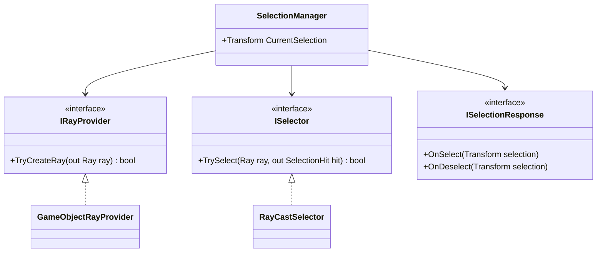

# Lab 10 Part B - Selecting Inventory Slots

## 1. Overview

You continue from the Part A scene. Pressing Tab opens the inventory: the cursor appears and the view stops turning. A second selection system, built from the same `SelectionManager` as the first, highlights the slot under the pointer, shows a tooltip, and uses a medkit when you click its slot, which frees room for the second medkit. The new ray provider and selector are only possible because `ISelector` now returns `SelectionHit` instead of a physics `RaycastHit`.

---

## 2. What You Will Learn

| Skill | You can... |
|:------|:-----------|
| Change controller state without editing it | Open and close the inventory by changing `StarterAssetsInputs` and the cursor |
| Write a new ray provider | Provide a pointer ray only while the cursor is unlocked |
| Write a non-physics selector | Select UI with `GraphicRaycaster` and return a `SelectionHit` |
| Reuse the selection pipeline | Run a second `SelectionManager` with UI responses and the existing `EventChannelSelectionResponse` |
| Diagnose a UI raycast with the debugger | Show which UI element is front-most under the pointer |
| Extend an interface's reach | Make a slot `IInteractable`, so the same `SelectionInteractor` uses items |

---

## 3. Before You Start

| Item | Check |
|:-----|:------|
| Part A | `SCN_Lab10_Inventory` works to the end of Part A: coins, medkits and key collect, and the hotbar updates |
| Upgraded interface | `Assets/GD/Common/Scripts/Selection/Selectors/SelectionHit.cs` exists, and `ISelector` uses `out SelectionHit hit` |
| Event System | The scene has an `EventSystem` object, which Unity added with the `HUD` canvas |
| Input actions | `Assets/InputSystem_Actions` contains `UI/Point` and `UI/Click` |
| Event channels | `Assets > Create > GD > Events > Game Object` exists |
| Reference copy | `Assets/GD/Common/Scripts/Inventory` and `Selection` hold a finished copy of the classes in this part, in other namespaces. Write your own in `Assets/Lab10/Scripts`, and compare with the copy after each Checkpoint |
| Notes | You have read [10 - Inventory Systems](../notes/10_inventory_systems.md), Sections 4.9 and 4.10 |

---

## 4. Plan

Complete the plan before Step 3.



Copy the diagram into `LabNotes.md` and complete it:

1. Add the UI implementations: `UnlockedPointerRayProvider`, `GraphicRaycastSelector`, `SlotHighlightResponse` and `EventChannelSelectionResponse`.
2. Add `SelectionInteractor` and `IInteractable`, with `InteractableItem` and `InventorySlotUI` (Step 6) both implementing it.
3. Explain in one sentence why `GraphicRaycastSelector` could not have implemented the first version of `ISelector`, which returned `out RaycastHit` (Note 10, Section 4.9).

---

## 5. Steps

### Step 1 - Open and Close the Inventory

This step frees the cursor and stops mouse look while the inventory is open. It changes the Starter Assets input rather than the controller (Note 09, Section 4.10). (10 min)

1. Create `Assets/Lab10/Scripts/InventoryToggle.cs`:

```csharp
using StarterAssets;
using UnityEngine;
using UnityEngine.InputSystem;

/// <summary>
/// Opens and closes the inventory: unlocks the cursor and stops mouse look while it is open.
/// Works through the Starter Assets input, so the controller is not edited.
/// </summary>
public class InventoryToggle : MonoBehaviour
{
    [SerializeField, Tooltip("The StarterAssetsInputs on the player")]
    private StarterAssetsInputs starterInputs;

    [SerializeField, Tooltip("Opens and closes the inventory. Owned by this component, so it is enabled here")]
    private InputAction toggleAction = new InputAction("ToggleInventory", InputActionType.Button, "<Keyboard>/tab");

    private bool isOpen;

    public bool IsOpen => isOpen;

    private void Awake()
    {
        if (starterInputs == null)
        {
            Debug.LogError($"{name}: InventoryToggle needs the player's StarterAssetsInputs.", this);
            enabled = false;
        }
    }

    private void OnEnable()
    {
        toggleAction.Enable();
    }

    private void OnDisable()
    {
        toggleAction.Disable();
    }

    private void Update()
    {
        if (toggleAction.WasPressedThisFrame())
            SetOpen(!isOpen);
    }

    public void SetOpen(bool open)
    {
        isOpen = open;

        // StarterAssetsInputs re-applies cursorLocked when the window regains focus, so keep it in step.
        starterInputs.cursorLocked = !open;

        // While false, StarterAssetsInputs ignores mouse look; clearing look stops the last value turning the view.
        starterInputs.cursorInputForLook = !open;
        if (open)
            starterInputs.LookInput(Vector2.zero);

        Cursor.lockState = open ? CursorLockMode.None : CursorLockMode.Locked;
        Cursor.visible = open;
    }
}
```

2. Add `InventoryToggle` to `HUD`. Set `Starter Inputs` to `PlayerCapsule`.
3. Press Play. Press Tab, move the mouse, then press Tab again.

**Record:** `toggleAction` is an `InputAction` field, not an `InputActionReference` to the project's actions asset. What does that cost and gain? Who must enable it?

**Checkpoint:** after the first Tab, the cursor appears and moving the mouse does not turn the view; WASD still moves. After the second Tab, the cursor is hidden and the mouse turns the view again. `FirstPersonController.cs` and `StarterAssetsInputs.cs` are unchanged.

### Step 2 - Write the UI Ray Provider and Selector

This step writes the two new pipeline parts. The provider only offers a ray while the cursor is free; the selector returns the front-most tagged UI element as a `SelectionHit`. (15 min)

1. Create `Assets/Lab10/Scripts/UnlockedPointerRayProvider.cs`:

```csharp
using GD;
using UnityEngine;
using UnityEngine.InputSystem;

/// <summary>
/// Provides a ray from the camera through the pointer, but only while the cursor is unlocked,
/// for example while an inventory is open. While the cursor is locked, it provides no ray,
/// so nothing is selected.
/// </summary>
public class UnlockedPointerRayProvider : MonoBehaviour, IRayProvider
{
    [SerializeField, Tooltip("Camera used to create the ray. Defaults to Camera.main if left empty")]
    private Camera viewCamera;

    [SerializeField, Tooltip("A Vector2 screen position action, for example UI/Point in InputSystem_Actions")]
    private InputActionReference pointAction;

    private void Awake()
    {
        if (viewCamera == null)
            viewCamera = Camera.main;

        if (viewCamera == null || pointAction == null)
            Debug.LogError($"{name}: UnlockedPointerRayProvider needs a camera and a point action.", this);
    }

    private void OnEnable()
    {
        // The UI input module shares this action, so this component enables it but never disables it.
        if (pointAction != null)
            pointAction.action.Enable();
    }

    public bool TryCreateRay(out Ray ray)
    {
        // A locked cursor means first person look is active, so the UI is not being pointed at.
        if (Cursor.lockState == CursorLockMode.Locked || viewCamera == null || pointAction == null)
        {
            ray = default;
            return false;
        }

        Vector2 screenPosition = pointAction.action.ReadValue<Vector2>();
        ray = viewCamera.ScreenPointToRay(screenPosition);
        return true;
    }
}
```

2. Create `Assets/Lab10/Scripts/GraphicRaycastSelector.cs`:

```csharp
using System.Collections.Generic;
using GD;
using UnityEngine;
using UnityEngine.EventSystems;
using UnityEngine.UI;

/// <summary>
/// Selects the front-most UI element under the ray, if it carries the selectable tag.
/// The UI equivalent of RayCastSelector.
/// </summary>
public class GraphicRaycastSelector : MonoBehaviour, ISelector
{
    [SerializeField, Tooltip("The GraphicRaycaster on the canvas to search")]
    private GraphicRaycaster raycaster;

    [SerializeField, Tooltip("The camera the ray comes from. Defaults to Camera.main if left empty")]
    private Camera viewCamera;

    [SerializeField, Tooltip("Tag used by selectable UI elements")]
    private string selectableTag = "Selectable";

    // Reused every frame, so selection creates no garbage.
    private readonly List<RaycastResult> results = new List<RaycastResult>();
    private PointerEventData pointerData;

    private void Awake()
    {
        if (viewCamera == null)
            viewCamera = Camera.main;

        if (raycaster == null || viewCamera == null)
        {
            Debug.LogError($"{name}: GraphicRaycastSelector needs a GraphicRaycaster and a camera.", this);
            enabled = false;
        }
    }

    public bool TrySelect(Ray ray, out SelectionHit hit)
    {
        hit = default;

        if (!enabled || EventSystem.current == null)
            return false;

        pointerData ??= new PointerEventData(EventSystem.current);

        // The ray starts on the camera's near plane under the pointer, so projecting
        // its origin back to the screen gives the pointer position the UI needs.
        pointerData.position = viewCamera.WorldToScreenPoint(ray.origin);

        results.Clear();
        raycaster.Raycast(pointerData, results);

        if (results.Count == 0)
            return false;

        // Only the front-most element counts, so a window or tooltip over a slot blocks it.
        GameObject front = results[0].gameObject;
        if (!front.CompareTag(selectableTag))
            return false;

        hit = new SelectionHit(front.transform, results[0].worldPosition, results[0].worldNormal, results[0].distance);
        return true;
    }
}
```

**Record:** `GraphicRaycastSelector` turns a `Ray` back into a screen position. Is that a sign that `IRayProvider` is also shaped around 3D? Answer in two sentences using Note 10, Section 4.10.

**Checkpoint:** the project compiles with no errors.

### Step 3 - Assemble the UI Selection Pipeline

This step builds the second selection system from the new parts, a new highlight response and the unchanged `SelectionManager`. (10 min)

1. Create `Assets/Lab10/Scripts/SlotHighlightResponse.cs`:

```csharp
using GD;
using UnityEngine;
using UnityEngine.UI;

/// <summary>
/// Tints the selected slot's Image, and restores its colour when it is deselected.
/// The UI equivalent of HighlightSelectionResponse, which swaps a Renderer's material.
/// </summary>
public class SlotHighlightResponse : MonoBehaviour, ISelectionResponse
{
    [SerializeField] private Color highlightColour = new Color(1f, 0.85f, 0.3f);

    // The image currently tinted, and the colour it had before.
    private Image highlightedImage;
    private Color originalColour;

    public void OnSelect(Transform selection)
    {
        if (!selection.TryGetComponent(out Image image))
            return;

        highlightedImage = image;
        originalColour = image.color;
        image.color = highlightColour;
    }

    public void OnDeselect(Transform selection)
    {
        if (highlightedImage != null)
            highlightedImage.color = originalColour;

        highlightedImage = null;
    }
}
```

2. Tag `Slot_Coin`, `Slot_Medkit` and `Slot_Key` as `Selectable`. Tag only the slots, not their children.
3. Add an empty GameObject named `UISelection` and add, in this order:
   - `UnlockedPointerRayProvider`: leave `View Camera` empty; set `Point Action` to `UI/Point`.
   - `GraphicRaycastSelector`: set `Raycaster` to the `HUD` canvas, which has the `Graphic Raycaster` component.
   - `SlotHighlightResponse`.
   - `SelectionManager`.
4. Press Play. Press Tab and move the pointer over each slot.

**Checkpoint:** no slot highlights, and the Console shows no errors. Moving over the slots with the inventory closed also does nothing. Step 4 finds the cause.

### Step 4 - Diagnose the UI Raycast with the Debugger

This step finds why a tagged slot under the pointer is never selected. (10 min)

**Hypothesis:** the slot's `Icon` child is drawn on top of the slot and is also a raycast target, so it is the front-most result. It is not tagged, so `GraphicRaycastSelector` rejects it, and the slot behind it is never tested.

1. Switch the Editor to debug mode and attach your IDE.
2. Choose where to place a breakpoint in `GraphicRaycastSelector.TrySelect` so that you can see every UI element under the pointer before the tag test. Place it, but disable it until the inventory is open, because `TrySelect` runs every frame.
3. Press Play, press Tab, hold the pointer over `Slot_Medkit`, then enable the breakpoint. Inspect `results.Count` and the `gameObject.name` of each entry in `results`.

**Record:** the number of results and the name of each, in order. Which element is front-most, and does the evidence support the hypothesis? What would change if the selector tested every result instead of only the first, and why is testing only the first the better rule for a mouse?

4. Remove the breakpoint, detach the debugger and switch back to release mode.
5. On each slot's `Icon` and `Count` children, untick `Raycast Target`: on the `Image` component for `Icon`, and under `Extra Settings` on the TextMeshPro component for `Count`.
6. Press Play, press Tab and move over the slots again.

**Checkpoint:** before the fix, the debugger shows `Icon` as the first result and `Slot_Medkit` after it. After the fix, each slot tints gold while the pointer is over it and returns to grey when the pointer leaves. With the inventory closed, no slot highlights.

### Step 5 - Show a Tooltip Through an Event Channel

This step reuses `EventChannelSelectionResponse` from `Common` unchanged: the same response that announced world selection in Lab 6 now announces slot selection. (10 min)

1. Create `Assets/Lab10/Scripts/ItemTooltip.cs`:

```csharp
using TMPro;
using UnityEngine;

/// <summary>
/// Shows the name and count of the slot under the pointer. Called by GameObjectEventChannelListeners.
/// </summary>
[RequireComponent(typeof(TMP_Text))]
public class ItemTooltip : MonoBehaviour
{
    private TMP_Text label;

    private void Awake()
    {
        label = GetComponent<TMP_Text>();
        label.text = string.Empty;
    }

    public void Show(GameObject slotObject)
    {
        if (!slotObject.TryGetComponent(out InventorySlotUI slot))
            return;

        label.text = $"{slot.Item.DisplayName} ({slot.Count}/{slot.Item.MaxStack})";
    }

    // The parameter is unused, but it lets a GameObjectEventChannelListener call this method.
    public void Clear(GameObject slotObject)
    {
        label.text = string.Empty;
    }
}
```

2. In `Assets/Lab10/Data/Events/`, create two `GD > Events > Game Object` assets, `SlotSelected` and `SlotDeselected`. Fill in each `Description`.
3. Add `EventChannelSelectionResponse` to `UISelection`. Set `Selected` to `SlotSelected` and `Deselected` to `SlotDeselected`.
4. Under `HUD`, add a `Text - TextMeshPro` named `Tooltip`, anchored to the bottom centre, `Pos Y` 140, `Font Size` 24, centred. Untick its `Raycast Target`. Add `ItemTooltip` to it.
5. Add two `GameObjectEventChannelListener` components to `HUD`: one with `Channel` `SlotSelected` calling the dynamic `ItemTooltip.Show` on `Tooltip`, the other with `Channel` `SlotDeselected` calling the dynamic `ItemTooltip.Clear`.
6. Press Play, collect a coin and the key, press Tab and move over each slot.

**Record:** you did not write a new response for the tooltip. Which class from `Common` did the work, and which SOLID principle let it work for UI with no change?

**Checkpoint:** over the coin slot the tooltip reads `Coin (1/5)`, over the key slot `Key (1/1)`, and it clears when the pointer leaves the hotbar.

### Step 6 - Use a Medkit from Its Slot

This step makes a slot `IInteractable`, so the same `SelectionInteractor` that collects items in the level uses them in the UI. The use request goes to the inventory through a channel. (10 min)

1. Replace `Assets/Lab10/Scripts/InventorySlotUI.cs` with this version, which adds `IInteractable` and a use request:

```csharp
using TMPro;
using UnityEngine;
using UnityEngine.UI;

/// <summary>
/// One inventory slot, pre-assigned to an item in the Inspector. Shows the item's icon and count,
/// and asks the inventory to use one when it is interacted with. Holds no inventory state of its own.
/// </summary>
public class InventorySlotUI : MonoBehaviour, IInteractable
{
    [SerializeField, Tooltip("The item this slot shows")]
    private ItemDefinition item;

    [SerializeField] private Image icon;
    [SerializeField] private TMP_Text countLabel;

    [SerializeField, Range(0f, 1f), Tooltip("Icon opacity while the player has none of the item")]
    private float emptyAlpha = 0.25f;

    [SerializeField, Tooltip("Raised to ask the inventory to use one of this item. Leave empty if the item cannot be used")]
    private ItemRequestEventChannel useRequested;

    public ItemDefinition Item => item;

    public int Count { get; private set; }

    private void Awake()
    {
        if (item == null || icon == null || countLabel == null)
        {
            Debug.LogError($"{name}: InventorySlotUI needs an item, an icon and a count label.", this);
            enabled = false;
            return;
        }

        icon.sprite = item.Icon;
        SetCount(0);
    }

    public void SetCount(int count)
    {
        Count = count;

        Color colour = item.Colour;
        colour.a = count > 0 ? 1f : emptyAlpha;
        icon.color = colour;

        countLabel.text = count > 0 ? count.ToString() : string.Empty;
    }

    public void Interact(GameObject interactor)
    {
        // The slot only asks; the inventory decides whether there is one to use.
        if (useRequested == null || Count == 0)
            return;

        useRequested.Raise(new ItemRequest(item, 1, interactor));
    }
}
```

2. In `Assets/Lab10/Data/Events/`, create an `Inventory > Events > Item Request` asset named `UseRequested`. Tick `Log Raises`.
3. On `Slot_Medkit`, set `Use Requested` to `UseRequested`. Leave it empty on `Slot_Coin` and `Slot_Key`, because they cannot be used.
4. On `Inventory`, add a second `ItemRequestEventChannelListener`: `Channel` is `UseRequested`; in `Response`, choose `Inventory` and the dynamic `InventoryManager.HandleUseRequest`.
5. On `UISelection`, add `SelectionInteractor`. Set `Interact Action` to `UI/Click` and `Interactor` to `PlayerCapsule`.
6. Press Play. Collect `Medkit_A`, then try `Medkit_B`. Press Tab, click the medkit slot, press Tab again, and collect `Medkit_B`.

<!-- IMAGE: screenshot "../images/labs/lab_10b_step_6.png" - Game view during Play with the inventory open: cursor visible over Slot_Medkit, the slot tinted gold, the tooltip above the hotbar reading "Medkit (1/1)", and the coin and key slots filled. Beside it, the Inspector for UISelection showing UnlockedPointerRayProvider, GraphicRaycastSelector, SlotHighlightResponse, EventChannelSelectionResponse, SelectionManager and SelectionInteractor with UI/Click. -->

**Record:** the log lines when you click the medkit slot, in order. Which existing classes did this step reuse without change, and which did it change?

**Checkpoint:** `Medkit_B` is refused while the player holds a medkit. Clicking the medkit slot with the inventory open logs `[UseRequested]` and `[ItemCountChanged]`, and the slot fades. After closing the inventory, `Medkit_B` can be collected. Clicking the coin or key slot does nothing.

---

## 6. Debugging and Pitfalls

| Symptom | Likely cause | How to confirm | Fix |
|:--------|:-------------|:---------------|:----|
| A channel asset or a selector, provider or response does not fit a field in your script, or editing your script changes nothing in Play | The asset or component uses the finished copy in `Assets/GD/Common`, which has the same class name as yours. Its assets are under `Create > GD > Inventory` | Double-click the `Script` field of the asset or component: it opens a file in `Assets/GD/Common` | Create assets from `Create > Inventory`, and add components by dragging your script from `Assets/Lab10/Scripts` |
| Compile error naming `TrySelect` and `RaycastHit` | Your project still has the old `ISelector` | Open `ISelector.cs` | Update `Common` to the version with `SelectionHit` |
| Tab does nothing | `InventoryToggle` has no `Starter Inputs`, so it disabled itself | Read the Console error | Set `Starter Inputs` to `PlayerCapsule` |
| The view still turns with the inventory open | `cursorInputForLook` not cleared, or look not reset | Breakpoint in `SetOpen`; step over each line | Use `SetOpen` as given |
| The cursor locks again after clicking another window | `cursorLocked` was not cleared, so `OnApplicationFocus` re-locked it | Click away and back with the inventory open | Keep the `cursorLocked` line |
| No slot ever highlights | Children are raycast targets in front of the slot | Step 4 | Untick `Raycast Target` on `Icon` and `Count` |
| No slot highlights and no results at all | `Raycaster` is not the `HUD` canvas, or there is no `EventSystem` | Breakpoint; `results.Count` is 0 | Assign the canvas; add `UI > Event System` |
| Slots highlight with the inventory closed | The provider ignores the cursor state | Read which provider is on `UISelection` | Use `UnlockedPointerRayProvider` |
| The tooltip hides a slot as the pointer reaches it | The tooltip is a raycast target in front of the slot | The debugger shows `Tooltip` first in `results` | Untick its `Raycast Target` |
| Clicking a slot does nothing | `SelectionInteractor` is missing from `UISelection`, or `Use Requested` is empty on the slot | Breakpoint in `InventorySlotUI.Interact` | Step 6, items 3 and 5 |
| Clicking a slot logs `[UseRequested]` but the count does not change | The use listener on `Inventory` is missing or calls `HandleCollectRequest` | Read the listener | Call the dynamic `HandleUseRequest` |

---

## 7. Production Checklist

| Requirement | Done |
|:------------|:-----|
| Tab opens and closes the inventory, freeing the cursor and stopping mouse look, with no edit to the Starter Assets | |
| `UISelection` uses `SelectionManager` unchanged, with `UnlockedPointerRayProvider` and `GraphicRaycastSelector` | |
| `GraphicRaycastSelector` returns a `SelectionHit` built from a UI raycast result | |
| Slots highlight only while the inventory is open, and debugger evidence for Step 4 is recorded | |
| The tooltip is driven by `EventChannelSelectionResponse` from `Common` and two `GameObjectEventChannelListener` components | |
| Clicking the medkit slot uses one medkit through `UseRequested`, and the second medkit can then be collected | |
| The completed Plan diagram shows both pipelines' parts and every `IInteractable` | |
| No file in `Assets/GD/Common` or `Assets/ThirdParty` was edited in this part | |

---

## 8. Extension

### Stretch - Keyboard and Gamepad Slot Selection

Some players will not use a mouse. With the inventory open, the left and right arrow keys, or the gamepad's d-pad, should move a selection along the hotbar, and the same `SlotHighlightResponse`, tooltip and `SelectionInteractor` should work.

`SelectionManager` asks a provider for a ray and a selector for a hit, so a pointer is not required by the design. Write the parts you need without editing `SelectionManager`. One route is an `IRayProvider` that aims at the screen position of the current slot, which the arrow keys change. You may find a better one, for example a selector that ignores the ray.

**Expected result:** the arrow keys move the highlight along the slots, the tooltip follows, and Enter or the gamepad's south button uses a medkit. In `LabNotes.md`, explain in 100 to 150 words which roles your new classes fill, and whether the design is honest to the contracts of `IRayProvider` and `ISelector`.

---

## 9. Reflective Questions

1. The `ISelector` upgrade let `GraphicRaycastSelector` exist. Name the principle the old interface broke, and explain how you could have spotted the problem when the interface was first written.
2. `UnlockedPointerRayProvider` reads `Cursor.lockState` rather than being told by `InventoryToggle` that the inventory is open. What does that gain, and what would break if another system locked the cursor for a different reason?
3. You reused `EventChannelSelectionResponse`, `SelectionManager` and `SelectionInteractor` in a context their authors did not plan for. What made that possible?
4. The tooltip shows the count when the pointer arrives, but does not update if the count changes while it is shown. Which channel would fix that, and should the tooltip listen to it?
5. uGUI's `IPointerEnterHandler` and `IPointerClickHandler` could have done this part with less code. When would you choose them instead of the selection pipeline in your group's project?

---

## 10. How This Builds

- **Note 11 - Interpolation, Easing and Tweening** explains the easing you could use to replace the instant slot tint and count change, inside `SlotHighlightResponse` and `InventorySlotUI`.
- **Note 15 - Orchestration and Game Flow** pauses and resumes player control during gameplay sequences.
- **GCA - C# & Software Design - Software Design** and **Iteration & Improvement:** the `ISelector` upgrade, with the `RaycastHit` version as the "before" and two selection pipelines as the "after", is a model of the before-and-after evidence to collect for your own project.

**Group project task (take-home).** List every interface in your group's project. For each one, check whether any method signature uses a type that belongs to one implementation, such as a physics, UI or networking type. If you find one, record what a second implementation would need, and whether the interface should change now or when that implementation arrives.
