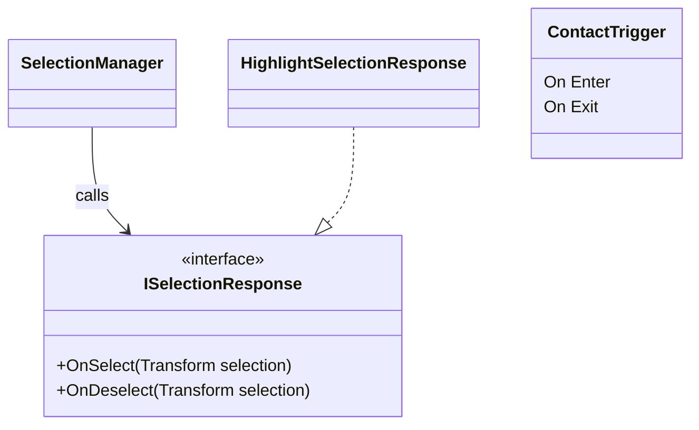
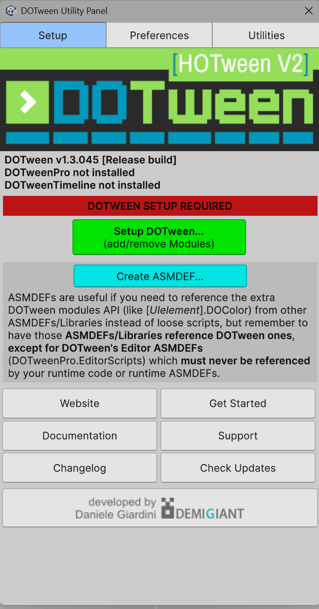
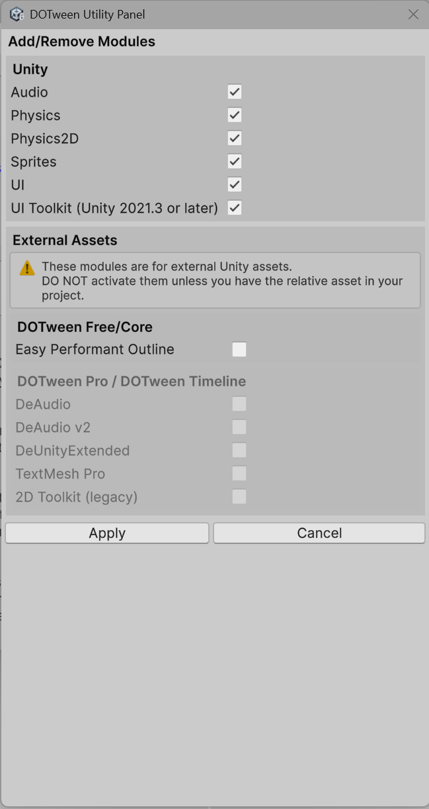

# Lab 11 - Eased Selection and a Tweened Door

## 1. Overview

You measure why a common smoothing line changes with frame rate, then fix it. You then turn two instant interactions into deliberate ones: crates that ease when you look at them, and a door that slides open as you approach. Both use DOTween, take their timing from reusable assets, and need no edits to `Assets/GD/Common`. The lab takes about 75 minutes.

---

## 2. What You Will Learn

| Skill | You can... |
|:------|:-----------|
| Measure frame-rate dependence | Show different arrival times from the same smoothing line at 20 and 60 FPS |
| Confirm a cause with the debugger | Inspect the `t` passed to `Lerp` and explain the difference |
| Create and manage tweens | Start a DOTween tween, kill it on interruption and link it to its object |
| Fix an interruption bug | Stop an object growing when it is selected repeatedly |
| Move timing into data | Create `TweenProfile` assets and tune feel with no code change |
| Extend through existing extension points | Add behaviour through `ISelectionResponse` and `ContactTrigger` events |

---

## 3. Before You Start

| Item | Check |
|:-----|:------|
| Unity version | 6000.6.3f1 with URP 17.6.0 |
| Common code | `Assets/GD/Common/Scripts/Triggers/ContactTrigger.cs` has an `On Exit` event, and `Selection` contains `SelectionManager` |
| Starter Assets | `Assets/ThirdParty/Scripts/Controllers/Runtime/FirstPersonController/Prefabs` contains `PlayerCapsule`, `PlayerFollowCamera` and `MainCamera` |
| DOTween | `Assets/Plugins/Demigiant/DOTween` exists; you update and set it up in Step 1 |
| Tags | `Selectable` and `Player` exist under `Edit > Project Settings > Tags and Layers` |
| Debugger | You can attach your IDE to the Unity Editor and switch the Editor to debug mode ([Notes 01](../notes/01_unity_foundations.md), Section 4.9) |
| Reference copy | `Assets/GD/Common/Scripts/Selection/Responses/TweenScaleSelectionResponse.cs` is a finished copy of the response in Step 5, in the `GD` namespace. Write your own in `Assets/Lab11/Scripts`, and compare after the Checkpoint |
| Notes | You have read [11 - Interpolation, Easing and Tweening](../notes/11_interpolation_easing_tweening.md), Sections 3 to 4.10 |

---

## 4. Plan

Complete the plan before Step 4.



Copy the diagram into `LabNotes.md` and complete it:

1. Add `TweenProfile` from `Assets/GD/Common` (Step 4), with what it applies to.
2. Add `TweenScaleSelectionResponse` (Step 5), with the interface it implements and the asset it uses.
3. Add `TweenDoor` (Step 7), with an arrow from `ContactTrigger` labelled with each event.
4. Circle every class that already existed. None of them should need an edit. Say why, using the open/closed principle.

---

## 5. Steps

### Step 1 - Update and Set Up DOTween

DOTween is already installed in the project, under `Assets/Plugins/Demigiant/DOTween`. You still need to check for updates and run its setup, because the setup activates the modules that provide shortcuts such as `DOFade`, and it must be run again after any update. (5 min)

1. Pull the latest version of the repository and open the project.
2. Open `Tools > Demigiant > DOTween Utility Panel`. Click `Check Updates`. If a newer version is listed, update using the download link, then reopen the panel.
3. If the panel shows a red `DOTWEEN SETUP REQUIRED` banner, click `Setup DOTween...`. Run the setup again after any update, even if the banner has gone.

<p align="center">
  
</p>

4. In `Add/Remove Modules`, keep every module under `Unity` ticked: `Audio`, `Physics`, `Physics2D`, `Sprites`, `UI` and `UI Toolkit`. Leave everything under `External Assets` unticked, because those modules need assets this project does not have. Click `Apply`.

<p align="center">
  
</p>

5. Open `Tools > GD > Setup > Create Project Folders`. Set `Project Folder` to `Lab11`, choose `Project assets only` and click `Create Folders`.

**Checkpoint:** the panel no longer shows the red banner, the Console has no errors, and a test script with `using DG.Tweening;` compiles.

### Step 2 - Build the Scene

This step builds a small room with a first person player, three selectable crates and a doorway. Selection starts with the instant highlight, as the baseline to improve. (10 min)

1. Create a new scene and save it as `Assets/Lab11/Scenes/SCN_Lab11_Tweens.unity`. Delete `Main Camera`.
2. Create these objects, applying materials from `GD/Common/Materials`:

| Object | Type | Position | Scale | Notes |
|:--|:--|:--|:--|:--|
| `Ground` | Plane | (0, 0, 0) | (3, 1, 3) | |
| `Crate_A` | Cube | (-3, 0.5, 4) | (1, 1, 1) | Tag `Selectable` |
| `Crate_B` | Cube | (-1.8, 0.5, 4) | (1, 1, 1) | Tag `Selectable` |
| `Crate_C` | Cube | (2.5, 0.5, 4) | (1, 1, 1) | Tag `Selectable` |
| `Wall_Left` | Cube | (-4, 1.5, 8) | (6, 3, 0.5) | |
| `Wall_Right` | Cube | (4, 1.5, 8) | (6, 3, 0.5) | |
| `Door` | Cube | (0, 1.5, 8) | (2, 3, 0.5) | |

3. From the first person `Prefabs` folder, drag in `MainCamera`, `PlayerFollowCamera` and `PlayerCapsule`. Set `PlayerCapsule` to `Position` (0, 0, 0). Set `Tracking Target` on `PlayerFollowCamera` to `PlayerCameraRoot`, a child of `PlayerCapsule`.
4. Create an empty `SelectionSystem` and add `Game Object Ray Provider`, `Ray Cast Selector`, `Selection Manager` and `Highlight Selection Response`. Set the provider's `Target` to `MainCamera`, and the response's `Highlight Material` to `Yellow`.
5. Press Play. Walk around and look at each crate.

**Checkpoint:** each crate turns yellow on the frame you look at it and changes back on the frame you look away. The door blocks the doorway.

### Step 3 - Measure Frame-Rate Dependent Smoothing

This step shows the problem in Note 11, Section 4.2, with your own measurements. (15 min)

1. Create `Assets/Lab11/Scripts/SmoothingComparison.cs`:

```csharp
using UnityEngine;

/// <summary>
/// Moves two cubes the same distance, one with frame-rate dependent smoothing and one
/// without, and logs when each has covered 95% of the distance.
/// </summary>
public class SmoothingComparison : MonoBehaviour
{
    private const float ArrivalFraction = 0.95f;

    [SerializeField] private Transform naiveCube;
    [SerializeField] private Transform correctedCube;

    [SerializeField, Min(1), Tooltip("Frame rate to request. Change it during Play")]
    private int targetFrameRate = 60;

    [SerializeField, Min(0.1f), Tooltip("Smoothing rate used by both cubes")]
    private float rate = 20f;

    [SerializeField, Min(0.1f), Tooltip("Metres each cube travels")]
    private float distance = 10f;

    [SerializeField, Min(0.1f), Tooltip("Seconds before the run restarts")]
    private float runLength = 1.5f;

    private Vector3 naiveStart;
    private Vector3 correctedStart;
    private float naiveValue;
    private float correctedValue;
    private float elapsed;
    private float naiveArrival;
    private float correctedArrival;
    private int originalVSyncCount;

    private void Awake()
    {
        naiveStart = naiveCube.position;
        correctedStart = correctedCube.position;
        BeginRun();
    }

    private void OnEnable()
    {
        // VSync overrides targetFrameRate, so switch it off while this test runs.
        originalVSyncCount = QualitySettings.vSyncCount;
        QualitySettings.vSyncCount = 0;
    }

    private void OnDisable()
    {
        QualitySettings.vSyncCount = originalVSyncCount;
        Application.targetFrameRate = -1;
    }

    private void Update()
    {
        Application.targetFrameRate = targetFrameRate;

        float deltaTime = Time.deltaTime;
        elapsed += deltaTime;

        float naiveT = rate * deltaTime;
        float correctedT = 1f - Mathf.Exp(-rate * deltaTime);

        naiveValue = Mathf.Lerp(naiveValue, distance, naiveT);
        correctedValue = Mathf.Lerp(correctedValue, distance, correctedT);

        naiveCube.position = naiveStart + Vector3.right * naiveValue;
        correctedCube.position = correctedStart + Vector3.right * correctedValue;

        if (naiveArrival < 0f && naiveValue >= distance * ArrivalFraction)
            naiveArrival = elapsed;

        if (correctedArrival < 0f && correctedValue >= distance * ArrivalFraction)
            correctedArrival = elapsed;

        if (elapsed >= runLength)
        {
            Debug.Log($"{targetFrameRate} FPS: naive {naiveArrival:F3} s, corrected {correctedArrival:F3} s", this);
            BeginRun();
        }
    }

    private void BeginRun()
    {
        naiveValue = 0f;
        correctedValue = 0f;
        elapsed = 0f;
        naiveArrival = -1f;
        correctedArrival = -1f;
    }
}
```

2. Create two cubes named `Cube_Naive` at (-5, 0.5, 6) and `Cube_Corrected` at (-5, 1.7, 6). Remove each cube's `Box Collider`, so they cannot hit the player.
3. Create an empty `SmoothingTest`, add `SmoothingComparison` and assign both cubes.
4. Press Play. Ignore the first log line, which includes start-up time. Read the Console at a `Target Frame Rate` of 60, then change it to 20 during Play.

**Hypothesis:** at 20 FPS with `Rate` 20, `naiveT` reaches 1, so the naive cube arrives in a single frame.

5. Switch the Editor to debug mode and attach your IDE. Choose where to place a breakpoint so that you can read `naiveT` and `correctedT`. Run at 20 FPS. Read the values at the first hit, because time spent paused affects later frames.
6. Remove the breakpoint, stop Play mode, detach the debugger, and switch back to release mode.

**Record:** both arrival times at both frame rates, and both `t` values at 20 FPS. Does the evidence support the hypothesis? Explain why `correctedT` is lower than `naiveT`, using Note 11, Section 4.2.

7. Disable `SmoothingTest`, so that it stops changing the frame rate during later steps.

**Checkpoint:** the corrected cube takes about 0.15 s at both frame rates. The naive cube takes about 0.13 s at 60 FPS and about 0.05 s at 20 FPS. At 20 FPS, `naiveT` is about 1 and `correctedT` about 0.63. Times vary slightly with your machine's actual frame rate.

### Step 4 - Create Tween Profiles

This step moves timing into assets before any tween needs it, so you never hardcode a duration. `TweenProfile` is already in `Assets/GD/Common`. (5 min)

1. Open `Assets/GD/Common/Scripts/ScriptableObjects/Types/Tweens/TweenProfile.cs` and read `Apply`. Compare it with Note 11, Section 4.10.
2. In `Assets/Lab11/Data`, use `Create > GD > Tweens > Tween Profile` to create these assets:

| Asset | `Duration` | `Ease` |
|:--|:--|:--|
| `TP_SelectPop` | 0.25 | `OutBack` |
| `TP_SelectReturn` | 0.15 | `OutCubic` |
| `TP_DoorOpen` | 0.6 | `OutCubic` |
| `TP_DoorClose` | 0.9 | `InOutSine` |

**Checkpoint:** the four assets exist, and each shows its values in the Inspector.

### Step 5 - Add a Naive Eased Response

This step adds an eased scale as a new response, and then shows why a first version is not enough. (10 min)

1. Create `Assets/Lab11/Scripts/TweenScaleSelectionResponse.cs`:

```csharp
using DG.Tweening;
using GD;
using GD.Types;
using UnityEngine;

/// <summary>
/// Eases each selected object to a larger scale and back again.
/// </summary>
public class TweenScaleSelectionResponse : MonoBehaviour, ISelectionResponse
{
    [SerializeField, Min(0f), Tooltip("Multiple of the object's resting scale when selected")]
    private float selectedScale = 1.2f;

    [SerializeField] private TweenProfile selectProfile;
    [SerializeField] private TweenProfile deselectProfile;

    private Vector3 restingScale;

    public void OnSelect(Transform selection)
    {
        restingScale = selection.localScale;
        selectProfile.Apply(selection.DOScale(restingScale * selectedScale, selectProfile.Duration));
    }

    public void OnDeselect(Transform selection)
    {
        deselectProfile.Apply(selection.DOScale(restingScale, deselectProfile.Duration));
    }
}
```

2. Add it to `SelectionSystem`, beside `Highlight Selection Response`. Assign `TP_SelectPop` and `TP_SelectReturn`.
3. Press Play. Look at a crate slowly, then look away slowly. Next, flick the view on and off `Crate_C` ten times, as fast as you can. Look away and compare it with `Crate_A`.

**Record:** which existing files did you edit to add this behaviour? Describe what happened to `Crate_C`. Which line reads the wrong value?

**Checkpoint:** a slow look pops the crate up and settles it back, and the yellow highlight still works. After the fast flicks, `Crate_C` is visibly the wrong size at rest.

### Step 6 - Fix Interruption

This step applies the two rules from Note 11, Section 4.8, and records each object's size once. (10 min)

1. Replace the contents of `TweenScaleSelectionResponse.cs`:

```csharp
using System.Collections.Generic;
using DG.Tweening;
using GD;
using GD.Types;
using UnityEngine;

/// <summary>
/// Eases each selected object to a larger scale and back again. Handles several objects
/// at once, and being interrupted halfway.
/// </summary>
public class TweenScaleSelectionResponse : MonoBehaviour, ISelectionResponse
{
    [SerializeField, Min(0f), Tooltip("Multiple of the object's resting scale when selected")]
    private float selectedScale = 1.2f;

    [SerializeField] private TweenProfile selectProfile;
    [SerializeField] private TweenProfile deselectProfile;

    // Each object's scale, recorded the first time it is selected, while it is at rest.
    private readonly Dictionary<Transform, Vector3> restingScales = new();

    public void OnSelect(Transform selection)
    {
        if (!restingScales.ContainsKey(selection))
            restingScales[selection] = selection.localScale;

        TweenScale(selection, restingScales[selection] * selectedScale, selectProfile);
    }

    public void OnDeselect(Transform selection)
    {
        if (restingScales.TryGetValue(selection, out Vector3 restingScale))
            TweenScale(selection, restingScale, deselectProfile);
    }

    private void TweenScale(Transform target, Vector3 scale, TweenProfile profile)
    {
        // Replace any running tween, so only one writes to this object's scale.
        target.DOKill();

        profile.Apply(target.DOScale(scale, profile.Duration))
            .SetLink(target.gameObject);
    }
}
```

2. Repeat the fast flicks on `Crate_C`. Then sweep the view directly from `Crate_A` to `Crate_B` and back.
3. Open `TP_SelectPop` during Play, and try `Duration` 0.5 with `Ease` `OutElastic`. Change it back afterwards, because asset changes made in Play mode persist.

**Checkpoint:** after any amount of flicking, every crate rests at scale (1, 1, 1). Sweeping across crates animates one up while the other returns. Changing the profile changes the feel with no compile.

### Step 7 - Add a Tweened Door

This step replaces an instant door with an eased one, wired to the `On Enter` and `On Exit` events of `ContactTrigger` in `Assets/GD/Common`. (10 min)

1. Create `Assets/Lab11/Scripts/TweenDoor.cs`:

```csharp
using DG.Tweening;
using GD.Types;
using UnityEngine;

/// <summary>
/// Slides this object between its closed position and an offset open position.
/// </summary>
public class TweenDoor : MonoBehaviour
{
    [SerializeField, Tooltip("Local movement from closed to fully open")]
    private Vector3 openOffset = new(0f, 3.2f, 0f);

    [SerializeField] private TweenProfile openProfile;
    [SerializeField] private TweenProfile closeProfile;

    private Vector3 closedPosition;

    private void Awake()
    {
        closedPosition = transform.localPosition;
    }

    public void Open()
    {
        MoveTo(closedPosition + openOffset, openProfile);
    }

    public void Close()
    {
        MoveTo(closedPosition, closeProfile);
    }

    private void MoveTo(Vector3 position, TweenProfile profile)
    {
        transform.DOKill();

        profile.Apply(transform.DOLocalMove(position, profile.Duration))
            .SetLink(gameObject);
    }
}
```

2. Add `TweenDoor` to `Door`. Assign `TP_DoorOpen` and `TP_DoorClose`.
3. Create an empty `DoorTrigger` at (0, 1.5, 8). Add a `Box Collider` with `Size` (4, 3, 6) and tick `Is Trigger`. Add `Contact Trigger` and set `Required Tag` to `Player`.
4. On `Contact Trigger`, wire `On Enter` to `TweenDoor.Open` and `On Exit` to `TweenDoor.Close` on `Door`.
5. Press Play. Walk through the doorway. Then walk in, and back out before the door finishes opening.

**Record:** why is the trigger larger than the door? What could go wrong if `Door` itself had the trigger collider? Compare the time taken by a door closing from fully open and from a quarter open. Is that acceptable in your game?

**Checkpoint:** the door starts opening before you reach it and settles at the top. It closes slowly once you leave. Reversing halfway makes it change direction from where it is, with no jump. `ContactTrigger.cs` is unchanged.

### Step 8 - Draw a Curve

This step uses a designer-drawn shape, with no code change, because `TweenProfile` already supports one. (5 min)

1. Open `TP_DoorClose`. Tick `Use Curve` and open the curve.
2. Shape it so that the door falls most of the way, overshoots slightly past 1 and settles back at 1, as if it landed with some weight.
3. Test it, and tune it until the door looks heavy.

**Record:** describe your curve and the `Duration` you ended on. Use the GIF tool at `Tools > GD > Evidence > GIF Capture` to record it with the earlier `InOutSine` setting, as a practice before-and-after.

**Checkpoint:** the door closes with your curve's overshoot, and no script changed.

---

## 6. Debugging and Pitfalls

| Symptom | Likely cause | How to confirm | Fix |
|:--------|:-------------|:---------------|:----|
| Editing your `TweenScaleSelectionResponse` changes nothing in Play | The component is the finished copy in `Assets/GD/Common/Scripts/Selection`, which has the same class name as yours, and `Add Component` lists both | Double-click the `Script` field of the component: it opens a file in `Assets/GD/Common` | Remove the component, then drag your script from `Assets/Lab11/Scripts` onto the object |
| `The type or namespace name 'DG' could not be found` | DOTween is missing from your copy of the project | Look for `Assets/Plugins/Demigiant` | Pull the latest repository, then repeat Step 1 |
| `DOFade` or another shortcut could not be found | The DOTween module providing it is not active | Open `Setup DOTween...` and check the module's tick box | Repeat Step 1 |
| The frame rate does not change in Step 3 | VSync still limits it, or `Game` view VSync is ticked | Watch `FPS` in the `Stats` panel | Untick VSync in the `Game` view toolbar |
| The crate never reacts | Its tag is not `Selectable`, or the provider's `Target` is empty | Breakpoint in `OnSelect` | Set the tag and `Target` |
| A crate ends at the wrong size | `OnSelect` reads a mid-tween scale | Log `restingScale` on each select | Use the Step 6 version |
| `NullReferenceException` in `OnSelect` or `MoveTo` | A profile field is empty | Click the error, then check the component | Assign the profile |
| The door never opens | `Required Tag` does not match, or `Is Trigger` is unticked | Breakpoint in `ContactTrigger.HandleContact` | `PlayerCapsule` is tagged `Player`; tick `Is Trigger` |
| The door opens but never closes | `On Exit` is not wired | Check the event list | Wire `TweenDoor.Close` |
| The door flies off upwards | `Open` adds to the current position | Log `closedPosition` | Keep `closedPosition` from `Awake` |
| Profile values changed after Play | Asset changes in Play mode persist | Compare them with the Step 4 table | Set them back |

---

## 7. Production Checklist

| Requirement | Done |
|:------------|:-----|
| `LabNotes.md` records arrival times at 20 and 60 FPS, and the debugger values for `t` | |
| `SmoothingTest` is disabled | |
| Crates ease up and down, and rest at scale (1, 1, 1) after repeated fast selection | |
| Sweeping between two crates animates both | |
| The door opens and closes from `ContactTrigger` events, and reverses with no jump | |
| All durations and easings come from `TweenProfile` assets, and at least one uses a curve | |
| No file in `Assets/ThirdParty` or `Assets/GD/Common` was edited | |
| The completed Plan diagram marks which classes already existed | |

---

## 8. Extension

### Stretch - Keep the Door's Speed When Reversing

A door a quarter of the way open still takes the whole `TP_DoorClose` duration to close, so it creeps. Change `TweenDoor` so that an interrupted move takes a duration in proportion to the distance left, without adding any timer of your own.

**Expected result:** reversing near the start of a move takes a fraction of the full duration, and a move from fully open or closed still takes the full duration. In `LabNotes.md`, explain in 80 to 120 words why you did or did not change `TweenProfile` to do this, using the single responsibility principle.

---

## 9. Reflective Questions

1. Step 3 showed the corrected line was slower than the naive one at 20 FPS. Which is "correct", and what are you tuning against when you choose a `rate`?
2. Step 5 and Step 6 ease the same scale. What specifically made the first version wrong, and why would a test with one slow look never find it?
3. `TweenDoor` has no idea what opens it. List two other things that could call `Open` with no change to the door, and justify this using the dependency inversion principle.
4. Your door moves its collider with a tween. What could this mean for a player standing under it as it closes? How would you test that?
5. You could have given each door its own duration field. When is a shared `TweenProfile` worth the extra asset, and when is a plain field the better choice?

---

## 10. How This Builds

- **Note 12 - Character Animation** gives a character animation events and asks when to use the Animator rather than a tween.
- **Note 15 - Orchestration and Game Flow** uses a tween as one step in a gameplay sequence.
- **GCA - Technical Craft** and **Iteration & Improvement:** Step 8's before-and-after is the form your evidence should take.

**Group project task (take-home).** Find one instant change in your group's game, such as a door, a pickup or a panel. Record it, ease it using a `TweenProfile`, and record it again. Add both captures and one sentence on why you chose that easing to your project log.
