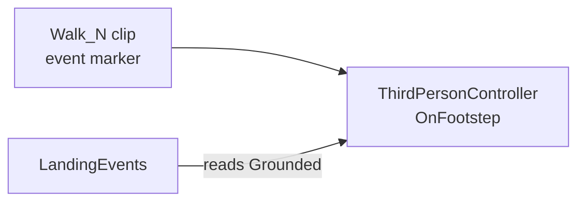

# Lab 12 - Extending the Third Person Animator

## 1. Overview

You copy the third person controller's Animator Controller, trace how code drives it, and connect its animation events to the rest of a game through event channels: dust on footsteps and landings, and a new event on the jump's push-off. You then add a stagger state that a hazard triggers, with no new script. Nothing in `Assets/ThirdParty` changes. The lab takes about 60 minutes.

---

## 2. What You Will Learn

| Skill | You can... |
|:------|:-----------|
| Change third-party animation safely | Assign a copied controller and clip to one character, leaving the originals as imported |
| Trace a parameter with the debugger | Match the value code sets to the value the Animator shows |
| Diagnose foot sliding | Find the speed at which the blend tree runs out, and describe the trade-off in fixing it |
| Extend through animation events | Receive `OnFootstep` in your own component alongside the controller |
| Add a new animation event | Mark a frame in a copied clip and raise a channel from it |
| Add a state with no code | Trigger a new state from a hazard, through `ContactTrigger` and event channels |

---

## 3. Before You Start

| Item | Check |
|:-----|:------|
| Unity version | 6000.6.3f1 with URP 17.6.0 |
| Starter Assets | `Assets/ThirdParty/Scripts/Controllers/Runtime/ThirdPersonController/Prefabs` contains `PlayerArmature`, `PlayerFollowCamera` and `MainCamera` |
| Common code | `Assets/GD/Common/Scripts` contains `Triggers/ContactTrigger.cs`, `Controllers/Character/LandingEvents.cs` and `ScriptableObjects/Types/Events/VoidEventChannel.cs` |
| Debugger | You can attach your IDE to the Unity Editor and switch the Editor to debug mode ([Notes 01](../notes/01_unity_foundations.md), Section 4.9) |
| Notes | You have read [12 - Character Animation](../notes/12_character_animation.md), Sections 3 to 4.8 |

---

## 4. Plan

Complete the plan before Step 4.



Copy the diagram into `LabNotes.md` and complete it:

1. Add `CharacterAnimationEvents` (Step 4), and show which clips call it.
2. Add the `Footstep`, `Landed` and `PushOff` channel assets, and an arrow from each object that raises each one.
3. Add one `VoidEventChannelListener`, which plays dust.
4. Add a second listener and a sound, and check that nothing else on your diagram has to change. This is the test of the design.

---

## 5. Steps

### Step 1 - Build the Scene and Copy the Controller

This step builds a small level, adds the third person character, and gives it its own copy of the Animator Controller, so that nothing you change affects the original. (10 min)

1. Open `Tools > GD > Setup > Create Project Folders`. Set `Project Folder` to `Lab12`, choose `Project assets only` and click `Create Folders`.
2. Create a new scene and save it as `Assets/Lab12/Scenes/SCN_Lab12_Animator.unity`. Delete `Main Camera`.
3. Create these objects, applying materials from `GD/Common/Materials`:

| Object | Type | Position | Scale |
|:--|:--|:--|:--|
| `Ground` | Plane | (0, 0, 0) | (3, 1, 3) |
| `Ledge` | Cube | (0, 0.5, 6) | (4, 1, 3) |
| `Hazard` | Cube | (6, 0.25, 4) | (2, 0.5, 2) |

4. From the third person `Prefabs` folder, drag in `MainCamera`, `PlayerFollowCamera` and `PlayerArmature`. Set `PlayerArmature` to `Position` (0, 0, 0). Set `Tracking Target` on `PlayerFollowCamera` to `PlayerCameraRoot`, a child of `PlayerArmature`.
5. In `Runtime/ThirdPersonController/Character/Animations`, select `StarterAssetsThirdPerson.controller` and press `Ctrl+D`. Move the copy to `Assets/Lab12/Animation` and name it `AC_Player`.
6. Assign `AC_Player` to the `Controller` field of the `Animator` on `PlayerArmature`.

<!-- IMAGE: screenshot "../images/labs/lab_12_step_1.png" - Two panels. Left: Project window showing AC_Player in Assets/Lab12/Animation. Right: Inspector for PlayerArmature, with the Animator component's Controller set to AC_Player, Avatar set, and Apply Root Motion unticked. -->

**Checkpoint:** in Play mode, the character walks, sprints, jumps and lands as it did in the Starter Assets, with footstep sounds. `Controller` on `PlayerArmature` is bold in the Inspector because it overrides the prefab.

### Step 2 - Trace a Parameter with the Debugger

This step confirms how the controller drives the Animator, by reading it from both sides. (10 min)

1. Select `PlayerArmature`, open `Window > Animation > Animator` and press Play. Dock it beside the `Game` view. Keep the `Parameters` tab open.
2. Walk, sprint, stop, jump and land. Watch the current state highlight, and the values of `Speed`, `Jump`, `Grounded` and `FreeFall`.

**Hypothesis:** at full walk, the `Speed` parameter equals `MoveSpeed` and the blend tree plays pure `Walk_N`. At a sprint, it equals `SprintSpeed`, which is below the `Run_N` threshold, so `Walk_N` is still partly mixed in.

3. Switch the Editor to debug mode and attach your IDE. In `ThirdPersonController.cs`, choose where to place a breakpoint so that you can read the value passed to the `Speed` parameter while sprinting. Do not change any code in this file.
4. Double-click `Idle Walk Run Blend` in the Animator window to see the blend tree's thresholds. Work out the mix at the sprint value you read.
5. Remove the breakpoint, stop Play mode, detach the debugger, and switch back to release mode.

**Record:** where you placed the breakpoint, the value you read at a full sprint, and your mix of `Walk_N` and `Run_N`. Does the evidence support the hypothesis? Use Note 12, Section 4.4.

**Checkpoint:** you read about 5.335 at a full sprint, which gives about 83% `Run_N` and 17% `Walk_N`. `ThirdPersonController.cs` is unchanged.

### Step 3 - Find Foot Sliding

This step finds what happens when movement speed passes what the clips were authored for, using only values you can change in the scene. (5 min)

1. On `Third Person Controller`, set `Sprint Speed` to 8 for this test. Press Play and sprint. Use the `Scene` view, close to the feet.
2. In `AC_Player`, select `Idle Walk Run Blend` and change the state's `Speed` from 1 to 1.33. Sprint again, then walk.
3. Set `Speed` back to 1, and `Sprint Speed` back to 5.335.

**Record:** what the feet did at a sprint of 8, and why the blend tree cannot fix it. What did the state's `Speed` of 1.33 improve, and what did it make worse?

**Checkpoint:** at a sprint of 8, the feet visibly slide. A `Speed` of 1.33 reduces this and also makes walking too quick. Both values are back to their defaults.

### Step 4 - Raise Channels from Footsteps and Landings

This step routes animation moments to channels, so that the character does not depend on what responds. It adds dust without editing the controller. (15 min)

1. In `Assets/Lab12/Data`, use `Create > GD > Events > Void` to create `EC_Footstep`, `EC_Landed`, `EC_PushOff` and `EC_PlayerHit`. Tick `Log Raises` on each for now.
2. Create `Assets/Lab12/Scripts/CharacterAnimationEvents.cs`:

```csharp
using GD.Types;
using UnityEngine;

/// <summary>
/// Turns animation events on this character into event channel raises, so other systems
/// can respond without depending on the character or its animations.
/// </summary>
[RequireComponent(typeof(Animator))]
public class CharacterAnimationEvents : MonoBehaviour
{
    [SerializeField, Tooltip("Raised when a foot lands")]
    private VoidEventChannel footstepChannel;

    [SerializeField, Tooltip("Raised when the character pushes off for a jump")]
    private VoidEventChannel pushOffChannel;

    [SerializeField, Range(0f, 1f), Tooltip("Blended clips below this weight do not raise footsteps")]
    private float minimumClipWeight = 0.5f;

    // Called by animation events in the walk and run clips. The controller has its
    // own method with this name, and both run.
    public void OnFootstep(AnimationEvent animationEvent)
    {
        if (footstepChannel != null && animationEvent.animatorClipInfo.weight > minimumClipWeight)
            footstepChannel.Raise();
    }

    // Called by an animation event you add to a copy of the jump clip.
    public void OnPushOff()
    {
        if (pushOffChannel != null)
            pushOffChannel.Raise();
    }
}
```

3. Add `CharacterAnimationEvents` to `PlayerArmature`, the same object as the `Animator`. Assign `EC_Footstep` and `EC_PushOff`.
4. Add `GD > Character > Landing Events` to `PlayerArmature`. Under `On Landed`, click `+`, drag in `EC_Landed` and choose `VoidEventChannel > Raise ()`.
5. Add a child to `PlayerArmature` with `Effects > Particle System`, named `Dust`, at local `Position` (0, 0.05, 0). Set it up as one small burst:
   - Main module: `Duration` 0.3, untick `Looping`, `Start Lifetime` 0.3, `Start Speed` 1, `Start Size` 0.15, untick `Play On Awake`.
   - `Emission`: `Rate over Time` 0; add one `Burst` with `Count` 6.
   - `Shape`: `Hemisphere` with `Radius` 0.2.
6. On `Dust`, add `Void Event Channel Listener`, with `Channel` set to `EC_Footstep`. Under `Response`, drag in `Dust` and choose `ParticleSystem > Play ()`. Add a second listener for `EC_Landed`, with the same response.

**Record:** which files did you edit? `OnFootstep` exists on two components on this object. Why do both run? What would your component need to change if your group added an enemy that hears footsteps?

**Checkpoint:** each footstep gives a small puff at the feet, with the controller's sound still playing. Landing from the ledge gives a puff. With `Log Raises` on, walking logs one `EC_Footstep` per step, and sprinting logs no doubled steps. Holding still logs nothing.

### Step 5 - Add a New Animation Event to a Copied Clip

This step adds an event at a frame you choose. Clips inside an FBX are read-only, so you work on a copy. (10 min)

1. In `Character/Animations`, expand `Jump--Jump.anim.fbx` and select the `JumpStart` clip inside it. Press `Ctrl+D`, move the copy to `Assets/Lab12/Animation` and name it `JumpStart_PushOff`.
2. In `AC_Player`, select the `JumpStart` state and set its `Motion` to `JumpStart_PushOff`.
3. With `PlayerArmature` selected, open `Window > Animation > Animation` and choose `JumpStart_PushOff` from the clip list. Scrub to the first frame where the feet start to leave the ground. Click `Add Event`, and set `Function` to `OnPushOff`.
4. Add a third `Void Event Channel Listener` on `Dust`, for `EC_PushOff`, with the same response.
5. Press Play. Jump on the spot and at a run. Press Space repeatedly while in the air.

**Record:** the frame you chose, and why. Why can pressing Space in the air not cause this dust, when a component watching `input.jump` could?

<!-- IMAGE: screenshot "../images/labs/lab_12_step_5.png" - Animation window with JumpStart_PushOff selected, showing the event marker on the timeline, and the Inspector showing Function set to OnPushOff. -->

**Checkpoint:** dust appears on the frame you chose for each real jump, and never for a press in the air. `EC_PushOff` logs once for each jump. The original `JumpStart` clip still has no event.

### Step 6 - Add a Stagger State

This step adds a hit reaction using only editor work and existing Common components. Being able to do this with no script is the result of the earlier design. (10 min)

1. In `AC_Player`, open the `Parameters` tab and add a `Trigger` named `Stagger`.
2. Right-click the graph and choose `Create State > Empty`. Name it `Stagger`. Set its `Motion` to the `JumpLand` clip, and its `Speed` to 0.6, to make the movement more visible.
3. Right-click `Any State` and choose `Make Transition` to `Stagger`. On the transition, add the condition `Stagger`, untick `Has Exit Time`, set `Transition Duration` to 0.1 and untick `Can Transition To Self`.
4. Make a transition from `Stagger` to `Idle Walk Run Blend`. Keep `Has Exit Time` ticked, with `Exit Time` 0.9 and `Transition Duration` 0.2.
5. On `Hazard`, tick `Is Trigger` on its `Box Collider`, add `Contact Trigger` and set `Required Tag` to `Player`. Under `On Enter`, drag in `EC_PlayerHit` and choose `VoidEventChannel > Raise ()`.
6. On `PlayerArmature`, add `Void Event Channel Listener` with `Channel` set to `EC_PlayerHit`. Under `Response`, drag in `PlayerArmature`, choose `Animator > SetTrigger (string)`, and type `Stagger`.
7. Press Play. Walk onto `Hazard`, then run onto it. Watch the Animator window. Jump onto it from above.

**Record:** while you run through the stagger, what do the character's legs do? Which system would have to change to stop the character, and why is the Animator not the place for it? Use Note 12, Section 4.5.

**Checkpoint:** entering `Hazard` plays one stagger and returns to the blend tree, whichever state the character was in. The landing sound also plays, because the `JumpLand` clip contains the `OnLand` event. The character can still move during the stagger, and this is expected. No new script was needed in this step.

---

## 6. Debugging and Pitfalls

| Symptom | Likely cause | How to confirm | Fix |
|:--------|:-------------|:---------------|:----|
| `... has no receiver for function OnPushOff` | `CharacterAnimationEvents` is on a child, or the name differs | Check it is on the same object as `Animator` | Move it, or correct the spelling |
| The same error for `OnFootstep` on another object | A clip is used on an object without a receiver | Find which object logged it | Add the component, or use a different clip |
| The character falls through a pose or stands frozen | A state has no `Motion`, or the wrong clip | Select the state during Play | Assign the clip |
| Dust appears twice per step | The weight check is removed, or two listeners use one channel | Count `Log Raises` lines per step | Restore the check; remove the extra listener |
| No dust | `Play On Awake` or the burst is wrong, or the listener's channel is empty | Raise the channel from its context menu | Check `Emission` and the listener |
| Dust only appears once | The burst lasts longer than the gap between steps | Lower `Duration` and `Start Lifetime` | Use the values in Step 4 |
| Stagger plays repeatedly | `Can Transition To Self` is ticked, and a trigger is queued | Watch the Animator window | Untick it |
| Stagger never ends | The return transition is missing | Look for an arrow out of `Stagger` | Add it, with `Has Exit Time` ticked |
| Nothing happens on `Hazard` | `Is Trigger` is unticked, or the tag differs | Breakpoint in `ContactTrigger.HandleContact` | Tick it; `PlayerArmature` is tagged `Player` |
| The original Animator changed | The edit went into `StarterAssetsThirdPerson` | Check the Animator window's title and the `Controller` field | Revert it with Git, and edit `AC_Player` |

---

## 7. Production Checklist

| Requirement | Done |
|:------------|:-----|
| `PlayerArmature` uses `AC_Player`, and the original controller and clips are unchanged | |
| `LabNotes.md` records the traced `Speed` value, and the mix worked out from it | |
| `LabNotes.md` records the foot sliding test, with its trade-off | |
| Footsteps and landings raise channels, and each plays dust through a listener | |
| A new event in `JumpStart_PushOff` raises `EC_PushOff` once per jump | |
| `Hazard` triggers one `Stagger` through `EC_PlayerHit`, with no new script | |
| `Log Raises` is unticked on all channels when finished | |
| No file in `Assets/ThirdParty` or `Assets/GD/Common` was edited | |

---

## 8. Extension

### Stretch - An Upper-Body Stagger

The legs go out of step because `Stagger` replaces the whole body's pose. Use an **Avatar Mask** and a second Animator layer, so that `Stagger` affects only the upper body while the legs keep running.

**Expected result:** running through `Hazard` keeps the legs in step while the upper body reacts. In `LabNotes.md`, explain in 80 to 120 words which layer settings you used and why, and say whether this is worth the extra work for your group's game.

---

## 9. Reflective Questions

1. Step 3 showed that a blend tree cannot fix foot sliding above its top threshold. Why not? What would you do if your game's sprint needed to be faster?
2. `CharacterAnimationEvents` has two channels. A third is needed next week. Would you add a third field, or a small class per event? Justify it using the single responsibility principle.
3. Step 6 used `SetTrigger` with a typed string, in the Inspector. Compare that with a small script using `StringToHash`. What does each make easier, and what does each make harder to find?
4. A new teammate replaces the walk clip with one from a library. What will silently stop working, and how would your group catch it?
5. Choose a feature in your group's game that currently plays an effect from input. Should it move to an animation event? What evidence would help you decide?

---

## 10. How This Builds

- **Note 13 - AudioManager** connects channels like these to pooled audio, without touching the character.
- **Note 15 - Orchestration and Game Flow** disables control during a sequence, which answers the Step 6 question.
- **GCA - Gameplay Systems & Integration - Systems Integration** and **Technical Craft:** a pose, particle and sound linked to one moment, through channels, is evidence for both.

**Group project task (take-home).** If your group uses the third person controller, add one animation-timed effect to your game, using a copied clip and a channel. If it uses the first person controller, raise a footstep channel from distance walked (Note 12, Apply exercise), and connect one effect to it. Add a capture to your project log.
