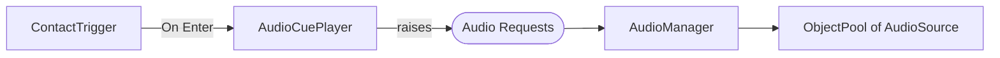

# Lab 13 - A Pooled AudioManager with Ducking

## 1. Overview

You build one audio system for a small third person level: sounds described as assets, requested through a channel, and played on pooled sources from a group table that routes each group through a mixer. You measure what the pool changes, connect footsteps and landings without editing the controller, and then lower the music under important sounds using a class the manager does not know about. The lab takes about 75 minutes.

---

## 2. What You Will Learn

| Skill | You can... |
|:------|:-----------|
| Route audio through a mixer | Build `Music`, `SFX` and `Player` groups, and expose a volume parameter |
| Map groups to settings | Fill a group table so that each group has its own source prefab, which sets its mixer group and spatial settings |
| Use the Common pool | Play overlapping sounds on `ObjectPool<AudioSource>` |
| Measure a change | Compare `GC Alloc` in the Profiler before and after the pool |
| Confirm behaviour with the debugger | Show how the number of active sources behaves under heavy use |
| Extend the controller by composition | Replace its footstep audio with your own, using its animation events |
| Add a feature without editing a class | Add ducking with no change to `AudioManager` |

---

## 3. Before You Start

| Item | Check |
|:-----|:------|
| Unity version | 6000.6.3f1 with URP 17.6.0 |
| DOTween | The panel at `Tools > Demigiant > DOTween Utility Panel` shows no red banner, and the `Audio` module is active |
| Starter Assets | `Runtime/ThirdPersonController/Prefabs` contains `PlayerArmature`, `PlayerFollowCamera` and `MainCamera`, and `Character/Sfx` contains the footstep clips |
| Common code | `Assets/GD/Common/Scripts` contains `Patterns/Pool/ObjectPool.cs`, `Triggers/ContactTrigger.cs`, `Controllers/Character/LandingEvents.cs` and `ScriptableObjects/Types/Tweens/TweenProfile.cs` |
| Clips | `Assets/ThirdParty/Audio/SFX/CasualGameSounds` contains `DM-CGS-02` and `DM-CGS-03` |
| Debugger | You can attach your IDE to the Unity Editor and switch the Editor to debug mode ([Notes 01](../notes/01_unity_foundations.md), Section 4.9) |
| Reference copy | `Assets/GD/Common/Scripts/Audio` holds a finished copy of the classes in this lab, in the `GD.Audio` namespace. Write your own in `Assets/Lab13/Scripts`, and compare with the copy after each Checkpoint |
| Notes | You have read [13 - AudioManager](../notes/13_audio_manager.md), Sections 3 to 4.9 |

---

## 4. Plan

Complete the plan before Step 3.



Copy the diagram into `LabNotes.md` and complete it:

1. Add the group table between `AudioManager` and the pools, and the `Music`, `SFX` and `Player` mixer groups. Show what plays through each, and which row each cue uses.
2. Add footsteps (Step 5) and landings (Step 5), and how each reaches a player of a cue.
3. Add `MusicDucker` (Step 6). Which existing arrows and classes change? There should be none. Say why, using the open/closed principle.

---

## 5. Steps

### Step 1 - Build the Scene and the Mixer

This step builds the level and the mix that every sound will go through. (10 min)

1. Open `Tools > GD > Setup > Create Project Folders`. Set `Project Folder` to `Lab13`, choose `Project assets only` and click `Create Folders`.
2. Create a new scene and save it as `Assets/Lab13/Scenes/SCN_Lab13_Audio.unity`. Delete `Main Camera`.
3. Create these objects, applying materials from `GD/Common/Materials`:

| Object | Type | Position | Scale | Notes |
|:--|:--|:--|:--|:--|
| `Ground` | Plane | (0, 0, 0) | (3, 1, 3) | |
| `Ledge` | Cube | (0, 0.5, 6) | (4, 1, 3) | |
| `AlarmPad` | Cube | (6, 0.1, 3) | (2, 0.2, 2) | Tick `Is Trigger` on its `Box Collider` |

4. From the third person `Prefabs` folder, drag in `MainCamera`, `PlayerFollowCamera` and `PlayerArmature`. Set `PlayerArmature` to `Position` (0, 0, 0). Set `Tracking Target` on `PlayerFollowCamera` to `PlayerCameraRoot`.
5. In `Assets/Lab13/Audio`, use `Create > Audio > Audio Mixer` and name it `MX_Game`. Open it in `Window > Audio > Audio Mixer`. Add groups `Music` and `SFX` under `Master`, and a group `Player` under `SFX`, so that the `SFX` fader also controls the player.
6. Select the `Music` group. In the Inspector, right-click `Volume` and choose `Expose 'Volume (of Music)' to script`. In the `Audio Mixer` window, open `Exposed Parameters`, and rename it `MusicVolume`.
7. Create an empty `Music`. Add an `Audio Source`, with `Audio Resource` set to `DM-CGS-03`, `Output` set to the `Music` group, `Loop` and `Play On Awake` ticked, and `Pitch` 0.5. This repeating sound stands in for music, so that the changes are easy to hear; use a music clip of your own if you have one.

**Checkpoint:** in Play mode, you hear the repeating sound, and the `Music` group's meter in the `Audio Mixer` window moves. Dragging its fader during Play changes the level. Enable `Edit in Play Mode` on the mixer to do this.

### Step 2 - Measure the Baseline

This step records what the controller's own footsteps cost, so that you can compare it later. (5 min)

1. Press Play. Run in a straight line, and watch the Hierarchy.
2. Open `Window > Analysis > Profiler`. Select the `CPU Usage` module, and set the lower panel to `Hierarchy`. Sort by `GC Alloc`.
3. Run for a few seconds, then pause Play mode. Move along the timeline to a frame with a footstep, shown by the `One shot audio` object appearing. Look for `ThirdPersonController.Update` and the `AnimationEvent` entries. Note the `GC Alloc` total for that frame.

**Record:** the `GC Alloc` for a footstep frame and a frame with no footstep. Compare them; a single reading varies, so take three.

**Checkpoint:** a `One shot audio` object appears and disappears in the Hierarchy for each step. Footstep frames show more `GC Alloc` than frames between steps.

### Step 3 - Build the Pooled Manager

This step creates the group names, the data, the request and the manager, and tests them with no gameplay attached. (25 min)

1. Create `Assets/Lab13/Scripts/MixerGroupType.cs`:

```csharp
/// <summary>
/// The standard mixer groups a game routes its sounds through. A cue names one of these,
/// and the AudioManager maps each one to a source prefab, whose Output is the mixer group.
/// </summary>
/// <remarks>
/// Add a value only at the end. Unity saves an enum field as its number, so inserting a value
/// earlier in the list changes the group of every cue and mapping already saved.
/// </remarks>
public enum MixerGroupType
{
    Master,
    Music,
    SFX,
    Player,
    Environment,
    Ambience,
    UI,
    Gameplay,
    Voice,
    Cinematic
}
```

2. Create `Assets/Lab13/Scripts/AudioCue.cs`:

```csharp
using UnityEngine;

/// <summary>
/// Describes one sound in the game: which clips, how they vary, and which mixer group it belongs to.
/// </summary>
/// <remarks>
/// The cue names a group, not a mixer asset. The AudioManager maps the group to a source prefab,
/// which sets the mixer group and the spatial settings, so changing the mixer changes no cue.
/// </remarks>
[CreateAssetMenu(fileName = "AudioCue", menuName = "Audio/Audio Cue")]
public class AudioCue : ScriptableObject
{
    [SerializeField, TextArea(2, 4), Tooltip("What this cue is for and where it plays, for the team. Not shown in the game")]
    private string description;

    [SerializeField, Tooltip("One clip is chosen at random each time")]
    private AudioClip[] clips;

    [SerializeField, Tooltip("The group this sound plays through. Its source prefab sets the mixer group, 2D or 3D, rolloff and priority")]
    private MixerGroupType group = MixerGroupType.SFX;

    [SerializeField, Range(0f, 1f), Tooltip("Volume before random variation. 1 plays the clip at its recorded level")]
    private float volume = 1f;

    [SerializeField, Range(0f, 0.5f), Tooltip("Random reduction in volume, as a fraction")]
    private float volumeVariation;

    [SerializeField, Range(0f, 0.5f), Tooltip("Random change in pitch, up or down, as a fraction")]
    private float pitchVariation = 0.05f;

    [Header("Mix")]
    [SerializeField, Tooltip("Lower the music while this sound plays")]
    private bool ducksMusic;

    [SerializeField, Min(0f), Tooltip("Seconds the music stays lowered")]
    private float duckHoldSeconds = 0.5f;

    public string Description => description;
    public MixerGroupType Group => group;
    public bool DucksMusic => ducksMusic;
    public float DuckHoldSeconds => duckHoldSeconds;

    /// <summary>
    /// Sets every value this cue controls, so a reused source keeps nothing from its last cue.
    /// Values the source prefab controls, such as spatial blend and rolloff, are left alone.
    /// Returns false if the cue has no clips.
    /// </summary>
    public bool TryApplyTo(AudioSource source)
    {
        if (clips == null || clips.Length == 0)
            return false;

        source.clip = clips[Random.Range(0, clips.Length)];
        source.volume = volume * Random.Range(1f - volumeVariation, 1f);
        source.pitch = Random.Range(1f - pitchVariation, 1f + pitchVariation);
        source.loop = false;
        return true;
    }
}
```

3. Create `Assets/Lab13/Scripts/AudioRequest.cs`:

```csharp
using UnityEngine;

/// <summary>
/// A request to play a cue at a world position.
/// </summary>
public readonly struct AudioRequest
{
    public readonly AudioCue Cue;
    public readonly Vector3 Position;

    public AudioRequest(AudioCue cue, Vector3 position)
    {
        Cue = cue;
        Position = position;
    }
}
```

4. Create `Assets/Lab13/Scripts/AudioRequestEventChannel.cs`:

```csharp
using GD.Types;
using UnityEngine;

/// <summary>
/// Carries audio requests from anywhere in the game to whatever is listening.
/// </summary>
[CreateAssetMenu(fileName = "AudioRequestEventChannel", menuName = "Audio/Audio Request Event Channel")]
public class AudioRequestEventChannel : EventChannel<AudioRequest>
{
}
```

5. Create `Assets/Lab13/Scripts/AudioCuePlayer.cs`:

```csharp
using UnityEngine;

/// <summary>
/// Requests a cue at this object's position. Wire Play to any Inspector event.
/// </summary>
public class AudioCuePlayer : MonoBehaviour
{
    [SerializeField, Tooltip("The sound to play when Play is called")]
    private AudioCue cue;

    [SerializeField, Tooltip("Channel the AudioManager listens on. Use the same asset as the AudioManager")]
    private AudioRequestEventChannel requestChannel;

    [ContextMenu("Play")]
    public void Play()
    {
        requestChannel.Raise(new AudioRequest(cue, transform.position));
    }
}
```

6. Create `Assets/Lab13/Scripts/AudioManager.cs`:

```csharp
using System;
using System.Collections.Generic;
using GD.Pool;
using UnityEngine;

/// <summary>
/// Plays requested cues on pooled AudioSources, with one pool per mixer group, and returns
/// each source when it finishes.
/// </summary>
/// <remarks>
/// Each group has its own source prefab. The prefab's Output sets the mixer group, and its other
/// settings set 2D or 3D, rolloff and priority, so everything about how a group sounds is in one
/// place. Cues only name a <see cref="MixerGroupType"/>.
/// </remarks>
public class AudioManager : MonoBehaviour
{
    #region Types

    /// <summary>One row of the group table, as set in the Inspector.</summary>
    [Serializable]
    private class GroupMapping
    {
        [Tooltip("The group that cues name")]
        public MixerGroupType group;

        [Tooltip("Prefab with an AudioSource, with Play On Awake unticked. Its Output is this group's mixer group")]
        public AudioSource sourcePrefab;

        [Min(1), Tooltip("Sources created in advance for this group")]
        public int initialSources = 4;
    }

    /// <summary>A playing source, and the pool it must go back to.</summary>
    private readonly struct ActiveSource
    {
        public ActiveSource(AudioSource source, ObjectPool<AudioSource> pool)
        {
            Source = source;
            Pool = pool;
        }

        public AudioSource Source { get; }

        public ObjectPool<AudioSource> Pool { get; }
    }

    #endregion Types

    #region Fields

    [SerializeField, Tooltip("Channel that gameplay raises requests on. Every AudioCuePlayer must use the same asset")]
    private AudioRequestEventChannel requestChannel;

    [SerializeField, Tooltip("One row per group. A cue whose group has no row plays through the Master row")]
    private List<GroupMapping> groups = new();

    [SerializeField, Min(1), Tooltip("Requests beyond this many sounds at once, across all groups, are dropped")]
    private int maxVoices = 16;

    // Unity cannot serialize a dictionary, so the Inspector list is turned into one in Awake.
    private readonly Dictionary<MixerGroupType, ObjectPool<AudioSource>> poolsByGroup = new();
    private readonly List<ActiveSource> activeSources = new();
    private readonly HashSet<MixerGroupType> reportedMissing = new();

    #endregion Fields

    #region Unity Messages

    private void Awake()
    {
        foreach (GroupMapping mapping in groups)
        {
            if (mapping.sourcePrefab == null)
            {
                Debug.LogWarning($"{name}: the {mapping.group} row has no source prefab, so it is ignored.", this);
                continue;
            }

            if (poolsByGroup.ContainsKey(mapping.group))
            {
                Debug.LogWarning($"{name}: {mapping.group} has more than one row, so only the first is used.", this);
                continue;
            }

            // With no Output, sources play straight to the listener and no fader affects them.
            if (mapping.sourcePrefab.outputAudioMixerGroup == null)
                Debug.LogWarning($"{name}: {mapping.sourcePrefab.name} has no Output, so {mapping.group} sounds bypass the mixer.", this);

            // A child per group keeps the hierarchy readable during Play.
            Transform parent = new GameObject(mapping.group.ToString()).transform;
            parent.SetParent(transform, false);

            poolsByGroup.Add(mapping.group, new ObjectPool<AudioSource>(mapping.sourcePrefab, mapping.initialSources, parent));
        }

        if (requestChannel == null || poolsByGroup.Count == 0)
        {
            Debug.LogError($"{name}: AudioManager needs a request channel and at least one group row.", this);
            enabled = false;
        }
    }

    private void OnEnable()
    {
        if (requestChannel != null)
            requestChannel.Raised += HandleRequest;
    }

    private void OnDisable()
    {
        if (requestChannel != null)
            requestChannel.Raised -= HandleRequest;
    }

    private void Update()
    {
        // Backwards, because removing an item moves the ones after it.
        for (int i = activeSources.Count - 1; i >= 0; i--)
        {
            ActiveSource active = activeSources[i];

            if (active.Source.isPlaying)
                continue;

            active.Pool.ReturnToPool(active.Source);
            activeSources.RemoveAt(i);
        }
    }

    #endregion Unity Messages

    #region Core Methods

    private void HandleRequest(AudioRequest request)
    {
        if (request.Cue == null || activeSources.Count >= maxVoices)
            return;

        if (!TryGetPool(request.Cue.Group, out ObjectPool<AudioSource> pool))
            return;

        AudioSource source = pool.Get();

        if (!request.Cue.TryApplyTo(source))
        {
            pool.ReturnToPool(source);
            return;
        }

        source.transform.position = request.Position;
        source.Play();
        activeSources.Add(new ActiveSource(source, pool));
    }

    private bool TryGetPool(MixerGroupType group, out ObjectPool<AudioSource> pool)
    {
        if (poolsByGroup.TryGetValue(group, out pool))
            return true;

        // Report each missing group once, not on every request.
        if (reportedMissing.Add(group))
            Debug.LogWarning($"{name}: no row for {group}, so its cues play through Master, or not at all if Master has no row.", this);

        return poolsByGroup.TryGetValue(MixerGroupType.Master, out pool);
    }

    #endregion Core Methods
}
```

7. In `Assets/Lab13/Prefabs`, create one prefab per group, each from an empty object with an `Audio Source` with `Play On Awake` unticked:

| Prefab | How to make it | `Output` | `Spatial Blend` | `Max Distance` |
|:--|:--|:--|:--|:--|
| `PF_Master` | New prefab | `Master` | 0 | - |
| `PF_SFX` | New prefab | `SFX` | 1 | 30 |
| `PF_Player` | Right-click `PF_SFX`, `Create > Prefab Variant` | `Player`, the only override | 1, inherited | 30, inherited |

8. In `Assets/Lab13/Data`, create `Create > Audio > Audio Request Event Channel`, named `EC_AudioRequests`. Create `Create > Audio > Audio Cue`, named `AC_Alarm`, with `Clips` containing `DM-CGS-02` and `Group` set to `SFX`. Set its `Description` to "Alarm when the player steps on AlarmPad", and write one for every cue you create in this lab.
9. Create an empty `AudioSystem`. Add `Audio Manager`, assigning `EC_AudioRequests`. Add three rows to `Groups`:

| `Group` | `Source Prefab` | `Initial Sources` |
|:--|:--|:--|
| `Master` | `PF_Master` | 2 |
| `SFX` | `PF_SFX` | 8 |
| `Player` | `PF_Player` | 8 |

10. On `AlarmPad`, add `Audio Cue Player`, assigning `AC_Alarm` and `EC_AudioRequests`. Add `Contact Trigger` with `Required Tag` set to `Player`, and wire `On Enter` to `AudioCuePlayer.Play`.
11. Press Play. Under `AudioSystem`, look at the children. Right-click `Audio Cue Player` and choose `Play`, several times in quick succession. Walk onto `AlarmPad`, then walk away from it and play it again.
12. Stop Play. Set `Group` on `AC_Alarm` to `UI`, which has no row, and press Play again. Read the Console, and listen from far away. Set it back to `SFX`.

**Record:** with `Group` set to `UI`, which row played the alarm, and how did it sound from far away? Explain both, using Section 4.6 of the note.

**Checkpoint:** `AudioSystem` has children named `Master`, `SFX` and `Player`, holding 2, 8 and 8 inactive sources when Play starts. Quick repeats overlap rather than cutting each other off, and the alarm is quieter from further away. A source activates while a sound plays and deactivates when it ends. The `SFX` group's meter moves. With `Group` set to `UI`, one warning appears and the alarm plays at full level from anywhere, through `Master`.

### Step 4 - Test the Pool Under Heavy Use

This step checks the pool's limit by reasoning and by inspection, then measures its allocation. (10 min)

1. Create `Assets/Lab13/Scripts/AudioStressTest.cs`:

```csharp
using UnityEngine;

/// <summary>
/// Plays a cue repeatedly at a set rate, to test the audio system under heavy use.
/// </summary>
[RequireComponent(typeof(AudioCuePlayer))]
public class AudioStressTest : MonoBehaviour
{
    [SerializeField, Min(1f), Tooltip("Requests per second")]
    private float requestsPerSecond = 60f;

    private AudioCuePlayer player;
    private float timer;

    private void Awake()
    {
        player = GetComponent<AudioCuePlayer>();
    }

    private void Update()
    {
        timer += Time.deltaTime;

        while (timer >= 1f / requestsPerSecond)
        {
            timer -= 1f / requestsPerSecond;
            player.Play();
        }
    }
}
```

2. Add `AudioStressTest` to `AlarmPad`. Press Play, and watch the children of `AudioSystem`.

**Hypothesis:** at 60 requests per second with a 0.5 s clip, about 30 sounds would overlap. `maxVoices` stops `activeSources.Count` passing 16, and because the check comes before `Get`, the `SFX` pool never needs more than 16 sources.

3. Switch the Editor to debug mode and attach your IDE. In `AudioManager`, choose where to place a breakpoint so that you can read `activeSources.Count` once it has reached the cap, and confirm that the request is dropped. A conditional breakpoint avoids stopping on every request.
4. Remove the breakpoint, detach the debugger, and switch back to release mode.
5. In the Profiler, sort by `GC Alloc` and read several frames.
6. Remove `AudioStressTest` from `AlarmPad`.

**Record:** the highest `activeSources.Count` you saw, and how many source objects existed. Does the evidence support the hypothesis? Compare `GC Alloc` per request here with your Step 2 reading. Is it zero? Look at `EventChannel<T>.Raise` in `Assets/GD/Common`, and suggest what could still be allocating.

**Checkpoint:** `activeSources.Count` stays at or below 16, and the number of `PF_SFX(Clone)` children under `SFX` stops growing at 16. No `One shot audio` objects appear from this test. Your measurement decides the allocation comparison; it may be lower without being zero.

### Step 5 - Replace the Controller's Audio

This step moves footsteps and landings onto the new system, without editing the controller. (10 min)

1. Create `Assets/Lab13/Scripts/FootstepCuePlayer.cs`:

```csharp
using UnityEngine;

/// <summary>
/// Plays a cue on each footstep animation event. The controller has its own method with
/// this name, and both run, so the controller is not edited.
/// </summary>
[RequireComponent(typeof(AudioCuePlayer))]
public class FootstepCuePlayer : MonoBehaviour
{
    [SerializeField, Range(0f, 1f), Tooltip("Blended clips below this weight do not play footsteps")]
    private float minimumClipWeight = 0.5f;

    private AudioCuePlayer player;

    private void Awake()
    {
        player = GetComponent<AudioCuePlayer>();
    }

    public void OnFootstep(AnimationEvent animationEvent)
    {
        if (animationEvent.animatorClipInfo.weight > minimumClipWeight)
            player.Play();
    }
}
```

2. Create two cues:

| Asset | `Clips` | `Group` | `Volume` | `Volume Variation` | `Pitch Variation` |
|:--|:--|:--|:--|:--|:--|
| `AC_Footstep` | All ten `Player_Footstep` clips | `Player` | 0.5 | 0.15 | 0.08 |
| `AC_Land` | `Player_Land` | `Player` | 0.8 | 0 | 0.05 |

3. On `PlayerArmature`, add `Footstep Cue Player`. Unity adds an `Audio Cue Player`; assign `AC_Footstep` and `EC_AudioRequests`.
4. On `PlayerArmature`, add `GD > Character > Landing Events`. Add a second child object `LandingAudio` with its own `Audio Cue Player`, assigning `AC_Land` and `EC_AudioRequests`. Under `On Landed`, wire `AudioCuePlayer.Play` on `LandingAudio`.
5. On `Third Person Controller`, set `Footstep Audio Clips` to size 0, and `Footstep Audio Volume` to 0. Leave `Landing Audio Clip` assigned, because `OnLand` has no null check.
6. Press Play. Run, and jump onto and off `Ledge`. Compare footstep frames in the Profiler with Step 2.

**Record:** why is `Landing Audio Clip` left assigned? What does the controller still do on each landing, and does it matter? Which files did you edit?

**Checkpoint:** footsteps vary slightly and play through the `Player` group: its fader controls them, and so does `SFX` above it, while the alarm ignores the `Player` fader. No `One shot audio` object appears for footsteps. One landing sound plays per landing from `Landing Events`, and it respects the mixer. `ThirdPersonController.cs` is unchanged.

### Step 6 - Add Ducking

This step lowers the music under chosen sounds, using a new class that listens to the same channel. (10 min)

1. Create `Assets/Lab13/Scripts/MusicDucker.cs`:

```csharp
using DG.Tweening;
using GD.Types;
using UnityEngine;
using UnityEngine.Audio;

/// <summary>
/// Lowers an exposed mixer volume when a cue that ducks the music is requested, then restores it.
/// </summary>
public class MusicDucker : MonoBehaviour
{
    [SerializeField, Tooltip("Channel to watch for cues that duck the music. Use the same asset as the AudioManager")]
    private AudioRequestEventChannel requestChannel;

    [SerializeField, Tooltip("The mixer that holds the exposed music volume parameter")]
    private AudioMixer mixer;

    [SerializeField, Tooltip("Exposed mixer parameter for the music group's volume")]
    private string volumeParameter = "MusicVolume";

    [Header("Levels (dB)")]
    [SerializeField, Tooltip("Music volume in dB when nothing is ducking it. 0 leaves the group at its mixer level")]
    private float normalVolume = 0f;

    [SerializeField, Tooltip("Music volume in dB while ducked. About -10 dB sounds half as loud")]
    private float duckedVolume = -12f;

    [Header("Timing")]
    [SerializeField, Tooltip("How quickly the music drops")]
    private TweenProfile attackProfile;

    [SerializeField, Tooltip("How slowly the music returns")]
    private TweenProfile releaseProfile;

    private Tween duckTween;

    private void OnEnable()
    {
        requestChannel.Raised += HandleRequest;
    }

    private void OnDisable()
    {
        requestChannel.Raised -= HandleRequest;
    }

    private void HandleRequest(AudioRequest request)
    {
        if (request.Cue.DucksMusic)
            Duck(request.Cue.DuckHoldSeconds);
    }

    private void Duck(float holdSeconds)
    {
        // A second duck replaces the first, starting from the current level.
        if (duckTween != null && duckTween.IsActive())
            duckTween.Kill();

        duckTween = DOTween.Sequence()
            .Append(attackProfile.Apply(mixer.DOSetFloat(volumeParameter, duckedVolume, attackProfile.Duration)))
            .AppendInterval(holdSeconds)
            .Append(releaseProfile.Apply(mixer.DOSetFloat(volumeParameter, normalVolume, releaseProfile.Duration)))
            .SetLink(gameObject);
    }
}
```

2. In `Assets/Lab13/Data`, use `Create > GD > Tweens > Tween Profile` to create `TP_DuckAttack`, with `Duration` 0.1 and `Ease` `OutCubic`, and `TP_DuckRelease`, with `Duration` 0.6 and `Ease` `InOutSine`. Add `Music Ducker` to `AudioSystem`, assigning `EC_AudioRequests`, `MX_Game` and both profiles.
3. On `AC_Alarm`, tick `Ducks Music` and set `Duck Hold Seconds` to 1.
4. Press Play. Walk onto `AlarmPad`, and watch the `Music` meter and fader. Step off and on again while the music is coming back up. Run around, and confirm that footsteps do not duck the music.
5. Try `Duck Hold Seconds` 0.2 and 2, then `Ducked Volume` -6 and -24. Choose values you can defend.

**Record:** your final values, and why. Which existing class did you edit to add ducking? Which single setting decides which sounds duck, and who can change it?

**Checkpoint:** the music dips quickly when `AC_Alarm` plays, holds, then rises slowly. Re-triggering during the rise dips again from the current level, with no jump. Footsteps have no effect on the music. `AudioManager.cs` is unchanged.

---

## 6. Debugging and Pitfalls

| Symptom | Likely cause | How to confirm | Fix |
|:--------|:-------------|:---------------|:----|
| An audio cue or channel asset does not fit a field in your script, or editing your script changes nothing in Play | The asset or component uses the finished copy in `Assets/GD/Common`, which has the same class name as yours. Its assets are under `Create > GD > Audio` | Double-click the `Script` field of the asset or component: it opens a file in `Assets/GD/Common` | Create assets from `Create > Audio`, and add components by dragging your script from `Assets/Lab13/Scripts` |
| No sound, and no error | Nothing listens to the channel, or the `Audio Cue Player` uses a different asset | Check `ListenerCount` in the debugger; tick `Log Raises` | Use the same `EC_AudioRequests` everywhere |
| `NullReferenceException` in `AudioCuePlayer.Play` | `Request Channel` is empty | Click the error, then check the component | Assign it |
| Nothing plays from a cue | `Clips` is empty, so `TryApplyTo` returns false | Breakpoint in `HandleRequest` | Add a clip |
| A 3D sound is silent | Its group's prefab has `Spatial Blend` 1 and the object is out of range | Set the cue's `Group` to `Master` to test | Raise `Max Distance` on that prefab |
| A fader has no effect on a sound | The cue names another group, or that group's prefab has no `Output` | Read the cue's `Group`, then the `Output` on that row's prefab; look for the "has no Output" warning | Change the cue, or set `Output` on the prefab |
| `PF_Player` changes when `PF_SFX` is edited | `PF_Player` is a variant, and inherits every value it does not override | Look for the bold override marks on `PF_Player` | Intended; override a value on `PF_Player` to keep it different |
| "has no row" warning, and the sound plays through `Master` | No row maps the cue's group | Read the warning | Add a row, or choose a mapped group |
| "has more than one row" warning | Two rows name the same group | Read the warning | Delete one row |
| `AudioManager needs a request channel and at least one group row` | `Groups` is empty, or every row lacks a prefab | Read the component | Add rows with prefabs |
| `MissingReferenceException` on a source | A pooled source was parented to something destroyed | Check its parent | Keep sources under `AudioSystem` |
| `DOSetFloat` could not be found | The DOTween `Audio` module is off | Open `Setup DOTween...` | Tick `Audio` and click `Apply` |
| `NullReferenceException` in `Duck` | A profile field on `Music Ducker` is empty | Click the error, then check the component | Assign both profiles |
| The music level never changes | `Volume Parameter` does not match the exposed name | Compare with `Exposed Parameters` | Rename one to match |
| Footsteps are doubled | `Footstep Audio Clips` still has entries | Look for `One shot audio` objects | Set its size to 0 |
| An error on each landing | `Landing Audio Clip` was cleared | Read the stack trace to `OnLand` | Reassign it, with volume 0 |

---

## 7. Production Checklist

| Requirement | Done |
|:------------|:-----|
| All cues route through `MX_Game` by group, and the `Music`, `SFX` and `Player` faders each control their sounds | |
| The group table maps `Master`, `SFX` and `Player`, each with its own pool, and no cue holds a mixer asset | |
| Overlapping sounds play without cutting each other off | |
| `LabNotes.md` records `GC Alloc` before and after, with your reasoning | |
| `LabNotes.md` records debugger evidence that `activeSources.Count` stays within `maxVoices` | |
| Footsteps and landings play through `AudioManager`, with varied pitch | |
| `AC_Alarm` ducks the music, and re-triggering has no jump | |
| `AudioStressTest` is removed | |
| No file in `Assets/ThirdParty` or `Assets/GD/Common` was edited | |

---

## 8. Extension

### Stretch - Priority Rather Than Dropping

`AudioManager` drops any request past `maxVoices`, so a critical alarm can be lost during a burst of footsteps. Add a priority to `AudioCue`, and when all voices are busy, stop and reuse the lowest-priority active source, if the new sound has a higher priority.

**Expected result:** during `AudioStressTest` with a low-priority cue, a high-priority cue always plays. In `LabNotes.md`, explain in 80 to 120 words which data you needed to keep for each active source, and what you would do if two sounds had equal priority.

---

## 9. Reflective Questions

1. Step 4 asked whether the pool's allocation was zero. What did you find? If the difference had been small, would you still keep the pool? Which other reason for it remains?
2. `TryApplyTo` sets `loop` to false, although no cue ever loops. What goes wrong if it is left out, and when would you discover it?
3. The group table is a `List` in the Inspector and a `Dictionary` at runtime. Explain why it cannot be only one of them, and what a designer would lose if the mapping were a `switch` on `MixerGroupType` in code.
4. `MusicDucker` and `AudioManager` listen to the same channel. Should either one's order matter? What could go wrong if a later feature relied on it?
5. Compare your tweened duck with the `Duck Volume` mixer effect for your group's game. What evidence would make you switch?

---

## 10. How This Builds

- **Note 14 - CameraManager** uses the same structure of assets, requests and a thin manager for camera effects.
- **Note 15 - Orchestration and Game Flow** plays audio as steps in a sequence.
- **GCA - Technical Craft** and **C# & Software Design - System Communication:** one mix, varied cues and a chosen duck are evidence for both.

**Group project task (take-home).** List every sound in your group's game and how each plays. Move them onto one system, using one mixer. Record a short before-and-after, and add one sentence on your ducking choice to your project log.
