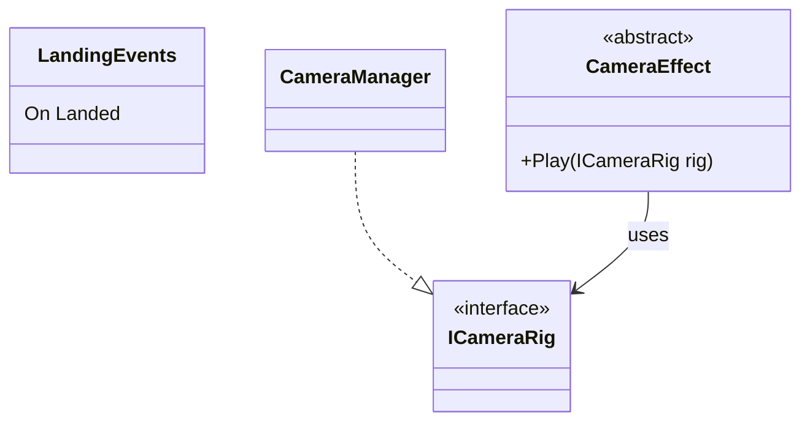

# Lab 14 - Camera Zones and Camera Effects

## 1. Overview

You switch between cameras using trigger zones with no new script, and tune the blends. You add a landing shake directly, then replace it with effect assets played by a thin `CameraManager`. Finally, you add a field of view kick as a new class, with no edit to the manager. The lab takes about 60 minutes.

---

## 2. What You Will Learn

| Skill | You can... |
|:------|:-----------|
| Switch cameras by priority | Activate a higher-priority camera from `ContactTrigger` events |
| Rely on Cinemachine's queue | Show overlapping zones working with no code |
| Tune blends | Choose a blend style and time, with a reason |
| Add impulses | Connect a source and a listener, and shake the camera on landing |
| Diagnose with the debugger | Show that an effect runs on a camera that has no listener |
| Apply Strategy | Add an effect as a class and asset, with no edit to `CameraManager` |

---

## 3. Before You Start

| Item | Check |
|:-----|:------|
| Unity version | 6000.6.3f1 with URP 17.6.0 |
| Cinemachine | `Window > Package Management > Package Manager` lists `Cinemachine` 6.6.0 as installed |
| DOTween | The panel at `Tools > Demigiant > DOTween Utility Panel` shows no red banner |
| Starter Assets | `Runtime/ThirdPersonController/Prefabs` contains `PlayerArmature`, `PlayerFollowCamera` and `MainCamera` |
| Common code | `Assets/GD/Common/Scripts` contains `Triggers/ContactTrigger.cs`, `Controllers/Character/LandingEvents.cs` and `ScriptableObjects/Types/Tweens/TweenProfile.cs` |
| Debugger | You can attach your IDE to the Unity Editor and switch the Editor to debug mode ([Notes 01](../notes/01_unity_foundations.md), Section 4.9) |
| Reference copy | `Assets/GD/Common/Scripts/Cameras` holds a finished copy of the classes in this lab, in the `GD.Cameras` namespace. Write your own in `Assets/Lab14/Scripts`, and compare with the copy after each Checkpoint |
| Notes | You have read [14 - CameraManager](../notes/14_camera_manager.md), Sections 3 to 4.7 |

---

## 4. Plan

Complete the plan before Step 4.



Copy the diagram into `LabNotes.md` and complete it:

1. Add `CameraEffectPlayer` and `CameraEffectEventChannel`, and connect `LandingEvents` to `CameraManager` through them.
2. Add `ImpulseCameraEffect` (Step 4) and `FovKickCameraEffect` (Step 5).
3. Mark the arrows you would need to change to add a third effect. There should be none. Say why, using the open/closed principle.

---

## 5. Steps

### Step 1 - Build the Scene

This step builds a level with two overlapping zones, a ledge to land from and a pad. (10 min)

1. Open `Tools > GD > Setup > Create Project Folders`. Set `Project Folder` to `Lab14`, choose `Project assets only` and click `Create Folders`.
2. Create a new scene and save it as `Assets/Lab14/Scenes/SCN_Lab14_Camera.unity`. Delete `Main Camera`.
3. Create these objects, applying materials from `GD/Common/Materials`:

| Object | Type | Position | Scale | Notes |
|:--|:--|:--|:--|:--|
| `Ground` | Plane | (0, 0, 0) | (3, 1, 3) | |
| `Ledge` | Cube | (6, 0.5, -3) | (4, 1, 3) | |
| `KickPad` | Cube | (-6, 0.1, -3) | (2, 0.2, 2) | Tick `Is Trigger` |
| `Zone_A` | Empty | (-6, 1.5, 8) | (1, 1, 1) | `Box Collider`, `Size` (8, 3, 8), tick `Is Trigger` |
| `Zone_B` | Empty | (0, 1.5, 8) | (1, 1, 1) | `Box Collider`, `Size` (8, 3, 8), tick `Is Trigger` |

4. From the third person `Prefabs` folder, drag in `MainCamera`, `PlayerFollowCamera` and `PlayerArmature`. Set `PlayerArmature` to `Position` (0, 0, 0). Set `Tracking Target` on `PlayerFollowCamera` to `PlayerCameraRoot`.
5. Use `GameObject > Cinemachine > Cinemachine Camera` twice, to make `CM_ZoneA` at (-14, 6, 2) and `CM_ZoneB` at (8, 6, 2). On each, set:
   - `Priority`: tick it, and set the value to 20.
   - `Tracking Target`: `PlayerCameraRoot`.
   - `Position Control`: `None`.
   - `Rotation Control`: `Hard Look At`.
6. Untick the active box on both `CM_ZoneA` and `CM_ZoneB` at the top of the Inspector, so that they start inactive.

**Checkpoint:** in Play mode, the follow camera works as in the Starter Assets, and walking into the zones changes nothing yet. The character walks, jumps and can reach `Ledge`.

### Step 2 - Switch Cameras with Zones

This step changes the view using only Inspector wiring, because `ContactTrigger` and Cinemachine provide everything needed. (10 min)

1. On `Zone_A`, add `Contact Trigger`, with `Required Tag` set to `Player`.
2. Under `On Enter`, click `+`, drag in `CM_ZoneA` and choose `GameObject > SetActive (bool)`, ticked. Under `On Exit`, do the same, unticked.
3. Repeat for `Zone_B`, with `CM_ZoneB`.
4. Press Play. Walk into `Zone_A`, then across into the overlap with `Zone_B`, then back into `Zone_A` alone, then out. Watch which camera the `CinemachineBrain` shows as live on `MainCamera`.
5. On `MainCamera`, try `Default Blend` with `Cut`, then `Ease In Out` at 2, 1 and 0.5 seconds. Pick one.

**Record:** your blend and the reason for it. While you held a direction and crossed into a zone, what happened to the direction the character moved? Why? Use Note 14, Section 4.3. Did the overlap need any code?

**Checkpoint:** entering a zone blends to its camera, and leaving all zones blends back to the follow camera. Moving from the overlap back into `Zone_A` returns to `CM_ZoneA`. No script was written.

### Step 3 - Shake the Camera Directly

This step adds an impulse the simplest way, as the baseline to compare with later. (5 min)

1. On `PlayerArmature`, add `GD > Character > Landing Events`.
2. On `PlayerArmature`, add `Cinemachine Impulse Source`. Set `Impulse Type` to `Uniform`, `Impulse Shape` to `Bump`, and `Impulse Duration` to 0.2.
3. Under `On Landed`, wire `CinemachineImpulseSource > GenerateImpulse ()` on `PlayerArmature`.
4. Select `PlayerFollowCamera`. In its `Add Extension` list, choose `Cinemachine Impulse Listener`.
5. Press Play. Jump onto and off `Ledge`.

**Record:** how many components did this take, and what would it take to add the same shake to a door in a different scene?

**Checkpoint:** the camera bumps once per landing, and no script was written.

### Step 4 - Replace It with Effect Assets and a Manager

This step moves the shake behind a thin manager, so that any system can request any effect through a channel. (20 min)

1. Create `Assets/Lab14/Scripts/ICameraRig.cs`:

```csharp
using Unity.Cinemachine;

/// <summary>
/// What a camera effect may use. Effects depend on this rather than on CameraManager.
/// </summary>
public interface ICameraRig
{
    /// <summary>The live camera, or null if the Brain has no CinemachineCamera live.</summary>
    CinemachineCamera ActiveCamera { get; }

    CinemachineImpulseSource ImpulseSource { get; }

    /// <summary>The camera's field of view when it is not being changed by an effect.</summary>
    float GetRestingFieldOfView(CinemachineCamera camera);
}
```

2. Create `Assets/Lab14/Scripts/CameraEffect.cs`:

```csharp
using UnityEngine;

/// <summary>
/// Base class for a camera effect asset. Holds settings only, because assets are shared.
/// </summary>
public abstract class CameraEffect : ScriptableObject
{
    public abstract void Play(ICameraRig rig);
}
```

3. Create `Assets/Lab14/Scripts/ImpulseCameraEffect.cs`:

```csharp
using UnityEngine;

/// <summary>
/// Shakes every listening camera with an impulse.
/// </summary>
[CreateAssetMenu(fileName = "ImpulseCameraEffect", menuName = "Camera/Impulse Effect")]
public class ImpulseCameraEffect : CameraEffect
{
    [SerializeField, Min(0f), Tooltip("Strength of the impulse")]
    private float force = 1f;

    public override void Play(ICameraRig rig)
    {
        rig.ImpulseSource.GenerateImpulseWithForce(force);
    }
}
```

4. Create `Assets/Lab14/Scripts/CameraEffectEventChannel.cs`:

```csharp
using GD.Types;
using UnityEngine;

/// <summary>
/// Carries camera effect requests from anywhere in the game to the CameraManager.
/// </summary>
[CreateAssetMenu(fileName = "CameraEffectEventChannel", menuName = "Camera/Camera Effect Event Channel")]
public class CameraEffectEventChannel : EventChannel<CameraEffect>
{
}
```

5. Create `Assets/Lab14/Scripts/CameraEffectPlayer.cs`:

```csharp
using UnityEngine;

/// <summary>
/// Requests a camera effect. Wire Play to any Inspector event.
/// </summary>
public class CameraEffectPlayer : MonoBehaviour
{
    [SerializeField] private CameraEffect effect;
    [SerializeField] private CameraEffectEventChannel effectChannel;

    [ContextMenu("Play")]
    public void Play()
    {
        effectChannel.Raise(effect);
    }
}
```

6. Create `Assets/Lab14/Scripts/CameraManager.cs`:

```csharp
using System.Collections.Generic;
using Unity.Cinemachine;
using UnityEngine;

/// <summary>
/// Plays requested camera effects, and gives them access to the live camera.
/// </summary>
public class CameraManager : MonoBehaviour, ICameraRig
{
    [SerializeField] private CameraEffectEventChannel effectChannel;
    [SerializeField] private CinemachineBrain brain;
    [SerializeField] private CinemachineImpulseSource impulseSource;

    // Each camera's field of view, recorded before any effect changes it.
    private readonly Dictionary<CinemachineCamera, float> restingFieldOfViews = new();

    public CinemachineCamera ActiveCamera => brain.ActiveVirtualCamera as CinemachineCamera;

    public CinemachineImpulseSource ImpulseSource => impulseSource;

    public float GetRestingFieldOfView(CinemachineCamera camera)
    {
        if (!restingFieldOfViews.TryGetValue(camera, out float fieldOfView))
        {
            fieldOfView = camera.Lens.FieldOfView;
            restingFieldOfViews[camera] = fieldOfView;
        }

        return fieldOfView;
    }

    private void OnEnable()
    {
        effectChannel.Raised += HandleEffect;
    }

    private void OnDisable()
    {
        effectChannel.Raised -= HandleEffect;
    }

    private void HandleEffect(CameraEffect effect)
    {
        effect.Play(this);
    }
}
```

7. In `Assets/Lab14/Data`, create `Create > Camera > Camera Effect Event Channel`, named `EC_CameraEffects`. Create `Create > Camera > Impulse Effect`, named `CE_Landing`, with `Force` 1.
8. Remove `Cinemachine Impulse Source` from `PlayerArmature`, and clear the `On Landed` entry.
9. Create an empty `CameraSystem`. Add `Cinemachine Impulse Source`, with the same settings as Step 3, and `Camera Manager`. Assign `EC_CameraEffects`, the `Cinemachine Brain` on `MainCamera`, and the new source.
10. On `PlayerArmature`, add `Camera Effect Player`, assigning `CE_Landing` and `EC_CameraEffects`. Wire `On Landed` to `CameraEffectPlayer.Play`.
11. Press Play. Jump off `Ledge` under the follow camera. Then jump inside `Zone_A`.

**Hypothesis:** the shake works under the follow camera and not in `Zone_A`, because the effect runs in both places, and `CM_ZoneA` has no listener.

12. Switch the Editor to debug mode and attach your IDE. In `ImpulseCameraEffect`, choose where to place a breakpoint so that you can show the effect runs for a landing in `Zone_A`. In `CameraManager`, read which camera `ActiveCamera` returns.
13. Remove the breakpoint, detach the debugger, and switch back to release mode. Add `Cinemachine Impulse Listener` to both zone cameras.

**Record:** the value of `ActiveCamera` at the breakpoint. Does the evidence support the hypothesis? Why does the missing listener produce no error? Change `Force` on `CE_Landing`, and record a value you can defend.

**Checkpoint:** before adding the listeners, the breakpoint is hit in `Zone_A` with no shake. Afterwards, landing shakes the camera everywhere. The shake's strength now comes from one asset.

### Step 5 - Add a Field of View Kick

This step adds a different effect as one new class. Nothing that already exists changes. (10 min)

1. Create `Assets/Lab14/Scripts/FovKickCameraEffect.cs`:

```csharp
using DG.Tweening;
using Unity.Cinemachine;
using GD.Types;
using UnityEngine;

/// <summary>
/// Briefly widens the live camera's field of view, then returns it to rest.
/// </summary>
[CreateAssetMenu(fileName = "FovKickCameraEffect", menuName = "Camera/FOV Kick Effect")]
public class FovKickCameraEffect : CameraEffect
{
    [SerializeField, Tooltip("Degrees added to the field of view at the peak")]
    private float kick = 6f;

    [SerializeField, Tooltip("Timing of the move to the peak")]
    private TweenProfile attackProfile;

    [SerializeField, Tooltip("Timing of the return to rest")]
    private TweenProfile releaseProfile;

    public override void Play(ICameraRig rig)
    {
        CinemachineCamera camera = rig.ActiveCamera;

        // The Brain can be mid-change, or showing something other than a CinemachineCamera.
        if (camera == null)
            return;

        float resting = rig.GetRestingFieldOfView(camera);

        // The newest kick replaces any kick still running on this camera.
        DOTween.Kill(camera);

        DOTween.Sequence()
            .Append(attackProfile.Apply(TweenFieldOfView(camera, resting + kick, attackProfile.Duration)))
            .Append(releaseProfile.Apply(TweenFieldOfView(camera, resting, releaseProfile.Duration)))
            .SetTarget(camera)
            .SetLink(camera.gameObject);
    }

    private static Tween TweenFieldOfView(CinemachineCamera camera, float fieldOfView, float duration)
    {
        return DOTween.To(() => camera.Lens.FieldOfView, value => camera.Lens.FieldOfView = value,
            fieldOfView, duration);
    }
}
```

2. In `Assets/Lab14/Data`, use `Create > GD > Tweens > Tween Profile` to create `TP_KickAttack`, with `Duration` 0.08 and `Ease` `OutCubic`, and `TP_KickRelease`, with `Duration` 0.35 and `Ease` `InOutSine`. Create `Create > Camera > FOV Kick Effect`, named `CE_Kick`, and assign both profiles.
3. On `KickPad`, add `Camera Effect Player`, assigning `CE_Kick` and `EC_CameraEffects`. Add `Contact Trigger`, with `Required Tag` set to `Player`, and wire `On Enter` to `CameraEffectPlayer.Play`.
4. Press Play. Select `PlayerFollowCamera`, and watch its `Field Of View` in the Inspector. Walk onto `KickPad`. Step off and on again repeatedly. Use the component's context menu to play the effect several times quickly.

**Record:** which existing files did you edit? Read `Field Of View` after repeated kicks. What would have happened if the effect read the camera's current value as its resting value? Use Note 11, Section 4.8.

**Checkpoint:** the view widens quickly and settles back. After any number of quick kicks, `Field Of View` returns to 40. `CameraManager.cs` is unchanged.

### Step 6 - Tune and Capture

This step practises the evidence you need for the GCA. (5 min)

1. Tune `CE_Landing`, `CE_Kick` and your blend together, until they feel deliberate and not busy.
2. Use `Tools > GD > Evidence > GIF Capture` to record a landing with the effects off, by disabling the `Camera Effect Player`, and again with them on.

**Record:** your final values. In one sentence, what does the player gain from each effect? If you cannot say, remove that effect.

**Checkpoint:** you have two captures, and a reason for each value.

---

## 6. Debugging and Pitfalls

| Symptom | Likely cause | How to confirm | Fix |
|:--------|:-------------|:---------------|:----|
| A camera effect or channel asset does not fit a field in your script, or editing your script changes nothing in Play | The asset or component uses the finished copy in `Assets/GD/Common`, which has the same class name as yours. Its assets are under `Create > GD > Camera` | Double-click the `Script` field of the asset or component: it opens a file in `Assets/GD/Common` | Create assets from `Create > Camera`, and add components by dragging your script from `Assets/Lab14/Scripts` |
| A zone does not change the camera | Its camera's `Priority` is not ticked, or `Required Tag` is wrong | Read the live camera on `CinemachineBrain` during Play | Tick `Priority` and set 20; `PlayerArmature` is tagged `Player` |
| A zone camera is live at the start | Its active box was left ticked | Check the Hierarchy | Untick it |
| A zone camera points the wrong way | `Tracking Target` is empty, or `Rotation Control` is not `Hard Look At` | Select it in the Scene view | Set both |
| No shake anywhere | No listener, or the source and listener `Impulse Channel` values differ | Breakpoint in `ImpulseCameraEffect.Play` | Add a listener; match the channels |
| `NullReferenceException` in `ImpulseCameraEffect.Play` | `Impulse Source` is empty on `Camera Manager` | Inspect `rig.ImpulseSource` | Assign it |
| `NullReferenceException` in `CameraEffectPlayer.Play` | `Effect Channel` is empty | Check the component | Assign it |
| Nothing happens at all | The player and manager use different channel assets | Tick `Log Raises`, and read the listener count | Use `EC_CameraEffects` on both |
| `The type or namespace name 'Cinemachine' could not be found` | The script uses the old namespace | Read the `using` line | Use `using Unity.Cinemachine;` |
| The field of view creeps up | `GetRestingFieldOfView` is not used | Read the value after several kicks | Use the Step 5 version |
| The kick does nothing during a blend | `ActiveCamera` is not a `CinemachineCamera` at that moment | Breakpoint at the null check | Expected; try it after the blend ends |

---

## 7. Production Checklist

| Requirement | Done |
|:------------|:-----|
| `Zone_A` and `Zone_B` switch cameras with no script, including in the overlap | |
| `LabNotes.md` records your blend, with a reason | |
| `LabNotes.md` records debugger evidence for the missing listener | |
| Landing plays `CE_Landing` through `CameraEffectPlayer` and `EC_CameraEffects` | |
| Every camera that should shake has a listener | |
| `KickPad` plays `CE_Kick`, and `Field Of View` returns to rest after repeated kicks | |
| Adding `FovKickCameraEffect` needed no edit to any existing class | |
| No file in `Assets/ThirdParty` or `Assets/GD/Common` was edited | |

---

## 8. Extension

### Stretch - Sprint Field of View

While the player sprints, the field of view should stay slightly wider, and return when they stop. Write a component that reads `StarterAssetsInputs.sprint` and `move`, without editing the controller. It must not conflict with `CE_Kick`.

**Expected result:** sprinting widens the view smoothly, stopping restores it, and a kick during a sprint still ends at the correct value. In `LabNotes.md`, explain in 80 to 120 words why this does or does not fit `CameraEffect`, and how you resolved two systems writing to one value.

---

## 9. Reflective Questions

1. Step 3 needed no script. For which kind of game would you stop there? What specifically justified Step 4 in this lab?
2. `CameraManager` is about 40 lines and never mentions an effect by name. Which SOLID principle does that show? What would it look like with an `enum` and a `switch`?
3. Step 4's missing listener produced no error. How would your group catch this kind of failure before a demo?
4. `ActiveCamera` can be null during some blends. Should each effect check for that, or should the manager? Justify your answer using the Liskov substitution principle.
5. Does your Step 6 capture show an improvement? What would you ask a playtester to find out?

---

## 10. How This Builds

- **Note 15 - Orchestration and Game Flow** activates a camera and plays effects as steps in a sequence.
- **GCA - Technical Craft** and **C# & Software Design - Software Design:** a tuned, justified camera reaction with a before-and-after capture is evidence for both.

**Group project task (take-home).** Choose one moment in your group's game that deserves a camera reaction. Add it as an effect asset, capture it with and without the effect, and write one sentence in your project log on what the player gains.
