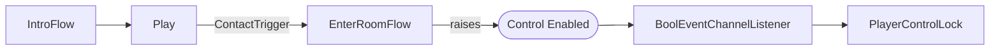

# Lab 15 - A Game Loop Built with a Flow Builder

## 1. Overview

You build a complete small game loop around the third person controller: a title screen, play, a scripted sequence when entering a room, a hazard, game over, restart and pause. You write the room sequence first as one coroutine, then replace it using the flow classes in `Assets/GD/Common`, so that the later flows become short lists. The lab takes about 75 minutes.

---

## 2. What You Will Learn

| Skill | You can... |
|:------|:-----------|
| Take and return control | Lock the controller without editing it, with no stale input |
| Write and stop a coroutine | Show with the debugger what does and does not stop one |
| Apply the Builder pattern | Describe a sequence through `FlowBuilder`, and run it from `FlowBehaviour` |
| Connect systems through channels | Change camera and control from a flow, with no reference to either |
| Use `Func<T>` for delayed work | Explain why a tween step takes a lambda |
| Complete a game loop | Connect title, play, game over, restart and pause |
| Handle `Time.timeScale` | Keep UI working while the game is paused |

---

## 3. Before You Start

| Item | Check |
|:-----|:------|
| Unity version | 6000.6.3f1 with URP 17.6.0 |
| DOTween | The panel at `Tools > Demigiant > DOTween Utility Panel` shows no red banner, and the `UI` module is active |
| Starter Assets | `Runtime/ThirdPersonController/Prefabs` contains `PlayerArmature`, `PlayerFollowCamera` and `MainCamera` |
| Common code | `Assets/GD/Common/Scripts` contains `Flow/FlowBuilder.cs`, `UI/ScreenPanel.cs`, `Controllers/Character/PlayerControlLock.cs`, `Triggers/ContactTrigger.cs` and `ScriptableObjects/Types/Tweens/TweenProfile.cs` |
| TextMeshPro and UI | A UI `Button` can be created; import `TMP Essentials` if Unity asks |
| Debugger | You can attach your IDE to the Unity Editor and switch the Editor to debug mode ([Notes 01](../notes/01_unity_foundations.md), Section 4.9) |
| Notes | You have read [15 - Orchestration and Game Flow](../notes/15_orchestration_game_flow.md), Sections 3 to 4.10 |

---

## 4. Plan

Complete the plan before Step 4.



Copy the diagram into `LabNotes.md` and complete it:

1. Add the `Room Camera` channel, its listener and the camera it controls. Say which object the listener must be on, and why.
2. Add `DeathFlow`, and the channels that start and finish it.
3. Add `PauseController`, and mark what it changes other than through a channel.
4. List in order the steps of each flow, before you read the builder. Which step types repeat across flows?

---

## 5. Steps

### Step 1 - Build the Scene and Channels

This step builds a level with a door, a room trigger and a hazard, plus the UI and the channels that connect everything. (15 min)

1. Open `Tools > GD > Setup > Create Project Folders`. Set `Project Folder` to `Lab15`, choose `Project assets only` and click `Create Folders`.
2. Create a new scene and save it as `Assets/Lab15/Scenes/SCN_Lab15_GameLoop.unity`. Delete `Main Camera`. Add the scene under `File > Build Profiles > Scene List`, because restarting loads it by name.
3. Create these objects, applying materials from `GD/Common/Materials`:

| Object | Type | Position | Scale | Notes |
|:--|:--|:--|:--|:--|
| `Ground` | Plane | (0, 0, 0) | (3, 1, 3) | |
| `Wall_Left` | Cube | (-4, 1.5, 8) | (6, 3, 0.5) | |
| `Wall_Right` | Cube | (4, 1.5, 8) | (6, 3, 0.5) | |
| `Door` | Cube | (0, 1.5, 8) | (2, 3, 0.5) | |
| `RoomTrigger` | Empty | (0, 1.5, 5) | (1, 1, 1) | `Box Collider`, `Size` (6, 3, 2), tick `Is Trigger` |
| `Hazard` | Cube | (0, 0.1, 14) | (4, 0.2, 4) | Tick `Is Trigger`, use `Red` |

4. From the third person `Prefabs` folder, drag in `MainCamera`, `PlayerFollowCamera` and `PlayerArmature`. Set `PlayerArmature` to `Position` (0, 0, 0). Set `Tracking Target` on `PlayerFollowCamera` to `PlayerCameraRoot`. On `MainCamera`, set `Default Blend` to `Ease In Out` at 0.5 seconds.
5. Use `GameObject > Cinemachine > Cinemachine Camera` to make `CM_Room` at (8, 5, 2). Tick `Priority` and set 20. Set `Tracking Target` to `Door`, `Position Control` to `None` and `Rotation Control` to `Hard Look At`. Untick its active box, so that it starts inactive.
6. In `Assets/Lab15/Data`, use `Create > GD > Events` to make:

| Type | Assets |
|:--|:--|
| `Bool` | `EC_ControlEnabled`, `EC_RoomCamera` |
| `Void` | `EC_DoorOpened`, `EC_PlayPressed`, `EC_RestartPressed`, `EC_PlayerDied` |

7. In the same folder, use `Create > GD > Tweens > Tween Profile` to make `TP_DoorOpen`, with `Duration` 0.8 and `Ease` `OutCubic`, and `TP_PanelFade`, with `Duration` 0.25 and `Ease` `OutCubic`.
8. Create an empty `CameraSwitch`. Add `Bool Event Channel Listener` with `Channel` set to `EC_RoomCamera`. Under `Response`, drag in `CM_Room` and choose the dynamic `GameObject.SetActive` under `Dynamic bool`.

**Checkpoint:** in Play mode, the follow camera works as in the Starter Assets, the door blocks the doorway, and the Console has no errors. Walking onto `Hazard` does nothing yet.

### Step 2 - Add the Control Lock

This step makes a single component responsible for taking control from the controller, with no edit to it. (5 min)

1. Open `Assets/GD/Common/Scripts/Controllers/Character/PlayerControlLock.cs` and read `SetControlEnabled`.
2. On `PlayerArmature`, add `GD > Character > Player Control Lock`, and assign `Third Person Controller` to `Controller`.
3. On `PlayerArmature`, add `Bool Event Channel Listener`, with `Channel` set to `EC_ControlEnabled`. Under `Response`, drag in `PlayerArmature` and choose the dynamic `PlayerControlLock.SetControlEnabled` under `Dynamic bool`.

Step 3 tests this, because a `Bool` channel cannot be raised from its context menu.

**Record:** list what `SetControlEnabled` changes, and for each one, what would go wrong if it were left out. Use Note 15, Section 4.9.

**Checkpoint:** the project compiles, and the character still moves normally in Play mode.

### Step 3 - Write the Sequence as a Coroutine

This step writes the room sequence the direct way. It works, and you need it as the baseline for Step 4. (15 min)

1. Create `Assets/Lab15/Scripts/EnterRoomCoroutine.cs`:

```csharp
using System.Collections;
using DG.Tweening;
using GD.Types;
using UnityEngine;

/// <summary>
/// Plays the room entry sequence as one hand-written coroutine.
/// </summary>
public class EnterRoomCoroutine : MonoBehaviour
{
    [SerializeField] private BoolEventChannel controlEnabled;
    [SerializeField] private BoolEventChannel roomCamera;
    [SerializeField] private VoidEventChannel doorOpened;

    [SerializeField] private Transform door;
    [SerializeField] private Vector3 openOffset = new(0f, 3.2f, 0f);
    [SerializeField] private TweenProfile doorProfile;

    private Coroutine running;

    public void Play()
    {
        if (running == null)
            running = StartCoroutine(Sequence());
    }

    private IEnumerator Sequence()
    {
        controlEnabled.Raise(false);
        roomCamera.Raise(true);

        yield return new WaitForSeconds(0.6f);

        Vector3 openPosition = door.localPosition + openOffset;
        Tween tween = doorProfile.Apply(door.DOLocalMove(openPosition, doorProfile.Duration));
        tween.SetLink(door.gameObject);
        yield return tween.WaitForCompletion();

        doorOpened.Raise();

        yield return new WaitForSeconds(1f);

        roomCamera.Raise(false);

        yield return new WaitForSeconds(0.6f);

        controlEnabled.Raise(true);
        running = null;
    }
}
```

2. Add `Enter Room Coroutine` to `RoomTrigger`. Assign `EC_ControlEnabled`, `EC_RoomCamera`, `EC_DoorOpened`, `Door` and `TP_DoorOpen`.
3. Add `Contact Trigger` to `RoomTrigger`, with `Required Tag` set to `Player`. Wire `On Enter` to `EnterRoomCoroutine.Play`.
4. Press Play. Run into `RoomTrigger` while holding `W`.

**Hypothesis:** unticking the `Enter Room Coroutine` component during the sequence does not stop it, but deactivating `RoomTrigger` does.

5. Switch the Editor to debug mode and attach your IDE. Choose where to place a breakpoint so that you can tell whether the sequence reaches its end. Test with the component unticked during the sequence, then, in a new Play session, with the `RoomTrigger` object deactivated during it.
6. Remove the breakpoint, detach the debugger, and switch back to release mode.

**Record:** the result of each test, and what state the player is left in by the second one. Does the evidence support the hypothesis? Walk out and back into the trigger. What happens to the door, and why?

**Checkpoint:** entering the trigger stops the character, blends to `CM_Room`, opens the door, holds, blends back, and returns control. The character does not keep walking until you press a key again. Unticking the component leaves the sequence running. Deactivating the object leaves the player locked.

### Step 4 - Read the Flow System

This step reads the classes that separate describing a sequence from running it. They are in `Assets/GD/Common/Scripts/Flow`, and they are not specific to this level or to any system in it. (10 min)

Read them in this order, with Note 15, Section 5 open:

| File | Look for |
|:--|:--|
| `Steps/IFlowStep.cs` | The one method every step has |
| `Steps/ActionStep.cs` | Why `Run` has `yield break` |
| `Steps/TweenStep.cs` | When the tween is created |
| `Steps/WaitForChannelStep.cs` | Where it subscribes and unsubscribes |
| `FlowSequence.cs` | How each step is run, and what it knows about steps |
| `FlowBuilder.cs` | What each method returns, and why `Build` copies the list |
| `FlowBehaviour.cs` | What a child class has to supply |

**Record:** how would you add a step that plays a particle effect, and which files would change? Why does `TweenStep` take a `Func<Tween>` and not a `Tween`? Which line of `FlowBehaviour` would have saved you in the first Step 3 test?

**Checkpoint:** you can state each class's single responsibility in one sentence. Nothing in the scene has changed yet.

### Step 5 - Replace the Coroutine with a Flow

This step moves the sequence to the builder, and fixes the Step 3 repeat problem. (5 min)

1. Create `Assets/Lab15/Scripts/EnterRoomFlow.cs`:

```csharp
using DG.Tweening;
using GD.Flow;
using GD.Types;
using UnityEngine;

/// <summary>
/// Shows the door opening when the player enters the room, then returns control.
/// </summary>
public class EnterRoomFlow : FlowBehaviour
{
    [SerializeField] private BoolEventChannel controlEnabled;
    [SerializeField] private BoolEventChannel roomCamera;
    [SerializeField] private VoidEventChannel doorOpened;

    [SerializeField] private Transform door;
    [SerializeField] private Vector3 openOffset = new(0f, 3.2f, 0f);
    [SerializeField] private TweenProfile doorProfile;

    [SerializeField, Min(0f), Tooltip("Seconds for the camera blend, before and after the door")]
    private float cameraBlendSeconds = 0.6f;

    [SerializeField, Min(0f), Tooltip("Seconds to hold on the open door")]
    private float holdSeconds = 1f;

    protected override FlowSequence BuildSequence()
    {
        Vector3 openPosition = door.localPosition + openOffset;

        return new FlowBuilder()
            .Raise(controlEnabled, false)
            .Raise(roomCamera, true)
            .Wait(cameraBlendSeconds)
            .Tween(() => doorProfile.Apply(door.DOLocalMove(openPosition, doorProfile.Duration))
                .SetLink(door.gameObject))
            .Raise(doorOpened)
            .Wait(holdSeconds)
            .Raise(roomCamera, false)
            .Wait(cameraBlendSeconds)
            .Raise(controlEnabled, true)
            .Build();
    }
}
```

2. Remove `Enter Room Coroutine` from `RoomTrigger`, and delete its script. Add `Enter Room Flow`, with the same assignments, and tick `Play Once`.
3. Wire `On Enter` on `Contact Trigger` to `EnterRoomFlow.Play`.
4. Open `Tools > GD > Analyse > State and Flow Viewer`. Press Play. Enter the trigger, leave it, and enter it again, while watching the current step.

**Record:** count the lines of the sequence in each version. Which version would you rather read a month from now? Which would you rather debug, and why?

**Checkpoint:** the sequence behaves as in Step 3. Entering the trigger again has no effect, and the door stays open.

### Step 6 - Complete the Loop

This step adds a title and a game over, with short flows using the same steps. (20 min)

1. Open `Assets/GD/Common/Scripts/UI/ScreenPanel.cs` and read `Fade`. It is the panel fade used in this step.
2. Create `Assets/Lab15/Scripts/IntroFlow.cs`:

```csharp
using DG.Tweening;
using GD.Flow;
using GD.Types;
using GD.UI;
using UnityEngine;

/// <summary>
/// Shows the title until the player presses Play, then gives them control.
/// </summary>
public class IntroFlow : FlowBehaviour
{
    [SerializeField] private BoolEventChannel controlEnabled;
    [SerializeField] private VoidEventChannel playPressed;
    [SerializeField] private ScreenPanel titlePanel;

    protected override FlowSequence BuildSequence()
    {
        return new FlowBuilder()
            .Raise(controlEnabled, false)
            .WaitFor(playPressed)
            .Tween(() => titlePanel.Hide())
            .Raise(controlEnabled, true)
            .Build();
    }
}
```

3. Create `Assets/Lab15/Scripts/DeathFlow.cs`:

```csharp
using DG.Tweening;
using GD.Flow;
using GD.Types;
using GD.UI;
using UnityEngine.SceneManagement;
using UnityEngine;

/// <summary>
/// Takes control when the player dies, shows the game over panel, and restarts on request.
/// </summary>
public class DeathFlow : FlowBehaviour
{
    [SerializeField] private BoolEventChannel controlEnabled;
    [SerializeField] private VoidEventChannel restartPressed;
    [SerializeField] private ScreenPanel gameOverPanel;

    [SerializeField, Min(0f), Tooltip("Seconds before the panel appears")]
    private float delaySeconds = 0.5f;

    protected override FlowSequence BuildSequence()
    {
        return new FlowBuilder()
            .Raise(controlEnabled, false)
            .Wait(delaySeconds)
            .Tween(() => gameOverPanel.Show())
            .WaitFor(restartPressed)
            .Do(ReloadScene)
            .Build();
    }

    private static void ReloadScene()
    {
        SceneManager.LoadScene(SceneManager.GetActiveScene().name);
    }
}
```

4. Create a `Canvas` with `GameObject > UI > Canvas`. If the `EventSystem` offers `Replace with InputSystemUIInputModule`, click it. Add two full-screen `Panel` children:

| Panel | Contains | `Canvas Group` settings |
|:--|:--|:--|
| `TitlePanel` | `Text` "Game Title", `Button` "Play" | `Alpha` 1, `Interactable` and `Blocks Raycasts` ticked |
| `GameOverPanel` | `Text` "Game Over", `Button` "Restart" | `Alpha` 0, `Interactable` and `Blocks Raycasts` unticked |

5. Add a `Canvas Group` and `Screen Panel` to each, with `TP_PanelFade` assigned to both profiles.
6. On the `Play` button, wire `On Click` to `VoidEventChannel > Raise ()` on `EC_PlayPressed`. On the `Restart` button, do the same with `EC_RestartPressed`.
7. Create an empty `GameFlow`. Add `Intro Flow`, tick `Play On Start`, and assign `EC_ControlEnabled`, `EC_PlayPressed` and `TitlePanel`.
8. On `GameFlow`, add `Death Flow`. Assign `EC_ControlEnabled`, `EC_RestartPressed` and `GameOverPanel`. Add `Void Event Channel Listener` with `Channel` set to `EC_PlayerDied`, and `Response` calling `DeathFlow.Play`.
9. On `Hazard`, add `Contact Trigger` with `Required Tag` set to `Player`, and wire `On Enter` to `VoidEventChannel > Raise ()` on `EC_PlayerDied`.
10. Press Play. Click `Play`. Walk through the door, onto `Hazard`, then click `Restart`.

**Record:** how many lines do `IntroFlow` and `DeathFlow` add, against what a third hand-written coroutine would need? Was any step type missing? Where is the `GameManager`, and what would it have contained?

**Checkpoint:** the title shows at the start, with a free cursor and no player movement. `Play` fades it out and gives control back. `Hazard` locks control and fades in `Game Over`. `Restart` reloads the scene, and the title shows again, with the door closed.

### Step 7 - Add Pause

This step adds pause, which has different rules, because `Time.timeScale` affects systems differently. (10 min)

1. Create `Assets/Lab15/Scripts/PauseController.cs`:

```csharp
using GD.Types;
using GD.UI;
using UnityEngine.InputSystem;
using UnityEngine;

/// <summary>
/// Pauses and resumes the game. Pausing is only allowed while the player has control,
/// so that it cannot interrupt another flow.
/// </summary>
public class PauseController : MonoBehaviour
{
    [SerializeField] private InputAction pauseAction = new("Pause", binding: "<Keyboard>/p");
    [SerializeField] private BoolEventChannel controlEnabled;
    [SerializeField] private ScreenPanel pausePanel;

    private bool playerHasControl;
    private bool isPaused;

    private void OnEnable()
    {
        controlEnabled.Raised += HandleControlChanged;
        pauseAction.performed += HandlePausePressed;
        pauseAction.Enable();
    }

    private void OnDisable()
    {
        controlEnabled.Raised -= HandleControlChanged;
        pauseAction.performed -= HandlePausePressed;
        pauseAction.Disable();

        // These settings outlive the scene, so they must be restored here.
        Time.timeScale = 1f;
        AudioListener.pause = false;
    }

    public void Resume()
    {
        SetPaused(false);
    }

    private void HandleControlChanged(bool hasControl)
    {
        // Pausing raises this channel too, and that must not count as losing control.
        if (!isPaused)
            playerHasControl = hasControl;
    }

    private void HandlePausePressed(InputAction.CallbackContext context)
    {
        if (isPaused)
            SetPaused(false);
        else if (playerHasControl)
            SetPaused(true);
    }

    private void SetPaused(bool paused)
    {
        isPaused = paused;
        Time.timeScale = paused ? 0f : 1f;
        AudioListener.pause = paused;

        if (paused)
            pausePanel.Show();
        else
            pausePanel.Hide();

        controlEnabled.Raise(!paused);
    }
}
```

2. Add a third full-screen `Panel`, `PausePanel`, with `Text` "Paused", a `Button` "Resume", a `Canvas Group` set up like `GameOverPanel`, and `Screen Panel` with `TP_PanelFade`.
3. On `GameFlow`, add `Pause Controller`, assigning `EC_ControlEnabled` and `PausePanel`. Wire the `Resume` button to `PauseController.Resume`.
4. Press Play. Click `Play`, then press `P` during play. Press `P` again. Try `P` on the title and during the room sequence.
5. Read `.SetUpdate(true)` in `ScreenPanel.Fade`, in `Assets/GD/Common`. Predict what the panel would do without it while the game is paused.

**Record:** what would happen to the panel without `SetUpdate(true)`, and why? Why does `P` do nothing on the title screen? Which other system would need attention if this game used an `AudioManager`? Use Note 15, Section 4.4.

**Checkpoint:** `P` freezes the character and any moving tween, and shows `Paused` with a free cursor. `P` or `Resume` returns to play. `P` does nothing while another flow has taken control. `Time.timeScale` is 1 after you stop Play mode and after a restart.

---

## 6. Debugging and Pitfalls

| Symptom | Likely cause | How to confirm | Fix |
|:--------|:-------------|:---------------|:----|
| A flow stops part way, with no error | A `WaitFor` channel is never raised, or was raised before the step began | Read the current step in `State and Flow Viewer`; tick `Log Raises` | Check the order and the asset |
| The door moves at scene start | A tween was created outside a lambda | Look at what is passed to `.Tween` | Use `() => ...` |
| `CM_Room` never goes live | The listener is on `CM_Room`, which is inactive | Check `CameraSwitch` is active with the listener | Keep the listener on `CameraSwitch` |
| The camera does not change | `Priority` is not above the follow camera's | Read the live camera on the Brain | Tick it and set 20 |
| The character walks on after control returns | `StarterAssetsInputs` kept stale input | Read `move` in the debugger | Check `SetControlEnabled` clears input |
| The character runs on the spot during a sequence | `Speed` was not reset | Watch the `Parameters` tab | Check `SetControlEnabled` resets it |
| The Play button cannot be clicked | The cursor is locked, or `Blocks Raycasts` is off | Look for a visible cursor; check the `Canvas Group` | Check `IntroFlow` raises `false`; tick it |
| UI buttons do not respond at all | The `EventSystem` uses the old input module | Check its component | Click the replace button on it |
| `Scene couldn't be loaded because it has not been added` | The scene is not in the list | `File > Build Profiles` | Add it under `Scene List` |
| A fade of your own does not run while paused | It uses scaled time | Compare it with `ScreenPanel.Fade` | Add `SetUpdate(true)`, or use `ScreenPanel` |
| The game is frozen after restart | `Time.timeScale` is still 0 | Read it in the debugger | `OnDisable` must restore it |
| `P` does nothing during play | `IntroFlow` did not raise `true`, so `playerHasControl` is false | Breakpoint in `HandleControlChanged` | Check the channel on both |

---

## 7. Production Checklist

| Requirement | Done |
|:------------|:-----|
| `PlayerControlLock` takes and returns control with no stale movement, and no edit to the controller | |
| `LabNotes.md` records debugger evidence for what stops a coroutine | |
| `EnterRoomFlow` replaces the coroutine, and plays once | |
| Title, play, room sequence, game over and restart run in order | |
| Flows reach the camera and control only through channels | |
| Pause works with `P` and with the button, and is blocked during other flows | |
| `Time.timeScale` is restored after pause and restart | |
| No file in `Assets/ThirdParty` or `Assets/GD/Common` was edited | |

---

## 8. Extension

### Stretch - A Skippable Sequence

Let the player press a key to skip `EnterRoomFlow` after it has started. The door must end fully open, the camera must return, and control must come back, whichever step was running. Stopping the coroutine alone leaves the player locked (Step 3).

**Expected result:** skipping at any moment ends in the same state as finishing normally. In `LabNotes.md`, explain in 100 to 150 words where the "end state" belongs in your design, whether your design needs a change to `FlowSequence` in `Assets/GD/Common` or can sit beside it, and how you handled the running tween.

---

## 9. Reflective Questions

1. Compare your Step 3 and Step 5 code. For a game with only one sequence, which would you ship? Justify your answer against the cost of the extra classes.
2. `FlowBehaviour` uses inheritance, in a module that prefers composition. Argue that this use is justified, or describe a composition-based alternative.
3. `FlowBuilder` has `Do(Action)`, which can run any code. How could that weaken the design if a group overused it? What rule would you set?
4. Step 7's `PauseController` changes `Time.timeScale` directly rather than through a channel. Is that the right call? What would change if another system needed to know?
5. Your loop has no `GameManager`. Where would you add a score that must survive a restart, and what would you use from `Assets/GD/Common`?

---

## 10. How This Builds

- **Note 16 - State Machines and the State Pattern** handles behaviour with many transitions, where a linear list of steps stops being clear.
- **GCA - Gameplay Systems & Integration - Systems Integration** and **C# & Software Design - Software Design:** a complete loop, with sequences that connect systems through channels, is evidence for both.

**Group project task (take-home).** Get your group's complete loop running this week, even with placeholder art: start, play, end, restart. Write out your game's main scripted moment as a list of steps. Then decide whether it needs a builder or one coroutine, and record the reason in your project log.
