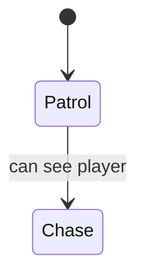

# Lab 16 - An Enemy with States

## 1. Overview

You build an enemy that patrols, chases, searches and can be stunned. You write it first as an enum and a `switch`, find where that stops working, then move to the State pattern. Its conditions come from a trigger zone, a shared variable and an event channel. The lab takes about 75 minutes.

---

## 2. What You Will Learn

| Skill | You can... |
|:------|:-----------|
| Implement a simple FSM | Write an enemy with an enum and a `switch`, and identify its limits |
| Apply the State pattern | Move behaviour into classes behind `IState`, run by `StateMachine` from `Assets/GD/Common` |
| Express transitions | Add transitions as `Func<bool>` in one place |
| Use varied conditions | Drive transitions from `ContactTrigger`, a `BoolVariable` and a channel |
| Pair setup and cleanup | Use `Enter` and `Exit` to prevent one state's values leaking |
| Trace state changes | Use the debugger to confirm the order of `Exit`, `Enter` and `Tick` |

---

## 3. Before You Start

| Item | Check |
|:-----|:------|
| Unity version | 6000.6.3f1 with URP 17.6.0 |
| AI Navigation | `Add Component` offers `NavMesh Surface` |
| DOTween | The panel at `Tools > Demigiant > DOTween Utility Panel` shows no red banner |
| Starter Assets | `Runtime/ThirdPersonController/Prefabs` contains `PlayerArmature`, `PlayerFollowCamera` and `MainCamera` |
| Common code | `Assets/GD/Common/Scripts` contains `StateMachines/StateMachine.cs`, `Triggers/ContactTrigger.cs` and `ScriptableObjects/Types/Tweens/TweenProfile.cs` |
| Debugger | You can attach your IDE to the Unity Editor and switch the Editor to debug mode ([Notes 01](../notes/01_unity_foundations.md), Section 4.9) |
| Notes | You have read [16 - State Machines and the State Pattern](../notes/16_state_machines.md), Sections 3 to 4.9 |

---

## 4. Plan

Complete the plan before Step 3.



Copy the diagram into `LabNotes.md` and complete it:

1. Add `Search`, with its way in and its two ways out, stating each condition as a sentence.
2. Add `Stunned`, and how it can be entered from every state.
3. For each state, list what `Enter` sets up, and what `Exit` must undo. Which state needs an `Exit`?
4. Choose one pair of arrows, and explain why the enemy cannot flicker between those states. Use Note 16, Section 4.7.

---

## 5. Steps

### Step 1 - Build the Scene

This step builds a level with a baked NavMesh, the third person player, and an enemy with nothing on it yet. (15 min)

1. Open `Tools > GD > Setup > Create Project Folders`. Set `Project Folder` to `Lab16`, choose `Project assets only` and click `Create Folders`.
2. Create a new scene and save it as `Assets/Lab16/Scenes/SCN_Lab16_Enemy.unity`. Delete `Main Camera`.
3. Create these objects, applying materials from `GD/Common/Materials`:

| Object | Type | Position | Scale | Notes |
|:--|:--|:--|:--|:--|
| `Level` | Empty | (0, 0, 0) | (1, 1, 1) | Parent of `Ground` and `Wall` |
| `Ground` | Plane | (0, 0, 0) | (3, 1, 3) | Child of `Level` |
| `Wall` | Cube | (0, 1.5, 6) | (8, 3, 0.5) | Child of `Level` |
| `WP_A` | Empty | (-10, 0, 10) | (1, 1, 1) | |
| `WP_B` | Empty | (10, 0, 10) | (1, 1, 1) | |
| `WP_C` | Empty | (10, 0, 0) | (1, 1, 1) | |
| `HideZone` | Cube | (-10, 1.5, -8) | (4, 3, 4) | Tick `Is Trigger`, use `Green` |
| `StunPad` | Cube | (10, 0.1, -8) | (3, 0.2, 3) | Tick `Is Trigger`, use `Blue` |
| `Enemy` | Capsule | (-10, 1, 10) | (1, 1, 1) | Use `Orange` |

4. Select `Level`. Add `NavMesh Surface`, set `Collect Objects` to `Current Object Hierarchy`, and click `Bake`.
5. On `Enemy`, add `Nav Mesh Agent`.
6. Add a child to `Enemy` named `SightZone`, with a `Sphere Collider`, `Radius` 7 and `Is Trigger` ticked.
7. From the third person `Prefabs` folder, drag in `MainCamera`, `PlayerFollowCamera` and `PlayerArmature`. Set `PlayerArmature` to `Position` (0, 0, -8). Set `Tracking Target` on `PlayerFollowCamera` to `PlayerCameraRoot`.

**Checkpoint:** the Scene view shows a blue NavMesh around the wall when `Show NavMesh` is on. In Play mode, the player moves and the enemy stands still. The player can walk through `HideZone` and `StunPad`.

### Step 2 - Write the Enum Version

This step writes the simple version. You need it to see what the pattern solves. (10 min)

1. Create `Assets/Lab16/Scripts/EnumEnemy.cs`:

```csharp
using UnityEngine;
using UnityEngine.AI;

/// <summary>
/// Patrols between waypoints, and chases the player while they are in range.
/// </summary>
[RequireComponent(typeof(NavMeshAgent))]
public class EnumEnemy : MonoBehaviour
{
    private enum EnemyState { Patrol, Chase }

    [SerializeField] private Transform player;
    [SerializeField] private Transform[] waypoints;
    [SerializeField, Min(0f)] private float sightRange = 7f;
    [SerializeField, Min(0f)] private float patrolSpeed = 2f;
    [SerializeField, Min(0f)] private float chaseSpeed = 4.5f;

    private NavMeshAgent agent;
    private EnemyState state = EnemyState.Patrol;
    private int waypointIndex;

    private void Awake()
    {
        agent = GetComponent<NavMeshAgent>();
    }

    private void Update()
    {
        bool playerInRange = Vector3.Distance(transform.position, player.position) < sightRange;

        switch (state)
        {
            case EnemyState.Patrol:
                agent.speed = patrolSpeed;
                agent.SetDestination(waypoints[waypointIndex].position);

                if (!agent.pathPending && agent.remainingDistance < 0.5f)
                    waypointIndex = (waypointIndex + 1) % waypoints.Length;

                if (playerInRange)
                    state = EnemyState.Chase;
                break;

            case EnemyState.Chase:
                agent.speed = chaseSpeed;
                agent.SetDestination(player.position);

                if (!playerInRange)
                    state = EnemyState.Patrol;
                break;
        }
    }
}
```

2. Add `Enum Enemy` to `Enemy`. Assign `PlayerArmature` to `Player`, and `WP_A`, `WP_B` and `WP_C` to `Waypoints`.
3. Press Play. Walk towards the enemy, and sprint away.

**Record:** without writing code, list every line you would change or add for a Search state, and for a Stun that can interrupt either state. How many branches does the stun touch? Which lines run every frame, but only need to run once? Keep this list, and compare it with Step 6.

**Checkpoint:** the enemy walks its route, speeds up and follows you when you come close, and returns to its route when you get away.

### Step 3 - Read the State Machine

This step reads the part that knows nothing about enemies. It is already in `Assets/GD/Common/Scripts/StateMachines`. (5 min)

1. Remove `Enum Enemy` from `Enemy`, and delete its script.
2. Open `IState.cs` and `StateMachine.cs`. Compare them with Note 16, Sections 4.3, 4.4 and 4.6.

**Record:** which types does `StateMachine` depend on? Could it run a door or a wave spawner with no change? Why does `Tick` change state before ticking the current state? Where does the first true condition win?

**Checkpoint:** you can state what each public method of `StateMachine` does, in one sentence each.

### Step 4 - Add the Enemy's Data and Context

This step adds the settings, the shared context, and a component that shows the state to the player. (10 min)

1. Create `Assets/Lab16/Scripts/Enemy/EnemySettings.cs`:

```csharp
using UnityEngine;

/// <summary>
/// Tuning values for one type of enemy.
/// </summary>
[CreateAssetMenu(fileName = "EnemySettings", menuName = "GD/Enemies/Enemy Settings")]
public class EnemySettings : ScriptableObject
{
    [Header("Speeds (metres per second)")]
    [SerializeField, Min(0f)] private float patrolSpeed = 2f;
    [SerializeField, Min(0f)] private float chaseSpeed = 4.5f;
    [SerializeField, Min(0f)] private float searchSpeed = 3f;

    [Header("Timing (seconds)")]
    [SerializeField, Min(0f), Tooltip("Time between path updates while chasing")]
    private float repathSeconds = 0.25f;

    [SerializeField, Min(0f), Tooltip("Time spent looking after reaching the last known position")]
    private float searchSeconds = 3f;

    [SerializeField, Min(0f)] private float stunSeconds = 2f;

    [Header("Navigation")]
    [SerializeField, Min(0f), Tooltip("Distance that counts as having arrived")]
    private float arriveDistance = 0.5f;

    [Header("Colours")]
    [SerializeField] private Color patrolColour = Color.green;
    [SerializeField] private Color chaseColour = Color.red;
    [SerializeField] private Color searchColour = Color.yellow;
    [SerializeField] private Color stunnedColour = Color.cyan;

    public float PatrolSpeed => patrolSpeed;
    public float ChaseSpeed => chaseSpeed;
    public float SearchSpeed => searchSpeed;
    public float RepathSeconds => repathSeconds;
    public float SearchSeconds => searchSeconds;
    public float StunSeconds => stunSeconds;
    public float ArriveDistance => arriveDistance;
    public Color PatrolColour => patrolColour;
    public Color ChaseColour => chaseColour;
    public Color SearchColour => searchColour;
    public Color StunnedColour => stunnedColour;
}
```

2. Create `Assets/Lab16/Scripts/Enemy/EnemyView.cs`:

```csharp
using DG.Tweening;
using GD.Types;
using UnityEngine;

/// <summary>
/// Shows the enemy's state to the player. States call this, and know nothing about renderers.
/// </summary>
public class EnemyView : MonoBehaviour
{
    [SerializeField] private Renderer bodyRenderer;
    [SerializeField] private TweenProfile tintProfile;

    private Material material;

    private void Awake()
    {
        // A copy for this enemy, so that enemies can show different states.
        material = bodyRenderer.material;
    }

    private void OnDestroy()
    {
        // Unity does not free a material copy made through Renderer.material.
        Destroy(material);
    }

    public void SetTint(Color colour)
    {
        material.DOKill();
        tintProfile.Apply(material.DOColor(colour, tintProfile.Duration)).SetLink(gameObject);
    }
}
```

3. Create `Assets/Lab16/Scripts/Enemy/EnemyContext.cs`:

```csharp
using GD.Types;
using UnityEngine;
using UnityEngine.AI;

/// <summary>
/// What the enemy's states share. Add to this only what several states need.
/// </summary>
public class EnemyContext
{
    public NavMeshAgent Agent { get; }
    public Transform Target { get; }
    public Transform[] Waypoints { get; }
    public EnemySettings Settings { get; }
    public EnemyView View { get; }
    public VoidEventChannel PlayerSpotted { get; }

    public EnemyContext(NavMeshAgent agent, Transform target, Transform[] waypoints,
        EnemySettings settings, EnemyView view, VoidEventChannel playerSpotted)
    {
        Agent = agent;
        Target = target;
        Waypoints = waypoints;
        Settings = settings;
        View = view;
        PlayerSpotted = playerSpotted;
    }

    /// <summary>True once the agent has a path and has come within the arrive distance.</summary>
    public bool HasArrived => !Agent.pathPending && Agent.remainingDistance <= Settings.ArriveDistance;
}
```

4. In `Assets/Lab16/Data`, create `Create > GD > Enemies > Enemy Settings`, named `ES_Guard`. Create `Create > GD > Tweens > Tween Profile`, named `TP_Tint`, with `Duration` 0.2 and `Ease` `OutCubic`. Create `Create > GD > Variables > Bool`, named `BV_PlayerHidden`, with an initial value of false. Create `Create > GD > Events > Void` twice, named `EC_PlayerSpotted` and `EC_StunRequested`, and tick `Log Raises` on `EC_PlayerSpotted`.
5. On `Enemy`, add `Enemy View`. Assign the capsule's `Mesh Renderer` and `TP_Tint`.

**Checkpoint:** the project compiles, and `ES_Guard` shows its values in the Inspector.

### Step 5 - Add Patrol, Chase and Search

This step adds three states, and connects them in one place. Compare this with the diagram in your plan. (15 min)

1. In `Assets/Lab16/Scripts/Enemy`, create `PatrolState.cs`:

```csharp
using GD.States;
using UnityEngine;

/// <summary>
/// Walks between waypoints in order.
/// </summary>
public class PatrolState : IState
{
    private readonly EnemyContext context;
    private int waypointIndex;

    public PatrolState(EnemyContext context)
    {
        this.context = context;
    }

    public void Enter()
    {
        context.Agent.speed = context.Settings.PatrolSpeed;
        context.View.SetTint(context.Settings.PatrolColour);
        MoveToCurrentWaypoint();
    }

    public void Tick()
    {
        if (!context.HasArrived)
            return;

        waypointIndex = (waypointIndex + 1) % context.Waypoints.Length;
        MoveToCurrentWaypoint();
    }

    public void Exit()
    {
    }

    private void MoveToCurrentWaypoint()
    {
        Transform waypoint = context.Waypoints[waypointIndex];
        context.Agent.SetDestination(waypoint.position);
    }
}
```

2. Create `ChaseState.cs`:

```csharp
using GD.States;
using UnityEngine;

/// <summary>
/// Follows the target, updating the path at a set interval rather than every frame.
/// </summary>
public class ChaseState : IState
{
    private readonly EnemyContext context;
    private float repathTimer;

    public ChaseState(EnemyContext context)
    {
        this.context = context;
    }

    public void Enter()
    {
        context.Agent.speed = context.Settings.ChaseSpeed;
        context.View.SetTint(context.Settings.ChaseColour);
        context.PlayerSpotted.Raise();
        repathTimer = 0f;
    }

    public void Tick()
    {
        repathTimer -= Time.deltaTime;

        if (repathTimer > 0f)
            return;

        repathTimer = context.Settings.RepathSeconds;
        context.Agent.SetDestination(context.Target.position);
    }

    public void Exit()
    {
    }
}
```

3. Create `SearchState.cs`:

```csharp
using GD.States;
using UnityEngine;

/// <summary>
/// Goes to where the target was last seen, looks for a while, then reports that it is finished.
/// </summary>
public class SearchState : IState
{
    private readonly EnemyContext context;
    private float lookTimer;

    public SearchState(EnemyContext context)
    {
        this.context = context;
    }

    /// <summary>A condition can read this, so the state need not know what comes next.</summary>
    public bool IsFinished { get; private set; }

    public void Enter()
    {
        IsFinished = false;
        lookTimer = context.Settings.SearchSeconds;
        context.Agent.speed = context.Settings.SearchSpeed;
        context.View.SetTint(context.Settings.SearchColour);
        context.Agent.SetDestination(context.Target.position);
    }

    public void Tick()
    {
        if (!context.HasArrived)
            return;

        lookTimer -= Time.deltaTime;
        IsFinished = lookTimer <= 0f;
    }

    public void Exit()
    {
    }
}
```

4. Create `EnemyBrain.cs`:

```csharp
using GD.States;
using GD.Types;
using UnityEngine;
using UnityEngine.AI;

/// <summary>
/// Builds the enemy's state machine and runs it. This is the only class that knows the
/// whole diagram of states and transitions.
/// </summary>
[RequireComponent(typeof(NavMeshAgent))]
public class EnemyBrain : MonoBehaviour
{
    [SerializeField] private EnemySettings settings;
    [SerializeField] private EnemyView view;
    [SerializeField] private Transform player;
    [SerializeField] private Transform[] waypoints;

    [Header("Conditions")]
    [SerializeField, Tooltip("True while the player is hidden, for every enemy")]
    private BoolVariable playerHidden;

    [SerializeField, Tooltip("Raised each time this enemy starts chasing")]
    private VoidEventChannel playerSpotted;

    [Header("Debug")]
    [SerializeField, Tooltip("Shows the current state in the Inspector during Play")]
    private string currentStateName;

    private StateMachine machine;
    private IState firstState;
    private bool playerInSight;

    private void Awake()
    {
        var context = new EnemyContext(GetComponent<NavMeshAgent>(), player, waypoints,
            settings, view, playerSpotted);

        var patrol = new PatrolState(context);
        var chase = new ChaseState(context);
        var search = new SearchState(context);

        bool CanSeePlayer() => playerInSight && !playerHidden.Value;

        machine = new StateMachine(this);
        machine.AddTransition(patrol, chase, CanSeePlayer);
        machine.AddTransition(chase, search, () => !CanSeePlayer());
        machine.AddTransition(search, chase, CanSeePlayer);
        machine.AddTransition(search, patrol, () => search.IsFinished);

        machine.StateChanged += state => currentStateName = state.GetType().Name;
        firstState = patrol;
    }

    private void Start()
    {
        // In Start, because SetState uses other objects that are ready after their Awake.
        machine.SetState(firstState);
    }

    private void Update()
    {
        machine.Tick();
    }

    /// <summary>Wire to On Enter and On Exit of a ContactTrigger on the enemy's sight zone.</summary>
    public void SetPlayerInSight(bool inSight)
    {
        playerInSight = inSight;
    }
}
```

5. Add `Enemy Brain` to `Enemy`. Assign `ES_Guard`, `Enemy View`, `PlayerArmature`, the three waypoints, `BV_PlayerHidden` and `EC_PlayerSpotted`.
6. On `SightZone`, add `Contact Trigger`, with `Required Tag` set to `Player`. Wire `On Enter` to `EnemyBrain.SetPlayerInSight`, ticked, and `On Exit` to the same method, unticked.
7. Open `Tools > GD > Analyse > State and Flow Viewer`. Press Play, and watch the enemy's state, its transitions and their answers. Enter the sight zone, get away from it, and watch what happens at the place you were last seen.

**Hypothesis:** in one change of state, `Exit` on the old state runs first, then `Enter` on the new one, and then `Tick` on the new one, all in the same frame.

8. Switch the Editor to debug mode and attach your IDE. Choose where to place breakpoints in `StateMachine` and in one state so that you can confirm that order. Inspect `CurrentState` at each one.
9. Remove the breakpoints, detach the debugger, and switch back to release mode.

**Record:** the order you saw, and whether the frame count stayed the same. Does the evidence support the hypothesis? Read `EnemyBrain.Awake` against your plan. Does every arrow appear? Does `PatrolState` mention any other state?

**Checkpoint:** the enemy is green on patrol, turns red and chases when you enter its zone, and turns yellow and goes to where you were when you escape. After about three seconds there it turns green, and resumes its route. Returning during the search makes it chase again. `EC_PlayerSpotted` logs once per chase.

### Step 6 - Add a Shared Variable as a Condition

This step adds hiding, with one line of code already in place and only Inspector wiring to add. (5 min)

1. On `HideZone`, add `Contact Trigger`, with `Required Tag` set to `Player`.
2. Under `On Enter`, drag in `BV_PlayerHidden`, choose `BoolVariable > bool Value`, and tick it. Under `On Exit`, do the same, unticked.
3. Press Play. Let the enemy chase you, then lead it to `HideZone`.

**Record:** which C# files did you change? `playerHidden` is a shared asset, while `playerInSight` is a field. What would go wrong with two enemies if `playerInSight` were also a shared asset? Use Note 16, Section 4.5.

**Checkpoint:** with the player inside `HideZone`, an enemy that was chasing goes to `SearchState` even when it is close. On leaving the zone, an enemy that is in range chases again. No C# file changed in this step.

### Step 7 - Add a Stunned State

This step adds an interrupt from every state. Compare the work with your Step 2 list. (10 min)

1. Create `Assets/Lab16/Scripts/Enemy/StunnedState.cs`:

```csharp
using GD.States;
using UnityEngine;

/// <summary>
/// Stops the agent. Exit restarts it, whichever state comes next.
/// </summary>
public class StunnedState : IState
{
    private readonly EnemyContext context;

    public StunnedState(EnemyContext context)
    {
        this.context = context;
    }

    public void Enter()
    {
        context.Agent.isStopped = true;
        context.View.SetTint(context.Settings.StunnedColour);
    }

    public void Tick()
    {
    }

    public void Exit()
    {
        context.Agent.isStopped = false;
    }
}
```

2. Replace the contents of `EnemyBrain.cs`:

```csharp
using GD.States;
using GD.Types;
using UnityEngine;
using UnityEngine.AI;

/// <summary>
/// Builds the enemy's state machine and runs it. This is the only class that knows the
/// whole diagram of states and transitions.
/// </summary>
[RequireComponent(typeof(NavMeshAgent))]
public class EnemyBrain : MonoBehaviour
{
    [SerializeField] private EnemySettings settings;
    [SerializeField] private EnemyView view;
    [SerializeField] private Transform player;
    [SerializeField] private Transform[] waypoints;

    [Header("Conditions")]
    [SerializeField, Tooltip("True while the player is hidden, for every enemy")]
    private BoolVariable playerHidden;

    [SerializeField, Tooltip("Raised each time this enemy starts chasing")]
    private VoidEventChannel playerSpotted;

    [SerializeField, Tooltip("Stuns this enemy when raised")]
    private VoidEventChannel stunRequested;

    [Header("Debug")]
    [SerializeField, Tooltip("Shows the current state in the Inspector during Play")]
    private string currentStateName;

    private StateMachine machine;
    private IState firstState;
    private bool playerInSight;
    private float stunnedUntil;

    private void Awake()
    {
        var context = new EnemyContext(GetComponent<NavMeshAgent>(), player, waypoints,
            settings, view, playerSpotted);

        var patrol = new PatrolState(context);
        var chase = new ChaseState(context);
        var search = new SearchState(context);
        var stunned = new StunnedState(context);

        bool CanSeePlayer() => playerInSight && !playerHidden.Value;
        bool IsStunned() => Time.time < stunnedUntil;

        machine = new StateMachine(this);
        machine.AddAnyTransition(stunned, IsStunned);
        machine.AddTransition(stunned, search, () => !IsStunned());
        machine.AddTransition(patrol, chase, CanSeePlayer);
        machine.AddTransition(chase, search, () => !CanSeePlayer());
        machine.AddTransition(search, chase, CanSeePlayer);
        machine.AddTransition(search, patrol, () => search.IsFinished);

        machine.StateChanged += state => currentStateName = state.GetType().Name;
        firstState = patrol;
    }

    private void OnEnable()
    {
        stunRequested.Raised += HandleStunRequested;
    }

    private void OnDisable()
    {
        stunRequested.Raised -= HandleStunRequested;
    }

    private void Start()
    {
        // In Start, because SetState uses other objects that are ready after their Awake.
        machine.SetState(firstState);
    }

    private void Update()
    {
        machine.Tick();
    }

    /// <summary>Wire to On Enter and On Exit of a ContactTrigger on the enemy's sight zone.</summary>
    public void SetPlayerInSight(bool inSight)
    {
        playerInSight = inSight;
    }

    private void HandleStunRequested()
    {
        // An event happens once, so leave a value for the condition to read each frame.
        stunnedUntil = Time.time + settings.StunSeconds;
    }
}
```

3. On `Enemy Brain`, assign `EC_StunRequested` to `Stun Requested`.
4. On `StunPad`, add `Contact Trigger`, with `Required Tag` set to `Player`. Under `On Enter`, drag in `EC_StunRequested` and choose `VoidEventChannel > Raise ()`.
5. Press Play. Step on `StunPad` while the enemy patrols, then while it chases, and again during its search. Step on it again during a stun.
6. Temporarily remove the body of `StunnedState.Exit`, and test again. Put it back.

**Record:** compare the files you changed with your Step 2 list. How many existing states did you edit? What happened without `Exit`, and which line of the old enum version would have had to do this job?

**Checkpoint:** from any state, the enemy stops and turns cyan for two seconds, then searches. Stepping on the pad again extends the stun. `PatrolState.cs`, `ChaseState.cs` and `SearchState.cs` are unchanged.

---

## 6. Debugging and Pitfalls

| Symptom | Likely cause | How to confirm | Fix |
|:--------|:-------------|:---------------|:----|
| `SetDestination can only be called on an active agent` | The NavMesh is not baked, or `Enemy` is off it | Turn on `Show NavMesh` | Bake it; check `Enemy`'s position |
| The enemy never chases | `Required Tag` differs, or `Is Trigger` is off | Breakpoint in `SetPlayerInSight` | `PlayerArmature` is tagged `Player`; tick `Is Trigger` |
| The enemy never leaves chase | `On Exit` is not wired, or is ticked | Read `playerInSight` in the debugger | Wire it, unticked |
| The enemy switches states rapidly | A condition and its opposite share one boundary | Look for the flicker warning in `State and Flow Viewer` | Compare with your plan; Note 16, Section 4.7 |
| Search finishes at once | `HasArrived` was read while a path was pending | Breakpoint in `SearchState.Tick` | Keep the `pathPending` check |
| The enemy stands still on patrol | `Waypoints` is empty, or a waypoint is off the NavMesh | Read `Agent.pathStatus` in the debugger | Assign them; move them |
| The tint does not change | `Body Renderer` or `Tint Profile` is empty, or the material has no colour | Check the component | Assign them; use a URP Lit material |
| `NullReferenceException` in `SetTint` | The first state entered before `EnemyView.Awake` | Check `SetState` is called from `Start` | Keep it in `Start` |
| Hiding has no effect | The wrong asset, or `Value` is static with the wrong tick | Watch `BV_PlayerHidden` in the Inspector during Play | Fix the event entries |
| The stun has no effect | The channel on the pad and on the brain differ | Tick `Log Raises` | Use `EC_StunRequested` on both |
| The enemy stays still after a stun | `Exit` did not restart the agent | Read `Agent.isStopped` | Restore the body of `Exit` |

---

## 7. Production Checklist

| Requirement | Done |
|:------------|:-----|
| `LabNotes.md` holds the completed state diagram | |
| `LabNotes.md` holds the Step 2 list, and the comparison from Step 7 | |
| `LabNotes.md` records debugger evidence for the order of `Exit`, `Enter` and `Tick` | |
| Patrol, chase, search and stunned all work, with a colour for each | |
| Conditions come from a trigger, a `BoolVariable`, a channel and a state property | |
| No state class mentions another state | |
| All speeds and durations come from `ES_Guard` | |
| No file in `Assets/ThirdParty` or `Assets/GD/Common` was edited | |

---

## 8. Extension

### Stretch - Investigate a Noise

An enemy should go to investigate a noise anywhere in the level. Use a `Vector3EventChannel` from `Assets/GD/Common`, raised by a trigger you place, with a new `InvestigateState`. A noise must not interrupt a chase, and a second noise during an investigation should update the destination.

**Expected result:** a patrolling enemy leaves its route for the noise, looks around and returns, and a chasing enemy ignores it. In `LabNotes.md`, explain in 100 to 150 words how a one-off event became something a condition can read, which order you added the transitions in, and how many existing states changed.

---

## 9. Reflective Questions

1. Using your Step 2 list and Step 7 results, state what the pattern saved, and what it cost in files and lines. Was it worth it for this enemy? Would it be for an enemy with only two states?
2. `EnemyBrain` is the one class that changes for every new state. Justify why that is acceptable, or describe how you would avoid it.
3. `EnemyContext` holds what states share. What would make you split it, and what are the signs it has grown too far?
4. `ChaseState` raises `PlayerSpotted` in `Enter`. Why there, and not in `EnemyBrain` or `Tick`? What could listen to it, with no change to the enemy?
5. Your enemy changes colour to show its state. What would a player need instead in a finished game, and which single class would change?

---

## 10. How This Builds

- **GCA - Gameplay Systems & Integration - Gameplay System 1** and **C# & Software Design - Software Design:** a diagram with matching code is direct evidence for both.

**Group project task (take-home).** Draw the state diagram of one behaviour in your group's game, even if it is currently written as flags in `Update`. Decide whether it needs an enum or the State pattern, and record the reason. Keep the diagram and the before version as evidence for your screencast.
