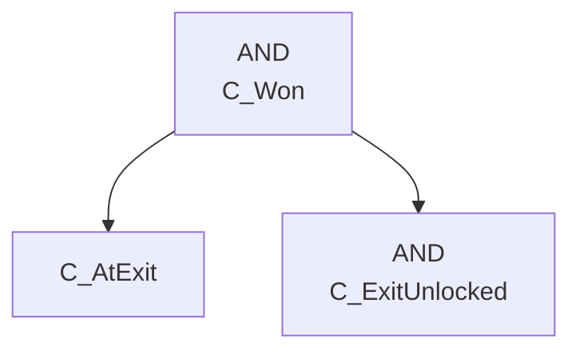

# Lab 17 - Win, Lose and Restart from Condition Assets

## 1. Overview

You give a small third person level a complete ending. The player must collect a key and five items, and set one of two levers, to open the exit. They lose if their health runs out, or if time runs out when they are outside a safe zone. You write those rules once as an `if` statement, then rebuild them as condition assets, and use them to drive a toast, an end screen, restart and quit. The lab takes about 75 minutes.

---

## 2. What You Will Learn

| Skill | You can... |
|:------|:-----------|
| Write state with no code | Set shared variables from `ContactTrigger` events |
| Build rules as assets | Combine leaf conditions with AND, OR, XOR and NOT, nested to several levels |
| Debug a rule | Use `Log State` and the debugger to find which part of a tree is false |
| React to a condition | Use `ConditionWatcher` to open a door and request a toast |
| Finish a game | Connect `GameEnding` assets to a toast, an end screen, restart and quit |
| Reset correctly | Show what breaks if a variable is not reset on restart |

---

## 3. Before You Start

| Item | Check |
|:-----|:------|
| Unity version | 6000.6.3f1 with URP 17.6.0 |
| DOTween | The panel at `Tools > Demigiant > DOTween Utility Panel` shows no red banner, and the `UI` module is active |
| Starter Assets | `Runtime/ThirdPersonController/Prefabs` contains `PlayerArmature`, `PlayerFollowCamera` and `MainCamera` |
| Common code | `Assets/GD/Common/Scripts` contains `Conditions/Condition.cs`, `Flow/GameEnd/GameEndFlow.cs`, `UI/ScreenPanel.cs` and `Controllers/Character/PlayerControlLock.cs` |
| TextMeshPro and UI | A UI `Button` can be created; import `TMP Essentials` if Unity asks |
| Debugger | You can attach your IDE to the Unity Editor and switch the Editor to debug mode ([Notes 01](../notes/01_unity_foundations.md), Section 4.9) |
| Notes | You have read [17 - Game Conditions and End States](../notes/17_game_conditions.md), Sections 3 to 4.9 |

---

## 4. Plan

Complete the plan before Step 4.



Copy the diagram into `LabNotes.md` and complete it:

1. Add the three children of `C_ExitUnlocked`: the key, the items, and exactly one of two levers.
2. Draw a second tree for `C_Lost`, in which the player loses when health has run out, or when time has run out and they are not in the safe zone.
3. Next to each leaf, write which variable it reads, and which object writes that variable.
4. Which rule would you check first if the player reaches the exit on the same frame that time runs out? Say why.

---

## 5. Steps

### Step 1 - Build the Scene

This step builds the level, its data assets and its UI. Nothing is connected yet. (15 min)

1. Open `Tools > GD > Setup > Create Project Folders`. Set `Project Folder` to `Lab17`, choose `Project assets only` and click `Create Folders`.
2. Create a new scene and save it as `Assets/Lab17/Scenes/SCN_Lab17_Conditions.unity`. Delete `Main Camera`. Add the scene under `File > Build Profiles > Scene List`, because restarting loads it by name.
3. Create these objects, applying materials from `GD/Common/Materials`. Tick `Is Trigger` on the collider of every object marked Trigger:

| Object | Type | Position | Scale | Notes |
|:--|:--|:--|:--|:--|
| `Ground` | Plane | (0, 0, 0) | (3, 1, 3) | |
| `Key` | Cube | (-8, 0.5, -4) | (0.5, 0.5, 0.5) | Trigger, `Yellow` |
| `Item_1` | Cube | (6, 0.5, -8) | (0.5, 0.5, 0.5) | Trigger, `Blue` |
| `Item_2` | Cube | (10, 0.5, -4) | (0.5, 0.5, 0.5) | Trigger, `Blue` |
| `Item_3` | Cube | (6, 0.5, 0) | (0.5, 0.5, 0.5) | Trigger, `Blue` |
| `Item_4` | Cube | (10, 0.5, 4) | (0.5, 0.5, 0.5) | Trigger, `Blue` |
| `Item_5` | Cube | (-8, 0.5, 4) | (0.5, 0.5, 0.5) | Trigger, `Blue` |
| `Hazard` | Cube | (0, 0.1, 0) | (3, 0.2, 3) | Trigger, `Red` |
| `SafeZone` | Cube | (-12, 1.5, -10) | (4, 3, 4) | Trigger, `Green` |
| `Lever_A` | Cube | (-4, 0.1, 6) | (2, 0.2, 2) | Trigger, `Orange` |
| `Lever_B` | Cube | (4, 0.1, 6) | (2, 0.2, 2) | Trigger, `Orange` |
| `ExitDoor` | Cube | (0, 1.5, 10) | (4, 3, 0.5) | |
| `ExitZone` | Empty | (0, 1.5, 12) | (1, 1, 1) | `Box Collider`, `Size` (4, 3, 2), Trigger |

4. From the third person `Prefabs` folder, drag in `MainCamera`, `PlayerFollowCamera` and `PlayerArmature`. Set `PlayerArmature` to `Position` (0, 0, -12). Set `Tracking Target` on `PlayerFollowCamera` to `PlayerCameraRoot`.
5. In `Assets/Lab17/Data`, use `Create > GD > Variables` to make these, setting each `Initial Value` as shown:

| Type | Assets |
|:--|:--|
| `Bool` | `BV_HasKey`, `BV_AtExit`, `BV_InSafeZone`, `BV_LeverA`, `BV_LeverB`, all false |
| `Int` | `IV_Items`, 0 |
| `Float` | `FV_Health`, 100; `FV_TimeLeft`, 90 |

6. In the same folder, use `Create > GD > Events` to make `Bool` channel `EC_ControlEnabled`, `String` channel `EC_ToastRequested`, and `Void` channel `EC_GameEnded`. Use `Create > GD > Tweens > Tween Profile` to make `TP_PanelFade`, with `Duration` 0.25 and `Ease` `OutCubic`.
7. On `PlayerArmature`, add `GD > Character > Player Control Lock`, and assign `Third Person Controller`. Add `Bool Event Channel Listener` with `EC_ControlEnabled`, and a `Response` calling the dynamic `PlayerControlLock.SetControlEnabled`.
8. Create a `Canvas`. If the `EventSystem` offers `Replace with InputSystemUIInputModule`, click it. Add:

| Panel | Contains | `Canvas Group` settings |
|:--|:--|:--|
| `ToastPanel`, a strip at the top | A `Text` child | `Alpha` 0, `Interactable` and `Blocks Raycasts` unticked |
| `EndPanel`, full screen | A `Text` child, `Button` "Restart", `Button` "Quit" | `Alpha` 0, `Interactable` and `Blocks Raycasts` unticked |

9. On each panel, add `Canvas Group` and `GD > UI > Screen Panel`, assigning `TP_PanelFade` to both profiles. Add `GD > UI > Toast View` to `ToastPanel`, and `GD > UI > End Screen` to `EndPanel`, and assign each one's `Text` child. On `ToastPanel`, add `String Event Channel Listener` with `EC_ToastRequested`, and a `Response` calling the dynamic `ToastView.Show`.

**Checkpoint:** in Play mode, the player can walk around, walks into the trigger objects with no effect, and is blocked by `ExitDoor`. Both panels are invisible, and the Console has no errors.

### Step 2 - Write the Rule as an If Statement

This step writes the direct version, so that you can compare the cost of changing it. (5 min)

1. Create `Assets/Lab17/Scripts/SimpleGameManager.cs`:

```csharp
using GD.Types;
using UnityEngine;

public class SimpleGameManager : MonoBehaviour
{
    [SerializeField] private BoolVariable hasKey;
    [SerializeField] private BoolVariable atExit;
    [SerializeField] private IntVariable itemsCollected;
    [SerializeField] private FloatVariable health;

    private bool finished;

    private void Update()
    {
        if (finished)
            return;

        if (health.Value <= 0f)
        {
            finished = true;
            Debug.Log("Lost");
        }
        else if (hasKey.Value && atExit.Value && itemsCollected.Value >= 5)
        {
            finished = true;
            Debug.Log("Won");
        }
    }
}
```

2. Add it to an empty `Manager`, assign the variables, and press Play. You cannot win yet, because nothing writes the variables.

**Record:** without coding it, list what would change for each of these: a third lever; "three items on easy"; a second level with no key; a door that also needs "has the key". Keep your list for Step 5.

**Checkpoint:** the project compiles, and the Console stays empty while you play. Remove `Simple Game Manager` from `Manager` at the end of Step 3.

### Step 3 - Write State with No Code

This step connects the level to its variables, using only the Inspector. (10 min)

Add `Contact Trigger` to each object below, with `Required Tag` set to `Player`, and wire it as shown:

| Object | `On Enter` | `On Exit` |
|:--|:--|:--|
| `Key` | `BV_HasKey > bool Value`, ticked; then `GameObject.SetActive`, unticked, on `Key` | |
| `Item_1` to `Item_5` | `IV_Items > IntVariable.Add (int)`, 1; then `GameObject.SetActive`, unticked, on itself | |
| `Hazard` | `FV_Health > FloatVariable.Add (float)`, -40 | |
| `SafeZone` | `BV_InSafeZone > bool Value`, ticked | The same, unticked |
| `Lever_A` | `BV_LeverA > BoolVariable.Toggle` | |
| `Lever_B` | `BV_LeverB > BoolVariable.Toggle` | |
| `ExitZone` | `BV_AtExit > bool Value`, ticked | The same, unticked |

Press Play. Select each variable asset in turn, and watch its value in the Inspector as you collect, step on and leave each object.

**Record:** which C# files did you write in this step? `Lever_A` toggles, and `SafeZone` sets and clears. Why does each one suit its behaviour?

**Checkpoint:** each variable changes as you act. Every pickup disappears when collected. `IV_Items` reaches 5, and `FV_Health` falls by 40 per step onto `Hazard`.

### Step 4 - Build the Rules as Assets

This step rebuilds the rules as a tree of assets, using the classes in `Assets/GD/Common/Scripts/Conditions`. (15 min)

1. In `Assets/Lab17/Data/Conditions`, use `Create > GD > Conditions` to make these, in this order:

| Asset | Menu entry | Settings |
|:--|:--|:--|
| `C_HasKey` | `Bool Variable` | `BV_HasKey`, expected true |
| `C_AtExit` | `Bool Variable` | `BV_AtExit`, expected true |
| `C_InSafeZone` | `Bool Variable` | `BV_InSafeZone`, expected true |
| `C_LeverA` | `Bool Variable` | `BV_LeverA`, expected true |
| `C_LeverB` | `Bool Variable` | `BV_LeverB`, expected true |
| `C_FiveItems` | `Int Variable` | `IV_Items`, `GreaterOrEqual`, 5 |
| `C_NoHealth` | `Float Variable` | `FV_Health`, `LessOrEqual`, 0 |
| `C_NoTime` | `Float Variable` | `FV_TimeLeft`, `LessOrEqual`, 0 |
| `C_OneLever` | `Exactly One (XOR)` | `C_LeverA`, `C_LeverB` |
| `C_ExitUnlocked` | `All (AND)` | `C_HasKey`, `C_FiveItems`, `C_OneLever` |
| `C_Won` | `All (AND)` | `C_ExitUnlocked`, `C_AtExit` |
| `C_NotSafe` | `Not` | `C_InSafeZone` |
| `C_OutOfTime` | `All (AND)` | `C_NoTime`, `C_NotSafe` |
| `C_Lost` | `Any (OR)` | `C_NoHealth`, `C_OutOfTime` |

2. Press Play. Right-click `C_ExitUnlocked` in the Project window, or use the `...` menu in its Inspector, and choose `Log State`. Collect the key, and log it again.

**Hypothesis:** `AllCondition` stops at the first false child, so while the player has no key, `IntVariableCondition.IsMet` does not run for `C_FiveItems`.

3. Switch the Editor to debug mode and attach your IDE. Choose where to place breakpoints in `AllCondition` and `IntVariableCondition`, so that you can test this without changing any code. Note that `Log State` itself reads every child, so call `IsMet` in a way that does not use it, as Step 5 will.
4. Finish this test in Step 5, with the watcher running. Then remove the breakpoints, detach the debugger, and switch back to release mode.
5. Remove `Simple Game Manager` from `Manager`.

**Record:** paste one `Log State` output into `LabNotes.md`. Compare it with your Plan. Use your Step 2 list, and write how each change would be made now.

**Checkpoint:** `Log State` prints the tree, with each line showing met or not met. Pressing both levers makes `C_OneLever` not met.

### Step 5 - React with a Watcher

This step opens the exit when a rule is met, and closes it again if the rule stops being met. No script is needed. (10 min)

1. On `Manager`, add `GD > Conditions > Condition Watcher`, and set `Condition` to `C_ExitUnlocked`.
2. Under `On Met`, add `GameObject.SetActive`, unticked, on `ExitDoor`, and `StringEventChannel.Raise (string)` on `EC_ToastRequested`, with the text "The exit is open".
3. Under `On No Longer Met`, add `GameObject.SetActive`, ticked, on `ExitDoor`, and a second toast with the text "The exit has closed".
4. Press Play. Collect the key and the items. Step on `Lever_A`. Then step on `Lever_B`.
5. With the debugger attached, complete the hypothesis test from Step 4.

**Record:** the result of your test. Does the evidence support the hypothesis? Why must `IsMet` have no side effects? Why does the door not open a second time on each frame the rule is met?

**Checkpoint:** the door opens once all three parts of the rule are met, with a toast. Pressing the second lever closes it, with another toast. Pressing either lever again opens it.

### Step 6 - Finish the Game

This step connects the rules to the end of the game: a toast, a locked player, an end screen, restart and quit. (15 min)

1. Create `Assets/Lab17/Scripts/LevelTimer.cs`:

```csharp
using GD.Types;
using UnityEngine;

/// <summary>
/// Counts a shared float down to zero. Disable this component to stop the clock.
/// </summary>
public class LevelTimer : MonoBehaviour
{
    [SerializeField] private FloatVariable timeLeft;

    private void Update()
    {
        timeLeft.Value = Mathf.Max(timeLeft.Value - Time.deltaTime, 0f);
    }
}
```

2. On `Manager`, add `Level Timer`, with `FV_TimeLeft` assigned. Add `Void Event Channel Listener` with `EC_GameEnded`, and a `Response` that sets `LevelTimer.enabled` to unticked.
3. In `Assets/Lab17/Data`, use `Create > GD > Conditions > Game Ending` to make `GE_Lost`, with `C_Lost`, the title "You Lost" and a toast "Out of luck", and `GE_Won`, with `C_Won`, the title "You Escaped" and a toast "You made it".
4. On `Manager`, add `GD > Flow > Game End Flow`. Tick `Play Once`. Set `Endings` to `GE_Lost`, then `GE_Won`. Assign `EndPanel` to `End Screen`, and the three channels.
5. On `Manager`, add `GD > Flow > Game Session`. Add all five `Bool` variables, `IV_Items`, and both `Float` variables to its lists.
6. On the `Restart` button, wire `On Click` to `GameSession.Restart`. On the `Quit` button, wire `On Click` to `GameSession.Quit`.
7. Press Play. Win the game, and click `Restart`. Play again and step on `Hazard` three times. Click `Restart`. Set `Initial Value` on `FV_TimeLeft` to 15 for a test: let time run out outside `SafeZone`, then again inside it, then set it back to 90.
8. Remove `IV_Items` from the list on `Game Session`. Collect the items, reach an ending, and click `Restart`. Collect the key, and set one lever. Add `IV_Items` back to the list.

**Record:** what happened in the last test, and why? Could you stand in `SafeZone` forever when time has run out? Is that the design you want? How would you change it with one asset edit?

**Checkpoint:** each ending shows its toast, then locks the player and fades in its title, with a free cursor. `Restart` gives a new game, with all objects back and all values reset. `Quit` stops Play mode in the Editor. With `IV_Items` left out of the list, the door opens with no items collected in the second game.

---

## 6. Debugging and Pitfalls

| Symptom | Likely cause | How to confirm | Fix |
|:--------|:-------------|:---------------|:----|
| The game ends as soon as Play starts | A variable's `Initial Value` makes a rule true, such as `FV_Health` at 0 | `Log State` on `C_Lost` | Set `Initial Value` to the table's value |
| The game ends straight after `Restart` | A variable is missing from `Game Session` | `Log State` after reloading | Add it to the list |
| A rule never becomes met | One child is false, or a slot is empty | `Log State` on the root | Fix that child |
| `C_OneLever` is never met | One lever is already on, and pressing the other turned both on | Watch both assets | Press one again to turn it off |
| A lever flips twice | The player left and entered again, or the trigger is on the wrong object | Watch the asset | Stand clear, then step on once |
| `bool Value` is not offered in the event list | The asset is in the wrong field | Check that you dragged in the asset | Drag the variable asset into the event's object slot |
| A toast never appears | `String Event Channel Listener` uses a static string, or the panel is inactive | Tick `Log Raises` on the channel | Choose `Show` under `Dynamic string`; keep the panel active |
| The cursor stays locked on the end screen | `PlayerControlLock` did not hear `EC_ControlEnabled` | Breakpoint in `SetControlEnabled` | Check the listener's channel |
| The buttons cannot be clicked | The `EventSystem` uses the old input module | Check its component | Click the replace button on it |
| `Scene couldn't be loaded because it has not been added` | The scene is not in the list | `File > Build Profiles` | Add it under `Scene List` |
| Two endings appear to compete | Both rules are met, and the order decides | Read `Endings` on `Game End Flow` | Set the order you want |
| `Stack overflow`, or an error from `OnValidate` | A group contains itself | Read the error, which selects the asset | Remove the loop |

---

## 7. Production Checklist

| Requirement | Done |
|:------------|:-----|
| All rules are condition assets, and no game rule is left in a script | |
| AND, OR, XOR and NOT are all in use, with at least one nested group | |
| `LabNotes.md` holds a `Log State` output, and debugger evidence for stopping at the first false child | |
| The exit door opens and closes from `Condition Watcher`, with toasts | |
| Winning and losing each show a toast and the correct title, and lock the player | |
| `Restart` gives a clean new game, and `Quit` works | |
| `LabNotes.md` records what happens if a variable is not reset | |
| No file in `Assets/ThirdParty` or `Assets/GD/Common` was edited | |

---

## 8. Extension

### Stretch - An Alarm with a State Machine

Build an `Alarm` light with `Calm` and `Alarmed` states, using `StateMachine` and `IState` from `Assets/GD/Common`. Pass condition assets as its transitions, for example `machine.AddTransition(calm, alarmed, alarmOn.IsMet)`. The alarm rule is a new asset: time below 30 seconds, or health below 50.

**Expected result:** the light changes as the rule changes, and a designer can change the alarm rule by editing assets, with no code. In `LabNotes.md`, explain in 100 to 150 words why `StateMachine` needed no change to accept a `Condition`, and whether the same rule should also drive a `ConditionWatcher`.

---

## 9. Reflective Questions

1. Compare your Step 2 list with what the same changes need now. Was the asset version worth it for this game? For which game would you keep the `if`?
2. `GE_Lost` comes before `GE_Won` in your list. Argue for the opposite order, using what a player would feel when both happen in one frame.
3. Step 6 showed the result of forgetting one variable. How would you make this mistake harder for a group to make, and what would that cost?
4. `Lever_A` writes a variable, and `C_LeverA` reads it. Neither knows the other. Which SOLID principle does this show, and what would break if the condition read the trigger directly?
5. Write down one rule in your group's game. Which leaf types does it need? If it needs a new leaf, could a variable be used instead?

---

## 10. How This Builds

- **GCA - C# & Software Design - Data & State:** rules as assets, which change with no code, are direct evidence.
- **GCA - Gameplay Systems & Integration - Systems Integration:** a complete win, lose and restart loop that connects triggers, variables, flows and UI is direct evidence.

**Group project task (take-home).** Write your group's win and lose rules as trees. Build them as assets in your own project, connect them to `GameEndFlow`, and record the `if` version or a sketch of your old rules as a before-and-after in your project log.
