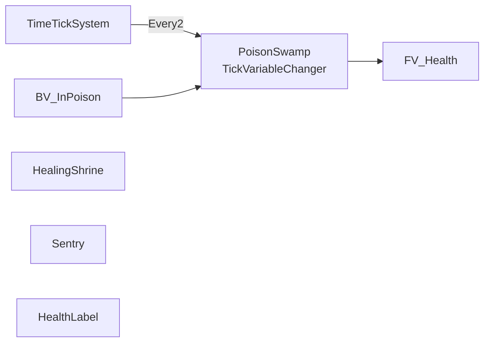

# Lab 18 - Hazards, Sensors and a HUD on Ticks

## 1. Overview

You build a small third person level with a poison swamp, a healing shrine, a sentry with a lamp, and a health label. You write the swamp first with a timer in `Update`, then move every rule onto `TimeTickSystem` from `Assets/GD/Common`. Then you follow ticks in the debugger, and test that health changes at the same rate at 20 and at 120 frames per second. The lab takes about 70 minutes.

---

## 2. What You Will Learn

| Skill | You can... |
|:------|:-----------|
| Set up the tick system | Add one `TimeTickSystem` to a scene and choose its settings |
| Write tick components | Extend `TickBehaviour` and write only `HandleTick` |
| Keep rates per second | Use `SecondsPerTick` so damage and healing do not depend on the tick rate |
| Poll on a tick | Check for a target in range a few times a second, and raise events only on a change |
| Debug ticks | Use breakpoints to confirm which ticks a handler runs on, and what happens after a long frame |
| Test frame-rate independence | Show that a rule gives the same result at two frame rates |

---

## 3. Before You Start

| Item | Check |
|:-----|:------|
| Unity version | 6000.6.3f1 with URP 17.6.0 |
| Starter Assets | `Runtime/ThirdPersonController/Prefabs` contains `PlayerArmature`, `PlayerFollowCamera` and `MainCamera` |
| Common code | `Assets/GD/Common/Scripts/Time/Tick` contains `IHandleTicks.cs`, `TickBehaviour.cs` and `TimeTickSystem.cs` |
| TextMeshPro | A `Text - TextMeshPro` object can be created; import `TMP Essentials` if Unity asks |
| Debugger | You can attach your IDE to the Unity Editor and switch the Editor to debug mode ([Notes 01](../notes/01_unity_foundations.md), Section 4.9) |
| Notes | You have read [18 - Tick Systems](../notes/18_tick_systems.md), Sections 3 to 4.11 |

---

## 4. Plan

Complete the plan before Step 4.



Copy the diagram into `LabNotes.md` and complete it:

1. Connect `HealingShrine`, `Sentry` and `HealthLabel` to the clock, and label each link with the rate you plan to use.
2. Add the variable each one reads or writes, and the object that writes each `BoolVariable`.
3. Mark the one connection that does not go through a tick, because something else announces it.
4. Which handlers run on tick 4? Which run on tick 6? Write both lists, in the order Note 18, Section 4.5 says they are called.

---

## 5. Steps

### Step 1 - Build the Scene

This step builds the level and its data. Nothing ticks yet. (15 min)

1. Open `Tools > GD > Setup > Create Project Folders`. Set `Project Folder` to `Lab18`, choose `Project assets only` and click `Create Folders`.
2. Create a new scene and save it as `Assets/Lab18/Scenes/SCN_Lab18_Ticks.unity`. Delete `Main Camera`.
3. Create these objects, applying materials from `GD/Common/Materials`. Tick `Is Trigger` on the collider of every object marked Trigger:

| Object | Type | Position | Scale | Notes |
|:--|:--|:--|:--|:--|
| `Ground` | Plane | (0, 0, 0) | (3, 1, 3) | |
| `PoisonSwamp` | Cube | (-6, 0.1, 0) | (6, 0.2, 6) | Trigger, `Green` |
| `HealingShrine` | Cube | (6, 0.1, 0) | (3, 0.2, 3) | Trigger, `Blue` |
| `Sentry` | Cube | (0, 1, 8) | (1, 2, 1) | `Red` |
| `Lamp` | Point Light, child of `Sentry` | (0, 1.2, 0) | | `Color` red, `Range` 5, `Intensity` 3, `Light` component unticked |

4. From the third person `Prefabs` folder, drag in `MainCamera`, `PlayerFollowCamera` and `PlayerArmature`. Set `PlayerArmature` to `Position` (0, 0, -8). Set `Tracking Target` on `PlayerFollowCamera` to `PlayerCameraRoot`.
5. Under `Edit > Project Settings > Tags and Layers`, add a layer named `Player`. Set `PlayerArmature`'s `Layer` to `Player`, and choose `Yes, change children`, because the sentry will look for this layer only.
6. In `Assets/Lab18/Data`, use `Create > GD > Variables` to make `Bool` assets `BV_InPoison` and `BV_OnShrine`, both false, and `Float` asset `FV_Health` with `Initial Value` 100.
7. On `PoisonSwamp`, add `Contact Trigger` with `Required Tag` set to `Player`. Under `On Enter`, drag in `BV_InPoison` and choose `BoolVariable > bool Value`, ticked. Under `On Exit`, do the same, unticked. Repeat on `HealingShrine` with `BV_OnShrine`.

**Checkpoint:** in Play mode, the player walks across both pads, and is blocked by `Sentry`. The Console has no errors.

### Step 2 - Add the Clock and a Health Label

This step adds the one clock and a label to watch health with. (8 min)

1. Create an empty object named `TimeTickSystem`, and add `GD > Time > Time Tick System`. Leave `Base Tick Interval` at 0.1, `Max Ticks Per Frame` at 3, and `Use Unscaled Time` and `Spread Handlers` unticked.
2. Open `TickBehaviour.cs` in `Assets/GD/Common/Scripts/Time/Tick`. Compare it with Note 18, Section 4.6.
3. Create a `Canvas` with a `Text - TextMeshPro` child named `HealthLabel`, anchored to the top left.
4. Create `Assets/Lab18/Scripts/TickFloatLabel.cs`:

```csharp
using GD.Tick;
using GD.Types;
using TMPro;
using UnityEngine;

/// <summary>
/// Shows a float in a TextMeshPro label, refreshed on ticks rather than every frame.
/// </summary>
public class TickFloatLabel : TickBehaviour
{
    [SerializeField] private FloatVariable source;
    [SerializeField] private TMP_Text label;

    [SerializeField, Tooltip("{0} is the value. In TextMeshPro, {0:1} shows one decimal place")]
    private string format = "Health {0:0}";

    // NaN is never equal to a real value, so the first tick always draws the label.
    private float shownValue = float.NaN;

    public override void HandleTick()
    {
        // Rebuilding text is the costly part, so skip it when nothing has changed.
        if (source.Value == shownValue)
            return;

        shownValue = source.Value;
        label.SetText(format, shownValue);
    }
}
```

5. Add `Tick Float Label` to `HealthLabel`. Set `Tick Rate` to `Every2`, `Source` to `FV_Health`, and `Label` to the object's own text component.

**Record:** in `LabNotes.md`, answer: which two methods does `TickBehaviour` write for you? Why does it keep `registeredRate` rather than using `tickRate` in `OnDisable`?

**Checkpoint:** in Play mode, the label reads `Health 100`. The Hierarchy shows the scene's `TimeTickSystem` and no second one.

### Step 3 - Write the Poison as an Update Timer

This step builds the first version, so you have something to improve on. (8 min)

1. Create `Assets/Lab18/Scripts/PoisonTimerUpdate.cs`:

```csharp
using GD.Types;
using UnityEngine;

/// <summary>
/// Changes health every half second while the player is in the zone,
/// using a timer of its own.
/// </summary>
public class PoisonTimerUpdate : MonoBehaviour
{
    [SerializeField] private BoolVariable inZone;
    [SerializeField] private FloatVariable health;
    [SerializeField, Min(0.01f)] private float interval = 0.5f;
    [SerializeField] private float amountPerInterval = -5f;

    private float timer;

    private void Update()
    {
        timer += Time.deltaTime;

        if (timer < interval)
            return;

        timer -= interval;

        if (inZone.Value)
            health.Add(amountPerInterval);
    }
}
```

2. Add `Poison Timer Update` to `PoisonSwamp`. Set `In Zone` to `BV_InPoison` and `Health` to `FV_Health`.
3. Press Play and stand in the swamp.

**Record:** without writing code, list what you would add for the shrine to heal 5 per second, and for the sentry to check for the player four times a second. How many timers would the level have? Where would you change them all to make the game's rhythm faster? Keep this list for Reflective Question 1.

**Checkpoint:** in the swamp, health falls by 5 every half second, and stops falling when you step out. Health can go below 0, which Step 4 fixes.

### Step 4 - Replace the Timers with a Tick Component

This step replaces the timer with one component that both pads use. (10 min)

1. Remove `Poison Timer Update` from `PoisonSwamp`.
2. Create `Assets/Lab18/Scripts/TickVariableChanger.cs`:

```csharp
using GD.Tick;
using GD.Types;
using UnityEngine;

/// <summary>
/// While a flag is true, changes a float at a rate per second, applied once
/// per tick. One class covers poison, healing, oxygen and stamina.
/// </summary>
public class TickVariableChanger : TickBehaviour
{
    [SerializeField] private BoolVariable whileTrue;
    [SerializeField] private FloatVariable target;

    [SerializeField, Tooltip("Change per second. Use a negative rate to drain")]
    private float ratePerSecond = -10f;

    [SerializeField] private float minValue;
    [SerializeField] private float maxValue = 100f;

    public override void HandleTick()
    {
        if (!whileTrue.Value)
            return;

        // The rate is per second, so it is scaled by the seconds this tick stands for.
        float next = target.Value + ratePerSecond * SecondsPerTick;
        target.Value = Mathf.Clamp(next, minValue, maxValue);
    }
}
```

3. Add `Tick Variable Changer` to both pads:

| Object | `Tick Rate` | `While True` | `Target` | `Rate Per Second` | `Min Value` | `Max Value` |
|:--|:--|:--|:--|:--|:--|:--|
| `PoisonSwamp` | `Every2` | `BV_InPoison` | `FV_Health` | -10 | 0 | 100 |
| `HealingShrine` | `Every4` | `BV_OnShrine` | `FV_Health` | 5 | 0 | 100 |

4. Press Play. Lose some health in the swamp, then heal on the shrine.
5. Stop. Change the swamp's `Tick Rate` to `Every8`, and play again.

**Record:** how much health does the swamp take per tick at `Every2`, and at `Every8`? Is the loss per second the same? Which line makes it so?

**Checkpoint:** the swamp drains 10 health per second, the shrine restores 5 per second, and health stays between 0 and 100. At `Every8`, the label changes in larger, less frequent steps, but 10 seconds in the swamp still take all 100 health. Set the swamp back to `Every2`.

### Step 5 - Add the Sentry

This step polls a question that nothing announces: is the player in range? (10 min)

1. Create `Assets/Lab18/Scripts/TickProximitySensor.cs`:

```csharp
using GD.Tick;
using UnityEngine;
using UnityEngine.Events;

/// <summary>
/// Checks a few times a second for a target in range, and raises an event
/// when one is first found and when none remain.
/// </summary>
public class TickProximitySensor : TickBehaviour
{
    [SerializeField, Min(0f)] private float range = 6f;
    [SerializeField] private LayerMask targetLayers;
    [SerializeField] private UnityEvent onDetected;
    [SerializeField] private UnityEvent onLost;

    // Reused by every check, so sensing does not allocate. One slot is enough
    // to know whether anything is in range.
    private readonly Collider[] hits = new Collider[1];
    private bool detected;

    public override void HandleTick()
    {
        int count = Physics.OverlapSphereNonAlloc(
            transform.position, range, hits, targetLayers, QueryTriggerInteraction.Ignore);

        bool found = count > 0;

        if (found == detected)
            return;

        detected = found;

        if (found)
            onDetected.Invoke();
        else
            onLost.Invoke();
    }

    private void OnDrawGizmosSelected()
    {
        Gizmos.color = detected ? Color.red : Color.yellow;
        Gizmos.DrawWireSphere(transform.position, range);
    }
}
```

2. Add `Tick Proximity Sensor` to `Sentry`. Set `Tick Rate` to `Every4`, `Range` to 6, and `Target Layers` to `Player` only.
3. Under `On Detected`, drag in `Lamp` and choose `Light > bool enabled`, ticked. Under `On Lost`, do the same, unticked.
4. Select `Sentry` so its range gizmo shows, press Play, and walk in and out of the sphere.

**Checkpoint:** the lamp turns on shortly after you enter the sphere and off shortly after you leave. The delay is never more than about 0.4 s.

### Step 6 - Follow Ticks in the Debugger

This step tests a hypothesis about when handlers run, and what happens after a long frame. (10 min)

**Hypothesis:** the sentry runs only on ticks that are multiples of 4. After the game stops at a breakpoint for several seconds, the next frame sends at most 3 ticks, so the player does not take several seconds of poison at once.

1. Switch the Editor to debug mode and attach your IDE.
2. Choose where to place a breakpoint so that you stop each time the sentry runs. Press Play. Each time it stops, inspect `TimeTickSystem.Instance.Tick` in the Watch window, write the value in `LabNotes.md`, and continue. Record at least four values.
3. Remove the sentry breakpoint. On `TimeTickSystem`, tick `Use Unscaled Time`, because Unity already limits scaled time after a long frame (Note 18, Section 4.7), and this test is about the system's own limit.
4. Stand in the swamp, and note the health shown. Choose where to place a breakpoint in `TimeTickSystem` so you stop once per tick sent. Stay stopped for at least five seconds, then continue several times, recording `Tick` each time.
5. Remove the breakpoints, untick `Use Unscaled Time`, detach the debugger, and switch back to release mode.

**Record:** do your values confirm both parts of the hypothesis? How many ticks were sent in the first frame after the pause, and how much health was lost compared with five seconds of play? Which lines of `Update` in `TimeTickSystem` decide this? With `Use Unscaled Time` unticked, what would have limited the catch-up instead?

**Checkpoint:** `LabNotes.md` holds a list of sentry ticks, all multiples of 4, and a short explanation of the catch-up you saw after the pause, citing the lines responsible.

### Step 7 - Test at Two Frame Rates

This step shows that a tick-driven rule does not depend on the frame rate. (8 min)

1. Create `Assets/Lab18/Scripts/FrameRateCap.cs`:

```csharp
using UnityEngine;

/// <summary>
/// Limits the frame rate, so behaviour can be compared at a low and a high rate.
/// </summary>
public class FrameRateCap : MonoBehaviour
{
    [SerializeField, Range(10, 240)] private int targetFrameRate = 30;

    private void Update()
    {
        // VSync overrides targetFrameRate, so it is turned off while testing.
        QualitySettings.vSyncCount = 0;
        Application.targetFrameRate = targetFrameRate;
    }

    private void OnDisable()
    {
        // -1 is Unity's default: no limit.
        Application.targetFrameRate = -1;
    }
}
```

2. Create an empty object named `FrameRateCap`, and add the component with `Target Frame Rate` 20. Turn on the Game view's `Stats` panel to see the frame rate.
3. Press Play, step into the swamp, and time how long health takes to fall from 100 to 0, using a phone stopwatch.
4. Repeat at 120. If your monitor or machine cannot reach 120, use the highest rate the `Stats` panel shows.

**Record:** both times, and the frame rate `Stats` showed for each. Why is the result about the same? What would differ if `TickVariableChanger` subtracted a fixed 2 per tick instead of using `SecondsPerTick`, and the swamp's rate were changed?

**Checkpoint:** both runs take about 10 seconds. Disable `FrameRateCap` when you finish.

---

## 6. Debugging and Pitfalls

| Symptom | Likely cause | How to confirm | Fix |
|:--------|:-------------|:---------------|:----|
| The label never changes from its placeholder text | `HandleTick` is not called, or `Source` is empty | Breakpoint in `HandleTick` | Assign `Source` and `Label`; check that the component is enabled |
| Changing settings on `TimeTickSystem` does nothing | A second, hidden system is in use | `TimeTickSystem.Instance` in the Watch window: is it the scene's object? | Keep the scene's object active, and add only one |
| Health never changes in the swamp | `BV_InPoison` is never set, or `Required Tag` does not match | Breakpoint in `HandleTick`, and inspect `whileTrue.Value` | Check the `Contact Trigger` events and the player's tag |
| Health goes below 0 | `Poison Timer Update` is still on the swamp | Look at the swamp's components | Remove it |
| Health changes twice as fast as expected | Two changers on one pad | Look at the pad's components | Remove one |
| The lamp never turns on | `Target Layers` does not include the player, or children were not moved to `Player` | Breakpoint after `OverlapSphereNonAlloc`, and inspect `count` | Set the layer on `PlayerArmature` and its children |
| The lamp turns on at the edge of the swamp | `Range` reaches the swamp | The gizmo with `Sentry` selected | Lower `Range` or move the sentry |
| Frame rates do not change in Step 7 | VSync is on, or `FrameRateCap` is disabled | `Stats` panel | Keep `FrameRateCap` enabled, and turn off any VSync option in the Game view |
| `When Play stops, some objects were not cleaned up` | A handler's `OnDisable` uses `Instance` without `HasInstance` | Read the warning's stack trace | Extend `TickBehaviour`, which guards it |

---

## 7. Production Checklist

| Requirement | Done |
|:------------|:-----|
| The scene has one `TimeTickSystem`, and no rule in the lab has a timer of its own | |
| The swamp and shrine use one class, configured twice | |
| Damage and healing are per second, and the same at `Every2` and `Every8` | |
| The sentry's lamp changes only when the answer changes | |
| `LabNotes.md` holds the completed plan, and the Step 3 list of timers | |
| `LabNotes.md` holds the Step 6 debugger evidence and the Step 7 timings | |
| No file in `Assets/ThirdParty` or `Assets/GD/Common` was edited | |

---

## 8. Extension

### Stretch - A Field of Sentries

Duplicate `Sentry` until there are eight, in a ring round the shrine. Add a log line to `TickProximitySensor.HandleTick` that prints `TimeTickSystem.Instance.Tick` and the object's name. Play for a few seconds with `Spread Handlers` off, then again with it on.

**Expected result:** with spreading off, all eight sentries log on the same ticks, every fourth tick. With it on, two log on every tick. In `LabNotes.md`, record a table of sentries per tick for both runs, and explain in 100 to 150 words when you would turn spreading on in your group's game, and what a sentry that feeds an AI decision would lose. Remove the log line afterwards.

---

## 9. Reflective Questions

1. Compare your Step 3 list with the finished level. How many timers does it have now? Which change would have been hardest with the `Update` version?
2. The swamp ticks at `Every2` and the shrine at `Every4`. Using Note 18, Section 4.5, explain what happens on tick 4 when the player stands on both, and why the order of the two handlers does not change the result here.
3. The sentry reacts up to 0.4 s late. Is that a defect or a feature in this game? What evidence from a playtest would make you change its rate?
4. Your label polls `FV_Health`. Would listening to `ValueChanged` be better for this game? Justify the choice against the reason ticks exist.
5. Name one behaviour in your group's game that runs in `Update` but could run on a tick. What rate would you choose, and how would you show in your project log that the player cannot tell the difference?

---

## 10. How This Builds

- **GCA - C# & Software Design - Software Design:** small tick components behind one interface, with one clock and no timers of their own, are evidence you can nominate and explain.
- **GCA - Technical Finish & Performance - Reliability & Finish:** rules that give the same result at any frame rate, and survive a hitch, support a stable demo.

**Group project task (take-home).** Find every hand-written timer in your group's project. Move the ones that run a gameplay rule onto ticks, and record one as a before-and-after in your project log, with the frame-rate test from Step 7 as evidence.
