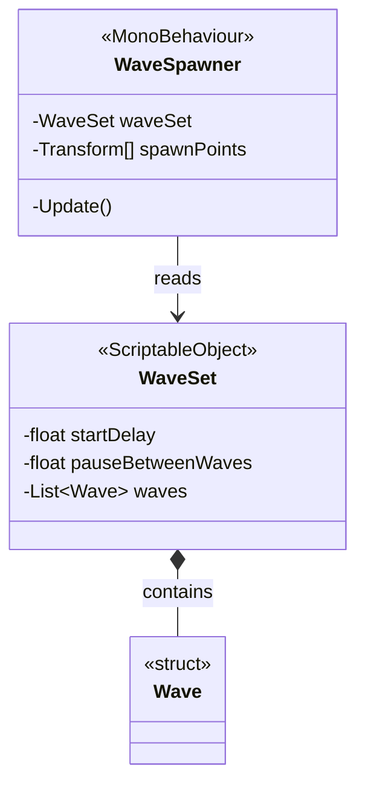

# Lab 2 - Data-Driven Enemy Waves

## 1. Overview

You start with a wave spawner that works but has every number written into its code. You work through three requests from a designer: move the waves into data, review a quick fix that breaks when two spawners share a wave set, and spawn one wave from a chosen gate. The notes used rotating cubes to explain the ideas. This lab uses a different system, so you apply the ideas yourself rather than copying the notes.

Keep a short `LabNotes.md` file in your lab folder. Steps marked **Record** ask for an observation or a short answer. You reuse those answers when you explain a Data & State decision for the GCA.

---

## 2. What You Will Learn

| Skill | You can... |
|:------|:-----------|
| Spot configuration hidden in code | List every value in a script that a designer cannot change without a programmer |
| Design a ScriptableObject from a request | Write a `WaveSet` asset with a list of `[Serializable]` structs, without copying from the notes |
| Swap behaviour by swapping data | Change one spawner from Normal to Hard waves with no code change |
| Review code for shared runtime state | Predict, before running, what goes wrong when progress is stored in a shared asset |
| Confirm a hypothesis with the debugger | Show with breakpoints and watched values that two spawners write one counter |
| Work within what an asset can reference | Explain why an asset cannot hold a scene `Transform`, and pick a working alternative |

---

## 3. Before You Start

| Item | Check |
|:-----|:------|
| Unity version | Unity 6000.6 with the module project open |
| IDE | Visual Studio or Rider set in `Edit > Preferences > External Tools > External Script Editor` |
| Debugger | You can attach your IDE to the Unity Editor (Visual Studio: `Attach to Unity`; Rider: `Attach to Unity Editor`) |
| Asset serialization | `Edit > Project Settings > Editor > Asset Serialization > Mode` is `Force Text` |
| Notes | You have read [02 - ScriptableObjects](../notes/02_scriptable_objects.md), Sections 3 to 5 |

---

## 4. Plan

Complete the plan before Step 3, because the bug in Steps 5 and 6 comes from placing a value in the wrong class. (10 min)

The diagram shows the design you build in Step 3. The members of `Wave` are left for you to decide:



Copy this table into `LabNotes.md` and fill in the owner and kind of each value:

| Value | Owner (`Wave`, `WaveSet` or `WaveSpawner`) | Kind (asset data, scene configuration or runtime state) |
|:------|:-------------------------------------------|:---------------------------------------------------------|
| Enemy prefab for a wave | | |
| Number of enemies in a wave | | |
| Time between spawns in a wave | | |
| Pause between waves | | |
| The spawn point `Transform`s | | |
| Which wave is running now | | |
| How many enemies this wave has spawned so far | | |
| Time until the next spawn | | |

You check your answers in Step 7.

---

## 5. Steps

### Step 1 - Set Up the Scene

This step builds a small scene with three gates and two enemy prefabs. (10 min)

1. Open `Tools > GD > Setup > Create Project Folders`. Set `Project Folder` to `Lab02`, choose `Project assets only` and click `Create Folders`.
2. Create a new scene and save it as `Assets/Lab02/Scenes/Lab02_Waves.unity`.
3. Add a `Plane` at the origin with scale (2, 1, 2). Set the `Main Camera` position to (0, 14, -14) and rotation to (45, 0, 0).
4. Add an empty GameObject named `SpawnPoints`. Give it three empty children: `North` at (0, 0.5, 8), `East` at (8, 0.5, 0) and `West` at (-8, 0.5, 0).
5. Add a `Cube` named `Grunt` and a `Capsule` named `Runner` with scale (0.6, 0.6, 0.6). Drag each into `Assets/Lab02/Prefabs/`, then delete both from the scene.
6. Add an empty GameObject named `Spawner`.

**Checkpoint:** the Hierarchy shows `Plane`, `SpawnPoints` with three children, `Spawner` and the camera, and `Assets/Lab02/Prefabs/` holds `Grunt` and `Runner`.

### Step 2 - Run the Hard-Coded Spawner

This step gives you the code you will improve, so you can judge what is wrong with it before changing it. (10 min)

Create `Assets/Lab02/Scripts/WaveSpawner.cs`:

```csharp
using UnityEngine;

public class WaveSpawner : MonoBehaviour
{
    [SerializeField] private GameObject gruntPrefab;
    [SerializeField] private GameObject runnerPrefab;
    [SerializeField] private Transform[] spawnPoints;

    // Runtime state: where this spawner is in its sequence.
    private int waveIndex;
    private int spawnedInWave;
    private float timer = 2f;

    private void Update()
    {
        if (waveIndex >= 3) return;

        timer -= Time.deltaTime;
        if (timer > 0f) return;

        GameObject prefab;
        int count;
        float interval;

        if (waveIndex == 0)
        {
            prefab = gruntPrefab;
            count = 5;
            interval = 1f;
        }
        else if (waveIndex == 1)
        {
            prefab = runnerPrefab;
            count = 8;
            interval = 0.5f;
        }
        else
        {
            prefab = gruntPrefab;
            count = 10;
            interval = 0.3f;
        }

        Spawn(prefab);
        spawnedInWave++;
        timer = interval;

        if (spawnedInWave >= count)
        {
            waveIndex++;
            spawnedInWave = 0;
            timer = 3f;   // Pause before the next wave.
            Debug.Log($"{name}: wave {waveIndex} complete.", this);
        }
    }

    private void Spawn(GameObject prefab)
    {
        Transform point = spawnPoints[Random.Range(0, spawnPoints.Length)];

        // A small random offset stops enemies from the same gate appearing inside each other.
        Vector3 offset = new Vector3(Random.Range(-1f, 1f), 0f, Random.Range(-1f, 1f));
        GameObject enemy = Instantiate(prefab, point.position + offset, point.rotation);

        // Remove the enemy after a few seconds so the scene does not fill up.
        Destroy(enemy, 4f);
    }
}
```

Add `WaveSpawner` to `Spawner`. Assign both prefabs, and drag `North`, `East` and `West` into `Spawn Points`. Press Play and watch the three waves.

The designer then asks:

> "I want to tune the waves while the game runs, try a Hard version of the level, and add a fourth wave, all without asking a programmer."

**Record:** list every value in `WaveSpawner` that the designer cannot change without editing code. For each one, say whether it should become asset data or stay in code.

**Checkpoint:** three waves spawn (grunts, then runners, then fast grunts), and your list includes the counts, the intervals, the number of waves, the pauses and the choice of prefab per wave.

### Step 3 - Create the WaveSet Type

This step moves the wave design out of the code into an asset that a designer can edit. (20 min)

Write `Assets/Lab02/Scripts/WaveSet.cs` before you look at the reference version. It must:

- be a ScriptableObject that you create from `Create > GD > Spawning > Wave Set`;
- hold a start delay, a pause between waves and a list of waves;
- describe each wave with a `[Serializable]` struct named `Wave`, holding the enemy prefab, the count and the time between spawns;
- expose every value through get-only properties, and the list as `IReadOnlyList<Wave>`.

Then change `WaveSpawner` so it reads everything from a `WaveSet` field. Keep the runtime state where your Plan table says it belongs, and guard a missing `WaveSet` in `Awake` as the notes do.

<details>
<summary>Reference version</summary>

```csharp
using System;
using System.Collections.Generic;
using UnityEngine;

[Serializable]
public struct Wave
{
    [SerializeField] private GameObject enemyPrefab;
    [SerializeField, Min(1)] private int count;
    [SerializeField, Min(0.05f)] private float interval;

    public GameObject EnemyPrefab => enemyPrefab;
    public int Count => count;
    public float Interval => interval;
}

[CreateAssetMenu(fileName = "WaveSet", menuName = "GD/Spawning/Wave Set")]
public class WaveSet : ScriptableObject
{
    [SerializeField, Min(0f)] private float startDelay = 2f;
    [SerializeField, Min(0f)] private float pauseBetweenWaves = 3f;
    [SerializeField] private List<Wave> waves = new List<Wave>();

    public float StartDelay => startDelay;
    public float PauseBetweenWaves => pauseBetweenWaves;
    public IReadOnlyList<Wave> Waves => waves;
}
```

```csharp
using UnityEngine;

public class WaveSpawner : MonoBehaviour
{
    [SerializeField] private WaveSet waveSet;
    [SerializeField] private Transform[] spawnPoints;

    // Runtime state: belongs to this spawner only, and starts again every Play session.
    private int waveIndex;
    private int spawnedInWave;
    private float timer;

    private void Awake()
    {
        if (waveSet == null)
        {
            Debug.LogError($"{name} has no WaveSet assigned.", this);
            enabled = false;
            return;
        }

        if (spawnPoints == null || spawnPoints.Length == 0)
        {
            Debug.LogError($"{name} has no spawn points assigned.", this);
            enabled = false;
            return;
        }

        timer = waveSet.StartDelay;
    }

    private void Update()
    {
        if (waveIndex >= waveSet.Waves.Count) return;

        timer -= Time.deltaTime;
        if (timer > 0f) return;

        Wave wave = waveSet.Waves[waveIndex];

        Spawn(wave.EnemyPrefab);
        spawnedInWave++;
        timer = wave.Interval;

        if (spawnedInWave >= wave.Count)
        {
            waveIndex++;
            spawnedInWave = 0;
            timer = waveSet.PauseBetweenWaves;
            Debug.Log($"{name}: wave {waveIndex} of {waveSet.Waves.Count} complete.", this);
        }
    }

    private void Spawn(GameObject prefab)
    {
        Transform point = spawnPoints[Random.Range(0, spawnPoints.Length)];

        // A small random offset stops enemies from the same gate appearing inside each other.
        Vector3 offset = new Vector3(Random.Range(-1f, 1f), 0f, Random.Range(-1f, 1f));
        GameObject enemy = Instantiate(prefab, point.position + offset, point.rotation);

        // Remove the enemy after a few seconds so the scene does not fill up.
        Destroy(enemy, 4f);
    }
}
```

</details>

Compare your version with the reference. If your class, struct or property names differ, rename yours to match, because Steps 5 and 8 use these names.

`Wave` is a struct, so `waveSet.Waves[waveIndex]` returns a copy. Even if `Wave` had setters, changing that copy would not change the asset.

**Checkpoint:** the Console shows no compile errors, and `Create > GD > Spawning > Wave Set` appears in the Project window `+` menu.

### Step 4 - Make Normal and Hard Sets

This step shows that a new version of the level is a new asset, not new code. (10 min)

1. In `Assets/Lab02/Data/`, create a `Wave Set` named `Normal`. Add three waves that match the Step 2 code.
2. Assign `Normal` to `Spawner`, press Play, and check that the waves match Step 2.
3. During Play, select `Normal`, add a fourth wave and change some counts. Press Stop and check the asset.
4. Duplicate `Normal` (`Ctrl+D`), name the copy `Hard`, and make it harder: more enemies, shorter intervals or a shorter pause. Assign `Hard` to `Spawner` and press Play.
5. Open `Hard.asset` in VS Code. Find the `waves:` list, and find how a wave stores its enemy prefab.

**Record:** how is the prefab stored in the asset file, as a copy or as a reference? What would you have changed in the Step 2 code to add the Hard version?

**Checkpoint:** swapping `Normal` for `Hard` on `Spawner` changes the waves with no code change, the fourth wave added during Play is still on `Normal` after Stop, and the asset file stores each prefab as a `guid`.

### Step 5 - Review a Quick Fix

This step practises reading code for a shared-state bug before you run it. (15 min)

The designer asks:

> "When I select the wave set during Play, I want to see which wave is running and how many enemies have spawned."

A quick fix is to store the progress on the asset, where the designer is already looking. Add these two fields to `WaveSet`, below the existing fields:

```csharp
    // Progress, shown on the asset while the game runs. A quick fix: see Step 5.
    public int currentWave;
    public int spawnedInWave;
```

Replace `WaveSpawner.cs` with a version that uses them:

```csharp
using UnityEngine;

public class WaveSpawner : MonoBehaviour
{
    [SerializeField] private WaveSet waveSet;
    [SerializeField] private Transform[] spawnPoints;

    private float timer;

    private void Awake()
    {
        if (waveSet == null)
        {
            Debug.LogError($"{name} has no WaveSet assigned.", this);
            enabled = false;
            return;
        }

        if (spawnPoints == null || spawnPoints.Length == 0)
        {
            Debug.LogError($"{name} has no spawn points assigned.", this);
            enabled = false;
            return;
        }

        timer = waveSet.StartDelay;
    }

    private void Update()
    {
        if (waveSet.currentWave >= waveSet.Waves.Count) return;

        timer -= Time.deltaTime;
        if (timer > 0f) return;

        Wave wave = waveSet.Waves[waveSet.currentWave];

        Spawn(wave.EnemyPrefab);
        waveSet.spawnedInWave++;
        timer = wave.Interval;

        if (waveSet.spawnedInWave >= wave.Count)
        {
            waveSet.currentWave++;
            waveSet.spawnedInWave = 0;
            timer = waveSet.PauseBetweenWaves;
            Debug.Log($"{name}: wave {waveSet.currentWave} of {waveSet.Waves.Count} complete.", this);
        }
    }

    private void Spawn(GameObject prefab)
    {
        Transform point = spawnPoints[Random.Range(0, spawnPoints.Length)];

        // A small random offset stops enemies from the same gate appearing inside each other.
        Vector3 offset = new Vector3(Random.Range(-1f, 1f), 0f, Random.Range(-1f, 1f));
        GameObject enemy = Instantiate(prefab, point.position + offset, point.rotation);

        // Remove the enemy after a few seconds so the scene does not fill up.
        Destroy(enemy, 4f);
    }
}
```

Before you press Play, read the code and answer in `LabNotes.md`:

1. With one spawner, what happens on the second Play session?
2. If two spawners both use `Normal`, how many enemies does each wave spawn in total?

Now test your predictions:

1. Assign `Normal` to `Spawner`. Press Play, let all waves finish, press Stop, then press Play again. Watch `Current Wave` on `Normal`.
2. Set `Current Wave` and `Spawned In Wave` on `Normal` back to 0. Duplicate `Spawner` (`Ctrl+D`) so two spawners use `Normal`, then press Play and count the enemies in the first wave.

**Record:** which predictions were right? Note any symptom you did not predict.

**Checkpoint:** you have seen at least two of these symptoms: the second Play spawns nothing, two spawners together spawn the same number per wave as one spawner, and one spawner starts the next wave without the pause.

### Step 6 - Confirm the Bug with the Debugger

This step tests a hypothesis with evidence instead of guessing from what the enemies do. (10 min)

**Hypothesis:** both spawners increase the same `spawnedInWave` on the asset, so a wave ends after `Count` spawns in total rather than `Count` per spawner.

[Notes 01](../notes/01_unity_foundations.md), Section 4.9, describes the debugger setup in full.

1. Set `Current Wave` and `Spawned In Wave` on `Normal` back to 0. Keep both spawners.
2. Switch the Editor to debug mode: click the code optimisation button in the bottom-right of the status bar and choose `Switch to debug mode`. Breakpoints are not hit in release mode.
3. Attach your IDE to the Unity Editor.
4. Place a breakpoint in `WaveSpawner.Update` where it will test the hypothesis. Decide where before you run.
5. Add watches for `name`, `Time.frameCount` and `waveSet.spawnedInWave`.
6. Press Play and continue (`F5`) through at least six hits.

**Record:** a short table of the hits (spawner name, frame number, `spawnedInWave` before the line runs). Does the evidence support the hypothesis? Which symptom from Step 5 does it explain, and which does it not explain?

**Checkpoint:** the breakpoint is hit for both `Spawner` and `Spawner (1)`, and `waveSet.spawnedInWave` has changed between hits on different spawners.

Detach the debugger and switch back to release mode when you finish, because debug mode runs scripts more slowly.

### Step 7 - Fix the Progress Tracking

This step fixes the bug while still meeting the designer's request. (10 min)

1. Remove `currentWave` and `spawnedInWave` from `WaveSet`.
2. Restore `WaveSpawner` to your Step 3 version, so each spawner keeps its own progress.
3. To show the designer the progress during Play, select `Spawner`, open the Inspector's `More Items` menu (the three dots at the top right) and choose `Debug`. The Debug Inspector shows the spawner's private fields, including `Wave Index` and `Spawned In Wave`. Choose `Normal` from the same menu to switch back.

**Record:** correct your Plan table if needed, and add one sentence per row explaining the owner. Then write one sentence on why the Debug Inspector meets the designer's request better than fields on the asset did.

**Checkpoint:** press Play twice with both spawners. Each spawner runs every wave in full, every Play starts from wave 1, and nothing on `Normal` changes during play.

Delete `Spawner (1)` before the next step.

### Step 8 - Apply: Spawn from a Chosen Gate

This step applies the rules about what an asset can reference to a new request, without a required design. (20 min)

The designer asks:

> "Wave 2 should come only through the north gate. The other waves can use any gate."

1. Try the obvious design first: add a `[SerializeField] private Transform spawnPoint;` field to `Wave`. Select `Normal` and try to drag `North` from the Hierarchy into it.
2. Remove the field. Choose one of these designs and implement it:
   - (a) an index into the spawner's `Spawn Points` array, with -1 meaning "any gate";
   - (b) a gate name, matched against the names of the spawn point objects;
   - (c) a design of your own that keeps scene objects out of the asset.
3. Guard the case where the designer gives a gate that the spawner does not have. Log a warning with the spawner as context, and fall back to a random gate.

**Record:** why would the asset not accept `North`? (See notes Key Concept 8.) Give one strength and one weakness of the design you chose, compared with one you did not choose. A new wave added with the `+` button copies the previous wave's values, and a brand new list starts from zero. What gate does a new wave use in your design, and is that a safe default?

<details>
<summary>Reference version, design (a)</summary>

Add to `Wave`:

```csharp
    [SerializeField, Min(-1), Tooltip("Index into the spawner's Spawn Points. -1 means any gate.")]
    private int spawnPointIndex;

    public int SpawnPointIndex => spawnPointIndex;
```

In `WaveSpawner`, change the call in `Update` to `Spawn(wave);` and replace `Spawn` with these two methods:

```csharp
    private void Spawn(Wave wave)
    {
        Transform point = ChoosePoint(wave.SpawnPointIndex);

        // A small random offset stops enemies from the same gate appearing inside each other.
        Vector3 offset = new Vector3(Random.Range(-1f, 1f), 0f, Random.Range(-1f, 1f));
        GameObject enemy = Instantiate(wave.EnemyPrefab, point.position + offset, point.rotation);

        // Remove the enemy after a few seconds so the scene does not fill up.
        Destroy(enemy, 4f);
    }

    private Transform ChoosePoint(int index)
    {
        if (index >= spawnPoints.Length)
        {
            Debug.LogWarning($"{name}: wave asks for spawn point {index}, but there are only {spawnPoints.Length}. Using a random gate.", this);
            index = -1;
        }

        return index < 0
            ? spawnPoints[Random.Range(0, spawnPoints.Length)]
            : spawnPoints[index];
    }
```

With `North`, `East` and `West` in that order, set wave 2 to 0 and the others to -1.

</details>

**Checkpoint:** wave 2 spawns only at `North`, the other waves use all three gates, and giving a gate the spawner does not have logs one warning per spawn that names `Spawner`, and the wave still spawns.

---

## 6. Debugging and Pitfalls

| Symptom | Likely cause | How to confirm | Fix |
|:--------|:-------------|:---------------|:----|
| `Create > GD > Spawning` menu is missing | Compile error, or file name does not match class name | Console shows errors; compare `WaveSet.cs` with the class name | Fix the error; rename the file to match the class |
| The `Waves` list does not appear in the Inspector | `Wave` is missing `[Serializable]`, or its fields are not serialized | Read `Wave` against the serialization rules in notes Section 4.3 | Add `[Serializable]` and `[SerializeField]` |
| `ArgumentException` when a wave starts | A wave has no enemy prefab assigned | Click the error; select the `WaveSet` and expand the waves | Assign a prefab; Extension 8.1 catches this in the Editor |
| Nothing spawns and no error appears | `Current Wave` left at the end on the asset from Step 5, or a set with no waves | Select the asset and read its values | Step 7; add at least one wave |
| A wave spawns far fewer enemies than its `Count` | Two spawners share progress on the asset | Step 6 | Step 7 |
| `North` will not drop into a field on the asset | Assets cannot reference scene objects | Try dragging a prefab instead: that works | Step 8 |
| Breakpoint is never hit | Editor is in release mode, or the IDE is not attached | Status bar code optimisation button; IDE debug toolbar | Switch to debug mode; attach to the Unity Editor |

---

## 7. Production Checklist

| Requirement | Done |
|:------------|:-----|
| `WaveSpawner` contains no wave counts, intervals or prefab choices | |
| `WaveSet` and `Wave` expose only get-only properties; the list is `IReadOnlyList<Wave>` | |
| `Normal` and `Hard` exist in `Assets/Lab02/Data/`, and swapping them needs no code change | |
| No script writes to a `WaveSet` asset at runtime | |
| Wave progress and the timer are private fields on `WaveSpawner` | |
| A missing `WaveSet` or empty spawn point array produces one clear error | |
| Step 5 predictions and Step 6 debugger evidence are in `LabNotes.md` | |
| Wave 2 spawns only at `North`, with no scene object referenced from the asset | |
| A gate the spawner does not have gives a warning, not an exception | |
| Every **Record** answer is in `LabNotes.md` | |

---

## 8. Extension

### 8.1 Stretch - Validate the Wave Data

A designer can make a broken wave set without noticing: a wave with no prefab, or a set with no waves. Catch these in the Editor rather than at runtime.

- Add `OnValidate` to `WaveSet`. Warn, with the asset as context, when a wave has no prefab or the set has no waves.
- Add a read-only `EstimatedDuration` property that adds up every wave's spawning time and the pauses. Show it with a `[ContextMenu("Log Estimated Duration")]` method.

**Expected result:** a wave without a prefab gives a warning as soon as you edit the asset, before Play. `Log Estimated Duration` reports a different duration for `Normal` and `Hard`, and the figure for `Normal` matches a stopwatch to within a second. In `LabNotes.md`, explain why `OnValidate` must not be your only check, and what still protects a build.

### 8.2 Optional - Difficulty Profiles

This task leads into Notes 03 to 05, which look at how systems find each other.

Instead of a full `Hard` copy of every wave set, the game needs Easy and Hard modes that scale any wave set.

- Create a `DifficultyProfile` ScriptableObject with a `countMultiplier` and an `intervalMultiplier`.
- Create `Easy` and `Hard` profile assets.
- Create a `GameConfig` MonoBehaviour in the scene that holds the active profile. Pressing `1` selects Easy and `2` selects Hard during play (use `Keyboard.current`).
- `WaveSpawner` applies the active multipliers when it reads a wave.
- Do not modify any `DifficultyProfile` or `WaveSet` asset at runtime.

**Record:** you now have two ways to make the game harder, a `Hard` wave set and a `Hard` profile. When would a designer want each one? Every `WaveSpawner` now needs a reference to `GameConfig`: what is useful about that dependency, and what is inconvenient?

---

## 9. Reflective Questions

1. The Step 5 quick fix met the designer's request and passed a one-spawner test on the first Play. What would you add to your own testing so that bugs like this are found before a teammate finds them?
2. The notes' bug used a `float` on a rotation asset; this lab's used two `int` counters on a wave asset. What do the two bugs have in common, and what question would you ask about any new field to avoid both?
3. `Wave` is a struct returned from an `IReadOnlyList<Wave>`. Using what you revised about value and reference types, explain why a caller cannot change a wave in the asset, even by accident.
4. Justify your Step 8 design against one alternative, as you would to a designer who has to use it every day.
5. Which part of this lab would you nominate as a GCA Data & State example? State it as Problem, Solution, Benefit in three sentences.

---

## 10. How This Builds

- **Notes 03 to 05 - Communication and Scene Architecture** ([Notes 03](../notes/03_shared_variables.md)) introduces shared variables and variable references, which let a value such as a spawn-rate multiplier be shared by any system that opts in. The Extension 8.2 dependency on `GameConfig` is the problem Notes 03 to 05 solve.
- **Note 15 - Orchestration and Game Flow** rewrites the timer in `Update` as a coroutine, and uses events to announce when a wave starts and ends.
- **Note 16 - State Machines and the State Pattern** treats "waiting", "spawning" and "paused between waves" as states.

**Group project task (take-home).** In your group's project, find one piece of configuration that is hard-coded, duplicated or scattered across objects, for example player movement values, a pickup's effect or an enemy's stats. Move it into a ScriptableObject with read-only properties, and check that no runtime state is stored in the asset. In your project log, record what you changed and why, and one value you deliberately did not move, and why. This is early evidence for the **C# & Software Design - Data & State** and **Iteration & Improvement** criteria.
