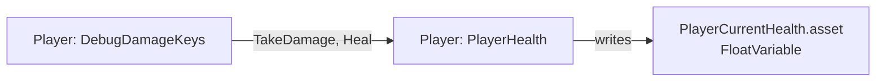
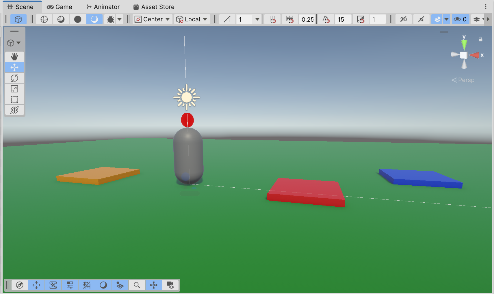
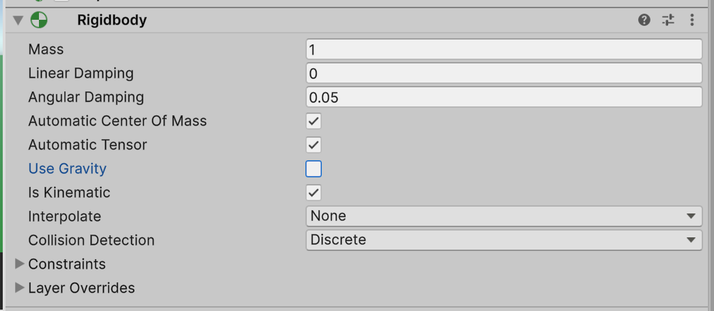
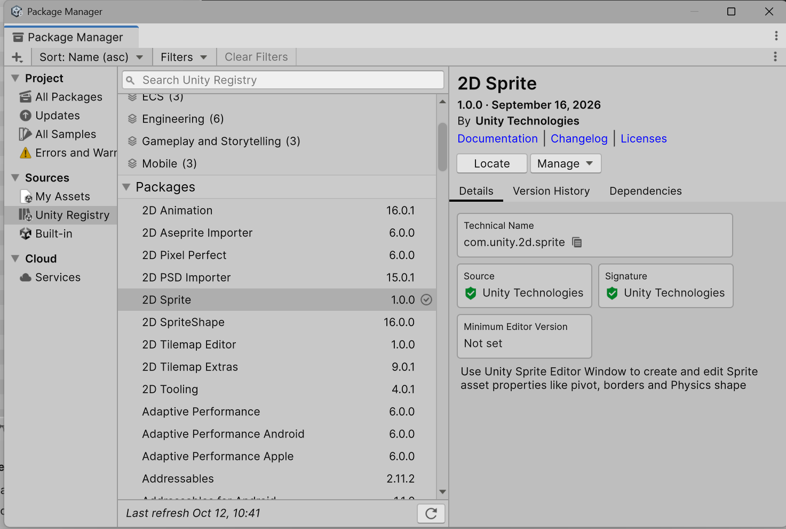
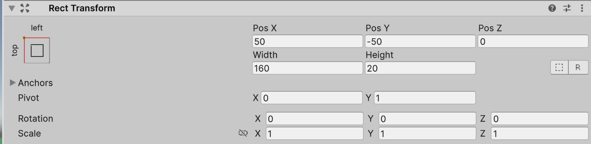

# Lab 3 - Shared Variables and Variable References

## 1. Overview

You build the worked example from [Note 03](../notes/03_shared_variables.md), Section 5, as a working scene. A player with `PlayerHealth`, a HUD slider and a warning icon above the player's head all show the same health value. You start with the direct-reference version, hit the prefab problem from the notes, and refactor to shared `FloatVariable` assets. You then use the debugger to catch a stale subscriber, and finish with damage zones that use a `FloatReference`.

Keep a short `LabNotes.md` file in your lab folder. Steps marked **Record** ask for an observation or a short answer.

---

## 2. What You Will Learn

| Skill | You can... |
|:------|:-----------|
| Identify coupling | Show the field that ties `HealthBar` to `PlayerHealth`, and why it cannot be set in a prefab |
| Share a value through an asset | Connect one writer and two readers through `PlayerCurrentHealth`, with no references between them |
| Write an event-driven reader | Subscribe to `ValueChanged` in `OnEnable`, read the current value straight away, and unsubscribe in `OnDisable` |
| Place a reader correctly | Explain why `LowHealthWarning` sits on `Player` and not on the icon it hides |
| Diagnose a stale subscriber with the debugger | Show that a destroyed reader is still called when it never unsubscribed |
| Use a variable reference | Configure one `DamageZone` component as a constant on one object and a shared value on others, with no code change |

---

## 3. Before You Start

| Item | Check |
|:-----|:------|
| Unity version | Unity 6000.6 with the module project open |
| Shared classes | `Assets > Create > GD > Variables > Float` exists |
| Input System | `Edit > Project Settings > Player > Active Input Handling` is `Input System Package (New)` |
| Sprites | `GameObject > 2D Object > Sprites > Circle` exists (2D Sprite package, already in the project) |
| Debugger | You can attach your IDE and switch the Editor to debug mode ([Notes 01](../notes/01_unity_foundations.md), Section 4.9) |
| Notes | You have read [03 - Shared Variables and Variable References](../notes/03_shared_variables.md), Sections 3 to 5 |

The module project already contains the lecturer's demo scripts `PlayerHealth`, `HealthBar`, `LowHealthWarning` and `DebugDamageKeys` in `Assets/GD/Demos`. Two classes with the same name in the same namespace do not compile, so every script in this lab is inside `namespace Lab03`.

---

## 4. Plan

Complete the plan before Step 2. (5 min)



Copy this table into `LabNotes.md` and complete it. Add the readers, `DamageZone` and `StormController` to the diagram on paper or in Mermaid.

| Variable | Its one writer | Its readers | Does any reader reference the player? |
|:---------|:---------------|:------------|:--------------------------------------|
| `PlayerCurrentHealth` | | | |
| `PlayerMaxHealth` | | | |
| `StormDamage` (Step 6) | | | |

---

## 5. Steps

### Step 1 - Build the Scene

This step builds every object and asset the lab uses. Nothing needs to look good: each object is a writer, a reader or a source of damage. (10 min)



1. Open `Tools > GD > Setup > Create Project Folders`. Set `Project Folder` to `Lab03`, choose `Project assets only` and click `Create Folders`. Then create `Assets/Lab03/Data/Variables/`.
2. Create a new scene and save it as `Assets/Lab03/Scenes/Lab03_PlayerHealth.unity`. Leave `Main Camera` at its default position, (0, 1, -10), facing +Z. Add a `Plane` named `Ground` at the origin and set `Scale` to (5, 1, 5).
3. Add a `Capsule` named `Player` at (0, 1, 0). Add a `Rigidbody`, tick `Is Kinematic` and clear `Use Gravity`. A trigger message needs a `Rigidbody` on one of the two objects (Step 6), and a kinematic body lets you drag the player in the Scene view without physics moving it.



4. Add `GameObject > 2D Object > Sprites > Circle` as a child of `Player`. Name it `WarningIcon`, set its local position to (0, 2.25, 0) and scale to (0.5, 0.5, 0.5), and set the `Sprite Renderer` `Color` to red. A sprite faces -Z, so the default camera sees it face-on above the player's head. If you do **not** see this menu option then you need to install the `2D Sprite` package in your Package Manager



1. Add `GameObject > UI(Canvas) > Slider`. Unity also creates a `Canvas` and an `EventSystem`. Rename the slider `HealthBar` and anchor it to the top-left of the Canvas. Clear `Interactable` and delete its `Handle Slide Area` child, because the bar displays health and must not be dragged. Under the `Slider` component, set `Transition` to None and leave `Min Value` 0 and `Max Value` 1. Set the `Pos X` and `Pos Y` values as shown below to indent the slider.



6. Add three `Cube` objects with scale (2, 0.2, 2): `Lava` at (-4, 0.1, 0), `Storm_A` at (4, 0.1, 0) and `Storm_B` at (4, 0.1, 3). Add an empty GameObject named `Storm`. These are used in Step 6. Use the materials in `Common/Materials` to set 3 different colours on these cubes.
7. In `Assets/Lab03/Data/Variables/`, create three `GD > Variables > Float` assets. Fill in each `Description`, because the description is where the single writer is recorded:

   | Asset | Initial Value | Description |
   |:------|:--------------|:------------|
   | `PlayerCurrentHealth` | 100 | Player health this run. Written only by PlayerHealth. |
   | `PlayerMaxHealth` | 100 | Player maximum health. Read by PlayerHealth and HealthBar. |
   | `StormDamage` | 5 | Damage per second in every storm zone. Written only by StormController. |

**Checkpoint:** in the Game view you see the plane, the capsule with a red circle above it, three flat cubes and a non-draggable slider in the top-left. The three ScriptableObject assets show their descriptions (e.g. "Player health this run...").

### Step 2 - Stage 1: Direct Reference

This step builds the first version from the notes, so you see the coupling before you remove it. (10 min)

Create these three scripts in `Assets/Lab03/Scripts/`. They are the Stage 1 code from the notes, inside `namespace Lab03`.

`PlayerHealth.cs`:

```csharp
using UnityEngine;

namespace Lab03
{
    public class PlayerHealth : MonoBehaviour
    {
        [SerializeField, Min(1f)] private float maxHealth = 100f;

        private float currentHealth;

        public float CurrentHealth => currentHealth;
        public float MaxHealth => maxHealth;

        private void Awake()
        {
            currentHealth = maxHealth;
        }

        public void TakeDamage(float amount)
        {
            if (amount <= 0f) return;

            currentHealth = Mathf.Max(0f, currentHealth - amount);
        }

        public void Heal(float amount)
        {
            if (amount <= 0f) return;

            currentHealth = Mathf.Min(maxHealth, currentHealth + amount);
        }
    }
}
```

`HealthBar.cs`:

```csharp
using UnityEngine;
using UnityEngine.UI;

namespace Lab03
{
    public class HealthBar : MonoBehaviour
    {
        [SerializeField] private PlayerHealth player;
        [SerializeField] private Slider slider;

        private void Awake()
        {
            if (player == null || slider == null)
            {
                Debug.LogError($"{name}: assign the player and the slider.", this);
                enabled = false;
            }
        }

        private void Update()
        {
            // Polls the player every frame, even when nothing has changed.
            slider.value = player.CurrentHealth / player.MaxHealth;
        }
    }
}
```

`DebugDamageKeys.cs`, a test harness that stays unchanged for the whole lab:

```csharp
using UnityEngine;
using UnityEngine.InputSystem;

namespace Lab03
{
    // Test harness only: lets you change health from the keyboard before the game has real damage sources.
    [RequireComponent(typeof(PlayerHealth))]
    public class DebugDamageKeys : MonoBehaviour
    {
        [SerializeField, Min(0f)] private float amount = 10f;

        private PlayerHealth playerHealth;

        private void Awake()
        {
            playerHealth = GetComponent<PlayerHealth>();
        }

        private void Update()
        {
            // Keyboard.current is null when no keyboard is connected.
            Keyboard keyboard = Keyboard.current;
            if (keyboard == null) return;

            if (keyboard.dKey.wasPressedThisFrame) playerHealth.TakeDamage(amount);
            if (keyboard.hKey.wasPressedThisFrame) playerHealth.Heal(amount);
        }
    }
}
```

1. Add `PlayerHealth` and `DebugDamageKeys` to `Player`.
2. Add `HealthBar` to the `HealthBar` slider object. Drag `Player` into `Player` and the slider's own `Slider` component into `Slider`.
3. Press Play, click the Game view so it has keyboard focus, and press `D` and `H`.

**Checkpoint:** each `D` lowers the bar by a tenth, each `H` raises it, and the bar never goes below empty or above full. `WarningIcon` is always visible, because nothing reads health for it yet.

### Step 3 - Problem and Refactor: Share the Value

This step reproduces the Stage 2 problem, then replaces the direct reference with shared assets (Stage 3). (15 min)

1. Drag `Canvas` from the Hierarchy into `Assets/Lab03/Prefabs/` to make a prefab named `HUD`. Open the prefab (double-click it in the Project window) and select `HealthBar`.

**Record:** what does the `Player` field show inside the prefab, and why? (See the notes, Section 3.) Close the prefab.

2. Replace the contents of `PlayerHealth.cs`. The player becomes the only writer of `PlayerCurrentHealth`:

```csharp
using GD.Types;
using UnityEngine;

namespace Lab03
{
    public class PlayerHealth : MonoBehaviour
    {
        [SerializeField] private FloatVariable health;
        [SerializeField] private FloatVariable maxHealth;

        private void Awake()
        {
            if (health == null || maxHealth == null)
            {
                Debug.LogError($"{name}: assign both health variables.", this);
                enabled = false;
                return;
            }

            // The player owns the rule "start at full health", so it sets the shared value here.
            // This also covers reloading the scene, which does not reset a ScriptableObject.
            health.Value = maxHealth.Value;
        }

        public void TakeDamage(float amount)
        {
            // Disabling a component stops Update, not public method calls, so check enabled here too.
            if (!enabled || amount <= 0f) return;

            health.Value = Mathf.Max(0f, health.Value - amount);
        }

        public void Heal(float amount)
        {
            if (!enabled || amount <= 0f) return;

            health.Value = Mathf.Min(maxHealth.Value, health.Value + amount);
        }
    }
}
```

3. Replace the contents of `HealthBar.cs`. It now references the assets, not the player, and updates only when health changes:

```csharp
using GD.Types;
using UnityEngine;
using UnityEngine.UI;

namespace Lab03
{
    public class HealthBar : MonoBehaviour
    {
        [SerializeField] private FloatVariable health;
        [SerializeField] private FloatVariable maxHealth;
        [SerializeField] private Slider slider;

        private void OnEnable()
        {
            if (health == null || maxHealth == null || slider == null)
            {
                Debug.LogError($"{name}: assign both health variables and the slider.", this);
                enabled = false;
                return;
            }

            health.ValueChanged += OnHealthChanged;

            // Show the current value now, so the bar is correct whichever object initialised first.
            OnHealthChanged(health.Value);
        }

        private void OnDisable()
        {
            // Every += needs a matching -=, or the asset keeps calling this component after it is destroyed.
            if (health != null)
                health.ValueChanged -= OnHealthChanged;
        }

        private void OnHealthChanged(float current)
        {
            slider.value = maxHealth.Value > 0f ? current / maxHealth.Value : 0f;
        }
    }
}
```

4. On `Player`, assign `PlayerCurrentHealth` to `Health` and `PlayerMaxHealth` to `Max Health`.
5. Open the `HUD` prefab, select `HealthBar` and assign `PlayerCurrentHealth`, `PlayerMaxHealth` and the slider. Save and close the prefab. In the scene, check that the `HealthBar` instance shows the same values and no bold override marks.
6. Press Play and press `D` and `H`.

**Checkpoint:** the bar behaves exactly as in Step 2. The `HUD` prefab has every field assigned, and no script on the Canvas references `Player`. `DebugDamageKeys` did not change.

### Step 4 - Add the Overhead Warning

This step adds a second reader with no change to the writer or the first reader. (10 min)

Write `Assets/Lab03/Scripts/LowHealthWarning.cs` yourself before you look at the reference version. It must show a `GameObject` when `PlayerCurrentHealth` is at or below a threshold set in the Inspector, and hide it otherwise. Use the reader pattern from the notes, Section 4.3, and no reference to `PlayerHealth` or `HealthBar`.

<details>
<summary>Reference version (Note 03, Section 5, Stage 3)</summary>

```csharp
using GD.Types;
using UnityEngine;

namespace Lab03
{
    public class LowHealthWarning : MonoBehaviour
    {
        [SerializeField] private FloatVariable health;
        [SerializeField, Min(0f)] private float threshold = 25f;
        [SerializeField] private GameObject warningIcon;

        private void OnEnable()
        {
            if (health == null || warningIcon == null)
            {
                Debug.LogError($"{name}: assign the health variable and the warning icon.", this);
                enabled = false;
                return;
            }

            health.ValueChanged += OnHealthChanged;
            OnHealthChanged(health.Value);
        }

        private void OnDisable()
        {
            if (health != null)
                health.ValueChanged -= OnHealthChanged;
        }

        private void OnHealthChanged(float current)
        {
            warningIcon.SetActive(current <= threshold);
        }
    }
}
```

</details>

1. Add `LowHealthWarning` to `Player`, not to `WarningIcon`. Assign `PlayerCurrentHealth` and drag `WarningIcon` into `Warning Icon`.
2. Press Play. Press `D` eight times, then `H` once.

**Record:** why must `LowHealthWarning` sit on `Player` and not on the `WarningIcon` it hides? (Think about what Unity calls on a component when its GameObject is deactivated.) Move it to `WarningIcon` and test to confirm, then move it back.

**Checkpoint:** the red circle is hidden at the start, appears on the eighth `D` (health 20) and hides again after `H` (health 30). The bar and the icon change together.

### Step 5 - Catch a Stale Subscriber with the Debugger

This step shows why every `+=` needs a `-=`, using evidence rather than a rule. (10 min)

1. Press Play, press `D` once, then delete `HealthBar` in the Hierarchy. Press `D` again. Note what happens.
2. Stop. In `HealthBar.OnDisable`, comment out both lines of the `if` statement that unsubscribes. Commenting out only the `-=` line leaves an `if` with nothing to run, which does not compile.

**Hypothesis:** without the `-=`, the deleted `HealthBar` is still in the `PlayerCurrentHealth` asset's subscriber list, so pressing `D` calls a method on a destroyed component.

3. Switch the Editor to debug mode and attach your IDE.
4. Place a breakpoint where it will test the hypothesis. Decide where before you run.
5. Press Play, press `D` once, delete `HealthBar`, then press `D` again. When the breakpoint is hit, watch `this == null`, `slider == null` and `current`.
6. Continue (`F5`) and read the Console. Press `D` until health is at or below 25 and watch `WarningIcon`.

**Record:** the watched values at the breakpoint, and the exception in the Console. Follow the call stack from `DebugDamageKeys.Update` to the exception. Did `WarningIcon` still appear? Explain what you saw using the order in which `ValueChanged` calls its subscribers.

7. Restore the unsubscribe lines. Detach the debugger and switch back to release mode.

**Checkpoint:** with the lines commented out, the breakpoint is hit after `HealthBar` was deleted, `this == null` is true, and the Console shows a `MissingReferenceException` from `HealthBar.OnHealthChanged`. With the lines restored, deleting `HealthBar` causes no errors and the warning still works.

### Step 6 - Damage Zones with a Variable Reference

This step gives one component a field that is a constant on one object and a shared, changing value on others (Stage 4). (15 min)

Create `DamageZone.cs` and `StormController.cs` in `Assets/Lab03/Scripts/`:

```csharp
using GD.Types;
using UnityEngine;

namespace Lab03
{
    [RequireComponent(typeof(Collider))]
    public class DamageZone : MonoBehaviour
    {
        [SerializeField] private FloatReference damagePerSecond;

        private void Awake()
        {
            if (!damagePerSecond.IsValid)
            {
                Debug.LogError($"{name}: Damage Per Second uses a variable, but none is assigned.", this);
                enabled = false;
            }
        }

        private void Reset()
        {
            // Editor only: runs when the component is added, so the collider starts as a trigger.
            GetComponent<Collider>().isTrigger = true;
        }

        private void OnTriggerStay(Collider other)
        {
            // Physics messages still arrive on a disabled component, so check enabled here.
            if (!enabled) return;
            if (!other.TryGetComponent(out PlayerHealth player)) return;

            // Inside physics callbacks, Time.deltaTime returns the fixed timestep.
            player.TakeDamage(damagePerSecond.Value * Time.deltaTime);
        }
    }
}
```

```csharp
using GD.Types;
using UnityEngine;

namespace Lab03
{
    public class StormController : MonoBehaviour
    {
        [SerializeField] private FloatVariable stormDamage;
        [SerializeField, Min(0f)] private float increasePerSecond = 2f;
        [SerializeField, Min(0f)] private float maxDamage = 50f;

        private void Awake()
        {
            if (stormDamage == null)
            {
                Debug.LogError($"{name}: assign the storm damage variable.", this);
                enabled = false;
                return;
            }

            // The single writer owns the start state, so a scene reload starts the storm from its authored value.
            stormDamage.ResetToInitial();
        }

        private void Update()
        {
            // The only writer of StormDamage. Every zone that references it reads the new value.
            stormDamage.Value = Mathf.Min(maxDamage, stormDamage.Value + increasePerSecond * Time.deltaTime);
        }
    }
}
```

1. Add `DamageZone` to `Lava`, then press Play and drag `Player` into it in the Scene view without changing anything.

**Record:** what happened, and why? (See the notes, Section 4.6, Defaults.)

2. Stop. On `Lava`, expand `Damage Per Second`, leave `Use Constant` ticked and set `Constant Value` to 20.
3. Add `DamageZone` to `Storm_A` and `Storm_B`. Clear `Use Constant` and assign `StormDamage` to `Variable`.
4. Add `StormController` to `Storm` and assign `StormDamage`.
5. Press Play. Drag `Player` into `Lava`, then out, press `H` to recover, then into `Storm_A`. Wait 20 seconds and try `Storm_B`.
6. Stop. On `Storm_B`, clear `Variable` and press Play.

**Checkpoint:** in `Lava` the bar empties in about 5 seconds, whenever you test it. In either storm zone the bar falls slowly at first and faster the longer Play has run, and both storm zones always do the same damage. With `Variable` cleared on `Storm_B`, the Console shows one error naming `Storm_B` and that zone does nothing. Restore the asset afterwards.

---

## 6. Debugging and Pitfalls

| Symptom | Likely cause | How to confirm | Fix |
|:--------|:-------------|:---------------|:----|
| `CS0101: The namespace '<global namespace>' already contains a definition for 'PlayerHealth'` | A lab script is missing `namespace Lab03` | Read the error's file path | Wrap the class in `namespace Lab03 { }` |
| `D` and `H` do nothing | Game view does not have focus | Click the Game view; try again | Click the Game view before pressing keys |
| Bar does not move after Step 3 | `HealthBar` has a field unassigned and disabled itself | Console error from `HealthBar` | Assign both assets and the slider in the `HUD` prefab |
| Bar wrong until the first key press | The reader subscribed but did not read the current value | Read `OnEnable` | Call the handler once after subscribing |
| You can drag the health bar with the mouse | `Interactable` still ticked | Select the slider | Clear `Interactable`; delete `Handle Slide Area` |
| Warning icon never comes back | `LowHealthWarning` is on `WarningIcon`, so hiding it unsubscribed the reader | Which object has `LowHealthWarning`? | Put it on `Player` |
| Warning icon invisible or a thin line | Camera rotated, so the sprite is seen edge-on | Check `Main Camera` rotation | Reset the camera to face +Z |
| `MissingReferenceException` from `HealthBar` | The `-=` in `OnDisable` is missing | Step 5 | Restore the unsubscribe lines |
| A zone does no damage | No `Rigidbody` on `Player`, collider not a trigger, or `Constant Value` is 0 | Check `Player` and the zone in the Inspector | Step 1 item 3; tick `Is Trigger`; set the constant |
| Damage stops while the player stands still in a zone | The `Rigidbody` went to sleep, so `OnTriggerStay` stopped | Drag the player a little and watch the bar | Keep dragging during the test |
| Breakpoint is never hit | Editor is in release mode, or the IDE is not attached | Status bar code optimisation button | Switch to debug mode; attach |

---

## 7. Production Checklist

| Requirement | Done |
|:------------|:-----|
| Every lab script is in `namespace Lab03` | |
| `PlayerHealth` is the only script that writes `PlayerCurrentHealth`, and sets its start state in `Awake` | |
| The `HUD` prefab has every field assigned and no reference to `Player` | |
| `HealthBar` and `LowHealthWarning` subscribe in `OnEnable`, read the value straight away, and unsubscribe in `OnDisable` | |
| `LowHealthWarning` sits on `Player` and shows `WarningIcon` at or below 25 health | |
| Deleting `HealthBar` during Play causes no errors | |
| Debugger evidence for Step 5 is recorded in `LabNotes.md` | |
| `Lava` uses a constant 20; `Storm_A` and `Storm_B` share `StormDamage` | |
| `StormController` is the only script that writes `StormDamage` | |
| All three assets have a `Description` naming their writer | |
| The Plan table and diagram match the finished scene | |

---

## 8. Extension

### Challenge - Raising Maximum Health

Add a pickup that raises the player's maximum health from 100 to 150. Then press `D` once and look at the bar.

`HealthBar` subscribes only to `PlayerCurrentHealth`, so a change to `PlayerMaxHealth` alone leaves the bar wrong until health next changes. Fix this so the bar is correct after either value changes. Decide which script is the single writer of `PlayerMaxHealth`, and do not let the pickup write either asset directly.

**Expected result:** collecting the pickup at full health shows the bar at two-thirds immediately, and `H` then fills it to 150. In `LabNotes.md`, explain in two or three sentences which script writes `PlayerMaxHealth` and why, and how `HealthBar` handles a change to either value.

---

## 9. Reflective Questions

1. In Step 3, `HealthBar` went from one dependency (the player) to two (both assets). Why is it now less coupled? Use the Dependency Inversion Principle in your answer.
2. `DamageZone` holds no shared variable but still causes `PlayerCurrentHealth` to change. Using the single writer rule, explain why routing damage through `PlayerHealth.TakeDamage` is worth the extra call.
3. Step 5 showed one missing line in the HUD affecting a system above the player's head. Why can an exception in one reader stop other readers and the writer's code?
4. `Lava` uses a constant and the storm zones share a variable. When would a plain `float` field be better than a `FloatReference` on `DamageZone`? Give a rule you would put in your group's coding conventions.
5. A teammate suggests giving each enemy an `EnemyHealth` `FloatVariable` asset so enemies can have health bars. Using the notes, Section 4.7, explain what goes wrong and what to use instead.

---

## 10. How This Builds

- **Next, event channels** ([Note 04](../notes/04_event_channels.md)) handle moments with no lasting value, such as "player died" when health reaches 0.
- **Note 07 - Movement Systems** uses `FloatReference` for speeds that are usually constant but can be driven by difficulty or power-ups.
- **GCA - C# & Software Design - System Communication:** a shared variable with one writer and event-driven readers, explained as Problem, Solution, Benefit, is direct evidence.

**Group project task (take-home).** Find one value in your group's project that at least two systems read, for example health, score or a timer. Replace the direct references with a shared variable that has one writer. Record in your project log the before and after dependencies, and name the writer in the asset's `Description`.
