# Lab 4 - Event Channels

## 1. Overview

You build a small scene with a player and a HUD, then add two moments: the player dying and a pickup being collected. `PlayerHealth` raises a `PlayerDied` channel, and a `VoidEventChannelListener` shows a game over panel with no code. Pickups raise a `PickupCollected` channel, and `ScoreKeeper`, the single writer of `Score`, turns those moments into state. You then break the death response on purpose and use the debugger to show why the listener missed the event.

---

## 2. What You Will Learn

| Skill | You can... |
|:------|:-----------|
| Raise a channel from gameplay code | Raise `PlayerDied` once when health reaches 0 |
| Wire a response in the Inspector | Show a panel and disable the debug keys with `VoidEventChannelListener`, with no new code |
| Test a channel without its cause | Raise `PlayerDied` from the asset's context menu during Play |
| Combine a channel and a variable | Show that two pickups with the same points both add to `Score` |
| Trace a channel | Use `Log Raises` to see each raise and its listener count |
| Diagnose a missed event with the debugger | Show with `ListenerCount` that a listener on an inactive object never subscribed |

---

## 3. Before You Start

| Item | Check |
|:-----|:------|
| Input System | `Edit > Project Settings > Player > Active Input Handling` is `Input System Package (New)` |
| Debugger | You can attach your IDE to the Unity Editor and switch the Editor to debug mode ([Notes 01](../notes/01_unity_foundations.md), Section 4.9) |
| Channel classes | `Assets/GD/Common/Scripts/ScriptableObjects/Types/Events` and `Listeners` exist |
| Create menu | `Assets > Create > GD > Events > Void` exists |
| TextMeshPro | A uGUI `Text - TextMeshPro` object can be created; import `TMP Essentials` if Unity asks |
| Notes | You have read [04 - Event Channels](../notes/04_event_channels.md), Sections 3 to 4.6 |

---

## 4. Plan

Complete the plan before Step 2.

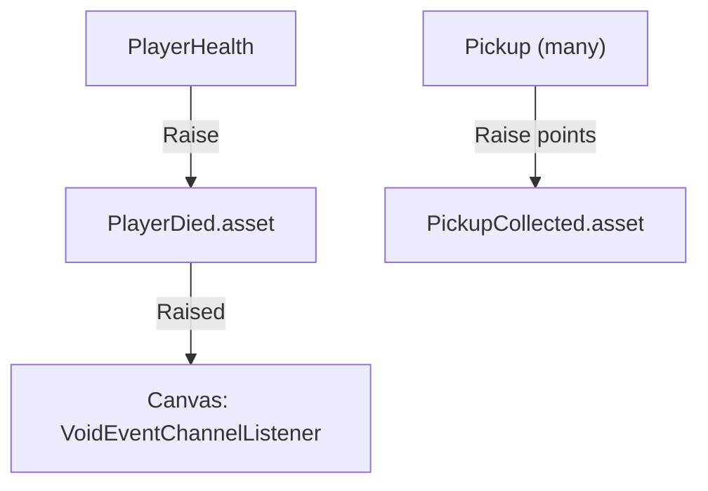

Copy this table into `LabNotes.md` and complete it. Add a row for every script and asset you create in Step 4:

| Script | Raises | Listens to | Writes |
|:-------|:-------|:-----------|:-------|
| `PlayerHealth` | | | |
| `Pickup` | | | |
| `VoidEventChannelListener` (Canvas) | | | |

Then complete the table on paper or in Mermaid.

---

## 5. Steps

### Step 1 - Set Up the Scene

This step builds a small scene with a player, its health variables and the UI that the death and score responses will use. (10 min)

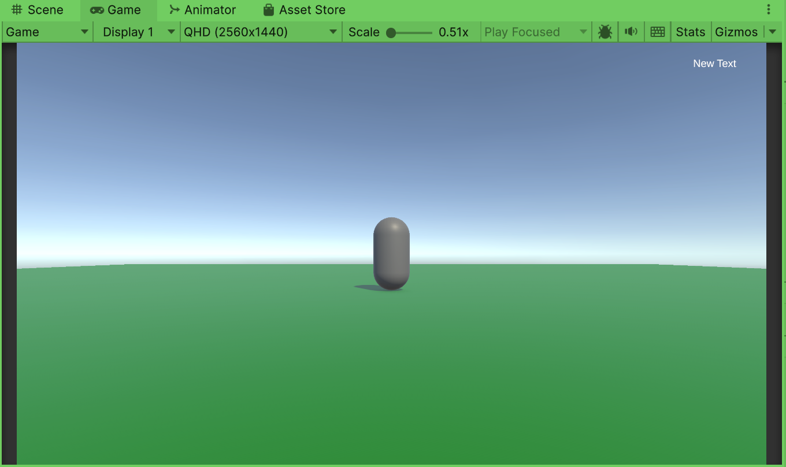

1. Open `Tools > GD > Setup > Create Project Folders`. Set `Project Folder` to `Lab04`, choose `Project assets only` and click `Create Folders`. Then create `Assets/Lab04/Data/Variables/` and `Assets/Lab04/Data/Events/`.
2. Create a new scene and save it as `Assets/Lab04/Scenes/Lab04_Events.unity`. Add a `Plane` named `Ground` at the origin and set `Scale` to (5, 1, 5).
3. Add a `Capsule` named `Player` at (0, 1, 0) and set its `Tag` to `Player`, because pickups identify the player by tag.

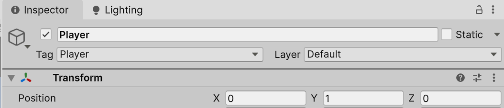

4. Add a `Rigidbody` to `Player`. Tick `Is Kinematic` and clear `Use Gravity`. A trigger message needs a `Rigidbody` on one of the two objects, and a kinematic body lets you drag the player in the Scene view without physics moving it.

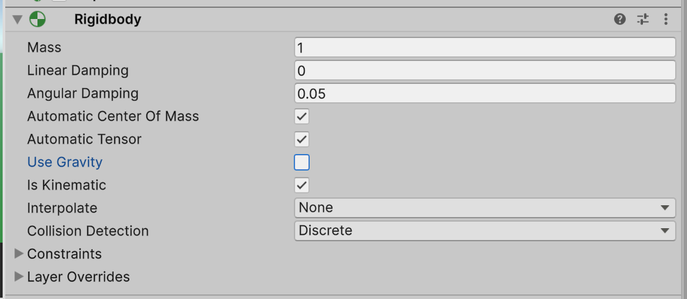

5. In `Assets/Lab04/Data/Variables/`, create two `GD > Variables > Float` assets, `PlayerCurrentHealth` and `PlayerMaxHealth`, both with `Initial Value` 100. These are the shared health variables from Note 03.
6. Add a uGUI `Canvas` (`GameObject > UI(Canvas) > Canvas`). Under it, add a `Panel` named `GameOverPanel` with a `Text - TextMeshPro` child reading "Game Over", then disable `GameOverPanel`.
7. Under the `Canvas`, add a `Text - TextMeshPro` object named `ScoreLabel` in a top corner with a reasonable `Pos X` and `Pos Y` offset.

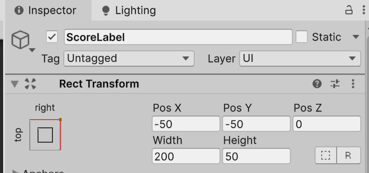

**Checkpoint:** in Play mode the score label is visible, the game over panel is not, and `Player` shows the `Player` tag and a kinematic `Rigidbody`.

### Step 2 - Announce Death with a Channel

This step turns death into a moment that any system can hear, with no reference to the player. (10 min)

1. In `Assets/Lab04/Data/Events/`, create a `GD > Events > Void` asset named `PlayerDied`. Tick `Log Raises`. In `Description`, write "Raised once by PlayerHealth when health reaches 0."
2. Create `Assets/Lab04/Scripts/PlayerHealth.cs`. It is the only writer of the two health variables:

```csharp
using GD.Types;
using UnityEngine;

public class PlayerHealth : MonoBehaviour
{
    [SerializeField] private FloatVariable health;
    [SerializeField] private FloatVariable maxHealth;
    [SerializeField] private VoidEventChannel playerDied;

    // Runtime state for this player: stops a second death being announced.
    private bool isDead;

    private void Awake()
    {
        if (health == null || maxHealth == null || playerDied == null)
        {
            Debug.LogError($"{name}: assign both health variables and the player died channel.", this);
            enabled = false;
            return;
        }

        health.Value = maxHealth.Value;
    }

    public void TakeDamage(float amount)
    {
        if (!enabled || isDead || amount <= 0f) return;

        health.Value = Mathf.Max(0f, health.Value - amount);

        if (health.Value <= 0f)
        {
            isDead = true;

            // Announce the moment. PlayerHealth does not know or care who is listening.
            playerDied.Raise();
        }
    }

    public void Heal(float amount)
    {
        if (!enabled || isDead || amount <= 0f) return;

        health.Value = Mathf.Min(maxHealth.Value, health.Value + amount);
    }
}
```

3. Create `Assets/Lab04/Scripts/DebugDamageKeys.cs`, a test harness that lets you cause damage before the game has real damage sources:

```csharp
using UnityEngine;
using UnityEngine.InputSystem;

// Test harness only: lets you change health from the keyboard.
[RequireComponent(typeof(PlayerHealth))]
public class DebugDamageKeys : MonoBehaviour
{
    [SerializeField, Min(0f)] private float amount = 10f;

    private PlayerHealth playerHealth;

    private void Awake()
    {
        playerHealth = GetComponent<PlayerHealth>();
    }

    private void Update()
    {
        // Keyboard.current is null when no keyboard is connected.
        Keyboard keyboard = Keyboard.current;
        if (keyboard == null) return;

        if (keyboard.dKey.wasPressedThisFrame) playerHealth.TakeDamage(amount);
        if (keyboard.hKey.wasPressedThisFrame) playerHealth.Heal(amount);
    }
}
```

4. Add `PlayerHealth` and `DebugDamageKeys` to `Player`. Assign `PlayerCurrentHealth`, `PlayerMaxHealth` and `PlayerDied`.
5. Press Play, click the Game view, and press `D` ten times. Keep pressing `D`, then press `H`.

**Checkpoint:** the Console shows exactly one `[PlayerDied] raised (0 listeners)` message, and `D` and `H` do nothing after death.

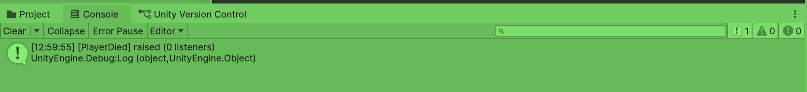

### Step 3 - Respond Without Code

This step wires the presentation response in the Inspector, where a designer can change it. (10 min)

1. Add a `VoidEventChannelListener` to the `Canvas` and set `Channel` to `PlayerDied`.
2. Add two entries to `Response`:
   - `GameOverPanel`, `GameObject.SetActive`, ticked;
   - `Player`, `DebugDamageKeys.enabled`, cleared.


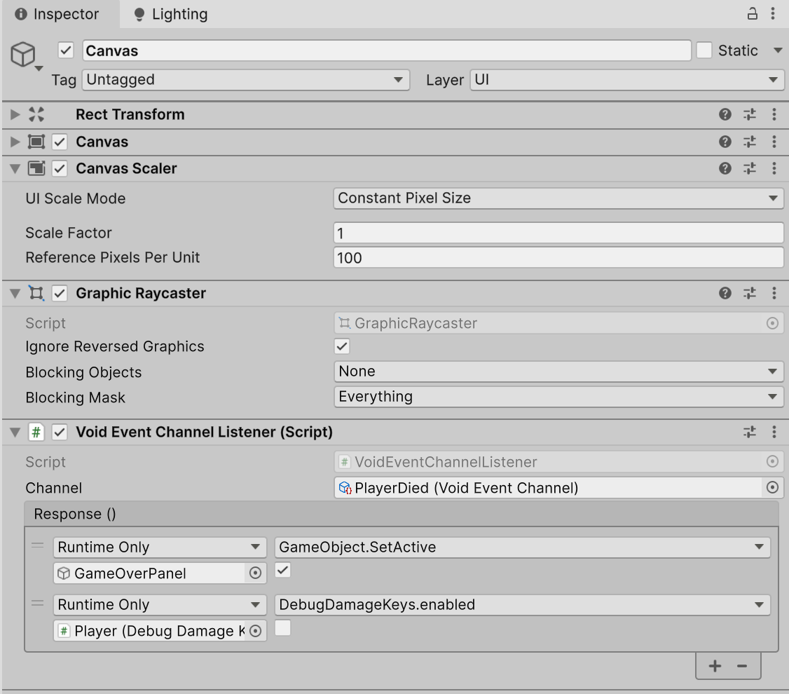

3. Press Play. Without taking damage, select `PlayerDied`, open its context menu (the three dots at the top of its Inspector) and choose `Raise`.
4. Stop, press Play again, and this time die by pressing `D` ten times.

**Record:** the listener count in the log for step 3 and step 4. Which object holds a reference to which? List every reference involved.

**Checkpoint:** the context menu `Raise` shows the panel and stops the debug keys without the player dying. Dying from damage does the same, and the log shows `(1 listeners)`.

### Step 4 - Turn Pickups into a Score

This step shows a channel carrying a value, and one listener turning many moments into state. (15 min)

1. Create a `GD > Events > Int` asset named `PickupCollected` with `Log Raises` ticked, and a `GD > Variables > Int` asset named `Score` with `Initial Value` 0. Fill in both descriptions.
2. Create these scripts in `Assets/Lab04/Scripts/`.

`Pickup.cs`:

```csharp
using GD.Types;
using UnityEngine;

[RequireComponent(typeof(Collider))]
public class Pickup : MonoBehaviour
{
    [SerializeField, Min(0)] private int points = 10;
    [SerializeField] private IntEventChannel pickupCollected;

    private void Awake()
    {
        if (pickupCollected == null)
        {
            Debug.LogError($"{name}: assign the pickup collected channel.", this);
            enabled = false;
        }
    }

    private void Reset()
    {
        // Editor only: runs when the component is added, so the collider starts as a trigger.
        GetComponent<Collider>().isTrigger = true;
    }

    private void OnTriggerEnter(Collider other)
    {
        // Physics messages still arrive on a disabled component, so check enabled here.
        if (!enabled || !other.CompareTag("Player")) return;

        // Raise, then remove. Every pickup raises, even when the points are the same as the last one.
        pickupCollected.Raise(points);
        Destroy(gameObject);
    }
}
```

`ScoreKeeper.cs`:

```csharp
using GD.Types;
using UnityEngine;

public class ScoreKeeper : MonoBehaviour
{
    [SerializeField] private IntEventChannel pickupCollected;
    [SerializeField] private IntVariable score;

    private void Awake()
    {
        if (pickupCollected == null || score == null)
        {
            Debug.LogError($"{name}: assign the pickup collected channel and the score variable.", this);
            enabled = false;
            return;
        }

        // The single writer of Score owns its start state.
        score.ResetToInitial();
    }

    private void OnEnable()
    {
        // Awake has already checked the references; OnEnable does not run if Awake disabled the component.
        pickupCollected.Raised += OnPickupCollected;
    }

    private void OnDisable()
    {
        if (pickupCollected != null)
            pickupCollected.Raised -= OnPickupCollected;
    }

    private void OnPickupCollected(int points)
    {
        // Many pickups raise the event; only ScoreKeeper writes the score.
        score.Add(points);
    }
}
```

`ScoreText.cs`:

```csharp
using GD.Types;
using TMPro;
using UnityEngine;

public class ScoreText : MonoBehaviour
{
    [SerializeField] private IntVariable score;
    [SerializeField] private TextMeshProUGUI label;

    private void OnEnable()
    {
        if (score == null || label == null)
        {
            Debug.LogError($"{name}: assign the score variable and the label.", this);
            enabled = false;
            return;
        }

        score.ValueChanged += OnScoreChanged;
        OnScoreChanged(score.Value);
    }

    private void OnDisable()
    {
        if (score != null)
            score.ValueChanged -= OnScoreChanged;
    }

    private void OnScoreChanged(int value)
    {
        label.text = $"Score: {value}";
    }
}
```

3. Add an empty GameObject named `Systems` and add the `ScoreKeeper` component. Assign both values in the `ScoreKeeper` component.
   
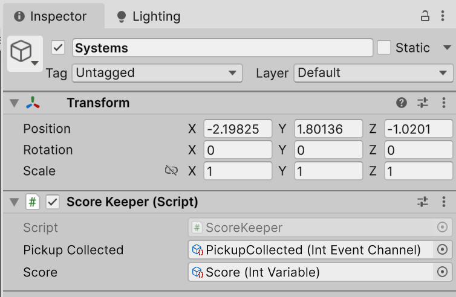

4. Add `ScoreText` to `ScoreLabel` and assign `Score` and the label's own `TextMeshProUGUI`.

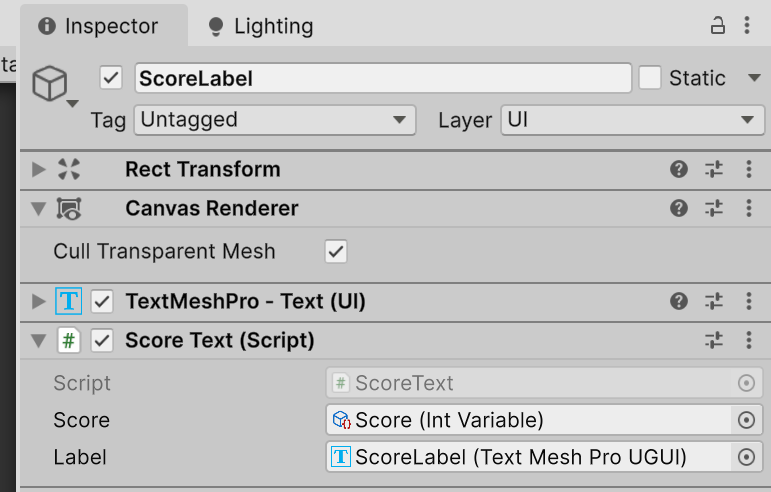

5. Add three small yellow `Sphere` objects named `Pickup_01` to `Pickup_03`, spread across the plane. Add `Pickup` to each and assign `PickupCollected`. Leave `Points` at 10 on the first two and set 50 on the third.
6. Press Play and drag the player through all three in the Scene view.

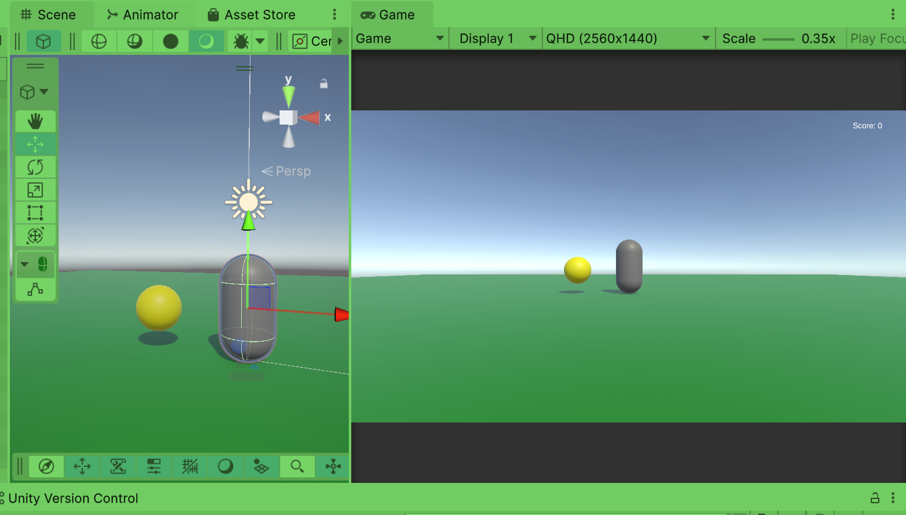

**Checkpoint:** the label reads 0, then 10, 20 and 70. The Console shows three `[PickupCollected] raised` lines, each with 1 listener, and the score is 0 again on the next Play.

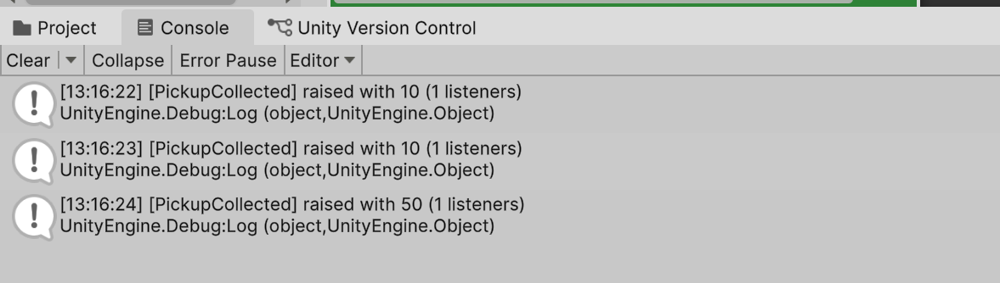

### Step 5 - Diagnose a Missed Event with the Debugger

This step reproduces the most common channel bug, a listener that never subscribed, and confirms the cause with evidence. (10 min)

1. Remove the `VoidEventChannelListener` from the `Canvas` and add a new one to `GameOverPanel` with the same channel and responses. This looks tidier: the panel handles its own event.
2. Press Play and die. The panel does not appear, and there is no error.

**Hypothesis:** the listener is on an inactive GameObject, so its `OnEnable` never ran and it never subscribed. At the moment of the raise, the channel has no listeners.

3. Switch the Editor to debug mode and attach your IDE.
4. Place one breakpoint in `VoidEventChannel.Raise` and one in `VoidEventChannelListener.OnEnable` (both in `Assets/GD/Common/Scripts/ScriptableObjects`).
5. Press Play and die. When `Raise` stops, inspect `ListenerCount`. Note whether the `OnEnable` breakpoint was hit before it.

**Record:** the value of `ListenerCount`, and whether `OnEnable` ran. Does the evidence support the hypothesis? Why does the `(0 listeners)` log line alone not tell you which listener is missing?

6. Move the listener back to the `Canvas`. Detach the debugger and switch back to release mode.

**Checkpoint:** with the listener on the panel, `ListenerCount` is 0 at the raise and the `OnEnable` breakpoint is never hit. With the listener on the `Canvas`, the panel appears on death.

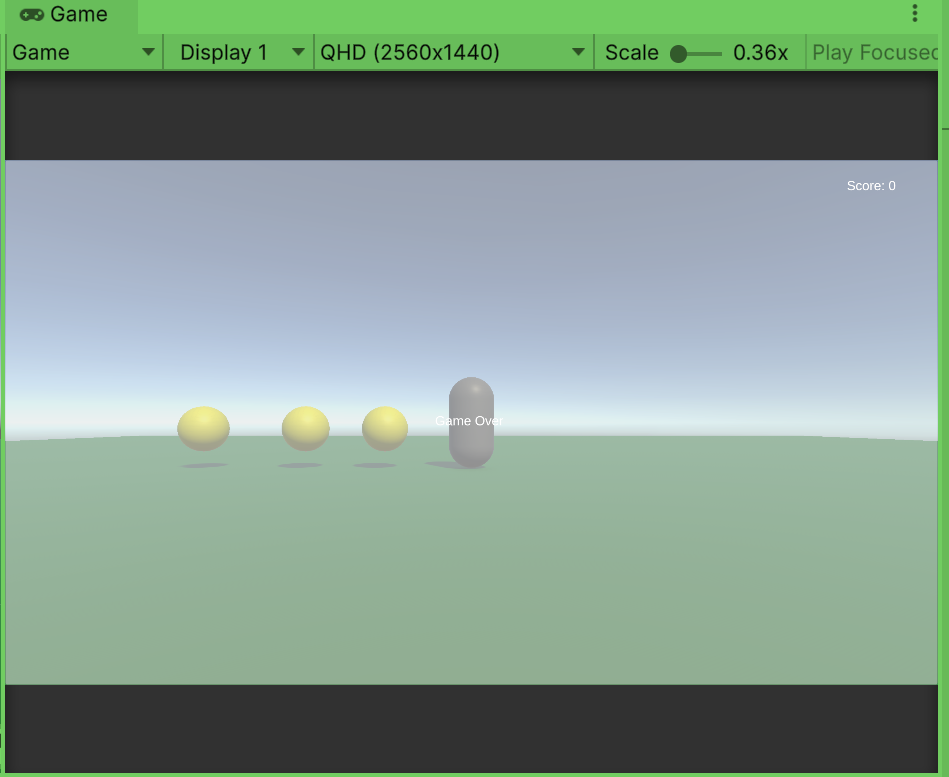

---

## 6. Debugging and Pitfalls

| Symptom | Likely cause | How to confirm | Fix |
|:--------|:-------------|:---------------|:----|
| `GD > Events` is missing from the Create menu | Compile error in the project | Console shows errors | Fix the errors |
| Log shows `(0 listeners)` | No listener subscribed at the time of the raise | Step 5 | Put the listener on an active object |
| Game over panel never appears | Listener on the inactive panel | Select the panel; the listener is on it | Move it to the `Canvas` |
| `PlayerDied` raised on every hit after death | `isDead` guard missing | Count log lines | Use the Step 2 version |
| Pickups do nothing | `Player` tag not set, player has no `Rigidbody`, or sphere collider is not a trigger | Check the tag, `Rigidbody` and `Is Trigger` | Step 1 |
| Score does not reset on Play | `ScoreKeeper` missing from the scene, so nothing resets `Score` | Select `Systems` | Add `ScoreKeeper` |
| Label shows "New Text" | `ScoreText` label not assigned or component disabled by its check | Console error from `ScoreText` | Assign the label |
| A `Response` entry shows as missing | The method it called was renamed or removed | Select the listener; the entry is marked missing | Re-select the method |
| Breakpoint in GD code is not hit | Release mode, or IDE not attached | Status bar code optimisation button | Switch to debug mode; attach |

---

## 7. Production Checklist

| Requirement | Done |
|:------------|:-----|
| `PlayerDied` is raised once, by `PlayerHealth` only | |
| The game over response is wired in the Inspector with no new script | |
| The response works from the channel's `Raise` context menu | |
| No script references `PlayerHealth` to react to death | |
| Pickups raise `PickupCollected`; only `ScoreKeeper` writes `Score` | |
| Two pickups with equal points both add to the score | |
| Every channel and variable has a `Description` naming its raisers or writer | |
| Debugger evidence for Step 5 is recorded in `LabNotes.md` | |
| The completed Plan table and diagram include every script and asset | |

---

## 8. Extension

### Stretch - Restart Without Scene References

Add a `RestartRequested` `VoidEventChannel`. A button on `GameOverPanel` raises it through the button's `On Click` UnityEvent. A `LevelRestarter` component on `Systems` listens and reloads the active scene.

Health and score must both be correct after the restart. Decide which existing code already guarantees that and which does not. Use Note 03, Section 4.5 on what a scene reload does and does not reset.

**Expected result:** clicking the button restarts the level with full health, a score of 0 and all pickups back. In `LabNotes.md`, explain in three or four sentences why no extra reset code was needed, or what you added and why.

---

## 9. Reflective Questions

1. In Step 3, the death response was wired without code. Which parts of your group project's responses belong in the Inspector, and which must stay in code? Justify the line you draw.
2. Your Step 5 evidence showed a listener that never subscribed. Why did the channel raise no error, and would you want it to?
3. `ScoreKeeper` is the only listener that writes `Score`. What would change if a second listener, a combo system, also wanted to change the score?
4. Stage 1 in the notes used a C# event on `PlayerHealth`. Name one situation where that is still the better choice, using Section 4.8 of the notes.
5. You ticked `Log Raises` on every channel in this lab. Should it stay ticked in your group project? Weigh the evidence it gives against its cost.

---

## 10. How This Builds

- **Next, additive scenes** ([Note 05](../notes/05_additive_scenes.md)) split the UI and the gameplay into separate scenes. Channels and variables like the ones in this lab are the only connection those scenes need.
- **Note 15 - Orchestration and Game Flow** uses channels to trigger stages of the gameplay flow, and the Extension's restart is an early version of that.
- **GCA - C# & Software Design - System Communication:** Steps 2 to 4 give a complete example: moments as channels, state as variables, one writer, and no references between raisers and listeners.

**Group project task (take-home).** Find one moment in your group's project that more than one system reacts to, such as death, level complete or item collected. Replace the direct calls or references with a channel. In your project log, list the raisers and listeners before and after, and record them in the channel's `Description`.
