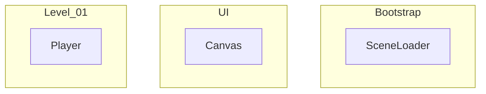

# Lab 5 - Splitting the Game into Scenes (Part A)

## 1. Overview

You build a deliberately small game in one scene: pickups that add to a score and a hazard that ends the run. You then split it into a `Bootstrap` scene for systems, a `UI` scene for the Canvas and a `Level_01` scene for the world. A `SceneLoader` in Bootstrap loads the other two additively. You then make Play work from the level scene too, use the debugger to find why the level appears twice, and fix the loader.

---

## 2. What You Will Learn

| Skill | You can... |
|:------|:-----------|
| Assign objects to scene roles | Place every object from the one-scene game in Bootstrap, UI or Level_01, with a reason |
| Edit several scenes at once | Open three scenes in the Hierarchy, move objects between them and save each one |
| Replace a cross-scene reference | Rewire a response that referenced an object in another scene, using a channel |
| Load scenes additively | Start from Bootstrap alone and have UI and Level_01 load around it |
| Set the active scene | Show that the level is the active (bold) scene after loading |
| Diagnose a duplicated scene with the debugger | Show with watched values that the level was already open when the loader loaded it again |

---

## 3. Before You Start

| Item | Check |
|:-----|:------|
| Unity version | Unity 6000.6 |
| Shared classes | `Assets > Create > GD > Events` and `Assets > Create > GD > Variables` exist |
| TextMeshPro | A uGUI `Text - TextMeshPro` object can be created; import `TMP Essentials` if Unity asks |
| Build profiles | You can open `File > Build Profiles` and find `Scene List` |
| Debugger | You can attach your IDE and switch the Editor to debug mode ([Notes 01](../notes/01_unity_foundations.md), Section 4.9) |
| Notes | You have read [05 - Additive Scenes and Persistent Systems](../notes/05_additive_scenes.md), Sections 3 to 4.8 |

---

## 4. Plan

Complete the plan before Step 3.



Copy this table into `LabNotes.md` and complete it for every root object in the Step 1 scene. Leave `Systems` (with `ScoreKeeper`) in `Level_01` for this lab; Part B tests that decision.

| Object | Scene | Reason (should it be replaced when the level changes?) |
|:-------|:------|:-------------------------------------------------------|
| `Main Camera` | | |
| `Directional Light` | | |
| `Plane`, pickups, `Hazard` | | |
| `Player` | | |
| `Canvas` | | |
| `EventSystem` | | |
| `Systems` | `Level_01` | Kept here until Part B |

---

## 5. Steps

### Step 1 - Build the One-Scene Game

This step builds the game you will split. It is small on purpose: every object is there because it raises a channel, listens to one, or has to live in a particular scene. (15 min)

1. Open `Tools > GD > Setup > Create Project Folders`, set `Project Folder` to `Lab05`, choose `Project assets only` and click `Create Folders`. Then create `Assets/Lab05/Data/Variables/` and `Assets/Lab05/Data/Events/`.
2. Create a new scene (`File > New Scene`) from a template that includes a camera and a light, such as `Basic (URP)`, and save it as `Assets/Lab05/Scenes/Level_01.unity`.
3. Create the shared assets:
   - in `Data/Variables/`, a `GD > Variables > Int` asset named `Score` with `Initial Value` 0;
   - in `Data/Events/`, a `GD > Events > Int` asset named `PickupCollected` and a `GD > Events > Void` asset named `PlayerDied`.
4. Create these scripts in `Assets/Lab05/Scripts/`. `Pickup`, `ScoreKeeper` and `ScoreText` are the designs from [Note 04](../notes/04_event_channels.md), Section 5. `Hazard` raises `PlayerDied` directly, because this game has no health.

`Pickup.cs`:

```csharp
using GD.Types;
using UnityEngine;

[RequireComponent(typeof(Collider))]
public class Pickup : MonoBehaviour
{
    [SerializeField, Min(0)] private int points = 10;
    [SerializeField] private IntEventChannel pickupCollected;

    private void Awake()
    {
        if (pickupCollected == null)
        {
            Debug.LogError($"{name}: assign the pickup collected channel.", this);
            enabled = false;
        }
    }

    private void Reset()
    {
        // Editor only: runs when the component is added, so the collider starts as a trigger.
        GetComponent<Collider>().isTrigger = true;
    }

    private void OnTriggerEnter(Collider other)
    {
        // Physics messages still arrive on a disabled component, so check enabled here.
        if (!enabled || !other.CompareTag("Player")) return;

        pickupCollected.Raise(points);
        Destroy(gameObject);
    }
}
```

`Hazard.cs`:

```csharp
using GD.Types;
using UnityEngine;

[RequireComponent(typeof(Collider))]
public class Hazard : MonoBehaviour
{
    [SerializeField] private VoidEventChannel playerDied;

    private void Awake()
    {
        if (playerDied == null)
        {
            Debug.LogError($"{name}: assign the player died channel.", this);
            enabled = false;
        }
    }

    private void Reset()
    {
        // Editor only: runs when the component is added, so the collider starts as a trigger.
        GetComponent<Collider>().isTrigger = true;
    }

    private void OnTriggerEnter(Collider other)
    {
        // Physics messages still arrive on a disabled component, so check enabled here.
        if (!enabled || !other.CompareTag("Player")) return;

        // The hazard announces the moment. It does not know what the game does about it.
        playerDied.Raise();
    }
}
```

`ScoreKeeper.cs`:

```csharp
using GD.Types;
using UnityEngine;

public class ScoreKeeper : MonoBehaviour
{
    [SerializeField] private IntEventChannel pickupCollected;
    [SerializeField] private IntVariable score;

    private void Awake()
    {
        if (pickupCollected == null || score == null)
        {
            Debug.LogError($"{name}: assign the pickup collected channel and the score variable.", this);
            enabled = false;
            return;
        }

        // The single writer of Score owns its start state.
        score.ResetToInitial();
    }

    private void OnEnable()
    {
        // Awake has already checked the references; OnEnable does not run if Awake disabled the component.
        pickupCollected.Raised += OnPickupCollected;
    }

    private void OnDisable()
    {
        if (pickupCollected != null)
            pickupCollected.Raised -= OnPickupCollected;
    }

    private void OnPickupCollected(int points)
    {
        score.Add(points);
    }
}
```

`ScoreText.cs`:

```csharp
using GD.Types;
using TMPro;
using UnityEngine;

public class ScoreText : MonoBehaviour
{
    [SerializeField] private IntVariable score;
    [SerializeField] private TextMeshProUGUI label;

    private void OnEnable()
    {
        if (score == null || label == null)
        {
            Debug.LogError($"{name}: assign the score variable and the label.", this);
            enabled = false;
            return;
        }

        score.ValueChanged += OnScoreChanged;
        OnScoreChanged(score.Value);
    }

    private void OnDisable()
    {
        if (score != null)
            score.ValueChanged -= OnScoreChanged;
    }

    private void OnScoreChanged(int value)
    {
        label.text = $"Score: {value}";
    }
}
```

5. Build the scene:
   - a `Plane` at the origin;
   - a `Capsule` named `Player` at (0, 1, 0) with the `Player` tag and a `Rigidbody` with `Is Kinematic` ticked and `Use Gravity` cleared, so trigger messages arrive and you can drag it in the Scene view;
   - three small `Sphere` objects named `Pickup_01` to `Pickup_03`, each with `Pickup` and `PickupCollected` assigned;
   - a red `Cube` named `Hazard` at (3, 0.5, 3) with `Hazard` and `PlayerDied` assigned;
   - an empty GameObject named `Systems` with `ScoreKeeper`, and both assets assigned.
6. Add a uGUI `Canvas` (`GameObject > UI > Canvas`, which also creates an `EventSystem`). Under it, add a `Text - TextMeshPro` named `ScoreLabel` with `ScoreText` (assign `Score` and its own label), and a `Panel` named `GameOverPanel` with a "Game Over" text child. Disable `GameOverPanel`.
7. Add a `VoidEventChannelListener` to the `Canvas` with `Channel` set to `PlayerDied` and two responses:
   - `GameOverPanel`, `GameObject.SetActive`, ticked;
   - `Player`, `GameObject.SetActive`, cleared.

**Checkpoint:** press Play and drag `Player` through the pickups in the Scene view: the label counts up. Drag it onto `Hazard`: the game over panel appears and the player disappears.

### Step 2 - Create the Other Two Scenes

This step creates one scene per role, without default objects that would be duplicated later. (5 min)

Create a new scene from the `Empty` template (`File > New Scene`) and save it as `Assets/Lab05/Scenes/Bootstrap.unity`. Repeat for `Assets/Lab05/Scenes/UI.unity`.

The `Empty` template has no camera or light, because Section 4.8 of the notes allows only one of each across all loaded scenes.

**Checkpoint:** `Assets/Lab05/Scenes/` contains `Bootstrap`, `UI` and `Level_01`, and `Bootstrap` and `UI` have no objects.

### Step 3 - Move Objects to Their Scenes

This step places each object in the scene that matches its lifetime. (10 min)

1. Open `Level_01`. Drag `Bootstrap.unity` and `UI.unity` from the Project window into the Hierarchy. All three scenes are now open.
2. Drag `Canvas` from `Level_01` onto the `UI` scene heading in the Hierarchy.
3. Drag `EventSystem` onto the `Bootstrap` scene heading.
4. Move every other object according to your Plan table. Leave `Systems` in `Level_01`.
5. Select the `Canvas` and look at its `VoidEventChannelListener`. The response that hid `Player` now points at an object in another scene.
6. Remove that response from the Canvas listener. Add a `VoidEventChannelListener` to `Player` in `Level_01`, with `Channel` set to `PlayerDied` and one response: `Player`, `GameObject.SetActive`, cleared.
7. Save all three scenes (`File > Save` with each scene selected, or right-click each scene heading and choose `Save Scene`).

**Record:** what happened to the cross-scene response in item 5? Why can the Canvas still show the score, which changes when pickups in the level are collected?

**Checkpoint:** `UI` contains only `Canvas`, `Bootstrap` contains only `EventSystem`, and no response in any listener refers to an object in another scene.

### Step 4 - Add the Scenes to the Build Profile

This step makes the scenes loadable, because only scenes in the scene list can be loaded by name. (5 min)

1. Open `File > Build Profiles`, select `Scene List`, and add `Bootstrap`, `UI` and `Level_01`, in that order.
2. Remove any other scenes from the list, or clear their tick boxes, including `SampleScene` if present.

**Checkpoint:** the scene list shows `Bootstrap` at index 0, then `UI` and `Level_01`, all ticked.

### Step 5 - Load the Other Scenes from Bootstrap

This step gives Bootstrap the job of loading everything else, as a build will. (10 min)

1. Create `Assets/Lab05/Scripts/SceneLoader.cs`:

```csharp
using System.Collections;
using UnityEngine;
using UnityEngine.SceneManagement;

public class SceneLoader : MonoBehaviour
{
    [SerializeField, Tooltip("Exact name of the UI scene.")]
    private string uiSceneName = "UI";

    [SerializeField, Tooltip("Exact name of the level loaded when the game starts.")]
    private string firstLevelName = "Level_01";

    // Unity runs Start as a coroutine when it returns IEnumerator, so it can wait for loads to finish.
    private IEnumerator Start()
    {
        yield return SceneManager.LoadSceneAsync(uiSceneName, LoadSceneMode.Additive);
        yield return SceneManager.LoadSceneAsync(firstLevelName, LoadSceneMode.Additive);

        // Lighting settings and objects created with Instantiate go to the active scene.
        SceneManager.SetActiveScene(SceneManager.GetSceneByName(firstLevelName));
    }
}
```

2. In `Bootstrap`, add an empty GameObject named `SceneLoader` with the component. Check `Ui Scene Name` is `UI` and `First Level Name` is `Level_01`.
3. Remove `UI` and `Level_01` from the Hierarchy (right-click each scene heading, `Remove Scene`), leaving only `Bootstrap` open.
4. Press Play. Collect a pickup, then touch the hazard.

**Record:** which scene name is bold in the Hierarchy during Play, and why does that matter for objects created with `Instantiate`?

**Checkpoint:** during Play the Hierarchy shows `Bootstrap`, `UI` and `Level_01`, with `Level_01` in bold. The score and the game over response work as they did in the single scene.

### Step 6 - Play from the Level and Fix the Duplicate

This step makes Play work from a level scene, then fixes the bug that change reveals. (15 min)

1. Stop. Open only `Level_01` and press Play. Note what is missing.
2. Stop. Create `Assets/Lab05/Scripts/BootstrapLoader.cs`:

```csharp
using UnityEngine;
using UnityEngine.SceneManagement;

public static class BootstrapLoader
{
    // Must match the scene's name in File > Build Profiles > Scene List.
    private const string BootstrapSceneName = "Bootstrap";

    // Runs once when Play starts, after the first scene has loaded.
    [RuntimeInitializeOnLoadMethod(RuntimeInitializeLoadType.AfterSceneLoad)]
    private static void EnsureBootstrapLoaded()
    {
        // In a build, Bootstrap is the first scene, so this does nothing.
        // In the Editor, pressing Play in any other scene loads Bootstrap alongside it.
        if (!SceneManager.GetSceneByName(BootstrapSceneName).isLoaded)
            SceneManager.LoadScene(BootstrapSceneName, LoadSceneMode.Additive);
    }
}
```

3. With only `Level_01` open, press Play again. Look at the Hierarchy: `Level_01` appears twice, with two players.

**Hypothesis:** `Level_01` was already loaded when `SceneLoader.Start` ran, and `Start` loads `firstLevelName` without checking.

4. Stop. Switch the Editor to debug mode and attach your IDE.
5. Place a breakpoint in `SceneLoader.Start` where it will test the hypothesis. Decide where before you run.
6. Press Play with only `Level_01` open. When the breakpoint is hit, watch `SceneManager.sceneCount` and `SceneManager.GetSceneAt(0).name`, `GetSceneAt(1).name` and so on up to the count.

**Record:** the scene count and names at the breakpoint. Does the evidence support the hypothesis?

7. Replace `SceneLoader.cs`:

```csharp
using System.Collections;
using UnityEngine;
using UnityEngine.SceneManagement;

public class SceneLoader : MonoBehaviour
{
    [SerializeField, Tooltip("Exact name of the UI scene.")]
    private string uiSceneName = "UI";

    [SerializeField, Tooltip("Exact name of the level loaded when the game starts.")]
    private string firstLevelName = "Level_01";

    private Scene currentLevel;

    // Unity runs Start as a coroutine when it returns IEnumerator, so it can wait for loads to finish.
    private IEnumerator Start()
    {
        // Load the UI only if it is not already open, for example in the Editor.
        if (!SceneManager.GetSceneByName(uiSceneName).isLoaded)
            yield return SceneManager.LoadSceneAsync(uiSceneName, LoadSceneMode.Additive);

        // If Play was pressed in a level scene, adopt that level instead of loading a second copy.
        currentLevel = FindOpenLevel();

        if (!currentLevel.IsValid())
        {
            yield return SceneManager.LoadSceneAsync(firstLevelName, LoadSceneMode.Additive);
            currentLevel = SceneManager.GetSceneByName(firstLevelName);
        }

        // Lighting settings and objects created with Instantiate go to the active scene.
        SceneManager.SetActiveScene(currentLevel);
    }

    private Scene FindOpenLevel()
    {
        // A level is any loaded scene that is not this Bootstrap scene and not the UI.
        for (int i = 0; i < SceneManager.sceneCount; i++)
        {
            Scene scene = SceneManager.GetSceneAt(i);

            if (scene == gameObject.scene || scene.name == uiSceneName)
                continue;

            if (scene.isLoaded)
                return scene;
        }

        // default(Scene) is not valid, which tells the caller no level is open.
        return default;
    }
}
```

8. Press Play with only `Level_01` open, then with only `Bootstrap` open. Detach the debugger and switch back to release mode.

**Checkpoint:** at the breakpoint, the scene list already contains `Level_01` before the loader loads it. After the fix, Play from either scene gives exactly one `Bootstrap`, one `UI` and one `Level_01`, with `Level_01` bold.

### Step 7 - Check There Is One of Each

This step confirms that no object is duplicated across the loaded scenes. (5 min)

1. Press Play from `Bootstrap`.
2. In the Hierarchy search box, type `t:EventSystem`, then `t:AudioListener`, then `t:Camera`. The search covers all loaded scenes.
3. Read the Console for warnings about audio listeners or event systems.

**Checkpoint:** each search finds exactly one object, and the Console has no warnings about audio listeners or event systems.

---

## 6. Debugging and Pitfalls

| Symptom | Likely cause | How to confirm | Fix |
|:--------|:-------------|:---------------|:----|
| Error: scene "has not been added to the build settings" | Scene missing or unticked in the scene list | `File > Build Profiles > Scene List` | Add and tick it |
| Only the level appears when pressing Play in it | `BootstrapLoader` missing, or `Bootstrap` misspelled | Check the constant against the scene file name | Add the script; match the name exactly |
| Two copies of `Level_01` | Loader does not adopt an open level | Step 6 | Use the second `SceneLoader` |
| Score does not update | `ScoreText` lost its asset references when moved | Select `ScoreLabel` | Reassign the assets; assets are allowed across scenes |
| Game over panel appears but the player stays visible | The response that hid `Player` was lost with the cross-scene reference | Select the listeners | Step 3, items 5 and 6 |
| Pickups or the hazard do nothing | `Player` tag not set, player has no `Rigidbody`, or the collider is not a trigger | Check the tag, `Rigidbody` and `Is Trigger` | Step 1, item 5 |
| "2 audio listeners" warning | A camera in Bootstrap or UI | Step 7 search | Delete the extra camera |
| Level is dark or uses the wrong skybox | Level not set as the active scene | Is `Level_01` bold during Play? | Check `SetActiveScene` runs |
| Changes lost after reopening a scene | Only one of the open scenes was saved | Reopen each scene | Save every scene heading that shows `*` |

---

## 7. Production Checklist

| Requirement | Done |
|:------------|:-----|
| `Bootstrap`, `UI` and `Level_01` exist, with objects placed as in the Plan table | |
| No response or field refers to an object in another scene | |
| The scene list has `Bootstrap` first, then `UI` and `Level_01` | |
| Play from `Bootstrap` loads `UI` and `Level_01`, with `Level_01` active | |
| Play from `Level_01` loads `Bootstrap` and `UI`, with one copy of `Level_01` | |
| One `EventSystem`, one `AudioListener` and one camera during Play | |
| Debugger evidence for Step 6 is recorded in `LabNotes.md` | |
| Score and the game over response behave as they did in the single scene | |

---

## 8. Extension

### Stretch - Persistent Music, Two Ways

Add looping music that must keep playing without restarting through Part B's level changes.

1. Put an `AudioSource` with `Loop` ticked on a `Music` object in `Bootstrap`.
2. In a separate test scene, try the alternative: the `MusicPlayer` component from the notes, Section 4.4, on an object in `Level_01` with `DontDestroyOnLoad`.

**Expected result:** a comparison in `LabNotes.md` of what happens with each approach when you press Play from `Level_01`, and when `Level_01` is loaded a second time. Recommend one for your group project in two sentences.

---

## 9. Reflective Questions

1. You placed the camera in `Level_01`. Argue for or against moving it to `Bootstrap` for your group project.
2. Step 3 lost a cross-scene reference. Why does the Inspector refuse to save references between scenes, when a scene can be loaded without the other?
3. `BootstrapLoader` runs in builds too, where it does nothing. Is it acceptable to ship Editor-only convenience code in a build? What would you check before deciding?
4. Your Step 6 evidence showed the level already open. Describe how the second `SceneLoader` decides which open scene is the level, and one project layout where that rule would choose wrongly.

---

## 10. How This Builds

- **[Lab 5 Part B](lab_5_additive_scenes_part_b.md)** replaces the scene-name strings with `SceneDefinition` assets, adds `Level_02` and a level exit, and tests whether the score survives the change.
- **Note 15 - Orchestration and Game Flow** builds a title screen and game flow on channels, which you can connect to this structure.
- **GCA - Technical Finish & Performance - Project Organisation:** a scene split with one role per scene is direct evidence of logical organisation.
