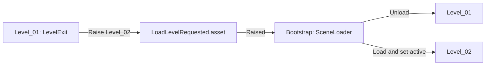

# Lab 5 - Level Flow (Part B)

## 1. Overview

You upgrade Part A's `SceneLoader` from scene-name strings to `SceneDefinition` assets and a `LoadLevelRequested` channel, then add `Level_02` and level exits. Moving between levels exposes a persistence bug: the score resets. You confirm the cause with the debugger and fix it by moving a system to the scene it belongs in, then decide what else should reset per level.

---

## 2. What You Will Learn

| Skill | You can... |
|:------|:-----------|
| Replace strings with definition assets | Load scenes through `SceneDefinition` assets, and see the Editor warn about a misspelled scene |
| Request a level through a channel | Move to the next level by raising `LoadLevelRequested` from a trigger |
| Swap levels around persistent scenes | Show `Level_01` unloading and `Level_02` loading while `Bootstrap` and `UI` stay loaded |
| Diagnose a persistence bug with the debugger | Show which scene the resetting `ScoreKeeper` belongs to |
| Decide what resets per level | Make each shared value either persist or reset, and justify each choice |

---

## 3. Before You Start

| Item | Check |
|:-----|:------|
| Part A complete | Play from `Bootstrap` or `Level_01` gives one of each scene, with `Level_01` bold |
| Shared classes | `Create > GD > Scenes > Scene Definition` and `Create > GD > Events > Scene` exist |
| Debugger | You can attach your IDE and switch the Editor to debug mode |
| Notes | You have read [05 - Additive Scenes and Persistent Systems](../notes/05_additive_scenes.md), Sections 4.5 to 4.7 and 5 |

---

## 4. Plan

Complete the plan before Step 3.



Copy this table into `LabNotes.md`. Predict each value after moving from `Level_01` to `Level_02`, before you run anything:

| Value | Persist or reset? | Which script or rule makes it so? |
|:------|:------------------|:----------------------------------|
| `Score` | | |
| The player's position | | |
| Pickups | | |
| `ElapsedTime` (added in Step 5) | | |

You check your predictions in Steps 4 and 5.

---

## 5. Steps

### Step 1 - Upgrade the Loader to Definitions and a Channel

This step replaces scene-name strings with assets and a request channel. This is the deliberate upgrade in this lab: Part A typed each scene name in the Inspector and in code, and a typo failed only at runtime. (10 min)

1. Create `Assets/Lab05/Data/Scenes/`. In it, create three `GD > Scenes > Scene Definition` assets: `UIScene` (scene name `UI`), `Level_01_Def` (scene name `Level_01`, display name `The Yard`) and `Level_02_Def` (scene name `Level_02`, display name `The Storm`).
2. Type `level_01` as the scene name in `Level_01_Def`, read the Console, then correct it. `Level_02_Def` also warns until Step 2 adds the scene.
3. In `Assets/Lab05/Data/Events/`, create a `GD > Events > Scene` asset named `LoadLevelRequested`. Tick `Log Raises`, and in `Description` name `SceneLoader` as its only listener.
4. Replace `Assets/Lab05/Scripts/SceneLoader.cs`:

```csharp
using System.Collections;
using GD.Types;
using UnityEngine;
using UnityEngine.SceneManagement;

public class SceneLoader : MonoBehaviour
{
    [SerializeField] private SceneDefinition uiScene;
    [SerializeField] private SceneDefinition firstLevel;
    [SerializeField] private SceneEventChannel loadLevelRequested;

    private Scene currentLevel;
    private bool isLoading;

    private void Awake()
    {
        if (uiScene == null || firstLevel == null || loadLevelRequested == null)
        {
            Debug.LogError($"{name}: assign the UI scene, the first level and the load level channel.", this);
            enabled = false;
        }
    }

    private void OnEnable()
    {
        // Awake has already checked the references; OnEnable does not run if Awake disabled the component.
        loadLevelRequested.Raised += OnLoadLevelRequested;
    }

    private void OnDisable()
    {
        if (loadLevelRequested != null)
            loadLevelRequested.Raised -= OnLoadLevelRequested;
    }

    // Unity runs Start as a coroutine when it returns IEnumerator, so it can wait for loads to finish.
    private IEnumerator Start()
    {
        // Load the UI only if it is not already open, for example in the Editor.
        if (!SceneManager.GetSceneByName(uiScene.SceneName).isLoaded)
            yield return SceneManager.LoadSceneAsync(uiScene.SceneName, LoadSceneMode.Additive);

        // If Play was pressed in a level scene, adopt that level instead of loading a second copy.
        currentLevel = FindOpenLevel();

        if (currentLevel.IsValid())
            SceneManager.SetActiveScene(currentLevel);
        else
            yield return LoadLevel(firstLevel);
    }

    private void OnLoadLevelRequested(SceneDefinition level)
    {
        // A second request while loading would unload the level that is still arriving.
        if (isLoading)
        {
            Debug.LogWarning($"{name}: ignored a load request while a level is loading.", this);
            return;
        }

        StartCoroutine(LoadLevel(level));
    }

    private IEnumerator LoadLevel(SceneDefinition level)
    {
        if (level == null || !Application.CanStreamedLevelBeLoaded(level.SceneName))
        {
            Debug.LogError($"{name}: cannot load the requested level. Check the SceneDefinition and File > Build Profiles > Scene List.", this);
            yield break;
        }

        isLoading = true;

        if (currentLevel.IsValid() && currentLevel.isLoaded)
            yield return SceneManager.UnloadSceneAsync(currentLevel);

        yield return SceneManager.LoadSceneAsync(level.SceneName, LoadSceneMode.Additive);
        currentLevel = SceneManager.GetSceneByName(level.SceneName);

        // Lighting settings and objects created with Instantiate go to the active scene.
        SceneManager.SetActiveScene(currentLevel);

        isLoading = false;
    }

    private Scene FindOpenLevel()
    {
        // A level is any loaded scene that is not this Bootstrap scene and not the UI.
        for (int i = 0; i < SceneManager.sceneCount; i++)
        {
            Scene scene = SceneManager.GetSceneAt(i);

            if (scene == gameObject.scene || scene.name == uiScene.SceneName)
                continue;

            if (scene.isLoaded)
                return scene;
        }

        // default(Scene) is not valid, which tells the caller no level is open.
        return default;
    }
}
```

5. On `SceneLoader` in `Bootstrap`, assign `UIScene`, `Level_01_Def` and `LoadLevelRequested`.
6. Press Play from `Bootstrap`, then from `Level_01`.

**Checkpoint:** Play from either scene gives one `Bootstrap`, one `UI` and one `Level_01`, as at the end of Part A, and the misspelled name produced a warning naming the asset.

### Step 2 - Build Level 2

This step creates a second level to move to. (5 min)

1. In the Project window, duplicate `Level_01` (`Ctrl+D`) and rename the copy `Level_02`.
2. Open `Level_02` on its own. Move the pickups and the hazard, and rotate the plane a little, so you can tell the levels apart.
3. Add `Level_02` to `File > Build Profiles > Scene List`, after `Level_01`.

**Checkpoint:** the scene list has four ticked scenes, `Bootstrap` first, and `Level_02_Def` no longer warns (select it to trigger the check).

### Step 3 - Add Level Exits

This step lets the player request the next level without any reference to the loader. (10 min)

1. Create `Assets/Lab05/Scripts/LevelExit.cs`:

```csharp
using GD.Types;
using UnityEngine;

[RequireComponent(typeof(Collider))]
public class LevelExit : MonoBehaviour
{
    [SerializeField] private SceneDefinition nextLevel;
    [SerializeField] private SceneEventChannel loadLevelRequested;

    // Runtime state: the exit asks for the next level once, even if the player re-enters it.
    private bool used;

    private void Awake()
    {
        if (nextLevel == null || loadLevelRequested == null)
        {
            Debug.LogError($"{name}: assign the next level and the load level channel.", this);
            enabled = false;
        }
    }

    private void Reset()
    {
        // Editor only: runs when the component is added, so the collider starts as a trigger.
        GetComponent<Collider>().isTrigger = true;
    }

    private void OnTriggerEnter(Collider other)
    {
        // Physics messages still arrive on a disabled component, so check enabled here.
        if (!enabled || used || !other.CompareTag("Player")) return;

        used = true;

        // The exit does not load anything itself. It asks, and the SceneLoader in Bootstrap decides.
        loadLevelRequested.Raise(nextLevel);
    }
}
```

2. In `Level_01`, add a green `Cube` named `Exit` at a corner of the plane. Add `LevelExit`, and assign `Level_02_Def` and `LoadLevelRequested`.
3. In `Level_02`, add the same exit with `Next Level` set to `Level_01_Def`, so you can travel back and forth.
4. Save both levels. Open only `Bootstrap` and press Play. Drag the player onto the exit in the Scene view, then onto `Level_02`'s exit.

**Checkpoint:** the Console logs a line starting `[LoadLevelRequested] raised with Level_02_Def` and ending `(1 listeners)`. During the change, `Level_01` disappears from the Hierarchy and `Level_02` appears in bold, while `Bootstrap` and `UI` stay loaded throughout.

### Step 4 - Find Why the Score Resets

This step checks your persistence predictions and traces the first one that fails. (10 min)

1. Press Play from `Bootstrap`. Collect two pickups in `Level_01`, then take the exit.
2. Compare the score before and after the change with your Plan table.

**Hypothesis:** `Level_02` contains its own copy of `Systems`, so a new `ScoreKeeper` runs `Awake` when the level loads and calls `score.ResetToInitial()`.

3. Switch the Editor to debug mode and attach your IDE.
4. Place a breakpoint in `ScoreKeeper.Awake` where it will test the hypothesis. Watch `gameObject.scene.name` and `score.Value`.
5. Repeat steps 1 and 2. Continue past the first hit at start-up and inspect the second hit.

**Record:** the watched values at each hit. Which scene did each `ScoreKeeper` belong to?

6. Stop. Open `Bootstrap` and `Level_01` together, and drag `Systems` from `Level_01` onto the `Bootstrap` heading. Open `Level_02` and delete its `Systems`. Save all three.
7. Repeat steps 1 and 2, then detach the debugger and switch back to release mode.

**Checkpoint:** before the fix, the second `Awake` hit shows `gameObject.scene.name` as `Level_02` and the score reset to 0. After the fix, `ScoreKeeper.Awake` runs once per Play, the score carries into `Level_02`, and the player starts at its own position in each level.

### Step 5 - Apply: Decide What Resets per Level

This step applies the persistence rules to a value nobody has decided about yet. (15 min)

The designer adds an on-screen timer.

1. In `Assets/Lab05/Data/Variables/`, create a `GD > Variables > Float` asset named `ElapsedTime` with `Initial Value` 0. In `Description`, name `LevelTimer` as its only writer.
2. Create these scripts in `Assets/Lab05/Scripts/`.

`LevelTimer.cs`:

```csharp
using GD.Types;
using UnityEngine;

public class LevelTimer : MonoBehaviour
{
    [SerializeField] private FloatVariable elapsedTime;

    private void Awake()
    {
        if (elapsedTime == null)
        {
            Debug.LogError($"{name}: assign the elapsed time variable.", this);
            enabled = false;
            return;
        }

        // The single writer of ElapsedTime owns its start state.
        elapsedTime.ResetToInitial();
    }

    private void Update()
    {
        elapsedTime.Add(Time.deltaTime);
    }
}
```

`TimeText.cs`:

```csharp
using GD.Types;
using TMPro;
using UnityEngine;

public class TimeText : MonoBehaviour
{
    [SerializeField] private FloatVariable elapsedTime;
    [SerializeField] private TextMeshProUGUI label;

    private void OnEnable()
    {
        if (elapsedTime == null || label == null)
        {
            Debug.LogError($"{name}: assign the elapsed time variable and the label.", this);
            enabled = false;
            return;
        }

        elapsedTime.ValueChanged += OnTimeChanged;
        OnTimeChanged(elapsedTime.Value);
    }

    private void OnDisable()
    {
        if (elapsedTime != null)
            elapsedTime.ValueChanged -= OnTimeChanged;
    }

    private void OnTimeChanged(float value)
    {
        label.text = $"Time: {value:0.0}";
    }
}
```

3. In both `Level_01` and `Level_02`, add an empty GameObject named `Timer` with `LevelTimer`, and assign `ElapsedTime`.
4. In `UI`, add a `Text - TextMeshPro` named `TimeLabel` under the `Canvas`, with `TimeText`. Assign `ElapsedTime` and its own label.
5. Save every scene. Play from `Bootstrap` and travel `Level_01` to `Level_02` to `Level_01`, watching the timer.

Now decide and implement:

- Should the timer show the time in this level, restarting in each level, or the time for the whole run, continuing across levels?
- Implement your decision without adding code to any script other than `LevelTimer`, and without moving `LevelTimer` to `Bootstrap`.
- Check that pickups reappear when you return to a level, and explain why in one sentence.

**Record:** complete the Plan table with what actually happened, and justify your timer decision using the writer-owns-start-state rule from Note 03, Section 4.4. If the timer continues across levels, what still sets it to 0 at the start of each Play session? (Read `ScriptableVariable.cs`.)

**Checkpoint:** each value in your Plan table behaves as your final column says, including `ElapsedTime`, and pickups reappear on returning to a level.

---

## 6. Debugging and Pitfalls

| Symptom | Likely cause | How to confirm | Fix |
|:--------|:-------------|:---------------|:----|
| `SceneDefinition` warns about its scene | Name misspelled, or scene not in the list | Compare with the scene file name; check the scene list | Correct the name; add and tick the scene |
| "cannot load the requested level" error | `SceneDefinition` missing on the exit, or scene not in the list | Select the exit; check the scene list | Assign the asset; add the scene |
| Exit does nothing | `Player` tag missing, exit collider not a trigger, or channel not assigned | Log shows no raise | Check the tag, `Is Trigger` and the channel |
| Log shows `(0 listeners)` | `SceneLoader` not in a loaded scene, or disabled by its `Awake` check | Is `Bootstrap` loaded? Any error from `SceneLoader`? | Load `Bootstrap`; assign all three fields |
| Score resets on level change | `ScoreKeeper` in the level scenes | Step 4 | Move `Systems` to `Bootstrap` |
| No player, or a player from the previous level, after a level change | `Player` moved to `Bootstrap` by mistake | Which scene contains `Player`? | Keep a `Player` in each level |
| A warning that a load request was ignored | A second request arrived while loading | Count `LoadLevelRequested` log lines | Expected if you re-enter an exit quickly; `LevelExit` fires once per level |
| Level is lit wrongly after a change | Level not active | Is the new level bold? | Check `SetActiveScene` runs after the load |

---

## 7. Production Checklist

| Requirement | Done |
|:------------|:-----|
| `SceneLoader` uses `SceneDefinition` assets; no scene-name strings remain except in `BootstrapLoader` | |
| Level changes are requested only through `LoadLevelRequested` | |
| `Bootstrap` and `UI` stay loaded through every level change | |
| One level is loaded at a time, and it is the active scene | |
| `Systems` is in `Bootstrap` only; the score survives level changes | |
| Each level has its own `Player`, pickups and exit | |
| `ElapsedTime` behaves as you decided, set only by `LevelTimer` | |
| Debugger evidence for Step 4 is recorded in `LabNotes.md` | |
| The Plan table shows predicted and actual behaviour for every value | |

---

## 8. Extension

### Stretch - Restart the Current Level

The game over panel should offer a restart that reloads the current level only, keeping the score from before the level started.

Add a `RestartRequested` `VoidEventChannel`, raised by a button on the game over panel. Extend `SceneLoader` to handle it: reload the current level through the same `LoadLevel` path. Decide how the score returns to its value at the start of the level, and which system owns that rule.

**Expected result:** restarting reloads only the current level, `Bootstrap` and `UI` stay loaded, and the score equals its value when the level was entered. In `LabNotes.md`, explain in three or four sentences where the start-of-level score is stored and why.

---

## 9. Reflective Questions

1. Step 1 moved scene names from strings into assets. What class of bug does that remove, and what can still go wrong?
2. `LevelExit` asks for a level; it does not load one. What would break if each exit called `SceneManager` directly?
3. Step 4 showed a system in the wrong scene. What question from the notes, Section 4.1, would have placed it correctly from the start?
4. In Step 5 you chose whether the timer continues or restarts. Which choice would a player notice, and how would you test it in your group project?
5. `SceneLoader` ignores requests while loading. Is ignoring the right response, or should it queue them? Give a game situation that supports your answer.

---

## 10. How This Builds

- **Note 07 - Movement Systems** replaces dragging the player in the Scene view with a real controller, in each level scene.
- **Note 15 - Orchestration and Game Flow** builds a title screen and a full game flow on channels, which you can connect to `SceneLoader` from this lab.
- **GCA - Gameplay Systems & Integration - Systems Integration:** the level flow, with persistent score and per-level state, shows systems working together across scenes.

**Group project task (take-home).** Split your group's project into Bootstrap, UI and at least one level scene. Record in your project log which objects went where and why, and one reference you had to replace with a variable or channel.
