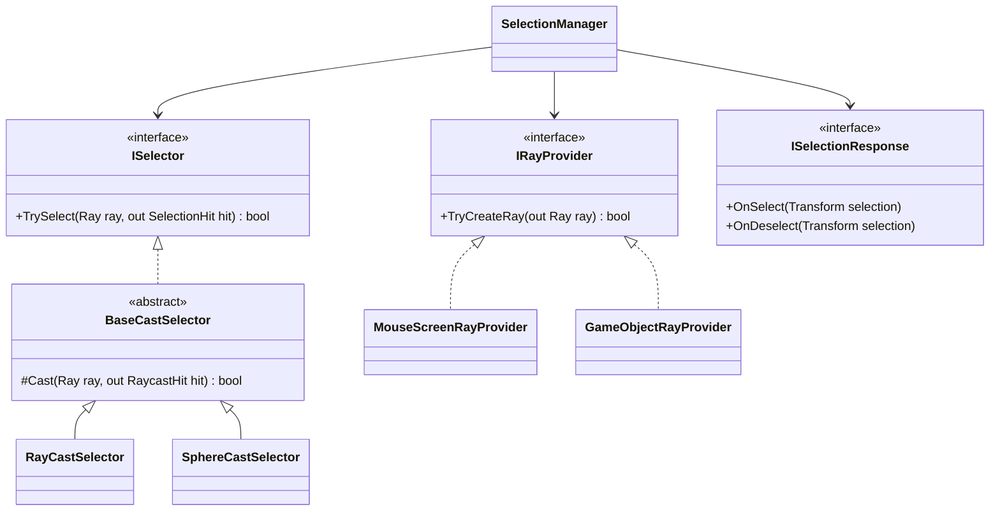
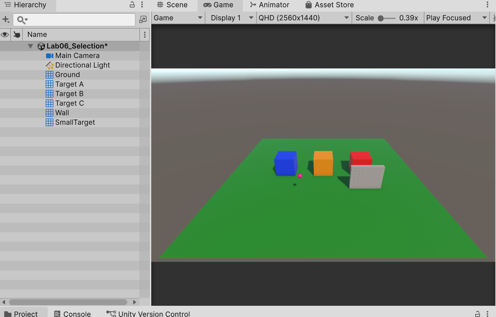
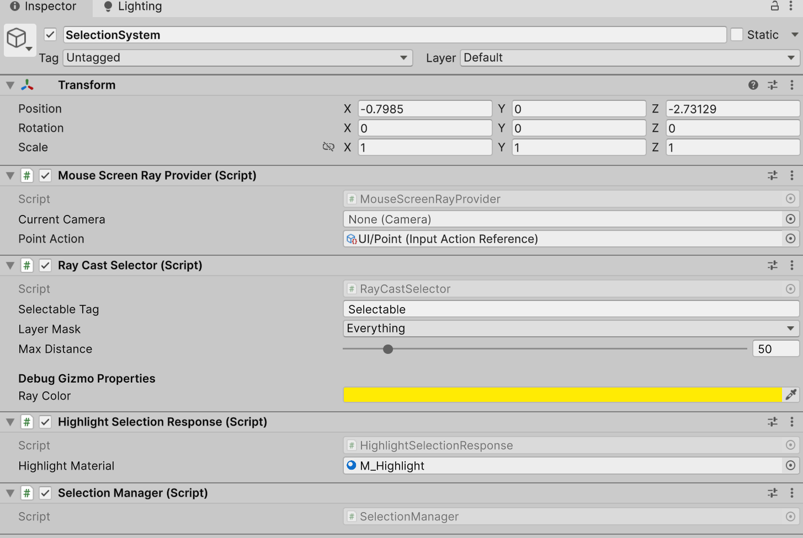
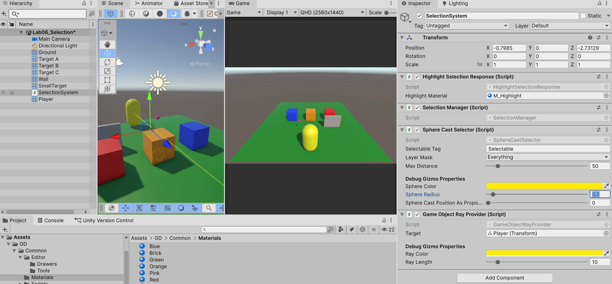
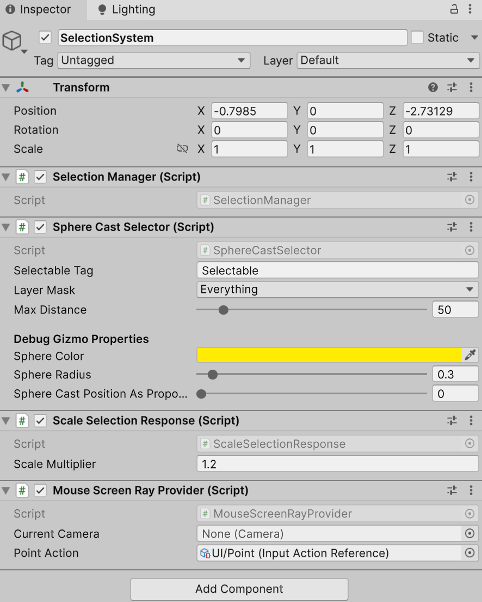
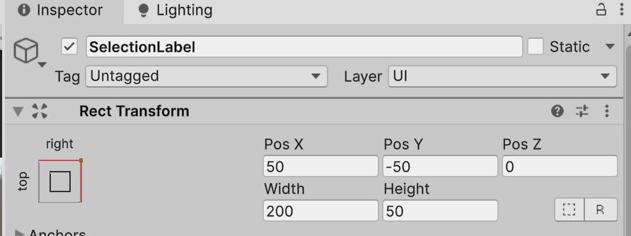
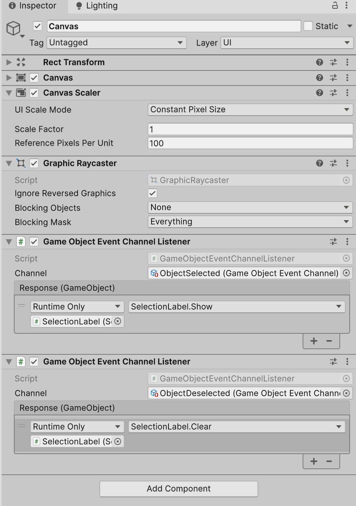

# Lab 6 - Selection Systems

## 1. Overview

You build a small scene of selectable targets and assemble hover selection from the shared selection components, without writing a line of manager code. You then change how selection works by swapping components, add a new response of your own, and send the selection to a HUD through an event channel. Finally, you use the debugger to show why disabling a component did not change which selector the manager uses.

---

## 2. What You Will Learn

| Skill | You can... |
|:------|:-----------|
| Assemble a system by composition | Build working hover selection from a provider, a selector, a response and `SelectionManager` on one GameObject |
| Swap a strategy without code | Replace the selector and the ray provider and show that `SelectionManager` is unchanged |
| Extend through an interface | Write `ScaleSelectionResponse` and add it with no edit to any existing file |
| Decouple a reaction | Show the selected object's name in the HUD through a `GameObjectEventChannel`, with no reference from the selection object to the HUD |
| Diagnose a component lookup with the debugger | Show which `ISelector` the manager is using, and that it is the disabled one |

---

## 3. Before You Start

| Item | Check |
|:-----|:------|
| Unity version | 6000.6.3f1 with URP 17.6.0 |
| Input System | `Edit > Project Settings > Player > Active Input Handling` is `Input System Package (New)` |
| Debugger | You can attach your IDE to the Unity Editor and switch the Editor to debug mode ([Notes 01](../notes/01_unity_foundations.md), Section 4.9) |
| Selection classes | `Assets/GD/Common/Scripts/Selection` contains `SelectionManager.cs`, and `IRayProvider` declares `TryCreateRay` |
| Event channels | `Assets > Create > GD > Events > Game Object` exists |
| Input actions | `Assets/InputSystem_Actions` contains the `UI/Point` action |
| TextMeshPro | A uGUI `Text - TextMeshPro` object can be created; import `TMP Essentials` if Unity asks |
| Notes | You have read [06 - Selection Systems and SOLID Design](../notes/06_selection_systems.md), Sections 3 to 4.9 |

---

## 4. Plan

Complete the plan before Step 2.



Copy the diagram into `LabNotes.md` and complete it:

1. Add every class that implements `ISelectionResponse` in this lab: `HighlightSelectionResponse`, `ScaleSelectionResponse` (Step 4) and `EventChannelSelectionResponse` (Step 5).
2. Add the channel asset, the listener and the HUD script from Step 5, with an arrow for each reference.
3. Mark the one class that no step in this lab edits. Predict why before you start.

---

## 5. Steps

### Step 1 - Set Up the Scene

This step builds a scene where each object tests one part of the selection rule: tagged targets, an untagged wall in the way, and a small target that is hard to hit. (10 min)



1. Open `Tools > GD > Setup > Create Project Folders`. Set `Project Folder` to `Lab06`, choose `Project assets only` and click `Create Folders`. Then create `Assets/Lab06/Data/Events/`.
2. Create a new scene and save it as `Assets/Lab06/Scenes/Lab06_Selection.unity`. Set `Main Camera` to `Position` (0, 5, -8) and `Rotation` (30, 0, 0).
3. Add a `Plane` named `Ground` at the origin. Apply a coloured material from `GD/Common/Materials`.
4. Open `Tags and Layers` (from any object's `Tag` drop-down, `Add Tag...`) and add the tag `Selectable`, because the selectors accept only objects with this tag.
5. Add three `Cube` objects named `Target_A`, `Target_B` and `Target_C` at (-2, 0.5, 0), (0, 0.5, 0) and (2, 0.5, 0). Tag all three `Selectable`. Apply three coloured materials from `GD/Common/Materials`, one per cube.
6. Add a `Cube` named `Wall` at (2, 0.6, -1.5) with `Scale` (1.5, 1.2, 0.2). Leave it `Untagged`. It hides the front of `Target_C`, so only its top is visible from the camera.
7. Add a `Sphere` named `SmallTarget` at (-1, 1, -2) with `Scale` (0.2, 0.2, 0.2). Tag it `Selectable`. It floats so that the ground does not block the sphere cast in Step 3.  Apply a coloured material from `GD/Common/Materials`.
8. In `Assets/Lab06/Materials/`, create a material named `M_Highlight` with a bright yellow `Base Map` colour.

**Checkpoint:** the Game view shows three cubes, a wall hiding the front of the right-hand cube, and a small floating sphere between the left and middle cubes. Four objects are tagged `Selectable`; `Wall` and `Ground` are not.

### Step 2 - Assemble Hover Selection from Components

This step builds a working selection system with no new code, because the shared components already fill each role. (10 min)



1. Add an empty GameObject named `SelectionSystem`.
2. Add these components to it, in this order:
   - `MouseScreenRayProvider`: leave `Current Camera` empty so it uses `Camera.main`; set `Point Action` to `UI/Point` from `InputSystem_Actions`.
   - `RayCastSelector`: leave the defaults (`Selectable Tag` is `Selectable`, `Layer Mask` is `Everything`).
   - `HighlightSelectionResponse`: set `Highlight Material` to `M_Highlight`.
   - `SelectionManager`: it has nothing to assign.
3. Press Play and move the mouse over each object in the Game view.

**Record:** in `LabNotes.md`, explain why `SelectionManager` has no fields in the Inspector. Use Note 06, Section 4.4.

**Checkpoint:** each target turns yellow while the mouse is over it and returns to its own material when the mouse leaves. `Ground` and `Wall` never highlight. `Target_C` highlights only when the cursor is on its visible top. `SmallTarget` highlights, but only when the cursor is exactly on it.

### Step 3 - Swap Strategies Without Code

This step changes the hit test and then the ray source, and shows that the manager does not change. (10 min)

1. Remove `RayCastSelector` (`Remove Component`) and add `SphereCastSelector`. Set `Sphere Radius` to 0.3.
2. Press Play. Move the cursor near, but not onto, `SmallTarget`, then along the edge of `Wall` next to `Target_C`.
3. Stop. Add a `Capsule` named `Player` at (0, 1, -3).  Apply a coloured material from `GD/Common/Materials`.
4. Remove `MouseScreenRayProvider` and add `GameObjectRayProvider`. Set `Target` to `Player`.
5. Press Play. Select `Player` and change its `Position` X value in the Inspector to sweep the centre of the ray across the targets.



6. Stop. Remove `GameObjectRayProvider` and add `MouseScreenRayProvider` back, with `Point Action` set to `UI/Point`.

**Record:** how did the sphere cast change selection of `SmallTarget` and of `Target_C` behind the wall? Which files did you edit to change the hit test and the ray source?

**Checkpoint:** with the sphere cast, `SmallTarget` highlights when the cursor is close to it. With `GameObjectRayProvider`, rotating the camera highlights whatever is at the centre of the view. You edited no script.

### Step 4 - Add a Response Through the Interface

This step adds a new reaction to selection as a new file, which is the open/closed principle in practice. (10 min)

1. Create `Assets/Lab06/Scripts/ScaleSelectionResponse.cs`:

```csharp
using GD;
using UnityEngine;

/// <summary>
/// Scales the selected object up, and restores its scale when it is deselected.
/// </summary>
public class ScaleSelectionResponse : MonoBehaviour, ISelectionResponse
{
    [SerializeField, Min(1f)] private float scaleMultiplier = 1.2f;

    // The object currently scaled, and the scale it had before.
    private Transform scaledTransform;
    private Vector3 originalScale;

    public void OnSelect(Transform selection)
    {
        scaledTransform = selection;
        originalScale = selection.localScale;
        selection.localScale = originalScale * scaleMultiplier;
    }

    public void OnDeselect(Transform selection)
    {
        // The scaled object may have been destroyed since it was selected.
        if (scaledTransform != null)
            scaledTransform.localScale = originalScale;

        scaledTransform = null;
    }
}
```

2. In Edit mode, add `ScaleSelectionResponse` to `SelectionSystem`.



3. Press Play and move the cursor across the targets.

**Record:** which existing file had to change for the new response to run? What would you have edited in the Stage 1 `MouseHighlighter` (Note 06, Section 5) to get the same result?

**Checkpoint:** each target turns yellow and grows when selected, and returns to its own material and size when deselected. `SelectionManager.cs` and every other shared file are unchanged.

### Step 5 - Send the Selection to the HUD

This step connects selection to the UI through an event channel, so the selection object holds no reference to the HUD. (15 min)

1. In `Assets/Lab06/Data/Events/`, create two `GD > Events > Game Object` assets, `ObjectSelected` and `ObjectDeselected`. Tick `Log Raises` on both and fill in each `Description` with its raiser and listener.
2. Add `EventChannelSelectionResponse` to `SelectionSystem`. Set `Selected` to `ObjectSelected` and `Deselected` to `ObjectDeselected`.
3. Add a UI(Canvas) `Canvas`. Under it, add a `Text - TextMeshPro` object named `SelectionLabel`. In the `RectTransform` align the text in the top right corner with XY offset.
   


4. Create `Assets/Lab06/Scripts/SelectionLabel.cs` and add it to `SelectionLabel`:

```csharp
using TMPro;
using UnityEngine;

/// <summary>
/// Shows the name of the selected object. Called by event channel listeners.
/// </summary>
[RequireComponent(typeof(TextMeshProUGUI))]
public class SelectionLabel : MonoBehaviour
{
    private TextMeshProUGUI label;

    private void Awake()
    {
        label = GetComponent<TextMeshProUGUI>();
        label.text = string.Empty;
    }

    public void Show(GameObject selected)
    {
        label.text = selected.name;
    }

    // The parameter is unused, but it lets a GameObjectEventChannelListener
    // call this method as a dynamic response.
    public void Clear(GameObject deselected)
    {
        label.text = string.Empty;
    }
}
```

5. Add two `GameObjectEventChannelListener` components to the `Canvas`, which is always active:
   - `Channel` is `ObjectSelected`; in `Response`, choose `SelectionLabel` and the dynamic `SelectionLabel.Show`.
   - `Channel` is `ObjectDeselected`; in `Response`, choose `SelectionLabel` and the dynamic `SelectionLabel.Clear`.



6. Press Play and move the cursor from `Target_A` straight to `Target_B`, then off all targets.

**Record:** the order of the log lines when the cursor moves from `Target_A` directly to `Target_B`. Why does that order matter to `SelectionLabel`? Use Note 06, Section 4.8.

**Checkpoint:** the label shows the name of the selected target and clears when nothing is selected. Moving directly between targets shows the new name, not an empty label. Each move logs one `[ObjectDeselected]` line, then one `[ObjectSelected]` line, each with 1 listener.

### Step 6 - Diagnose a Component Lookup with the Debugger

This step reproduces a common composition bug: a disabled component that is still in use. (10 min)

You want to compare the sphere cast with the ray cast again, so you try the quick route.

1. Add a `RayCastSelector` to `SelectionSystem`, below `SphereCastSelector`. Clear the checkbox on `SphereCastSelector` to disable it.
2. Press Play and move the cursor near, but not onto, `SmallTarget`. It still highlights, as it did with the sphere cast.

**Hypothesis:** `GetComponent<ISelector>()` returns the first `ISelector` on the GameObject whether or not it is enabled. The manager is still using the disabled `SphereCastSelector`.

3. Switch the Editor to debug mode and attach your IDE.
4. Choose where to place breakpoints so that you can see which selector the manager stored and which selector runs each frame. Both answers are in `Assets/GD/Common/Scripts/Selection`.
5. Press Play and confirm or reject the hypothesis.

**Record:** where you placed each breakpoint, the runtime type of the stored `selector`, and the value of `enabled` on the selector that ran. Does the evidence support the hypothesis?

6. Remove `SphereCastSelector`. Detach the debugger and switch back to release mode.

**Checkpoint:** the debugger shows that `selector` holds the `SphereCastSelector` and that its `enabled` is `false`. After you remove it, `SmallTarget` highlights only when the cursor is exactly on it.

---

## 6. Debugging and Pitfalls

| Symptom | Likely cause | How to confirm | Fix |
|:--------|:-------------|:---------------|:----|
| Console: "SelectionManager needs an IRayProvider and an ISelector" | A part is missing or on another GameObject | Select `SelectionSystem` and check the components | Put all the parts on `SelectionSystem` |
| Console: "MouseScreenRayProvider needs a camera and a point action" | `Point Action` not set, or no camera tagged `MainCamera` | Read the provider's fields | Set `Point Action` to `UI/Point`; check the camera's tag |
| Nothing highlights, with no error | Targets not tagged `Selectable`, or `Layer Mask` is `Nothing` | Check a target's tag and the selector's `Layer Mask` | Step 1, item 4; set `Layer Mask` to `Everything` |
| A target stays yellow or large after the cursor leaves | A response does not undo its change in `OnDeselect` | Breakpoint in the response's `OnDeselect` | Restore what `OnSelect` stored |
| `ScaleSelectionResponse` does nothing | It was added during Play | It works after you stop and press Play again | Add responses in Edit mode |
| Disabling a selector has no effect | `GetComponent` returns disabled components | Step 6 | Remove the unused selector |
| HUD label never changes | A listener has the wrong channel, or the static rather than the dynamic `Show` method | Log lines show `(0 listeners)`, or the response entry shows a fixed argument | Re-select the dynamic method under `Dynamic GameObject` |
| HUD label clears when moving directly between targets | The listeners are swapped, so `Show` runs on deselect | Check each listener's `Channel` | Match `ObjectSelected` with `Show` and `ObjectDeselected` with `Clear` |
| Breakpoint in shared code is not hit | Release mode, or IDE not attached | Status bar code optimisation button | Switch to debug mode; attach |

---

## 7. Production Checklist

| Requirement | Done |
|:------------|:-----|
| Hover selection works with one provider, one selector, two or more responses and `SelectionManager` on `SelectionSystem` | |
| The selector and the provider were each swapped with no script edits | |
| `ScaleSelectionResponse` implements `ISelectionResponse` and restores the original scale | |
| The HUD shows the selected name through `ObjectSelected` and `ObjectDeselected`, with no reference from `SelectionSystem` to the HUD | |
| Both channel assets have a `Description` naming their raiser and listener | |
| No file in `Assets/GD/Common` was edited | |
| Debugger evidence for Step 6 is recorded in `LabNotes.md` | |
| The completed Plan diagram includes every response, the channels and the HUD script | |

---

## 8. Extension

### Stretch - Switch Ray Source at Runtime

Your group's game uses the mouse in menus and the screen centre during play. Pressing `Tab` must switch between the two ray sources while the game runs.

`SelectionManager` stores one `IRayProvider` in `Awake`, so swapping components at runtime does not work. Design a solution that does not edit `SelectionManager`. One route is a `SwitchableRayProvider` that implements `IRayProvider` and passes the call on to one of two other providers. You may find a better one.

**Expected result:** `Tab` switches between mouse and screen-centre selection during Play, and `SelectionManager.cs` is unchanged. In `LabNotes.md`, explain in 100 to 150 words where the switching decision lives and why, and name the SOLID principle your design depends on.

---

## 9. Reflective Questions

1. In Step 3 you changed the hit test and the ray source without editing a script. Which SOLID principle made that possible, and which line in `SelectionManager` shows it?
2. `ScaleSelectionResponse` and `HighlightSelectionResponse` both store what they changed so they can undo it. Should that shared logic move into a base class? Justify your answer using Note 06, Section 4.7.
3. In Step 5, the HUD could have been one more response with a direct reference to the label. When would that simpler design be the better choice?
4. Step 6 showed that the manager used a disabled component. Should `SelectionManager` skip disabled parts? Weigh the extra code against the bug it prevents.
5. Your Plan diagram marked one class that no step edited. What would have to happen in your group project for that class to need an edit?

---

## 10. How This Builds

- **Next, movement systems** use the same composition approach: interchangeable movement components behind one interface, chosen by what is on the GameObject.
- **Note 11 - Interpolation, Easing and Tweening** adds a response that eases scale over time. The change stays inside one response.
- **GCA - C# & Software Design - Software Design:** Steps 2 to 5 give a complete example of composition, interfaces and a named pattern, with a Stage 1 "before" in Note 06 to compare against.

**Group project task (take-home).** Find one script in your group's project that does two or more jobs, such as reading input, deciding something and reacting to it. List its reasons to change in your project log. If a second variant of one job is already needed, split that job behind an interface and record the before and after as a candidate for Iteration & Improvement.
