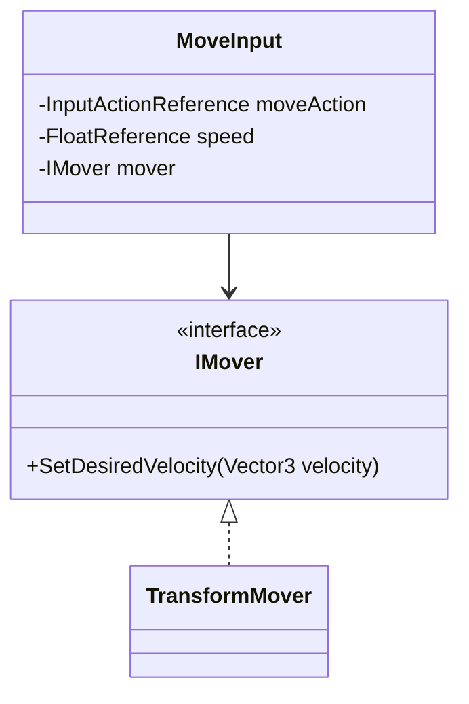
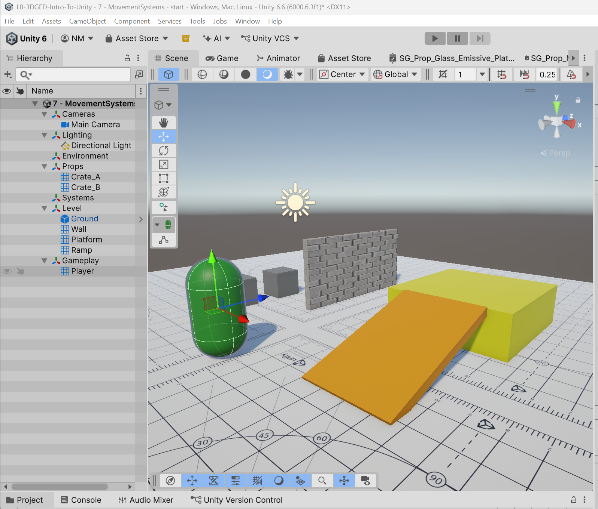
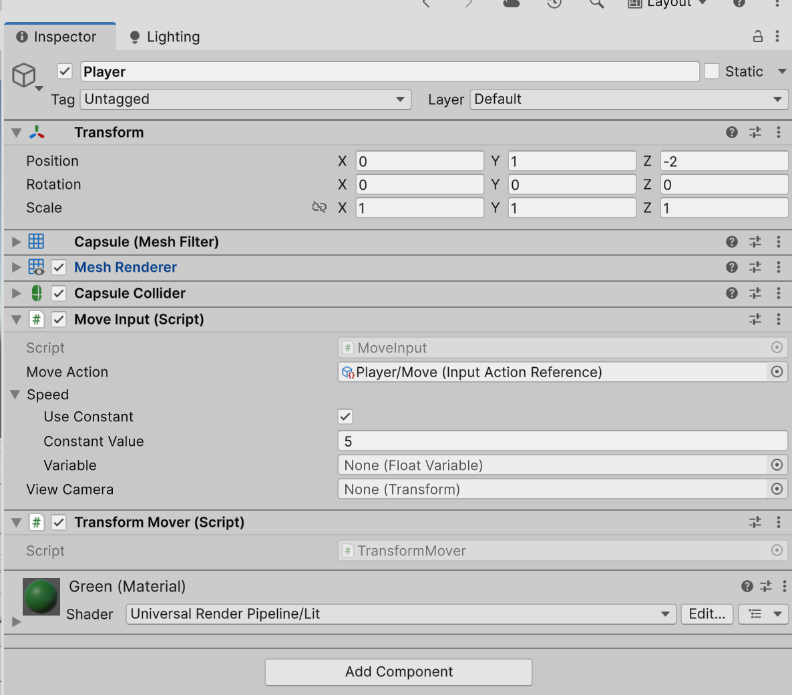
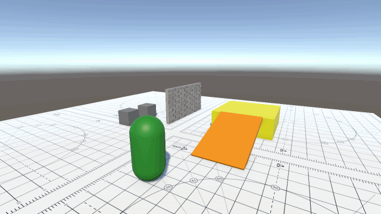
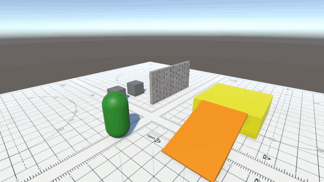
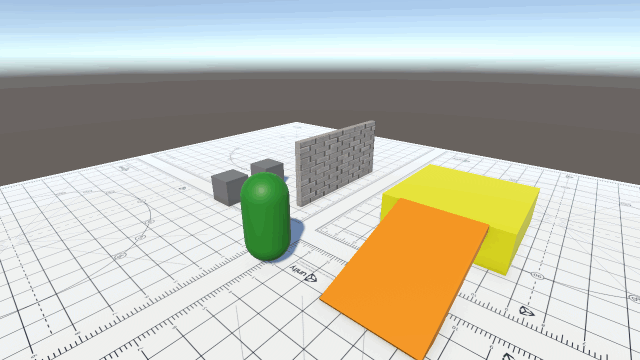
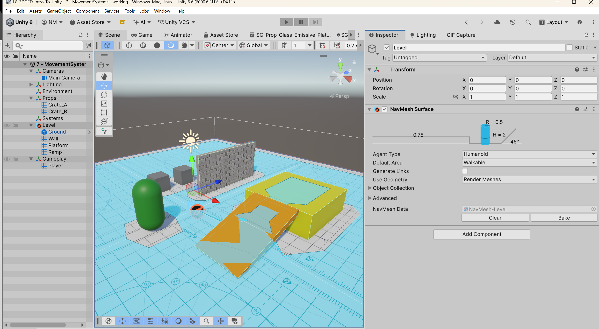
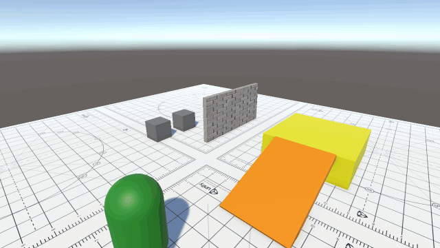
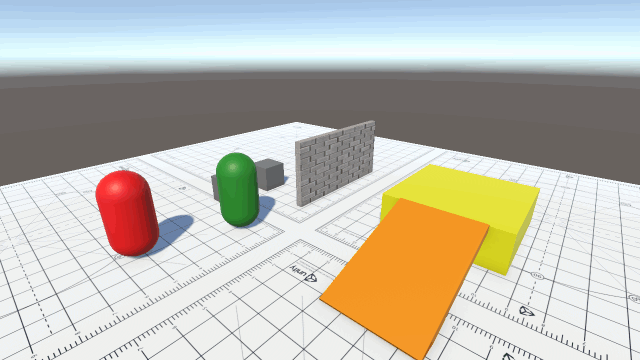

# Lab 7 - Movement Systems

## 1. Overview

You build a small test level with a wall, a ramp, a raised platform and two crates, and drive a player across it with one input component and four interchangeable movers. Each mover uses a different movement approach, and the level shows what each one does with walls, slopes, ledges and crates. You use the debugger to find why the first Rigidbody mover floats off ledges, then add a NavMesh enemy that chases the player.

---

## 2. What You Will Learn

| Skill | You can... |
|:------|:-----------|
| Separate intent from motion | Write `MoveInput` so that it depends only on `IMover` |
| Compare movement approaches | Record what Transform, Rigidbody, CharacterController and NavMesh movement each do at a wall, a ramp, a ledge and a crate |
| Swap a strategy without code | Change the player's movement approach by changing components, with no edit to `MoveInput` |
| Diagnose a physics bug with the debugger | Show that a mover overwrites the vertical velocity on every physics step |
| Use a NavMesh | Bake a `NavMeshSurface` and make an agent chase a moving target |

---

## 3. Before You Start

| Item | Check |
|:-----|:------|
| Unity version | 6000.6.3f1 with URP 17.6.0 |
| Input System | `Edit > Project Settings > Player > Active Input Handling` is `Input System Package (New)` |
| Input actions | `Assets/InputSystem_Actions` contains the `Player/Move` action |
| AI Navigation | `Window > Package Management > Package Manager` lists `AI Navigation` 2.0.14 as installed |
| Shared variables | `Assets/GD/Common/Scripts/ScriptableObjects/Types/Base/VariableReference.cs` declares `FloatReference` |
| Debugger | You can attach your IDE to the Unity Editor and switch the Editor to debug mode ([Notes 01](../notes/01_unity_foundations.md), Section 4.9) |
| Notes | You have read [07 - Movement Systems](../notes/07_movement_systems.md), Sections 3 to 4.9 |

---

## 4. Plan

Complete the plan before Step 2.



Copy the diagram into `LabNotes.md` and complete it:

1. Add every class that implements `IMover` in this lab: `RigidbodyMover` (Step 3), `CharacterControllerMover` (Step 5) and `NavMeshAgentMover` (Step 6).
2. For each mover, add the Unity component it requires, with an arrow.
3. Add `ChaseTarget` (Step 7) and the component it uses. Predict whether it implements `IMover`, and write one sentence on why, before you start.

---

## 5. Steps

### Step 1 - Build the Test Level

This step builds a level where each object tests one thing a mover must handle: a wall to stop at, a ramp to climb, a ledge to fall from and crates to push. The level geometry sits under one parent so that Step 6 can bake it without the crates. (10 min)

> [!IMPORTANT] Remember when adding game objects to an empty that you should reset the empty's `Transform::Position` to `(0,0,0)` otherwise any position values stated wont make the scene layout make sense visually.
> 
1. Open `Tools > GD > Setup > Create Project Folders`. Set `Project Folder` to `Lab07`, choose `Project assets only` and click `Create Folders`.
2. Create a new scene and save it as `Assets/Lab07/Scenes/SCN_Lab07_Movement.unity`. Set `Main Camera` to `Position` (0, 10, -10) and `Rotation` (45, 0, 0).
3. Open `Tools > GD > Setup > Create Scene Hierarchy`. Click `Create Hierarchy`.
4. Add an empty GameObject named `Level` at the origin. Create these objects as children of `Level`, and apply a material from `GD/Common/Materials` to each:

| Object | Type | Position | Rotation | Scale |
|:--|:--|:--|:--|:--|
| `Ground` | Plane | (0, 0, 0) | (0, 0, 0) | (2, 1, 2) |
| `Wall` | Cube | (-1, 1, 3) | (0, 0, 0) | (0.2, 2, 4) |
| `Platform` | Cube | (3, 0.5, 3) | (0, 0, 0) | (3, 1, 3) |
| `Ramp` | Cube | (3, 0.45, 0) | (-18, 0, 0) | (2, 0.2, 3.2) |

4. In the `Props` empty, add two `Cube` objects named `Crate_A` and `Crate_B` at (-3, 0.4, 0) and (-3, 0.4, 1.5), with `Scale` (0.8, 0.8, 0.8). Add a `Rigidbody` to each. Keep them outside `Level`, because they move and must not be baked into the NavMesh.
5. In the `Gameplay` empty, add a `Capsule` named `Player` at (0, 1, -2), outside `Level`. Apply a different material so it stands out.



**Checkpoint:** the Game view shows the ground, a thin wall on the left, a raised platform on the right reached by a ramp that faces the camera, two crates to the left of the wall's front end, and the player capsule near the camera. Press Play: the crates stay where they are.

### Step 2 - Separate Input from Motion

This step writes the interface, the input component and the simplest mover, so that every later step changes only the mover. (15 min)

1. Create `Assets/Lab07/Scripts/IMover.cs`:

```csharp
using UnityEngine;

/// <summary>
/// Something that can move this GameObject. Callers state the velocity they want;
/// the mover decides how, and in which loop, it is applied.
/// </summary>
public interface IMover
{
    /// <param name="velocity">World-space velocity in metres per second. Movers ignore its Y value.</param>
    void SetDesiredVelocity(Vector3 velocity);
}
```

2. Create `Assets/Lab07/Scripts/MoveInput.cs`:

```csharp
using GD.Types;
using UnityEngine;
using UnityEngine.InputSystem;

/// <summary>
/// Reads the Move action and passes a camera-relative velocity to the IMover on this GameObject.
/// </summary>
// Runs before the movers' Update, so they use this frame's input.
[DefaultExecutionOrder(-100)]
public class MoveInput : MonoBehaviour
{
    [SerializeField, Tooltip("A Vector2 action, for example Player/Move in InputSystem_Actions")]
    private InputActionReference moveAction;

    [SerializeField, Tooltip("Top speed in metres per second")]
    private FloatReference speed;

    [SerializeField, Tooltip("Movement is relative to this camera. Defaults to Camera.main if left empty")]
    private Transform viewCamera;

    private IMover mover;

    private void Awake()
    {
        mover = GetComponent<IMover>();

        if (viewCamera == null && Camera.main != null)
            viewCamera = Camera.main.transform;

        if (mover == null || moveAction == null || !speed.IsValid)
        {
            Debug.LogError($"{name}: MoveInput needs an IMover on this GameObject, a move action and a speed.", this);
            enabled = false;
        }
    }

    private void OnEnable()
    {
        if (moveAction != null)
            moveAction.action.Enable();
    }

    private void Update()
    {
        Vector2 input = moveAction.action.ReadValue<Vector2>();
        mover.SetDesiredVelocity(ToWorldDirection(input) * speed.Value);
    }

    private Vector3 ToWorldDirection(Vector2 input)
    {
        if (viewCamera == null)
            return new Vector3(input.x, 0f, input.y);

        // Flatten the camera's axes onto the ground, so a camera looking down does not slow movement.
        Vector3 forward = Vector3.ProjectOnPlane(viewCamera.forward, Vector3.up).normalized;
        Vector3 right = Vector3.ProjectOnPlane(viewCamera.right, Vector3.up).normalized;

        // Diagonals are no faster than straight lines; a half-pushed stick still gives half speed.
        return Vector3.ClampMagnitude(forward * input.y + right * input.x, 1f);
    }
}
```

3. Create `Assets/Lab07/Scripts/TransformMover.cs`:

```csharp
using UnityEngine;

/// <summary>
/// Moves the Transform directly. Nothing stops it: use for objects that ignore collisions.
/// </summary>
public class TransformMover : MonoBehaviour, IMover
{
    private Vector3 desiredVelocity;

    public void SetDesiredVelocity(Vector3 velocity)
    {
        desiredVelocity = velocity;
    }

    private void Update()
    {
        transform.position += desiredVelocity * Time.deltaTime;
    }
}
```

4. Add `TransformMover` and `MoveInput` to `Player`. On `MoveInput`, set `Move Action` to `Player/Move` from `InputSystem_Actions`, leave `Use Constant` ticked and set the constant `Speed` to 5. Leave `View Camera` empty.



5. Press Play. Use WASD to drive the player into the wall, onto the ramp, through the platform and into the crates.



**Record:** in `LabNotes.md`, start a table with the columns Mover, Wall, Ramp, Ledge and Crates. Fill in the `TransformMover` row. Use Note 07, Section 4.2 to explain the crates.

**Checkpoint:** W moves the player away from the camera and D moves it right. The player passes through the wall, the ramp, the platform and the crates without stopping or climbing. The crates do not move, because they are asleep by the time the player reaches them and a collider with no Rigidbody does not wake them.

### Step 3 - Swap in a Rigidbody Mover

This step replaces the mover with a first, quickly written Rigidbody version. It contains a bug that Step 4 finds. (10 min)

1. Create `Assets/Lab07/Scripts/RigidbodyMover.cs`:

```csharp
using UnityEngine;

/// <summary>
/// Moves a dynamic Rigidbody by setting its velocity on each physics step.
/// </summary>
[RequireComponent(typeof(Rigidbody))]
public class RigidbodyMover : MonoBehaviour, IMover
{
    private Rigidbody body;
    private Vector3 desiredVelocity;

    private void Awake()
    {
        body = GetComponent<Rigidbody>();

        // Stop the capsule falling over when it is pushed at its side.
        body.freezeRotation = true;
    }

    public void SetDesiredVelocity(Vector3 velocity)
    {
        // Store the request; it is applied on the next physics step.
        desiredVelocity = velocity;
    }

    private void FixedUpdate()
    {
        body.linearVelocity = desiredVelocity;
    }
}
```

2. On `Player`, remove `TransformMover` and add `RigidbodyMover`. Unity adds a `Rigidbody` because of `[RequireComponent]`. Keep the `CapsuleCollider`.

3. Press Play. Drive the player into the wall, up the ramp, onto the platform and into the crates. Then walk off the far edge of the platform.
   


**Record:** fill in the `RigidbodyMover` row of your table. Which files did you edit to change the movement approach?

**Checkpoint:** the player stops at the wall, climbs the ramp onto the platform and pushes the crates. When it walks off the platform edge, it drifts down slowly instead of falling. You edited no file except the new mover.

### Step 4 - Diagnose the Slow Fall with the Debugger

This step finds why the Rigidbody player floats, using the debugger rather than log lines. (10 min)

**Hypothesis:** `RigidbodyMover` replaces the whole velocity on every physics step. Gravity adds about -0.2 m/s of vertical velocity in each step (9.81 m/s2 x 0.02 s), and the mover sets it back to zero before the next step, so the vertical speed never builds up.

1. Switch the Editor to debug mode and attach your IDE.
2. Press Play and walk the player off the platform edge. Do not set a breakpoint yet, because `FixedUpdate` runs fifty times a second and the breakpoint would stop the game before the player reaches the edge.
3. While the player is drifting down, choose where to place a breakpoint so that you can read the vertical velocity before the mover changes it. Place it.
4. When the breakpoint is hit, inspect `body.linearVelocity`. Continue, and inspect it again on two or three more hits.


**Record:** where you placed the breakpoint, the Y value of `body.linearVelocity` on three hits, and the Y value you would expect after one second of real falling. Does the evidence support the hypothesis?

1. Remove the breakpoint, stop Play mode and replace `FixedUpdate` in `RigidbodyMover` with a version that keeps the vertical velocity:

```csharp
    private void FixedUpdate()
    {
        // Keep the vertical velocity, so gravity and falling still work.
        Vector3 velocity = desiredVelocity;
        velocity.y = body.linearVelocity.y;
        body.linearVelocity = velocity;
    }
```

6. Detach the debugger and switch back to release mode. Press Play and walk off the platform again.

**Checkpoint:** before the fix, the debugger shows a Y velocity of about -0.2 on every hit, never larger. After the fix, the player falls off the platform edge as quickly as a crate pushed off it. Update the `Ledge` cell of your `RigidbodyMover` row.

### Step 5 - Swap in a CharacterController Mover

This step changes the movement approach to collide and slide, and shows that the controls do not change. (10 min)

1. Create `Assets/Lab07/Scripts/CharacterControllerMover.cs`:

```csharp
using UnityEngine;

/// <summary>
/// Moves a CharacterController with collide and slide, adding gravity each frame.
/// </summary>
[RequireComponent(typeof(CharacterController))]
public class CharacterControllerMover : MonoBehaviour, IMover
{
    [SerializeField, Tooltip("Downward speed while grounded, in m/s. Keeps the controller pressed onto the floor")]
    private float groundedSpeed = -2f;

    private CharacterController controller;
    private Vector3 desiredVelocity;
    private float verticalSpeed;

    private void Awake()
    {
        controller = GetComponent<CharacterController>();
    }

    public void SetDesiredVelocity(Vector3 velocity)
    {
        desiredVelocity = velocity;
    }

    private void Update()
    {
        // isGrounded reports the result of the previous Move call.
        if (controller.isGrounded && verticalSpeed < 0f)
            verticalSpeed = groundedSpeed;

        // The controller has no gravity of its own.
        verticalSpeed += Physics.gravity.y * Time.deltaTime;

        Vector3 velocity = desiredVelocity;
        velocity.y = verticalSpeed;

        // One Move call per frame, with the whole frame's movement.
        controller.Move(velocity * Time.deltaTime);
    }
}
```

2. On `Player`, remove `RigidbodyMover` first, then `Rigidbody`, because Unity will not remove a component that another component requires. Remove the `CapsuleCollider` as well, because the `CharacterController` is its own collider.
3. Add `CharacterControllerMover`. Unity adds a `CharacterController`; its default `Height` 2, `Radius` 0.5 and `Center` (0, 0, 0) match the capsule.
<!-- IMAGE: screenshot "../images/labs/lab_7_step_5.png" - Inspector for Player showing MoveInput, CharacterControllerMover and the CharacterController with Height 2, Radius 0.5 and Center (0, 0, 0). No Rigidbody and no CapsuleCollider remain. -->

4. Press Play and repeat the route from Step 3, including walking off the platform. Then walk diagonally into the wall.
 


**Record:** fill in the `CharacterControllerMover` row. Compare walking diagonally into the wall with the Rigidbody mover's behaviour, using Note 07, Section 4.4.

**Checkpoint:** the player stops at the wall and slides along it when walking diagonally, walks up the ramp, and falls off the platform edge at full speed. It stops at the crates instead of pushing them. `MoveInput` is unchanged.

### Step 6 - Bake a NavMesh and Swap in a NavMesh Mover

This step bakes the walkable area of the level and holds the player to it. (10 min)

1. Select `Level`. Add a `NavMesh Surface` component. Leave `Agent Type` as `Humanoid` and set `Collect Objects` to `Current Object Hierarchy`, so the crates and the player are not baked into the NavMesh. Click `Bake`.



1. In the Scene view, check the blue NavMesh overlay. It covers the ground, the ramp and the top of the platform, with a gap round the wall.
<!-- IMAGE: screenshot "../images/labs/lab_7_step_6_1.png" - Scene view after baking, angled from above: blue NavMesh overlay on the ground, ramp and platform top, a gap round the wall, and no holes where the crates stand. -->

1. Create `Assets/Lab07/Scripts/NavMeshAgentMover.cs`:

```csharp
using UnityEngine;
using UnityEngine.AI;

/// <summary>
/// Moves a NavMeshAgent by a velocity, held to the walkable area of the baked NavMesh.
/// </summary>
[RequireComponent(typeof(NavMeshAgent))]
public class NavMeshAgentMover : MonoBehaviour, IMover
{
    private NavMeshAgent agent;
    private Vector3 desiredVelocity;

    private void Awake()
    {
        agent = GetComponent<NavMeshAgent>();
    }

    public void SetDesiredVelocity(Vector3 velocity)
    {
        desiredVelocity = velocity;
    }

    private void Update()
    {
        // The agent can only move once it is standing on a baked NavMesh.
        if (!agent.isOnNavMesh)
            return;

        // Move slides along the NavMesh edge instead of leaving the walkable area.
        agent.Move(desiredVelocity * Time.deltaTime);
    }
}
```

4. On `Player`, remove `CharacterControllerMover`, then `CharacterController`. Add `NavMeshAgentMover`; Unity adds a `NavMeshAgent`. Set its `Base Offset` to 1, because the capsule's pivot is at its centre, 1 m above its feet.
5. Press Play. Try to reach the platform from the side, then by the ramp, then try to walk off each platform edge.




**Record:** fill in the `NavMeshAgentMover` row. Which mover would you give a player in a top-down game where the player must never leave the playable area?

**Checkpoint:** the player cannot walk onto the platform from the side, reaches it only by the ramp, and stops at every edge of the platform instead of walking off. `MoveInput` is still unchanged, and four movers have used it.

### Step 7 - Add a Chasing Enemy

This step adds an enemy that uses the NavMeshAgent for what it does best, pathfinding to a destination, without going through `IMover`. (10 min)

1. Create `Assets/Lab07/Scripts/ChaseTarget.cs`:

```csharp
using UnityEngine;
using UnityEngine.AI;

/// <summary>
/// Sends the NavMeshAgent towards a target each frame, so it follows a moving target.
/// </summary>
[RequireComponent(typeof(NavMeshAgent))]
public class ChaseTarget : MonoBehaviour
{
    [SerializeField] private Transform target;

    private NavMeshAgent agent;

    private void Awake()
    {
        agent = GetComponent<NavMeshAgent>();

        if (target == null)
        {
            Debug.LogError($"{name}: ChaseTarget needs a target.", this);
            enabled = false;
        }
    }

    private void Update()
    {
        // SetDestination fails with an error if the agent is not on a baked NavMesh.
        if (!agent.isOnNavMesh)
            return;

        agent.SetDestination(target.position);
    }
}
```

2. Add a `Capsule` named `Chaser` at (-4, 1, -4), outside `Level`, with a third material. Remove its `CapsuleCollider`, because the agent does not need one in this lab, and a collider with no Rigidbody would knock some crates away and pass through others, as in Step 2.
3. Add `ChaseTarget` to `Chaser`. Set `Target` to `Player`. On the `NavMeshAgent` that Unity adds, set `Base Offset` to 1, `Speed` to 2 and `Stopping Distance` to 1.5.

4. Press Play. Drive the player up the ramp onto the platform, then round the far side of the wall.



**Record:** the route the chaser takes to reach the platform, and why it does not climb the platform side. Was your Plan prediction about `ChaseTarget` and `IMover` right? Use Note 07, Section 4.8.

<!-- IMAGE: screenshot "../images/labs/lab_7_step_7_1.png" - Scene view during Play with Chaser selected so its path gizmo is drawn: the player on the platform and the path running round the wall and up the ramp. -->

**Checkpoint:** the chaser follows the player at a slower speed, goes round the wall rather than through it, climbs the platform only by the ramp, and stops about 1.5 m from the player.

---

## 6. Debugging and Pitfalls

| Symptom | Likely cause | How to confirm | Fix |
|:--------|:-------------|:---------------|:----|
| Console: "MoveInput needs an IMover on this GameObject, a move action and a speed" | The mover is missing, or `Move Action` is empty | Read the components on `Player` | Add a mover; set `Move Action` to `Player/Move` |
| The player does not move, with no error | `Speed` is 0 | Read `MoveInput` in the Inspector | Set the constant `Speed` to 5 |
| W moves the player sideways or towards the camera | `View Camera` points at a rotated object, or the camera was moved | Breakpoint in `ToWorldDirection`; inspect `forward` | Leave `View Camera` empty so it uses `Main Camera` |
| In Step 2, a crate is sometimes knocked away instead of walked through | The crate was still awake, for example because it was moving when the player reached it | Select the crate during Play; a Rigidbody that is awake shows changing values under `Info` | No fix needed; this is the unreliable behaviour Note 07, Section 4.2 describes |
| The capsule falls over | `freezeRotation` not set, or a different mover on the object | Check `Rigidbody > Constraints` during Play | Use `RigidbodyMover` from Step 3, which sets it |
| Cannot remove `Rigidbody` | `RigidbodyMover` requires it | The Inspector names the component that requires it | Remove the mover first |
| The CharacterController player hovers or catches on things | The `CapsuleCollider` is still on `Player` | Read the components on `Player` | Remove the `CapsuleCollider` |
| Console: "SetDestination can only be called on an active agent that has been placed on a NavMesh" | The NavMesh was not baked, or the agent starts off it | Scene view shows no blue overlay under the agent | Bake on `Level`; place the agent on the overlay |
| The NavMesh has square holes on the ground | The crates were baked | The holes match the crates' positions | Set `Collect Objects` to `Current Object Hierarchy` and bake again |
| The NavMesh player does not move | The agent is not on the NavMesh | Breakpoint in `NavMeshAgentMover.Update`; inspect `agent.isOnNavMesh` | Bake, then check the player starts on the overlay |
| An agent capsule is half sunk into the ground | `Base Offset` is 0 | Select the agent; the capsule's centre sits on the NavMesh | Set `Base Offset` to 1 |
| Breakpoint in `FixedUpdate` stops the game at once | The breakpoint was set before Play reached the fall | It is hit before the player moves | Set it while the player is drifting down (Step 4) |

---

## 7. Production Checklist

| Requirement | Done |
|:------------|:-----|
| `MoveInput` depends only on `IMover` and was not edited after Step 2 | |
| `TransformMover`, `RigidbodyMover`, `CharacterControllerMover` and `NavMeshAgentMover` each implement `IMover` | |
| `RigidbodyMover` keeps the vertical velocity, and the player falls off the platform at full speed | |
| The comparison table in `LabNotes.md` has a row for each mover and a cell for wall, ramp, ledge and crates | |
| Debugger evidence for Step 4 is recorded in `LabNotes.md` | |
| The NavMesh is baked from `Level` only, with no holes under the crates | |
| `Chaser` reaches the player round the wall and up the ramp, using `ChaseTarget` | |
| The completed Plan diagram shows every mover, its required component and `ChaseTarget` | |
| No file in `Assets/GD/Common` was edited | |

---

## 8. Extension

### Stretch - Add a Jump

Your group wants the player to jump when `Player/Jump` is pressed. `RigidbodyMover` and `CharacterControllerMover` can jump, but `NavMeshAgentMover` cannot leave the NavMesh, and `TransformMover` has no ground to jump from.

Design the change. Options include adding a method to `IMover`, adding a second interface such as `IJumper` that only some movers implement, or a separate component. Implement it for `CharacterControllerMover`.

**Expected result:** pressing Space makes the CharacterController player jump onto the platform from the ground, and the other movers still compile and work. In `LabNotes.md`, explain in 100 to 150 words where the jump request lives, what happens when the player uses `NavMeshAgentMover`, and which SOLID principle your design depends on.

---

## 9. Reflective Questions

1. Steps 3, 5 and 6 changed the movement approach without editing `MoveInput`. Which SOLID principle made that possible, and which line in `MoveInput` shows it?
2. The Step 3 mover compiled, ran and stopped at walls, yet it was wrong. Why did the bug only appear at a ledge, and what does that tell you about how to test a mover?
3. Your comparison table has four rows. Which mover would you choose for your group's player, and which cell of the table decided it?
4. `ChaseTarget` uses the `NavMeshAgent` directly. Under what change to your game would you give the chase its own interface?
5. `MoveInput` reads speed through a `FloatReference`. Name one gameplay feature in your group project that would use a shared `FloatVariable` for it.

---

## 10. How This Builds

- **Note 11 - Interpolation, Easing and Tweening** explains the smoothing and easing you could apply to a mover's instant start and stop, so that the same input feels deliberate rather than mechanical.
- **Note 16 - State Machines and the State Pattern** makes the chase one state of an enemy that also patrols and searches.
- **GCA - Gameplay Systems & Integration** and **C# & Software Design - Software Design:** your comparison table is the evidence for why your group chose its movement approach, and the input and mover split is a complete example of the Strategy pattern with a Stage 1 "before" in Note 07 to compare against.

**Group project task (take-home).** Fill in a comparison row for your group's player: wall, ramp, ledge and any object it must push or avoid. If the current movement approach fails a row that your game needs, record the failure and the approach that would pass it, as a candidate for Iteration & Improvement.
