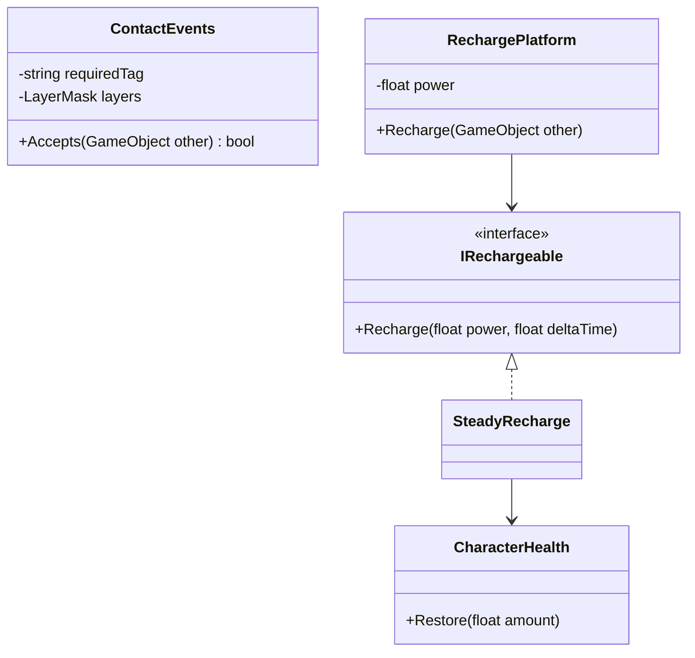

# Lab 8 - Recharge Platform

## 1. Overview

You build a recharge platform that restores the health of any character standing on it. The platform detects characters with a filtered trigger, which works for a Rigidbody character and a CharacterController character alike. Each character type recharges in its own way through an `IRechargeable` strategy, and the platform never names a character type. Along the way you use the debugger to find why the first version of the filter rejects everything.

---

## 2. What You Will Learn

| Skill | You can... |
|:------|:-----------|
| Detect characters with a trigger | Show the same trigger zone reacting to a Rigidbody and a CharacterController character |
| Filter by tag and layer | Show that an object with the wrong tag or on the wrong layer is ignored |
| Diagnose a bitmask bug with the debugger | Show that a layer index was tested against a layer mask without a shift |
| Wire reactions in the Inspector | Connect `ContactEvents` to a light and to the platform with no code that references either |
| Apply the Strategy pattern | Add a character type with a new recharge rule and no edit to `RechargePlatform` |

---

## 3. Before You Start

| Item | Check |
|:-----|:------|
| Unity version | 6000.6.3f1 with URP 17.6.0 |
| Input System | `Edit > Project Settings > Player > Active Input Handling` is `Input System Package (New)` |
| Input actions | `Assets/InputSystem_Actions` contains the `Player/Move` action |
| Shared code | `Assets/GD/Common/Scripts/Controllers/Camera/FaceCamera.cs` exists |
| TextMeshPro | A `Text - TextMeshPro` 3D object can be created; import `TMP Essentials` if Unity asks |
| Debugger | You can attach your IDE to the Unity Editor and switch the Editor to debug mode ([Notes 01](../notes/01_unity_foundations.md), Section 4.9) |
| Notes | You have read [08 - Collision Detection and Contact Events](../notes/08_collision_detection.md), Sections 3 to 4.9 |

---

## 4. Plan

Complete the plan before Step 2.



Copy the diagram into `LabNotes.md` and complete it:

1. Add the Inspector link from `ContactEvents` to `RechargePlatform`, labelled with the event that carries it, and the link from `ContactEvents` to the `Glow` light.
2. Add `SurgeRecharge` (Step 6) and `FieldRepair` (Step 7), with their links.
3. Mark every class that would need editing to add a fourth character type. Predict the answer before you start.

---

## 5. Steps

### Step 1 - Build the Scene

This step builds a platform with a trigger zone above it, a Rigidbody character, a CharacterController character, and two test objects that each fail one part of the filter. (15 min)

1. Open `Tools > GD > Setup > Create Project Folders`. Set `Project Folder` to `Lab08`, choose `Project assets only` and click `Create Folders`.
2. Create a new scene and save it as `Assets/Lab08/Scenes/SCN_Lab08_RechargePlatform.unity`. Set `Main Camera` to `Position` (0, 10, -8) and `Rotation` (50, 0, 0).
3. Open `Edit > Project Settings > Tags and Layers`. Under `Layers`, name `User Layer 6` as `Characters`, so the filter and your recorded values match this handout.
4. Create these objects, applying materials from `GD/Common/Materials` so the characters, platform and test objects are easy to tell apart:

| Object | Type | Position | Scale | Tag | Layer |
|:--|:--|:--|:--|:--|:--|
| `Ground` | Plane | (0, 0, 0) | (2, 1, 2) | `Untagged` | `Default` |
| `Platform` | Cube | (0, 0.05, 3) | (3, 0.1, 3) | `Untagged` | `Default` |
| `Knight` | Capsule | (-2, 1, -2) | (1, 1, 1) | `Player` | `Characters` |
| `Mage` | Capsule | (0, 1, -2) | (1, 1, 1) | `Player` | `Characters` |
| `Dummy_WrongLayer` | Cube | (-0.8, 3, 3) | (0.8, 0.8, 0.8) | `Player` | `Default` |
| `Dummy_WrongTag` | Cube | (0.8, 3, 3) | (0.8, 0.8, 0.8) | `Untagged` | `Characters` |

5. Add a `Rigidbody` to `Knight`, `Dummy_WrongLayer` and `Dummy_WrongTag`. The dummies start above the platform, so when you press Play they fall into the zone and test the filter without you having to steer them there.
6. On `Mage`, remove the `CapsuleCollider` and add a `CharacterController`, because the controller is its own collider. Then untick the checkbox next to `Mage` in the Inspector to deactivate it, because both characters read the same input and you test one at a time.
7. Add an empty GameObject named `RechargeZone` at (0, 1, 3). Add a `Box Collider`, tick `Is Trigger` and set `Size` to (3, 2, 3). It sits on top of `Platform` and covers the space a character stands in.
8. Add a `Point Light` named `Glow` at (0, 1.5, 3). Set `Range` to 5 and `Intensity` to 3, choose a bright colour, then untick the `Light` component so it starts off.

<!-- IMAGE: screenshot "../images/labs/lab_8_step_1.png" - Scene view of the finished Step 1 scene, angled from above, with RechargeZone selected so its green trigger box shows above the platform. Visible: the thin platform, the Knight capsule, the two dummy cubes floating above the platform and the Glow light gizmo. Include the Hierarchy panel with Mage greyed out as inactive. -->

**Checkpoint:** the Scene view shows a green box outline above the platform, two dummy cubes above it, the knight in front of it, and the mage greyed out in the Hierarchy. Press Play: the dummies drop onto the platform and nothing else happens.

### Step 2 - Make the Characters Move and Show Health

This step gives each character movement suited to its body, a health value, and a label that shows it. None of these scripts mention the platform. (10 min)

1. Create `Assets/Lab08/Scripts/KeyboardRigidbodyMover.cs` and add it to `Knight`:

```csharp
using UnityEngine;
using UnityEngine.InputSystem;

/// <summary>
/// Moves a dynamic Rigidbody along the world axes from a Move action.
/// </summary>
[RequireComponent(typeof(Rigidbody))]
public class KeyboardRigidbodyMover : MonoBehaviour
{
    [SerializeField] private InputActionReference moveAction;
    [SerializeField, Min(0f)] private float speed = 4f;

    private Rigidbody body;
    private Vector2 input;

    private void Awake()
    {
        body = GetComponent<Rigidbody>();

        // Stop the capsule falling over when it bumps into something.
        body.freezeRotation = true;
    }

    private void OnEnable()
    {
        if (moveAction != null)
            moveAction.action.Enable();
    }

    private void Update()
    {
        if (moveAction != null)
            input = moveAction.action.ReadValue<Vector2>();
    }

    private void FixedUpdate()
    {
        // Keep the vertical velocity, so gravity still works.
        Vector3 velocity = new Vector3(input.x, 0f, input.y) * speed;
        velocity.y = body.linearVelocity.y;
        body.linearVelocity = velocity;
    }
}
```

2. Create `Assets/Lab08/Scripts/KeyboardControllerMover.cs` and add it to `Mage`:

```csharp
using UnityEngine;
using UnityEngine.InputSystem;

/// <summary>
/// Moves a CharacterController along the world axes from a Move action, with gravity.
/// </summary>
[RequireComponent(typeof(CharacterController))]
public class KeyboardControllerMover : MonoBehaviour
{
    [SerializeField] private InputActionReference moveAction;
    [SerializeField, Min(0f)] private float speed = 4f;

    private CharacterController controller;
    private float verticalSpeed;

    private void Awake()
    {
        controller = GetComponent<CharacterController>();
    }

    private void OnEnable()
    {
        if (moveAction != null)
            moveAction.action.Enable();
    }

    private void Update()
    {
        Vector2 input = moveAction != null ? moveAction.action.ReadValue<Vector2>() : Vector2.zero;

        // A small downward speed while grounded keeps isGrounded reliable.
        if (controller.isGrounded && verticalSpeed < 0f)
            verticalSpeed = -2f;

        verticalSpeed += Physics.gravity.y * Time.deltaTime;

        Vector3 velocity = new Vector3(input.x, 0f, input.y) * speed;
        velocity.y = verticalSpeed;
        controller.Move(velocity * Time.deltaTime);
    }
}
```

3. On both movers, set `Move Action` to `Player/Move` from `InputSystem_Actions`.
4. Create `Assets/Lab08/Scripts/CharacterHealth.cs` and add it to `Knight` and to `Mage`:

```csharp
using System;
using UnityEngine;

/// <summary>
/// A character's health. Other components restore it and listen for changes.
/// </summary>
public class CharacterHealth : MonoBehaviour
{
    [SerializeField, Min(1f)] private float maxHealth = 100f;
    [SerializeField, Min(0f)] private float startHealth = 25f;

    private float currentHealth;

    public float Current => currentHealth;

    public float Max => maxHealth;

    /// <summary>Raised with the current and maximum health whenever health changes.</summary>
    public event Action<float, float> HealthChanged;

    private void Awake()
    {
        currentHealth = Mathf.Min(startHealth, maxHealth);
    }

    public void Restore(float amount)
    {
        // Ignore zero or negative amounts, and do not raise an event when already full.
        if (amount <= 0f || currentHealth >= maxHealth)
            return;

        currentHealth = Mathf.Min(currentHealth + amount, maxHealth);
        HealthChanged?.Invoke(currentHealth, maxHealth);
    }
}
```

5. On `Mage`, set `Max Health` to 60 and `Start Health` to 15, so the two characters start at different points and recharge visibly differently later.
6. Create `Assets/Lab08/Scripts/HealthText.cs`:

```csharp
using TMPro;
using UnityEngine;

/// <summary>
/// Shows a character's health as text, updated only when the health changes.
/// </summary>
[RequireComponent(typeof(TMP_Text))]
public class HealthText : MonoBehaviour
{
    [SerializeField, Tooltip("Defaults to the CharacterHealth on a parent if left empty")]
    private CharacterHealth health;

    private TMP_Text label;

    private void Awake()
    {
        label = GetComponent<TMP_Text>();

        if (health == null)
            health = GetComponentInParent<CharacterHealth>();
    }

    private void OnEnable()
    {
        if (health != null)
            health.HealthChanged += Show;
    }

    private void OnDisable()
    {
        if (health != null)
            health.HealthChanged -= Show;
    }

    private void Start()
    {
        // Every Awake has run by now, so the health has its starting value.
        if (health != null)
            Show(health.Current, health.Max);
    }

    private void Show(float current, float max)
    {
        label.text = $"{current:0} / {max:0}";
    }
}
```

7. For each character, add a child `3D Object > Text - TextMeshPro` named `HealthLabel` at local `Position` (0, 1.6, 0). Set `Font Size` to 4 and `Alignment` to centre. Add `HealthText` and `FaceCamera` to it.
<!-- IMAGE: screenshot "../images/labs/lab_8_step_2.png" - Game view during Play: the Knight capsule with its "25 / 100" HealthLabel above its head, readable and facing the camera. Include the Inspector for HealthLabel showing TextMeshPro Font Size 4, HealthText and FaceCamera. -->

8. Press Play and drive `Knight` with WASD, onto the platform and off again.

**Checkpoint:** `Knight` shows `25 / 100` above its head and the label faces the camera as it moves. The knight walks onto the platform and off it. Nothing happens on the platform yet.

### Step 3 - Detect Characters with a Filtered Trigger

This step adds the detector and wires it to the light, with no code that references the light. This first version of the filter was written quickly and contains a bug. (10 min)

1. Create `Assets/Lab08/Scripts/ContactEvents.cs`:

```csharp
using UnityEngine;
using UnityEngine.Events;

/// <summary>
/// Raises UnityEvents when an object that passes the tag and layer filter enters,
/// stays in or leaves contact with a collider on this GameObject. Works with trigger
/// and solid colliders.
/// </summary>
public class ContactEvents : MonoBehaviour
{
    #region Fields

    [Header("Filter")]
    [SerializeField, Tooltip("Only objects with this tag. Leave empty to accept any tag")]
    private string requiredTag = "Player";

    [SerializeField, Tooltip("Only objects on these layers")]
    private LayerMask layers = ~0;

    [Header("Responses")]
    [SerializeField, Tooltip("Called once when an accepted object first makes contact")]
    private UnityEvent<GameObject> onEnter;

    [SerializeField, Tooltip("Called every physics step while an accepted object stays in contact")]
    private UnityEvent<GameObject> onStay;

    [SerializeField, Tooltip("Called once when an accepted object leaves. Not called if it is destroyed or deactivated")]
    private UnityEvent<GameObject> onExit;

    #endregion Fields

    #region Trigger Messages

    private void OnTriggerEnter(Collider other) => Respond(other.gameObject, onEnter);

    private void OnTriggerStay(Collider other) => Respond(other.gameObject, onStay);

    private void OnTriggerExit(Collider other) => Respond(other.gameObject, onExit);

    #endregion Trigger Messages

    #region Collision Messages

    private void OnCollisionEnter(Collision collision) => Respond(collision.gameObject, onEnter);

    private void OnCollisionStay(Collision collision) => Respond(collision.gameObject, onStay);

    private void OnCollisionExit(Collision collision) => Respond(collision.gameObject, onExit);

    #endregion Collision Messages

    #region Core Methods

    /// <summary>True when <paramref name="other"/> is on an accepted layer and has the required tag.</summary>
    public bool Accepts(GameObject other)
    {
        bool layerMatches = (layers.value & other.layer) != 0;

        bool tagMatches = string.IsNullOrEmpty(requiredTag) || other.CompareTag(requiredTag);

        return layerMatches && tagMatches;
    }

    private void Respond(GameObject other, UnityEvent<GameObject> response)
    {
        // Physics messages still arrive on a disabled component, so check enabled here.
        if (!enabled || !Accepts(other))
            return;

        response.Invoke(other);
    }

    #endregion Core Methods
}
```

2. Add `ContactEvents` to `RechargeZone`. Leave `Required Tag` as `Player`. Open the `Layers` drop-down, choose `Nothing`, then tick only `Characters`.
3. Under `On Enter`, click `+`, drag `Glow` into the object slot and choose `Light > bool enabled`, then tick the box. Under `On Exit`, do the same and leave the box cleared.

<!-- IMAGE: screenshot "../images/labs/lab_8_step_3.png" - Inspector for RechargeZone showing the Box Collider with Is Trigger ticked and Size (3, 2, 3), and ContactEvents with Required Tag "Player", Layers showing "Characters", On Enter calling Light.enabled on Glow with the box ticked, and On Exit calling Light.enabled on Glow with the box cleared. -->

4. Press Play and drive `Knight` onto the platform and off again.

**Record:** in `LabNotes.md`, describe what the light did. Predict which line of `ContactEvents` is responsible before Step 4.

**Checkpoint:** the light stays off when the knight walks onto the platform. There is no error in the Console.

### Step 4 - Diagnose the Filter with the Debugger

This step finds why the filter rejects an object that has the right tag and is on the right layer. (10 min)

**Hypothesis:** `Accepts` compares the object's layer index directly with the layer mask, without shifting, so the test answers a different question from the one intended (Note 08, Section 4.7).

1. Switch the Editor to debug mode and attach your IDE.
2. Choose where to place a breakpoint so that you can see the mask, the object's layer and the result of the layer test for each object that enters the zone. Place it.
3. Press Play. The breakpoint is hit first for each dummy as it falls into the zone: inspect `other.name`, `other.layer` and `layerMatches`, then continue. Drive `Knight` onto the platform, and when the breakpoint is hit for it, inspect `layers.value`, `other.layer` and `layerMatches`.

<!-- IMAGE: screenshot "../images/labs/lab_8_step_4.png" - IDE paused at a breakpoint in ContactEvents.Accepts with the Knight in the zone. The Locals or Watch window shows other.name "Knight", layers.value 64, other.layer 6 and layerMatches false. -->

**Record:** for `Knight`, the values of `layers.value` and `other.layer`, both in decimal and in binary, and the result of `layers.value & other.layer`. Write the expression that would give the right answer, and work out its value by hand. Does the evidence support the hypothesis?

4. Stop Play mode and fix the layer test in `Accepts`:

```csharp
        // Shift a 1 into the bit for the object's layer, then test that bit in the mask.
        bool layerMatches = (layers.value & (1 << other.layer)) != 0;
```

5. Remove the breakpoint, detach the debugger and switch back to release mode.
6. Press Play. Watch the light while the dummies drop into the zone, then drive the knight onto the platform and off again.

**Checkpoint:** before the fix, the debugger shows `layers.value` as 64 and `other.layer` as 6 for the knight, and `layerMatches` as `false`. After the fix, the light turns on when the knight enters and off when it leaves. Neither dummy turns the light on: one fails the layer test and the other fails the tag test.

### Step 5 - Recharge Through an Interface

This step adds the platform's behaviour. The platform asks for "something that can be recharged" and never names a character type. (10 min)

1. Create `Assets/Lab08/Scripts/IRechargeable.cs`:

```csharp
/// <summary>
/// Something a recharge platform can restore. Each character type decides how much
/// of the platform's power it turns into health.
/// </summary>
public interface IRechargeable
{
    /// <param name="power">The platform's base restore rate, in health per second.</param>
    /// <param name="deltaTime">The time this call covers, in seconds.</param>
    void Recharge(float power, float deltaTime);
}
```

2. Create `Assets/Lab08/Scripts/RechargePlatform.cs` and add it to `RechargeZone`:

```csharp
using UnityEngine;

/// <summary>
/// Recharges characters on the platform. Called by ContactEvents.On Stay once per
/// physics step for each accepted character.
/// </summary>
public class RechargePlatform : MonoBehaviour
{
    [SerializeField, Min(0f), Tooltip("Base health restored per second, before each character's own rule")]
    private float power = 10f;

    public void Recharge(GameObject other)
    {
        if (!enabled)
            return;

        // A character with no recharge rule is ignored, not an error.
        if (!other.TryGetComponent(out IRechargeable rechargeable))
            return;

        // Called from a physics message, so deltaTime is the fixed timestep.
        rechargeable.Recharge(power, Time.deltaTime);
    }
}
```

3. Create `Assets/Lab08/Scripts/SteadyRecharge.cs` and add it to `Knight`:

```csharp
using UnityEngine;

/// <summary>
/// Restores health at a steady rate: the platform's power times an efficiency.
/// </summary>
[RequireComponent(typeof(CharacterHealth))]
public class SteadyRecharge : MonoBehaviour, IRechargeable
{
    [SerializeField, Min(0f), Tooltip("Multiplier applied to the platform's power")]
    private float efficiency = 1f;

    private CharacterHealth health;

    private void Awake()
    {
        health = GetComponent<CharacterHealth>();
    }

    public void Recharge(float power, float deltaTime)
    {
        health.Restore(power * efficiency * deltaTime);
    }
}
```

4. On `RechargeZone`, under `ContactEvents > On Stay`, click `+`, drag `RechargeZone` into the object slot and choose the dynamic `RechargePlatform.Recharge` under `Dynamic GameObject`.
<!-- IMAGE: screenshot "../images/labs/lab_8_step_5.png" - Inspector for RechargeZone showing ContactEvents On Stay with RechargeZone in the object slot and RechargePlatform.Recharge selected (the dynamic version, so no argument field is shown), plus the RechargePlatform component with Power 10. -->

5. Press Play. Drive the knight onto the platform and wait, then step off half way through.

**Record:** how long the knight takes to go from 25 to 100. Work out the expected time from `power` and `efficiency`, and compare.

**Checkpoint:** the knight's label rises by about 10 per second while it is on the platform and stops rising when it steps off. It reaches `100 / 100` after about 7.5 seconds on the platform and then stops.

### Step 6 - Add a Second Character Type

This step adds a CharacterController character with a different recharge rule. The platform and the detector do not change. (10 min)

1. Create `Assets/Lab08/Scripts/SurgeRecharge.cs` and add it to `Mage`:

```csharp
using UnityEngine;

/// <summary>
/// Restores health fastest when health is low, slowing to the platform's base rate when full.
/// </summary>
[RequireComponent(typeof(CharacterHealth))]
public class SurgeRecharge : MonoBehaviour, IRechargeable
{
    [SerializeField, Min(1f), Tooltip("Multiplier at zero health. Falls to 1 at full health")]
    private float maxSurge = 3f;

    private CharacterHealth health;

    private void Awake()
    {
        health = GetComponent<CharacterHealth>();
    }

    public void Recharge(float power, float deltaTime)
    {
        // 1 when health is empty, 0 when full.
        float missing = 1f - health.Current / health.Max;

        float multiplier = Mathf.Lerp(1f, maxSurge, missing);
        health.Restore(power * multiplier * deltaTime);
    }
}
```

2. Deactivate `Knight` and activate `Mage`.
3. Press Play. Drive the mage onto the platform and watch its label until it is full.

**Record:** describe how the mage's rate of recharge changes over time, and explain it from `missing` and `multiplier`. Which kind of mover is the mage, and what did you change in `ContactEvents` for it to be detected? Use Note 08, Section 4.3.

**Checkpoint:** the light turns on when the mage enters. The mage's label starts at `15 / 60`, rises quickly at first and slows as it approaches `60 / 60`. You edited no existing script.

### Step 7 - Write a Third Strategy

This step applies the pattern yourself: a new character type with a new rule, written as a new file. (10 min)

The scout's field repair kit recharges at twice the platform's power, but only up to half of its maximum health; above that, the platform does nothing for it.

1. Duplicate `Knight` and name the copy `Scout`. Move it to (2, 1, -2). Remove `SteadyRecharge` from `Scout`. On its `CharacterHealth`, set `Max Health` to 80 and `Start Health` to 10.
2. Write `Assets/Lab08/Scripts/FieldRepair.cs`, an `IRechargeable` that requires `CharacterHealth`. In `Recharge`:
   - work out the cap as half of `health.Max`;
   - return if `health.Current` is already at or above the cap;
   - restore `power * 2 * deltaTime`, but no more than the amount left to reach the cap, using `Mathf.Min`.
3. Add `FieldRepair` to `Scout`. Deactivate `Mage`, activate `Scout`, press Play and drive the scout onto the platform.

<!-- IMAGE: screenshot "../images/labs/lab_8_step_7.png" - Game view during Play: the Scout on the platform with the Glow light on and its label stopped at "40 / 80". -->

**Record:** which files did you create and which did you edit to add the scout? Compare with your Plan prediction.

**Checkpoint:** the scout's label rises from `10 / 80` at about 20 per second and stops at `40 / 80`, although the scout is still on the platform and the light is still on. `RechargePlatform.cs` and `ContactEvents.cs` are unchanged since Step 4.

---

## 6. Debugging and Pitfalls

| Symptom | Likely cause | How to confirm | Fix |
|:--------|:-------------|:---------------|:----|
| The light never turns on, with no error | Layer test without a shift, or `Layers` is `Nothing` | Step 4 breakpoint; read `layers.value` | Use `1 << other.layer`; tick `Characters` |
| The light turns on for a dummy | `Layers` is `Everything`, or `Required Tag` is empty | Read the `ContactEvents` filter in the Inspector | Tick only `Characters`; set `Required Tag` to `Player` |
| Console: "Tag: ... is not defined" | `Required Tag` is misspelt | Compare it with the tags in `Tags and Layers` | Correct the spelling |
| The knight falls through the platform | `Is Trigger` was ticked on `Platform` instead of `RechargeZone` | Select `Platform` and read its `Box Collider` | Untick it on `Platform`; tick it on `RechargeZone` |
| Health never rises, but the light works | `On Stay` is not wired, or the static `Recharge` was chosen | The `On Stay` entry shows a text field for a GameObject | Choose the method under `Dynamic GameObject` |
| Health never rises for one character | The character has no `IRechargeable` component | Breakpoint in `RechargePlatform.Recharge`; step over `TryGetComponent` | Add the character's recharge strategy |
| Health rises about 50 times too fast | The strategy does not multiply by `deltaTime` | Watch the label: it fills almost instantly | Multiply by `deltaTime` |
| Health stops rising while the knight stands still | The Rigidbody went to sleep, so `OnTriggerStay` stopped | `body.IsSleeping()` in the debugger | Keep `KeyboardRigidbodyMover`, which sets velocity every step |
| The light turns on as the dummies land | The filter accepts them | Breakpoint in `Accepts`; inspect the dummy's tag and layer | Check the dummies' tag and layer against the Step 1 table |
| The mage is not detected | The mage was moved by dragging it in the Scene view, not by `Move` | Drive it with WASD instead | Move the CharacterController with `Move` |
| Labels show `New Text` | `HealthText` cannot find `CharacterHealth` | The label is not a child of the character | Make `HealthLabel` a child, or assign `Health` |
| Compile error: "already contains a definition" | A class with the same name exists in another lab folder | The error names the other file | Keep this lab's class names as given |

---

## 7. Production Checklist

| Requirement | Done |
|:------------|:-----|
| `RechargeZone` has a trigger `Box Collider`, `ContactEvents` and `RechargePlatform`; `Platform` is solid | |
| The layer test in `Accepts` shifts the layer index, and debugger evidence for Step 4 is recorded | |
| `Glow` turns on and off through `On Enter` and `On Exit`, with no script that references it | |
| Neither dummy turns the light on, and you can say which filter rejects each one | |
| The knight (Rigidbody) and the mage (CharacterController) are both detected by the same zone | |
| `SteadyRecharge`, `SurgeRecharge` and `FieldRepair` each implement `IRechargeable` | |
| `RechargePlatform` names no character type and was not edited after Step 5 | |
| The completed Plan diagram shows every strategy and both Inspector links | |
| No file in `Assets/GD/Common` was edited | |

---

## 8. Extension

### Stretch - Platform Power from Data

Your group wants several platforms in the level: a weak one early on, a strong one before the final fight, and one that slowly loses power each time it is used. A platform's power is currently a float typed into each copy.

Design a change so that power comes from data a designer can share between platforms, and so that the draining platform needs no edit to `IRechargeable` or to any strategy. One route is a `RechargePlatform` that reads its power through a `FloatReference` (Note 03). You may find a better one.

**Expected result:** two platforms share one power value, a third platform's power falls each time a character steps onto it, and no strategy class changed. In `LabNotes.md`, explain in 100 to 150 words where each piece of data lives, which component owns the draining rule, and why `IRechargeable` did not need to change.

---

## 9. Reflective Questions

1. Steps 6 and 7 added two character types without editing `RechargePlatform`. Which SOLID principle does that show, and which line of `RechargePlatform` makes it possible?
2. The Step 3 layer test compiled, ran and never threw an error. Why is a bug like this harder to find than a `NullReferenceException`, and what made the debugger the right tool for it?
3. The recharge rule lives on the character, not on the platform. When would it be better on the platform, for example as a `RechargeStrategy` field on `RechargePlatform`? Use the phrase "based on character type" in your answer.
4. `Glow` turns off when any character leaves, even if another is still on the platform. Is that a bug in `ContactEvents`, or in how it is used? Justify your answer.
5. `CharacterHealth` raises a C# event, but `ContactEvents` raises `UnityEvent`s. Explain why each choice suits its job.

---

## 10. How This Builds

- **Note 11 - Interpolation, Easing and Tweening** sets an exercise that pulses a light while a character is in a trigger and fades it on leaving, wired to `ContactTrigger` events.
- **Note 16 - State Machines and the State Pattern** uses detection zones as transition conditions, and the recharge rule could become behaviour that changes with a character's state.
- **GCA - Gameplay Systems & Integration - Systems Integration** and **C# & Software Design - Software Design:** a zone that connects a character to the level through filtered events, and a strategy interface that lets the zone stay unchanged as character types are added, are each a complete Problem, Solution, Benefit example.

**Group project task (take-home).** List every trigger or collision script in your group's project. For each one, note which kind of mover it must detect and whether it would still work if the player's movement approach changed. Rebuild one of them with `ContactEvents` and record the before and after as a candidate for Iteration & Improvement.
