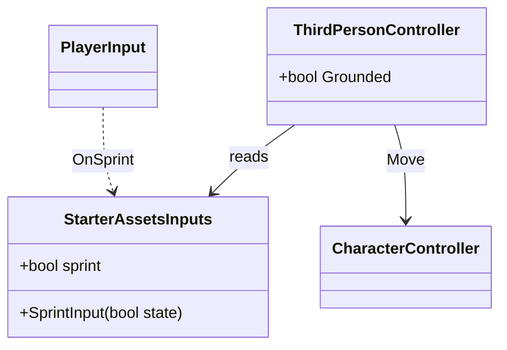

# Lab 9 - Extending the Third Person Controller

## 1. Overview

You set up Unity's third person controller in a small level of your own, tune how it feels, and use the debugger to find why the character stops being able to jump after a level change. You then add two features, landing dust and sprint stamina, as your own components, without changing a line of the controller.

---

## 2. What You Will Learn

| Skill | You can... |
|:------|:-----------|
| Set up a third-party controller | Assemble the player, the follow camera and the main camera from the Starter Assets prefabs in a new scene |
| Tune feel | Change four controller values and describe the effect of each on how the character feels |
| Diagnose a configuration bug with the debugger | Show that the grounded check's layer mask excludes the ground's layer |
| Configure, before coding | Make the character push crates by setting up `BasicRigidBodyPush` |
| Extend by reading state | Add landing dust with a component that watches `Grounded` |
| Extend by writing input | Add sprint stamina with a component that cancels the sprint request before the controller reads it |

---

## 3. Before You Start

| Item | Check |
|:-----|:------|
| Unity version | 6000.6.3f1 with URP 17.6.0 |
| Starter Assets | `Assets/ThirdParty/Scripts/Controllers/Runtime/ThirdPersonController/Prefabs` contains `PlayerArmature`, `PlayerFollowCamera` and `MainCamera` |
| Cinemachine | `Window > Package Management > Package Manager` lists `Cinemachine` as installed, and `Add Component` offers `Cinemachine Camera` |
| Input System | `Edit > Project Settings > Player > Active Input Handling` is `Input System Package (New)` |
| TextMeshPro and UI | A UI `Slider` can be created; import `TMP Essentials` if Unity asks |
| Debugger | You can attach your IDE to the Unity Editor and switch the Editor to debug mode ([Notes 01](../notes/01_unity_foundations.md), Section 4.9) |
| Notes | You have read [09 - First and Third Person Controllers](../notes/09_starter_assets_controllers.md), Sections 3 to 4.10 |

---

## 4. Plan

Complete the plan before Step 5.



Copy the diagram into `LabNotes.md` and complete it:

1. Add `LandingEvents` (Step 5), with an arrow to what it reads and an arrow, labelled with the event, to what it plays.
2. Add `SprintStamina` (Step 6), with an arrow to what it writes and an arrow, labelled with the event, to the stamina bar.
3. Mark which side of each arrow runs first in a frame, and why it must. Use Note 09, Section 4.10.

---

## 5. Steps

### Step 1 - Build the Scene

This step builds a level with flat ground to run on, a ledge to jump onto and crates to push, and adds the three Starter Assets prefabs. (15 min)

1. Open `Tools > GD > Setup > Create Project Folders`. Set `Project Folder` to `Lab09`, choose `Project assets only` and click `Create Folders`.
2. Create a new scene and save it as `Assets/Lab09/Scenes/SCN_Lab09_ThirdPerson.unity`. Delete `Main Camera`, because the Starter Assets camera prefab replaces it.
3. Create these objects, applying materials from `GD/Common/Materials`:

| Object | Type | Position | Scale |
|:--|:--|:--|:--|
| `Ground` | Plane | (0, 0, 0) | (3, 1, 3) |
| `Ledge` | Cube | (0, 0.5, 6) | (4, 1, 3) |
| `Crate_A` | Cube | (-3, 0.5, 3) | (1, 1, 1) |
| `Crate_B` | Cube | (3, 0.5, 3) | (1, 1, 1) |

4. Add a `Rigidbody` to `Crate_A` and `Crate_B`.
5. From `Assets/ThirdParty/Scripts/Controllers/Runtime/ThirdPersonController/Prefabs`, drag `MainCamera`, `PlayerFollowCamera` and `PlayerArmature` into the Hierarchy. Set `PlayerArmature` to `Position` (0, 0, 0).
6. Select `PlayerFollowCamera`. On its `Cinemachine Camera` component, set `Tracking Target` to `PlayerCameraRoot`, a child of `PlayerArmature`. The prefab leaves it empty because a prefab asset cannot reference a scene object.

<!-- IMAGE: screenshot "../images/labs/lab_9_step_1.png" - Two panels. Left: Hierarchy showing Ground, Ledge, Crate_A, Crate_B, MainCamera, PlayerFollowCamera and PlayerArmature expanded to show PlayerCameraRoot. Right: Inspector for PlayerFollowCamera with the Cinemachine Camera component, Tracking Target set to PlayerCameraRoot, and the Cinemachine Third Person Follow component below it. -->

7. Press Play. Move with WASD, look with the mouse, sprint with Left Shift and jump with Space. Jump onto `Ledge`. Walk into a crate. Press Escape to release the cursor before you click in the Editor.

**Checkpoint:** the camera follows behind the character's shoulder and orbits with the mouse. The character walks, runs with Shift, jumps onto the ledge and lands with a sound. It stops at the crates rather than pushing them.

### Step 2 - Tune the Feel

This step shows how much of the character's feel comes from a few numbers, before you change any code. (10 min)

1. Press Play and select `PlayerArmature`. Find the `Third Person Controller` component.
2. Change one value at a time, test it, then set it back:

| Value | Default | Try | What to test |
|:--|:--|:--|:--|
| `Speed Change Rate` | 10 | 2, then 30 | Start and stop running |
| `Rotation Smooth Time` | 0.12 | 0.5, then 0 | Turn sharply left and right |
| `Gravity` | -15 | -9.81 | Jump onto the ledge |
| `Jump Height` | 1.2 | 0.8 | Jump onto the ledge |

**Record:** in `LabNotes.md`, one sentence per row describing how the character felt with each new value. For `Gravity`, say whether the jump went higher or only took longer, and explain why using Note 09, Section 4.5. For `Jump Height` 0.8, say whether the character still reached the ledge.

**Checkpoint:** a low `Speed Change Rate` makes the character slide into and out of a run; a `Rotation Smooth Time` of 0 snaps it to face each new direction. With `Gravity` -9.81 the jump is floatier but reaches the same height. After you stop Play mode, every value is back to its default.

### Step 3 - Diagnose the Grounded Check with the Debugger

This step reproduces a level change that breaks the controller, and finds the cause in Unity's code without editing it. (10 min)

The level designer wants the level geometry on its own layer, so that later raycasts can target it.

1. Open `Edit > Project Settings > Tags and Layers`. Name `User Layer 7` as `Ground`.
2. Set `Ground` and `Ledge` to the `Ground` layer. If Unity asks whether to change children, choose `No, this object only`.
3. Press Play and try to jump. Select `PlayerArmature` and look at the sphere drawn at its feet in the Scene view.

**Hypothesis:** the controller's grounded check only tests the layers in `GroundLayers`, which is still `Default`, so the ground on the `Ground` layer is never found.

4. Switch the Editor to debug mode and attach your IDE. Open `ThirdPersonController.cs` by double-clicking the script field on the component.
5. Choose where to place a breakpoint so that you can see the layer mask the check uses and the result it returns. Place it. Do not change any code in this file.
6. When the breakpoint is hit, inspect `GroundLayers`, the value it holds, and `Grounded` after the check has run. Work out the mask value for the `Ground` layer by hand.

**Record:** where you placed the breakpoint, the value of `GroundLayers` as a number, the mask value for layer 7 written as `1 << 7` and in decimal, and the result of ANDing them. Does the evidence support the hypothesis? Use Note 08, Section 4.7.

7. Remove the breakpoint, stop Play mode and detach the debugger. Switch back to release mode.
8. On `PlayerArmature`'s `Third Person Controller`, open `Ground Layers` and tick `Ground` as well as `Default`. The field turns bold because it now overrides the prefab, which is what you want for this scene.

**Checkpoint:** before the fix, the sphere at the character's feet is red, the character plays its falling animation while standing on the ground, it cannot jump, and the debugger shows `GroundLayers` as 1 and `Grounded` as `false`. After the fix, the sphere is green and the character jumps onto the ledge. `ThirdPersonController.cs` is unchanged.

### Step 4 - Push the Crates by Configuration

This step adds a feature without writing code, because the package already provides it. Check what a package offers before you build your own version. (5 min)

1. On `PlayerArmature`, find `Basic Rigid Body Push`. Tick `Can Push`. Set `Push Layers` to `Default`, because the crates are on `Default`.
2. Press Play and walk into each crate.

**Record:** `BasicRigidBodyPush` uses `OnControllerColliderHit` and tests `1 << body.gameObject.layer` against `pushLayers`. Why does it need `OnControllerColliderHit` rather than `OnCollisionEnter`? Use Note 08, Section 4.3.

**Checkpoint:** the crates slide away when the character walks into them. Moving `Crate_A` to the `Ground` layer stops it being pushed.

### Step 5 - Add Landing Dust by Reading State

This step adds a landing effect in your own component, which reads the controller's public `Grounded` field after the controller has updated it. (15 min)

1. Create `Assets/Lab09/Scripts/LandingEvents.cs`:

```csharp
using StarterAssets;
using UnityEngine;
using UnityEngine.Events;

/// <summary>
/// Raises events when the third person controller leaves the ground and when it lands,
/// without editing the controller.
/// </summary>
[RequireComponent(typeof(ThirdPersonController))]
public class LandingEvents : MonoBehaviour
{
    [SerializeField, Min(0f), Tooltip("Shorter times in the air, such as stepping off a kerb, do not count as a landing")]
    private float minimumAirTime = 0.3f;

    [SerializeField, Tooltip("Called on the frame the character leaves the ground")]
    private UnityEvent onLeftGround;

    [SerializeField, Tooltip("Called on the frame the character lands, after at least Minimum Air Time in the air")]
    private UnityEvent onLanded;

    private ThirdPersonController controller;
    private bool wasGrounded = true;
    private float airTime;

    private void Awake()
    {
        controller = GetComponent<ThirdPersonController>();
    }

    private void LateUpdate()
    {
        // LateUpdate runs after the controller's Update, so Grounded is this frame's value.
        bool grounded = controller.Grounded;

        if (!grounded)
            airTime += Time.deltaTime;

        if (wasGrounded && !grounded)
            onLeftGround.Invoke();

        if (!wasGrounded && grounded)
        {
            if (airTime >= minimumAirTime)
                onLanded.Invoke();

            airTime = 0f;
        }

        wasGrounded = grounded;
    }
}
```

2. Add `LandingEvents` to `PlayerArmature`.
3. Add a child to `PlayerArmature` with `Effects > Particle System`, named `LandingDust`, at local `Position` (0, 0.05, 0). Keep the rotation Unity gives it, which points the particles upwards. Set it up as a single short burst:
   - Main module: `Duration` 0.5, untick `Looping`, `Start Lifetime` 0.4, `Start Speed` 2, `Start Size` 0.2, untick `Play On Awake`.
   - `Emission`: `Rate over Time` 0; add one `Burst` with `Count` 20.
   - `Shape`: `Hemisphere` with `Radius` 0.3.
4. On `LandingEvents`, under `On Landed`, click `+`, drag `LandingDust` into the object slot and choose `ParticleSystem > Play ()`.

<!-- IMAGE: screenshot "../images/labs/lab_9_step_5.png" - Inspector for PlayerArmature scrolled to LandingEvents, with Minimum Air Time 0.3, On Left Ground empty and On Landed calling ParticleSystem.Play () on LandingDust. Beside it, a Game view frame captured as the character lands, showing the burst of dust at its feet. -->

5. Press Play. Jump on the spot, jump onto the ledge, and walk off the ledge.

**Record:** which existing files did you edit? What would `Minimum Air Time` 0 do on uneven ground, and why is that rule in `LandingEvents` rather than in the particle system?

**Checkpoint:** a puff of dust appears at the character's feet each time it lands from a jump or from the ledge, once per landing, and never while it runs on flat ground. `ThirdPersonController.cs` is unchanged.

### Step 6 - Add Sprint Stamina by Writing Input

This step limits sprinting with a stamina meter. The component cancels the sprint request in `StarterAssetsInputs` before the controller reads it, so the controller never needs to know that stamina exists. (15 min)

1. Create `Assets/Lab09/Scripts/SprintStamina.cs`:

```csharp
using StarterAssets;
using UnityEngine;
using UnityEngine.Events;

/// <summary>
/// Drains stamina while the player sprints and cancels the sprint when stamina runs out.
/// Works by changing the sprint input, so the controller is not edited.
/// </summary>
// Runs before the controller's Update, so a cancelled sprint is cancelled this frame.
[DefaultExecutionOrder(-50)]
[RequireComponent(typeof(StarterAssetsInputs))]
public class SprintStamina : MonoBehaviour
{
    [SerializeField, Min(0.1f), Tooltip("Seconds of sprinting from full stamina")]
    private float maxStamina = 3f;

    [SerializeField, Min(0f), Tooltip("Stamina recovered per second while not sprinting")]
    private float recoveryRate = 1f;

    [SerializeField, Min(0f), Tooltip("Once exhausted, stamina needed before sprinting is allowed again")]
    private float recoveredThreshold = 1f;

    [SerializeField, Tooltip("Called with stamina from 0 to 1 whenever it changes")]
    private UnityEvent<float> onStaminaChanged;

    private StarterAssetsInputs input;
    private float stamina;
    private bool exhausted;

    private void Awake()
    {
        input = GetComponent<StarterAssetsInputs>();
        stamina = maxStamina;
    }

    private void Start()
    {
        onStaminaChanged.Invoke(1f);
    }

    private void Update()
    {
        float before = stamina;

        // Only drain while actually moving; holding Shift while standing still costs nothing.
        bool sprinting = input.sprint && input.move != Vector2.zero;

        if (sprinting)
        {
            stamina = Mathf.Max(stamina - Time.deltaTime, 0f);

            if (stamina <= 0f)
                exhausted = true;
        }
        else
        {
            stamina = Mathf.Min(stamina + recoveryRate * Time.deltaTime, maxStamina);
        }

        if (exhausted && stamina >= recoveredThreshold)
            exhausted = false;

        // Cancel the request before the controller reads it. The player must press Sprint
        // again, because PlayerInput only sends OnSprint when the button changes.
        if (exhausted && input.sprint)
            input.SprintInput(false);

        if (!Mathf.Approximately(before, stamina))
            onStaminaChanged.Invoke(stamina / maxStamina);
    }
}
```

2. Add `SprintStamina` to `PlayerArmature`.
3. Add a UI `Slider` named `StaminaBar`. In its `RectTransform`, anchor it to the top left with a small offset. On the `Slider`, untick `Interactable`, set `Min Value` 0, `Max Value` 1 and `Value` 1. Delete its `Handle Slide Area` child, because the bar is a display, not a control.
4. On `SprintStamina`, under `On Stamina Changed`, click `+`, drag `StaminaBar` into the object slot and choose the dynamic `Slider.value` under `Dynamic float`.

<!-- IMAGE: screenshot "../images/labs/lab_9_step_6.png" - Inspector for PlayerArmature scrolled to SprintStamina, with Max Stamina 3, Recovery Rate 1, Recovered Threshold 1 and On Stamina Changed calling the dynamic Slider.value on StaminaBar. Beside it, a Game view frame mid-sprint with the stamina bar in the top left about half full. -->

5. Press Play. Hold Shift and run until the bar empties. Keep holding Shift. Then release it, wait for the bar to refill a little, and press Shift again.

**Record:** why does `SprintStamina` need `[DefaultExecutionOrder(-50)]`? Predict what the player would see if it ran after the controller. Which file would you have edited to add stamina without the input layer?

**Checkpoint:** the bar empties in about three seconds of sprinting and the character drops to walking speed while you still hold Shift. Holding Shift while standing still does not drain the bar. After about one second without sprinting, a new press of Shift runs again. `ThirdPersonController.cs` and `StarterAssetsInputs.cs` are unchanged.

---

## 6. Debugging and Pitfalls

| Symptom | Likely cause | How to confirm | Fix |
|:--------|:-------------|:---------------|:----|
| The view does not follow the character | `Tracking Target` on `PlayerFollowCamera` is empty | Select `PlayerFollowCamera` | Set it to `PlayerCameraRoot` |
| The Game view shows "No cameras rendering" or two views | `Main Camera` was deleted without adding the prefab, or both were kept | Count the objects tagged `MainCamera` | Keep only the `MainCamera` prefab |
| The character cannot jump and plays its fall animation on the ground | `Ground Layers` does not include the ground's layer | Step 3; the feet sphere is red | Tick the ground's layer in `Ground Layers` |
| The mouse cannot click the Editor during Play | The cursor is locked | It reappears when you press Escape | Press Escape; untick `Cursor Locked` while testing UI |
| No landing dust | `On Landed` is not wired, or `Play On Awake` and `Looping` are confusing the test | Breakpoint on `onLanded.Invoke()` | Wire `ParticleSystem.Play ()`; untick `Looping` |
| Dust plays while running | `Minimum Air Time` is 0 and the grounded check flickers on uneven ground | Watch the feet sphere flicker red | Raise `Minimum Air Time` |
| The bar does not move | `On Stamina Changed` uses the static `value` with a fixed number | The event entry shows a number field | Choose `value` under `Dynamic float` |
| The character keeps sprinting with an empty bar | `SprintStamina` runs after the controller | Breakpoint in both `Update` methods; note which is hit first | Keep `[DefaultExecutionOrder(-50)]` |
| Compile error: "The type or namespace name 'StarterAssets' could not be found" | The script is in an assembly that does not reference `Unity.StarterAssets` | The script sits in a folder with its own assembly definition | Keep lab scripts outside any assembly definition, or add the reference |
| A value tuned in Step 2 is still changed | It was changed in Edit mode | The field is bold as a prefab override | Right-click the field and choose `Revert` |

---

## 7. Production Checklist

| Requirement | Done |
|:------------|:-----|
| The scene uses the `MainCamera`, `PlayerFollowCamera` and `PlayerArmature` prefabs, with `Tracking Target` set | |
| `LabNotes.md` records the effect of each value tuned in Step 2 | |
| `Ground Layers` includes the `Ground` layer, and debugger evidence for Step 3 is recorded | |
| The character pushes crates on `Default` and not on `Ground` | |
| `LandingEvents` plays the dust once per landing, wired through `On Landed` | |
| `SprintStamina` empties the bar, stops sprinting when exhausted, and requires a new press after recovery | |
| No file in `Assets/ThirdParty` or `Assets/GD/Common` was edited | |
| The completed Plan diagram shows both new components, what they read or write, and the order they run in | |

---

## 8. Extension

### Stretch - A Landing Component for Both Controllers

Your group's game has a first person section. `LandingEvents` requires a `ThirdPersonController`, so it cannot be added to the first person `PlayerCapsule`, although `FirstPersonController` also has a public `Grounded` field.

Make one `LandingEvents` class work with both controllers, without editing either controller. One route is an `IGroundedSource` interface with a small adapter component per controller, which `LandingEvents` finds with `GetComponent<IGroundedSource>()`. You may find a better one.

**Expected result:** a second scene with the first person `PlayerCapsule`, its `PlayerFollowCamera` and its `MainCamera` produces landing dust from the same `LandingEvents` class. In `LabNotes.md`, explain in 100 to 150 words what each adapter does, which SOLID principle the design depends on, and what changes if Unity later adds a shared interface to both controllers.

---

## 9. Reflective Questions

1. Step 3 broke the controller without any code change. What does that tell you about testing a level change, and how would you have caught it before playtesting?
2. Step 4 needed no code. Before you write a feature for a third-party system, what should you check, and where?
3. `LandingEvents` reads state and `SprintStamina` writes input. Which approach would you use for a feature that stops the player moving during a cutscene, and why?
4. `SprintStamina` depends on `[DefaultExecutionOrder]`. Is a hidden ordering rule like this better or worse than editing the controller to call a stamina check? Justify your answer using Note 06.
5. Your Step 2 notes describe feel in words. What would you measure to turn one of those descriptions into evidence for Iteration & Improvement?

---

## 10. How This Builds

- **Note 11 - Interpolation, Easing and Tweening** explains why the controller's `Speed Change Rate` smoothing changes with frame rate, and how to ease instant changes such as your stamina bar's.
- **Note 12 - Character Animation** opens the controller's Animator and adds a new animation event alongside the footsteps.
- **Notes 13 and 14 - AudioManager and CameraManager** add audio and a camera impulse to `On Landed`, using `LandingEvents` from `Assets/GD/Common`.
- **GCA - C# & Software Design - Software Design** and **Technical Craft:** a third-party controller extended by composition, with tuned values recorded against how they feel, is evidence for both. Keep your Step 2 notes as the start of a before-and-after.

**Group project task (take-home).** If your group uses a Starter Assets controller, list every change you have made to its files. Move each one into your own component, or record why it needs a fork. If you do not use one, write two sentences in your project log on why your own controller is the better choice for your game.
