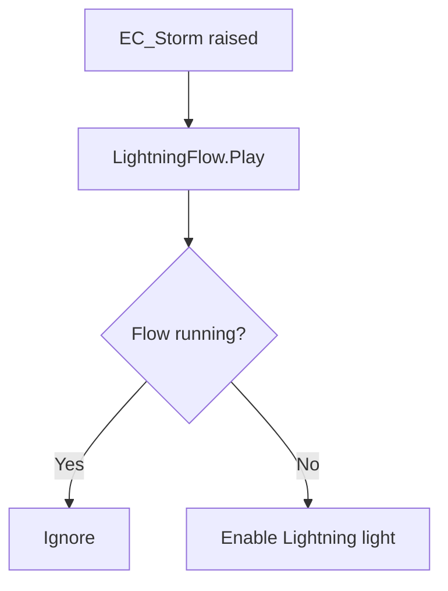

# Lab S - A Lightning Storm

## 1. Overview

You build a small night scene with a storm. Lightning strikes at random intervals, each strike has a different shape, brightness and length, and thunder follows after a random delay. You build it from `Common` classes and two short scripts, measure what an idle light costs, and use the debugger to find a random value that is not random. This is supplementary material, outside the weekly sequence, and it takes about 75 minutes.

---

## 2. What You Will Learn

| Skill | You can... |
|:------|:-----------|
| Set up an effect light | Create a Realtime light that is dark and disabled until it is needed |
| Measure an idle light | Record `Stats` figures for a light that is disabled, at intensity 0, and lit |
| Shape a strike | Draw an envelope curve in a `TweenProfile` and see the shape in the Game view |
| Sequence an effect | Build a strike and its thunder as a `FlowBehaviour` started by a channel |
| Find a build-time value | Show with the debugger that a value drawn in `BuildSequence` never changes, and fix it |
| Schedule an effect | Raise a channel at random intervals, and observe what happens to a request during a strike |

---

## 3. Before You Start

| Item | Check |
|:-----|:------|
| Unity version | 6000.6.3f1 with URP 17.6.0 |
| DOTween | The panel at `Tools > Demigiant > DOTween Utility Panel` shows no red banner |
| Common code | `Assets/GD/Common/Scripts` contains `Flow/FlowBehaviour.cs`, `ScriptableObjects/Types/Tweens/TweenProfile.cs` and `ScriptableObjects/Listeners/VoidEventChannelListener.cs` |
| Thunder sound | Optional. Any short `AudioClip`; without one, `Log Raises` on a channel shows when the thunder would play |
| Debugger | You can attach your IDE to the Unity Editor and switch the Editor to debug mode ([Notes 01](../notes/01_unity_foundations.md), Section 4.9) |
| Notes | You have read [Timed Light Effects](../notes/s_timed_light_effects.md), Sections 3 to 4.7 |

---

## 4. Plan

Complete the plan before Step 5.



Copy the diagram into `LabNotes.md` and complete it:

1. Add the remaining steps of a strike, in order, from Section 4.6 of the note.
2. Beside each random value (peak, strike length, thunder delay), write when it is drawn: once in `Awake`, or each time its step runs.
3. Mark where the light's intensity is when the strike finishes, and why.
4. Add the listener that turns `EC_Thunder` into a sound.

---

## 5. Steps

### Step 1 - Build the Night Scene

This step builds a dark scene with a dim moon, objects that cast shadows, and a lightning light that is ready but off. (10 min)

1. Open `Tools > GD > Setup > Create Project Folders`. Set `Project Folder` to `LabSLightning`, choose `Project assets only` and click `Create Folders`.
2. Create a new scene and save it as `Assets/LabSLightning/Scenes/SCN_LabS_Lightning.unity`.
3. Open `Window > Rendering > Lighting`, `Environment` tab. Set `Skybox Material` to `None`, `Environment Lighting > Source` to `Color`, and `Ambient Color` to a dark blue, about (20, 24, 36). The scene must be dark, or the flash will not show.
4. Select `Main Camera`. Set `Position` (0, 6, -12), `Rotation` (20, 0, 0), and `Environment > Background Type` to `Solid Color`, almost black.
5. Rename `Directional Light` to `Moon`. Set `Rotation` (50, -30, 0), `Color` pale blue, `Intensity` 0.15, `Mode` Realtime and `Shadow Type` Soft Shadows.
6. Create these objects, applying materials from `GD/Common/Materials`:

| Object | Type | Position | Scale | Material |
|:--|:--|:--|:--|:--|
| `Ground` | Plane | (0, 0, 0) | (3, 1, 3) | `Green` |
| `House` | Cube | (0, 1.5, 4) | (4, 3, 4) | `Brick` |
| `Post_1` | Cube | (-4, 1.5, 0) | (0.3, 3, 0.3) | `Orange` |
| `Post_2` | Cube | (4, 1.5, -1) | (0.3, 3, 0.3) | `Orange` |
| `Post_3` | Cube | (-2, 1.5, -4) | (0.3, 3, 0.3) | `Orange` |

7. Create a second directional light with `GameObject > Light > Directional Light`, named `Lightning`. Set `Rotation` (70, 40, 0), `Color` white with a hint of blue, `Intensity` 0, `Mode` Realtime and `Shadow Type` Hard Shadows. Untick the `Light` component, so it starts disabled.
8. Create an empty `Thunder`, and add an `Audio Source` with `Play On Awake` unticked. If you have a thunder clip, assign it to `Audio Resource`.

**Checkpoint:** the Game view shows a dark blue scene with faint moon shadows. Tick the `Lightning` light, set `Intensity` to 5, and the scene turns bright white with hard shadows pointing in a different direction. Set `Intensity` back to 0 and untick the component again.

### Step 2 - See the Problem

This step runs the simplest storm, so that you know what the final one improves. (5 min)

1. Create `Assets/LabSLightning/Scripts/StormCoroutine.cs`:

```csharp
using System.Collections;
using UnityEngine;

/// <summary>
/// First version of the storm: one coroutine that flashes a light and plays thunder.
/// It works, but every strike is identical and nothing else can start one.
/// </summary>
public class StormCoroutine : MonoBehaviour
{
    [SerializeField] private Light lightningLight;
    [SerializeField] private AudioSource thunder;

    [SerializeField, Min(0f)] private float flashIntensity = 6f;
    [SerializeField, Min(0f)] private float flashSeconds = 0.15f;
    [SerializeField, Min(0f)] private float thunderDelay = 1.5f;
    [SerializeField, Min(0.1f)] private float secondsBetweenStrikes = 8f;

    private IEnumerator Start()
    {
        while (true)
        {
            yield return new WaitForSeconds(secondsBetweenStrikes);

            lightningLight.intensity = flashIntensity;
            lightningLight.enabled = true;
            yield return new WaitForSeconds(flashSeconds);
            lightningLight.enabled = false;

            yield return new WaitForSeconds(thunderDelay);
            thunder.Play();
        }
    }
}
```

2. Create an empty `Storm`, add `Storm Coroutine`, and assign `Lightning` and `Thunder`. Set `Seconds Between Strikes` to 3 so you do not wait long.
3. Press Play and watch four strikes.

**Record:** in `LabNotes.md`, list three things that make this storm feel mechanical rather than like weather.

**Checkpoint:** a flat white flash every 3 seconds, with the thunder (if you have a clip) always the same time after it. Stop Play, remove `Storm Coroutine` from `Storm`, and set `Lightning`'s `Intensity` back to 0, because the coroutine left it at 6.

### Step 3 - Measure an Idle Light

This step measures what the lightning light costs while it waits, so that the flow's choice to disable it is based on evidence. (8 min)

1. Press Play, and open the `Stats` panel from the Game view toolbar.
2. Record `Batches`, `SetPass calls` and `Shadow casters` in a table in `LabNotes.md` for three states of `Lightning`:

| State | How |
|:--|:--|
| Disabled | `Light` component unticked |
| Enabled at 0 | `Light` component ticked, `Intensity` 0 |
| Lit | `Light` component ticked, `Intensity` 5 |

3. Stop Play. Leave `Lightning` disabled, at intensity 0.

**Record:** which state does an idle lightning light match more closely, enabled at 0 or disabled? Use your figures, not the note, to answer.

**Checkpoint:** `LabNotes.md` has the table with nine figures, and a one-sentence conclusion that names the figure that changed most.

### Step 4 - Make the Strike Assets

This step creates the shape of a strike as data, and the two channels that connect the storm. (10 min)

1. In `Assets/LabSLightning/Data`, create `TP_LightningEnvelope` with `Create > GD > Tweens > Tween Profile`. Set `Duration` 0.5, `Delay` 0, and tick `Use Curve`.
2. Open its `Curve` and replace the keys with these. Right-click each key and choose `Both Tangents > Linear`, so the flashes are sharp:

| Time | Value |
|:--|:--|
| 0 | 0 |
| 0.04 | 1 |
| 0.12 | 0.15 |
| 0.2 | 0.7 |
| 0.3 | 0.05 |
| 0.42 | 0.45 |
| 1 | 0 |

3. Create `EC_Storm` and `EC_Thunder` with `Create > GD > Events > Void`. Tick `Log Raises` on both, so the Console shows each strike and each thunder.

**Checkpoint:** the curve preview shows a tall spike, then two smaller spikes, and returns to 0 at the right edge.

### Step 5 - Write the Strike Flow

This step writes the strike as a `FlowBehaviour` and starts it from a channel. This first version has a deliberate mistake, which you find in Step 6. (15 min)

1. Create `Assets/LabSLightning/Scripts/LightningFlow.cs`:

```csharp
using DG.Tweening;
using GD.Flow;
using GD.Types;
using UnityEngine;

/// <summary>
/// One lightning strike: the light flashes in the shape of an envelope curve, then
/// thunder is raised after a random delay.
/// </summary>
public class LightningFlow : FlowBehaviour
{
    [Header("Light")]
    [SerializeField, Tooltip("A Realtime light used only for lightning, disabled and at intensity 0. The flow enables it for each strike")]
    private Light lightningLight;

    [SerializeField, Tooltip("Use Curve ticked, with a curve that starts and ends at 0. The curve is the shape of the strike")]
    private TweenProfile strikeEnvelope;

    [SerializeField, Min(0f), Tooltip("Lowest peak intensity of a strike")]
    private float minPeakIntensity = 3f;

    [SerializeField, Min(0f), Tooltip("Highest peak intensity of a strike")]
    private float maxPeakIntensity = 8f;

    [SerializeField, Min(0.05f), Tooltip("Shortest strike, in seconds")]
    private float minStrikeSeconds = 0.3f;

    [SerializeField, Min(0.05f), Tooltip("Longest strike, in seconds")]
    private float maxStrikeSeconds = 0.8f;

    [Header("Thunder")]
    [SerializeField, Tooltip("Raised when the thunder should be heard. A listener plays the sound")]
    private VoidEventChannel thunder;

    [SerializeField, Min(0f), Tooltip("Shortest delay before the thunder. Sound takes about 3 seconds to travel 1 kilometre")]
    private float minThunderDelay = 0.5f;

    [SerializeField, Min(0f), Tooltip("Longest delay before the thunder")]
    private float maxThunderDelay = 3f;

    protected override FlowSequence BuildSequence()
    {
        return new FlowBuilder()
            .Do(() => lightningLight.enabled = true)
            .Tween(CreateStrike)
            .Do(() => lightningLight.enabled = false)
            .Wait(Random.Range(minThunderDelay, maxThunderDelay))
            .Raise(thunder)
            .Build();
    }

    // Called when its step starts, not when the sequence is built,
    // so each strike draws new random values.
    private Tween CreateStrike()
    {
        float peak = Random.Range(minPeakIntensity, maxPeakIntensity);
        float seconds = Random.Range(minStrikeSeconds, maxStrikeSeconds);

        // The curve ends at 0, so the intensity ends where it started.
        return strikeEnvelope.Apply(lightningLight.DOIntensity(peak, seconds))
            .SetLink(gameObject);
    }
}
```

2. On `Storm`, add `Lightning Flow`. Assign `Lightning`, `TP_LightningEnvelope` and `EC_Thunder`. Leave `Play On Start` and `Play Once` unticked.
3. On `Storm`, add `Void Event Channel Listener` with `Channel` `EC_Storm`, and a `Response` that calls `LightningFlow.Play`.
4. On `Thunder`, add `Void Event Channel Listener` with `Channel` `EC_Thunder`, and a `Response` that calls `AudioSource.Play`.
5. Press Play. Select `EC_Storm` in the Project window, and choose `Raise` from its context menu (the three dots at the top right of the Inspector). Do this several times, waiting for the thunder each time.

**Checkpoint:** each raise gives one strike: a bright flash, a dip and two smaller re-strikes, ending dark. Strikes differ in brightness and length. The Console shows `[EC_Thunder] raised` after each strike, and the thunder clip plays if you assigned one.

### Step 6 - Debug the Thunder Delay

This step tests a hypothesis with the debugger: the thunder delay is the same on every strike, even though the code calls `Random.Range`. (10 min)

1. Watch the Console timestamps for several strikes. The delay between `[EC_Storm] raised` and `[EC_Thunder] raised` looks the same every time. Form a hypothesis about why before you continue.
2. Open `Assets/GD/Common/Scripts/Flow/Steps/WaitStep.cs` in your IDE. Do not edit it. Place a breakpoint on the first line of `Run`.
3. Attach the debugger, press Play, and raise `EC_Storm`. When the breakpoint is hit, read the value of `seconds`. Continue, raise `EC_Storm` again, and read `seconds` again.
4. Place a second breakpoint in `LightningFlow.BuildSequence`, stop Play, and press Play again. Note when it is hit, and how many times.

**Record:** the two `seconds` values, how many times `BuildSequence` ran, and a one-sentence explanation of the bug that uses both.

5. Fix it by drawing the delay each time the step runs. In `LightningFlow`, replace the line `.Wait(Random.Range(minThunderDelay, maxThunderDelay))` with `.Tween(CreateThunderDelay)`, and add this method below `CreateStrike`:

```csharp
    private Tween CreateThunderDelay()
    {
        float seconds = Random.Range(minThunderDelay, maxThunderDelay);

        // false: scaled time, so the delay stops while the game is paused.
        return DOVirtual.DelayedCall(seconds, null, false)
            .SetLink(gameObject);
    }
```

6. Move the breakpoint to the `return` line of `CreateThunderDelay`, and read `seconds` over two strikes.

**Checkpoint:** after the fix, `seconds` differs between strikes, and the Console timestamps show a different delay before each thunder. Remove the breakpoints.

### Step 7 - Schedule the Storm

This step makes the storm run by itself, and tests the rule for a request that arrives during a strike. (10 min)

1. Create `Assets/LabSLightning/Scripts/RandomIntervalRaiser.cs`:

```csharp
using System.Collections;
using GD.Types;
using UnityEngine;

/// <summary>
/// Raises a channel again and again while enabled, after a new random wait each time.
/// It knows nothing about what responds, so it can drive a storm, birdsong or a creaking ship.
/// </summary>
public class RandomIntervalRaiser : MonoBehaviour
{
    [SerializeField, Tooltip("The channel to raise")]
    private VoidEventChannel channel;

    [SerializeField, Min(0.1f), Tooltip("Shortest wait between raises, in seconds")]
    private float minSeconds = 4f;

    [SerializeField, Min(0.1f), Tooltip("Longest wait between raises, in seconds")]
    private float maxSeconds = 12f;

    private void OnEnable()
    {
        if (channel == null)
        {
            Debug.LogError($"{name}: assign the channel to raise.", this);
            enabled = false;
            return;
        }

        StartCoroutine(RaiseRepeatedly());
    }

    private void OnDisable()
    {
        // Disabling a component does not stop its coroutines, so stop them here.
        StopAllCoroutines();
    }

    private IEnumerator RaiseRepeatedly()
    {
        while (true)
        {
            yield return new WaitForSeconds(Random.Range(minSeconds, maxSeconds));
            channel.Raise();
        }
    }
}
```

2. Add `Random Interval Raiser` to `Storm`, with `Channel` `EC_Storm`, `Min Seconds` 3 and `Max Seconds` 8. Press Play and watch for a minute.
3. Stop Play. Set `Min Seconds` to 0.2 and `Max Seconds` to 0.5, and press Play again.

**Record:** with the short range, compare the number of `[EC_Storm] raised` lines with the number of `[EC_Thunder] raised` lines over about 10 seconds. Explain the difference using `FlowBehaviour.Play`.

**Checkpoint:** with 3 to 8 seconds, strikes arrive at uneven intervals, and each looks and sounds different. With 0.2 to 0.5 seconds, there are many more storm raises than thunders, and no strike is cut short. Set the range back to 3 to 8 seconds.

---

## 6. Debugging and Pitfalls

| Symptom | Likely cause | How to confirm | Fix |
|:--------|:-------------|:---------------|:----|
| No flash, but `[EC_Storm] raised` appears | The listener on `Storm` calls nothing, or calls a different object's `Play` | Select `Storm` and read the listener's `Response` | Choose `LightningFlow.Play` on `Storm` |
| A flash, but the scene hardly changes | Ambient light or the skybox is too bright | Set `Ambient Color` to black and compare | Repeat Step 1, item 3 |
| The light stays bright, then snaps off | `Use Curve` is not ticked on the profile | Select `TP_LightningEnvelope` | Tick `Use Curve` |
| Each strike starts brighter than the last | The last curve key is not at value 0 | Breakpoint at `return` in `CreateStrike`; read `lightningLight.intensity` | Set the last key to (1, 0) |
| Strikes happen only once | `Play Once` is ticked | Read the `Lightning Flow` component | Untick `Play Once` |
| `NullReferenceException` in `FlowBuilder.Raise` | `Thunder` is not assigned on the flow | The stack trace names `BuildSequence` | Assign `EC_Thunder` |
| Thunder never plays, though `[EC_Thunder] raised` appears | No clip, or the listener calls a static method | Select `Thunder` | Assign a clip; choose `AudioSource.Play` on `Thunder` |
| The thunder delay is still the same after Step 6 | The old `.Wait` line is still in `BuildSequence` | Breakpoint in `CreateThunderDelay`: is it hit on each strike? | Replace the `.Wait` line with `.Tween(CreateThunderDelay)` |

---

## 7. Production Checklist

| Requirement | Done |
|:------------|:-----|
| The completed plan is in `LabNotes.md` | |
| `Lightning` is Realtime, starts disabled at intensity 0, and ends each strike disabled at intensity 0 | |
| The `Stats` table from Step 3 and its conclusion are in `LabNotes.md` | |
| Each strike has the envelope's shape, and strikes differ in brightness and length | |
| The debugger evidence from Step 6, before and after the fix, is in `LabNotes.md` | |
| The thunder delay differs between strikes | |
| The storm runs by itself at random intervals, and a request during a strike is ignored | |
| No file in `Assets/GD/Common` was edited | |

---

## 8. Extension

### Stretch - A Reusable Random Wait

`DOVirtual.DelayedCall` works, but `.Tween(CreateThunderDelay)` hides the intent: the flow wants a random wait. `FlowBuilder.Add` accepts any `IFlowStep` (Note 15, Section 4.6). Write a `WaitRandomStep` in `Assets/LabSLightning/Scripts` that draws its wait each time `Run` is called, and use it in `LightningFlow` with `.Add(new WaitRandomStep(minThunderDelay, maxThunderDelay))`, with no edit to `Common`.

**Expected result:** the thunder delay still varies, and the State and Flow Viewer (`Tools > GD > Analyse > State and Flow Viewer`) lists your step with a readable name from its `ToString`. In `LabNotes.md`, explain in 100 to 150 words which version you would keep in a group project, and why, considering who reads the flow and how many flows need a random wait.

---

## 9. Reflective Questions

1. Step 3 compared a disabled light with one at intensity 0. Using your figures, state a rule for effect lights in your group's game, and the evidence you would collect before breaking it.
2. In Step 6, `Random.Range` was called, but the result never changed. Explain the difference between when `BuildSequence` runs and when a `Func<Tween>` runs, and name one other value in your own code that could have the same problem.
3. Step 4 put the strike's shape into an asset. Describe a change a designer could now make without you, and one that would still need code.
4. Step 7 showed that requests during a strike are dropped. Is that the right rule for a scripted strike when the player opens a door? Justify your answer, and state the rule you would use instead if not.
5. How would you show the difference between Step 2 and Step 7 in your group's screencast, as evidence of iteration?

---

## 10. How This Builds

This is supplementary material, and no other note or lab depends on it.

- **GCA - Gameplay Systems & Integration - Systems Integration:** a timed effect built by connecting flows, tweens and channels, with no new system, is evidence of integration.
- **GCA - Technical Craft - Craft Example 1:** the flat flash from Step 2 against the shaped, varied strike from Step 7, recorded as a before and after.

**Group project task (take-home).** List every light in your game that should change during play. For each one, record its current `Mode`, what changes it, and whether the change should end where it started (an envelope) or stay (an ease). Change any light a script will drive to Realtime, or add a separate Realtime light for the effect.
