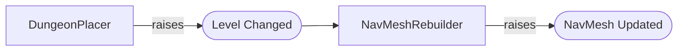

# Lab S - NavMesh Agents in a Player-Built Dungeon

## 1. Overview

You build a small dungeon that the player lays out during play: walls, traps and explosives, placed on a grid from a top-down view. Enemies then walk through it, route around walls, weigh up traps, and stay clear of explosives. This is supplementary material, outside the weekly sequence, and it takes about 85 minutes.

---

## 2. What You Will Learn

| Skill | You can... |
|:------|:-----------|
| Build a NavMesh at runtime | Configure a surface for pieces placed during play, and keep it current |
| Combine update requests | Show one update serving a burst of placements |
| Protect the route | Refuse a placement that would seal the level, with debugger evidence |
| Make agents weigh danger | Use an area cost, and work out when an enemy will accept a trap |
| Make agents refuse danger | Use a carving obstacle, and see its hole close |
| Vary behaviour as data | Give two enemies different judgement, from one class |

---

## 3. Before You Start

| Item | Check |
|:-----|:------|
| Unity version | 6000.6.3f1 with URP 17.6.0 |
| AI Navigation | `Add Component` offers `NavMesh Surface` and `NavMesh Modifier Volume` |
| Common code | `Assets/GD/Common/Scripts` contains `Flow/FlowBehaviour.cs`, `Selection/Providers/MouseScreenRayProvider.cs` and `Triggers/ContactTrigger.cs` |
| Debugger | You can attach your IDE to the Unity Editor and switch the Editor to debug mode ([Notes 01](../notes/01_unity_foundations.md), Section 4.9) |
| Notes | You have read [NavMesh Agents in Player-Built Levels](../notes/s_navmesh_runtime_levels.md), Sections 3 to 4.8 |

---

## 4. Plan

Complete the plan before Step 3.



Copy the diagram into `LabNotes.md` and complete it:

1. Add `RouteCheck`, and what happens to a piece that fails it. Which channel is raised a second time, and why?
2. Add `DungeonWalker`, and what it does on `NavMesh Updated`.
3. Add `Explosive`. Mark which arrows it does not need, because carving needs no rebuild.
4. Predict the trap cost at which an enemy accepts the trap in Step 5. Use Section 4.5 of the note.

---

## 5. Steps

### Step 1 - Build the Scene

This step builds a floor with two gaps in a dividing wall, so that the enemy has a short route and a long route. (15 min)

1. Open `Tools > GD > Setup > Create Project Folders`. Set `Project Folder` to `LabS`, choose `Project assets only` and click `Create Folders`.
2. Open `Edit > Project Settings > Tags and Layers`, and name a free `User Layer` as `Level`. Open `Window > AI > Navigation`. On the `Areas` tab, name a free area `Trap`, and leave its cost at 1.
3. Create a new scene and save it as `Assets/LabS/Scenes/SCN_LabS_Dungeon.unity`.
4. Set `Main Camera` to `Position` (0, 35, 0), `Rotation` (90, 0, 0), `Projection` `Orthographic` and `Size` 22.
5. Create these objects, applying materials from `GD/Common/Materials`:

| Object | Type | Position | Scale | Layer |
|:--|:--|:--|:--|:--|
| `Floor` | Plane | (0, 0, 0) | (4, 1, 4) | `Level` |
| `Divider_West` | Cube | (-12, 1.5, 2) | (16, 3, 4) | `Level` |
| `Divider_East` | Cube | (8, 1.5, 2) | (16, 3, 4) | `Level` |
| `SpawnPoint` | Empty | (-18, 0, -18) | (1, 1, 1) | `Default` |
| `Goal` | Empty | (-10, 0, 16) | (1, 1, 1) | `Default` |

The dividers leave `Gap A` at about x = -2, close to the straight line from spawn to goal, and `Gap B` at about x = 18, which is about 30 metres longer.

6. Create an empty `NavSystem`, and add `NavMesh Surface`. Set `Collect Objects` to `All Game Objects`, `Include Layers` to `Level` only, and `Use Geometry` to `Physics Colliders`.
7. Click `Bake`.

**Checkpoint:** with `Show NavMesh` on in the Scene view, the blue NavMesh covers the floor except around the dividers, and it passes through both gaps.

### Step 2 - See the Problem

This step shows why a baked map is not enough. (5 min)

1. Create `Assets/LabS/Scripts/WalkToGoal.cs`:

```csharp
using UnityEngine;
using UnityEngine.AI;

[RequireComponent(typeof(NavMeshAgent))]
public class WalkToGoal : MonoBehaviour
{
    [SerializeField] private Transform goal;

    private void Start()
    {
        GetComponent<NavMeshAgent>().SetDestination(goal.position);
    }
}
```

2. Create a `Capsule` named `Enemy` at (-18, 1, -18), and add `Nav Mesh Agent` and `Walk To Goal`, with `Goal` assigned. Set `Speed` to 5 on the agent.
3. Create a prefab `Assets/LabS/Prefabs/PF_Wall` from a `Cube` with `Scale` (4, 3, 4), on the `Level` layer. Delete it from the scene.
4. Press Play. While the enemy walks, drag `PF_Wall` from the Project window into the Scene view, and place it in `Gap A`.

**Record:** what did the enemy do at the new wall, and why?

**Checkpoint:** the enemy reaches `Gap A` and pushes into or through the wall, because its path comes from a map that has no wall. Delete `Enemy` and `Walk To Goal` when you have seen this.

### Step 3 - Keep the Map Current and Protect the Route

This step adds the rebuilder, the placer and the route check. (25 min)

1. In `Assets/LabS/Data`, use `Create > GD > Events > Void` to make `EC_LevelChanged`, `EC_NavMeshUpdated`, `EC_PlacementRefused`, `EC_StartPressed`, `EC_Detonate` and `EC_TrapTriggered`. Tick `Log Raises` on `EC_LevelChanged`, `EC_NavMeshUpdated` and `EC_PlacementRefused`.
2. Create `Assets/LabS/Scripts/NavMeshRebuilder.cs`:

```csharp
using System.Collections;
using GD.Types;
using Unity.AI.Navigation;
using UnityEngine;

/// <summary>
/// Updates the NavMesh when the level changes. Requests during an update share one more
/// update, because only the latest layout matters.
/// </summary>
[RequireComponent(typeof(NavMeshSurface))]
public class NavMeshRebuilder : MonoBehaviour
{
    [SerializeField, Tooltip("Raise this after changing the level")]
    private VoidEventChannel levelChanged;

    [SerializeField, Tooltip("Raised when the NavMesh matches the level")]
    private VoidEventChannel navMeshUpdated;

    private NavMeshSurface surface;
    private Coroutine updating;
    private bool updateAgain;

    private void Awake()
    {
        surface = GetComponent<NavMeshSurface>();
    }

    private void OnEnable()
    {
        levelChanged.Raised += HandleLevelChanged;
    }

    private void OnDisable()
    {
        levelChanged.Raised -= HandleLevelChanged;
    }

    private void Start()
    {
        // UpdateNavMesh needs existing data, so build once first.
        surface.BuildNavMesh();
        navMeshUpdated.Raise();
    }

    private void HandleLevelChanged()
    {
        if (updating != null)
        {
            updateAgain = true;
            return;
        }

        updating = StartCoroutine(UpdateUntilCurrent());
    }

    private IEnumerator UpdateUntilCurrent()
    {
        do
        {
            updateAgain = false;
            yield return surface.UpdateNavMesh(surface.navMeshData);
        }
        while (updateAgain);

        updating = null;
        navMeshUpdated.Raise();
    }
}
```

3. Create `Assets/LabS/Scripts/RouteCheck.cs`:

```csharp
using UnityEngine;
using UnityEngine.AI;

/// <summary>
/// Reports whether a complete route exists between two points on the NavMesh.
/// </summary>
public class RouteCheck : MonoBehaviour
{
    [SerializeField] private Transform start;
    [SerializeField] private Transform goal;

    [SerializeField, Min(0.1f), Tooltip("How far a point may be from the NavMesh, in metres")]
    private float sampleDistance = 2f;

    private NavMeshPath path;

    private void Awake()
    {
        path = new NavMeshPath();
    }

    public bool HasCompleteRoute()
    {
        if (!NavMesh.SamplePosition(start.position, out NavMeshHit startHit, sampleDistance, NavMesh.AllAreas))
            return false;

        if (!NavMesh.SamplePosition(goal.position, out NavMeshHit goalHit, sampleDistance, NavMesh.AllAreas))
            return false;

        return NavMesh.CalculatePath(startHit.position, goalHit.position, NavMesh.AllAreas, path)
            && path.status == NavMeshPathStatus.PathComplete;
    }
}
```

4. Create `Assets/LabS/Scripts/DungeonPlacer.cs`:

```csharp
using System.Collections.Generic;
using GD;
using GD.Types;
using UnityEngine;
using UnityEngine.InputSystem;

/// <summary>
/// Places pieces on a grid. A piece that would seal the route is removed again.
/// </summary>
public class DungeonPlacer : MonoBehaviour
{
    [SerializeField] private InputAction placeAction = new("Place", binding: "<Mouse>/leftButton");
    [SerializeField] private GameObject piecePrefab;
    [SerializeField] private RouteCheck routeCheck;

    [SerializeField, Tooltip("Layers a piece can be placed on")]
    private LayerMask buildLayers;

    [SerializeField, Min(0.5f), Tooltip("Size of one grid cell, in metres")]
    private float cellSize = 4f;

    [Header("Channels")]
    [SerializeField] private VoidEventChannel levelChanged;
    [SerializeField] private VoidEventChannel navMeshUpdated;
    [SerializeField] private VoidEventChannel placementRefused;

    private readonly Dictionary<Vector2Int, GameObject> pieces = new();

    private IRayProvider rayProvider;
    private GameObject pendingPiece;
    private Vector2Int pendingCell;

    private void Awake()
    {
        rayProvider = GetComponent<IRayProvider>();
    }

    private void OnEnable()
    {
        navMeshUpdated.Raised += HandleNavMeshUpdated;
        placeAction.performed += HandlePlacePressed;
        placeAction.Enable();
    }

    private void OnDisable()
    {
        navMeshUpdated.Raised -= HandleNavMeshUpdated;
        placeAction.performed -= HandlePlacePressed;
        placeAction.Disable();
    }

    /// <summary>Wire to UI buttons, to choose what the next click places.</summary>
    public void SelectPiece(GameObject prefab)
    {
        piecePrefab = prefab;
    }

    private void HandlePlacePressed(InputAction.CallbackContext context)
    {
        // One piece at a time, because each one must pass the route check.
        if (pendingPiece != null || !rayProvider.TryCreateRay(out Ray ray))
            return;

        if (!Physics.Raycast(ray, out RaycastHit hit, 200f, buildLayers))
            return;

        Vector2Int cell = new(Mathf.FloorToInt(hit.point.x / cellSize), Mathf.FloorToInt(hit.point.z / cellSize));

        if (pieces.ContainsKey(cell))
            return;

        Vector3 position = new((cell.x + 0.5f) * cellSize, hit.point.y, (cell.y + 0.5f) * cellSize);

        pendingPiece = Instantiate(piecePrefab, position, Quaternion.identity);
        pendingCell = cell;
        pieces[cell] = pendingPiece;

        levelChanged.Raise();
    }

    private void HandleNavMeshUpdated()
    {
        if (pendingPiece == null)
            return;

        GameObject piece = pendingPiece;
        pendingPiece = null;

        if (routeCheck.HasCompleteRoute())
            return;

        pieces.Remove(pendingCell);

        // Deactivate now, because Destroy waits for the end of the frame, and the
        // next update must not collect this piece.
        piece.SetActive(false);
        Destroy(piece);

        levelChanged.Raise();
        placementRefused.Raise();
    }
}
```

5. On `NavSystem`, add `NavMesh Rebuilder`, assigning `EC_LevelChanged` and `EC_NavMeshUpdated`.
6. Create an empty `DungeonSystem`. Add `Mouse Screen Ray Provider`, with `Point Action` set to `UI/Point` from `InputSystem_Actions`. Add `Route Check`, assigning `SpawnPoint` and `Goal`. Add `Dungeon Placer`, assigning `PF_Wall`, `Route Check`, `Level` under `Build Layers`, and the three channels.
7. Press Play. Click the floor to place several walls quickly. Then click `Gap A`, which is the cell around (-2, 2).

**Hypothesis:** with `Gap A` walled, a wall in `Gap B` makes `path.status` report `PathPartial` when the route check runs, so the placer removes it. The check gives this answer only because it waits for `NavMesh Updated`.

8. Switch the Editor to debug mode and attach your IDE. In `RouteCheck` or `DungeonPlacer`, choose where to place a breakpoint so that you can read the path's status. Click `Gap B`, which is the cell around (18, 2). When you have read it, remove the breakpoint, detach the debugger and switch back to release mode.

**Record:** the value of `path.status`. Does the evidence support the hypothesis? Count how many times `EC_NavMeshUpdated` was raised for your quick clicks. Why does `DungeonPlacer` accept only one piece until the update ends?

**Checkpoint:** walls appear on the grid, and the blue NavMesh updates around them. A wall in `Gap A` stays. A wall in `Gap B` appears briefly, is removed, and `EC_PlacementRefused` is logged.

### Step 4 - Add Enemies

This step adds enemies that plan again when the map changes. (15 min)

1. Create `Assets/LabS/Scripts/NavigationProfile.cs`:

```csharp
using UnityEngine;
using UnityEngine.AI;

/// <summary>
/// How an enemy values danger. One careful and one reckless asset give two behaviours
/// from one enemy prefab.
/// </summary>
[CreateAssetMenu(fileName = "NavigationProfile", menuName = "GD/Enemies/Navigation Profile")]
public class NavigationProfile : ScriptableObject
{
    [SerializeField, Tooltip("Must match a name on the Areas tab")]
    private string trapAreaName = "Trap";

    [SerializeField, Min(1f), Tooltip("How many metres of normal floor one metre of trap is worth")]
    private float trapCost = 20f;

    public void ApplyTo(NavMeshAgent agent)
    {
        int area = NavMesh.GetAreaFromName(trapAreaName);

        if (area < 0)
        {
            Debug.LogError($"{name}: there is no NavMesh area named {trapAreaName}.", this);
            return;
        }

        agent.SetAreaCost(area, trapCost);
    }
}
```

2. Create `Assets/LabS/Scripts/IExplosionTarget.cs`:

```csharp
/// <summary>
/// Anything an explosion can affect.
/// </summary>
public interface IExplosionTarget
{
    void HandleExplosion();
}
```

3. Create `Assets/LabS/Scripts/DungeonWalker.cs`:

```csharp
using GD.Types;
using UnityEngine;
using UnityEngine.AI;

/// <summary>
/// Walks to a goal across a level that can change at any time.
/// </summary>
[RequireComponent(typeof(NavMeshAgent))]
public class DungeonWalker : MonoBehaviour, IExplosionTarget
{
    [SerializeField] private NavigationProfile profile;
    [SerializeField] private VoidEventChannel navMeshUpdated;

    [SerializeField, Min(0.1f), Tooltip("Seconds between path updates when nothing else requests one")]
    private float repathSeconds = 1f;

    [SerializeField, Min(0.1f), Tooltip("How far the agent may be from the NavMesh and still return to it")]
    private float recoverDistance = 2f;

    private NavMeshAgent agent;
    private Transform goal;
    private float repathTimer;

    private void Awake()
    {
        agent = GetComponent<NavMeshAgent>();
        profile.ApplyTo(agent);
    }

    private void OnEnable()
    {
        navMeshUpdated.Raised += Repath;
    }

    private void OnDisable()
    {
        navMeshUpdated.Raised -= Repath;
    }

    /// <summary>Called by the spawner, straight after creating this enemy.</summary>
    public void SetGoal(Transform newGoal)
    {
        goal = newGoal;
        Repath();
    }

    public void HandleExplosion()
    {
        Destroy(gameObject);
    }

    private void Update()
    {
        repathTimer -= Time.deltaTime;

        if (repathTimer <= 0f)
            Repath();
    }

    private void Repath()
    {
        repathTimer = repathSeconds;

        if (goal == null)
            return;

        // The ground under this enemy may have been removed.
        if (!agent.isOnNavMesh && !TryReturnToNavMesh())
            return;

        agent.SetDestination(goal.position);
    }

    private bool TryReturnToNavMesh()
    {
        if (!NavMesh.SamplePosition(transform.position, out NavMeshHit hit, recoverDistance, NavMesh.AllAreas))
            return false;

        return agent.Warp(hit.position);
    }
}
```

4. Create `Assets/LabS/Scripts/EnemyWaveFlow.cs`:

```csharp
using GD.Flow;
using GD.Types;
using UnityEngine;

/// <summary>
/// Spawns one wave of enemies once the player presses Start, one at a time.
/// </summary>
public class EnemyWaveFlow : FlowBehaviour
{
    [SerializeField] private VoidEventChannel startPressed;
    [SerializeField] private DungeonWalker enemyPrefab;
    [SerializeField] private Transform spawnPoint;
    [SerializeField] private Transform goal;

    [SerializeField, Min(1)] private int enemyCount = 5;
    [SerializeField, Min(0f)] private float secondsBetweenEnemies = 1.5f;

    protected override FlowSequence BuildSequence()
    {
        FlowBuilder builder = new FlowBuilder().WaitFor(startPressed);

        for (int i = 0; i < enemyCount; i++)
            builder.Do(SpawnEnemy).Wait(secondsBetweenEnemies);

        return builder.Build();
    }

    private void SpawnEnemy()
    {
        DungeonWalker enemy = Instantiate(enemyPrefab, spawnPoint.position, spawnPoint.rotation);
        enemy.SetGoal(goal);
    }
}
```

5. In `Assets/LabS/Data`, use `Create > GD > Enemies > Navigation Profile` to make `NP_Careful`, with `Trap Cost` 20, and `NP_Reckless`, with `Trap Cost` 1.
6. Create a prefab `Assets/LabS/Prefabs/PF_EnemyCareful` from a `Capsule` with `Nav Mesh Agent`, `Speed` 5, and `Dungeon Walker`. Assign `NP_Careful` and `EC_NavMeshUpdated`. Add a `Rigidbody` with `Is Kinematic` ticked, because trigger events need a `Rigidbody` on one of the two objects. Apply `Blue`. Make a variant `PF_EnemyReckless` with `NP_Reckless`, and apply `Red`.
7. Create an empty `WaveSystem`. Add `Enemy Wave Flow` twice. On both, tick `Play On Start`, and assign `EC_StartPressed`, `SpawnPoint` and `Goal`. Use `PF_EnemyCareful` for the first and `PF_EnemyReckless` for the second.
8. Create a `Canvas` with `GameObject > UI > Canvas`, using `Screen Space - Overlay`. If the `EventSystem` offers `Replace with InputSystemUIInputModule`, click it. Add a `Button` named `Start` at the far left of the screen, beyond the edge of the floor, so that a click on it cannot also place a piece. Wire `On Click` to `VoidEventChannel > Raise ()` on `EC_StartPressed`.
9. Press Play. Click `Start`. While enemies walk, wall `Gap A`.

**Record:** how long do enemies take to change route after you place the wall? Which line makes them do so, the channel or `Auto Repath`? How could you test which?

**Checkpoint:** enemies head for `Gap A`. A wall placed there sends them round through `Gap B` without touching it. No enemy stands still.

### Step 5 - Add Traps

This step adds "would rather not". Enemies now choose, and two enemy types choose differently. (10 min)

1. Create a prefab `Assets/LabS/Prefabs/PF_Trap`:
   - The root is an empty object on the `Default` layer, with a `Box Collider`, `Size` (4, 1, 4), `Is Trigger` ticked, and `Contact Trigger`, wired so that `On Enter` calls `VoidEventChannel > Raise ()` on `EC_TrapTriggered`.
   - Add a child `Visual`: a `Cube` with `Scale` (4, 0.1, 4), its `Box Collider` removed, using `Red`.
   - Add a child `CostVolume` on the `Level` layer, with `NavMesh Modifier Volume`, `Size` (4, 2, 4), and `Area Type` `Trap`.
2. On the `Canvas`, add two more buttons beside `Start`: `Wall` and `Trap`. Wire each `On Click` to `DungeonPlacer.SelectPiece`, with the matching prefab.
3. Press Play. Select `Trap`, and place one in `Gap A`. Click `Start`, and watch both enemy types.
4. Stop. Set `Trap Cost` on `NP_Careful` to 5, then 15, and test again. Find the value at which careful enemies change their choice.

**Record:** the cost at which careful enemies changed route, against your prediction in the Plan. What route length difference does that imply? Why must `CostVolume` be on `Level`, while the rest of the prefab must not?

**Checkpoint:** with `Trap Cost` 20, careful enemies go round through `Gap B`, and reckless enemies walk through the trap, and `EC_TrapTriggered` logs when they do. With a low enough cost, careful enemies also cross it. With both gaps' routes blocked except for a trap, every enemy crosses the trap.

### Step 6 - Add Explosives

This step adds "cannot", with a hole that closes again and needs no rebuild. (15 min)

1. Create `Assets/LabS/Scripts/Explosive.cs`:

```csharp
using GD.Types;
using UnityEngine;
using UnityEngine.AI;

/// <summary>
/// Keeps agents away by carving the NavMesh, and affects everything in range when detonated.
/// </summary>
[RequireComponent(typeof(NavMeshObstacle))]
public class Explosive : MonoBehaviour
{
    [SerializeField, Tooltip("All explosives listening to this channel detonate together")]
    private VoidEventChannel detonate;

    [SerializeField, Min(0f), Tooltip("Blast radius, in metres")]
    private float radius = 5f;

    [SerializeField] private LayerMask targetLayers = ~0;

    private void OnEnable()
    {
        detonate.Raised += Explode;
    }

    private void OnDisable()
    {
        detonate.Raised -= Explode;
    }

    private void Explode()
    {
        foreach (Collider hit in Physics.OverlapSphere(transform.position, radius, targetLayers))
        {
            if (hit.TryGetComponent(out IExplosionTarget target))
                target.HandleExplosion();
        }

        // The carved hole closes with this object. The enemies' next regular repath uses the new map.
        Destroy(gameObject);
    }
}
```

2. Create a prefab `Assets/LabS/Prefabs/PF_Explosive` from a `Cube` with `Scale` (2, 1, 2), on the `Default` layer, using `Orange`. Add `NavMesh Obstacle` with `Carve` ticked, and `Explosive`, with `EC_Detonate` assigned and `Radius` 5.
3. Add a button for `Explosive`, wired to `DungeonPlacer.SelectPiece`, and a `Detonate` button wired to `VoidEventChannel > Raise ()` on `EC_Detonate`.
4. Press Play with `Show NavMesh` on. Place an explosive on open floor, and watch the NavMesh, and whether `EC_LevelChanged` affects it. Click `Start`. Place an explosive in the enemies' path. Click `Detonate` as enemies pass.

**Record:** what appeared in the NavMesh when you placed the explosive? Is it because of the update, or carving? How would you test that? How long do enemies take to use the space after detonating, and why? Which `DungeonWalker` setting controls this?

**Checkpoint:** a hole appears around the explosive at once, and enemies walk around it, never over it. On `Detonate`, enemies within range disappear, the explosive goes, and the hole closes. Within about a second, enemies use that space again.

---

## 6. Debugging and Pitfalls

| Symptom | Likely cause | How to confirm | Fix |
|:--------|:-------------|:---------------|:----|
| `Failed to create agent because it is not close enough to the NavMesh` | `SpawnPoint` is away from the map, or the wave ran before the build | Turn on `Show NavMesh`; read the order of the logs | Move `SpawnPoint`; `EnemyWaveFlow` waits for `Start` |
| A piece appears on top of a divider | `Build Layers` includes everything on `Level`, including dividers | Look at where you clicked | Click the floor only, or give the floor its own layer, and add it to `Include Layers` |
| Walls do not change the NavMesh | `PF_Wall` is not on `Level`, or `Include Layers` is wrong | Select the prefab | Fix the layer and setting |
| The whole floor is missing after an update | `Floor` is not on `Level`, or `Use Geometry` was changed | Check both | Fix them |
| A trap has no effect | `CostVolume` is not on `Level`, or `Area Type` is `Walkable` | Colour of the NavMesh in the trap | Fix them |
| A trap's mesh raises the NavMesh | The root or `Visual` is on `Level`, or `Visual` has a collider | Select the prefab | Use `Default`; remove the collider |
| All enemies choose the same route | The profile was not assigned, or the costs are too low to differ | Read `Trap Cost` | Assign the right assets |
| `EC_TrapTriggered` never logs | Neither object has a `Rigidbody`, or `On Enter` is not wired | Check the enemy prefab | Add a kinematic `Rigidbody` |
| A wall is never refused | `RouteCheck` points at the wrong objects, or both gaps still exist | Breakpoint in `HasCompleteRoute` | Assign `SpawnPoint` and `Goal` |
| Every wall is refused | `SpawnPoint` or `Goal` is too far from the map | Read the `SamplePosition` results | Move it, or raise `Sample Distance` |
| A click on a button also places a piece | The button lies over the floor | Move it | Keep buttons beyond the floor's edge |

---

## 7. Production Checklist

| Requirement | Done |
|:------------|:-----|
| `NavMesh Surface` includes only `Level`, and uses `Physics Colliders` | |
| Walls placed during play change the route, including for enemies already walking | |
| A wall that would seal the level is refused, with debugger evidence in `LabNotes.md` | |
| Careful and reckless enemies take different routes around a trap | |
| `LabNotes.md` records the trap cost at which careful enemies change route, with your prediction | |
| Enemies never cross an explosive, and its hole closes on detonation | |
| Enemy judgement comes only from `NavigationProfile` assets | |
| No file in `Assets/ThirdParty` or `Assets/GD/Common` was edited | |

---

## 8. Extension

### Stretch - Enemies That Learn

When an enemy dies in a trap, later enemies should be more careful. Add a `FloatVariable` from `Assets/GD/Common` named `TrapFear`. A trap adds to it each time it catches an enemy, and each new enemy's trap cost includes it. Existing enemies must also respond, without each one reading the variable every frame.

**Expected result:** the first enemies walk into a trap in the short route, and later enemies go round. In `LabNotes.md`, explain in 100 to 150 words where you added the fear value, why a `NavigationProfile` asset must not store it, and how you told enemies already walking to plan again.

---

## 9. Reflective Questions

1. Step 3 refuses a sealing wall. Argue for allowing it instead, with enemies breaking through. Which design would suit your game, and what does it cost to build?
2. A trap uses an area and needs an update, while an explosive uses carving and does not. Justify each choice using what you saw in Steps 5 and 6.
3. `NavMeshRebuilder` knows nothing about walls, enemies or routes. Which SOLID principle does that show, and what could you add with no change to it?
4. Your Step 5 cost was worked out for one level. A player can build any level. What does that mean for how you tune `Trap Cost`?
5. `DungeonWalker` repaths every second as well as on a channel. What would you measure to decide whether to keep that interval?

---

## 10. How This Builds

This is supplementary material, and no other note or lab depends on it.

- **GCA - Gameplay Systems & Integration - Gameplay System 1** and **Systems Integration:** enemies that respond visibly to what a player built are evidence for both.

**Group project task (take-home).** If any part of your group's level can change during play, such as a door, a barricade or a collapsing bridge, list what agents should do when it changes. Choose an area, a carving obstacle or an update for each one, and record the reason in your project log.
