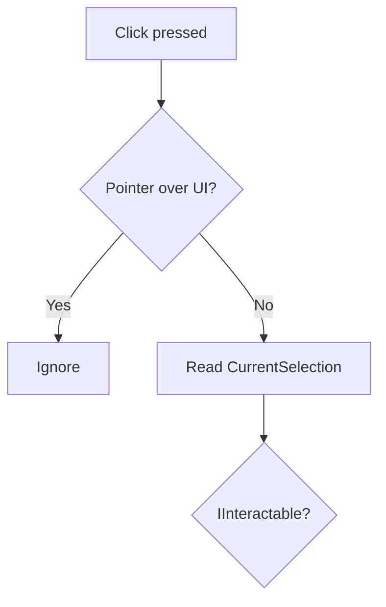

# Lab S - Point-and-Click in Two Rooms

## 1. Overview

You build two small rooms joined by a doorway, and a third person character controlled only by the mouse. A click on the floor walks there. A click on an object walks to it, turns to face it and uses it, and a click elsewhere on the way cancels the use. This is supplementary material, outside the weekly sequence, and it takes about 90 minutes.

---

## 2. What You Will Learn

| Skill | You can... |
|:------|:-----------|
| Separate places from things | Route a click to a walk or a walk-and-use, with `SelectionManager` and a floor raycast |
| Detect arrival | Act only when the agent reaches the point it was sent to, and not at the end of a partial path |
| Cancel an order | Show with the debugger that a new click drops the old callback |
| Place interactions | Give an object a stand point, and see why its centre is not enough |
| Animate an agent | Drive the Starter Assets Animator Controller from a `NavMeshAgent`, with no errors in the Console |
| Add feedback | Switch room cameras with no new script, and add a destination marker and an eased turn |

---

## 3. Before You Start

| Item | Check |
|:-----|:------|
| Unity version | 6000.6.3f1 with URP 17.6.0 |
| AI Navigation | `Add Component` offers `NavMesh Surface` |
| Cinemachine | `Window > Package Management > Package Manager` lists `Cinemachine` 6.6.0 as installed |
| DOTween | The panel at `Tools > Demigiant > DOTween Utility Panel` shows no red banner |
| Starter Assets | `Assets/ThirdParty/Scripts/Controllers/Runtime/ThirdPersonController/Prefabs` contains `PlayerArmature` |
| Common code | `Assets/GD/Common/Scripts` contains `Selection/SelectionManager.cs`, `Interaction/IInteractable.cs`, `UI/ToastView.cs` and `Triggers/ContactTrigger.cs` |
| Input actions | `Assets/InputSystem_Actions` contains `UI/Point` and `UI/Click` |
| Tags | `Selectable` exists under `Edit > Project Settings > Tags and Layers` |
| Debugger | You can attach your IDE to the Unity Editor and switch the Editor to debug mode ([Notes 01](../notes/01_unity_foundations.md), Section 4.9) |
| Notes | You have read [Point-and-Click Movement and Interaction](../notes/s_point_and_click_rooms.md), Sections 3 to 4.8 |

---

## 4. Plan

Complete the plan before Step 3.



Copy the diagram into `LabNotes.md` and complete it:

1. Add the `Yes` branch: where the player is sent, and what happens on arrival, in order.
2. Add the `No` branch: which layers the floor raycast tests, and what happens if it hits nothing.
3. Mark the point at which a second click must cancel the first order. Which two things must it cancel?
4. Add what happens when the path is partial. Use Section 4.4 of the note.

---

## 5. Steps

### Step 1 - Build the Rooms

This step builds two rooms joined by a doorway, a raised platform the player cannot reach, and a baked NavMesh. (15 min)

1. Open `Tools > GD > Setup > Create Project Folders`. Set `Project Folder` to `LabSPointClick`, choose `Project assets only` and click `Create Folders`.
2. Open `Edit > Project Settings > Tags and Layers`, and name a free `User Layer` as `Floor`.
3. Create a new scene and save it as `Assets/LabSPointClick/Scenes/SCN_LabS_PointClick.unity`.
4. Set `Main Camera` to `Position` (5, 12, -10) and `Rotation` (50, 0, 0), so that it shows both rooms.
5. Create an empty `Rooms` at (0, 0, 0). Create these objects as its children, applying materials from `GD/Common/Materials`:

| Object | Type | Position | Scale | Layer |
|:--|:--|:--|:--|:--|
| `Floor` | Plane | (5, 0, 0) | (2, 1, 1) | `Floor` |
| `Wall_Back_1` | Cube | (0, 1.5, 5) | (10, 3, 0.3) | `Default` |
| `Wall_Back_2` | Cube | (10, 1.5, 5) | (10, 3, 0.3) | `Default` |
| `Divider_North` | Cube | (5, 1.5, 3) | (0.3, 3, 4) | `Default` |
| `Divider_South` | Cube | (5, 1.5, -3) | (0.3, 3, 4) | `Default` |
| `Table` | Cube | (1, 0.4, -1) | (2, 0.8, 1) | `Default` |
| `Platform` | Cube | (11.5, 0.75, -2.5) | (4, 1.5, 4) | `Default` |

The dividers leave a doorway 2 metres wide at z = 0. The platform is taller than the agent's `Step Height`, so its top is NavMesh that cannot be reached from the floor.

6. Create these usable objects, also as children of `Rooms`, and tag each one `Selectable`:

| Object | Type | Position | Scale | Material |
|:--|:--|:--|:--|:--|
| `Painting` | Cube | (-2, 1.8, 4.8) | (1.2, 0.8, 0.05) | `Yellow` |
| `Chest` | Cube | (11.5, 1.75, -2.5) | (0.8, 0.5, 0.5) | `Orange` |

`Table` is usable too. Tag it `Selectable`.

7. Select `Rooms`, add `NavMesh Surface`, set `Collect Objects` to `Current Object Hierarchy`, and click `Bake`.

**Checkpoint:** with `Show NavMesh` on in the Scene view, the NavMesh covers both rooms and passes through the doorway. There is a hole around `Table` and a separate patch on top of `Platform`.

### Step 2 - See the Problem

This step shows what a single click script cannot do. (5 min)

1. Create `Assets/LabSPointClick/Scripts/ClickToWalk.cs`:

```csharp
using UnityEngine;
using UnityEngine.AI;
using UnityEngine.InputSystem;

[RequireComponent(typeof(NavMeshAgent))]
public class ClickToWalk : MonoBehaviour
{
    [SerializeField] private InputAction clickAction = new("Click", binding: "<Mouse>/leftButton");

    private NavMeshAgent agent;

    private void Awake()
    {
        agent = GetComponent<NavMeshAgent>();
    }

    private void OnEnable()
    {
        clickAction.Enable();
    }

    private void OnDisable()
    {
        clickAction.Disable();
    }

    private void Update()
    {
        if (!clickAction.WasPressedThisFrame())
            return;

        Ray ray = Camera.main.ScreenPointToRay(Mouse.current.position.ReadValue());

        if (Physics.Raycast(ray, out RaycastHit hit))
            agent.SetDestination(hit.point);
    }
}
```

2. Create a `Capsule` named `Player` at (-2, 1, -3). Add `Nav Mesh Agent` and `Click To Walk`.
3. Press Play. Click the floor in both rooms. Then click `Painting`, `Table` and `Chest`.

**Record:** for each object, where did the capsule go, and what did you expect a point-and-click game to do instead?

**Checkpoint:** floor clicks work in both rooms. Object clicks walk to a point near or under the object, and nothing is used. Remove `Click To Walk` from `Player` when you have seen this.

### Step 3 - Separate Places from Things

This step builds the mover and the controller, using the selection pipeline from `Common`. (20 min)

1. Create `Assets/LabSPointClick/Scripts/PointClickMover.cs`:

```csharp
using System;
using UnityEngine;
using UnityEngine.AI;

/// <summary>
/// Walks a NavMeshAgent to a point, and calls back when it gets there.
/// Knows nothing about clicks, cameras or the objects in the room.
/// </summary>
[RequireComponent(typeof(NavMeshAgent))]
public class PointClickMover : MonoBehaviour
{
    [SerializeField, Min(0.1f), Tooltip("How far a requested point may be from the NavMesh, in metres")]
    private float sampleDistance = 1f;

    private NavMeshAgent agent;
    private Action onArrived;
    private bool isMoving;

    public bool IsMoving => isMoving;

    private void Awake()
    {
        agent = GetComponent<NavMeshAgent>();
    }

    /// <summary>
    /// Starts walking to the point on the NavMesh nearest to <paramref name="point"/>.
    /// A new order replaces the current one, and the old callback is dropped.
    /// Returns false if there is no NavMesh near the point.
    /// </summary>
    public bool TryMoveTo(Vector3 point, Action arrived = null)
    {
        // Drop the old order first, so a refused order also cancels it.
        onArrived = null;
        isMoving = false;

        if (!agent.isOnNavMesh)
            return false;

        if (!NavMesh.SamplePosition(point, out NavMeshHit hit, sampleDistance, agent.areaMask))
            return false;

        if (!agent.SetDestination(hit.position))
            return false;

        onArrived = arrived;
        isMoving = true;
        return true;
    }

    public void Stop()
    {
        onArrived = null;
        isMoving = false;

        if (agent.isOnNavMesh)
            agent.ResetPath();
    }

    private void Update()
    {
        // remainingDistance is only meaningful once the path has been calculated.
        if (!isMoving || agent.pathPending || agent.remainingDistance > agent.stoppingDistance)
            return;

        isMoving = false;

        // A partial path ends as close as the agent can get, which is not the place it was sent.
        bool reached = agent.pathStatus == NavMeshPathStatus.PathComplete;

        // Clear the field before the call, because the callback may give a new order.
        Action arrived = onArrived;
        onArrived = null;

        if (reached)
            arrived?.Invoke();
    }
}
```

2. Create `Assets/LabSPointClick/Scripts/InteractionSpot.cs`:

```csharp
using UnityEngine;

/// <summary>
/// Marks where the player stands to use this object. The player faces the object itself.
/// </summary>
public class InteractionSpot : MonoBehaviour
{
    [SerializeField, Tooltip("A child placed on the floor in front of the object")]
    private Transform standPoint;

    public Vector3 StandPosition => standPoint != null ? standPoint.position : transform.position;

    private void OnDrawGizmosSelected()
    {
        if (standPoint == null)
            return;

        Gizmos.color = Color.cyan;
        Gizmos.DrawWireSphere(standPoint.position, 0.25f);
        Gizmos.DrawLine(standPoint.position, transform.position);
    }
}
```

3. Create `Assets/LabSPointClick/Scripts/PointClickController.cs`:

```csharp
using DG.Tweening;
using GD;
using GD.Types;
using UnityEngine;
using UnityEngine.EventSystems;
using UnityEngine.InputSystem;

/// <summary>
/// Turns a click into an order for the player: walk to the selected object and use it,
/// or walk to the clicked floor. Sits beside a SelectionManager and its ray provider.
/// </summary>
[RequireComponent(typeof(SelectionManager))]
public class PointClickController : MonoBehaviour
{
    #region Fields

    [SerializeField, Tooltip("A button action, for example UI/Click")]
    private InputActionReference clickAction;

    [SerializeField] private PointClickMover player;

    [SerializeField, Tooltip("Layers a click can walk to, usually only the floor")]
    private LayerMask walkableLayers;

    [SerializeField, Min(1f)] private float maxClickDistance = 100f;

    [SerializeField, Tooltip("How the player turns to face an object. Leave empty to turn at once")]
    private TweenProfile turnProfile;

    [SerializeField, Tooltip("Raised with each point the player walks to. Leave empty if not needed")]
    private Vector3EventChannel walkTargetChosen;

    private SelectionManager selectionManager;
    private IRayProvider rayProvider;
    private Tween turning;

    #endregion Fields

    #region Unity Messages

    private void Awake()
    {
        selectionManager = GetComponent<SelectionManager>();
        rayProvider = GetComponent<IRayProvider>();

        if (clickAction == null || player == null || rayProvider == null)
        {
            Debug.LogError($"{name}: PointClickController needs a click action, a player and an IRayProvider.", this);
            enabled = false;
        }
    }

    private void OnEnable()
    {
        // The UI input module shares this action, so this component enables it but never disables it.
        if (clickAction != null)
            clickAction.action.Enable();
    }

    private void Update()
    {
        if (!clickAction.action.WasPressedThisFrame())
            return;

        // A click on a button must not also move the player.
        if (EventSystem.current != null && EventSystem.current.IsPointerOverGameObject())
            return;

        // Any new order cancels a turn in progress, and the use that would follow it.
        if (turning != null && turning.IsActive())
            turning.Kill();

        Transform selection = selectionManager.CurrentSelection;

        if (selection != null && selection.TryGetComponent(out IInteractable interactable))
            WalkToAndUse(selection, interactable);
        else
            WalkToFloor();
    }

    #endregion Unity Messages

    #region Core Methods

    private void WalkToFloor()
    {
        if (!rayProvider.TryCreateRay(out Ray ray))
            return;

        if (!Physics.Raycast(ray, out RaycastHit hit, maxClickDistance, walkableLayers))
            return;

        if (player.TryMoveTo(hit.point) && walkTargetChosen != null)
            walkTargetChosen.Raise(hit.point);
    }

    private void WalkToAndUse(Transform target, IInteractable interactable)
    {
        Vector3 standPosition = target.TryGetComponent(out InteractionSpot spot)
            ? spot.StandPosition
            : target.position;

        // The callback runs only if the player arrives, so another click before then cancels the use.
        if (player.TryMoveTo(standPosition, () => FaceThenUse(target, interactable)) && walkTargetChosen != null)
            walkTargetChosen.Raise(standPosition);
    }

    private void FaceThenUse(Transform target, IInteractable interactable)
    {
        // The object may have been destroyed during the walk.
        if (target == null)
            return;

        Vector3 toTarget = target.position - player.transform.position;
        toTarget.y = 0f;

        if (toTarget.sqrMagnitude < 0.0001f || turnProfile == null)
        {
            if (toTarget.sqrMagnitude >= 0.0001f)
                player.transform.rotation = Quaternion.LookRotation(toTarget);

            interactable.Interact(player.gameObject);
            return;
        }

        Quaternion facing = Quaternion.LookRotation(toTarget);

        turning = turnProfile
            .Apply(player.transform.DORotateQuaternion(facing, turnProfile.Duration))
            .OnComplete(() =>
            {
                if (target != null)
                    interactable.Interact(player.gameObject);
            });
    }

    #endregion Core Methods
}
```

4. On `Player`, add `Point Click Mover`. On its `Nav Mesh Agent`, set `Speed` to 2 and `Stopping Distance` to 0.1.
5. Create an empty `Pointer`. Add, in this order:
   - `Mouse Screen Ray Provider`, with `Point Action` set to `UI/Point`;
   - `Ray Cast Selector`, with `Selectable Tag` `Selectable`;
   - `Selection Manager`;
   - `Highlight Selection Response`, with `Highlight Material` set to `Pink`;
   - `Point Click Controller`, with `Click Action` set to `UI/Click`, `Player` set to `Player`, and `Walkable Layers` set to `Floor` only.
6. Press Play. Move the pointer over each usable object, then click the floor in both rooms. Then click `Painting`.

**Record:** what happened when you clicked `Painting`? Read `PointClickController.Update`, and explain which branch ran, and why.

**Checkpoint:** usable objects highlight under the pointer and return to their colour when it leaves. Floor clicks walk in both rooms, including through the doorway. Clicking an object either walks to the floor beneath it or does nothing, because no object implements `IInteractable` yet.

### Step 4 - Use Objects, and Prove That Orders Cancel

This step makes objects usable, gives the painting a stand point, and uses the debugger to test cancellation and partial paths. (20 min)

1. Create `Assets/LabSPointClick/Scripts/ExamineInteractable.cs`:

```csharp
using GD;
using GD.Types;
using UnityEngine;

/// <summary>
/// Shows a line of text about this object when the player uses it.
/// </summary>
public class ExamineInteractable : MonoBehaviour, IInteractable
{
    [SerializeField, TextArea] private string description = "A dusty painting of the house, years ago.";

    [SerializeField, Tooltip("A ToastView listens to this through a StringEventChannelListener")]
    private StringEventChannel messageRequested;

    public void Interact(GameObject interactor)
    {
        if (messageRequested != null)
            messageRequested.Raise(description);
    }
}
```

2. In `Assets/LabSPointClick/Data`, use `Create > GD > Events > String` to make `EC_Message`, and use `Create > GD > Tweens > Tween Profile` to make `TP_PanelFade`, with `Duration` 0.25 and `Ease` `OutCubic`.
3. Create a `Canvas`. If the `EventSystem` offers `Replace with InputSystemUIInputModule`, click it. Add a panel `ToastPanel`, a strip at the bottom of the screen, with a `Text - TextMeshPro` child. On `ToastPanel`, add `Canvas Group` with `Alpha` 0 and `Interactable` and `Blocks Raycasts` unticked, then `GD > UI > Screen Panel` with `TP_PanelFade` for both profiles, then `GD > UI > Toast View` with its `Text` child, then `String Event Channel Listener` with `EC_Message` and a `Response` calling the dynamic `ToastView.Show`.
4. Add `Examine Interactable` to `Painting`, `Table` and `Chest`, each with its own `Description` and `EC_Message`.
5. Press Play, and click `Table`.

**Record:** where did the player go, and was the table used? Use Section 4.6 of the note to explain the result.

6. Give `Painting` a stand point: create an empty child `StandPoint` and set its world position to (-2, 0, 3.8). Add `Interaction Spot` to `Painting`, and assign `StandPoint`. Do the same for `Table`, with a stand point at (1, 0, -2.2), and for `Chest`, with a stand point on top of `Platform` at (11.5, 1.5, -1.3).
7. Press Play. Click `Painting`, then `Table`.

**Checkpoint:** the player walks to each stand point, turns to face the object at once, and its message appears at the bottom of the screen.

8. **Debugger.** The hypothesis is: *"Clicking the floor while the player walks to `Painting` drops the painting's callback, so the painting is never used."* Switch the Editor to debug mode and attach your IDE. Choose where to place breakpoints in `PointClickMover` so that you can read `onArrived` straight after the floor click is accepted, and again when the player arrives. Click `Painting`, then the floor before the player gets there.

**Record:** the value of `onArrived` at each breakpoint. Does the evidence support the hypothesis?

9. With the debugger still attached, move one breakpoint so that you can read `agent.pathStatus` on arrival. Click `Chest`, and let the player walk. When you have read it, remove the breakpoints, detach the debugger and switch back to release mode.

**Record:** the value of `pathStatus`, where the player stopped, and why the chest's message did not appear.

**Checkpoint:** `LabNotes.md` holds both recorded values. Clicking `Chest` walks the player to the platform's edge, and nothing is used.

### Step 5 - Swap in the Character

This step replaces the capsule with the Starter Assets character, moved by the agent. (15 min)

1. Drag `PlayerArmature` from `Assets/ThirdParty/Scripts/Controllers/Runtime/ThirdPersonController/Prefabs` into the scene at (-2, 0, -3). Right-click it and choose `Prefab > Unpack Completely`, because you are about to remove components and the original prefab must stay intact. Rename it `PlayerCharacter`.
2. Remove `Third Person Controller`, `Basic Rigid Body Push`, `Player Input`, `Starter Assets Inputs` and `Character Controller` from it, in that order. Unity refuses to remove a component that another one requires, so remove the ones that depend on others first.
3. Add `Nav Mesh Agent` (`Speed` 2, `Stopping Distance` 0.1) and `Point Click Mover`.
4. On `Pointer`, set `Point Click Controller > Player` to `PlayerCharacter`. Disable the capsule `Player`.
5. Press Play, and click the floor.

**Record:** describe the character's legs, and copy the first error from the Console.

6. Create `Assets/LabSPointClick/Scripts/AgentAnimator.cs`:

```csharp
using GD.Types;
using UnityEngine;
using UnityEngine.AI;

/// <summary>
/// Drives the Starter Assets third person Animator Controller from a NavMeshAgent, and
/// receives the clips' animation events in place of ThirdPersonController.
/// </summary>
[RequireComponent(typeof(Animator), typeof(NavMeshAgent))]
public class AgentAnimator : MonoBehaviour
{
    private static readonly int SpeedId = Animator.StringToHash("Speed");
    private static readonly int MotionSpeedId = Animator.StringToHash("MotionSpeed");
    private static readonly int GroundedId = Animator.StringToHash("Grounded");

    [SerializeField, Min(0f), Tooltip("Seconds to smooth Speed over, so starts and stops do not snap")]
    private float speedDampSeconds = 0.1f;

    [SerializeField, Tooltip("Raised on each footstep. Leave empty if not needed")]
    private VoidEventChannel footstep;

    private Animator animator;
    private NavMeshAgent agent;

    private void Awake()
    {
        animator = GetComponent<Animator>();
        agent = GetComponent<NavMeshAgent>();
    }

    private void OnEnable()
    {
        // Both default to 0 in the controller, and an Animator resets its parameters when
        // it is re-enabled. MotionSpeed 0 plays the walk at speed 0: legs frozen mid-stride.
        animator.SetFloat(MotionSpeedId, 1f);
        animator.SetBool(GroundedId, true);
    }

    private void Update()
    {
        // The blend tree is set in metres per second: 0 is idle, 2 a walk, 6 a run.
        animator.SetFloat(SpeedId, agent.velocity.magnitude, speedDampSeconds, Time.deltaTime);
    }

    // Called by the event markers in the walk and run clips.
    private void OnFootstep(AnimationEvent animationEvent)
    {
        // A blend tree plays several clips at once, and each fires its own events.
        if (animationEvent.animatorClipInfo.weight > 0.5f && footstep != null)
            footstep.Raise();
    }

    // Called by the landing clips. This character never lands, but without a receiver
    // Unity logs an error each time the event is reached.
    private void OnLand(AnimationEvent animationEvent)
    {
    }
}
```

7. Add `Agent Animator` to `PlayerCharacter`, the object with the `Animator`. Leave `Footstep` empty for now.
8. Press Play. Walk, then click `Painting`. Then set the agent's `Speed` to 3.5 during Play, and watch the feet.

**Record:** at a `Speed` of 3.5, do the feet match the ground? Use the blend tree thresholds in Section 4.7 of the note to explain what you saw.

**Checkpoint:** at `Speed` 2 the character walks with matching steps, and stops in the idle pose. The Console shows no `has no receiver` errors.

### Step 6 - Rooms and Feedback

This step adds a fixed camera for each room with no new script, a destination marker and an eased turn. (15 min)

1. On `PlayerCharacter`, add `Capsule Collider` (`Center` (0, 0.9, 0), `Radius` 0.3, `Height` 1.8) and `Rigidbody` with `Is Kinematic` ticked, because a `NavMeshAgent` alone does not fire trigger events.
2. On `Main Camera`, add `Cinemachine Brain`, and set its `Default Blend` to `Cut`.
3. Create two `Cinemachine Camera` objects, `CM_Room1` at (0, 6, -8) and `CM_Room2` at (10, 6, -8). On each one, set `Position Control` to `None`, `Rotation Control` to `Hard Look At` and `Tracking Target` to `PlayerCharacter`. Deactivate both.
4. Create `Room1Zone` with a trigger `Box Collider` at (0, 1.5, 0), `Size` (10, 3, 10), and `Room2Zone` at (10, 1.5, 0) with the same size. Add `Contact Trigger` to each, with `Required Tag` `Player`. On `Room1Zone`, wire `On Enter` to `CM_Room1 > GameObject.SetActive` ticked, and `On Exit` to the same, unticked. Wire `Room2Zone` to `CM_Room2` in the same way.
5. Press Play. Walk through the doorway in both directions, and click objects in each room.

**Checkpoint:** the view cuts to the room the character is in. Clicks still select the right objects after each cut, because the ray comes from the live camera.

6. Create `Assets/LabSPointClick/Scripts/ClickMarker.cs`:

```csharp
using DG.Tweening;
using GD.Types;
using UnityEngine;

/// <summary>
/// Shows where the player is walking to: pops up at the point, then shrinks away.
/// Called by a Vector3EventChannelListener.
/// </summary>
public class ClickMarker : MonoBehaviour
{
    [SerializeField] private TweenProfile popProfile;

    [SerializeField, Min(0f), Tooltip("Seconds the marker stays at full size")]
    private float holdSeconds = 0.4f;

    private Vector3 restingScale;

    private void Awake()
    {
        restingScale = transform.localScale;
        transform.localScale = Vector3.zero;
    }

    private void OnDestroy()
    {
        transform.DOKill();
    }

    public void ShowAt(Vector3 point)
    {
        // A new click interrupts the last marker, so kill its tweens before starting again.
        transform.DOKill();

        // Slightly above the floor, so the marker does not flicker against it.
        transform.position = point + Vector3.up * 0.02f;
        transform.localScale = Vector3.zero;

        popProfile
            .Apply(transform.DOScale(restingScale, popProfile.Duration))
            .OnComplete(() => transform.DOScale(Vector3.zero, 0.15f).SetDelay(holdSeconds));
    }
}
```

7. In `Assets/LabSPointClick/Data`, make `EC_WalkTarget` with `Create > GD > Events > Vector3`, `TP_MarkerPop` with `Duration` 0.2 and `Ease` `OutBack`, and `TP_Turn` with `Duration` 0.2 and `Ease` `OutCubic`.
8. Create a `Cylinder` named `Marker` with `Scale` (0.5, 0.01, 0.5) and the `Yellow` material. Remove its `Capsule Collider`, because the floor raycast must never hit it. Add `Click Marker` with `TP_MarkerPop`, and `Vector3 Event Channel Listener` with `EC_WalkTarget` and a `Response` calling the dynamic `ClickMarker.ShowAt`.
9. On `Pointer`, set `Point Click Controller > Turn Profile` to `TP_Turn` and `Walk Target Chosen` to `EC_WalkTarget`.
10. Press Play. Click the floor several times quickly, then click `Painting` from behind it, so the character has to turn.

**Record:** compare the turn with `Turn Profile` empty and set to `TP_Turn`. Which reads better as "the character has noticed the painting", and why?

**Checkpoint:** each click shows a marker that pops up and shrinks away, and a quick second click restarts it cleanly. The character turns smoothly to the painting before its message appears. Clicking the floor during the turn cancels the message.

---

## 6. Debugging and Pitfalls

| Symptom | Likely cause | How to confirm | Fix |
|:--------|:-------------|:---------------|:----|
| Nothing highlights, and clicks never use objects | The object is not tagged `Selectable`, or the tag is on a parent | Select the object with the collider | Tag the object that has the collider |
| Floor clicks do nothing | `Walkable Layers` does not include `Floor`, or `Floor` is not on that layer | Read both settings | Fix the layer and the mask |
| `"SetDestination" can only be called on an active agent that has been placed on a NavMesh` | The player starts above or beside the NavMesh, or the NavMesh was not baked | Turn on `Show NavMesh` | Move the player to the floor; bake again |
| A UI click also walks | The `EventSystem` uses the old input module, or the panel has no `Graphic Raycaster` | Select `EventSystem` | Replace the input module; keep the `Graphic Raycaster` |
| The toast never appears | `ToastPanel` has no listener, or the listener calls the static version of `Show` | Tick `Log Raises` on `EC_Message` | Choose the dynamic `ToastView.Show` |
| The character slides with frozen legs | `Agent Animator` is missing, or on a child of the `Animator` object | Read `MotionSpeed` in the `Animator` window during Play | Add it to `PlayerCharacter` itself |
| The character jitters or will not move | `Character Controller` or `Third Person Controller` is still on it | Read its components | Remove both |
| The camera never changes | The character has no `Rigidbody`, or is not tagged `Player` | Breakpoint in `ContactTrigger.OnTriggerEnter` | Add a kinematic `Rigidbody`; check the tag |
| The marker blocks floor clicks | `Marker` still has a collider | Select `Marker` | Remove the collider |
| The painting's message appears after clicking away | `onArrived` was not cleared, or the turn was not killed | The debugger in Step 4 | Compare your code with the listings |

---

## 7. Production Checklist

| Requirement | Done |
|:------------|:-----|
| The completed plan is in `LabNotes.md` | |
| Floor clicks walk in both rooms and through the doorway | |
| Usable objects highlight on hover, and are used only on arrival | |
| A click elsewhere during a walk or turn cancels the use, with debugger evidence in `LabNotes.md` | |
| Clicking `Chest` stops at the platform, uses nothing, and `LabNotes.md` records the `pathStatus` you read | |
| The Starter Assets character walks with matching steps, with no Console errors | |
| Each room has its own camera, switched with no new script | |
| A marker shows each destination, and the character turns before using an object | |
| No file in `Assets/ThirdParty` or `Assets/GD/Common` was edited | |

---

## 8. Extension

### Stretch - Tell the Player When Something Is Out of Reach

Clicking `Chest` does nothing, and the player cannot tell why. Make the character walk as close as it can, then show "I can't reach that." through `EC_Message`. `PointClickMover` must still know nothing about messages or objects.

**Expected result:** clicking `Chest` ends with the message, and clicking a reachable object still uses it. In `LabNotes.md`, explain in 100 to 150 words how the mover reports a partial path without depending on the controller, and why you did not move the message into the mover.

---

## 9. Reflective Questions

1. In Step 3, an object with no `IInteractable` behaved like a floor click. Is that the right behaviour for your game, or should such a click be ignored? Justify your choice.
2. Step 4 gave `Table` a stand point after it failed without one. Using what you saw, state a rule for which objects need one, and say who should decide where it goes.
3. `AgentAnimator` replaces part of `ThirdPersonController` rather than editing it. Which principle does that follow, and what would break if your group upgraded the Starter Assets later?
4. The room cameras need no new script. What would a camera manager class add, and what evidence would make you write one?
5. Step 6 changed timing and feedback, not behaviour. Describe how you would show that change in your group's screencast as evidence of iteration.

---

## 10. How This Builds

This is supplementary material, and no other note or lab depends on it.

- **GCA - Gameplay Systems & Integration - Gameplay System 1** and **Systems Integration:** a click that walks, faces and uses, connected to selection, navigation, animation and cameras, is evidence for both.
- **GCA - Technical Craft - Craft Example 1:** the hover, marker and eased turn, with a recorded before and after.

**Group project task (take-home).** List every object in your first room that the player can use. For each one, decide whether it needs a stand point, and what using it does. Record the list in your project log, and build the first room with those objects before adding a second.
