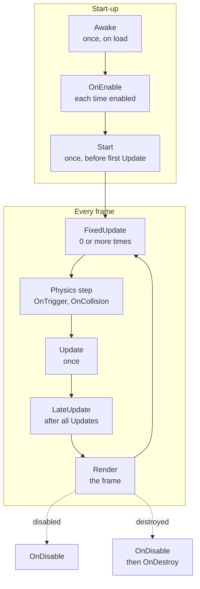

# 01 - Unity Foundations

## Key Concepts

1. **Composition over inheritance** - build behaviour from small components on a GameObject, not from deep class hierarchies.
2. **Awake for self, Start for others** - set up your own state in `Awake`; reach other objects in `Start` or later.
3. **Order is not guaranteed** - never assume one object's `Awake` runs before another's.
4. **Scale by time, not by frame** - multiply per-frame change by `Time.deltaTime`.
5. **Private and serialized** - expose fields to the Inspector with `[SerializeField]`, not `public`.
6. **Validate once** - check required references in `Awake`, log one error with context, and disable the component.
7. **Cache, do not search** - call `GetComponent` once in `Awake`, not every frame.
8. **Log with purpose** - pass a context object, never log every frame, and remove temporary logs.
9. **See it, do not print it** - use Gizmos and the debugger before adding another `Debug.Log`.
10. **Measure first** - record the Stats panel figures before you change anything for performance.

---

## 1. Framing Question

What does Unity do with your script, and when, and how do you organise a project so that you and your team can find, trust and debug that code?

---

## 2. What You Will Learn

| Skill | You can... |
|:------|:-----------|
| Organise a project and a scene | Create the module folder structure and scene hierarchy with the DkIT tools, and state the rule for moving or renaming assets |
| Build behaviour from components | Cache a required component in `Awake` and guarantee it exists with `[RequireComponent]` |
| Predict the MonoBehaviour lifecycle | Order `Awake`, `OnEnable`, `Start`, `FixedUpdate`, `Update`, `LateUpdate`, `OnDisable` and `OnDestroy` for one object, and explain which orders are not guaranteed between objects |
| Write frame-rate independent code | Show a value changing at the same rate at 30 and 144 frames per second |
| Read the Stats panel | Record FPS, CPU time, batches, SetPass calls and triangles for a scene as a baseline |
| Use Inspector attributes | Constrain and document fields with `[Header]`, `[Tooltip]`, `[Range]` and `[Min]`, and explain which checks still need code |
| Handle destroyed objects | Explain why `?.` does not detect a destroyed Unity object and `== null` does |
| Debug without flooding the Console | Replace a per-frame log with a Gizmo or a breakpoint, and write a log call that selects its object when clicked |
| Follow the module code conventions | Write a component whose naming, member order and validation match the module's shared code |

---

## 3. Why This Matters

In Weeks 1 and 2 you wrote C# that you called yourself: `Main` ran, your methods ran in the order you wrote them. In Unity you do not call most of your own code. The engine creates your objects, calls your methods at defined moments, and redraws the screen many times a second. Code that ignores those rules works in one scene and fails in the next, runs at different speeds on different machines, or throws errors only after an object is destroyed.

The second half of the topic is about working practice. A Unity project is shared by a team, and most time on a project is spent reading and debugging, not writing. A predictable folder structure, a tidy scene, consistent code and a Console that shows only what matters make that time shorter.

Both halves feed the GCA directly. **Code Quality** (C# & Software Design) asks for readable, consistently structured code with useful documentation. **Technical Finish & Performance** asks for a stable project, organised logically, with evidence of measurement. This note sets the conventions and the baseline measurement that the rest of the module builds on.

---

## 4. Core Ideas

### 4.1 Project Structure and Folder Hygiene

A Unity **project** is a folder on disk. Everything under `Assets/` is yours; `Packages/` and `ProjectSettings/` are managed by Unity; `Library/`, `Temp/` and `Logs/` are generated and can be rebuilt.

Each file in `Assets/` has a matching `.meta` file. The `.meta` file holds the asset's **GUID** and its import settings. Scenes, prefabs and other assets refer to each other by GUID, not by path. That gives two rules:

- **Move and rename assets inside the Unity Project window only.** Unity moves the `.meta` file with the asset, so every reference survives. Moving a file in Windows Explorer or VS Code leaves the `.meta` behind, Unity creates a new GUID, and every reference to the old asset breaks.
- **Never delete or edit a `.meta` file by hand.**

Use `Tools > GD > Setup > Create Project Folders` to create the module structure:

| Folder | Holds |
|:-------|:------|
| `Assets/_Project/` | Everything your team creates. The underscore sorts it to the top of the Project window |
| `Animations`, `Audio`, `Materials`, `Meshes`, `Textures`, `Shaders` | Content, grouped by type |
| `Data` | ScriptableObject assets (Notes 02 to 04) |
| `Prefabs`, `Scenes`, `Scripts`, `Settings`, `UI` | Game structure and code |
| `Assets/ThirdParty/` | Imported packages and asset store content, kept apart so updating them never touches your work |

Folder rules the module uses:

- One place for each kind of thing. If you cannot decide where an asset goes, the structure needs a folder, not an exception.
- Names are PascalCase with no spaces for scripts, because the file name must match the class name. Use descriptive names for other assets too (`EnemyFast`, not `Material 3`).
- Delete assets you no longer use. An unused asset still appears in searches and still has to be understood by the next reader.

### 4.2 Scenes, GameObjects and Components

A **scene** is a saved collection of GameObjects. A **GameObject** is an empty container with a name, a `Transform` and a list of **components**. Components give it behaviour: a `MeshRenderer` draws it, a `Rigidbody` simulates it, your scripts control it. A script you attach to a GameObject is a **MonoBehaviour**.

This is **composition**: a player is not a subclass of a character class, it is a GameObject with a movement component, a health component and an input component. Each component does one job and can be reused on other objects.

Components find each other with `GetComponent`:

```csharp
using UnityEngine;

[RequireComponent(typeof(Light))]
public class LightDimmer : MonoBehaviour
{
    [SerializeField, Range(0, 10)] private float brightness = 5;

    private Light cachedLight;

    private void Awake()
    {
        // Cache once: GetComponent searches the component list, so do not call it every frame.
        cachedLight = GetComponent<Light>();
    }

    private void Update()
    {
        cachedLight.intensity = brightness;
    }
}
```

- `[RequireComponent(typeof(Light))]` makes Unity add a `Light` when you add `LightDimmer`, and stops you removing it. The `GetComponent` call can then never return `null`.
- For an optional component, use `TryGetComponent(out Light found)`, which returns `false` instead of `null` and reads as a question.

Organise the scene the same way you organise folders. `Tools > GD > Setup > Create Scene Hierarchy` creates top-level grouping objects: `Cameras`, `Lighting`, `Environment`, `Gameplay`, `Props`, `Audio`, `UI` and `Systems`. Keep each grouping object at position (0, 0, 0) with rotation 0 and scale 1, because children inherit their parent's transform, and a moved parent silently moves everything under it.

### 4.3 The MonoBehaviour Lifecycle

Unity calls your MonoBehaviour's **messages**, specially named methods, at defined moments. This sequence is the **lifecycle**:



What each message is for:

| Message | Runs | Use it to |
|:--|:--|:--|
| `Awake` | Once, when the object is loaded, even if the component is disabled | Set up this object: cache components, validate serialized references |
| `OnEnable` | Each time the component or GameObject becomes enabled | Subscribe to events (Notes 03 and 04) |
| `Start` | Once, before the first `Update`, only if enabled | Reach other objects, which have all run `Awake` by now |
| `FixedUpdate` | At a fixed timestep (default 0.02 s), zero or more times per frame | Apply forces and move `Rigidbody` objects (Note 07) |
| `Update` | Once per rendered frame | Read input, run game logic |
| `LateUpdate` | Once per frame, after every `Update` | Follow cameras and anything that must see this frame's final positions |
| `OnDisable` | When disabled, and before `OnDestroy` | Unsubscribe from events |
| `OnDestroy` | When the object is destroyed or the scene unloads | Release anything `Awake` created |

This complete script logs each message once, with the frame number, so you can see the order:

```csharp
using UnityEngine;

public class LifecycleLogger : MonoBehaviour
{
    // Logs Update only once, because logging every frame would flood the Console.
    private bool loggedUpdate;

    private void Awake() => Log(nameof(Awake));
    private void OnEnable() => Log(nameof(OnEnable));
    private void Start() => Log(nameof(Start));
    private void OnDisable() => Log(nameof(OnDisable));
    private void OnDestroy() => Log(nameof(OnDestroy));

    private void Update()
    {
        if (loggedUpdate) return;

        loggedUpdate = true;
        Log(nameof(Update));
    }

    private void Log(string message)
    {
        // Passing this as the context means clicking the entry selects the object.
        Debug.Log($"[{Time.frameCount}] {name}: {message}", this);
    }
}
```

#### Order between objects

For one component, the order in the diagram is guaranteed. Between two objects it is not: Unity does not promise that object A's `Awake` runs before object B's. The guarantee you do get is that every object in a loaded scene finishes `Awake` (and `OnEnable`) before any object's `Start` runs.

That produces the module rule: **`Awake` for self, `Start` for others.** This pair breaks when `Spawner` happens to run first:

```csharp
using System.Collections.Generic;
using UnityEngine;

public class SpawnPointSet : MonoBehaviour
{
    private readonly List<Transform> points = new List<Transform>();

    public IReadOnlyList<Transform> Points => points;

    private void Awake()
    {
        // Self-setup: collect this object's children as spawn points.
        foreach (Transform child in transform)
            points.Add(child);
    }
}
```

```csharp
using UnityEngine;

public class Spawner : MonoBehaviour
{
    [SerializeField] private SpawnPointSet spawnPoints;

    private void Awake()
    {
        if (spawnPoints == null)
        {
            Debug.LogError($"{name}: assign the spawn point set.", this);
            enabled = false;
        }
    }

    private void Start()
    {
        // Safe here: every object has finished Awake before any Start runs.
        // Reading Points in Awake could see an empty list, depending on load order.
        Debug.Log($"{name}: {spawnPoints.Points.Count} spawn points found.", this);
    }
}
```

If two objects must initialise in a fixed order and `Start` is too late, `[DefaultExecutionOrder(-100)]` on a class (or `Edit > Project Settings > Script Execution Order`) forces it. Use it as a last resort: the order is then hidden in an attribute or a settings file, and the next reader has to know to look there.

### 4.4 The Frame Loop and Time

Games run as a loop of **frames**. Each frame, Unity runs your code, updates the world and draws one image. Frame rate varies: 144 frames per second on one machine, 40 on another, and it changes from moment to moment on the same machine.

`Update` runs once per frame, so a change applied per call is a change per frame. To make it a change per second, multiply by **`Time.deltaTime`**, the time in seconds since the last frame:

```csharp
using UnityEngine;

public class Mover : MonoBehaviour
{
    [SerializeField] private Vector3 velocity = new Vector3(0f, 0f, 2f);

    private void Update()
    {
        // velocity is in metres per second; deltaTime converts it to this frame's step.
        transform.Translate(velocity * Time.deltaTime, Space.World);
    }
}
```

Without `* Time.deltaTime` the object moves 2 m per frame: 288 m/s at 144 FPS and 80 m/s at 40 FPS.

`FixedUpdate` runs on a fixed timestep instead (`Time.fixedDeltaTime`, default 0.02 s), so physics behaves the same at any frame rate. On a fast machine some frames have no `FixedUpdate`; on a slow machine some frames have several. Inside `FixedUpdate` and physics messages, `Time.deltaTime` returns the fixed timestep. Note 07 covers which movement belongs in which method.

### 4.5 Rendering a Frame and the Stats Panel

Each frame has two main costs:

- **CPU**: your scripts, physics, animation, and preparing the list of things to draw.
- **GPU**: drawing that list. Each **draw call** tells the GPU to draw a mesh with a material; each change of shader setup between draw calls is a **SetPass call**.

The frame takes as long as the slower of the two, so the first question about performance is always which side is slower.

The Game view's `Stats` panel (toolbar button in the Game view) shows the current frame:

| Figure | What it tells you |
|:--|:--|
| FPS and CPU main / render thread (ms) | How long frames take. 60 FPS is about 16.7 ms per frame |
| Batches | How many draw batches the frame used; related to draw calls |
| Saved by batching | How many draw calls Unity combined |
| Tris and Verts | How much geometry was drawn |
| SetPass calls | How many times the GPU shader setup changed |
| Shadow casters | How many objects drew into shadow maps |

The Editor adds its own overhead, so treat Stats figures as a guide for comparing two versions of the same scene, not as the final game's performance. The Profiler (`Window > Analysis > Profiler`) gives more precise measurement when you need it. Start now by recording a **baseline**: the figures for your group scene before any optimisation, so that later changes can be measured against it.

### 4.6 Serialization and the Inspector

**Serialization** is how Unity saves a component's fields into the scene or prefab file and shows them in the Inspector. Unity serializes a field when it is `public` or marked `[SerializeField]`, and is not `static`, `const` or `readonly`. Note 02, Section 4.3 lists the supported types.

The module uses **private serialized fields**:

```csharp
[SerializeField] private float speed = 5f;   // Editable in the Inspector, private to other scripts.
public float speed = 5f;                      // Editable in the Inspector, and by every other script.
```

A `public` field makes a value editable by any script in the project, so any script might be the one that changed it. `[SerializeField] private` keeps Inspector access and removes that risk. Expose read access to other scripts with a property when they need it.

Changes you make in the Inspector during Play mode are discarded when you press Stop, because Unity restores the scene as it was saved. Copy a value before stopping if you want to keep it (the component's context menu has `Copy Component`). Note 02 shows the one important exception: changes to assets.

### 4.7 Attributes

An **attribute** is a label in square brackets that attaches information to a class, field or method. Unity reads many of them to change how the Inspector or the editor behaves.

```csharp
using UnityEngine;

[DisallowMultipleComponent]
public class AttributeShowcase : MonoBehaviour
{
    [Header("Movement")]
    [SerializeField, Tooltip("Top speed in metres per second.")]
    [Min(0f)] private float maxSpeed = 5f;

    [SerializeField, Range(0f, 1f), Tooltip("0 = no control in the air, 1 = full control.")]
    private float airControl = 0.3f;

    [Space]
    [Header("Presentation")]
    [SerializeField, TextArea(2, 4)] private string designerNotes = string.Empty;

    [ContextMenu("Print Settings")]
    private void PrintSettings()
    {
        Debug.Log($"{name}: max speed {maxSpeed}, air control {airControl}. {designerNotes}", this);
    }
}
```

| Attribute | Applies to | Effect |
|:--|:--|:--|
| `[SerializeField]` | Field | Saves and shows a non-public field |
| `[Header("...")]`, `[Space]` | Field | Groups fields under a heading, or adds a gap |
| `[Tooltip("...")]` | Field | Shows help text on hover. Include units |
| `[Range(min, max)]` | Field | Shows a slider and clamps Inspector input |
| `[Min(value)]` | Field | Clamps Inspector input to a minimum |
| `[TextArea(min, max)]` | String field | Multi-line text box |
| `[RequireComponent(typeof(T))]` | Class | Adds `T` automatically and stops its removal |
| `[DisallowMultipleComponent]` | Class | Stops two copies of the component on one object |
| `[ContextMenu("...")]` | Method | Adds the method to the component's context menu, for testing |
| `[FormerlySerializedAs("old")]` | Field | Keeps saved values after a rename (Note 02) |

`[Range]` and `[Min]` only clamp values typed into the Inspector. Code can still set any value, and values saved before you added the attribute are not changed. Rules that matter at runtime still need a check in code, or `OnValidate` for Inspector edits.

### 4.8 Enabling, Disabling and Destroying

The checkbox next to a component's name sets its `enabled` property. The checkbox next to a GameObject's name sets whether the object is **active**. They are not the same:

| When | Stops | Does not stop |
|:--|:--|:--|
| Component disabled (`enabled = false`) | `Update`, `FixedUpdate`, `LateUpdate`; `Start` waits until enabled | `Awake`; public method calls from other scripts; physics messages such as `OnTriggerEnter`; running coroutines |
| GameObject inactive (`SetActive(false)`) | Everything on the object, including physics and coroutines | `Awake` has not run yet if the object started inactive; it runs when first activated |

This explains two patterns in the module code: `if (!enabled) return;` at the top of public methods and trigger handlers, and listeners placed on objects that stay active (Note 04).

#### Destroyed objects and "fake null"

`Destroy(gameObject)` removes the object from the engine at the end of the frame. Your C# variables that referred to it still hold a C# object, but the engine side is gone. Unity overrides `==` on its objects so that a destroyed object compares equal to `null`.

```csharp
using UnityEngine;

public class TargetReporter : MonoBehaviour
{
    [SerializeField] private Transform target;

    private void OnDrawGizmos()
    {
        // Correct: Unity's == reports a destroyed object as null.
        if (target == null) return;

        Gizmos.color = Color.red;
        Gizmos.DrawLine(transform.position, target.position);
    }
}
```

`OnDrawGizmos` runs in Edit mode and Play mode, so the red line appears in the Scene view as soon as you assign `Target`. Delete the target object and the line disappears without an exception: the `Target` field shows `Missing`, and `== null` reports it as null.

The C# operators `?.`, `??` and `is null` do not use Unity's `==`. `target?.position` on a destroyed target does not skip the call: it throws a `MissingReferenceException`. Use `== null`, `!= null` or `if (target)` with Unity objects.

### 4.9 Debugging: Logs, Gizmos and the Debugger

#### `Debug.Log` with care

Use the three levels for their meaning: `Debug.Log` for information, `Debug.LogWarning` for something suspicious that still works, `Debug.LogError` for something that is broken and needs fixing. Rules:

- **Always pass a context object**: `Debug.Log(message, this)`. Clicking the entry in the Console selects that object.
- **Never log every frame.** Hundreds of identical lines hide the one that matters, and each call builds a string and captures a stack trace. Logs in `Update` can visibly lower the frame rate.
- **Logs are not free in builds.** They still run and are written to the player log file. Remove temporary logs before you commit.
- **Use the Console tools**: `Collapse` groups identical lines, `Clear on Play` starts each session empty, the search box and the three level toggles filter, and `Error Pause` pauses Play mode at the first error.

For development-only messages, a wrapper marked `[Conditional]` removes the call, including building its string, from builds that do not define the symbol:

```csharp
using System.Diagnostics;
using Debug = UnityEngine.Debug;

public static class DevLog
{
    // Calls to this method are compiled only in the Editor and in Development Builds.
    [Conditional("UNITY_EDITOR"), Conditional("DEVELOPMENT_BUILD")]
    public static void Info(string message, UnityEngine.Object context = null)
    {
        Debug.Log(message, context);
    }
}
```

You do not define either symbol yourself. Unity defines `UNITY_EDITOR` whenever code runs in the Editor, and defines `DEVELOPMENT_BUILD` when a build is made with `Development Build` ticked. To change it, open `File > Build Profiles`, select the active profile and tick or untick `Development Build`. Ticked, `DevLog.Info` calls stay in the build; unticked, they are removed. Untick it for the build you submit, because a release build should not contain development logging.

If the `Build Profiles` window has no Windows profile, add one. Click `Add Build Profile` at the top of the left-hand list to open the `Platform Browser`, select `Windows`, then click `Add Build Profile`. If `Windows` shows `Install with Unity Hub` instead, add the `Windows Build Support` module to your Editor version in Unity Hub first. Unity saves the new profile as an asset in `Assets/Settings/Build Profiles`, so it is committed with the project. Select the new profile under `Build Profiles` in the left-hand list and click `Switch Profile` to make it active. The `Development Build` checkbox is in the right-hand panel under `Platform Settings`, with the other build options.

#### Show it instead of printing it

Much of what students log is spatial: a distance, a direction, a range. Draw it instead:

- `OnDrawGizmos` and `OnDrawGizmosSelected` draw in the Scene view (and the Game view with `Gizmos` enabled) using `Gizmos.DrawWireSphere`, `Gizmos.DrawLine` and others. `OnDrawGizmosSelected` draws only for the selected object.
- Prefer wire shapes such as `Gizmos.DrawWireSphere` to solid ones such as `Gizmos.DrawSphere`, because a solid shape hides any line or gizmo inside it.
- The Inspector's `Debug` mode (three dots at the top right of the Inspector) shows private fields, including runtime values such as a cached reference.

#### The debugger

The debugger pauses the game at a line and lets you inspect every value, without changing code. Every lab in this module has a debugger step. The setup:

1. Set your IDE in `Edit > Preferences > External Tools > External Script Editor`.
2. Switch the Editor to debug mode: click the code optimisation button in the bottom-right of the status bar and choose `Switch to debug mode`. In release mode breakpoints are not hit.
3. Attach the IDE: in Visual Studio use `Attach to Unity`; in Rider use `Attach to Unity Editor`.
4. Click in the margin next to a line to set a **breakpoint**. Right-click it to add a condition, for example `name == "Enemy_03"`.
5. When the breakpoint is hit, use the Locals, Watch and Call Stack windows, then Continue (`F5`) or Step Over (`F10`).
6. Detach and switch back to release mode when you finish, because debug mode runs scripts more slowly.

Choose the tool by the question: "how often does this happen?" suits a log with `Collapse`; "where is it?" suits a Gizmo; "why is this value wrong?" suits a breakpoint.

### 4.10 Module Code Conventions

The shared code in `Assets/GD/Common` follows these conventions, and so should yours, because the GCA's **Code Quality** element assesses readability and consistency.

| Element | Convention | Example |
|:--|:--|:--|
| Classes, methods, properties, events | PascalCase | `PlayerHealth`, `TakeDamage`, `MaxHealth`, `ValueChanged` |
| Fields and locals | camelCase, no prefix | `currentHealth`, `cachedLight` |
| Inspector fields | `[SerializeField] private`, with `[Tooltip]` stating units | `[SerializeField, Min(0f)] private float speed` |
| Read access for other scripts | Get-only property | `public float MaxHealth => maxHealth;` |
| Member order | Serialized fields, private fields, events, properties, Unity messages, public methods, private methods | As in `ScriptableVariable.cs` |
| Documentation | XML `///` comments on classes and public members | `/// <summary>Adds points to the score.</summary>` |
| Namespaces | Shared module code in `GD` and `GD.Types`; your team's code in one namespace for the project | `namespace MyTeam.Gameplay` |
| Required references | Check in `Awake`; `Debug.LogError` with `this`; `enabled = false` | See Section 5 |

`#region` blocks appear in the shared code to group long files. They are optional in short scripts.

### 4.11 Input: the Input System

The project uses the **Input System** package only (`Edit > Project Settings > Player > Active Input Handling` is `Input System Package (New)`), so the old `Input.GetKey` API throws an error.

- For gameplay input, use the project's input actions asset (`Assets/InputSystem_Actions.inputactions`), which maps actions such as `Move` and `Jump` to keyboard, mouse and gamepad controls. Note 07 builds movement on it.
- For quick test controls in a lab, read a device directly, and check it exists first:

```csharp
using UnityEngine;
using UnityEngine.InputSystem;

public class TestKey : MonoBehaviour
{
    private void Update()
    {
        // Keyboard.current is null when no keyboard is connected.
        if (Keyboard.current != null && Keyboard.current.spaceKey.wasPressedThisFrame)
            Debug.Log($"{name}: space pressed.", this);
    }
}
```

Test controls like this are harnesses for trying out a system. They are not how a finished game should read input, because they hard-code one key on one device.

### 4.12 Prefabs

A **prefab** is an asset that stores a GameObject and its components as a reusable template. Each copy in a scene is a **prefab instance**, linked to the asset.

- Edit the asset (double-click it to open Prefab Mode) and every instance updates.
- Change a value on one instance and it becomes an **override**, shown in bold in the Inspector. Overrides stop following the asset for that value. Use `Overrides > Apply All` to push them to the asset, or `Revert` to discard them.
- A **prefab variant** is a prefab based on another prefab, with its own overrides: a `FastEnemy` variant of `Enemy`.
- A prefab asset cannot store a reference to an object in a scene. Note 03 shows why this matters and how to work around it.

---

## 5. Worked Example

The demo builds a beacon: a light that pulses while the player is near and fades out when the player leaves. It follows the module's iteration sequence: initial implementation, problem, change, improvement.

### Stage 1 - Initial Implementation

```csharp
using UnityEngine;

public class Beacon : MonoBehaviour
{
    public Transform player;
    public float radius = 5f;
    public float pulseSpeed = 2f;

    private void Update()
    {
        float distance = Vector3.Distance(transform.position, player.position);
        Debug.Log("Distance: " + distance);

        Light beaconLight = GetComponent<Light>();

        if (distance < radius)
            beaconLight.intensity = 1f + Mathf.Sin(Time.time * pulseSpeed);
        else
            beaconLight.intensity = 0f;
    }
}
```

Add a `Point Light` named `Beacon`, add the script, assign a `Player` capsule and press Play. Drag the player towards the beacon in the Scene view: it pulses.

### Stage 2 - Problem

It works, but:

1. The Console fills with one `Distance:` line per frame. The line you need (an error elsewhere) scrolls away, and every frame spends time building and printing a string nobody reads.
2. Forget to assign `Player` and you get one `NullReferenceException` per frame.
3. Add the script to a cube without a `Light` and you get another exception per frame.
4. `GetComponent` runs every frame for a value that never changes.
5. `player`, `radius` and `pulseSpeed` are `public`: any script can change them, and the Inspector shows no units or limits. `pulseSpeed` of 2 means "2 radians per second", which nobody would guess.
6. You cannot see the radius, so you tune it by guessing and logging distances.
7. The light snaps on and off at the edge of the radius.

### Stage 3 - Change

```csharp
using UnityEngine;

/// <summary>
/// Pulses a Light while the player is within range, and fades it out when the player leaves.
/// </summary>
[RequireComponent(typeof(Light))]
[DisallowMultipleComponent]
public class Beacon : MonoBehaviour
{
    [Header("Target")]
    [SerializeField, Tooltip("The object whose distance switches the beacon on.")]
    private Transform player;

    [Header("Behaviour")]
    [SerializeField, Min(0f), Tooltip("Distance in metres at which the beacon switches on.")]
    private float radius = 5f;

    [SerializeField, Range(0.1f, 5f), Tooltip("Pulses per second.")]
    private float pulseFrequency = 1f;

    [SerializeField, Min(0f), Tooltip("Peak light intensity.")]
    private float maxIntensity = 2f;

    [SerializeField, Min(0f), Tooltip("Intensity change per second when switching on or off.")]
    private float fadeSpeed = 4f;

    private Light beaconLight;
    private float currentIntensity;

    private void Awake()
    {
        // Self-setup: RequireComponent guarantees the Light, so cache it once.
        beaconLight = GetComponent<Light>();
        beaconLight.intensity = 0f;

        // Validate once, with context, instead of throwing every frame.
        if (player == null)
        {
            Debug.LogError($"{name}: assign the player.", this);
            enabled = false;
        }
    }

    private void Update()
    {
        bool inRange = Vector3.Distance(transform.position, player.position) <= radius;

        // 0.5 + 0.5 * sin keeps the pulse between 0 and 1; 2 * PI * frequency gives pulses per second.
        float pulse = 0.5f + 0.5f * Mathf.Sin(2f * Mathf.PI * pulseFrequency * Time.time);
        float targetIntensity = inRange ? pulse * maxIntensity : 0f;

        // MoveTowards with deltaTime fades at the same speed at any frame rate.
        currentIntensity = Mathf.MoveTowards(currentIntensity, targetIntensity, fadeSpeed * Time.deltaTime);
        beaconLight.intensity = currentIntensity;
    }

    private void OnDrawGizmosSelected()
    {
        // Shows the radius in the Scene view, so you tune it by eye instead of by logging distances.
        Gizmos.color = Color.yellow;
        Gizmos.DrawWireSphere(transform.position, radius);
    }
}
```

### Stage 4 - Improvement

Compare the two versions:

| Stage 2 problem | Stage 3 change |
|:--|:--|
| Per-frame log | Removed; the Gizmo shows the radius, and a breakpoint answers "why is it on?" |
| Per-frame exceptions for a missing player or light | `[RequireComponent]`; one `LogError` in `Awake` with context; component disabled |
| `GetComponent` every frame | Cached in `Awake` |
| Public fields with no units | Private serialized fields with `[Header]`, `[Tooltip]`, `[Min]` and `[Range]`; `pulseFrequency` in pulses per second |
| Invisible radius | `OnDrawGizmosSelected` |
| Light snaps on and off | `Mathf.MoveTowards` with `Time.deltaTime` fades it |

The last change is also the first step in the module's theme of **functional to crafted**: Stage 1 was functional, Stage 3 feels deliberate. Note 11 develops this with curves and easing.

---

## 6. Common Pitfalls

| Symptom | Cause | Fix |
|:--|:--|:--|
| References to an asset break after reorganising folders | Files were moved outside Unity, so their `.meta` files and GUIDs were lost | Move and rename only in the Project window |
| `NullReferenceException` in `Awake`, only sometimes | `Awake` reads another object that has not run its own `Awake` yet | Self-setup in `Awake`; reach other objects in `Start` |
| The same error hundreds of times | A missing reference is used in `Update` | Validate in `Awake`, log once with context, set `enabled = false` |
| Movement is faster on a better PC | Per-frame change not multiplied by `Time.deltaTime` | Multiply by `Time.deltaTime` in `Update` |
| Inspector changes vanish after Play | Play mode changes to scene objects are discarded on Stop | Stop first, then edit; or `Copy Component` before stopping |
| A value outside a `[Range]` appears at runtime | Attributes clamp Inspector input only | Validate in code or `OnValidate` |
| A disabled component still reacts to triggers or method calls | `enabled = false` stops update messages only | Check `enabled` at the top of public methods and physics messages |
| `MissingReferenceException` despite `?.` | `?.` does not use Unity's null check for destroyed objects | Use `== null` or `!= null` with Unity objects |
| The Console is unreadable and FPS drops | Logging every frame | Remove the log; use a Gizmo, `Collapse` or a breakpoint |
| Clicking a log entry selects nothing | No context object passed | `Debug.Log(message, this)` |
| Breakpoints are never hit | Editor in release mode, or IDE not attached | Switch to debug mode and attach the IDE |
| `Input.GetKey` throws `InvalidOperationException` | The project uses the Input System only | Use input actions, or `Keyboard.current` for test controls |
| Children move unexpectedly when a grouping object is moved | Grouping objects are not at the origin | Keep hierarchy grouping objects at position 0, rotation 0, scale 1 |

---

## 7. Software Development Parallels

- **Inversion of control.** You do not call `Awake` or `Update`; Unity calls them. The same "don't call us, we'll call you" idea is how web frameworks call your request handlers and how UI frameworks call your event handlers. Lifecycle rules exist wherever a framework owns the main loop.
- **Composition over inheritance.** Unity's component model is the Gang of Four advice "favour object composition over class inheritance" built into an engine. The **Component** pattern chapter in Robert Nystrom's *Game Programming Patterns* explains why games moved to it.
- **Fail fast.** Validating in `Awake` and disabling the component is the fail-fast principle: report a broken configuration once, at the point it is detected, rather than let it cause errors later and elsewhere.
- **Encapsulation.** `[SerializeField] private` plus a get-only property keeps designer access while protecting the field from other code, the same reason for private fields and public properties in any C# class.
- **Observability.** Logging levels, filtering and removing noise are the same practice as structured logging in server software: logs are for the people who read them, and too many make every log useless.
- **Coding standards.** Shared naming and layout rules, like the Microsoft C# coding conventions the module's rules are based on, reduce the time a team spends reading each other's code.

---

## 8. Exercises

### Core - Prove the Lifecycle

Create two cubes, `First` and `Second`, each with `LifecycleLogger`. Press Play, then disable and re-enable `Second` in the Inspector, then delete it.

**Expected result:** a Console log you can annotate showing: every `Awake` and `OnEnable` before any `Start`; `OnDisable` and `OnEnable` on toggling; `OnDisable` then `OnDestroy` on deletion. Then add `SpawnPointSet` and `Spawner` from Section 4.3, move the `Debug.Log` from `Start` into `Awake`, and use `[DefaultExecutionOrder]` on `Spawner` to make it run first. State the count it reports and why.

### Apply - A Moving Platform

Write a `MovingPlatform` component that moves between its start position and an offset, and back, at a speed in metres per second.

- Use `[SerializeField] private` fields with `[Tooltip]` units and `[Min]` limits.
- Use `Time.deltaTime` so the speed is the same at any frame rate.
- Draw the path with `OnDrawGizmosSelected`, from the start position even before Play.
- No `Debug.Log` in the finished script.

**Expected result:** the platform moves at the set speed, the path is visible in the Scene view when selected, and setting `Application.targetFrameRate` to 30 and then 144 in a test script does not change the round-trip time.

### Challenge - Frame Rate Investigation

Create three movers: one using `Update` with `Time.deltaTime`, one using `Update` without it, and one moving a kinematic `Rigidbody` with `MovePosition` in `FixedUpdate`. Run the scene at target frame rates of 30, 60 and 144, and record the distance each travels in 5 seconds and the Stats panel figures.

**Expected result:** a table of your measurements and 150 to 200 words explaining the differences, including what `FixedUpdate` did at each frame rate and which approach you would use for a player on a moving platform. Note 07 returns to this choice.

---

## 9. Reflective Questions

1. "`Awake` for self, `Start` for others." Explain the rule using the guarantee Unity gives about `Awake` and `Start`, and describe a bug that ignores it.
2. `[DefaultExecutionOrder]` can fix most order bugs. Why does the module treat it as a last resort?
3. Why is `[SerializeField] private` better than `public` for a field only the Inspector should set? Relate your answer to encapsulation.
4. A teammate says, "Logging is harmless, we can remove it before submission." Give two reasons to disagree, one about development and one about performance.
5. Your group wants to know whether a change made its game faster. What should you record before making the change, and why is a measurement taken in the Editor still useful?

---

## 10. How This Builds

- **[Note 02 - ScriptableObjects](02_scriptable_objects.md)** continues from Section 4.6: data that lives in an asset instead of a scene, and why asset changes survive Play mode.
- **Notes 03 and 04** use `OnEnable` and `OnDisable` from Section 4.3 to subscribe and unsubscribe, and Lab 3 uses Section 4.8's fake null to catch a destroyed subscriber in the debugger.
- **Note 07 - Movement Systems** builds on Section 4.4 (`Update` versus `FixedUpdate`) and Section 4.11 (input actions).
- **Note 11 - Interpolation, Easing and Tweening** develops the fade from Section 5 into curves and easing.
- **GCA:** comparing your group project against the Stats baseline from Section 4.5 shows whether a change helped, which is useful when you diagnose a performance problem.
- **GCA:** Sections 4.1, 4.2 and 4.10 support **Code Quality** and **Project Organisation**; Section 4.5 starts the evidence for **Technical Finish & Performance**.

---

## Glossary

| Term | Definition |
|:-----|:-----------|
| Active | Whether a GameObject takes part in the scene; an inactive object runs none of its components |
| Attribute | A label in square brackets that attaches information to a class, field or method, read by the compiler or Unity |
| Baseline | A measurement taken before a change, used to judge the change |
| Breakpoint | A marker that pauses the program at a line so the debugger can inspect values |
| Component | A piece of behaviour or data attached to a GameObject |
| Composition | Building an object's behaviour from separate parts rather than inheriting it |
| Draw call | A request from the CPU for the GPU to draw one mesh with one material |
| Frame | One pass of the game loop, ending in one rendered image |
| GameObject | An object in a scene: a container for components with a name and a Transform |
| GUID | A unique ID in a `.meta` file that Unity uses to link assets |
| Input System | Unity's input package, based on actions mapped to device controls |
| Lifecycle | The sequence of messages Unity calls on a MonoBehaviour from load to destruction |
| Message | A specially named method, such as `Awake` or `Update`, that Unity calls on a MonoBehaviour |
| MonoBehaviour | The base class for scripts attached to GameObjects |
| Override | A value on a prefab instance that differs from the prefab asset |
| Prefab | An asset storing a GameObject and its components as a reusable template |
| Prefab instance | A copy of a prefab in a scene, linked to the prefab asset |
| Prefab variant | A prefab based on another prefab, with its own overrides |
| Project | The folder containing a game's assets, packages and settings |
| Scene | A saved collection of GameObjects |
| Serialization | Saving an object's fields to a file and loading them back |
| SetPass call | A change of shader setup on the GPU between draw calls |
| `Time.deltaTime` | The time in seconds since the previous frame |
