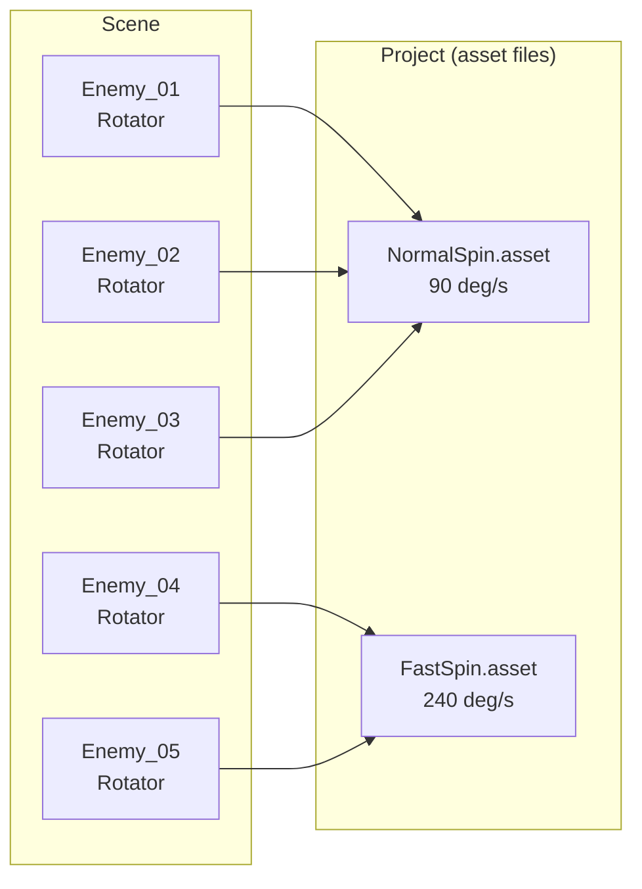

# 02 - ScriptableObjects: Separating Data from Behaviour

Lab: [Lab 2 - Data-Driven Enemy Waves](../labs/lab_2_scriptable_objects.md)

## Key Concepts

1. **Definition, not state** - an asset describes what a thing is; a component stores what this thing is doing now.
2. **Reference, not copy** - every object that uses an asset shares one instance of it.
3. **Read-only by default** - expose definition data through get-only properties.
4. **Not a save system** - Play mode changes that persist in the Editor are gone in a build.
5. **Shared or reused, else a field** - use an asset only when more than one object or system needs the data.
6. **Name it after its user** - `RotatorData` holds rotation data and nothing else.
7. **Small and focused** - several narrow assets are easier to reuse than one asset that describes everything.
8. **Assets reference assets** - a scene object can reference an asset; an asset cannot keep a reference to a scene object.
9. **Guard missing references** - check assigned assets in `Awake` and fail with a clear message.
10. **Measure, then decide** - check the Stats panel before and after you change how assets are shared.

---

## 1. Framing Question

How can many objects share one definition without also sharing each other's state?

---

## 2. What You Will Learn

| Skill | You can... |
|:------|:-----------|
| Distinguish the three kinds of class you write in Unity | State, for `MonoBehaviour`, `ScriptableObject` and a plain C# class, where each lives and how it is created |
| Move configuration out of a component | Refactor a component with hard-coded tuning values into a component plus a data asset, with no change in play behaviour |
| Separate asset data from runtime state | Place each of six given data items in asset, scene field, runtime field or save file, and justify each choice |
| Predict Editor versus build behaviour | Explain what happens to a value changed during Play mode in the Editor and in a build |
| Read a serialized asset | Open a `.asset` file in a text editor and identify the field values and the script GUID |
| Decide when not to use a ScriptableObject | Name the simpler alternative (serialized field or prefab) for a given case and say why it is enough |

---

## 3. Why This Matters

Our scene has a plane and five enemy cubes. Each cube has a `Rotator` component:

```csharp
using UnityEngine;

public class Rotator : MonoBehaviour
{
    [SerializeField] private Vector3 axis = Vector3.up;
    [SerializeField] private float degreesPerSecond = 90f;

    private void Update()
    {
        transform.Rotate(axis, degreesPerSecond * Time.deltaTime);
    }
}
```

This works. Then the designer asks for changes:

> "All the enemies spin too slowly. Make them faster, and I want to keep tweaking it while the game runs."

Later in development:

> "Two of the enemies should be a *fast* type. And each enemy type should have its own colour."

Each cube now holds its own copy of the tuning values. To change "the enemy speed" you must find and edit every copy. The question is how to control all five cubes **from one place**, while still allowing more than one type.

| Option | Does it work? | Limitation |
|:--|:--|:--|
| Multi-select the cubes and edit them together | In Edit mode, yes | Manual. It is easy to miss one. |
| Make the cube a prefab and edit the prefab | Yes, for default values | Per-instance overrides stop following the prefab. Editing the prefab asset during Play mode does not change instances already in the scene. A sphere enemy built from another prefab cannot share the value. |
| `static float degreesPerSecond` | Yes | Not visible in the Inspector. Exactly one value for every `Rotator`, so no fast type. |
| A ScriptableObject asset | Yes | One extra asset and one extra reference. Worth it only if the data is shared or reused. |

Prefabs are not wrong here. A prefab shares **default values between copies of one object**. A ScriptableObject shares **data between any objects that reference it**. That includes objects built from different prefabs, and systems with no object in the scene at all, such as a UI screen, a spawner or a shop.

The same split appears in game design. In Pokemon, every Pikachu shares the species' base stats, type and learnable moves. Each individual Pikachu has its own current HP, level and nickname. The species is a definition; the individual holds state. ScriptableObjects give you a direct way to build that split in Unity.

This also matters for assessment. The GCA **C# & Software Design** criterion asks your team to nominate one example of **Data & State** organisation, explained as Problem, Solution, Benefit. The problem-solution pair in these notes is a model for that explanation.

---

## 4. Core Ideas

Each idea looks at ScriptableObjects from a different perspective:

| Perspective | Question | Section |
|:--|:--|:--|
| Design | What is this thing, and what does it do? | 4.1, 4.2 |
| Engine | What does Unity do with it? | 4.3 |
| Lifetime and state | When do values change, persist or reset? | 4.4 |
| Engine precedent | Where have I already used this idea? | 4.5 |
| Workflow | Who edits it, and where? | 4.6 |
| C# | Which language features are involved? | 4.7 |
| Decision | When should I *not* use one? | 4.8 |

### 4.1 What Is a ScriptableObject?

A **ScriptableObject** is a Unity class you derive from to create your own kind of **asset**. An asset is a file in the Project window, like a Material, a Texture or an AudioClip. It exists independently of any scene.

You now write code for three kinds of object. Keep them distinct:

| | MonoBehaviour | ScriptableObject | Plain C# class |
|:--|:--|:--|:--|
| Derives from | `MonoBehaviour` | `ScriptableObject` | Anything, or nothing |
| Lives | On a GameObject, in a scene | As an asset file in the project | Wherever it is created |
| Created by | Adding a component | `Assets > Create` menu, or `ScriptableObject.CreateInstance<T>()` | `new` |
| Has `Update`, `transform`, `gameObject`? | Yes | No | No |
| Shown in the Inspector? | Yes | Yes (select the asset) | Only if a Unity object holds it as a `[Serializable]` field |
| Typical role | Behaviour of this object | Shared definition or configuration | Logic or state owned by something else |



Five components, two assets. Change `FastSpin.asset` and both fast enemies change. Nothing is copied: every component holds a reference to the same object. These are the same reference semantics you revised in the C# foundations weeks.

### 4.2 Design: Data versus Behaviour

The core idea is to separate:

- **the data** that describes a kind of rotation (axis, speed), held in an asset;
- **the behaviour** that uses it (rotate every frame), held in a component.

Code that gets its variation from assets rather than from new classes is **data-driven**.

```csharp
using UnityEngine;

[CreateAssetMenu(fileName = "RotatorData", menuName = "GD/Rotation/Rotator Data")]
public class RotatorData : ScriptableObject
{
    [SerializeField] private Vector3 axis = Vector3.up;
    [SerializeField, Min(0f)] private float degreesPerSecond = 90f;

    public Vector3 Axis => axis;
    public float DegreesPerSecond => degreesPerSecond;
}
```

```csharp
using UnityEngine;

public class Rotator : MonoBehaviour
{
    [SerializeField] private RotatorData data;

    private void Awake()
    {
        // Fail once, clearly, instead of throwing a NullReferenceException every frame.
        if (data == null)
        {
            Debug.LogError($"{name} has no RotatorData assigned.", this);
            enabled = false;
        }
    }

    private void Update()
    {
        transform.Rotate(data.Axis, data.DegreesPerSecond * Time.deltaTime);
    }
}
```

The non-obvious points:

- `RotatorData` contains no behaviour. It only describes a rotation.
- `Rotator` contains no tuning numbers. It reads them from whichever `RotatorData` asset it is given.
- A new kind of rotation is now a new asset, not new code.
- `enabled = false` stops `Update` running, so a missing asset produces one error with a clickable context object, not one error per frame.
- The name sets the scope. `RotatorData` is named after the component that uses it, so it holds rotation data and nothing else. Nothing in it is specific to enemies, so a rotating pickup or a spinning platform can use it too.

#### Design question: where does the colour go?

The designer wants each enemy type to have its own colour. Should a material go into `RotatorData`?

- **No.** A colour has nothing to do with rotation. Once `RotatorData` holds a material, it stops being reusable for pickups and platforms, and its name no longer describes it.
- A Material is already a shared asset (Section 4.5). Assign it to the renderer directly. You do not need to wrap it in a ScriptableObject.
- If an enemy type later needs to bundle many settings (rotation, colour, health, sounds), create one grouping asset, for example `EnemyType`, that references a `RotatorData`, a Material and so on. One *type* object shared by many *instances* is the **Type Object** pattern (Robert Nystrom, *Game Programming Patterns*). Introduce it when a second setting has to vary per type, not before.

### 4.3 Engine: What Unity Does with It

#### An asset is a text file

Create a `RotatorData` asset, then open the `.asset` file in a text editor such as VS Code:

```yaml
%YAML 1.1
%TAG !u! tag:unity3d.com,2011:
--- !u!114 &11400000
MonoBehaviour:
  m_ObjectHideFlags: 0
  m_CorrespondingSourceObject: {fileID: 0}
  m_PrefabInstance: {fileID: 0}
  m_PrefabAsset: {fileID: 0}
  m_GameObject: {fileID: 0}
  m_Enabled: 1
  m_EditorHideFlags: 0
  m_Script: {fileID: 11500000, guid: 3f2a...e91, type: 3}
  m_Name: FastSpin
  m_EditorClassIdentifier:
  axis: {x: 0, y: 1, z: 0}
  degreesPerSecond: 240
```

What to notice:

- Your Inspector values are plain text. `axis` and `degreesPerSecond` are your field names.
- `m_Script` links the asset to your C# script by **GUID**, a unique ID stored in the script's `.meta` file. Never delete or regenerate `.meta` files, because every asset using that script loses its link.
- The header says `MonoBehaviour`. Internally, ScriptableObjects and MonoBehaviours share the same scripting machinery. The difference is that a ScriptableObject is not attached to a GameObject (`m_GameObject: {fileID: 0}`).

Now open the scene file and find one of the cubes. Its `Rotator` holds the asset by GUID:

```yaml
  data: {fileID: 11400000, guid: 7c1e...b04, type: 2}
```

The scene does not contain the data. It contains a reference to the data.

> These text files appear only when `Edit > Project Settings > Editor > Asset Serialization > Mode` is `Force Text` (the default). Keep it that way, because Git can diff and merge text but not binary files.

#### Serialization rules

**Serialization** is the process of saving an object's fields to a file and loading them back. Unity serializes a field only if:

- it is `public`, or marked `[SerializeField]`; and
- it is not `static`, `const` or `readonly`; and
- its type is serializable: primitives, `string`, enums, Unity types (`Vector3`, `Color`, `AnimationCurve`), references to Unity objects (`Material`, `GameObject`, other ScriptableObjects), `[System.Serializable]` classes and structs, and arrays or `List<T>` of these.

Properties are not serialized. That is why these notes use a private serialized field with a read-only property in front of it.

`Dictionary<TKey, TValue>` is not serialized. Use a `List<T>` of a `[Serializable]` key-value struct if you need to author a lookup in the Inspector.

#### Creating instances

- In the Editor: `[CreateAssetMenu]` adds an entry to `Assets > Create` and to the Project window `+` menu.
- In code: `ScriptableObject.CreateInstance<RotatorData>()`. This creates an object in memory, not a file.
- Never use `new RotatorData()`. Unity logs a warning, and the object is not registered with the engine.
- The script file name must match the class name, or Unity cannot connect assets to the script.

#### Lifecycle

ScriptableObjects receive a small set of Unity messages:

| Message | When |
|:--|:--|
| `Awake` | When the instance is created, including when the asset is loaded |
| `OnEnable` | When the object is loaded or created. In the Editor also after scripts recompile, and on entering Play mode only if the domain reloads (see `Edit > Project Settings > Editor > Enter Play Mode Settings`) |
| `OnDisable` | Before the object is unloaded or destroyed, and before a script recompile in the Editor |
| `OnValidate` | Editor only: when the asset loads or a value changes in the Inspector |
| `Reset` | Editor only: when the asset is first created, or when you choose `Reset` from its context menu |

There is no `Update`. A ScriptableObject does not run every frame. Something else, usually a MonoBehaviour, has to use it.

Because `OnEnable` timing differs between the Editor and a build, do not rely on it to reset data. Section 4.4 explains why that matters.

### 4.4 Lifetime and State

#### Asset data versus runtime state

**Asset data** describes what a kind of thing is: axis, maximum speed, acceleration. **Runtime state** describes what one object is doing now: its current speed, its remaining delay.

Suppose `RotatorData` also stored the current spin rate:

```csharp
public float currentRate;   // Runtime state in a shared asset. Wrong - see the Worked Example.
```

Five cubes reference the same asset, so there is exactly one `currentRate` shared by all of them. When any cube changes it, every cube sees the change. Section 5 walks through this bug and its fix with complete code.

#### Editor versus build

| | In the Editor | In a build |
|:--|:--|:--|
| Code changes a ScriptableObject during Play mode | The change stays after you press Stop. It can be saved into the asset file. | The change lasts until the game quits, then it is gone. |
| Nothing references the asset any more (for example after a scene change) | The asset normally stays loaded | Unity may unload it. When reloaded, it has its original values. |

The same code behaves differently in the Editor and in a build, so a bug can appear in one and not the other. This is also why a ScriptableObject is **not a save system**: values that appear to save in the Editor are not saved for your players.

#### Where each kind of data belongs

| Kind of data | Where it lives | Lifetime | Example |
|:--|:--|:--|:--|
| Asset data (definition) | ScriptableObject | Project, on disk | Maximum spin rate, axis |
| Scene configuration | Serialized field on a MonoBehaviour | Scene | This cube's start delay |
| Runtime state | Private field on a MonoBehaviour, or a plain C# object it owns | One play session | Current spin rate |
| Saved progress | A save file | Between sessions | High score (not in this topic) |

The rule of thumb:

> The **asset** describes what an enemy type **is**.
> The **component** stores what **this** enemy is doing **now**.

#### Deliberately shared runtime values

Some runtime values are meant to be shared, for example one player health value read by the HUD, the audio system and the player. The module project contains asset types such as `FloatVariable` in `Assets/GD/Common/Scripts/ScriptableObjects` for this purpose. They are mutable on purpose, and they solve a *communication* problem between systems. Note 03 covers them, together with their reset rules. In this week, keep every asset you write read-only at runtime.

### 4.5 You Already Use Shared Assets: Materials

A Material is Unity's own shared data asset. Every renderer that uses `Grey.mat` references the same object. Change its colour and every cube using it changes. ScriptableObjects let you create your own asset types that behave in the same way.

Materials show the same two traps:

1. **Changing the shared asset at runtime.** `renderer.sharedMaterial.color = Color.red;` changes the asset for every renderer. In the Editor the change persists after Play mode.
2. **Accidental copies.** Reading `renderer.material` makes Unity create a private copy of the material for that renderer. The material name in the Inspector gains an `(Instance)` suffix. Each copy costs memory, and you must `Destroy` it when you no longer need it.

| Property | Returns | Use when |
|:--|:--|:--|
| `renderer.sharedMaterial` | The shared asset | All users should share it (the normal case) |
| `renderer.material` | A copy for this renderer only | You need a per-object variation, and you accept the cost |

Do not assume what those copies cost in rendering. In URP, the **SRP Batcher** groups draw calls by shader variant rather than by material, so extra copies do not always change the batch count. Measure it: open the Game view `Stats` panel, note `Batches` and `SetPass calls`, give each cube its own material copy, and note them again. For now, know which property you are using and why.

### 4.6 Workflow and Teams

ScriptableObjects matter as much for people as for code.

- **Designers tune data without touching code or scenes.** A designer can balance `FastSpin.asset` while a programmer edits `Rotator.cs` and another team member works in the scene.
- **Fewer merge conflicts.** Scene files are large and change constantly. Each asset is a small, separate file, so two people editing different enemy types change different files in Git.
- **A content catalogue.** A folder such as `Assets/GD/Data/Rotators/` shows every kind of rotation in the game at a glance.
- **Renaming fields safely.** If you rename a serialized field, existing assets lose that value, because the file stores the old field name. Use `[FormerlySerializedAs]` to map the old name to the new one:

```csharp
using UnityEngine;
using UnityEngine.Serialization;

[CreateAssetMenu(fileName = "RotatorData", menuName = "GD/Rotation/Rotator Data")]
public class RotatorData : ScriptableObject
{
    [SerializeField] private Vector3 axis = Vector3.up;

    // This field was called "speed" in an earlier version. Existing assets keep their value.
    [SerializeField, FormerlySerializedAs("speed"), Min(0f)]
    private float degreesPerSecond = 90f;

    public Vector3 Axis => axis;
    public float DegreesPerSecond => degreesPerSecond;
}
```

Suggested conventions:

- Script: `RotatorData.cs`, named after the component that uses it. Assets: `NormalSpin.asset`, `FastSpin.asset`.
- Menu path: `GD/<Area>/<Type>`, so all your team's asset types appear together in the Create menu.

### 4.7 C#: Language Features Involved

A ScriptableObject is an ordinary C# class. The C# habits from Weeks 1 and 2 apply directly.

#### Read-only exposure

```csharp
[SerializeField, Min(0f)] private float degreesPerSecond = 90f;

public float DegreesPerSecond => degreesPerSecond;
```

The field is private and editable in the Inspector. Other code can read the value but cannot change it. Code that tries `data.DegreesPerSecond = 0f;` does not compile, so the compiler prevents the shared-state bug in Section 4.4 instead of a comment asking people not to.

An alternative you will see online:

```csharp
[field: SerializeField] public float DegreesPerSecond { get; private set; } = 90f;
```

This serializes the auto-property's hidden **backing field**, the compiler-generated field that stores the property's value. It is shorter, but the serialized name becomes `<DegreesPerSecond>k__BackingField`. Renaming the property then needs `[field: FormerlySerializedAs("<OldName>k__BackingField")]`. Either style works. Pick one and use it throughout your team's project.

#### Validating data

Attributes such as `[Min]`, `[Range]` and `[Tooltip]` constrain and document values in the Inspector. For rules an attribute cannot express, use `OnValidate`. The complete class is in Section 5.

```csharp
private void OnValidate()
{
    if (axis == Vector3.zero)
    {
        Debug.LogWarning($"{name}: rotation axis cannot be zero. Using Vector3.up.", this);
        axis = Vector3.up;
    }
}
```

#### No constructors

Unity creates ScriptableObjects itself, so do not rely on constructors. Use field initialisers for defaults (`= 90f`) and `OnValidate` for checks.

#### Inheritance: add a base class only for shared behaviour

You could create a `BaseScriptableObject` that every asset type inherits from. Add one only when two or more types need the same members and behaviour. A base class that exists "just in case" couples every asset type in the project to it, and a change to the base affects all of them. The module project's `ScriptableVariable<T>` passes this test: six variable types (`BoolVariable`, `FloatVariable` and others) share the same value storage, reset rules and change event, so the base class removes real duplication. Prefer small, independent types, and compose them by reference (an `EnemyType` that holds a `RotatorData`) rather than by inheritance.

### 4.8 Decision: When Not to Use a ScriptableObject

ScriptableObjects are a tool, not a requirement. The GCA brief rewards them only where they give an architectural benefit you can explain.

| Situation | Choice |
|:--|:--|
| One object needs a value, and nothing else reads it | Serialized field on the component |
| Several copies of the same object share defaults, and differences are mostly structural or visual | Prefab or prefab variant |
| Several different objects or systems need the same data | ScriptableObject |
| You want to swap a whole set of values at once (enemy type, difficulty, weapon) | ScriptableObject |
| The data must be readable when no scene object exists (UI, spawner, shop) | ScriptableObject |
| Per-object values that change during play | MonoBehaviour field or plain C# object, not a ScriptableObject |
| Hundreds of rows of balancing data from a spreadsheet | External data (CSV or JSON) imported into assets. Out of scope here. |

Ask three questions:

1. Is this data **shared** or **reused**?
2. Is it **definition** (what something is) or **state** (what it is doing)?
3. Would a designer benefit from editing it as a named asset?

If the answers are "no", "state" and "no", you do not need a ScriptableObject.

---

## 5. Worked Example

The demo adds a spin-up feature to the rotating cubes. It follows the module's iteration sequence: initial implementation, problem, change, improvement.

**Requirement:** each enemy waits for its own start delay, then accelerates smoothly from zero to its type's full speed.

**Design decision before code:** the acceleration rate is the same for every enemy of a type, so it is asset data. The start delay differs per cube, so it is scene configuration. The current rate changes every frame for each cube, so it is runtime state. The initial implementation below ignores that last point, which is the most common mistake students make with ScriptableObjects.

### Stage 1 - Initial Implementation

The shortcut: store the current rate in the asset, next to the other rotation values.

```csharp
using UnityEngine;

[CreateAssetMenu(fileName = "RotatorData", menuName = "GD/Rotation/Rotator Data")]
public class RotatorData : ScriptableObject
{
    [SerializeField] private Vector3 axis = Vector3.up;
    [SerializeField, Min(0f)] private float degreesPerSecond = 90f;
    [SerializeField, Min(0f)] private float spinUpAcceleration = 45f;

    // Runtime state stored in a shared asset. Deliberately wrong.
    public float currentRate;

    public Vector3 Axis => axis;
    public float DegreesPerSecond => degreesPerSecond;
    public float SpinUpAcceleration => spinUpAcceleration;
}
```

```csharp
using UnityEngine;

public class Rotator : MonoBehaviour
{
    [SerializeField] private RotatorData data;
    [SerializeField, Min(0f)] private float startDelay;

    private void Update()
    {
        if (Time.time < startDelay) return;

        data.currentRate = Mathf.MoveTowards(
            data.currentRate,
            data.DegreesPerSecond,
            data.SpinUpAcceleration * Time.deltaTime);

        transform.Rotate(data.Axis, data.currentRate * Time.deltaTime);
    }
}
```

Give the five cubes start delays of 0, 1, 2, 3 and 4 seconds. Select `NormalSpin.asset` so you can watch `currentRate` in the Inspector, then press Play.

### Stage 2 - Problem

Three symptoms appear:

1. **Late cubes do not spin up.** When `Enemy_03` starts at 2 seconds, `currentRate` has already been raised by the earlier cubes, so it starts near full speed.
2. **Spin-up gets faster as more cubes start.** Every started cube calls `MoveTowards` on the same value each frame. With three cubes running, the value moves three steps per frame.
3. **The second Play starts at full speed.** Press Stop, then Play again. `currentRate` kept its value in the asset, because in the Editor Play mode changes to assets persist. In a build this symptom would not appear, so the Editor and the build now behave differently.

All three have one cause: `currentRate` is state that belongs to one cube, but it lives in an object that five cubes share.

### Stage 3 - Change

Move `currentRate` to the component, where each cube has its own copy. Keep the asset read-only, and add validation for the definition values.

```csharp
using UnityEngine;

[CreateAssetMenu(fileName = "RotatorData", menuName = "GD/Rotation/Rotator Data")]
public class RotatorData : ScriptableObject
{
    [SerializeField, Tooltip("Axis of rotation in local space.")]
    private Vector3 axis = Vector3.up;

    [SerializeField, Min(0f), Tooltip("Full speed, in degrees per second.")]
    private float degreesPerSecond = 90f;

    [SerializeField, Min(0f), Tooltip("How quickly the rotation reaches full speed, in degrees per second per second.")]
    private float spinUpAcceleration = 45f;

    public Vector3 Axis => axis;
    public float DegreesPerSecond => degreesPerSecond;
    public float SpinUpAcceleration => spinUpAcceleration;

    private void OnValidate()
    {
        // A zero axis makes transform.Rotate do nothing, which looks like a speed bug.
        if (axis == Vector3.zero)
        {
            Debug.LogWarning($"{name}: rotation axis cannot be zero. Using Vector3.up.", this);
            axis = Vector3.up;
        }
    }
}
```

```csharp
using UnityEngine;

public class Rotator : MonoBehaviour
{
    [SerializeField] private RotatorData data;
    [SerializeField, Min(0f)] private float startDelay;

    // Runtime state: belongs to this cube only, and starts at zero every Play session.
    private float currentRate;

    private void Awake()
    {
        if (data == null)
        {
            Debug.LogError($"{name} has no RotatorData assigned.", this);
            enabled = false;
        }
    }

    private void Update()
    {
        if (Time.time < startDelay) return;

        currentRate = Mathf.MoveTowards(
            currentRate,
            data.DegreesPerSecond,
            data.SpinUpAcceleration * Time.deltaTime);

        transform.Rotate(data.Axis, currentRate * Time.deltaTime);
    }
}
```

### Stage 4 - Improvement

Press Play again, twice:

- Each cube spins up from zero after its own delay, at the same rate.
- Adding more cubes does not change the spin-up rate.
- Every Play session starts from zero, and nothing in `NormalSpin.asset` changes during play.

What changed, as a Problem, Solution, Benefit summary you could give in a GCA explanation:

| Problem | Solution | Benefit |
|:--|:--|:--|
| Per-cube state in a shared asset leaked between cubes and between Play sessions | Definition values in a read-only asset; per-cube state in a private component field | Cubes are independent, Editor and build behave the same, and designers still tune every enemy type from one asset |

The asset is now also protected by the compiler. With no setters and no public fields, no other script can write to it by accident.

---

## 6. Common Pitfalls

| Symptom | Cause | Fix |
|:--|:--|:--|
| Changing one object changes all objects of that type | Runtime state (health, timer, current speed) stored in a shared definition asset | Keep runtime state in a private field on the component |
| A value is different at the start of the second Play session | Code wrote to an asset during Play mode; in the Editor the change persists | Make definition assets read-only; move the value to the component |
| Progress seems to save in the Editor but is lost in a build | A ScriptableObject was used as a save system | Use a save file when persistence between sessions is needed |
| Another script changes a definition value unexpectedly | Public mutable field on the asset | Private `[SerializeField]` field plus get-only property |
| An asset field will not accept a scene object when dragged in | Assets cannot store references to objects inside a scene | Assets reference other assets (prefabs, materials, clips); scene objects reference assets |
| Warning in Console after `new RotatorData()` | ScriptableObjects must be created by Unity | `ScriptableObject.CreateInstance<T>()`, or `Assets > Create` |
| `NullReferenceException` every frame | The asset was not assigned in the Inspector | Check in `Awake`, log an error with `this` as context, and set `enabled = false` |
| Material name shows `(Instance)` and memory use grows | Code read `renderer.material`, which creates a copy | Use `sharedMaterial` unless a per-object copy is needed, and destroy copies you create |
| Asset values reset unexpectedly in the Editor | A method named `Reset()` was written without knowing it is a Unity message | Choose another name, or implement `Reset` deliberately for editor defaults |
| An asset lost a value after a field was renamed | The file still stores the old field name | Add `[FormerlySerializedAs("oldName")]` before renaming |
| Dozens of one-value assets and code that is harder to follow | Every number converted into an asset | Use a ScriptableObject only when the data is shared or reused |

---

## 7. Software Development Parallels

- **Separation of concerns and the Single Responsibility Principle.** `RotatorData` has one reason to change (the design of a rotation type); `Rotator` has another (how rotation is applied). The same split appears as model versus view in UI frameworks.
- **Type Object** (Nystrom, *Game Programming Patterns*). One type object holds what all instances of a kind share; each instance points to it. `EnemyType` in Section 4.2 is this pattern.
- **Flyweight** (Gang of Four). Flyweight separates **intrinsic state**, shared and immutable, from **extrinsic state**, per object. `RotatorData` holds intrinsic state; `currentRate` is extrinsic. Flyweight requires the shared part to be immutable, which is why the asset is read-only.
- **Immutability and read-only views.** Exposing a get-only property is the same idea as returning `IReadOnlyList<T>` instead of `List<T>`: callers can use the data but not change the owner's copy.
- **Externalised configuration.** General software keeps settings out of code in files such as `appsettings.json` or environment variables, so they can change without recompiling. Assets do the same for game tuning, with an Inspector as the editor.

For the architecture view of ScriptableObjects in production, see Ryan Hipple's Unite Austin 2017 talk "Game Architecture with Scriptable Objects", and Unity's e-book "Create modular game architecture in Unity with ScriptableObjects". Both go further than this week, into the shared variables and event channels of Notes 03 and 04.

---

## 8. Exercises

### Core - Classify the Data

A pickup bobs up and down, gives score when collected, and plays a sound. For each item, say where it lives (asset, scene field, runtime field or save file) and why:

1. Bob height
2. Score value
3. Collection sound clip
4. Current bob phase
5. Whether this pickup has been collected
6. Total score across all play sessions

**Expected result:** a table with six rows. Items 1 to 3 are asset data, 4 and 5 are runtime state, 6 is saved progress. Each row has a one-clause reason that uses the words "shared", "definition" or "state".

### Apply - Extract a Data Asset

Take a MonoBehaviour from your earlier work, or from your group project, that has two or more hard-coded tuning values. Refactor it into a component plus a ScriptableObject named after the component. Create two assets with different values and use both in one scene.

**Expected result:** two objects using the same script behave differently because of their assets alone. The asset exposes only get-only properties, and the component guards a missing asset in `Awake`. Write two sentences: which fields moved to the asset, which stayed, and why.

### Challenge - Shape the Spin-Up with a Curve

Linear acceleration in Section 5 looks mechanical. Replace `spinUpAcceleration` with an `AnimationCurve spinUpCurve` and a `float spinUpDuration` in `RotatorData`. The curve maps normalised time (0 to 1) to normalised speed (0 to 1).

**Expected result:** designers can make one enemy type ease in slowly and another snap to speed, by editing assets only. Decide where the elapsed spin-up time lives and justify it using Section 4.4. Note 11 develops curves and easing further.

---

## 9. Reflective Questions

1. A team member says, "A prefab already shares values between enemies, so ScriptableObjects add nothing." Give one case where they are right and one where they are wrong.
2. Why is a get-only property a stronger guard for a shared definition than a comment that says "do not modify at runtime"? Relate your answer to the Flyweight pattern.
3. The shared-state bug in Section 5 shows a different symptom in the Editor from the one in a build. Why does that make it more dangerous than a bug that behaves the same in both?
4. Your group wants one `GameConfig` asset that holds every tuning value in the game. Using the Single Responsibility Principle, argue for or against it.
5. When would you choose a plain C# class over a ScriptableObject to hold data that several components use?

---

## 10. How This Builds

- **[Lab 2](../labs/lab_2_scriptable_objects.md)** applies these ideas to a different system: you move a hard-coded wave spawner into data, find the shared-state bug in a quick fix with the debugger, and work around the rule that assets cannot reference scene objects.
- **Notes 03 to 05 - Communication and Scene Architecture** ([Note 03](03_shared_variables.md)) uses ScriptableObjects as shared variables and event channels, so systems can communicate without direct references. The read-only rule from this week is what makes the deliberate exceptions clear.
- **Note 11 - Interpolation, Easing and Tweening** uses ScriptableObjects that hold behaviour as well as data, so tween timing can be swapped as assets.
- **Note 16 - State Machines and the State Pattern** uses data assets to define states and transitions.
- **GCA - C# & Software Design - Data & State:** a data asset with read-only definitions and component-owned state, explained as Problem, Solution, Benefit, is a direct way to evidence this element.

---

## Glossary

| Term | Definition |
|:-----|:-----------|
| Asset | A file in the Project window that exists independently of any scene, such as a Material, AudioClip or ScriptableObject |
| Asset data | Values that define what a kind of thing is; shared and read-only at runtime |
| Backing field | The hidden field the compiler generates to store an auto-property's value |
| Data-driven | Design in which variation comes from data assets rather than from new code |
| Extrinsic state | In the Flyweight pattern, the per-object state kept outside the shared object |
| Flyweight | A pattern that shares immutable intrinsic data between many objects to avoid duplication |
| GUID | A globally unique ID in a `.meta` file that Unity uses to link assets, scripts and scenes |
| Intrinsic state | In the Flyweight pattern, the shared, immutable data held in the flyweight |
| Not a save system | The rule that ScriptableObject changes made at runtime are not persisted in a build |
| Runtime state | Values that describe what one object is doing now; owned by that object and reset each play session |
| ScriptableObject | A Unity base class for creating your own asset types that hold data independently of scenes |
| Serialization | Saving an object's fields to a file and loading them back |
| SRP Batcher | A URP and HDRP rendering optimisation that groups draw calls by shader variant |
| Type Object | A pattern in which many instances reference one shared object that defines their type |
