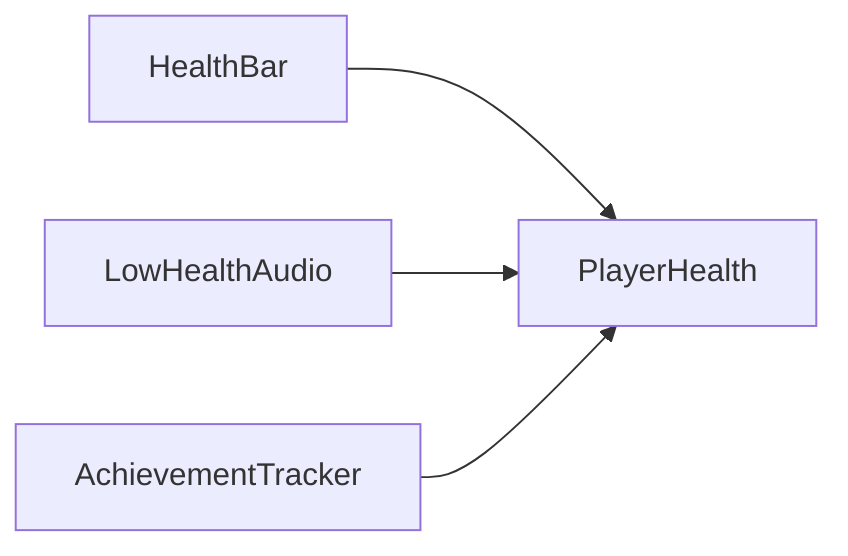
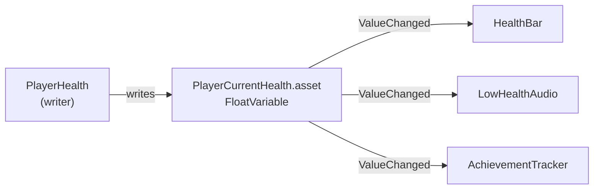

# 03 - Shared Variables and Variable References

Lab: [Lab 3 - Shared Variables and Variable References](../labs/lab_3_shared_variables.md)

## Key Concepts

1. **Depend on the data, not the owner** - a reader needs the value, not the object that produces it.
2. **One writer, many readers** - decide which system may change a shared value, and keep it to one.
3. **Subscribe, then read** - after subscribing, read the current value once, so start-up order does not matter.
4. **Every += has a -=** - unsubscribe in `OnDisable` for every subscription made in `OnEnable`.
5. **Initial is authored, Value is runtime** - code changes `Value`; only a designer changes `InitialValue`.
6. **The owner sets the start state** - the writer initialises the shared value when its object starts.
7. **Constant until shared** - use a variable reference so a field can be a constant today and a shared value later.
8. **Validate references in Awake** - check `IsValid` and missing assets once, with a clear error.
9. **Name assets for what they mean** - `PlayerCurrentHealth`, not `FloatVariable 3`.
10. **Shared is global** - a shared variable is visible to every system, so treat each one as a deliberate design decision.

---

## 1. Framing Question

How can the HUD, the audio and the player all use the player's health without any of them holding a reference to the others?

---

## 2. What You Will Learn

| Skill | You can... |
|:------|:-----------|
| Identify coupling between systems | Point to the field or call that makes one component depend on another, and say what breaks if the other is missing |
| Use a shared variable asset | Connect a writer and two readers through one `FloatVariable`, with no references between the components |
| Explain the module's variable classes | Describe what `ScriptableVariable<T>`, the concrete variable types and `VariableReference<T, TVariable>` each do, and why each exists |
| React to changes with an event | Subscribe to `ValueChanged` in `OnEnable`, unsubscribe in `OnDisable`, and show the current value immediately |
| Read generic C# with constraints | Explain what `T`, `TVariable` and `where TVariable : ScriptableVariable<T>` mean in the variable reference class |
| Choose between a constant and a shared value per object | Configure one component type so some instances use a constant and others share a variable, with no code change |
| Diagnose a stale subscriber | Use the debugger to show that a destroyed component is still receiving an event |

---

## 3. Why This Matters

In Note 02 every ScriptableObject you wrote was a read-only **definition**: data that describes what a thing is. This week adds shared **runtime** values that change during play, such as player health, score or whether a door is unlocked.

The motivating problem is **coupling**: the degree to which one piece of code depends on another. A HUD that reads health directly from the player is coupled to the player:

- the HUD cannot be tested without a player in the scene;
- a HUD prefab cannot store a reference to the player, because a prefab asset cannot reference an object inside a scene;
- if the HUD lives in its own scene (a common layout, covered later this week), there is no way to drag the player into it at all;
- every new reader (audio, a vignette effect, an achievement tracker) adds another reference to the player.

Direct references are not wrong. When two components are always on the same object or prefab, a direct reference is the simplest option and you should use it. The problem appears when **independent systems** need the same value.

The module project provides classes in `Assets/GD/Common/Scripts/ScriptableObjects` that solve this: shared variable assets, and a variable reference type that lets a field be either a constant or a shared value. These notes explain how they work and when to use them. You can use them directly in your group project.

The GCA **C# & Software Design** criterion asks for a nominated example of **System Communication** that avoids unnecessary coupling. A shared variable, explained as Problem, Solution, Benefit, is one way to evidence it.

---

## 4. Core Ideas

### 4.1 Coupling and Dependencies

A **dependency** is anything a class needs in order to work: a reference to another component, a call to a static method, a specific object in the scene. Every dependency is a reason the class can break when something else changes.



Three readers depend on the player component. None of them needs the player; each needs one number. The fix is to let all of them depend on the **data** instead:



Every component still has a dependency, but it is now on a small asset that exists independently of any scene. Any component in any scene or prefab can reference it.

### 4.2 The Shared Variable: `ScriptableVariable<T>`

A **shared variable** is a ScriptableObject asset that holds one value that several systems read or write at runtime. The module's base class is `ScriptableVariable<T>` in `Types/Base/ScriptableVariable.cs`. The key members:

```csharp
public abstract class ScriptableVariable<T> : ScriptableObject
{
    [SerializeField, TextArea(2, 4)] private string description = string.Empty;
    [SerializeField] private T initialValue;

    [NonSerialized] private T runtimeValue;

    public event Action<T> ValueChanged;

    public string Description => description;
    public T InitialValue => initialValue;

    public T Value
    {
        get => runtimeValue;
        set
        {
            if (EqualityComparer<T>.Default.Equals(runtimeValue, value))
                return;

            runtimeValue = value;
            ValueChanged?.Invoke(runtimeValue);
        }
    }

    public void ResetToInitial()
    {
        Value = initialValue;
    }

    // OnEnable, OnDisable, OnValidate and the Play mode reset are covered in Section 4.5.
}
```

This is an excerpt: the complete, commented class is in the project. The design decisions:

- **Two values, not one.** `initialValue` is serialized and set by a designer in the Inspector. `runtimeValue` has `[NonSerialized]`, so Unity never writes it to the asset file. This fixes the Note 02 bug where Play mode changes leaked into the asset: code can only change `runtimeValue`.
- **`Value` is the public runtime value.** Readers get it; writers set it.
- **`description`** is designer documentation: what the variable means, and which systems read or write it. Fill it in. Six months later, `FloatVariable` assets with no description are hard to reason about.
- **`ResetToInitial()`** puts the runtime value back to the authored one, for example when a level restarts.

#### Why abstract and generic?

`ScriptableVariable<T>` is a **generic type**: `T` is a **type parameter**, a placeholder for a real type such as `float` or `bool`. You have used generic types since Week 1: `List<T>` is one. Writing the class once for any `T` avoids six copies of the same code.

Unity cannot create an asset from a generic class, because an asset must link to one script file with one concrete class in it. So each type you want as an asset has a small concrete subclass:

```csharp
using System;
using UnityEngine;

namespace GD.Types
{
    [CreateAssetMenu(fileName = "FloatVariable", menuName = "GD/Variables/Float", order = 3)]
    public class FloatVariable : ScriptableVariable<float>
    {
        public void Add(float amount)
        {
            Value += amount;
        }

        public void Add(FloatVariable other)
        {
            if (other == null)
                throw new ArgumentNullException(nameof(other));

            Add(other.Value);
        }
    }
}
```

`FloatVariable` fills in `T = float` and adds operations that only make sense for numbers. The project provides:

| Asset type | Holds | Extra members | Example use |
|:--|:--|:--|:--|
| `BoolVariable` | `bool` | `Toggle()` | Exit door unlocked |
| `IntVariable` | `int` | `Add(int)`, `Add(IntVariable)` | Score, lives |
| `FloatVariable` | `float` | `Add(float)`, `Add(FloatVariable)` | Health, countdown |
| `StringVariable` | `string` | `IsNullOrEmpty`, `Append(...)` | Current objective text |
| `Vector3Variable` | `Vector3` | `Add(Vector3)`, `Add(Vector3Variable)` | Last checkpoint position |
| `GameObjectVariable` | `GameObject` | None | The player, the current target |

All appear under `Assets > Create > GD > Variables`.

A `GameObjectVariable` is a special case. Its initial value can only be an asset such as a prefab, because an asset cannot store a reference to a scene object. Set a scene object at runtime instead, for example from the player's `Awake`.

`ScriptableVariable<T>` is also the example promised in Note 02, Section 4.7: a base class that removes real duplication, because six types share the same storage, reset rules and event.

### 4.3 Reacting to Change: the `ValueChanged` Event

A reader can find out about a new value in two ways:

- **Polling**: read `Value` every frame in `Update`. Simple, but it runs every frame whether or not anything changed, and the reader cannot tell when the change happened.
- **Events**: subscribe to `ValueChanged` and run code only when the value changes.

`ValueChanged` is a C# `event Action<T>`, the same mechanism you used in Week 2. The `event` keyword means other classes can only subscribe (`+=`) and unsubscribe (`-=`). Only the variable itself can raise it. The setter raises it only when the new value differs from the old one, so setting health to its current value does nothing.

The standard reader pattern:

```csharp
private void OnEnable()
{
    health.ValueChanged += OnHealthChanged;
    OnHealthChanged(health.Value);   // Show the current value now.
}

private void OnDisable()
{
    health.ValueChanged -= OnHealthChanged;
}
```

Two rules make this reliable:

1. **Subscribe, then read.** Unity does not guarantee the order in which objects start. If the reader starts before the writer has set the value, the event updates it later. If it starts after, the immediate read shows the current value. Either way the reader is correct.
2. **Every `+=` has a `-=`.** The asset outlives scene objects. If a destroyed component stays subscribed, the asset keeps calling it: the call either throws a `MissingReferenceException` or silently does work for an object that no longer exists. A subscription that outlives its subscriber is a **stale subscriber**. `OnEnable` and `OnDisable` are the matching pair, because Unity calls `OnDisable` both when a component is disabled and when it is destroyed.

This relationship, one object announcing changes to any number of unknown listeners, is the **Observer** pattern.

### 4.4 One Writer, Many Readers

A shared variable is **global state**: any script with a reference can change it. That is its strength and its main risk. When a value is wrong and five systems can write it, finding the cause is slow.

Adopt a **single writer** rule: one system owns each variable and is the only one that sets `Value`. Everyone else reads.

| Variable | Writer | Readers |
|:--|:--|:--|
| `PlayerCurrentHealth` | `PlayerHealth` | `HealthBar`, `LowHealthWarning`, audio |
| `Score` | `ScoreKeeper` | HUD, end screen |
| `StormDamage` | `StormController` | Every storm damage zone |

Nothing in the code enforces this: `Value` has a public setter. Record the writer in the asset's `Description`, and keep damage and healing rules inside the writer (`PlayerHealth.TakeDamage`) rather than in whichever script causes the damage.

The writer also owns the **start state**. `PlayerHealth` sets `health.Value = maxHealth.Value` in its `Awake`. That rule ("the player starts at full health") belongs to the player, and it also covers the case in Section 4.5 where a scene reload does not reset the asset.

### 4.5 Lifetime and Reset Rules

Note 02 showed that runtime changes to an asset persist in the Editor but not in a build. `ScriptableVariable<T>` handles this by resetting `runtimeValue` to `initialValue` at defined moments:

| Moment | What resets it | Why |
|:--|:--|:--|
| The asset loads (Editor and build) | `OnEnable` | Every play session in a build starts from the authored value |
| Play mode starts in the Editor | `EditorApplication.playModeStateChanged` | With domain reload turned off (`Edit > Project Settings > Editor > Enter Play Mode Settings`), `OnEnable` does not run on entering Play mode |
| Play mode stops | `playModeStateChanged` | Edit mode shows the authored value again |
| The `Initial Value` is edited outside Play mode | `OnValidate` | The runtime value follows the Inspector |

The Editor-only code sits inside `#if UNITY_EDITOR` blocks. `EditorApplication` exists only in the Editor, so without the directive the project would not build.

Three cases are **not** reset automatically:

1. **Reloading a scene during play.** The asset stays loaded, so the value carries over. The writer's `Awake` sets the start state (Section 4.4), or call `ResetToInitial()`.
2. **Subscribers.** With domain reload turned off, subscriptions from the last Play session can survive into the next one if a component never unsubscribed. `OnDisable` unsubscription prevents this.
3. **Unloading in a build.** In a build, Unity may unload an asset that no loaded object references, for example during a scene change. When the asset loads again, `OnEnable` resets it to its initial value. A value that must survive scene changes (a score across levels) needs an object that references the asset for the whole game. Note 05's persistent systems cover this.

### 4.6 Variable References: `VariableReference<T, TVariable>`

Most fields in a game are local constants: the damage of one lava pit, the speed of one platform. A few need to be shared: every storm zone uses the same damage, which a storm system raises over time. You do not want two different components for the two cases, and you do not want to create an asset for every constant.

A **variable reference** is a field that can be either. The module's class is `VariableReference<T, TVariable>` in `Types/Base/VariableReference.cs`. The key members:

```csharp
[Serializable]
public class VariableReference<T, TVariable> where TVariable : ScriptableVariable<T>
{
    [SerializeField] private bool useConstant = true;
    [SerializeField] private T constantValue;
    [SerializeField] private TVariable variable;

    public bool UseConstant => useConstant;
    public TVariable Variable => useConstant ? null : variable;
    public bool IsValid => useConstant || variable != null;

    public T Value
    {
        get
        {
            if (useConstant)
                return constantValue;

            if (variable == null)
                throw new InvalidOperationException(
                    $"{GetType().Name} is set to use a variable, but no {typeof(TVariable).Name} asset is assigned.");

            return variable.Value;
        }
    }
}

[Serializable] public class FloatReference : VariableReference<float, FloatVariable> { }
```

This is an excerpt. The project version also declares `BoolReference`, `IntReference`, `StringReference`, `Vector3Reference` and `GameObjectReference`.

What each part does:

- **Not a ScriptableObject.** `VariableReference` is a plain C# class marked `[Serializable]`. It is not an asset; it is stored inside the component that declares the field, like a `Vector3`. In the Inspector it appears as a foldout with `Use Constant`, `Constant Value` and `Variable`.
- **`Value` hides the choice.** The component reads `damagePerSecond.Value` and does not know or care whether the number is a constant or shared. The designer makes the choice per object, with no code change.
- **Two type parameters with a constraint.** `T` is the value type (`float`). `TVariable` is the matching asset type (`FloatVariable`). The **type constraint** `where TVariable : ScriptableVariable<T>` tells the compiler that `TVariable` must be a variable asset holding a `T`. That is what makes `variable.Value` compile and return a `T`. It also stops mismatches: a `VariableReference<float, IntVariable>` does not compile.
- **`IsValid`** is `false` when the reference is set to use a variable but none is assigned. Check it in `Awake`, as you check any other required reference.
- **`Variable`** returns `null` when a constant is used. If a component wants to subscribe to changes, it must check for `null` first.
- **Named subclasses.** `FloatReference` adds nothing except a short name. `[SerializeField] private FloatReference damagePerSecond;` is easier to read than the full generic type, and gives each type its own name if you later write a custom Inspector drawer for it.

> **Terminology.** In C#, a *reference type* is any `class`, as opposed to a `struct` value type. A *variable reference* in these notes is the specific `VariableReference<T, TVariable>` class. Keep the two ideas separate.

#### Defaults

A new `FloatReference` field starts with `Use Constant` ticked and `Constant Value` 0. A damage zone with a 0 constant does no damage, and a speed multiplier of 0 stops movement. Set the constant when you add the component.

### 4.7 Decision: Which Communication Tool?

| Situation | Choice |
|:--|:--|
| Two components always on the same object or prefab | Direct reference (`GetComponent` or a serialized field) |
| One object reports something to its own children or parent | Direct reference or a C# event on that object |
| Independent systems need the same changing value, possibly across scenes | Shared variable asset |
| A field is usually a local constant but sometimes needs to be shared | Variable reference |
| Something happens that has no lasting value (player died, door opened) | An event channel (Note 04), not a variable |
| Per-object runtime state (this enemy's health) | A private field on the component, not a shared variable |

The last row matters. A shared variable is shared by every object that references it. Ten enemies referencing one `EnemyHealth` asset share one health value, which is the Note 02 bug again.

---

## 5. Worked Example

The demo connects a player's health to a health bar and a low-health warning, then adds damage zones. It follows the module's iteration sequence: initial implementation, problem, change, improvement.

### Stage 1 - Initial Implementation: Direct Reference

The player owns its health, and the health bar holds a reference to the player.

```csharp
using UnityEngine;

public class PlayerHealth : MonoBehaviour
{
    [SerializeField, Min(1f)] private float maxHealth = 100f;

    private float currentHealth;

    public float CurrentHealth => currentHealth;
    public float MaxHealth => maxHealth;

    private void Awake()
    {
        currentHealth = maxHealth;
    }

    public void TakeDamage(float amount)
    {
        if (amount <= 0f) return;

        currentHealth = Mathf.Max(0f, currentHealth - amount);
    }

    public void Heal(float amount)
    {
        if (amount <= 0f) return;

        currentHealth = Mathf.Min(maxHealth, currentHealth + amount);
    }
}
```

```csharp
using UnityEngine;
using UnityEngine.UI;

public class HealthBar : MonoBehaviour
{
    [SerializeField] private PlayerHealth player;
    [SerializeField] private Slider slider;

    private void Awake()
    {
        if (player == null || slider == null)
        {
            Debug.LogError($"{name}: assign the player and the slider.", this);
            enabled = false;
        }
    }

    private void Update()
    {
        // Polls the player every frame, even when nothing has changed.
        slider.value = player.CurrentHealth / player.MaxHealth;
    }
}
```

A test component changes health from the keyboard until the game has real damage sources:

```csharp
using UnityEngine;
using UnityEngine.InputSystem;

// Test harness only: lets you change health from the keyboard before the game has real damage sources.
[RequireComponent(typeof(PlayerHealth))]
public class DebugDamageKeys : MonoBehaviour
{
    [SerializeField, Min(0f)] private float amount = 10f;

    private PlayerHealth playerHealth;

    private void Awake()
    {
        playerHealth = GetComponent<PlayerHealth>();
    }

    private void Update()
    {
        // Keyboard.current is null when no keyboard is connected.
        Keyboard keyboard = Keyboard.current;
        if (keyboard == null) return;

        if (keyboard.dKey.wasPressedThisFrame) playerHealth.TakeDamage(amount);
        if (keyboard.hKey.wasPressedThisFrame) playerHealth.Heal(amount);
    }
}
```

It works: press D and the bar drops.

### Stage 2 - Problem

Turn the health bar into a prefab so every level can use it. Open the prefab: the `Player` field is empty, and you cannot drag the scene's player into it, because a prefab asset cannot reference a scene object. Each level now needs someone to reconnect it by hand. A low-health warning and an audio cue would each need the same reference. And the bar recalculates every frame even though health changes a few times a minute.

### Stage 3 - Change: Share the Value, React to Changes

Create two `FloatVariable` assets, `PlayerCurrentHealth` and `PlayerMaxHealth`, both with `Initial Value` 100. The player becomes the single writer:

```csharp
using GD.Types;
using UnityEngine;

public class PlayerHealth : MonoBehaviour
{
    [SerializeField] private FloatVariable health;
    [SerializeField] private FloatVariable maxHealth;

    private void Awake()
    {
        if (health == null || maxHealth == null)
        {
            Debug.LogError($"{name}: assign both health variables.", this);
            enabled = false;
            return;
        }

        // The player owns the rule "start at full health", so it sets the shared value here.
        // This also covers reloading the scene, which does not reset a ScriptableObject.
        health.Value = maxHealth.Value;
    }

    public void TakeDamage(float amount)
    {
        // Disabling a component stops Update, not public method calls, so check enabled here too.
        if (!enabled || amount <= 0f) return;

        health.Value = Mathf.Max(0f, health.Value - amount);
    }

    public void Heal(float amount)
    {
        if (!enabled || amount <= 0f) return;

        health.Value = Mathf.Min(maxHealth.Value, health.Value + amount);
    }
}
```

The health bar references the assets, not the player, and updates only when health changes:

```csharp
using GD.Types;
using UnityEngine;
using UnityEngine.UI;

public class HealthBar : MonoBehaviour
{
    [SerializeField] private FloatVariable health;
    [SerializeField] private FloatVariable maxHealth;
    [SerializeField] private Slider slider;

    private void OnEnable()
    {
        if (health == null || maxHealth == null || slider == null)
        {
            Debug.LogError($"{name}: assign both health variables and the slider.", this);
            enabled = false;
            return;
        }

        health.ValueChanged += OnHealthChanged;

        // Show the current value now, so the bar is correct whichever object initialised first.
        OnHealthChanged(health.Value);
    }

    private void OnDisable()
    {
        // Every += needs a matching -=, or the asset keeps calling this component after it is destroyed.
        if (health != null)
            health.ValueChanged -= OnHealthChanged;
    }

    private void OnHealthChanged(float current)
    {
        slider.value = maxHealth.Value > 0f ? current / maxHealth.Value : 0f;
    }
}
```

A second reader needs no change to the player or the bar:

```csharp
using GD.Types;
using UnityEngine;

public class LowHealthWarning : MonoBehaviour
{
    [SerializeField] private FloatVariable health;
    [SerializeField, Min(0f)] private float threshold = 25f;
    [SerializeField] private GameObject warningIcon;

    private void OnEnable()
    {
        if (health == null || warningIcon == null)
        {
            Debug.LogError($"{name}: assign the health variable and the warning icon.", this);
            enabled = false;
            return;
        }

        health.ValueChanged += OnHealthChanged;
        OnHealthChanged(health.Value);
    }

    private void OnDisable()
    {
        if (health != null)
            health.ValueChanged -= OnHealthChanged;
    }

    private void OnHealthChanged(float current)
    {
        warningIcon.SetActive(current <= threshold);
    }
}
```

`DebugDamageKeys` is unchanged: it calls `PlayerHealth`, which is still the only writer.

### Stage 4 - Improvement: Constant or Shared per Object

Damage zones need a damage rate. A lava pit has a fixed rate. Storm zones all share one rate that grows over time. One component handles both, using a `FloatReference`:

```csharp
using GD.Types;
using UnityEngine;

[RequireComponent(typeof(Collider))]
public class DamageZone : MonoBehaviour
{
    [SerializeField] private FloatReference damagePerSecond;

    private void Awake()
    {
        if (!damagePerSecond.IsValid)
        {
            Debug.LogError($"{name}: Damage Per Second uses a variable, but none is assigned.", this);
            enabled = false;
        }
    }

    private void Reset()
    {
        // Editor only: runs when the component is added, so the collider starts as a trigger.
        GetComponent<Collider>().isTrigger = true;
    }

    private void OnTriggerStay(Collider other)
    {
        // Physics messages still arrive on a disabled component, so check enabled here.
        if (!enabled) return;
        if (!other.TryGetComponent(out PlayerHealth player)) return;

        // Inside physics callbacks, Time.deltaTime returns the fixed timestep.
        player.TakeDamage(damagePerSecond.Value * Time.deltaTime);
    }
}
```

The storm system is the single writer of the shared rate:

```csharp
using GD.Types;
using UnityEngine;

public class StormController : MonoBehaviour
{
    [SerializeField] private FloatVariable stormDamage;
    [SerializeField, Min(0f)] private float increasePerSecond = 2f;
    [SerializeField, Min(0f)] private float maxDamage = 50f;

    private void Awake()
    {
        if (stormDamage == null)
        {
            Debug.LogError($"{name}: assign the storm damage variable.", this);
            enabled = false;
            return;
        }

        // The single writer owns the start state, so a scene reload starts the storm from its authored value.
        stormDamage.ResetToInitial();
    }

    private void Update()
    {
        // The only writer of StormDamage. Every zone that references it reads the new value.
        stormDamage.Value = Mathf.Min(maxDamage, stormDamage.Value + increasePerSecond * Time.deltaTime);
    }
}
```

Configure a `Lava` zone with `Use Constant` ticked and `Constant Value` 20. Configure `Storm_A` and `Storm_B` with `Use Constant` cleared and `Variable` set to a `StormDamage` asset.

What changed, as a Problem, Solution, Benefit summary:

| Problem | Solution | Benefit |
|:--|:--|:--|
| The HUD depended on the player, could not be a reusable prefab, and polled every frame | The player writes shared `FloatVariable` assets; readers subscribe to `ValueChanged` | Readers can be added, removed or moved to another scene without changing the player; UI updates only on change |
| Some zones need a fixed rate and some a shared rate | `FloatReference` field on one `DamageZone` component | The designer chooses per zone in the Inspector; no second component, no asset per constant |

---

## 6. Common Pitfalls

| Symptom | Cause | Fix |
|:--|:--|:--|
| `MissingReferenceException` from a UI script after an object is destroyed | A reader subscribed to `ValueChanged` but never unsubscribed | Unsubscribe in `OnDisable` for every `+=` in `OnEnable` |
| Errors from objects in a Play session that has already ended | Domain reload is off and a component from the previous session never unsubscribed | Same fix; check `OnDisable` exists and mirrors `OnEnable` |
| The HUD shows the wrong value until the first change | The reader subscribed but did not read the current value | Call the handler once with `Value` straight after subscribing |
| Health starts at the old value after a scene reload | Reloading a scene does not reset a loaded asset | The writer sets the start state in `Awake`, or calls `ResetToInitial()` |
| All enemies share one health bar value | Per-object state stored in one shared variable | Keep per-object state on the component; share only values that are genuinely one value for the whole game |
| A value changes and nobody knows which script did it | Several scripts write the same variable | One writer per variable; record it in the asset's `Description` |
| A zone does no damage, or an object stops moving | A new `FloatReference` defaults to `Use Constant` with 0 | Set `Constant Value` when adding the component |
| `InvalidOperationException` naming a reference type | `Use Constant` is cleared but no variable asset is assigned | Assign the asset; check `IsValid` in `Awake` to fail once with a clear message |
| `NullReferenceException` when subscribing through a reference | `reference.Variable` is `null` because `Use Constant` is ticked | Check `Variable != null` before subscribing |
| `Create > GD > Variables` does not offer a type you need | Only concrete subclasses can be assets | Add a small subclass, for example `class ColorVariable : ScriptableVariable<Color> {}` with `[CreateAssetMenu]`, in its own file |
| Score resets between levels in a build but not in the Editor | The asset was unloaded when no loaded object referenced it | Keep a reference to it from a persistent object (Note 05) |

---

## 7. Software Development Parallels

- **Observer pattern** (Gang of Four). A subject notifies any number of observers without knowing who they are. `ScriptableVariable<T>` is the subject; `ValueChanged` is the notification; each reader is an observer. C# events are the language's built-in Observer.
- **Dependency Inversion Principle** (the D in SOLID). High-level policy should not depend on low-level details; both should depend on an abstraction. The HUD and the player no longer depend on each other; both depend on the shared asset.
- **Blackboard.** AI systems and some architectures use a shared store of named values that independent modules read and write. A set of variable assets is a designer-editable blackboard. The same risks apply: many writers make behaviour hard to trace.
- **Global mutable state.** Singletons and static fields are the usual global state. Shared variables are also global, but they are visible in the Inspector, can be swapped per scene, and do not hide behind a static call. They still need the discipline of a single writer.
- **Generics with constraints.** `where TVariable : ScriptableVariable<T>` is the same mechanism as `where T : IComparable<T>` in a sorting method, or `where T : Component` in Unity's `GetComponent<T>()`: it tells the compiler what a type parameter can do.

Ryan Hipple's Unite Austin 2017 talk "Game Architecture with Scriptable Objects" introduced the `FloatVariable` and `FloatReference` idea these classes are based on. The module versions add the separate initial and runtime values, reset rules, the change event and validation.

---

## 8. Exercises

### Core - Score Display

Add an `IntVariable` named `Score` (initial value 0). Write a `ScoreKeeper` that is the only writer and adds 10 when you press `P` (test harness), and a `ScoreText` reader that shows the score in a `TextMeshProUGUI` label using `ValueChanged`.

**Expected result:** the label shows 0 at the start of every Play session and updates only when the score changes. Deleting the label during Play produces no errors when you press `P`.

### Apply - Locked Door

Add a `BoolVariable` named `ExitDoorUnlocked`. A key pickup sets it to `true` when the player enters its trigger and then destroys itself. A door reads it and opens (disable its collider and renderer, or move it) when it becomes `true`. A UI icon shows while the door is locked.

**Expected result:** the key, the door and the icon have no references to each other. You can place two doors that open from the same key with no code change. State in one sentence which component is the writer.

### Challenge - Reset on Restart

Pressing `R` restarts the level by reloading the scene. Some variables (score) must keep their value across a restart; others (health, storm damage) must reset.

Design a way for a designer to choose which variables reset, without adding a restart reference to every writer. You will find that `ScriptableVariable<T>` has no non-generic base type, so you cannot put a `FloatVariable` and a `BoolVariable` in one `List<>`.

**Expected result:** a working restart, plus 100 to 150 words explaining your design: where the list of variables lives, how you handled the generic type problem, and what you would need to change in the shared `GD.Types` code (if anything) and why.

---

## 9. Reflective Questions

1. The HUD in Stage 1 had one dependency; in Stage 3 it has two (both assets). Why is Stage 3 still less coupled? Use the Dependency Inversion Principle in your answer.
2. `Value` has a public setter, so any script can write it. Argue for or against removing the setter and adding a separate writer-only API. What would it cost?
3. Why does the reader read `Value` immediately after subscribing? Describe a start-up order where skipping it shows a wrong value.
4. When is a direct reference the better choice than a shared variable? Give a concrete example from your group project.
5. A teammate proposes one `GameState` asset holding health, score, ammo and lives. Evaluate this against four separate variables, considering single writers, events and merge conflicts.

---

## 10. How This Builds

- **[Lab 3](../labs/lab_3_shared_variables.md)** builds this worked example as a scene: `PlayerHealth` writing shared health, a HUD slider and an overhead warning sprite as readers, a stale subscriber caught with the debugger, and damage zones whose rate is a constant or a shared variable.
- **Next** ([Note 04](04_event_channels.md)) you meet ScriptableObject **event channels** for things that happen without a lasting value, and additive scenes, where a HUD scene and a gameplay scene communicate only through assets like these.
- **Note 07 - Movement Systems** uses `FloatReference` for speeds that are usually constant but can be driven by difficulty or power-ups.
- **Note 16 - State Machines and the State Pattern** uses shared variables as conditions for state transitions.
- **GCA - C# & Software Design:** a shared variable with a single writer and event-driven readers can evidence **System Communication**; the separation of authored and runtime values can evidence **Data & State**.

---

## Glossary

| Term | Definition |
|:-----|:-----------|
| Coupling | The degree to which one piece of code depends on another |
| Dependency | Anything a class needs in order to work, such as a reference to another component |
| Generic type | A class or method written once with a type parameter, then used with specific types |
| Global state | Data that any part of the program can read or change |
| Observer | A pattern in which a subject notifies any number of listeners of a change without knowing who they are |
| Polling | Checking a value repeatedly, usually every frame, to detect a change |
| Shared variable | A ScriptableObject asset holding one runtime value that several systems read or write |
| Single writer | The rule that only one system sets a given shared value |
| Stale subscriber | An event handler still registered after its object has been disabled or destroyed |
| Type constraint | A `where` clause that limits which types can be used for a type parameter |
| Type parameter | A placeholder such as `T` in a generic type, replaced by a real type when the type is used |
| Variable reference | A serializable field that returns either a local constant or the value of a shared variable asset |
