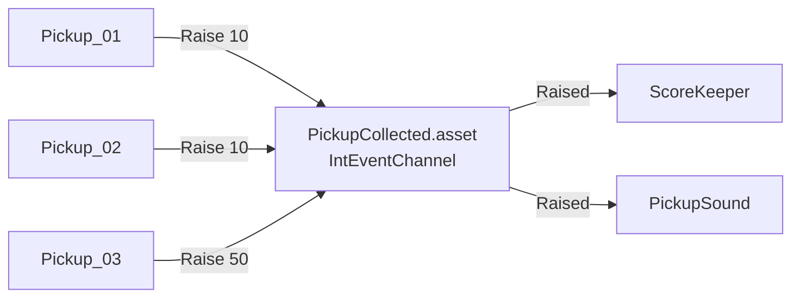
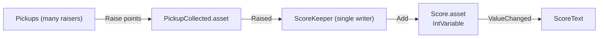

# 04 - Event Channels

Lab: [Lab 4 - Event Channels](../labs/lab_4_event_channels.md)

## Key Concepts

1. **State is a variable, a moment is an event** - "health is 20" is state; "the player died" is a moment.
2. **Raisers do not know listeners** - the object that raises a channel never holds a reference to what reacts.
3. **Many raisers, one writer** - let many objects raise an event, and let one system turn it into state.
4. **Listen while active** - a listener only hears events raised while it is subscribed; there is no replay.
5. **Every += has a -=** - unsubscribe in `OnDisable`, exactly as with shared variables.
6. **Code for logic, Inspector for wiring** - C# handlers for rules; `VoidEventChannelListener` for presentation a designer should adjust.
7. **Describe every channel** - record in `Description` who raises it and who listens.
8. **Log when lost** - tick `Log Raises` to see when a channel fires and how many listeners heard it.
9. **Raise once per moment** - guard against announcing the same moment twice, for example a second death.
10. **Not everything is an event** - two components on one object can call each other directly.

---

## 1. Framing Question

How does one system announce that something happened, to listeners it does not know, which may be in another prefab or another scene?

---

## 2. What You Will Learn

| Skill | You can... |
|:------|:-----------|
| Distinguish state from a moment | Classify six game facts as a shared variable or an event, and justify each |
| Explain the module's channel classes | Describe what `EventChannelBase`, `VoidEventChannel`, `EventChannel<T>` and the typed channels each do |
| Raise and handle an event in code | Raise `PlayerDied` from `PlayerHealth` and handle `PickupCollected` in `ScoreKeeper`, with no references between raisers and listeners |
| Wire a response without code | Show a game over panel using `VoidEventChannelListener` and a `UnityEvent` |
| Combine channels and variables | Build a score where many pickups raise an event and one `ScoreKeeper` writes the `Score` variable |
| Diagnose a missed event | Use the debugger and `ListenerCount` to show that a listener had not subscribed when the event was raised |

---

## 3. Why This Matters

Note 03 connected systems through **state**: values such as health and score that exist all the time and change occasionally. Many things in a game are not state. They are **moments**: the player died, a pickup was collected, a checkpoint was reached, the level was completed. Several systems react to each one: the UI, audio, the camera, the score, an achievement tracker.

Two tools you already have do not fit:

- **A C# event on the object.** `PlayerHealth` can declare `public event Action Died;`. Every listener then needs a reference to the player to subscribe, which brings back every coupling problem from Note 03: prefabs cannot hold it, other scenes cannot reach it.
- **A shared variable.** A `BoolVariable PlayerIsDead` works once, but `ValueChanged` fires only when the value changes. Two pickups worth 10 points in a row, written to an `IntVariable LastPickupPoints`, raise `ValueChanged` once: the second write sets 10 to 10, so nothing happens. A moment has no lasting value to compare.

An **event channel** is a ScriptableObject asset that carries a notification, and optionally a value, from any number of raisers to any number of listeners. Like a shared variable, it exists independently of scenes, so prefabs and other scenes can reference it. Unlike a shared variable, it stores nothing and notifies on every raise.

The module project now provides channel classes alongside the variables in `Assets/GD/Common/Scripts/ScriptableObjects`. These notes explain them and when to use them. The GCA **System Communication** element asks for communication that avoids unnecessary coupling; a channel, justified against the alternatives in Section 4.8, is direct evidence.

---

## 4. Core Ideas

### 4.1 State versus Moments

| Game fact | Kind | Tool |
|:--|:--|:--|
| The player's current health | State | `FloatVariable` |
| The player died | Moment | `VoidEventChannel` |
| The score | State | `IntVariable` |
| A pickup worth 10 points was collected | Moment with a value | `IntEventChannel` |
| The last checkpoint position | State | `Vector3Variable` |
| A checkpoint was reached | Moment with a value | `Vector3EventChannel` |

The test: if a system that starts late needs to know the fact, it is state. If only systems listening at the time should react, it is a moment. The two often appear together: the moment "checkpoint reached" updates the state "last checkpoint".

### 4.2 The Event Channel



A **raiser** calls `Raise` on the channel. A **listener** subscribes to the channel's `Raised` event. Neither holds a reference to the other; both reference the asset. This is the **publish-subscribe** style of communication: publishers and subscribers know only the channel between them.

### 4.3 The Module Classes

The classes follow the same structure as the variables in Note 03.

| Class | File | Role |
|:--|:--|:--|
| `EventChannelBase` | `Types/Base/EventChannelBase.cs` | Abstract base: `Description`, the `Log Raises` option and the abstract `ListenerCount` |
| `VoidEventChannel` | `Types/Events/VoidEventChannel.cs` | A concrete channel with no value: `event Action Raised` and `Raise()` |
| `EventChannel<T>` | `Types/Base/EventChannel.cs` | Abstract generic channel with a value: `event Action<T> Raised` and `Raise(T)` |
| `BoolEventChannel`, `IntEventChannel`, `FloatEventChannel`, `StringEventChannel`, `Vector3EventChannel`, `GameObjectEventChannel` | `Types/Events/` | Concrete subclasses of `EventChannel<T>`, one per type, so Unity can create assets |
| `VoidEventChannelListener` | `Listeners/VoidEventChannelListener.cs` | A MonoBehaviour that runs `UnityEvent` responses when a `VoidEventChannel` is raised |

All channel assets appear under `Assets > Create > GD > Events`.

The key members of `EventChannel<T>`:

```csharp
public abstract class EventChannel<T> : EventChannelBase
{
    public event Action<T> Raised;

    public override int ListenerCount => Raised?.GetInvocationList().Length ?? 0;

    public void Raise(T value)
    {
        LogRaise($" with {value}");
        Raised?.Invoke(value);
    }
}
```

This is an excerpt: the complete, commented class is in the project. Compare it with `ScriptableVariable<T>`:

| | `ScriptableVariable<T>` | `EventChannel<T>` |
|:--|:--|:--|
| Stores a value | Yes: `InitialValue` and `Value` | No |
| Notifies when | The value changes | Every `Raise`, even with the same value |
| A late listener can | Read the current `Value` | Nothing: past raises are gone |
| Reset rules needed | Yes (Note 03, Section 4.5) | No: there is nothing to reset |

`VoidEventChannel` is a separate class, not `EventChannel<T>` with a dummy type, because C# has no `Action<void>`. Both share `EventChannelBase`, which is the kind of base class Note 02 allows: it removes the same description, logging and listener count code from eight types.

#### Testing and tracing tools

- **`Raise` from the Inspector.** `VoidEventChannel.Raise` has `[ContextMenu("Raise")]`. During Play, open the asset's context menu (the three dots at the top of its Inspector) and choose `Raise` to test every listener without causing the real event.
- **`Log Raises`.** Tick it on a channel to log each raise with the value and the number of listeners. Clicking the log entry selects the asset.
- **`ListenerCount`.** Watch it in the debugger to check whether a listener has subscribed at the moment of a raise.

### 4.4 Raising and Listening in Code

Raising is one call. The raiser holds the channel asset in a serialized field:

```csharp
[SerializeField] private VoidEventChannel playerDied;

// Later, at the moment it happens:
playerDied.Raise();
```

Listening uses the same pattern as a shared variable, with one step fewer:

```csharp
private void OnEnable()
{
    pickupCollected.Raised += OnPickupCollected;
}

private void OnDisable()
{
    pickupCollected.Raised -= OnPickupCollected;
}

private void OnPickupCollected(int points)
{
    score.Add(points);
}
```

There is no "read the current value" step, because a channel has no current value. The consequence is the most important rule of this topic: **a listener only hears raises that happen while it is subscribed.** A UI in a scene that loads after the player died never learns about the death. If a late system needs the fact, keep it as state as well (for example a `BoolVariable PlayerIsDead` written by the same system that raises the event).

### 4.5 Wiring Responses in the Inspector: `VoidEventChannelListener`

Some responses are presentation, not rules: show a panel, play a sound, disable an input component. A designer should be able to change these without asking a programmer.

`VoidEventChannelListener` subscribes to a `VoidEventChannel` and invokes a **UnityEvent** when it is raised. A UnityEvent is a list of method calls stored in the scene and edited in the Inspector: pick an object, pick a method or property, set its argument.

| | C# event and handler method | UnityEvent response |
|:--|:--|:--|
| Set up by | A programmer, in code | Anyone, in the Inspector |
| Type-checked | At compile time | No: methods are stored by name, so renaming a method breaks the entry, which the Inspector then shows as missing |
| Visible in | Code; "Find All References" in the IDE | The Inspector of the listener object only |
| Best for | Game rules (scoring, damage, state changes) | Presentation (panels, sounds, particle effects, enabling objects) |

Use both: code for rules, the listener for presentation.

A listener must be on a GameObject that is active when the event is raised. A listener on an inactive game over panel never subscribed, so it never hears the event that should activate its own panel.

### 4.6 Many Raisers, One Writer

Note 03 set a single writer rule for shared variables. Channels make that rule easy to keep when many objects cause a change:



Every pickup announces a moment. Only `ScoreKeeper` turns moments into state. The scoring rule (combo multipliers, a score cap) lives in one place, and the score has one writer.

### 4.7 The Costs of Event Channels

Channels remove references, and references are what make code easy to follow. The costs:

- **Discoverability.** Reading `PlayerHealth` tells you it raises `PlayerDied`, not what happens next. Record raisers and listeners in the channel's `Description`, and use `Log Raises` when tracing.
- **Missed events.** A listener that subscribes late, or sits on an inactive object, misses raises with no error (Section 4.4).
- **Listener order.** Handlers run in subscription order, which depends on which objects enabled first. Do not write a listener that relies on another listener having run.
- **One failure stops the rest.** If a handler throws an exception, the remaining handlers for that raise do not run. A bug in the sound listener can stop the game over panel.
- **Re-raising inside a handler.** A handler that raises the same channel calls itself. Keep handlers short and avoid raising from inside them unless you can show the chain ends.

### 4.8 Decision: Which Communication Tool?

| Situation | Choice |
|:--|:--|
| Two components on the same object or prefab | Direct reference |
| A child reports to its parent, which already references it | C# event on the child |
| Independent systems share a value that exists all the time | Shared variable (Note 03) |
| Independent systems react to a moment, possibly across scenes | Event channel |
| A moment that late systems must also know about | Event channel plus a shared variable written by one system |
| A designer should adjust the reaction | Event channel plus `VoidEventChannelListener` |

---

## 5. Worked Example

The demo extends the Note 03 demo: the player can die, and pickups add to a score. It follows the module's iteration sequence: initial implementation, problem, change, improvement.

### Stage 1 - Initial Implementation: A C# Event on the Player

`PlayerHealth` announces death with its own event. `isDead` is runtime state that stops a second announcement.

```csharp
using System;
using GD.Types;
using UnityEngine;

public class PlayerHealth : MonoBehaviour
{
    [SerializeField] private FloatVariable health;
    [SerializeField] private FloatVariable maxHealth;

    private bool isDead;

    // Anyone who wants to know about death must hold a reference to this component.
    public event Action Died;

    private void Awake()
    {
        if (health == null || maxHealth == null)
        {
            Debug.LogError($"{name}: assign both health variables.", this);
            enabled = false;
            return;
        }

        health.Value = maxHealth.Value;
    }

    public void TakeDamage(float amount)
    {
        if (!enabled || isDead || amount <= 0f) return;

        health.Value = Mathf.Max(0f, health.Value - amount);

        if (health.Value <= 0f)
        {
            isDead = true;
            Died?.Invoke();
        }
    }

    public void Heal(float amount)
    {
        if (!enabled || isDead || amount <= 0f) return;

        health.Value = Mathf.Min(maxHealth.Value, health.Value + amount);
    }
}
```

```csharp
using UnityEngine;

public class GameOverScreen : MonoBehaviour
{
    [SerializeField] private PlayerHealth player;
    [SerializeField] private GameObject gameOverPanel;

    private void OnEnable()
    {
        if (player == null || gameOverPanel == null)
        {
            Debug.LogError($"{name}: assign the player and the game over panel.", this);
            enabled = false;
            return;
        }

        player.Died += OnPlayerDied;
    }

    private void OnDisable()
    {
        if (player != null)
            player.Died -= OnPlayerDied;
    }

    private void OnPlayerDied()
    {
        gameOverPanel.SetActive(true);
    }
}
```

It works in one scene.

### Stage 2 - Problem

`GameOverScreen` holds a reference to the player, so a Canvas prefab cannot store it, which is the problem Note 03 solved for health. Adding a death sound, a camera effect and disabling the debug keys needs three more references to the player, or one class that does all four jobs.

Scoring shows the second problem. An attempt using a shared `IntVariable LastPickupPoints`, written by each pickup and watched by a score script, loses points: two pickups worth 10 in a row set 10, then 10 again, and the second write raises no `ValueChanged`.

### Stage 3 - Change: Channels for Moments

Create a `VoidEventChannel` named `PlayerDied`, an `IntEventChannel` named `PickupCollected`, and an `IntVariable` named `Score` with `Initial Value` 0.

`PlayerHealth` raises the channel instead of its own event:

```csharp
using GD.Types;
using UnityEngine;

public class PlayerHealth : MonoBehaviour
{
    [SerializeField] private FloatVariable health;
    [SerializeField] private FloatVariable maxHealth;
    [SerializeField] private VoidEventChannel playerDied;

    // Runtime state for this player: stops a second death being announced.
    private bool isDead;

    private void Awake()
    {
        if (health == null || maxHealth == null || playerDied == null)
        {
            Debug.LogError($"{name}: assign both health variables and the player died channel.", this);
            enabled = false;
            return;
        }

        health.Value = maxHealth.Value;
    }

    public void TakeDamage(float amount)
    {
        if (!enabled || isDead || amount <= 0f) return;

        health.Value = Mathf.Max(0f, health.Value - amount);

        if (health.Value <= 0f)
        {
            isDead = true;

            // Announce the moment. PlayerHealth does not know or care who is listening.
            playerDied.Raise();
        }
    }

    public void Heal(float amount)
    {
        if (!enabled || isDead || amount <= 0f) return;

        health.Value = Mathf.Min(maxHealth.Value, health.Value + amount);
    }
}
```

Each pickup raises `PickupCollected` with its points:

```csharp
using GD.Types;
using UnityEngine;

[RequireComponent(typeof(Collider))]
public class Pickup : MonoBehaviour
{
    [SerializeField, Min(0)] private int points = 10;
    [SerializeField] private IntEventChannel pickupCollected;

    private void Awake()
    {
        if (pickupCollected == null)
        {
            Debug.LogError($"{name}: assign the pickup collected channel.", this);
            enabled = false;
        }
    }

    private void Reset()
    {
        // Editor only: runs when the component is added, so the collider starts as a trigger.
        GetComponent<Collider>().isTrigger = true;
    }

    private void OnTriggerEnter(Collider other)
    {
        // Physics messages still arrive on a disabled component, so check enabled here.
        if (!enabled || !other.CompareTag("Player")) return;

        // Raise, then remove. Every pickup raises, even when the points are the same as the last one.
        pickupCollected.Raise(points);
        Destroy(gameObject);
    }
}
```

`ScoreKeeper` is the only listener that writes state:

```csharp
using GD.Types;
using UnityEngine;

public class ScoreKeeper : MonoBehaviour
{
    [SerializeField] private IntEventChannel pickupCollected;
    [SerializeField] private IntVariable score;

    private void Awake()
    {
        if (pickupCollected == null || score == null)
        {
            Debug.LogError($"{name}: assign the pickup collected channel and the score variable.", this);
            enabled = false;
            return;
        }

        // The single writer of Score owns its start state.
        score.ResetToInitial();
    }

    private void OnEnable()
    {
        // Awake has already checked the references; OnEnable does not run if Awake disabled the component.
        pickupCollected.Raised += OnPickupCollected;
    }

    private void OnDisable()
    {
        if (pickupCollected != null)
            pickupCollected.Raised -= OnPickupCollected;
    }

    private void OnPickupCollected(int points)
    {
        // Many pickups raise the event; only ScoreKeeper writes the score.
        score.Add(points);
    }
}
```

`ScoreText` displays the state, using the Note 03 reader pattern:

```csharp
using GD.Types;
using TMPro;
using UnityEngine;

public class ScoreText : MonoBehaviour
{
    [SerializeField] private IntVariable score;
    [SerializeField] private TextMeshProUGUI label;

    private void OnEnable()
    {
        if (score == null || label == null)
        {
            Debug.LogError($"{name}: assign the score variable and the label.", this);
            enabled = false;
            return;
        }

        score.ValueChanged += OnScoreChanged;
        OnScoreChanged(score.Value);
    }

    private void OnDisable()
    {
        if (score != null)
            score.ValueChanged -= OnScoreChanged;
    }

    private void OnScoreChanged(int value)
    {
        label.text = $"Score: {value}";
    }
}
```

`GameOverScreen` is deleted.

### Stage 4 - Improvement: Presentation Wired in the Inspector

The death responses need no code. Add a `VoidEventChannelListener` to the always-active `Canvas`, set `Channel` to `PlayerDied`, and add three entries to `Response`:

| Object | Method or property | Argument |
|:--|:--|:--|
| `GameOverPanel` | `GameObject.SetActive` | Ticked |
| `Player` | `DebugDamageKeys.enabled` | Cleared |
| `DeathSound` | `AudioSource.Play` | None |

What changed, as a Problem, Solution, Benefit summary:

| Problem | Solution | Benefit |
|:--|:--|:--|
| Death listeners needed a reference to the player; score updates were lost when two pickups had the same value | `PlayerDied` and `PickupCollected` channels; `ScoreKeeper` as the single writer of `Score` | No listener references the player or a pickup; every pickup counts; death responses are edited in the Inspector without code |

---

## 6. Common Pitfalls

| Symptom | Cause | Fix |
|:--|:--|:--|
| A listener never reacts, with no error | The listener is on an inactive GameObject, or subscribed after the raise | Put listeners on objects active at the time; keep late-needed facts as state too |
| The game over panel never appears | `VoidEventChannelListener` was placed on the inactive panel itself | Move the listener to an always-active object such as the `Canvas` |
| The death response runs twice | The death condition is checked every hit after health reaches 0 | Guard with runtime state (`isDead`) so the moment is raised once |
| Score misses points when two pickups have the same value | A shared variable was used for a moment | Use an `IntEventChannel`; write state in one listener |
| Some listeners run and others do not | An earlier handler threw an exception | Read the first exception in the Console and fix that handler |
| A UnityEvent response stopped working after a rename | UnityEvents store method names as text | Re-select the method in the Inspector; prefer code for rules |
| `MissingReferenceException` after an object is destroyed | A listener did not unsubscribe | Unsubscribe in `OnDisable` |
| Nobody knows what raises a channel | Channels hide the connection between raiser and listener | Fill in `Description`; tick `Log Raises` while tracing |
| A channel raises itself until the game freezes | A handler raises the channel it is handling | Remove the re-raise or add a condition that ends the chain |

---

## 7. Software Development Parallels

- **Observer and publish-subscribe.** Note 03's shared variable is an Observer: listeners observe one subject. A channel goes further: raisers and listeners are both decoupled from each other and meet only at the channel. This is publish-subscribe, the model behind message brokers and event buses in web and distributed systems.
- **Mediator** (Gang of Four). A mediator object handles communication between components so they do not reference each other. A channel is a minimal mediator with one message type.
- **Command-query separation.** A channel is a notification (something happened); a variable is a query (what is the value now). Keeping the two separate is the same idea as separating commands from queries in an API.
- **Industry use.** Unity's open project *Chop Chop* used ScriptableObject event channels to connect its gameplay, UI and audio across additive scenes, and Unity's e-book "Create modular game architecture in Unity with ScriptableObjects" describes the pattern. Ryan Hipple's 2017 talk introduced the idea alongside the variables in Note 03.

---

## 8. Exercises

### Core - Checkpoints

Add checkpoints. Each checkpoint raises a `Vector3EventChannel` named `CheckpointReached` with its position when the player enters it. A `RespawnPoint` component is the single writer of a `Vector3Variable` named `LastCheckpoint`, and moves the player there when `R` is pressed (test harness).

**Expected result:** checkpoints do not reference `RespawnPoint`, and entering the same checkpoint twice raises the event twice. The respawn position is the last checkpoint entered.

### Apply - Level Complete

Add an exit zone that raises a `VoidEventChannel` named `LevelComplete`. With a `VoidEventChannelListener` and no new code, show a "Level Complete" panel, disable `DebugDamageKeys` and stop the `StormController`.

**Expected result:** all three responses happen from one raise, and you can test them with the channel's `Raise` context menu during Play without reaching the exit. State in one sentence why `LevelComplete` is an event and not a `BoolVariable`, and when you would add a `BoolVariable` as well.

### Challenge - A Typed Listener

`VoidEventChannelListener` only handles channels with no value. Write an `IntEventChannelListener` that passes the event's value to a `UnityEvent<int>` response, and use it to show a "+10" label when a pickup is collected.

Then consider all six typed channels. A MonoBehaviour cannot be generic and still be added to a GameObject, for the same reason a ScriptableObject cannot (Note 03, Section 4.2).

**Expected result:** a working `IntEventChannelListener`, plus 100 to 150 words on how you would share the subscribe and unsubscribe code between six typed listeners, and what that design costs.

---

## 9. Reflective Questions

1. Stage 2 lost points because `ValueChanged` ignores repeated values. Was that a bug in `ScriptableVariable<T>`, or a correct design used for the wrong job? Justify your answer.
2. In the score design, pickups never write `Score`. What would you lose if each pickup called `score.Add(points)` directly?
3. Channels remove references, and references make code easy to follow. Where would you draw the line in your group project, and what would you record so a teammate can trace a channel?
4. Should game rules ever be wired through a UnityEvent in the Inspector? Give a case where it is acceptable and one where it is not.
5. A HUD scene loads two seconds after the gameplay scene. Which of health, score, player died and pickup collected will it show correctly, and what would you change for the rest?

---

## 10. How This Builds

- **[Lab 4](../labs/lab_4_event_channels.md)** builds the Stage 3 and Stage 4 design in a small scene of its own, and uses the debugger to catch a listener that missed an event.
- **Next, additive scenes and persistent systems** ([Note 05](05_additive_scenes.md)) split gameplay, UI and audio into separate scenes. Shared variables and event channels are how those scenes communicate, and Section 4.4's late-listener rule decides which facts need to be state.
- **Note 10 - Inventory Systems** adds channel types for its own payloads by subclassing `EventChannel<T>` and `EventChannelListener<TChannel, T>`, with no edit to the shared code, and uses a request channel with reply channels when the sender needs an answer.
- **Note 15 - Orchestration and Game Flow** sequences gameplay flow (intro, play, death, restart) using channels as the triggers between stages.
- **Note 16 - State Machines and the State Pattern** uses events as the triggers for state machine transitions.
- **GCA - C# & Software Design - System Communication:** a channel with named raisers and listeners, justified against a direct reference and a shared variable, is a complete Problem, Solution, Benefit example.

---

## Glossary

| Term | Definition |
|:-----|:-----------|
| Event channel | A ScriptableObject asset that carries a notification, and optionally a value, from any raiser to any listener |
| Listener | An object that subscribes to a channel and runs code when it is raised |
| Moment | A game fact that happens at one time and has no lasting value, such as a death or a pickup |
| Publish-subscribe | Communication in which publishers and subscribers know only the channel between them, not each other |
| Raiser | An object that calls `Raise` on a channel to announce a moment |
| State | A game fact that exists all the time and can be read at any point, such as health or score |
| UnityEvent | A serialized list of method calls configured in the Inspector and invoked from code |
