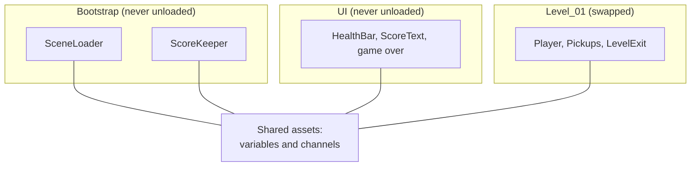

# 05 - Additive Scenes and Persistent Systems

Labs: [Lab 5 Part A - Splitting the Game into Scenes](../labs/lab_5_additive_scenes_part_a.md) and [Lab 5 Part B - Level Flow](../labs/lab_5_additive_scenes_part_b.md)

## Key Concepts

1. **One scene, one job** - Bootstrap holds systems, UI holds the interface, each level holds its world.
2. **Persistent means never unloaded** - systems that must survive a level change live in a scene that is never unloaded.
3. **Scenes meet at assets** - objects in different scenes cannot reference each other; they share variables and channels.
4. **Load additively** - add and remove levels around the persistent scenes instead of replacing everything.
5. **Set the active scene** - new objects and lighting settings belong to the active scene, so make the level active.
6. **Ask, do not load** - gameplay objects request a level through a channel; one loader decides and loads.
7. **Name scenes once** - put each scene name in a `SceneDefinition` asset, not in strings across the code.
8. **Play from anywhere** - pressing Play in a level scene must still load the systems it needs.
9. **One of each** - exactly one `EventSystem`, one `AudioListener` and one main camera across all loaded scenes.
10. **Late scenes read state** - a scene that loads later reads shared variables; it cannot hear events raised before it arrived.

---

## 1. Framing Question

How can gameplay, UI and game systems live in separate scenes yet run as one game, and what should survive when the player moves to the next level?

---

## 2. What You Will Learn

| Skill | You can... |
|:------|:-----------|
| Assign objects to scene roles | Sort every object in a scene into Bootstrap, UI or Level, and give the reason for each |
| Load and unload scenes additively | Load the UI and a level alongside Bootstrap with `LoadSceneAsync`, and unload a level with `UnloadSceneAsync` |
| Control the active scene | Explain what the active scene decides, and set it after loading a level |
| Keep systems alive across levels | Show that the score survives a level change while health resets |
| Play from any scene in the Editor | Press Play in a level scene and get the same loaded scenes as a build |
| Request levels without references | Move to the next level by raising a `SceneEventChannel` from a trigger |
| Compare persistence approaches | State one advantage and one cost of a Bootstrap scene against `DontDestroyOnLoad` |

---

## 3. Why This Matters

At the end of the Note 04 demo the whole game is one scene: player, level, HUD, score, event system and every test harness. That breaks down as soon as there is a second level:

- the HUD, `ScoreKeeper` and `EventSystem` must be copied into every level, and every copy must be kept in step;
- `SceneManager.LoadScene` replaces everything, so the score is lost and the HUD is rebuilt on each level change;
- every teammate edits the same scene file, so changes collide in Git.

Unity can have several scenes loaded at once. **Additive loading** adds a scene to those already loaded, instead of replacing them. That lets you split a game by responsibility: a scene of systems that is never unloaded, a scene of UI, and one scene per level that is swapped as the player progresses.

Notes 03 and 04 are what make this work. Objects in different scenes cannot reference each other in the Inspector, but every scene can reference the same shared variables and event channels. The split tests how well your communication design holds up.

The GCA rewards this directly. **Systems Integration** asks that systems interact with the wider game; **Project Organisation** asks for scenes, scripts and data organised logically; **System Communication** asks for communication without unnecessary coupling. The **Scene Architecture** row in the brief's technical opportunities lists scene management, additive loading and persistent systems.

---

## 4. Core Ideas

### 4.1 Scene Roles

The module uses three roles:

| Scene | Holds | Loaded | Unloaded |
|:--|:--|:--|:--|
| `Bootstrap` | Game systems (`SceneLoader`, `ScoreKeeper`, music), the `EventSystem` | First, once | Never |
| `UI` | The Canvas: HUD, game over panel | Once, by `SceneLoader` | Never |
| `Level_01`, `Level_02`, ... | The world: environment, player, pickups, hazards, lighting, the camera | One at a time, by `SceneLoader` | When the next level loads |



The question for any object is: "When the player moves to the next level, should this object be destroyed and replaced?" If yes, it belongs in the level. If no, it belongs in Bootstrap or UI.

### 4.2 Loading Scenes

`SceneManager` (namespace `UnityEngine.SceneManagement`) loads and unloads scenes:

| Call | Effect |
|:--|:--|
| `SceneManager.LoadScene(name)` | Unloads every scene, then loads `name`. Completes during the next frame |
| `SceneManager.LoadScene(name, LoadSceneMode.Additive)` | Loads `name` alongside the loaded scenes |
| `SceneManager.LoadSceneAsync(name, LoadSceneMode.Additive)` | The same, spread over several frames, so the game keeps running while it loads |
| `SceneManager.UnloadSceneAsync(scene)` | Unloads one scene and destroys its objects |
| `SceneManager.GetSceneByName(name)` | Returns a `Scene` struct; `isLoaded` says whether it is loaded |

Only scenes in the build scene list can be loaded, in the Editor as well as in a build. Add them in `File > Build Profiles > Scene List`, with `Bootstrap` first, because a build starts with the first scene in the list.

The async calls return an **`AsyncOperation`**. A coroutine can wait for it with `yield return`. A **coroutine** is a method that returns `IEnumerator` and can pause at a `yield return`, then carry on in a later frame. If `Start` returns `IEnumerator`, Unity runs it as a coroutine automatically. Note 15 covers coroutines fully; here you only need that `yield return someAsyncOperation;` waits until the load finishes.

### 4.3 The Active Scene

With several scenes loaded, exactly one is the **active scene**. It decides two things:

- **where new objects go**: `Instantiate` and `new GameObject()` add objects to the active scene;
- **which lighting settings apply**: the skybox, environment lighting and fog in `Window > Rendering > Lighting` come from the active scene.

After loading a level, make it active with `SceneManager.SetActiveScene`. Otherwise a pickup spawned during play lands in Bootstrap and is never unloaded, and the level is lit with Bootstrap's settings. In the Hierarchy, the active scene's name is bold; right-click a scene and choose `Set Active Scene` to change it while editing.

### 4.4 Persistence: Bootstrap Scene or `DontDestroyOnLoad`

There are two common ways to keep an object alive across level changes.

**`DontDestroyOnLoad`** moves a root GameObject into a special scene that is never unloaded:

```csharp
using UnityEngine;

// The DontDestroyOnLoad alternative to a Bootstrap scene, shown for comparison.
[RequireComponent(typeof(AudioSource))]
public class MusicPlayer : MonoBehaviour
{
    private static MusicPlayer instance;

    private void Awake()
    {
        // Returning to the scene that contains this object creates a second copy, so destroy it.
        if (instance != null && instance != this)
        {
            Destroy(gameObject);
            return;
        }

        instance = this;

        // Moves this root object into a special scene that is never unloaded.
        DontDestroyOnLoad(gameObject);
    }
}
```

It is one line, but it has costs. Loading the scene that contains the object again creates a second copy, so every persistent object needs the duplicate check above, which is usually written as a **singleton** (a class that allows only one instance and exposes it statically). The persistent objects are then scattered across whichever scenes first created them, and pressing Play in a later scene starts without them.

A **Bootstrap scene** holds every persistent system in one place and is never unloaded. The build loads it first; it loads everything else. Nothing is duplicated, because nothing reloads it, and every persistent object is visible in one scene file.

| | `DontDestroyOnLoad` | Bootstrap scene |
|:--|:--|:--|
| Setup | One call per object | A scene, a loader and a scene list order |
| Duplicates | Must be prevented in code | Cannot happen: Bootstrap is loaded once |
| Where persistent objects live | Wherever they were first created | One scene |
| Play from a level scene | Systems are missing unless each level contains them | Needs a bootstrap script (Section 4.6) |
| Tends towards | Singletons and static access | Assets and channels (Notes 03 and 04) |

The module uses a Bootstrap scene. `DontDestroyOnLoad` is still a reasonable choice for a very small game with one or two persistent objects.

### 4.5 One Loader, Requested Through a Channel

Only one object should load and unload levels. If a level exit, a death screen and a debug key each called `SceneManager` directly, two of them could run at once and unload a level that is still loading.

The module's `SceneLoader` lives in Bootstrap. Everything else **requests** a level by raising a `SceneEventChannel` with a `SceneDefinition`, both from `GD.Types`:

- **`SceneDefinition`** is a ScriptableObject holding a scene name and a display name. Type the scene name once, in the asset. In the Editor, it warns in the Console if no enabled scene in the build scene list has that name, so a typo shows up before you press Play.
- **`SceneEventChannel`** is an `EventChannel<SceneDefinition>`, created from `Create > GD > Events > Scene`.

This is Note 04's "many raisers, one writer" rule applied to scenes: many objects may ask for a level; one system loads it.

### 4.6 Play from Any Scene

In a build, the first scene in the list (`Bootstrap`) loads first. In the Editor, Play starts with whatever scenes are open. If you open `Level_01` and press Play, there is no Bootstrap, so no UI, no score and no loader.

A static method marked **`[RuntimeInitializeOnLoadMethod]`** runs automatically when Play starts, without being on any GameObject. This one loads Bootstrap if it is not already loaded:

```csharp
using UnityEngine;
using UnityEngine.SceneManagement;

public static class BootstrapLoader
{
    // Must match the scene's name in File > Build Profiles > Scene List.
    private const string BootstrapSceneName = "Bootstrap";

    // Runs once when Play starts, after the first scene has loaded.
    [RuntimeInitializeOnLoadMethod(RuntimeInitializeLoadType.AfterSceneLoad)]
    private static void EnsureBootstrapLoaded()
    {
        // In a build, Bootstrap is the first scene, so this does nothing.
        // In the Editor, pressing Play in any other scene loads Bootstrap alongside it.
        if (!SceneManager.GetSceneByName(BootstrapSceneName).isLoaded)
            SceneManager.LoadScene(BootstrapSceneName, LoadSceneMode.Additive);
    }
}
```

In a build it does nothing, because Bootstrap is always loaded first. `SceneLoader` then has to handle the Editor case where a level is already open (Section 5, Stage 3).

The scene name is a string here because a static method cannot have Inspector fields. It is the one place the module accepts a scene name in code, and it is a constant with a comment.

### 4.7 Communication Across Scenes

The Inspector does not allow a reference from an object in one scene to an object in another. If you move an object to another scene while it references something in the first, the reference is lost when the scenes are saved, and the Console warns about cross-scene references.

Every connection between scenes goes through assets:

| Need | Tool |
|:--|:--|
| The HUD shows the player's health | `FloatVariable` (Note 03) |
| `ScoreKeeper` in Bootstrap hears pickups in a level | `IntEventChannel` (Note 04) |
| The camera in a level follows the player in the same level | Direct reference; both are in the level |
| A level exit asks for the next level | `SceneEventChannel` |

Load order now matters. In the Editor, a level can finish loading before UI does. The UI then reads variables when it starts (Note 03's "subscribe, then read") and shows correct values, but it cannot hear an event raised before it loaded (Note 04, Section 4.4). This is the practical test of whether each fact was correctly modelled as state or as a moment.

### 4.8 Things There Must Be Only One Of

Each scene you create with `File > New Scene` comes with a camera and a light, and each Canvas you add creates an `EventSystem`. Across all loaded scenes there must be:

| Object | Why only one | Where |
|:--|:--|:--|
| `EventSystem` | Unity uses only one and logs a warning while two are loaded | Bootstrap |
| `AudioListener` | Unity warns and uses only one; 3D sound is heard from the wrong place | On the camera, in the level |
| Main camera | The Game view shows whichever renders last | Level |
| Directional light for the world | Two double the lighting | Level |

Remove the defaults from Bootstrap and UI when you create them.

### 4.9 Decision: How Many Scenes?

| Situation | Choice |
|:--|:--|
| One short level, nothing persists | One scene |
| Several levels; score, music or settings persist | Bootstrap, UI and one scene per level |
| Two or three persistent objects, no Editor workflow concerns | `DontDestroyOnLoad` on those objects |
| A large level edited by several people | Split the level itself into additive scenes (for example `Level_01_Geometry` and `Level_01_Gameplay`) |

---

## 5. Worked Example

The demo turns the Note 04 demo scene into Bootstrap, UI and two levels, with the score kept across levels. It follows the module's iteration sequence: initial implementation, problem, change, improvement.

### Stage 1 - Initial Implementation: One Scene

Everything from the Note 04 demo is in one scene, `Game`. A test component restarts it:

```csharp
using UnityEngine;
using UnityEngine.InputSystem;
using UnityEngine.SceneManagement;

public class LevelRestarter : MonoBehaviour
{
    private void Update()
    {
        // Test control: R reloads the whole game by reloading the one scene it lives in.
        if (Keyboard.current != null && Keyboard.current.rKey.wasPressedThisFrame)
            SceneManager.LoadScene(SceneManager.GetActiveScene().name);
    }
}
```

### Stage 2 - Problem

- Pressing `R` reloads the only scene, so the HUD and `ScoreKeeper` are destroyed and recreated with the level. `ScoreKeeper.Awake` resets the score, which is correct for a restart but wrong for moving to Level 2.
- A second level needs its own copy of the Canvas, `Systems` and `EventSystem`. A HUD fix made in `Level_01` must be repeated in `Level_02`.
- Every team member working on the game edits `Game.unity`.

### Stage 3 - Change: Split the Scenes

Create `Bootstrap`, `UI` and `Level_01` scenes, and move each object into its role's scene (Section 4.1). Add the three scenes to the build scene list, `Bootstrap` first. Add `BootstrapLoader` (Section 4.6) to the project, and a `SceneLoader` to Bootstrap.

The first loader uses scene names as strings:

```csharp
using System.Collections;
using UnityEngine;
using UnityEngine.SceneManagement;

public class SceneLoader : MonoBehaviour
{
    [SerializeField, Tooltip("Exact name of the UI scene.")]
    private string uiSceneName = "UI";

    [SerializeField, Tooltip("Exact name of the level loaded when the game starts.")]
    private string firstLevelName = "Level_01";

    // Unity runs Start as a coroutine when it returns IEnumerator, so it can wait for loads to finish.
    private IEnumerator Start()
    {
        yield return SceneManager.LoadSceneAsync(uiSceneName, LoadSceneMode.Additive);
        yield return SceneManager.LoadSceneAsync(firstLevelName, LoadSceneMode.Additive);

        // Lighting settings and objects created with Instantiate go to the active scene.
        SceneManager.SetActiveScene(SceneManager.GetSceneByName(firstLevelName));
    }
}
```

It works when you press Play in Bootstrap. Press Play in `Level_01` and `BootstrapLoader` loads Bootstrap, whose `SceneLoader` loads `Level_01` again: two players, two sets of pickups. The loader must adopt a level that is already open:

```csharp
using System.Collections;
using UnityEngine;
using UnityEngine.SceneManagement;

public class SceneLoader : MonoBehaviour
{
    [SerializeField, Tooltip("Exact name of the UI scene.")]
    private string uiSceneName = "UI";

    [SerializeField, Tooltip("Exact name of the level loaded when the game starts.")]
    private string firstLevelName = "Level_01";

    private Scene currentLevel;

    // Unity runs Start as a coroutine when it returns IEnumerator, so it can wait for loads to finish.
    private IEnumerator Start()
    {
        // Load the UI only if it is not already open, for example in the Editor.
        if (!SceneManager.GetSceneByName(uiSceneName).isLoaded)
            yield return SceneManager.LoadSceneAsync(uiSceneName, LoadSceneMode.Additive);

        // If Play was pressed in a level scene, adopt that level instead of loading a second copy.
        currentLevel = FindOpenLevel();

        if (!currentLevel.IsValid())
        {
            yield return SceneManager.LoadSceneAsync(firstLevelName, LoadSceneMode.Additive);
            currentLevel = SceneManager.GetSceneByName(firstLevelName);
        }

        // Lighting settings and objects created with Instantiate go to the active scene.
        SceneManager.SetActiveScene(currentLevel);
    }

    private Scene FindOpenLevel()
    {
        // A level is any loaded scene that is not this Bootstrap scene and not the UI.
        for (int i = 0; i < SceneManager.sceneCount; i++)
        {
            Scene scene = SceneManager.GetSceneAt(i);

            if (scene == gameObject.scene || scene.name == uiSceneName)
                continue;

            if (scene.isLoaded)
                return scene;
        }

        // default(Scene) is not valid, which tells the caller no level is open.
        return default;
    }
}
```

`Scene` is a struct, so "no scene" is `default(Scene)`, whose `IsValid()` returns `false`. `gameObject.scene` is the scene this component is in, which is Bootstrap.

### Stage 4 - Improvement: Requests, Definitions and Persistence

Three changes finish the design:

1. Scene names move into `SceneDefinition` assets: `UIScene`, `Level_01` and `Level_02`.
2. Levels are requested through a `SceneEventChannel` named `LoadLevelRequested`, and the loader ignores requests while it is already loading.
3. `ScoreKeeper` moves to Bootstrap, so it is created once and the score survives level changes. `PlayerHealth` stays in each level, so its `Awake` resets health for each new level, as Note 03, Section 4.4 intended.

```csharp
using System.Collections;
using GD.Types;
using UnityEngine;
using UnityEngine.SceneManagement;

public class SceneLoader : MonoBehaviour
{
    [SerializeField] private SceneDefinition uiScene;
    [SerializeField] private SceneDefinition firstLevel;
    [SerializeField] private SceneEventChannel loadLevelRequested;

    private Scene currentLevel;
    private bool isLoading;

    private void Awake()
    {
        if (uiScene == null || firstLevel == null || loadLevelRequested == null)
        {
            Debug.LogError($"{name}: assign the UI scene, the first level and the load level channel.", this);
            enabled = false;
        }
    }

    private void OnEnable()
    {
        // Awake has already checked the references; OnEnable does not run if Awake disabled the component.
        loadLevelRequested.Raised += OnLoadLevelRequested;
    }

    private void OnDisable()
    {
        if (loadLevelRequested != null)
            loadLevelRequested.Raised -= OnLoadLevelRequested;
    }

    // Unity runs Start as a coroutine when it returns IEnumerator, so it can wait for loads to finish.
    private IEnumerator Start()
    {
        // Load the UI only if it is not already open, for example in the Editor.
        if (!SceneManager.GetSceneByName(uiScene.SceneName).isLoaded)
            yield return SceneManager.LoadSceneAsync(uiScene.SceneName, LoadSceneMode.Additive);

        // If Play was pressed in a level scene, adopt that level instead of loading a second copy.
        currentLevel = FindOpenLevel();

        if (currentLevel.IsValid())
            SceneManager.SetActiveScene(currentLevel);
        else
            yield return LoadLevel(firstLevel);
    }

    private void OnLoadLevelRequested(SceneDefinition level)
    {
        // A second request while loading would unload the level that is still arriving.
        if (isLoading)
        {
            Debug.LogWarning($"{name}: ignored a load request while a level is loading.", this);
            return;
        }

        StartCoroutine(LoadLevel(level));
    }

    private IEnumerator LoadLevel(SceneDefinition level)
    {
        if (level == null || !Application.CanStreamedLevelBeLoaded(level.SceneName))
        {
            Debug.LogError($"{name}: cannot load the requested level. Check the SceneDefinition and File > Build Profiles > Scene List.", this);
            yield break;
        }

        isLoading = true;

        if (currentLevel.IsValid() && currentLevel.isLoaded)
            yield return SceneManager.UnloadSceneAsync(currentLevel);

        yield return SceneManager.LoadSceneAsync(level.SceneName, LoadSceneMode.Additive);
        currentLevel = SceneManager.GetSceneByName(level.SceneName);

        // Lighting settings and objects created with Instantiate go to the active scene.
        SceneManager.SetActiveScene(currentLevel);

        isLoading = false;
    }

    private Scene FindOpenLevel()
    {
        // A level is any loaded scene that is not this Bootstrap scene and not the UI.
        for (int i = 0; i < SceneManager.sceneCount; i++)
        {
            Scene scene = SceneManager.GetSceneAt(i);

            if (scene == gameObject.scene || scene.name == uiScene.SceneName)
                continue;

            if (scene.isLoaded)
                return scene;
        }

        // default(Scene) is not valid, which tells the caller no level is open.
        return default;
    }
}
```

A level exit raises the request:

```csharp
using GD.Types;
using UnityEngine;

[RequireComponent(typeof(Collider))]
public class LevelExit : MonoBehaviour
{
    [SerializeField] private SceneDefinition nextLevel;
    [SerializeField] private SceneEventChannel loadLevelRequested;

    // Runtime state: the exit asks for the next level once, even if the player re-enters it.
    private bool used;

    private void Awake()
    {
        if (nextLevel == null || loadLevelRequested == null)
        {
            Debug.LogError($"{name}: assign the next level and the load level channel.", this);
            enabled = false;
        }
    }

    private void Reset()
    {
        // Editor only: runs when the component is added, so the collider starts as a trigger.
        GetComponent<Collider>().isTrigger = true;
    }

    private void OnTriggerEnter(Collider other)
    {
        // Physics messages still arrive on a disabled component, so check enabled here.
        if (!enabled || used || !other.CompareTag("Player")) return;

        used = true;

        // The exit does not load anything itself. It asks, and the SceneLoader in Bootstrap decides.
        loadLevelRequested.Raise(nextLevel);
    }
}
```

What changed, as a Problem, Solution, Benefit summary:

| Problem | Solution | Benefit |
|:--|:--|:--|
| Systems and UI were duplicated per level and destroyed on every level change | Bootstrap and UI scenes that are never unloaded; one scene per level, loaded additively by one `SceneLoader` | One copy of each system; the score persists and health resets per level; each level scene holds only its world, so teammates can work on different scenes |
| Scene names typed in many places; any object could load a scene | `SceneDefinition` assets and a `LoadLevelRequested` channel | One place per scene name, checked in the Editor; one loader, protected against overlapping loads |

---

## 6. Common Pitfalls

| Symptom | Cause | Fix |
|:--|:--|:--|
| "Scene couldn't be loaded because it has not been added to the build settings" | The scene is missing from, or disabled in, the scene list | Add and enable it in `File > Build Profiles > Scene List` |
| A `SceneDefinition` warns that no scene has its name | Typo in the name, or scene not in the list | Correct the name to match the scene file exactly |
| Two players after pressing Play in a level | The loader loads the first level without checking for an open one | Adopt an open level (Stage 3) |
| Nothing but the level appears when pressing Play in it | Bootstrap was never loaded | Add `BootstrapLoader` |
| "There are 2 audio listeners in the scene" | Default cameras left in Bootstrap or UI | Delete them; keep the camera in the level |
| The Console warns that there are 2 event systems | An `EventSystem` in both UI and Bootstrap | Keep only the Bootstrap one |
| Spawned objects survive a level change | The level was not made active, so they were created in Bootstrap | `SceneManager.SetActiveScene` after loading |
| The level has the wrong skybox or ambient light | Lighting settings come from the active scene | Make the level active; set its lighting in `Window > Rendering > Lighting` |
| A reference field is empty after moving an object to another scene | Cross-scene references are not saved | Connect through a shared variable or channel |
| Score resets on every level change | `ScoreKeeper` lives in the level, so its `Awake` runs for each level | Move it to Bootstrap |
| The next level loads twice, or a level unloads while arriving | Two load requests overlapped | One loader with an `isLoading` guard; exits that fire once |
| The HUD misses the player dying just after load | UI loaded after the event was raised | Keep late-needed facts as state (Note 04, Section 4.4) |

---

## 7. Software Development Parallels

- **Composition root.** In dependency injection, the composition root is the one place where an application's objects are created and connected at start-up. The Bootstrap scene plays that role: systems are created there, not scattered across the code.
- **Singleton, and why to avoid it by default.** `DontDestroyOnLoad` with an `instance` check is the Singleton pattern. It gives global access and guarantees one instance, but it hides dependencies behind static calls and makes testing harder. A Bootstrap scene plus assets gives the "exactly one" guarantee without static access.
- **Modularity.** Scenes are module boundaries: each has one responsibility and communicates through defined interfaces (the shared assets). The same reasoning drives splitting a program into packages or services.
- **Separation of lifetimes.** Web applications distinguish application, session and request lifetimes, and put each object in the right one. Bootstrap, UI and Level are the game's equivalent lifetimes.
- **Industry use.** Unity's open project *Chop Chop* used a persistent managers scene, a gameplay scene and location scenes loaded additively, connected by ScriptableObject event channels.

---

## 8. Exercises

### Core - Scene Role Audit

List every root object in your group project's main scene. For each, state the scene role it belongs to (Bootstrap, UI or Level) and the reason, using the question in Section 4.1.

**Expected result:** a table with every root object assigned, and at least one object whose role needed discussion (for example the camera, or an audio source that plays both music and level sounds), with the decision explained.

### Apply - A Pause Menu Scene

Add a `PauseMenu` scene with a Canvas. Pressing `Escape` loads it additively and sets `Time.timeScale` to 0; its `Resume` button unloads it and sets `Time.timeScale` back to 1. Put the load and unload logic in one component in Bootstrap, requested through channels.

**Expected result:** pausing stops the storm, damage and movement; resuming restores them; the pause scene appears once in the Hierarchy when open and not at all when closed. State in one sentence why the pause menu is a separate scene rather than a hidden panel in UI, or argue that it should be a panel.

### Challenge - A Loading Transition

Level changes are instant and abrupt. Add a transition: the screen fades to black, the next level loads, then the screen fades back in. The fade must not start the new level until it is fully black.

Research `AsyncOperation.progress` and `AsyncOperation.allowSceneActivation`. Decide which component owns the fade, which scene it lives in, and how it learns that loading has started and finished, without a reference between the loader and the UI.

**Expected result:** a smooth fade on every level change, and 150 to 200 words justifying where the fade lives and how it communicates with `SceneLoader`. Note 11 returns to the timing and easing of transitions like this.

---

## 9. Reflective Questions

1. Using the question in Section 4.1, argue where the main camera belongs in a game where the camera behaviour is the same in every level.
2. `BootstrapLoader` contains the only scene-name string in the module code. Is that an acceptable exception? What would it cost to remove it?
3. Why is a single `SceneLoader` safer than letting each level exit call `SceneManager` itself? Relate your answer to Note 04's single writer rule.
4. Your HUD loads a frame after the level. Which values in your group project would it display correctly, and which events might it miss?
5. Compare a Bootstrap scene with `DontDestroyOnLoad` for your group project, and choose one. Justify it with the table in Section 4.4.

---

## 10. How This Builds

- **[Lab 5 Part A](../labs/lab_5_additive_scenes_part_a.md)** builds a small one-scene game, splits it into Bootstrap, UI and `Level_01`, and uses the debugger to catch a duplicated level.
- **[Lab 5 Part B](../labs/lab_5_additive_scenes_part_b.md)** adds `SceneDefinition` assets, a level exit and `Level_02`, and uses the debugger to find why the score resets.
- **Note 07 - Movement Systems** puts the player controller in the level scene, reading input and publishing its position through the patterns from Notes 03 and 04.
- **Note 15 - Orchestration and Game Flow** builds the game's flow (title, play, death, restart) on channels, shows how to connect it to a loader like the one in this note, and covers coroutines properly.
- **GCA:** the scene split is evidence for **Systems Integration** and **Project Organisation**, and the channel-based loader for **System Communication**.

---

## Glossary

| Term | Definition |
|:-----|:-----------|
| Active scene | The loaded scene that receives new objects and supplies the lighting settings |
| Additive loading | Loading a scene alongside those already loaded, instead of replacing them |
| `AsyncOperation` | The object returned by an async load or unload, which a coroutine can wait for |
| Bootstrap scene | A scene loaded first and never unloaded, holding the game's persistent systems |
| Coroutine | A method that returns `IEnumerator` and can pause at `yield return`, then continue in a later frame |
| `DontDestroyOnLoad` | A Unity call that moves a root object into a scene that is never unloaded |
| `RuntimeInitializeOnLoadMethod` | An attribute that makes a static method run automatically when the game starts |
| Singleton | A class that allows only one instance and gives global access to it |
