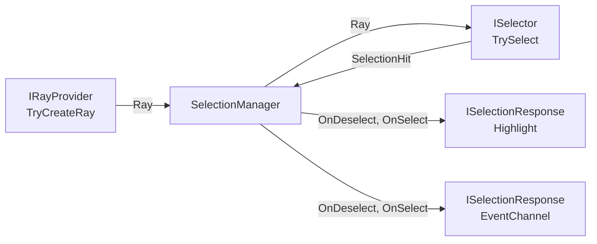

# 06 - Selection Systems and SOLID Design

Lab: [Lab 6 - Selection Systems](../labs/lab_6_selection_systems.md)

## Key Concepts

1. **Selection is four small jobs** - whatever the game, something makes a ray, something decides what it hit, something reacts, and something runs those steps in order.
2. **Give each job its own script** - if you change how hits are tested, only the hit-testing script should need editing.
3. **Ask for what a part does, not what it is** - the manager asks for "something that makes a ray", so the mouse, a crosshair or a turret can all supply one.
4. **Add new behaviour as a new component** - a hover sound is a new script on the object, not another `if` inside code that already works.
5. **Keep each interface small** - an interface that asks for one method is quick to implement and hard to get wrong.
6. **A replacement must do the whole job** - a selector that compiles but never selects anything breaks the game without an error.
7. **The Inspector becomes the settings panel** - the components on the `SelectionSystem` object decide how selection behaves, without code changes.
8. **React when the selection changes, not every frame** - a hover sound that replays every frame while the mouse rests on an object is a bug, not feedback.
9. **Write a shared rule once** - both selectors accept only tagged objects, so that rule lives in their base class and only the cast differs.
10. **Split only when a second version is needed** - one simple script is the right design until the game needs a different ray, hit test or reaction.

---

## 1. Framing Question

Your game needs to know what the player is pointing at, whether that is the crate under the mouse, the door in the crosshair or the item a gamepad cursor rests on, and several systems need to react when it changes. How do you build that so a teammate can change how pointing works, or add a new reaction, without rewriting the parts that already work?

Think of a game you have played recently. How does it show you what you are pointing at: an outline, a colour change, a sound, a prompt, or something else?

---

## 2. What You Will Learn

| Skill | You can... |
|:------|:-----------|
| Identify mixed responsibilities | List the separate reasons to change in a single-script selection system |
| Apply the five SOLID principles | Point to the class or interface in the selection system that shows each principle, and explain what it prevents |
| Design with interfaces as roles | Explain why `SelectionManager` depends on `IRayProvider`, `ISelector` and `ISelectionResponse` and not on concrete classes |
| Extend by composition | Add a new response or selector as a new component, with no change to `SelectionManager` |
| Use the Try pattern | Write and call a `bool TryX(..., out T result)` method |
| Use the Template Method pattern | Explain how `BaseCastSelector.TrySelect` fixes the selection rule while child classes supply the cast |
| Judge when to split | State when a single script is the better design, and what the split costs |

---

## 3. Why This Matters

Almost every 3D game selects things: the object under the mouse in a strategy game, the door in front of the crosshair in a first-person game, the item a gamepad cursor rests on. Selection looks small, so it usually starts as one script. Then the requests arrive. The level designer wants selection from the screen centre. Playtesters cannot hit small pickups. The audio designer wants a sound on hover, and the UI needs the object's name in the HUD. Each request edits the same script, and each edit risks breaking the requests already done.

That is a software design problem, not a selection problem. **SOLID** is a set of five design principles, named by Robert C. Martin, that address exactly this: code that is easy to extend without being rewritten. These notes use the selection system in `Assets/GD/Common/Scripts/Selection` as one worked case of all five, because each principle solves a problem you can see in the first version.

The GCA **Software Design** element asks for "clear responsibilities and an appropriate design approach such as composition, interfaces and/or a suitable design pattern". A system you can explain principle by principle, with a before and after, is direct evidence for that element and for **Improvement 1 or 2**.

---

## 4. Core Ideas

### 4.1 The Wrong Way: One Manager That Does Everything

Before looking at a good design, look at the design most selection systems drift into. `AllInOneSelectionManager` is what a single selection script becomes after a few weeks of feature requests. Each new request added a setting and an `if`, because that was the quickest change at the time.

```csharp
using TMPro;
using UnityEngine;
using UnityEngine.InputSystem;

// The wrong way: one class makes the ray, tests the hit and runs every reaction.
public class AllInOneSelectionManager : MonoBehaviour
{
    private enum RaySource { Mouse, ScreenCentre }
    private enum CastShape { Ray, Sphere }

    [Header("Ray")]
    [SerializeField] private RaySource raySource = RaySource.Mouse;
    [SerializeField] private Camera viewCamera;

    [Header("Hit Test")]
    [SerializeField] private CastShape castShape = CastShape.Ray;
    [SerializeField] private string selectableTag = "Selectable";
    [SerializeField, Min(0.01f)] private float maxDistance = 50f;
    [SerializeField, Min(0.01f)] private float sphereRadius = 0.5f;

    [Header("Reactions")]
    [SerializeField] private bool useHighlight = true;
    [SerializeField] private Material highlightMaterial;
    [SerializeField] private bool useSound;
    [SerializeField] private AudioSource audioSource;
    [SerializeField] private AudioClip selectClip;
    [SerializeField] private bool useLabel;
    [SerializeField] private TextMeshProUGUI selectionLabel;

    private Transform currentSelection;
    private Renderer highlightedRenderer;
    private Material originalMaterial;

    private void Awake()
    {
        if (viewCamera == null)
            viewCamera = Camera.main;
    }

    private void Update()
    {
        // Job 1: make the ray. Every new ray source adds another branch here.
        Ray ray;
        if (raySource == RaySource.Mouse)
        {
            Mouse mouse = Mouse.current;
            if (mouse == null) return;
            ray = viewCamera.ScreenPointToRay(mouse.position.ReadValue());
        }
        else
        {
            ray = viewCamera.ViewportPointToRay(new Vector3(0.5f, 0.5f, 0f));
        }

        // Job 2: test the hit. Every new cast shape adds another branch here.
        RaycastHit hit;
        bool didHit;
        if (castShape == CastShape.Ray)
            didHit = Physics.Raycast(ray, out hit, maxDistance);
        else
            didHit = Physics.SphereCast(ray, sphereRadius, out hit, maxDistance);

        Transform newSelection = didHit && hit.transform.CompareTag(selectableTag) ? hit.transform : null;
        if (newSelection == currentSelection) return;

        // Job 3: react. Every new reaction adds fields above and more code below.
        if (currentSelection != null)
        {
            if (useHighlight && highlightedRenderer != null)
                highlightedRenderer.sharedMaterial = originalMaterial;
            highlightedRenderer = null;

            if (useLabel)
                selectionLabel.text = string.Empty;
        }

        currentSelection = newSelection;

        if (currentSelection != null)
        {
            if (useHighlight && currentSelection.TryGetComponent(out highlightedRenderer))
            {
                originalMaterial = highlightedRenderer.sharedMaterial;
                highlightedRenderer.sharedMaterial = highlightMaterial;
            }

            if (useSound)
                audioSource.PlayOneShot(selectClip);

            if (useLabel)
                selectionLabel.text = currentSelection.name;
        }
    }
}
```

The code compiles, runs and does what was asked. Nothing in it is a beginner's mistake. The problems appear when you try to change it, share it or test it:

| Limitation | What goes wrong | Principle broken |
|:--|:--|:--|
| **Three jobs in one class** | Making the ray, testing the hit and reacting all live in `Update`. A change to any one of them means editing, and re-testing, the whole method | Single Responsibility |
| **Every feature is an edit** | A gamepad cursor, a box cast or a particle effect each need new fields and a new branch in code that already works. Each edit can break a feature that was finished | Open/Closed |
| **Settings that do not apply** | The Inspector shows `Sphere Radius` when `Cast Shape` is `Ray`, and `Select Clip` when `Use Sound` is cleared. A designer cannot tell which settings matter | Interface Segregation |
| **Tied to specific classes** | The manager names `Mouse`, `Physics`, `Material`, `AudioSource` and `TextMeshProUGUI` directly. It cannot run without all of them, even in a game with no HUD | Dependency Inversion |
| **Hidden crashes** | Tick `Use Sound` but leave `Audio Source` empty, and the game throws a `NullReferenceException` only when something is selected. Every flag needs its own check, and none is written here | - |
| **Combinations to test** | Two ray sources, two cast shapes and three on/off reactions give 2 x 2 x 8 = 32 configurations. Each new option doubles or multiplies the count | - |
| **No reuse** | An inventory screen that wants the same highlight on hover must copy the highlight code, because it is buried inside `Update` | - |
| **Merge conflicts** | In a group project, the programmer adding sound and the programmer adding the gamepad cursor both edit the same method in the same file, so Git reports conflicts every time | - |

The last row matters for the GCA: GitHub use is assessed, and a class that every teammate must edit is a constant source of conflicts.

The comments `Job 1`, `Job 2` and `Job 3` are the clue to the fix. Each job is a separate reason to change, so each should become a separate class. The rest of this section builds that design.

### 4.2 Selection as a Pipeline

Every selection system answers the same four questions each frame, whatever the game. In `AllInOneSelectionManager`, the first three questions are the three `Job` comments, all answered inside one method:

| Question | Role | Example answers |
|:--|:--|:--|
| Where does the ray come from? | **Ray provider** | The mouse position; the centre of the screen; a turret barrel |
| What does the ray select? | **Selector** | The first tagged object a thin ray hits; the first tagged object a sphere sweeps into |
| What happens when the selection changes? | **Response** | Highlight it; play a sound; show its name in the HUD |
| Who runs the steps in order? | **Manager** | Ask for a ray, test it, tell responses if the result changed |



The answers change from game to game, but the questions stay the same. That is the signal to split the code: each question becomes a role, described by an interface, and each answer becomes a class that fills that role. Changing an answer, for example from the mouse to the screen centre, then means swapping one class, not rewriting the system.

### 4.3 SOLID in One Table

| Principle | In plain terms | In the selection system |
|:--|:--|:--|
| **Single Responsibility (SRP)** | Each class has one job, so it has only one reason to be edited | The provider is edited only when the ray source changes; the selector only when the hit test changes; each response only when its reaction changes |
| **Open/Closed (OCP)** | You add new behaviour by adding new code, not by editing code that already works | A new response is a new component; `SelectionManager` is not edited |
| **Liskov Substitution (LSP)** | If code works with one implementation of an interface, it works with any other implementation of it | Replace `RayCastSelector` with `SphereCastSelector` and the manager still works |
| **Interface Segregation (ISP)** | An interface asks only for what its users actually call; several small interfaces beat one large one | Each interface has only the method or methods the manager calls |
| **Dependency Inversion (DIP)** | The class that controls the flow depends on interfaces, not on the specific classes that do the work | `SelectionManager` decides the order of the steps; it holds three interfaces and never names the classes that do the work |

You do not need to memorise the names to use the ideas. Read them as one story. Give each job its own class (SRP). Connect the classes through small interfaces (ISP and DIP). Make sure any class that fills an interface does the whole job (LSP). The payoff is OCP: new features arrive as new files, and working code stays untouched. Sections 4.4 to 4.8 show each idea in the code.

### 4.4 Interfaces as Roles

An interface names a role and the one thing a caller needs from it:

```csharp
public interface IRayProvider
{
    bool TryCreateRay(out Ray ray);
}

public interface ISelector
{
    bool TrySelect(Ray ray, out SelectionHit hit);
}

public interface ISelectionResponse
{
    void OnSelect(Transform selection);

    void OnDeselect(Transform selection);
}
```

`SelectionHit` is a small struct that holds the selected `Transform` and, where known, the hit point, normal and distance. An earlier version of `ISelector` returned Unity's `RaycastHit` instead; Note 10, Section 4.9 explains why that had to change.

`SelectionManager` stores its parts as these interface types:

```csharp
private IRayProvider rayProvider;
private ISelector selector;
private ISelectionResponse[] responses;
```

The manager compiles without knowing that `MouseScreenRayProvider` or `HighlightSelectionResponse` exist. It knows only the interfaces. This is **dependency inversion**.

Compare it with the single script in Section 5, Stage 1. There, the logic that runs selection each frame was tied directly to the details: the mouse, `Physics.Raycast` and a material. Now both sides depend on the interface in the middle. The manager calls the interface, and the concrete classes implement it. A wall socket works the same way: a lamp and a phone charger fit the same socket, and the wiring in the wall does not change when you plug in something new.

#### Why `GetComponent`, not `[SerializeField]`

Unity cannot serialize an interface field, so `[SerializeField] private IRayProvider rayProvider;` shows nothing in the Inspector and stays null. The manager finds its parts on its own GameObject instead:

```csharp
rayProvider = GetComponent<IRayProvider>();
selector = GetComponent<ISelector>();
responses = GetComponents<ISelectionResponse>();
```

`GetComponent<T>` accepts an interface type and returns the first component that implements it. The manager therefore uses whatever provider, selector and responses are attached to its GameObject. To change how selection works, you add, remove or swap components in the Inspector; you do not edit the manager. Section 4.9 covers the cost of this choice.

### 4.5 The Try Pattern

Some frames have no answer. If no mouse or other pointer is connected, the provider cannot make a ray. If the ray hits the floor or misses everything, there is nothing to select. The manager needs to know two things each frame: did this step work, and if so, what was the result?

A **Try method** answers both in one call. It returns `true` or `false` to say whether it worked, and hands back the result through an `out` parameter. The manager reads the result only when the method returned `true`:

```csharp
if (rayProvider.TryCreateRay(out Ray ray) && selector.TrySelect(ray, out SelectionHit hit))
    newSelection = hit.Transform;
```

You already use this pattern: `TryGetComponent`, `int.TryParse` and `Dictionary.TryGetValue` all follow it. Compare it with the alternatives:

| Design | Problem |
|:--|:--|
| `void Check(Ray ray)` then `Transform GetSelection()` | Two calls that must happen in the right order. Nothing stops a caller calling `GetSelection` first and getting last frame's answer |
| `Transform Select(Ray ray)` returning null for "nothing" | Works, but the caller loses the hit details: the hit point, surface normal and distance |
| `bool TrySelect(Ray ray, out SelectionHit hit)` | One call; the yes-or-no answer and the hit details arrive together |

The compiler also protects you. C# only lets you read `hit` inside the `if`, where `TrySelect` has returned `true`. Code that tries to use `hit` after a miss does not compile.

### 4.6 Template Method: Share the Rule, Vary the Step

Both selectors follow the same rule: cast, then accept the hit only if it carries the selectable tag. Only the cast differs. `BaseCastSelector` fixes the rule and leaves the cast to its children:

```csharp
public abstract class BaseCastSelector : MonoBehaviour, ISelector
{
    [SerializeField] protected string selectableTag = "Selectable";
    [SerializeField] protected LayerMask layerMask = ~0;
    [SerializeField] protected float maxDistance = 50;

    public bool TrySelect(Ray ray, out SelectionHit hit)
    {
        if (Cast(ray, out RaycastHit physicsHit) && physicsHit.transform.CompareTag(selectableTag))
        {
            hit = SelectionHit.FromRaycastHit(physicsHit);
            return true;
        }

        hit = default;
        return false;
    }

    protected abstract bool Cast(Ray ray, out RaycastHit hit);
}
```

```csharp
public class RayCastSelector : BaseCastSelector
{
    protected override bool Cast(Ray ray, out RaycastHit hit)
    {
        return Physics.Raycast(ray, out hit, maxDistance, layerMask);
    }
}
```

This is an excerpt: the complete classes, with their gizmos, are in the project. `TrySelect` is a **template method**: it fixes the order of the steps (cast, then check the tag), and each child class fills in the cast step. The tag check is written once, so changing the rule, for example to a layer check, means editing one file.

The class is marked `abstract`, so Unity will not let you add it to a GameObject; only its child classes can be added. That protects the Liskov substitution principle. An earlier version was a normal (concrete) class whose `Check` method had an empty body for children to replace. You could add that base class as a component by mistake. The manager accepted it, because it implemented `ISelector`, but it never selected anything and never reported an error. Making the class abstract turns that silent bug into something you cannot do.

### 4.7 Composition over Inheritance

An earlier version of the responses inherited from an abstract `SelectionResponse` base class that stored the previously selected object:

```csharp
public abstract class SelectionResponse : MonoBehaviour, ISelectionResponse
{
    public Transform PreviousTransform { get; set; }

    public virtual void OnSelect(Transform currentTransform)
    {
        PreviousTransform = currentTransform;
    }

    public virtual void OnDeselect(Transform currentTransform)
    {
    }
}
```

This base class caused three problems:

- **Unused state.** No response read `PreviousTransform`. The manager already passes the deselected object to `OnDeselect`, so the stored copy was never needed.
- **A rule to remember.** Every child had to call `base.OnSelect`. Forgetting it gave no error, only stale data.
- **Open to misuse.** The public setter let any script change `PreviousTransform`.

The base class added rules and state but no useful behaviour. The responses now implement `ISelectionResponse` directly, and each keeps only the state it needs. To give an object several reactions, you add several response components; you do not build a deeper class hierarchy. That is **composition over inheritance**.

The test from Note 02 still applies: use a base class when it removes real, repeated code from its children, as `BaseCastSelector` does with the tag rule and settings. Do not use one to hold state "in case a child needs it".

### 4.8 React to Change, Not to Frames

An earlier manager called `OnDeselect` and then `OnSelect` every frame while the mouse rested on an object. A highlight hid the problem, because setting the same material twice looks the same. A sound response played its clip every frame.

`SelectionManager` now compares the new selection with the current one and calls responses only when it changes:

```csharp
private void ChangeSelection(Transform newSelection)
{
    if (newSelection == currentSelection)
        return;

    if (currentSelection != null)
    {
        foreach (ISelectionResponse response in responses)
            response.OnDeselect(currentSelection);
    }

    currentSelection = newSelection;

    if (currentSelection != null)
    {
        foreach (ISelectionResponse response in responses)
            response.OnSelect(currentSelection);
    }
}
```

Every response relies on two promises from the manager. Together they form the **contract** between the manager and its responses:

1. `OnSelect` means "this object has just become selected", not "this object is still selected". A response can safely play a sound or start an effect in it.
2. The old object is always deselected before the new one is selected. A response that changes one object at a time, such as the highlight, always restores the old object first.

### 4.9 The Costs of the Split

The split design is not free:

- **More files.** One 50-line script became eleven files. A reader needs the pipeline diagram (Section 4.2) to see how they connect.
- **Hidden dependencies.** With a serialized field, an empty slot in the Inspector warns you that something is missing. `GetComponent<IRayProvider>()` has no slot, so nothing warns you until you press Play; then the manager logs an error and disables itself. `[RequireComponent]` cannot fill the gap, because it needs a specific component class, not an interface.
- **Disabled is not removed.** `GetComponent` returns disabled components too. Disabling a `RayCastSelector` does not make the manager use the `SphereCastSelector` below it. Remove the part you are not using.
- **First match wins.** With two selectors on the object, `GetComponent<ISelector>()` returns the first one it finds. Keep exactly one provider and one selector.
- **Responses are collected once.** The manager calls `GetComponents<ISelectionResponse>()` in `Awake`. A response added during Play is not called.

### 4.10 Decision: Split or Keep One Script?

| Situation | Choice |
|:--|:--|
| One ray source, one hit test, one reaction, and no request for more | One script (Section 5, Stage 1) |
| A second variant of any role is needed | Split that role behind an interface |
| Several systems outside the selection object react to selection | Add `EventChannelSelectionResponse` (Note 04) rather than more responses that reference the HUD or audio |
| Responses need the hit point or normal, not just the object | Change `ISelectionResponse` to receive the `SelectionHit`, and update every response once |

---

## 5. Worked Example

The demo builds hover selection for a small scene of crates. It follows the module's iteration sequence: initial implementation, problem, change, improvement.

### Stage 1 - Initial Implementation: One Script

`MouseHighlighter` does everything: it makes the ray, tests the hit and swaps the material. It is a reasonable first version and you should not feel bad about writing it.

```csharp
using UnityEngine;
using UnityEngine.InputSystem;

public class MouseHighlighter : MonoBehaviour
{
    [SerializeField] private Camera viewCamera;
    [SerializeField] private Material highlightMaterial;
    [SerializeField] private string selectableTag = "Selectable";
    [SerializeField, Min(0.01f)] private float maxDistance = 50f;

    // The renderer currently highlighted, and the material it had before.
    private Renderer highlightedRenderer;
    private Material originalMaterial;

    private void Awake()
    {
        if (viewCamera == null)
            viewCamera = Camera.main;
    }

    private void Update()
    {
        // Mouse.current is null when no mouse is connected.
        Mouse mouse = Mouse.current;
        if (mouse == null) return;

        // Job 1: make a ray from the camera through the mouse.
        Ray ray = viewCamera.ScreenPointToRay(mouse.position.ReadValue());

        // Job 2: decide what the ray selects.
        Renderer hitRenderer = null;
        if (Physics.Raycast(ray, out RaycastHit hit, maxDistance) && hit.transform.CompareTag(selectableTag))
            hit.transform.TryGetComponent(out hitRenderer);

        if (hitRenderer == highlightedRenderer) return;

        // Job 3: restore the old object and highlight the new one.
        if (highlightedRenderer != null)
            highlightedRenderer.sharedMaterial = originalMaterial;

        highlightedRenderer = hitRenderer;

        if (highlightedRenderer != null)
        {
            // sharedMaterial swaps the reference only; .material would leak a copy on every hover.
            originalMaterial = highlightedRenderer.sharedMaterial;
            highlightedRenderer.sharedMaterial = highlightMaterial;
        }
    }
}
```

It works, and it only reacts when the selection changes.

### Stage 2 - Problem: Three Requests

Three requests arrive in the same week:

| Request | Edit needed in `MouseHighlighter` |
|:--|:--|
| The first-person level selects from the screen centre | Job 1: add a `RaySource` setting and an `if` |
| Small pickups are hard to hit | Job 2: add a `CastShape` setting, a radius and another `if` |
| Play a sound and show the object's name in the HUD | Job 3: add on/off flags, an `AudioSource`, a clip and a reference to the HUD label |

After all three, the class has become `AllInOneSelectionManager` from Section 4.1: two mode settings, three on/off flags, and references to audio and UI. Two ray sources times two casts gives four combinations to test, and each new reaction is added next to the code of the others, where a mistake can break them.

The comments `Job 1`, `Job 2` and `Job 3` already pointed at the problem. The class has three jobs, so it has three reasons to be edited, which breaks SRP. Every request is met by editing code that already works, rather than by adding new code, which breaks OCP.

### Stage 3 - Change: One Role per Class

Each job becomes a role with an interface (Section 4.4), and `SelectionManager` runs them in order:

```csharp
using UnityEngine;

namespace GD
{
    /// <summary>
    /// Runs the selection pipeline each frame: the provider creates a ray, the selector
    /// tests it, and every response on this GameObject is told when the selection changes.
    /// </summary>
    public class SelectionManager : MonoBehaviour
    {
        #region Fields

        private IRayProvider rayProvider;
        private ISelector selector;
        private ISelectionResponse[] responses;

        private Transform currentSelection;

        #endregion Fields

        #region Properties

        /// <summary>The selected object, or null when nothing is selected.</summary>
        public Transform CurrentSelection => currentSelection;

        #endregion Properties

        #region Unity Messages

        private void Awake()
        {
            // Interfaces cannot be serialized fields, so the parts are found by component lookup.
            rayProvider = GetComponent<IRayProvider>();
            selector = GetComponent<ISelector>();
            responses = GetComponents<ISelectionResponse>();

            if (rayProvider == null || selector == null)
            {
                Debug.LogError($"{name}: SelectionManager needs an IRayProvider and an ISelector on the same GameObject.", this);
                enabled = false;
            }
        }

        private void Update()
        {
            Transform newSelection = null;

            if (rayProvider.TryCreateRay(out Ray ray) && selector.TrySelect(ray, out SelectionHit hit))
                newSelection = hit.Transform;

            ChangeSelection(newSelection);
        }

        private void OnDisable()
        {
            // Clear any highlight left behind when the manager is switched off.
            ChangeSelection(null);
        }

        #endregion Unity Messages

        #region Core Methods

        private void ChangeSelection(Transform newSelection)
        {
            // Responses run only when the selection changes, not every frame.
            if (newSelection == currentSelection)
                return;

            if (currentSelection != null)
            {
                foreach (ISelectionResponse response in responses)
                    response.OnDeselect(currentSelection);
            }

            currentSelection = newSelection;

            if (currentSelection != null)
            {
                foreach (ISelectionResponse response in responses)
                    response.OnSelect(currentSelection);
            }
        }

        #endregion Core Methods
    }
}
```

The three jobs from Stage 1 move into `MouseScreenRayProvider`, `RayCastSelector` and `HighlightSelectionResponse`. Notice what `SelectionManager` does not contain: no `Physics`, no `Camera`, no `Material`. It holds the sequence and the change check, and nothing else.

`MouseScreenRayProvider` also changes how it reads the pointer. Stage 1 read `Mouse.current` directly. The provider reads an `InputActionReference`, for example `UI/Point` in `InputSystem_Actions`, so mouse, pen and touch all work without code changes.

### Stage 4 - Improvement: The Requests as New Components

Each Stage 2 request is now a component change, and `SelectionManager` is not edited:

| Request | Change |
|:--|:--|
| Screen-centre selection | Replace `MouseScreenRayProvider` with `GameObjectRayProvider`, target the camera |
| Small pickups | Replace `RayCastSelector` with `SphereCastSelector` and set `Sphere Radius` |
| HUD name | Add `EventChannelSelectionResponse` and raise a `GameObjectEventChannel`; the HUD listens with `GameObjectEventChannelListener` (Note 04) |
| Sound | Add the new response below |

The sound response is new code, but it is new code in a new file:

```csharp
using GD;
using UnityEngine;

/// <summary>
/// Plays a short sound when an object becomes selected.
/// </summary>
[RequireComponent(typeof(AudioSource))]
public class AudioSelectionResponse : MonoBehaviour, ISelectionResponse
{
    [SerializeField] private AudioClip selectClip;

    private AudioSource audioSource;

    private void Awake()
    {
        audioSource = GetComponent<AudioSource>();
    }

    public void OnSelect(Transform selection)
    {
        // PlayOneShot lets a new hover start before the last sound has finished.
        if (selectClip != null)
            audioSource.PlayOneShot(selectClip);
    }

    public void OnDeselect(Transform selection)
    {
        // No reaction on deselect.
    }
}
```

`OnDeselect` is empty because the interface requires it, and the comment says the empty body is deliberate. Because the manager calls `OnSelect` only on a change (Section 4.8), the sound plays once per new object, not every frame.

The HUD route is worth a comment. The HUD could be one more response with a direct reference to a label. Raising a channel instead means the HUD, an achievement tracker or a tutorial prompt can react without the selection object holding a reference to any of them, and the HUD can live in another scene (Note 05).

What changed, as a Problem, Solution, Benefit summary:

| Problem | Solution | Benefit |
|:--|:--|:--|
| One script made the ray, tested the hit and reacted; every request edited it, and options multiplied as flags | Three interfaces for three roles; `SelectionManager` depends only on the interfaces; each variant is its own component | Ray source, hit test and reactions change independently; a new reaction is a new file; the manager has not changed since it was written |

---

## 6. Common Pitfalls

| Symptom | Cause | Fix |
|:--|:--|:--|
| Console: "SelectionManager needs an IRayProvider and an ISelector" | A provider or selector is missing, or is on a different GameObject | Put all the parts on the same GameObject as `SelectionManager` |
| Nothing is ever selected, with no error | The object is not tagged `Selectable`, or its layer is not in `Layer Mask` | Check the tag and the selector's `Layer Mask` |
| Disabling a selector has no effect | `GetComponent` returns disabled components | Remove the selector you are not using |
| A new response does nothing | It was added during Play, after `Awake` collected the responses | Add responses in Edit mode, then press Play |
| A response's effect stays on an object | `OnDeselect` does not undo what `OnSelect` did | Store what you changed in `OnSelect` and restore it in `OnDeselect` |
| A sound plays every frame while hovering | The response was called from `Update`, not from the manager's change check | Call responses only through `SelectionManager` |
| Material copies build up in the Memory Profiler | The response uses `renderer.material`, which creates a copy | Swap `renderer.sharedMaterial` instead |
| A close object cannot be selected with a sphere cast | `SphereCast` ignores colliders that already overlap the sphere at the ray origin | Start the ray outside selectable objects, or use a ray cast for close range |
| An object behind a wall cannot be selected | The ray stops at the first collider, tagged or not | Intended; remove the wall's layer from `Layer Mask` only if see-through selection is wanted |

---

## 7. Software Development Parallels

- **Strategy** (Gang of Four). A strategy is an interchangeable algorithm behind an interface. Ray providers and selectors are strategies: the manager uses whichever one is on the object. The movement systems in Note 07 use the same pattern to swap a Transform, Rigidbody or NavMesh mover.
- **Template Method** (Gang of Four). `BaseCastSelector.TrySelect` fixes the steps and leaves one step to child classes (Section 4.6).
- **Dependency inversion and plug-in architectures.** Editors, IDEs and browsers load plug-ins that implement an interface the host defines. The host never references a plug-in by name. `SelectionManager` is a small host; responses are its plug-ins.
- **The Try pattern in .NET.** `int.TryParse`, `Dictionary.TryGetValue` and Unity's `TryGetComponent` all return `bool` with the result in an `out` parameter (Section 4.5).
- **Unity's own selection pipeline.** Unity's UI `EventSystem` uses the same split: raycaster components (`GraphicRaycaster`, `PhysicsRaycaster`) decide what the pointer is over, and separate handler components react. You swap raycasters without changing the `EventSystem`.
- **Commercial games.** Strategy games such as *StarCraft II* select the unit under the mouse cursor; first-person games such as *Half-Life 2* select the usable object at the centre of the screen. The responses (highlight, prompt, sound) are the same kind of thing; only the ray provider differs.

---

## 8. Exercises

### Core - Screen-Centre Provider

Write `ScreenCentreRayProvider`, an `IRayProvider` that returns a ray from the camera through the centre of the viewport. Use `Camera.ViewportPointToRay(new Vector3(0.5f, 0.5f, 0f))`. Return false if no camera is available.

**Expected result:** replacing `MouseScreenRayProvider` with your provider selects whatever is at the screen centre. No other file changes. State which SOLID principle the "no other file changes" result demonstrates.

### Apply - Two Routes to the HUD

Show the selected object's name in a HUD label in two ways: first as a response that holds a direct reference to the `TextMeshProUGUI` label, then through `EventChannelSelectionResponse` and a `GameObjectEventChannelListener`.

**Expected result:** both versions show the name on select and clear it on deselect. In 100 to 150 words, compare them using Note 04, Section 4.8: which is simpler, which survives moving the HUD to its own scene, and which would you choose for your group project?

### Challenge - A Pluggable Filter

`BaseCastSelector` decides selectability with a tag. Your group wants some objects to be selectable only when the player is near, and others only while a quest is active. Design the change: either an `ISelectionFilter` interface checked by the selector, or another approach you can justify.

**Expected result:** a working filter for one of the two rules, and 150 to 200 words that justify your design against OCP and against Key Concept 10. Say what you would build if the group only ever needed the tag rule.

---

## 9. Reflective Questions

1. `MouseHighlighter` in Stage 1 worked. At what point in Stage 2 did splitting it become worth the cost, and which principle tells you so?
2. `ISelectionResponse` passes a `Transform`, not a `SelectionHit`. A teammate wants a response that spawns sparks at the hit point. Would you change the interface, add a second interface, or do something else? Justify your choice against ISP.
3. `SelectionManager` finds its parts with `GetComponent` rather than serialized fields. Argue for and against this choice in terms of discoverability and DIP.
4. The earlier `BaseCastSelector` was concrete with an empty `Check`. Explain why that breaks LSP even though it compiles and never throws.
5. Which system in your group project has the most reasons to change? Name them, and say which one you would split first.

---

## 10. How This Builds

- **[Lab 6](../labs/lab_6_selection_systems.md)** assembles the pipeline from the shared components in a scene of its own, swaps strategies without code, writes a new response, routes selection to the HUD through an event channel, and uses the debugger to show why disabling a component did not change the selector.
- **Next, movement systems** ([Note 07](07_movement_systems.md)) use the same Strategy and composition approach to choose between Transform, Rigidbody, CharacterController and NavMesh movement behind one interface.
- **Note 11 - Interpolation, Easing and Tweening** adds an eased response beside the instant `HighlightSelectionResponse`, with no change to `SelectionManager`. The new behaviour stays inside one response, which is the payoff of SRP.
- **Note 16 - State Machines and the State Pattern** builds states as small classes behind one interface, which is the same design move as the responses here.
- **GCA - C# & Software Design - Software Design:** a system you can explain principle by principle, with the Stage 1 version as the "before", is direct evidence for this element and for an Iteration & Improvement before-and-after.

---

## Glossary

| Term | Definition |
|:-----|:-----------|
| Composition over inheritance | Combining behaviour by attaching several small components, rather than by building deeper class hierarchies |
| Contract | The promises a caller and an implementation rely on, such as when a method is called and in what order |
| Dependency inversion | The class that controls the flow depends on interfaces, not on the specific classes that do the work; those classes implement the same interfaces |
| Interface segregation | A caller depends only on the members it uses, so interfaces stay small and role-specific |
| Liskov substitution | Any implementation of a type can replace another without breaking the code that uses the type |
| Open/Closed | Code is open for extension (new classes) and closed for modification (existing classes are not edited) |
| Ray provider | The role that creates the ray used for selection, through `IRayProvider` |
| Response | The role that reacts when the selection changes, through `ISelectionResponse` |
| Selector | The role that decides what a ray selects, through `ISelector` |
| Single responsibility | A class has one reason to change |
| SOLID | Five design principles for code that can be extended without rewriting: single responsibility, open/closed, Liskov substitution, interface segregation, dependency inversion |
| Template method | A base class method that fixes the steps of an algorithm and leaves one or more steps to child classes |
| Try method | A method that returns `bool` for success and passes its result through an `out` parameter |
