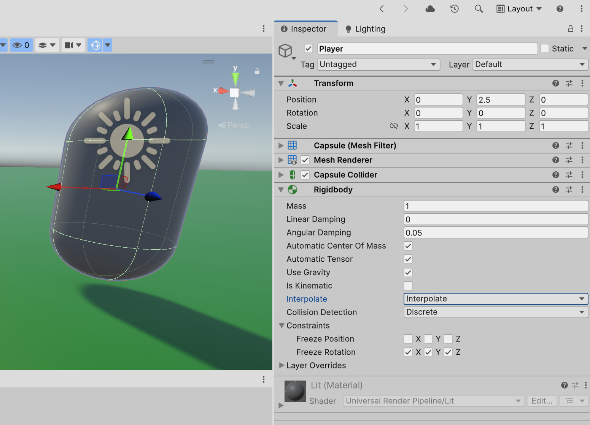
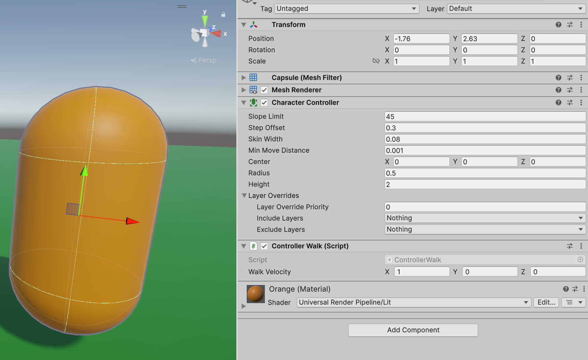
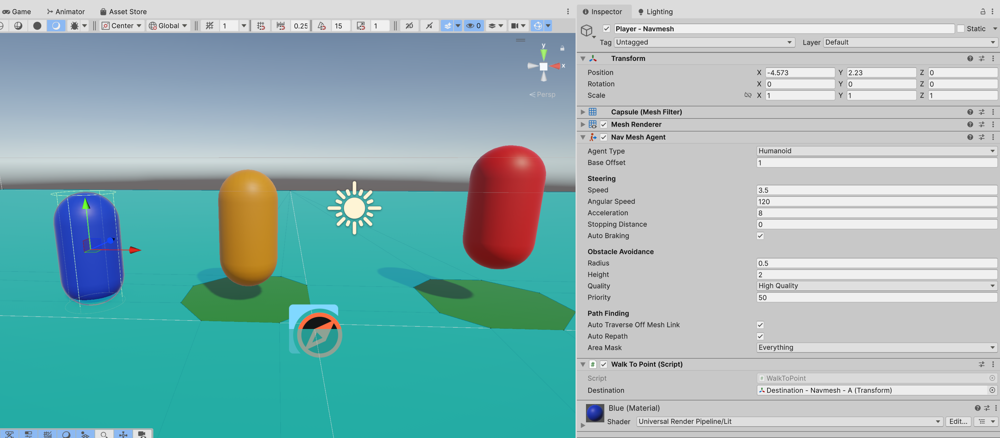
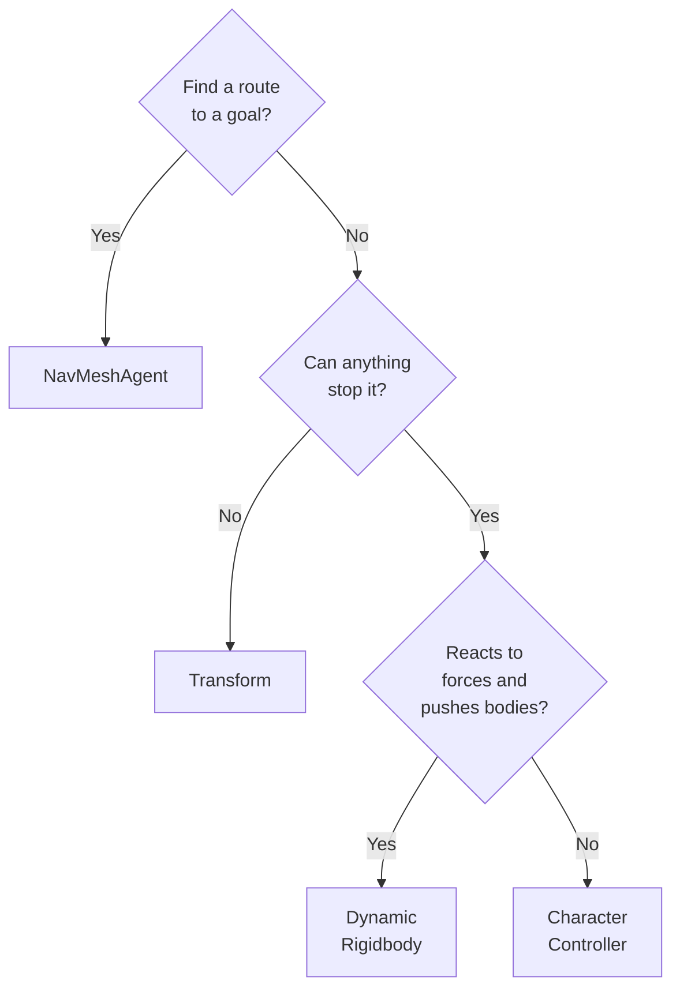
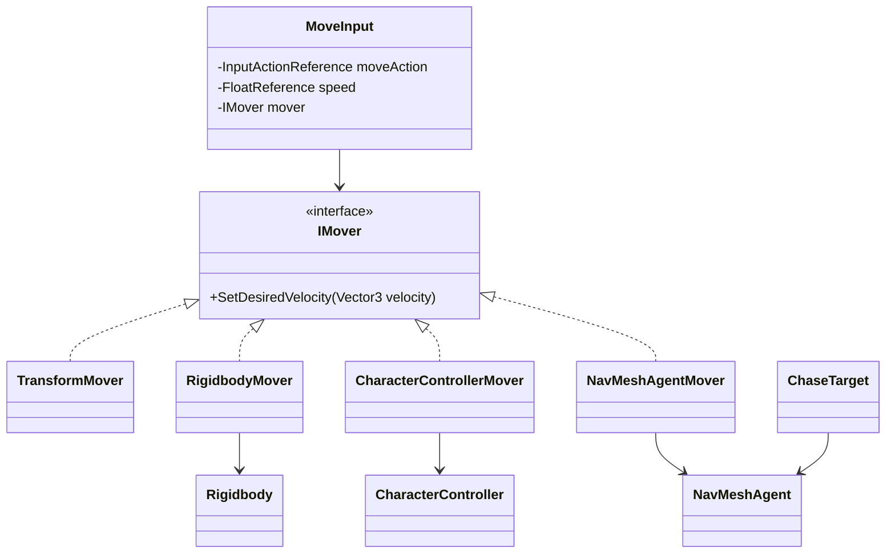

# 07 - Movement Systems

Lab: [Lab 7 - Movement Systems](../labs/lab_7_movement_systems.md)

## Key Concepts

1. **One owner per position** - the Transform, the physics engine, a CharacterController or a NavMeshAgent can each decide where an object is, but only one of them should decide it at a time.
2. **Transform movement ignores the world** - writing `transform.position` moves an object through walls, because nothing checks the move.
3. **Physics bodies move in `FixedUpdate`** - a dynamic Rigidbody is moved by setting its velocity or adding forces on the physics step, never by writing its Transform.
4. **Keep what you do not control** - a mover that sets horizontal velocity must keep the vertical velocity, or gravity stops working.
5. **A CharacterController collides but does not simulate** - it slides along walls and climbs steps, and you supply gravity yourself.
6. **A NavMeshAgent moves where the map allows** - it plans a path across a baked NavMesh and never leaves it.
7. **Choose by the problem, not by habit** - pushing crates, precise platforming and enemies that find the player are three different movement problems.
8. **Separate intent from motion** - input decides where the player wants to go; a mover decides how the object gets there.
9. **The interface hides when movement runs** - callers set a velocity at any time; each mover applies it in the loop its system needs.
10. **Abstract only what varies** - an enemy that chases with `SetDestination` does not need to go through the player's movement interface.

---

## 1. Framing Question

Your player has to walk up a ramp, stop at walls, push a crate and fall off a ledge, and an enemy has to find its way to the player around obstacles. Unity offers at least four ways to move an object. Which one fits each job, and how do you write the player's controls so that changing the movement approach does not mean rewriting them?

Think of a game you have played recently. When the character walks into a wall, does it stop dead, slide along the wall, or bounce off? Which of those feels right for that game?

---

## 2. What You Will Learn

| Skill | You can... |
|:------|:-----------|
| Compare movement approaches | State who owns the position, how collisions are handled and which loop runs the movement for Transform, Rigidbody, CharacterController and NavMeshAgent movement |
| Move a Rigidbody correctly | Set velocity in `FixedUpdate` while keeping the vertical velocity from gravity |
| Use a CharacterController | Apply gravity yourself and call `Move` once per frame |
| Use a NavMesh | Bake a `NavMeshSurface` and send an agent to a destination |
| Choose an approach | Pick a movement approach for a stated gameplay problem and justify it |
| Apply the Strategy pattern | Swap movers behind `IMover` with no change to the input code |
| Judge the limits of an abstraction | Explain why destination-based movement does not belong in `IMover` |

---

## 3. Why This Matters

Movement is the first system a player touches, and it touches almost every other system: collisions, triggers, cameras, animation and AI all depend on where things are and how they got there. Movement bugs are also among the hardest to explain without the right model. A player who sinks slowly off a ledge, jitters against a wall or walks through a door frame usually has two systems that both think they own the position, or one system running in the wrong loop.

Unity does not have one correct way to move an object. It has several systems, each built for a different problem. A physics puzzle where the player shoves crates needs the physics engine. A tight platformer needs a controller that stops exactly where you tell it. An enemy that walks round a table to reach you needs pathfinding. Choosing well is a design decision you will be asked to explain in the GCA.

The second half of the note applies Note 06 to movement. If the code that reads input also moves the object, every change of movement approach rewrites the input code. Splitting **intent** (where the player wants to go) from motion (how the object gets there) lets you change one without the other, and gives you a before-and-after for **Software Design** and **Iteration & Improvement**.

---

## 4. Core Ideas

### 4.1 Who Owns the Position?

Every frame, something decides where each object is. The four movement approaches differ in who that is:

| Approach | Who owns the position | Collides with walls | Gravity | Loop |
|:--|:--|:--|:--|:--|
| Transform | Your script, directly | No | No | `Update` |
| Dynamic Rigidbody | The physics engine | Yes, with physical response | Yes | `FixedUpdate` |
| CharacterController | Your script, through `Move` | Yes, slides along them | No, you add it | `Update` |
| NavMeshAgent | The agent, along a path | Stays inside the NavMesh | No, it follows the NavMesh surface | Agent update, each frame |

The **position owner** is the system whose decision wins. When two systems both write the position, for example a script writing `transform.position` on an object that also has a dynamic Rigidbody, they overwrite each other. The usual symptoms are jitter, objects passing through walls and movement that only works at some frame rates. Most movement bugs at this level come from mixing owners, so the first question when movement misbehaves is: which system owns this object's position, and does anything else write it?

### 4.2 Transform Movement

Writing the Transform is the movement you met in Note 01, Section 4.4:

```csharp
using UnityEngine;

public class TransformDrift : MonoBehaviour
{
    [SerializeField] private Vector3 velocity = new Vector3(0f, 0f, 2f);

    private void Update()
    {
        // The object is placed at the new position; nothing checks what is in the way.
        transform.position += velocity * Time.deltaTime;
    }
}
```

The object is moved to the new position whether or not something is in the way. Walls, floors and ramps have no effect on the moving object itself.

Its effect on dynamic bodies is unreliable. A collider on an object with no Rigidbody is a **static collider**: the physics engine treats it as level geometry that does not move, so moving it through the Transform teleports it rather than pushing anything. Dynamic bodies that have come to rest are put to **sleep** after a short time, so the engine can skip them, and a static collider moved into a sleeping body does not wake it. A crate that is still awake, for example one still rolling after a fall, is shoved out of the overlap, often violently. A crate that has gone to sleep, which takes less than a second at rest, is walked straight through. To push dynamic bodies every time, the moving object needs a Rigidbody of its own (Section 4.3).

That makes Transform movement the right choice when nothing should stop the object: a camera rig, a floating pickup that bobs in place, a decorative moving prop, or a projectile that checks its own hits with a raycast. It is the wrong choice for anything that must stand on floors and stop at walls.

### 4.3 Rigidbody Movement

A **dynamic Rigidbody** hands the position to the physics engine. The engine applies gravity, resolves collisions and pushes other bodies, on its own fixed timestep. You influence the body by changing its velocity or adding forces, and you do it in `FixedUpdate`, which runs once per physics step (Note 01, Section 4.4).

```csharp
using UnityEngine;

[RequireComponent(typeof(Rigidbody))]
public class RigidbodyWalk : MonoBehaviour
{
    [SerializeField] private Vector3 walkVelocity = new Vector3(0f, 0f, 3f);

    private Rigidbody body;

    private void Awake()
    {
        body = GetComponent<Rigidbody>();
    }

    private void FixedUpdate()
    {
        // Replace the horizontal velocity, but keep the vertical velocity from gravity.
        Vector3 velocity = walkVelocity;
        velocity.y = body.linearVelocity.y;
        body.linearVelocity = velocity;
    }
}
```

The non-obvious line is `velocity.y = body.linearVelocity.y`. Gravity adds downward velocity on every physics step. If you set the whole velocity each step, you throw that away, and a body that walks off a ledge drifts down at about 0.2 m/s instead of falling. Lab 7 makes you find this bug with the debugger.

Unity 6 names the property `linearVelocity`. Older tutorials use `velocity`, which is now obsolete.

There are two ways to drive a dynamic body:

| Technique | Code | Feels like | Use for |
|:--|:--|:--|:--|
| Set velocity | `body.linearVelocity = ...` | Instant, exact response; collisions still stop the body | Player characters that must respond at once |
| Add force | `body.AddForce(..., ForceMode.Force)` | Gradual, with momentum and mass | Vehicles, rolling balls, anything that should feel heavy |

Three settings matter for a character made of a capsule:

- **Freeze rotation.** A capsule pushed at its side falls over. Set `Constraints > Freeze Rotation` X, Y and Z, or set `body.freezeRotation = true` in code.
- **Rigidbody interpolation.** The physics step (default 0.02 s) and the frame rate do not match, so a fast body can appear to stutter when a camera follows it. `Interpolate` draws the body between its last two physics positions, which smooths what you see without changing the simulation.
- **Friction against walls.** Holding a direction into a wall while falling can make the capsule stick to the wall, because friction resists the slide. A `Physics Material` with zero friction on the player's collider removes it.



A **kinematic Rigidbody** (`Is Kinematic` ticked) is a different tool. Physics does not move it; you move it with `body.MovePosition` in `FixedUpdate`. It pushes dynamic bodies out of its way but is not stopped by anything, so it suits moving platforms and doors, not players.

### 4.4 CharacterController Movement

A **CharacterController** is a capsule collider with its own movement method. You pass `Move` the distance to travel this frame. The controller sweeps its capsule along that path and, when it hits something, slides along the surface for the rest of the distance. This is called **collide and slide**. It stops exactly where you would expect, climbs small steps and walks up slopes, but it is not a physics body: it ignores gravity and forces, and it does not push dynamic bodies.

```csharp
using UnityEngine;

[RequireComponent(typeof(CharacterController))]
public class ControllerWalk : MonoBehaviour
{
    [SerializeField] private Vector3 walkVelocity = new Vector3(0f, 0f, 3f);

    private CharacterController controller;
    private float verticalSpeed;

    private void Awake()
    {
        controller = GetComponent<CharacterController>();
    }

    private void Update()
    {
        // isGrounded reports the result of the previous Move call.
        if (controller.isGrounded && verticalSpeed < 0f)
            verticalSpeed = -2f;

        // The controller has no gravity of its own, so add it here.
        verticalSpeed += Physics.gravity.y * Time.deltaTime;

        Vector3 velocity = walkVelocity;
        velocity.y = verticalSpeed;

        // One Move call per frame, with the whole frame's movement.
        controller.Move(velocity * Time.deltaTime);
    }
}
```

The lines that need explaining:

- `isGrounded` is not checked against the world when you read it. It is set by the last `Move` call, if that call touched ground below the capsule. Calling `Move` several times a frame, or not at all, makes it unreliable.
- When grounded, the vertical speed is reset to a small downward value rather than to zero. A zero speed moves the capsule nowhere, so the next `Move` may not touch the ground, and `isGrounded` flickers between `true` and `false`. A steady push of -2 m/s keeps the capsule pressed onto the floor and onto slopes it walks down.
- Gravity accumulates in `verticalSpeed` across frames, so falls speed up the way they should.

The controller's own settings shape how it moves:

| Setting | Effect |
|:--|:--|
| `Slope Limit` | The steepest slope, in degrees, the controller walks up |
| `Step Offset` | The tallest step it climbs without jumping |
| **Skin width** | A thin margin around the capsule that stops it sticking inside walls; Unity recommends about 10% of the radius |
| `Center`, `Radius`, `Height` | The capsule shape; match them to the character's model |



A CharacterController is itself a collider. Remove any other collider on the same object, such as the `CapsuleCollider` a Capsule primitive comes with, so the two do not interfere.

To push crates with a CharacterController, you write the push yourself in `OnControllerColliderHit`. That is a strength as well as a cost: the controller only does what you tell it to, which is why precise platformers and many first-person games use this kind of movement.

### 4.5 NavMesh Movement

A **NavMesh** is a simplified map of the walkable surfaces in a scene, made of connected polygons. A **NavMeshAgent** uses it to plan a path to a destination and then moves along that path, steering around obstacles and other agents. The agent owns the position and never leaves the NavMesh.

The NavMesh is not built at runtime by default. You **bake** it in the Editor with a **NavMeshSurface** component from the AI Navigation package: the surface collects the geometry, works out where an agent of a given radius, height and maximum slope can stand, and saves the result as an asset.



Sending an agent somewhere is one call:

```csharp
using UnityEngine;
using UnityEngine.AI;

[RequireComponent(typeof(NavMeshAgent))]
public class WalkToPoint : MonoBehaviour
{
    [SerializeField] private Transform destination;

    private NavMeshAgent agent;

    private void Start()
    {
        agent = GetComponent<NavMeshAgent>();

        // SetDestination fails with an error if the agent is not standing on a baked NavMesh.
        if (destination != null && agent.isOnNavMesh)
            agent.SetDestination(destination.position);
    }

    private void Update()
    {
        // The path is calculated over the next few frames; pathPending is true until it is ready.
        if (!agent.pathPending && agent.hasPath && agent.remainingDistance <= agent.stoppingDistance)
            Debug.Log($"{name}: arrived.", this);
    }
}
```

The agent's `Speed`, `Angular Speed`, `Acceleration` and `Stopping Distance` are set in its Inspector. The movement is driven by a destination, not by a direction: the agent decides the route and the steps, and your code decides the goal.

The agent can also be moved by a direction. `agent.Move(offset)` moves it by an offset, but only as far as the NavMesh allows, so the agent slides along the edges of the walkable area instead of walking off a ledge or through a wall. That is how a player can be driven by input and still be held to the NavMesh, which suits top-down games where the player must never leave the playable area.

### 4.6 Choosing an Approach

| Gameplay problem | Approach | Why |
|:--|:--|:--|
| The player pushes crates, is knocked back by explosions, rolls down hills | Dynamic Rigidbody | The physics engine already resolves forces and pushes between bodies |
| The player must stop exactly at walls, climb steps and land where expected | CharacterController | Collide and slide gives precise, predictable movement with no physical surprises |
| An enemy must reach the player around obstacles | NavMeshAgent | Pathfinding plans a route; writing your own is far more work |
| Click-to-move, as in a top-down action game | NavMeshAgent | The click is a destination; the agent finds the path |
| A floating pickup, a camera rig, a moving decoration | Transform | Nothing should stop it, so collision checks would be wasted |
| A moving platform the player stands on | Kinematic Rigidbody | It pushes dynamic bodies and is not pushed back |



The chart is a starting point, not a rule. Many games combine approaches: a CharacterController player with a short push written in `OnControllerColliderHit`, or a NavMeshAgent enemy that switches to a Rigidbody when it is knocked back. When you combine them, make sure only one system owns the position at any moment.

### 4.7 Separate Intent from Motion

The player's controls answer one question: where does the player want to go? The movement approach answers a different question: how does the object get there? If both live in one script, changing the movement approach rewrites the controls too.

The fix is the same one Note 06 used for selection. Give the motion its own role, described by an interface, and let the input code depend only on the interface:

```csharp
using UnityEngine;

public interface IMover
{
    void SetDesiredVelocity(Vector3 velocity);
}
```

The input component turns the `Move` action into a velocity and passes it on. Each **mover** fills the role differently:

| Mover | What `SetDesiredVelocity` leads to |
|:--|:--|
| `TransformMover` | `transform.position` changes in `Update` |
| `RigidbodyMover` | `linearVelocity` changes in `FixedUpdate`, keeping gravity |
| `CharacterControllerMover` | `Move` is called in `Update`, with gravity added |
| `NavMeshAgentMover` | `agent.Move` is called in `Update`, held to the NavMesh |

This is the **Strategy pattern**: a family of interchangeable algorithms behind one interface, chosen by whichever component is on the GameObject.

The interface also hides a timing difference. The input component can call `SetDesiredVelocity` from `Update`, but a Rigidbody must be moved in `FixedUpdate`. The method only stores the request; each mover applies it in the loop its system needs. Callers never need to know which loop that is. The interface is about the request, not the timing.

The velocity is a request, not a command. The Rigidbody mover may be stopped by a wall, and the NavMesh mover may be held at an edge. That is why the method is named `SetDesiredVelocity` rather than `SetVelocity`.

### 4.8 Not Every Mover Fits the Interface

A NavMeshAgent's natural input is a destination. `NavMeshAgentMover` can fill `IMover` through `agent.Move`, which is right for a player who steers with a stick. An enemy that chases the player should not, because converting "go to the player" into a velocity each frame throws away the pathfinding that made you choose a NavMesh.

The tempting fix is to widen the interface:

```csharp
public interface IMover
{
    void SetDesiredVelocity(Vector3 velocity);

    void SetDestination(Vector3 destination);
}
```

Every mover must now implement `SetDestination`. `TransformMover` and `RigidbodyMover` cannot plan a path, so they either ignore the call or move in a straight line through walls. Both break the Liskov substitution rule from Note 06: code that calls `SetDestination` works with one mover and silently fails with the others. Interface segregation gives the better answer: the enemy uses the `NavMeshAgent` directly, through a small `ChaseTarget` component, and `IMover` stays one method long.

This is Key Concept 10 in practice. `IMover` exists because the player's movement approach varies. Nothing varies in how the enemy chases, so it does not need an interface. If a later design has several chase strategies, that is the time to add one.

### 4.9 The Costs of the Split

- **First match wins.** The input component finds its mover with `GetComponent<IMover>()`, so the costs from Note 06, Section 4.9 apply: no Inspector slot warns you about a missing mover, a disabled mover is still found, and with two movers the first one is used.
- **Movers bring components with them.** `RigidbodyMover` needs a `Rigidbody`, `CharacterControllerMover` needs a `CharacterController`. Swapping a mover means swapping its component too. Leaving a `Rigidbody` and a `CharacterController` on the same object makes them fight over the position.
- **Execution order.** The input component sets the velocity in `Update`, and the Transform, CharacterController and NavMesh movers also apply it in `Update`. Unity does not guarantee which `Update` runs first, so a mover might use last frame's input. `[DefaultExecutionOrder(-100)]` on the input component makes it run first.
- **Runtime cost differs.** Every dynamic Rigidbody adds work to each physics step, and each NavMesh path request adds pathfinding work. One player and a few enemies cost little. Do not guess for larger numbers: measure them with the Profiler (`Window > Analysis > Profiler`).

---

## 5. Worked Example

The demo moves a player across a small test level with a wall, a ramp, a raised platform and two crates. It follows the module's iteration sequence: initial implementation, problem, change, improvement.

### Stage 1 - Initial Implementation: One Script

`PlayerMover` reads the `Move` action and moves the Transform. It is the obvious first version.

```csharp
using UnityEngine;
using UnityEngine.InputSystem;

public class PlayerMover : MonoBehaviour
{
    [SerializeField] private InputActionReference moveAction;
    [SerializeField, Min(0f)] private float speed = 5f;

    private void OnEnable()
    {
        if (moveAction != null)
            moveAction.action.Enable();
    }

    private void Update()
    {
        // Job 1: read where the player wants to go.
        Vector2 input = moveAction.action.ReadValue<Vector2>();
        Vector3 direction = new Vector3(input.x, 0f, input.y);

        // Job 2: move the object.
        transform.position += direction * speed * Time.deltaTime;
    }
}
```

On open ground it works.

### Stage 2 - Problem: The Level Has Walls

Walk the player into the level and the problems arrive:

<!-- IMAGE: screenshot "../images/notes/07_stage2_through_wall.png" - Scene view during Play, Stage 1 PlayerMover: the player capsule half-way through the wall, with the wall selected so its outline shows the overlap. -->

| Observation | Cause |
|:--|:--|
| The player walks through the wall and the platform | Transform movement does not check collisions (Section 4.2) |
| Pressing up moves along world Z, even after the camera is rotated | The input is mapped to world axes, not to the camera's view |
| The player walks through the crates, or knocks one away if it is still moving | The player's collider is static, and moving it does not wake crates that have gone to sleep (Section 4.2) |

The quick fix is to add a `Rigidbody` to the player and leave the script alone. Now there are two position owners. The script writes `transform.position` in `Update`, and the physics engine moves the body in `FixedUpdate`. The player jitters against the wall, and at a low frame rate it can pass through it, because each `Update` places it inside the wall before physics pushes it out.

The real fix depends on the level. The physics puzzle room needs a Rigidbody, the platforming section needs a CharacterController, and the top-down hub needs NavMesh movement. Each change edits Job 2, and each edit risks Job 1, because both live in `Update` in the same class.

### Stage 3 - Change: Input and Movers

The two jobs become two roles. `MoveInput` handles intent: it reads the action, turns it into a camera-relative velocity and passes it to whatever `IMover` is on the GameObject.

```csharp
using GD.Types;
using UnityEngine;
using UnityEngine.InputSystem;

/// <summary>
/// Reads the Move action and passes a camera-relative velocity to the IMover on this GameObject.
/// </summary>
// Runs before the movers' Update, so they use this frame's input.
[DefaultExecutionOrder(-100)]
public class MoveInput : MonoBehaviour
{
    [SerializeField, Tooltip("A Vector2 action, for example Player/Move in InputSystem_Actions")]
    private InputActionReference moveAction;

    [SerializeField, Tooltip("Top speed in metres per second")]
    private FloatReference speed;

    [SerializeField, Tooltip("Movement is relative to this camera. Defaults to Camera.main if left empty")]
    private Transform viewCamera;

    private IMover mover;

    private void Awake()
    {
        mover = GetComponent<IMover>();

        if (viewCamera == null && Camera.main != null)
            viewCamera = Camera.main.transform;

        if (mover == null || moveAction == null || !speed.IsValid)
        {
            Debug.LogError($"{name}: MoveInput needs an IMover on this GameObject, a move action and a speed.", this);
            enabled = false;
        }
    }

    private void OnEnable()
    {
        if (moveAction != null)
            moveAction.action.Enable();
    }

    private void Update()
    {
        Vector2 input = moveAction.action.ReadValue<Vector2>();
        mover.SetDesiredVelocity(ToWorldDirection(input) * speed.Value);
    }

    private Vector3 ToWorldDirection(Vector2 input)
    {
        if (viewCamera == null)
            return new Vector3(input.x, 0f, input.y);

        // Flatten the camera's axes onto the ground, so a camera looking down does not slow movement.
        Vector3 forward = Vector3.ProjectOnPlane(viewCamera.forward, Vector3.up).normalized;
        Vector3 right = Vector3.ProjectOnPlane(viewCamera.right, Vector3.up).normalized;

        // Diagonals are no faster than straight lines; a half-pushed stick still gives half speed.
        return Vector3.ClampMagnitude(forward * input.y + right * input.x, 1f);
    }
}
```

Three decisions in this class need explaining:

- **Camera-relative movement.** Pressing up moves the player away from the camera, whatever direction the camera faces. The camera's forward and right vectors are flattened onto the ground with `ProjectOnPlane` so that a camera tilted down does not shorten the forward step.
- **`FloatReference` for speed.** Speed is usually a constant, but a power-up or difficulty setting can drive it from a shared `FloatVariable` without changing this class (Note 03).
- **`DefaultExecutionOrder`.** The input runs before the movers, so movement uses this frame's input (Section 4.9).

The movers each do one thing: apply a requested velocity in the way their system needs.

```csharp
using UnityEngine;

/// <summary>
/// Moves the Transform directly. Nothing stops it: use for objects that ignore collisions.
/// </summary>
public class TransformMover : MonoBehaviour, IMover
{
    private Vector3 desiredVelocity;

    public void SetDesiredVelocity(Vector3 velocity)
    {
        desiredVelocity = velocity;
    }

    private void Update()
    {
        transform.position += desiredVelocity * Time.deltaTime;
    }
}
```

```csharp
using UnityEngine;

/// <summary>
/// Moves a dynamic Rigidbody by setting its horizontal velocity on each physics step.
/// </summary>
[RequireComponent(typeof(Rigidbody))]
public class RigidbodyMover : MonoBehaviour, IMover
{
    private Rigidbody body;
    private Vector3 desiredVelocity;

    private void Awake()
    {
        body = GetComponent<Rigidbody>();

        // Stop the capsule falling over when it is pushed at its side.
        body.freezeRotation = true;
    }

    public void SetDesiredVelocity(Vector3 velocity)
    {
        // Store the request; it is applied on the next physics step.
        desiredVelocity = velocity;
    }

    private void FixedUpdate()
    {
        // Keep the vertical velocity, so gravity and falling still work.
        Vector3 velocity = desiredVelocity;
        velocity.y = body.linearVelocity.y;
        body.linearVelocity = velocity;
    }
}
```

```csharp
using UnityEngine;

/// <summary>
/// Moves a CharacterController with collide and slide, adding gravity each frame.
/// </summary>
[RequireComponent(typeof(CharacterController))]
public class CharacterControllerMover : MonoBehaviour, IMover
{
    [SerializeField, Tooltip("Downward speed while grounded, in m/s. Keeps the controller pressed onto the floor")]
    private float groundedSpeed = -2f;

    private CharacterController controller;
    private Vector3 desiredVelocity;
    private float verticalSpeed;

    private void Awake()
    {
        controller = GetComponent<CharacterController>();
    }

    public void SetDesiredVelocity(Vector3 velocity)
    {
        desiredVelocity = velocity;
    }

    private void Update()
    {
        // isGrounded reports the result of the previous Move call.
        if (controller.isGrounded && verticalSpeed < 0f)
            verticalSpeed = groundedSpeed;

        // The controller has no gravity of its own.
        verticalSpeed += Physics.gravity.y * Time.deltaTime;

        Vector3 velocity = desiredVelocity;
        velocity.y = verticalSpeed;

        // One Move call per frame, with the whole frame's movement.
        controller.Move(velocity * Time.deltaTime);
    }
}
```

```csharp
using UnityEngine;
using UnityEngine.AI;

/// <summary>
/// Moves a NavMeshAgent by a velocity, held to the walkable area of the baked NavMesh.
/// </summary>
[RequireComponent(typeof(NavMeshAgent))]
public class NavMeshAgentMover : MonoBehaviour, IMover
{
    private NavMeshAgent agent;
    private Vector3 desiredVelocity;

    private void Awake()
    {
        agent = GetComponent<NavMeshAgent>();
    }

    public void SetDesiredVelocity(Vector3 velocity)
    {
        desiredVelocity = velocity;
    }

    private void Update()
    {
        // The agent can only move once it is standing on a baked NavMesh.
        if (!agent.isOnNavMesh)
            return;

        // Move slides along the NavMesh edge instead of leaving the walkable area.
        agent.Move(desiredVelocity * Time.deltaTime);
    }
}
```



### Stage 4 - Improvement: Each Level Picks Its Mover

Each level now chooses its movement by the components on the player, and `MoveInput` is not edited:

| Level | Player components | Result |
|:--|:--|:--|
| Physics puzzle room | `MoveInput`, `RigidbodyMover`, `Rigidbody`, `CapsuleCollider` | Stops at walls, walks up the ramp, pushes crates, falls off the platform |
| Platforming section | `MoveInput`, `CharacterControllerMover`, `CharacterController` | Stops at walls and slides along them, walks up the ramp, falls off the platform; crates block it |
| Top-down hub | `MoveInput`, `NavMeshAgentMover`, `NavMeshAgent` | Reaches the platform only by the ramp; cannot walk off any edge |

The enemy is not a player, so it does not use `MoveInput` or `IMover` (Section 4.8). It uses the agent directly:

```csharp
using UnityEngine;
using UnityEngine.AI;

/// <summary>
/// Sends the NavMeshAgent towards a target each frame, so it follows a moving target.
/// </summary>
[RequireComponent(typeof(NavMeshAgent))]
public class ChaseTarget : MonoBehaviour
{
    [SerializeField] private Transform target;

    private NavMeshAgent agent;

    private void Awake()
    {
        agent = GetComponent<NavMeshAgent>();

        if (target == null)
        {
            Debug.LogError($"{name}: ChaseTarget needs a target.", this);
            enabled = false;
        }
    }

    private void Update()
    {
        // SetDestination fails with an error if the agent is not on a baked NavMesh.
        if (!agent.isOnNavMesh)
            return;

        agent.SetDestination(target.position);
    }
}
```

Calling `SetDestination` every frame is the simplest correct version, and it is cheap for one agent. If the Profiler later shows pathfinding cost with many enemies, the change is to call it less often, and that change stays inside this one class.

What changed, as a Problem, Solution, Benefit summary:

| Problem | Solution | Benefit |
|:--|:--|:--|
| One script read input and moved the Transform; every change of movement approach edited it, and adding a Rigidbody created two position owners | `MoveInput` handles intent and depends only on `IMover`; each mover applies the velocity in its own loop with its own component | The movement approach changes per level by swapping components; the input code has not changed since it was written; each mover has exactly one position owner |

---

## 6. Common Pitfalls

| Symptom | Cause | Fix |
|:--|:--|:--|
| The player passes through walls | Transform movement, or a script writing `transform.position` on a Rigidbody | Use a Rigidbody, CharacterController or NavMeshAgent mover, and remove any Transform writes |
| The player walks through crates, but sometimes knocks one away | The player's collider has no Rigidbody, so moving it does not wake sleeping crates | Use a Rigidbody mover, or a kinematic Rigidbody, on anything that must push dynamic bodies |
| The player jitters against walls | Two position owners, such as a Rigidbody and a script writing the Transform | Give the object one owner (Section 4.1) |
| The player drifts down slowly off a ledge | The Rigidbody mover overwrites the vertical velocity every step | Keep `body.linearVelocity.y` (Section 4.3) |
| The capsule falls over when it hits something | Rigidbody rotation is not frozen | Freeze rotation in `Constraints` or set `freezeRotation` |
| The player sticks to walls while falling | Friction between the collider and the wall | A zero-friction `Physics Material` on the player |
| A CharacterController never falls | No gravity added | Accumulate `Physics.gravity.y * Time.deltaTime` into a vertical speed |
| `isGrounded` flickers | `Move` called more than once per frame, or vertical speed reset to zero | One `Move` per frame; reset to a small negative speed |
| A CharacterController behaves strangely near objects | A `CapsuleCollider` is still on the same object | Remove the extra collider |
| Console: "SetDestination can only be called on an active agent that has been placed on a NavMesh" | The NavMesh is not baked, or the agent starts away from it | Bake the `NavMeshSurface`; check `agent.isOnNavMesh` before calling |
| The NavMesh has holes where crates stood | Moving objects were included in the bake | Bake only the static level geometry, for example with `Collect Objects` set to `Current Object Hierarchy` |
| Nothing moves, with no error | `Speed` on `MoveInput` is 0, or the move action is not set | Set a speed; set the action to `Player/Move` |
| Pressing up moves the wrong way | Input mapped to world axes, or the wrong camera | Use camera-relative movement and check `View Camera` |

---

## 7. Software Development Parallels

- **Strategy** (Gang of Four). Each mover is an interchangeable algorithm behind `IMover`. Note 06 used the same pattern for ray providers and selectors. Strategy appears wherever one decision has several valid implementations: sorting comparers, payment methods in a web shop, compression codecs.
- **Interface segregation.** Section 4.8 keeps `IMover` to one method, and the enemy uses a different, more suitable API. The same rule keeps service interfaces small in any large codebase: clients depend on what they call, not on everything a class can do.
- **Separating intent from execution.** Input systems, network code and replay systems all separate "what was requested" from "what happened". Note 15 extends this idea, and the Command pattern takes it further by turning a request into an object you can store, queue or undo.
- **Commercial games.** *Fall Guys* uses physics-driven characters that are knocked around by obstacles and each other, a dynamic Rigidbody problem. First-person games built on the Source engine, such as *Half-Life 2*, move the player with collide-and-slide movement, the same idea as a CharacterController. Click-to-move games such as *Diablo IV* send the character to the clicked point along a path, as a NavMeshAgent does. Unity's own Starter Assets third-person controller is built on a CharacterController.

---

## 8. Exercises

### Core - Kinematic Mover

Write `KinematicRigidbodyMover`, an `IMover` that moves a kinematic Rigidbody with `body.MovePosition` in `FixedUpdate`. Tick `Is Kinematic` on the Rigidbody.

**Expected result:** replacing `RigidbodyMover` with your mover moves the player with no change to `MoveInput`. The player pushes the crates but walks straight through the wall. In two or three sentences, explain the result using Section 4.3, and name one object in a game this mover suits.

### Apply - Chase a Shared Position

`ChaseTarget` holds a direct reference to the player's Transform. That fails if the enemy is in a level scene and the player is created somewhere else (Note 05). Write `PositionPublisher`, which writes its Transform's position to a `Vector3Variable` each frame, and change the chase so it reads that variable.

**Expected result:** the enemy chases the player with no reference from the enemy to the player. In 100 to 150 words, compare the two versions of the chase: which is simpler, which survives the player and enemy being in different scenes, and which you would use in your group project.

### Challenge - Click-to-Move

Your group wants the player to move with WASD and also by clicking a point on the ground. Design the change. Options include a second interface, a separate component that drives the `NavMeshAgent` directly, or a different approach you can justify.

**Expected result:** clicking the ground sends the player there along a path, and WASD still works. In 150 to 200 words, justify your design against Section 4.8 and against the Liskov substitution principle. State what happens in your design if the player is using `RigidbodyMover` instead of `NavMeshAgentMover`.

---

## 9. Reflective Questions

1. `PlayerMover` in Stage 1 worked on open ground. Which observation in Stage 2 made the split worth its cost, and which principle from Note 06 tells you so?
2. `RigidbodyMover` sets velocity directly rather than adding forces. For a game where the player rolls as a ball, would you change that? Justify your answer using Section 4.3.
3. `IMover` takes a velocity, not a direction and a speed. Argue for and against moving speed into the movers, in terms of where configuration should live.
4. Section 4.8 keeps `SetDestination` out of `IMover`. A teammate says that one bigger interface is simpler than two components. How would you answer, using the Liskov substitution principle?
5. Which movement approach suits your group's player, and which suits any other moving object in your game? Give the gameplay reason for each.

---

## 10. How This Builds

- **[Lab 7](../labs/lab_7_movement_systems.md)** builds a small test level, swaps the player between Transform, Rigidbody, CharacterController and NavMesh movers with no change to the input code, uses the debugger to find why the Rigidbody player floats off a ledge, and adds a NavMesh enemy that chases the player.
- **Note 11 - Interpolation, Easing and Tweening** explains frame-rate independent smoothing and easing. Applying them to a mover's start and stop would stay inside `MoveInput` or one mover, which is the payoff of the split.
- **[NavMesh Agents in Player-Built Levels](s_navmesh_runtime_levels.md)** is supplementary material on building the NavMesh at runtime, for levels the player lays out during play.
- **Note 15 - Orchestration and Game Flow** disables and re-enables movement during gameplay flow, for example during a cutscene or after death.
- **Note 16 - State Machines and the State Pattern** turns `ChaseTarget` into one state of an enemy that also patrols and searches.
- **GCA:** a movement system with a stated reason for its approach can be one of your **Gameplay System 1 or 2** nominations, and the Stage 1 to Stage 3 split is evidence for **Software Design** and a before-and-after for **Iteration & Improvement**.

---

## Glossary

| Term | Definition |
|:-----|:-----------|
| Bake | Build the NavMesh in the Editor from the scene's geometry and save it as an asset |
| CharacterController | A Unity capsule collider with a `Move` method that collides and slides, without physics simulation |
| Collide and slide | Movement that stops at a surface and slides along it for the rest of the distance |
| Dynamic Rigidbody | A Rigidbody moved by the physics engine, which applies gravity, forces and collisions |
| Intent | What the player or AI wants to happen, such as a direction or destination, separate from how it is carried out |
| Kinematic Rigidbody | A Rigidbody that physics does not move; you move it with `MovePosition`, and it pushes dynamic bodies |
| Mover | A component that implements `IMover` and applies a requested velocity with one movement approach |
| NavMesh | A baked map of the walkable surfaces in a scene, used for pathfinding |
| NavMeshAgent | A component that plans a path across the NavMesh and moves its GameObject along it |
| NavMeshSurface | The AI Navigation component that collects geometry and bakes a NavMesh |
| Position owner | The system whose decision about an object's position wins each frame |
| Rigidbody interpolation | A Rigidbody setting that draws the body between its last two physics positions, to smooth movement between physics steps |
| Skin width | A margin around a CharacterController's capsule that stops it sticking inside other colliders |
| Sleep | The state of a dynamic Rigidbody at rest that the physics engine skips until a contact, force or moving Rigidbody wakes it |
| Static collider | A collider on an object with no Rigidbody, treated by physics as geometry that does not move |
| Strategy pattern | Interchangeable algorithms behind one interface, so the caller does not change when the algorithm does |
