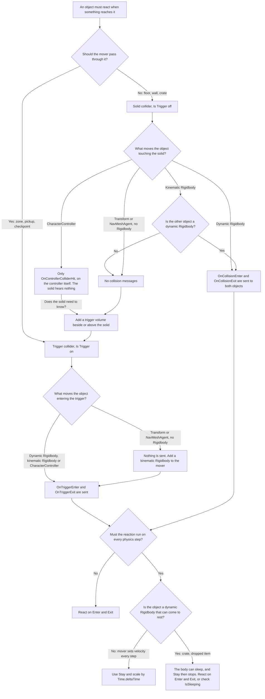

# 08 - Collision Detection and Contact Events

Lab: [Lab 8 - Recharge Platform](../labs/lab_8_recharge_platform.md)

## Key Concepts

1. **Contact is reported, not detected by your code** - the physics engine finds overlaps and calls your methods; your job is to decide what each message means.
2. **A solid collision and a trigger overlap are different messages** - `OnCollision` reports bodies that touch and push; `OnTrigger` reports bodies that pass through a volume.
3. **No Rigidbody, no messages** - at least one side of a contact must have a Rigidbody or a CharacterController, or Unity sends nothing.
4. **A CharacterController sends no collision messages** - it reports what it hits only to itself, through `OnControllerColliderHit`, so other objects detect it with a trigger.
5. **A trigger volume detects every kind of mover** - Rigidbody and CharacterController players both enter and leave a trigger in the same way.
6. **Stay runs on the physics step** - `OnTriggerStay` and `OnCollisionStay` run once per physics step, not once per frame, and `Time.deltaTime` inside them is the fixed timestep.
7. **Filter before you react** - check the tag and the layer first, so a crate rolling onto a pad does not do what the player does.
8. **A layer is an index; a layer mask is a set of bits** - compare them with a shift and a bitwise AND, never with `==`.
9. **Detection and reaction are separate jobs** - one component reports filtered contacts; other components, wired in the Inspector, decide what happens.
10. **Exit is not guaranteed** - an object that is destroyed or deactivated while in contact never sends Exit, so do not rely on Exit alone to undo state.

---

## 1. Framing Question

A pressure plate should open a door when the player or a crate is on it and close the door when they leave. Your group has one player built on a Rigidbody and another built on a CharacterController. How do you detect both, ignore everything else, and let a designer choose what happens without writing a new script for every plate, pad and zone?

Think of a game you have played recently. Which places in the level react when you walk into them: checkpoints, traps, doors, music changes? How did the game tell you that something had happened?

---

## 2. What You Will Learn

| Skill | You can... |
|:------|:-----------|
| Predict whether a contact is reported | State which messages Unity sends for a given pair of colliders, Rigidbodies and CharacterControllers |
| Choose trigger or collision | Pick a trigger volume or a solid collider for a gameplay problem and justify it |
| Detect a CharacterController | Explain why `OnCollisionEnter` never fires for it, and detect it with a trigger |
| Filter contacts | Accept only objects with a given tag and on given layers |
| Read and write bitmasks | Test, combine and remove layers in a `LayerMask` with shifts and bitwise operators |
| Separate detection from reaction | Wire `UnityEvent<GameObject>` responses to a reusable `ContactEvents` component |

---

## 3. Why This Matters

Almost every level has places that react when something reaches them: checkpoints, damage zones, pickups, doors, cutscene triggers. The first version of each is usually a small script with `OnTriggerEnter` or `OnCollisionEnter` and a tag check. Notes 03 to 05 used several of these. They work, but they are written again for every object, they each hard-code one reaction, and they fail silently when the player is built differently. A pad written with `OnCollisionEnter` for a Rigidbody player does nothing at all for a CharacterController player, and no error tells you why.

Collision detection is also where the movement choice from Note 07 meets the rest of the game. Whether Unity sends a message depends on what moves each object, so you need a clear model of which combinations work before you can debug them.

The second half of the note builds one component, `ContactEvents`, that detects contact, filters it by tag and layer, and raises Inspector-wired events for enter, stay and exit. A designer can then build a pressure plate, a checkpoint or a heal pad from it without new code. That is evidence for **Systems Integration** (systems reacting to each other in the level) and for **System Communication**.

---

## 4. Core Ideas

### 4.1 Collisions and Triggers

A **collider** gives an object a shape for physics. What happens when two colliders meet depends on one setting, `Is Trigger`:

| | Solid collider (`Is Trigger` off) | Trigger collider (`Is Trigger` on) |
|:--|:--|:--|
| Physical result | The bodies push apart; nothing passes through | Nothing; objects pass straight through |
| Messages | `OnCollisionEnter`, `OnCollisionStay`, `OnCollisionExit` | `OnTriggerEnter`, `OnTriggerStay`, `OnTriggerExit` |
| Parameter | `Collision`: the other collider, contact points, impact velocity | `Collider`: the other collider only |
| Use for | Floors, walls, crates, anything the player must stand on or bump into | Zones: checkpoints, pickups, damage areas, detection volumes |

A **trigger** is a collider that only reports overlaps. A common design is a solid object with a trigger beside or above it: a pressure plate is a solid slab the player stands on, plus a trigger volume just above it that reports who is standing there.

Each message comes in three parts:

| Message | When |
|:--|:--|
| Enter | The first physics step on which the two colliders touch or overlap |
| Stay | Every physics step while they still touch or overlap |
| Exit | The first physics step on which they no longer touch or overlap |

### 4.2 When Unity Sends a Message

The physics engine only checks contacts that involve something that moves through physics. A collider with no Rigidbody is a **static collider**: Unity assumes it never moves, and two static colliders never report anything to each other, even if a script moves one into the other.

Trigger messages, for an object entering a static trigger volume:

| The moving object has | Trigger messages sent |
|:--|:--|
| A dynamic Rigidbody | Yes |
| A kinematic Rigidbody | Yes |
| A CharacterController | Yes |
| A collider moved by its Transform, no Rigidbody | No |
| A NavMeshAgent and a collider, no Rigidbody | No |

Collision messages, for an object touching a static solid collider:

| The moving object has | Collision messages sent |
|:--|:--|
| A dynamic Rigidbody | Yes, to both objects |
| A kinematic Rigidbody | No; a kinematic body only reports collisions with dynamic bodies |
| A CharacterController | No `OnCollision` messages at all (Section 4.3) |

Two rules cover most cases. First, at least one side of the contact must have a Rigidbody or a CharacterController. Second, a trigger is the most forgiving way to detect something, because every kind of physics mover enters and leaves a trigger in the same way.

Messages go to scripts on the GameObject that owns the collider. When the collider is on a child of an object with a Rigidbody, the Rigidbody's GameObject receives the messages as well, so a script on the player's root still hears contacts made by a collider on its child.

### 4.3 Detecting a CharacterController

A CharacterController is not a physics body (Note 07, Section 4.4). It moves by sweeping its capsule in `Move`, and it never sends `OnCollisionEnter`, `OnCollisionStay` or `OnCollisionExit`, either to itself or to what it touches. Instead, the controller's own GameObject receives `OnControllerColliderHit` during each `Move` call that touches something:

```csharp
using UnityEngine;

[RequireComponent(typeof(CharacterController))]
public class ControllerHitLogger : MonoBehaviour
{
    private void OnControllerColliderHit(ControllerColliderHit hit)
    {
        // Called during Move, on the controller's own GameObject only.
        // The floor counts too, so this runs every frame while the controller is grounded.
        if (hit.gameObject.CompareTag("Player"))
            return;

        Debug.Log($"{name} hit {hit.gameObject.name} with normal {hit.normal}.", this);
    }
}
```

This message has three limits that matter for gameplay:

- It arrives only on the controller's side, so a pad cannot use it to detect the player.
- It has no enter or exit: it repeats every `Move` while touching, including every frame against the floor.
- It only runs during `Move`, so a controller that stands still reports nothing.

The CharacterController does enter and leave triggers normally. That is why a trigger volume is the portable way to detect a player whose movement approach might change.

### 4.4 Stay Runs on the Physics Step

`OnTriggerStay` and `OnCollisionStay` run once per physics step, like `FixedUpdate` (Note 01, Section 4.4). At 60 FPS with the default 0.02 s step, that is about 50 calls per second, not 60. Inside a physics message, `Time.deltaTime` returns the fixed timestep, so a rate per second is still written the usual way:

```csharp
// Inside OnTriggerStay: deltaTime is the fixed timestep here.
health.Restore(healPerSecond * Time.deltaTime);
```

A dynamic Rigidbody that comes to rest can **sleep**: the physics engine stops simulating it until something wakes it, and a sleeping body stops sending Stay messages. A player whose mover sets its velocity every physics step stays awake; a crate left on a pad falls asleep after a moment. If a Stay reaction stops while an object is still inside, check whether the body is asleep (`body.IsSleeping()`).

The graph below brings Sections 4.1 to 4.4 together. Start at the top with the object that must react, and follow it down to the messages you will receive or the change you need to make.



### 4.5 Filtering by Tag

A **tag** is a single string label on a GameObject, set in the `Tag` drop-down at the top of the Inspector. Tags answer "what kind of thing is this?": `Player`, `Enemy`, `Selectable`.

```csharp
// Compares without creating a new string, and reports a tag that does not exist.
if (other.CompareTag("Player"))
    Debug.Log("The player arrived.");
```

Use `CompareTag` rather than `other.tag == "Player"`. Reading `tag` creates a new string every call, which adds garbage in a method that may run 50 times a second, and a misspelt tag in `==` is simply false, whereas `CompareTag` reports a tag that is not defined in `Tags and Layers`.

An object has exactly one tag. To accept "the player or a crate", you either need a second check or a different tool: layers.

### 4.6 Filtering by Layer

A **layer** is a numbered group, 0 to 31, set in the `Layer` drop-down at the top of the Inspector. Layers 0 to 5 are built in (`Default`, `TransparentFX`, `Ignore Raycast`, `Water` and `UI`, with 3 left empty), and you name the rest in `Edit > Project Settings > Tags and Layers`. Unlike tags, layers are used by the engine itself: cameras, lights, raycasts and the physics engine can all include or exclude layers.

<!-- IMAGE: screenshot "../images/notes/08_tag_layer_dropdowns.png" - Top of the Inspector for a capsule, with the Layer drop-down open showing Default, TransparentFX, Ignore Raycast, Water, UI and Characters. The Tag drop-down beside it shows Player. -->

A **layer mask** is a set of layers, stored in one `int`. In the Inspector, a `LayerMask` field is a drop-down with a tick box per layer:

```csharp
[SerializeField] private LayerMask layers = ~0;
```

`~0` means "every layer"; Section 4.7 explains why. To ask whether an object's layer is in the mask, shift and test a bit:

```csharp
bool layerMatches = (layers.value & (1 << other.gameObject.layer)) != 0;
```

`other.gameObject.layer` is the layer's index, such as 6. `layers.value` is a mask, such as 64. Comparing them directly, with `==` or with `&` and no shift, compiles and runs but gives the wrong answer for almost every layer. The aside below shows why.

### 4.7 Aside: Bitmasks and Shifting

An `int` is 32 bits. A **bitmask** uses each bit as a separate yes-or-no flag, so one `int` holds 32 answers at once. A `LayerMask` uses bit 0 for layer 0, bit 1 for layer 1, and so on up to bit 31. A bit set to 1 means "this layer is in the set".

**Shifting.** The left shift operator `<<` moves the bits of a number left. `1 << n` moves a single 1 into bit `n`, which gives the mask for layer `n` on its own:

| Layer index `n` | `1 << n` in binary (low 8 bits) | Decimal value |
|:--|:--|:--|
| 0 | `0000 0001` | 1 |
| 1 | `0000 0010` | 2 |
| 2 | `0000 0100` | 4 |
| 6 | `0100 0000` | 64 |
| 7 | `1000 0000` | 128 |

Each step left doubles the value, so `1 << n` equals 2 to the power `n`.

**Combining with OR.** The bitwise OR operator `|` sets a bit if it is set in either operand. A mask for layers 6 and 7 is:

```csharp
int charactersAndProps = (1 << 6) | (1 << 7);   // 0100 0000 | 1000 0000 = 1100 0000 = 192
```

**Testing with AND.** The bitwise AND operator `&` keeps a bit only if it is set in both operands. To test one layer, AND the mask with that layer's bit. The result is either that bit (in the set) or 0 (not in the set):

| Object's layer | `1 << layer` | `192 & (1 << layer)` | In the mask? |
|:--|:--|:--|:--|
| 7 | `1000 0000` (128) | `1000 0000` (128) | Yes |
| 6 | `0100 0000` (64) | `0100 0000` (64) | Yes |
| 0 | `0000 0001` (1) | `0000 0000` (0) | No |

**The bug without the shift.** `192 & 6` compares the mask with the index itself. In binary, 6 is `0000 0110`, which shares no bits with `1100 0000`, so the result is 0 and the object on layer 6 is rejected. The index happens to look like a mask for layers 1 and 2, which is why the code compiles, runs and is wrong.

**Inverting with NOT.** The bitwise NOT operator `~` flips every bit. `~0` is all 32 bits set, which is "every layer", and is what the Inspector shows as `Everything`. As an `int` it reads as -1, which is why a mask can appear negative in the debugger. To remove a layer from a mask, AND it with the inverse of that layer's bit:

```csharp
int everythingButUI = ~0 & ~(1 << 5);   // Every bit set except bit 5.
```

**Unity helpers.** You rarely need to hard-code layer numbers:

```csharp
int characterLayer = LayerMask.NameToLayer("Characters");   // The index, for example 6.
int characterMask = LayerMask.GetMask("Characters");        // The mask, for example 64.
```

`NameToLayer` returns an index and `GetMask` returns a mask. Mixing them up produces exactly the bug above.

The same idea appears wherever Unity stores a set of options in one value: camera culling masks, raycast layer masks, light culling masks and `[Flags]` enums in your own code.

### 4.8 Physics-Level Filtering: The Layer Collision Matrix

`Edit > Project Settings > Physics > Layer Collision Matrix` decides which pairs of layers interact at all. Clearing the box for two layers stops their colliders colliding and stops every trigger and collision message between them, before any script runs.

<!-- IMAGE: screenshot "../images/notes/08_layer_collision_matrix.png" - Edit > Project Settings > Physics, Layer Collision Matrix section, with a Characters layer added. Crop to the matrix so the layer names and tick boxes are readable. -->

| Filter | Where | Cost | Use for |
|:--|:--|:--|:--|
| Layer Collision Matrix | Project Settings | Contacts are never generated | Rules that hold everywhere: projectiles never hit their own team, decorations never collide |
| Layer mask in a script | One component | Contact is generated, then rejected | Rules for one object: this pad reacts to characters, that one to crates |
| Tag in a script | One component | Contact is generated, then rejected | A finer check within a layer: the player, not any character |

### 4.9 Separating Detection from Reaction

Look at the pickup, damage zone and level exit scripts from Notes 03 to 05. Each one does two jobs: detect contact with the player, then do one thing. The detection part is the same in all of them. Note 06 applied the same split to selection, and the fix here follows the same idea: one component reports filtered contacts, and the reactions are separate.

A **`UnityEvent`** is an event whose listeners are chosen in the Inspector, as you used with event channel listeners in Note 04. The generic `UnityEvent<GameObject>` passes an argument, so a listener method with a `GameObject` parameter receives the object that made contact. In the Inspector, such a method appears under `Dynamic GameObject`.

| Route | Who chooses the listener | Best for |
|:--|:--|:--|
| A script calls the reaction directly | The programmer, in code | One fixed reaction that will not change |
| `UnityEvent` on the detector | The designer, in the Inspector | Reactions within the same scene or prefab: open this door, play this sound |
| Event channel (Note 04) | Any listener, in any scene | Reactions in other scenes or systems: the HUD, the score, the audio manager |

A `UnityEvent` has the same discoverability cost as any Inspector wiring: the connection lives in the scene file, not in code, so a search of the scripts will not find it. Write a `Description` or a short comment where the wiring matters.

---

## 5. Worked Example

The demo builds a pressure plate that opens a door while something is standing on it. It follows the module's iteration sequence: initial implementation, problem, change, improvement.

### Stage 1 - Initial Implementation: One Script

`PressurePlate` is a solid slab. It listens for collisions, checks the tag and opens the door.

```csharp
using UnityEngine;

public class PressurePlate : MonoBehaviour
{
    [SerializeField] private GameObject door;

    private void OnCollisionEnter(Collision collision)
    {
        if (collision.gameObject.tag == "Player")
            door.SetActive(false);
    }

    private void OnCollisionExit(Collision collision)
    {
        if (collision.gameObject.tag == "Player")
            door.SetActive(true);
    }
}
```

With a Rigidbody player it works: the door disappears when the player steps on the plate and comes back when the player steps off.

### Stage 2 - Problem: A Second Player and a Crate

| Observation | Cause |
|:--|:--|
| The CharacterController player stands on the plate and nothing happens | A CharacterController sends no collision messages (Section 4.3) |
| The design calls for a crate to hold the plate down, but the crate does nothing | The crate is not tagged `Player`, and an object has only one tag |
| A second plate must sound an alarm instead of opening a door | The reaction is written inside `PressurePlate`, so the alarm needs another script with the same detection code |
| The plate reacts to anything tagged `Player`, including a decoy the player throws | Tag is the only filter |

The first problem is the serious one, because it fails silently. Changing the player's movement approach, a decision Note 07 encouraged, breaks every plate in the level, and the Console shows nothing.

### Stage 3 - Change: A Trigger and a Reusable Detector

Two changes fix the problems. First, detect with a trigger volume above the plate, which both kinds of player enter (Section 4.2). Second, move detection and filtering into one reusable component that knows nothing about doors:

```csharp
using UnityEngine;
using UnityEngine.Events;

/// <summary>
/// Raises UnityEvents when an object that passes the tag and layer filter enters,
/// stays in or leaves contact with a collider on this GameObject. Works with trigger
/// and solid colliders.
/// </summary>
public class ContactEvents : MonoBehaviour
{
    #region Fields

    [Header("Filter")]
    [SerializeField, Tooltip("Only objects with this tag. Leave empty to accept any tag")]
    private string requiredTag = "Player";

    [SerializeField, Tooltip("Only objects on these layers")]
    private LayerMask layers = ~0;

    [Header("Responses")]
    [SerializeField, Tooltip("Called once when an accepted object first makes contact")]
    private UnityEvent<GameObject> onEnter;

    [SerializeField, Tooltip("Called every physics step while an accepted object stays in contact")]
    private UnityEvent<GameObject> onStay;

    [SerializeField, Tooltip("Called once when an accepted object leaves. Not called if it is destroyed or deactivated")]
    private UnityEvent<GameObject> onExit;

    #endregion Fields

    #region Trigger Messages

    private void OnTriggerEnter(Collider other) => Respond(other.gameObject, onEnter);

    private void OnTriggerStay(Collider other) => Respond(other.gameObject, onStay);

    private void OnTriggerExit(Collider other) => Respond(other.gameObject, onExit);

    #endregion Trigger Messages

    #region Collision Messages

    private void OnCollisionEnter(Collision collision) => Respond(collision.gameObject, onEnter);

    private void OnCollisionStay(Collision collision) => Respond(collision.gameObject, onStay);

    private void OnCollisionExit(Collision collision) => Respond(collision.gameObject, onExit);

    #endregion Collision Messages

    #region Core Methods

    /// <summary>True when <paramref name="other"/> is on an accepted layer and has the required tag.</summary>
    public bool Accepts(GameObject other)
    {
        // Shift a 1 into the bit for the object's layer, then test that bit in the mask.
        bool layerMatches = (layers.value & (1 << other.layer)) != 0;

        bool tagMatches = string.IsNullOrEmpty(requiredTag) || other.CompareTag(requiredTag);

        return layerMatches && tagMatches;
    }

    private void Respond(GameObject other, UnityEvent<GameObject> response)
    {
        // Physics messages still arrive on a disabled component, so check enabled here.
        if (!enabled || !Accepts(other))
            return;

        response.Invoke(other);
    }

    #endregion Core Methods
}
```

The decisions in this class:

- **One component for both kinds of message.** Unity sends trigger messages or collision messages depending on the colliders involved. Handling both means the same component works on a trigger zone and on a solid object, and the designer chooses by ticking `Is Trigger`.
- **The filter is a public method.** `Accepts` holds the rule in one place, so a test, a debug tool or another script can ask the same question.
- **Layer first, then tag.** The layer test is a bit operation; `CompareTag` is a string comparison. Testing the cheaper check first is not an optimisation worth measuring here, but it costs nothing and reads naturally: "is it a character, and is it the player?".
- **`UnityEvent<GameObject>`.** Every response receives the object that made contact, so a listener can read its health, its name or its position.
- **Expression-bodied messages.** Each message is one line that passes its object and its event to `Respond`, so the six messages stay readable and none of them duplicates the filter.

### Stage 4 - Improvement: Plates Built in the Inspector

The plate is now three objects and no new script:

| Object | Components | Settings |
|:--|:--|:--|
| `Plate` | `Cube` mesh, `BoxCollider` | Solid; the player and crates stand on it |
| `PlateSensor`, a child of `Plate` | `BoxCollider` with `Is Trigger` ticked, `ContactEvents` | `Required Tag` empty; `Layers` set to `Characters` and `Props` |
| `Door` | `Cube` mesh, `BoxCollider` | Wired to the sensor's events |

On `ContactEvents`, `On Enter` calls `Door > GameObject.SetActive` with the box cleared, and `On Exit` calls it with the box ticked. Both players are on the `Characters` layer and the crate is on the `Props` layer, so all three hold the plate down. The decoy is on `Default` and is ignored.

<!-- IMAGE: screenshot "../images/notes/08_plate_sensor_inspector.png" - Inspector for PlateSensor: Box Collider with Is Trigger ticked, and ContactEvents with Required Tag empty, Layers showing Characters and Props, On Enter calling GameObject.SetActive on Door with the box cleared, On Exit calling it with the box ticked. -->

The alarm plate is a second copy whose `On Enter` calls `AudioSource.Play` instead. The checkpoint, the damage zone and the level exit from earlier notes could all be rebuilt the same way, each with a small reaction script whose method takes a `GameObject`.

One problem is left, and it is a good one to notice. If the player and the crate are both on the plate and the player steps off, `On Exit` closes the door although the crate is still there. `ContactEvents` reports each object separately; it does not count them. The Challenge exercise fixes this.

What changed, as a Problem, Solution, Benefit summary:

| Problem | Solution | Benefit |
|:--|:--|:--|
| Each zone script repeated its own detection, used collision messages that a CharacterController never sends, filtered only by tag and hard-coded one reaction | A trigger volume detects every kind of mover; `ContactEvents` filters by tag and layer and raises Inspector-wired events | Plates, pads and zones are built without new detection code; changing the player's movement approach breaks nothing; reactions change in the Inspector |

---

## 6. Common Pitfalls

| Symptom | Cause | Fix |
|:--|:--|:--|
| No messages at all | Neither object has a Rigidbody or a CharacterController | Add a Rigidbody to the moving object, or detect with a trigger that a CharacterController enters |
| `OnCollisionEnter` never fires for the CharacterController player | A CharacterController sends no collision messages | Detect it with a trigger volume (Section 4.3) |
| `OnTriggerEnter` never fires, but `OnCollisionEnter` does | `Is Trigger` is off on both colliders | Tick `Is Trigger` on the zone's collider |
| The player falls through the floor | `Is Trigger` was ticked on the floor instead of the sensor | Keep the floor solid; put the trigger on a separate child |
| Nothing is accepted, even on the right layer | The layer index was compared with the mask, without `1 <<` | Test `(mask & (1 << layer)) != 0` (Section 4.7) |
| Everything is accepted | `Layers` is `Everything` and `Required Tag` is empty | Set the filter in the Inspector |
| Console: "Tag: ... is not defined" | `Required Tag` is misspelt or not added in `Tags and Layers` | Add the tag, or correct the spelling |
| A Stay reaction stops while an object is still inside | The Rigidbody went to sleep | Check `IsSleeping()`; keep the mover setting velocity, or react on Enter and Exit instead |
| A Stay reaction runs at the wrong rate | The reaction does not multiply by `Time.deltaTime` | Multiply by `Time.deltaTime`; inside physics messages it is the fixed timestep |
| A door stays open after the object that opened it is destroyed | Exit is not sent for destroyed or deactivated objects | Undo state on Exit and also when the other object is disabled, or check occupants periodically |
| Messages fire twice for one object | The object has two colliders, for example a solid capsule and a trigger child | Filter with a layer, or put the sensor child on a layer that the zone ignores |
| Teleporting a CharacterController player has no effect | The controller overwrites `transform.position` on its next `Move` | Disable the controller, set the position, then enable it again |

---

## 7. Software Development Parallels

- **Observer** (Gang of Four). `ContactEvents` is a subject; the components wired to its events are observers. Note 04 used the same pattern across scenes with event channels; a `UnityEvent` is the in-scene version.
- **Separation of detection and response.** Operating systems and UI frameworks separate the code that detects input (a key press, a touch) from the handlers that respond. Unity's own UI `EventSystem` does the same with raycasters and handlers (Note 06, Section 7).
- **Bit flags.** File permissions on Linux (`rwx` as bits), network subnet masks and C# `[Flags]` enums all store a set of options as bits in one integer, tested and combined with `&`, `|` and `~`.
- **Commercial games.** Pressure plates that need a crate or a second player, as in the co-op puzzles of *Portal 2*, are the occupancy problem from Stage 4. The collision layers that stop friendly fire in team shooters such as *Overwatch* are the same idea as the Layer Collision Matrix: a rule applied before any game code runs.

---

## 8. Exercises

### Core - A Contact Logger

Write `ContactLogger`, a component with public `LogEnter(GameObject other)` and `LogExit(GameObject other)` methods that log the object's name, layer index and tag. Wire it to a trigger zone's `ContactEvents`.

**Expected result:** walking a Rigidbody player and then a CharacterController player through the zone logs one enter and one exit line each. A crate on `Default` with `Layers` set to a `Characters` layer logs nothing. Record the layer index the logger prints and the mask value that `LayerMask.GetMask("Characters")` returns, and explain the difference in one sentence.

### Apply - A Kill Zone with Respawn

Add a large trigger under the level. When the player falls into it, the player returns to a spawn point. Write the respawn reaction as a component on the player, called from `On Enter`.

**Expected result:** a falling player of either kind reappears at the spawn point. In 80 to 120 words, explain what extra step the CharacterController player needed and why, using the last row of Section 6.

### Challenge - Occupancy

Fix the Stage 4 problem: the door must stay open while any accepted object is on the plate. Design where the count lives: inside `ContactEvents`, in a separate component wired to its events, or somewhere else you can justify. Consider what happens if a crate on the plate is destroyed.

**Expected result:** the door opens when the first object arrives and closes only when the last one leaves, including when one of them is destroyed on the plate. In 150 to 200 words, justify where the count lives using the single responsibility principle, and explain how you handled the missing Exit.

---

## 9. Reflective Questions

1. Stage 1 worked with a Rigidbody player and failed silently with a CharacterController player. What does that tell you about testing a system that depends on another system's design, and how would you catch it earlier?
2. `ContactEvents` handles both trigger and collision messages. Argue for and against splitting it into `TriggerEvents` and `CollisionEvents`, using the interface segregation principle.
3. When would you filter with the Layer Collision Matrix instead of a layer mask on the component? Give one rule from your group's game for each.
4. A `UnityEvent` lets a designer wire reactions without code, but the wiring is invisible to a code search. For your group project, where is that trade worth making, and where would you prefer a direct call or an event channel?
5. Explain, using binary, why `(mask & layer) != 0` accepts an object on layer 3 when the mask is `Everything`, but rejects it when the mask is only layer 3.

---

## 10. How This Builds

- **[Lab 8](../labs/lab_8_recharge_platform.md)** builds a recharge platform from `ContactEvents`, uses the debugger to find a broken layer test, and restores health differently for each character type through an interface, without the platform knowing the types exist.
- **Note 10 - Inventory Systems** collects some items by contact with a trigger, which the CharacterController player enters as Section 4.3 describes, and others by selection, with the choice made per item.
- **Note 11 - Interpolation, Easing and Tweening** builds an eased door, wired to `ContactTrigger` from `Assets/GD/Common` through its `On Enter` and `On Exit` events.
- **Note 15 - Orchestration and Game Flow** uses trigger volumes to start and sequence gameplay flow: entering a room starts a wave, reaching the exit ends the level.
- **Note 16 - State Machines and the State Pattern** uses detection volumes as conditions for AI state transitions, such as an enemy that starts chasing when the player enters its sight zone.
- **GCA:** zones built from `ContactEvents` connecting the player, the level and other systems are evidence for **Systems Integration**; choosing between a `UnityEvent`, a direct call and an event channel, with a reason, is evidence for **System Communication**.

---

## Glossary

| Term | Definition |
|:-----|:-----------|
| Bitmask | An integer in which each bit is a separate yes-or-no flag |
| Collider | A component that gives a GameObject a shape for physics contacts |
| Layer | A numbered group from 0 to 31 that the engine uses to include or exclude objects |
| Layer mask | A set of layers stored as a bitmask, with bit `n` set for layer `n` |
| Sleep | A state in which the physics engine stops simulating a resting Rigidbody until something wakes it |
| Static collider | A collider with no Rigidbody, which Unity assumes never moves |
| Tag | A single string label on a GameObject that identifies what kind of thing it is |
| Trigger | A collider with `Is Trigger` ticked, which reports overlaps but does not push objects apart |
| UnityEvent | An event whose listeners are chosen in the Inspector and stored in the scene or prefab |
