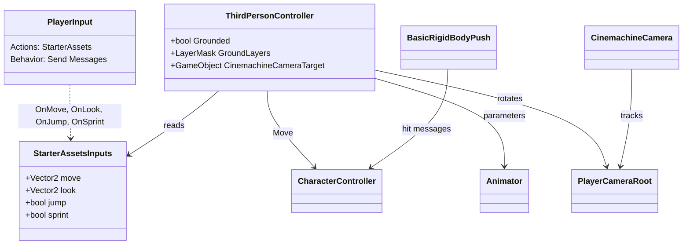
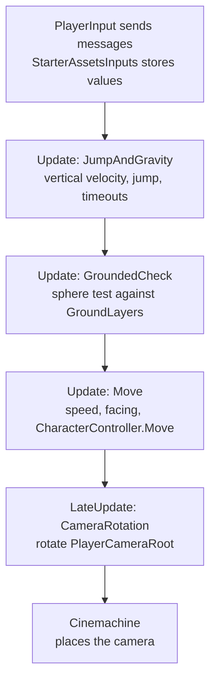

# 09 - First and Third Person Controllers

Lab: [Lab 9 - Extending the Third Person Controller](../labs/lab_9_third_person_controller.md)

## Key Concepts

1. **Read before you reuse** - a controller you did not write is still your responsibility once it is in your game, so trace one frame of it before you tune it.
2. **Input, movement and camera are separate layers** - `PlayerInput` reads devices, `StarterAssetsInputs` stores intent, and the controller turns intent into movement and camera rotation.
3. **Send Messages couples by name** - renaming an action silently stops its `On` method being called, with no compile error.
4. **The controller owns its own grounded test** - a sphere check against `GroundLayers` decides whether the character can jump, not `CharacterController.isGrounded`.
5. **Triggers are not ground** - the grounded check ignores triggers, so the zones from Note 08 never hold the character up.
6. **Jump height is a design value, not a force** - the controller works out the launch speed from the height you ask for and its own gravity.
7. **Feel lives in a handful of numbers** - acceleration rate, rotation smoothing, gravity and timeouts change how the same input feels.
8. **The camera follows a target, not the player** - the controller rotates a target object in `LateUpdate`, and Cinemachine places the camera relative to it.
9. **Do not edit third-party code in place** - add behaviour in your own components that read the controller's public state or write its input.
10. **Own it when you must change it** - if a feature needs the controller's private state, copy it into your own namespace, say so, and maintain it as your code.

---

## 1. Framing Question

Unity's Starter Assets give you a working first person and third person character in minutes: walking, sprinting, jumping, a camera that follows and collides, and an animated character. Your group wants to use one, then add landing effects, stamina and a few tuned values. How do you understand code you did not write well enough to change how it feels, and how do you add your own features without breaking it the next time it is updated?

Think of a game you have played recently. When the character jumps, how long does it take to reach the top, and does it fall faster than it rose? Would you notice if that changed?

---

## 2. What You Will Learn

| Skill | You can... |
|:------|:-----------|
| Trace third-party code | Describe, in order, what the third person controller does in one frame |
| Explain the input pipeline | Follow a key press from `PlayerInput` through `StarterAssetsInputs` to the controller |
| Configure a controller | Set up `GroundLayers`, the follow camera target and rigidbody pushing for a new level |
| Tune feel with evidence | Change acceleration, rotation smoothing, gravity and jump height, and describe the effect of each |
| Compare first and third person | State how the two controllers differ in movement, rotation and camera |
| Extend by composition | Add behaviour that reads the controller's state or writes its input, with no edit to the controller |
| Decide when to fork | Explain when a change justifies copying the controller into your own code |

---

## 3. Why This Matters

Most game code you work with in industry was written by someone else: an engine team, a middleware vendor, an asset store author or a colleague who has left. Reading it quickly and changing it safely is as important as writing new code. The Starter Assets controllers are a good place to practise: they are short enough to read in a session, they are written by Unity, and they use almost everything from Notes 01 to 08.

They are also a sensible starting point for your group project. A responsive character with a following camera is hard to get right, and building one from scratch can use weeks you need for the rest of the game. The GCA rewards you for choosing well and for improving what you chose, not for writing every line yourself. A team that adopts the third person controller, explains why, tunes its feel against playtests and extends it cleanly has evidence for **Software Design**, **Technical Craft** and **Iteration & Improvement**. A team that edits it in place until nobody can tell which parts are Unity's has none.

---

## 4. Core Ideas

### 4.1 What the Starter Assets Contain

The **Starter Assets** are two Unity packages, First Person and Third Person, that this project includes under `Assets/ThirdParty/Scripts/Controllers`. Their code is in the `StarterAssets` namespace and compiles into its own **assembly definition**, `Unity.StarterAssets`, a separate compiled unit that your scripts can reference because it is marked `Auto Referenced`.

| Folder or asset | Contents |
|:--|:--|
| `Runtime/ThirdPersonController/Prefabs/PlayerArmature` | Animated third person character |
| `Runtime/ThirdPersonController/Prefabs/PlayerCapsule` | The same controller on a capsule, with no Animator |
| `Runtime/FirstPersonController/Prefabs/PlayerCapsule` | First person character |
| `Runtime/*/Prefabs/MainCamera` | A camera tagged `MainCamera`, with a `CinemachineBrain` |
| `Runtime/*/Prefabs/PlayerFollowCamera` | A `CinemachineCamera` set up to follow the player |
| `Runtime/InputSystem/StarterAssets.inputactions` | `Move`, `Look`, `Jump` and `Sprint` for keyboard and mouse, and gamepad |
| `Runtime/Common/BasicRigidBodyPush.cs` | Lets a CharacterController push dynamic Rigidbodies |
| `Sample/*/Playground.unity` | A test level for each controller |

The components on `PlayerArmature` show the layers of the design:



### 4.2 The Input Layer

`PlayerInput` is an Input System component that owns a set of actions and reports them to other components. Its `Behavior` setting decides how:

| Behavior | How the controller hears about input |
|:--|:--|
| **Send Messages** | Unity calls a method named `On` plus the action name, such as `OnJump`, on components on the same GameObject |
| Broadcast Messages | The same, on the GameObject and all its children |
| Invoke Unity Events | A `UnityEvent` per action, wired in the Inspector |
| Invoke C# Events | One C# event that every action raises; code subscribes to it |

The Starter Assets use Send Messages. `StarterAssetsInputs` provides one method per action, and each method only stores a value:

```csharp
public void OnMove(InputValue value)
{
    MoveInput(value.Get<Vector2>());
}

public void MoveInput(Vector2 newMoveDirection)
{
    move = newMoveDirection;
}
```

This is the same split as `MoveInput` and `IMover` in Note 07: one layer records what the player wants, another layer acts on it. The controller never touches a device. That is why the same controller works with a keyboard, a gamepad and the on-screen touch joysticks in the package: each one only has to fill in `move`, `look`, `jump` and `sprint`.

The public `MoveInput`, `JumpInput` and `SprintInput` methods are also how your own code can drive the character, for example from a cutscene or an AI, without a device at all.

Send Messages has one cost to know about. The link between an action and its method is a name, found at runtime. Rename the `Sprint` action to `Run` and `OnSprint` is never called again. The code still compiles, nothing is logged, and the character simply cannot sprint.

### 4.3 One Frame of the Third Person Controller

The controller's `Update` and `LateUpdate` are short, because each job is a method:

```csharp
private void Update()
{
    _hasAnimator = TryGetComponent(out _animator);

    JumpAndGravity();
    GroundedCheck();
    Move();
}

private void LateUpdate()
{
    CameraRotation();
}
```



Two orderings are deliberate. The camera target is rotated in `LateUpdate`, after the character has moved, so the camera never lags one frame behind the character. Cinemachine then positions the real camera after that. The less obvious one is that `JumpAndGravity` runs before `GroundedCheck`, so it uses last frame's grounded result. At 60 FPS that delay is 17 ms and nobody notices it, but it is worth knowing when you read the timeouts in Section 4.5.

### 4.4 The Grounded Check

Note 07 used `CharacterController.isGrounded`, which only reports whether the last `Move` touched something below. The Starter Assets replace it with their own test:

```csharp
private void GroundedCheck()
{
    Vector3 spherePosition = new Vector3(transform.position.x, transform.position.y - GroundedOffset,
        transform.position.z);
    Grounded = Physics.CheckSphere(spherePosition, GroundedRadius, GroundLayers,
        QueryTriggerInteraction.Ignore);
}
```

A **grounded check** answers "is there ground under the character's feet right now?". `Physics.CheckSphere` returns true if any collider on the given layers overlaps a small sphere at the feet. This version has three advantages over `isGrounded`: it does not depend on how `Move` was called, its size and offset are visible and tunable (the sphere is drawn green or red when the character is selected), and it only counts layers you choose.

Two arguments link back to Note 08:

- `GroundLayers` is a `LayerMask`. In the prefab it is set to `Default` only. Put your level on a `Ground` layer and forget to add it here, and the character never counts as grounded: it cannot jump and it plays its falling animation while standing still. Lab 9 makes you find this with the debugger.
- `QueryTriggerInteraction.Ignore` means trigger colliders never count as ground. Without it, walking into a pickup or damage zone from Note 08 would let the character jump in mid-air.

### 4.5 Jump, Gravity and Timeouts

The designer sets `JumpHeight` in metres. The controller works out the launch speed that reaches exactly that height:

```csharp
// The square root of H * -2 * G is the speed needed to reach height H.
_verticalVelocity = Mathf.Sqrt(JumpHeight * -2f * Gravity);
```

This comes from the equation of motion v squared = u squared + 2as: at the top of the jump the speed is zero, so the launch speed u is the square root of 2gh. `Gravity` is negative, so `-2f * Gravity` is positive. Setting a height rather than a force means you can change gravity and the jump still reaches the same height; only the timing changes.

The controller uses its own `Gravity` of -15 m/s2, not the physics default of -9.81. Stronger gravity gives shorter, snappier jumps, which most players read as more responsive. This is a game feel decision, not a physics one, and it is why the controller does not use `Physics.gravity` as Note 07's movers did.

Three more values shape the vertical movement:

| Value | Default (third person) | What it does |
|:--|:--|:--|
| **Terminal velocity** | -53 m/s, private | The fastest the character can fall, so a long drop does not reach absurd speeds |
| **Jump timeout** | 0.5 s | Time on the ground before the character can jump again, so holding Jump does not bounce continuously |
| **Fall timeout** | 0.15 s | Time in the air before the falling animation starts, so walking down stairs does not flicker into a fall pose |

Each timeout is a float counted down by `Time.deltaTime` and reset when the state changes. That is the simplest way to measure time in `Update`; Note 15 compares it with coroutines.

### 4.6 Speed and Facing

When the input changes, the controller does not jump straight to the new speed. It moves part of the way each frame:

```csharp
_speed = Mathf.Lerp(currentHorizontalSpeed, targetSpeed * inputMagnitude, Time.deltaTime * SpeedChangeRate);
```

`Mathf.Lerp(a, b, t)` returns the value a fraction `t` of the way from `a` to `b`. With `SpeedChangeRate` 10 at 60 FPS, `t` is about 0.17, so each frame closes 17% of the remaining gap. The speed rises quickly at first and slows as it nears the target, which the code comments call "a more organic speed change". Note 11 explains why this form is not quite the same at every frame rate, and how to fix that.

The two controllers face differently:

- The **third person** controller turns the character to face the direction of movement, relative to the camera. It uses `Mathf.SmoothDampAngle` with `RotationSmoothTime` 0.12 s, so turns are quick but never instant.
- The **first person** controller never turns to face movement. The mouse turns the body directly, and movement is relative to the body, so A and D strafe sideways.

### 4.7 The Camera

Neither controller moves the camera. Each rotates a child object, `PlayerCameraRoot`, which is the **follow target**, and a Cinemachine camera follows it. **Cinemachine** is Unity's camera system: a `CinemachineBrain` on the real camera copies its position and rotation from whichever `CinemachineCamera` has the highest priority.

```csharp
// Third person: yaw and pitch both go on the camera target.
CinemachineCameraTarget.transform.rotation = Quaternion.Euler(_cinemachineTargetPitch + CameraAngleOverride,
    _cinemachineTargetYaw, 0.0f);
```

| | First person | Third person |
|:--|:--|:--|
| Yaw (left and right look) | Rotates the whole body | Rotates only the camera target; the body turns when it moves |
| Pitch (up and down look) | Rotates the camera target, clamped -90 to 90 degrees | Rotates the camera target, clamped -30 to 70 degrees |
| `CinemachineThirdPersonFollow` | `Camera Distance` 0, no shoulder offset | `Camera Distance` 4, `Shoulder Offset` (1, 0, 0) |

The `PlayerFollowCamera` prefab's `Tracking Target` is empty, because a prefab asset cannot reference an object in a scene (Note 01, Section 4.12). When you build your own scene, you must set it to the player's `PlayerCameraRoot`.

Mouse look is not multiplied by `Time.deltaTime`. Mouse delta is already a distance moved this frame, so multiplying it would make the camera slower at high frame rates. A stick, by contrast, reports a position that should become a rate, which does need `Time.deltaTime`. Check how the copy in this project treats gamepad look before you rely on it.

### 4.8 Animator Hooks

The third person controller drives an Animator through five parameters: `Speed`, `MotionSpeed`, `Grounded`, `Jump` and `FreeFall`. Three habits in this code are worth copying:

- **Parameter IDs.** `Animator.StringToHash("Speed")` turns the name into an `int` once, in `Start`. Setting a parameter by ID avoids hashing the string every frame, and a misspelt name fails in one place.
- **Optional Animator.** Every Animator call is inside `if (_hasAnimator)`, so the same script drives the capsule prefab, which has no Animator. It does recheck `TryGetComponent` every frame, which is only needed if the Animator could be added or removed at runtime.
- **Animation events.** Footstep and landing sounds are not played by the movement code. The walk and run clips contain **animation events** that call `OnFootstep` and `OnLand` at the frame the foot touches down. Because the locomotion blend tree plays several clips at once, each method checks `animatorClipInfo.weight > 0.5f`, so only the clip that is mostly playing makes a sound.

Note 12 covers the Animator in depth, using this controller as the case study.

### 4.9 Reading the Code Critically

The controllers are good code for their purpose: a sample that works out of the box and is easy to read. Measured against the module's conventions, some choices are different:

| In the Starter Assets | Module convention | Why it matters to you |
|:--|:--|:--|
| Public fields for every setting | `[SerializeField] private` (Note 01, Section 4.6) | Any script can change `MoveSpeed`; useful for extension, but nothing guards it |
| One class reads input state, moves, jumps, rotates the camera, drives animation and plays audio | One reason to change per class (Note 06) | Every feature you add to it touches the same 400 lines |
| `GameObject.FindGameObjectWithTag("MainCamera")` | Explicit, serialized references | Works, but the dependency is hidden |
| Send Messages, by method name | Compile-time links where possible | A renamed action fails silently (Section 4.2) |
| Lerp with `Time.deltaTime * rate` | Frame-rate independent smoothing (Note 11) | Acceleration feels slightly different at 30 and 144 FPS |

None of these is a reason not to use the controller. They are the reasons to extend it carefully, and to know which parts you would change if you took ownership of it.

### 4.10 Extend, Do Not Edit

Editing `ThirdPersonController.cs` directly is the quickest way to add a feature, and it creates three problems. Re-importing or updating the package overwrites your change. The first person controller needs the same change made again, by hand. And in a group, every feature lands in the same file, so Git merges conflict (Note 06, Section 4.1).

There are two clean ways to add behaviour without editing the controller:

| Route | Example | How |
|:--|:--|:--|
| Read its public state | Landing dust when `Grounded` changes from false to true | A component on the player reads `controller.Grounded` in `LateUpdate` |
| Write its input | Stamina that stops sprinting when it runs out | A component calls `input.SprintInput(false)` before the controller's `Update` reads it |

Writing input works because the controller only acts on what `StarterAssetsInputs` holds. Running before the controller is the one requirement, and `[DefaultExecutionOrder]` (Note 07, Section 4.9) guarantees it.

Some features need state the controller keeps private, such as a double jump that sets `_verticalVelocity`. Then extension is not enough. The honest options are to change the design (a jump pad that uses a trigger and a Rigidbody impulse, for example) or to **fork** the controller: copy it into your own folder and namespace, rename it, and from then on treat it as your code, with your conventions and your tests. A fork is a legitimate decision, but record it, because you can no longer take Unity's updates for free.

---

## 5. Worked Example

The demo adds a dust puff when the third person character lands. It follows the module's iteration sequence: initial implementation, problem, change, improvement.

### Stage 1 - Initial Implementation: Edit the Controller

The quickest route is to open `ThirdPersonController.cs`, add a field, and play the particles in `GroundedCheck` when the character becomes grounded:

```csharp
// Added to ThirdPersonController by hand.
public ParticleSystem LandingDust;

private void GroundedCheck()
{
    bool wasGrounded = Grounded;

    Vector3 spherePosition = new Vector3(transform.position.x, transform.position.y - GroundedOffset,
        transform.position.z);
    Grounded = Physics.CheckSphere(spherePosition, GroundedRadius, GroundLayers,
        QueryTriggerInteraction.Ignore);

    // Added: play the dust on the frame the character lands.
    if (!wasGrounded && Grounded && LandingDust != null)
        LandingDust.Play();

    if (_hasAnimator)
    {
        _animator.SetBool(_animIDGrounded, Grounded);
    }
}
```

It works: the character lands and dust appears.

### Stage 2 - Problem: Whose Code Is This?

| Observation | Cause |
|:--|:--|
| A teammate re-imports the Starter Assets to get a fix, and the dust disappears | The change lived in Unity's file, which the import replaced |
| The group's first person level needs the same dust | The same lines must be added to `FirstPersonController.cs` by hand |
| Walking off a kerb makes a puff of dust | The edit has no minimum air time, and adding one means more edits to the same method |
| The sound designer wants a landing camera shake too | Another field and another line in the controller; the controller now knows about particles, audio and the camera |
| Two teammates edit `ThirdPersonController.cs` in the same week | Git reports a conflict in a file neither of them wrote |

The Stage 1 code is correct. The problem is where it lives. `GroundedCheck` now has two jobs, and the controller has one more reason to change that has nothing to do with movement.

### Stage 3 - Change: A Component That Watches the Controller

The controller already exposes `Grounded` as a public field. A separate component can watch it and raise events, with no edit to the controller:

```csharp
using StarterAssets;
using UnityEngine;
using UnityEngine.Events;

/// <summary>
/// Raises events when the third person controller leaves the ground and when it lands,
/// without editing the controller.
/// </summary>
[RequireComponent(typeof(ThirdPersonController))]
public class LandingEvents : MonoBehaviour
{
    [SerializeField, Min(0f), Tooltip("Shorter times in the air, such as stepping off a kerb, do not count as a landing")]
    private float minimumAirTime = 0.3f;

    [SerializeField, Tooltip("Called on the frame the character leaves the ground")]
    private UnityEvent onLeftGround;

    [SerializeField, Tooltip("Called on the frame the character lands, after at least Minimum Air Time in the air")]
    private UnityEvent onLanded;

    private ThirdPersonController controller;
    private bool wasGrounded = true;
    private float airTime;

    private void Awake()
    {
        controller = GetComponent<ThirdPersonController>();
    }

    private void LateUpdate()
    {
        // LateUpdate runs after the controller's Update, so Grounded is this frame's value.
        bool grounded = controller.Grounded;

        if (!grounded)
            airTime += Time.deltaTime;

        if (wasGrounded && !grounded)
            onLeftGround.Invoke();

        if (!wasGrounded && grounded)
        {
            if (airTime >= minimumAirTime)
                onLanded.Invoke();

            airTime = 0f;
        }

        wasGrounded = grounded;
    }
}
```

The decisions in this class:

- **`LateUpdate`, not `Update`.** The controller sets `Grounded` in its `Update`. Reading it in `LateUpdate` guarantees this frame's value, without depending on script execution order.
- **Edge detection.** `wasGrounded` and `grounded` together detect the change, not the state. The event fires once on the landing frame, not every frame on the ground (the same idea as Note 06, Section 4.8).
- **Minimum air time.** The rule that a kerb is not a landing lives here, in one place, and a designer can tune it.
- **`UnityEvent`.** The component does not know what landing means for the game. Dust, sound and camera shake are wired in the Inspector (Note 08, Section 4.9).

### Stage 4 - Improvement: Wire the Reactions

`ThirdPersonController.cs` is back to Unity's original. The landing dust is a child particle system wired to `On Landed > ParticleSystem.Play`. A camera shake is a second listener on the same event, added by the sound designer without touching code. A re-import of the Starter Assets changes nothing in the group's work.

One limit is left. `LandingEvents` requires a `ThirdPersonController`, so it does not work on the first person prefab, although `FirstPersonController` also has a public `Grounded` field. The two classes share no interface, and you cannot add one without editing them. The Challenge exercise solves this with an adapter.

What changed, as a Problem, Solution, Benefit summary:

| Problem | Solution | Benefit |
|:--|:--|:--|
| The landing feature was written into Unity's controller, mixed into the grounded check, and lost on every re-import | `LandingEvents` reads the controller's public `Grounded` state and raises events; reactions are wired in the Inspector | The controller stays unmodified and updatable; the landing rule is in one tunable place; new reactions need no code |

---

## 6. Common Pitfalls

| Symptom | Cause | Fix |
|:--|:--|:--|
| The camera does not follow the player | `Tracking Target` on `PlayerFollowCamera` is empty | Set it to the player's `PlayerCameraRoot` child |
| Two cameras, or the view is from the wrong place | The scene's original `Main Camera` was kept alongside the prefab | Delete the original; keep the `MainCamera` prefab, which has the `CinemachineBrain` |
| The character cannot jump and plays its falling animation on the ground | The level is on a layer that `GroundLayers` does not include | Add the level's layer to `GroundLayers` |
| The character can jump in mid-air inside a zone | A custom grounded check counts triggers | Keep `QueryTriggerInteraction.Ignore` |
| The cursor disappears and the mouse cannot reach the Editor | `Cursor Locked` on `StarterAssetsInputs` locks it in Play mode | Press Escape to release it; untick `Cursor Locked` while testing UI |
| One action stops working after editing the input actions | The action was renamed, so its `On` method is no longer called | Keep the action name, or rename the method to match |
| The character does not push crates | `Can Push` is off or `Push Layers` is `Nothing` on `BasicRigidBodyPush` | Tick `Can Push` and include the crates' layer |
| Tuned values are lost | They were changed in Play mode | Copy the component values before stopping, or tune in Edit mode |
| A change to the controller vanished | The Starter Assets were re-imported | Move the change into your own component (Section 4.10) |
| Stamina or other input changes are ignored for a frame | The component runs after the controller's `Update` | Give it `[DefaultExecutionOrder]` with a negative value |

---

## 7. Software Development Parallels

- **Layered input.** Separating devices, actions and gameplay intent is the same idea as the Model-View-Controller family of patterns: the controller layer translates raw events into requests the model understands.
- **Open/Closed in practice.** You cannot edit Unity's controller safely, so it is effectively closed for modification. Its public fields and its input layer are the parts left open for extension. Library authors deliberately design these **extension points**; Section 4.10 uses the ones the Starter Assets provide.
- **Adapter** (Gang of Four). An adapter wraps a class you cannot change so that it fits an interface you need. The Challenge exercise adapts both controllers to one `IGroundedSource` interface.
- **Vendoring and forking.** Copying third-party code into your own repository and maintaining it yourself is common practice when a dependency needs changes its author will not make. The cost is the same in any language: you take over its bugs and lose its updates.
- **Commercial games.** *Celeste*, a 2D platformer, is a well-documented example of jump feel built from small numbers: stronger gravity on the way down, a short window to jump after leaving a ledge (coyote time) and buffered jump presses. The Starter Assets have stronger-than-real gravity but neither of the other two, which is one reason their jumps feel solid but strict.

---

## 8. Exercises

### Core - Air Time Display

Write `AirTimeDisplay`, a component that uses the `On Left Ground` and `On Landed` events of `LandingEvents` to measure each jump, and shows the last and longest air times in a HUD label.

**Expected result:** a standing jump shows about 0.8 s with the default `JumpHeight` 1.2 and `Gravity` -15. Change `Gravity` to -9.81 and the time rises to about 1 s while the height stays the same. Show both values with the calculation from Section 4.5.

### Apply - Speed Pad

Build a trigger pad that doubles `MoveSpeed` and `SprintSpeed` for three seconds when the third person character enters it, using `ContactEvents` from Note 08 or your own trigger script. Do not edit the controller.

**Expected result:** the character visibly speeds up on the pad and returns to its original speeds three seconds later, including when it enters the pad twice in quick succession. In 80 to 120 words, explain what the public fields made easy, and what could go wrong if a second system also changed `MoveSpeed`.

### Challenge - One Landing Component for Both Controllers

`LandingEvents` only works with `ThirdPersonController`. Make it work with `FirstPersonController` too, without editing either controller or duplicating `LandingEvents`. One route is an `IGroundedSource` interface with two small adapter components, one per controller.

**Expected result:** the same `LandingEvents` class raises its events on both prefabs. In 150 to 200 words, explain your design using the dependency inversion principle from Note 06, and say what you would do if Unity added a shared interface to both controllers in a later version.

---

## 9. Reflective Questions

1. The Starter Assets use public fields, which this module avoids. Name one way that choice helps you extend the controller, and one risk it creates in a group project.
2. `JumpHeight` is set in metres rather than as a launch speed. Why does that make the controller easier to tune, and which value would you change to make jumps feel snappier without making them higher?
3. Send Messages links an action to a method by name. Compare it with Invoke C# Events for a group project: which is easier to set up, and which fails more visibly when something is renamed?
4. Your group wants a double jump. Argue for forking the controller, and argue for a design that avoids it. Which would you choose, and what evidence would change your mind?
5. Section 4.9 lists five ways the controller differs from module conventions. Which one would you fix first if you forked it, and why that one?

---

## 10. How This Builds

- **[Lab 9](../labs/lab_9_third_person_controller.md)** sets up the third person controller in a scene of its own, tunes its feel, uses the debugger to find why the character cannot jump on a new ground layer, and adds landing dust and sprint stamina without editing the controller.
- **Note 10 - Inventory Systems** uses the first person controller as the player in a level of pickups, and changes its input to open an inventory without editing it.
- **Note 11 - Interpolation, Easing and Tweening** explains why `Mathf.Lerp(a, b, Time.deltaTime * rate)` is frame-rate dependent and replaces it with a version that is not.
- **Note 12 - Character Animation** uses the third person controller's Animator, blend tree and footstep events as its case study.
- **Notes 13 and 14 - AudioManager and CameraManager** use `LandingEvents`, now in `Assets/GD/Common`, to trigger audio and camera impulses.
- **GCA:** adopting a controller with stated reasons, tuning it against playtest feedback and extending it by composition is evidence for **Software Design** and for a **Craft Example**; a before-and-after of feel values is a candidate for **Iteration & Improvement**.

---

## Glossary

| Term | Definition |
|:-----|:-----------|
| Animation event | A marker on an animation clip that calls a named method on the GameObject when playback reaches it |
| Assembly definition | An asset that compiles a folder of scripts into a separate assembly, which other code references |
| Cinemachine | Unity's camera system, in which a `CinemachineBrain` on the camera follows the highest-priority `CinemachineCamera` |
| Extension point | A part of a class or library deliberately left open for other code to use or change, such as a public field or an input method |
| Fall timeout | The time in the air before the falling animation starts |
| Follow target | The object a Cinemachine camera tracks; the controllers rotate it to aim the camera |
| Fork | A copy of third-party code that you take over and maintain as your own |
| Grounded check | A test for ground under the character's feet, here a sphere overlap against chosen layers |
| Jump timeout | The time on the ground before the character can jump again |
| Send Messages | A `PlayerInput` behaviour that calls a method named after each action on components on the same GameObject |
| Starter Assets | Unity's first person and third person character controller packages |
| Terminal velocity | The fastest speed the character can fall |
