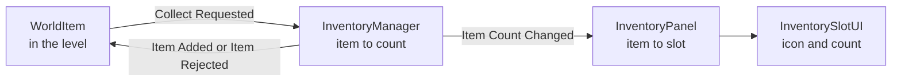
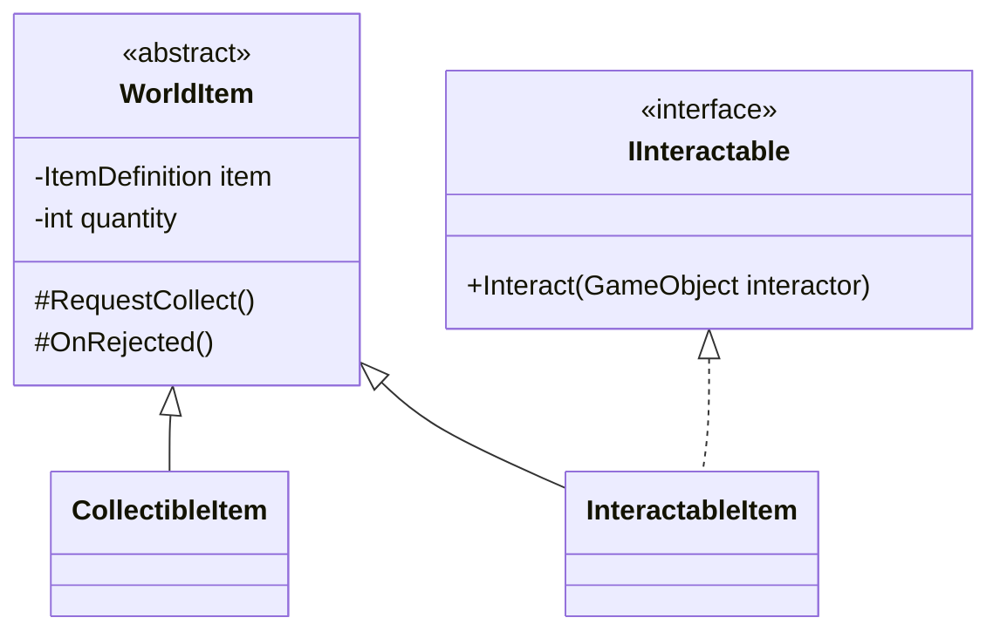

# 10 - Inventory Systems: Data, Events and Modular UI

Labs: [Lab 10 Part A - Collecting into an Inventory](../labs/lab_10_inventory_part_a.md), [Lab 10 Part B - Selecting Inventory Slots](../labs/lab_10_inventory_part_b.md)

## Key Concepts

1. **An inventory is state, rules and views** - a table of what the player holds, the rules that decide what it may hold, and the displays that show it are three separate jobs.
2. **The item asset is the key** - an `ItemDefinition` asset identifies an item type, so the code never compares names or strings.
3. **A dictionary answers "how many?" in one step** - `Dictionary<ItemDefinition, int>` finds any item's count without searching a list.
4. **Two dictionaries, one key** - the inventory maps items to counts; the panel maps the same items to slots, and neither reads the other.
5. **A slot is a view, not a container** - it shows an icon and a number and holds no inventory state of its own.
6. **The event system grows by subclassing** - a new payload type needs a two-line channel and a two-line listener, with no edit to the shared code.
7. **An event cannot return an answer** - when the sender needs to know the result, the receiver replies on another channel, or the sender calls it directly.
8. **How an item is collected is a strategy** - a pickup you walk into and a pickup you select and use share their data and their request, and differ only in what starts it.
9. **An interface must not demand one implementation's types** - `ISelector` returned a physics `RaycastHit`, so nothing but physics could implement it; returning `SelectionHit` fixed that.
10. **One pipeline, two worlds** - the same `SelectionManager` selects objects in the level and slots in the UI, with a different provider, selector and responses for each.

---

## 1. Framing Question

Your first person game has coins that the player collects by walking into them, and medkits and keys that the player collects by looking at them and pressing E. A hotbar at the bottom of the screen shows how many of each the player has, and the player can open it, point at a slot and use a medkit. How do you build this so that a designer can add a new item and its slot without a programmer, and so that the inventory, the pickups and the hotbar can each change without breaking the others?

Think of a game you have played recently. Does its inventory have a fixed place for each kind of item, such as an ammo counter per weapon, or does each item take the next free space?

---

## 2. What You Will Learn

| Skill | You can... |
|:------|:-----------|
| Model items as data | Create `ItemDefinition` assets and explain why the asset reference is a safe dictionary key |
| Use a dictionary for state | Add, update, look up and remove counts with `TryGetValue`, the indexer and `Remove` |
| Separate state from view | Explain why the inventory and the panel each hold their own dictionary with the same key |
| Extend the event channel system | Add channel and listener types for a new payload without editing `Assets/GD/Common` |
| Design request and reply | Return a result over channels with a reply that identifies its sender, and compare it with a direct call |
| Apply Strategy to collection | Collect some items by contact and others by selection, from one base class |
| Upgrade an interface | Explain why `ISelector` changed from `RaycastHit` to `SelectionHit`, and which principle the change restores |
| Select UI with the selection pipeline | Assemble a second selection system from a new ray provider, a new selector and UI responses |

---

## 3. Why This Matters

Almost every game keeps track of things the player has collected: coins, ammo, keys, potions, crafting parts. An inventory is also one of the best tests of a design, because it connects many systems. Pickups in the level add to it, the HUD shows it, doors and shops read it, and save systems store it. A first version written as one script on the player usually works for two item types and becomes hard to change by the fifth.

This note brings together most of what the module has covered so far. Items are data assets (Note 02). Pickups talk to the inventory through event channels (Note 04). Some pickups are collected by contact (Note 08), others by the selection system (Note 06), in a first person game built on the Starter Assets (Note 09). The new ideas are the ones that make those parts work together: dictionaries keyed by assets, events that need a reply, and an interface upgrade that lets the selection system work in the UI as well as in the level.

For the GCA, an inventory with a clear split between state, rules and views is direct evidence for **Data & State**, the channels between pickups, inventory and UI are evidence for **System Communication**, and the whole loop of collect, display and use is evidence for **Systems Integration**.

---

## 4. Core Ideas

### 4.1 Three Jobs in an Inventory

An inventory looks like one thing, but it does three jobs that change for different reasons:

| Job | Question it answers | Changes when |
|:--|:--|:--|
| **State** | What does the player hold, and how many of each? | Almost never; it is a table |
| **Rules** | May the player take this? Is the stack full? | The design changes: stack limits, weight, quest items |
| **Views** | How does the player see it? | The UI changes: a hotbar, a grid, a radial menu |

The design in this note gives each job its own home. `InventoryManager` holds the state and applies the rules. `InventoryPanel` and its `InventorySlotUI` slots are the view. The two are connected only by event channels, so the hotbar could be replaced by a grid without touching the manager.



### 4.2 Items as Data

An **item definition** is a ScriptableObject asset that describes one kind of item: its name, icon, colour and how many fit in one stack.

```csharp
using UnityEngine;

/// <summary>
/// Describes one kind of item: what it is called, how it looks in a slot and how many fit in a stack.
/// The asset itself identifies the item, so code compares assets, not names.
/// </summary>
[CreateAssetMenu(fileName = "SO_Item", menuName = "Inventory/Item Definition")]
public class ItemDefinition : ScriptableObject
{
    [SerializeField] private string displayName = "Item";

    [SerializeField, Tooltip("Shown in the slot. Leave empty to show a plain square in Colour")]
    private Sprite icon;

    [SerializeField] private Color colour = Color.white;

    [SerializeField, Min(1), Tooltip("The most of this item the player can hold")]
    private int maxStack = 10;

    public string DisplayName => displayName;

    public Sprite Icon => icon;

    public Color Colour => colour;

    public int MaxStack => maxStack;
}
```

This is Note 02's read-only data asset, used for a new purpose: the asset is the item's **identity**. Every coin pickup in every level refers to the same `SO_Coin` asset, so "is this a coin?" is answered by comparing references, which is fast and cannot be misspelt.

The alternative is a string ID such as `"coin"`. Strings are needed when items must be saved to a file or sent over a network, because an asset reference cannot be written to JSON. They are also easy to mistype, and a typo is a new item with no error. The Challenge exercise adds a string ID for saving while keeping the asset as the key in memory.

### 4.3 Dictionaries

A **`Dictionary<TKey, TValue>`** stores values by key. You give it a key and it returns the value directly, without searching, however many entries it holds. A `List<T>` would have to check each entry in turn to find a coin.

```csharp
var counts = new Dictionary<ItemDefinition, int>();

counts[coin] = 3;                                     // Add or overwrite.

if (counts.TryGetValue(coin, out int coinCount))      // Read, if present.
    Debug.Log($"Coins: {coinCount}");

counts.Remove(coin);                                  // Remove; returns false if it was not there.
```

The rules that matter for an inventory:

| Operation | Behaviour | Use it when |
|:--|:--|:--|
| `counts[key] = value` | Adds the entry, or overwrites it if the key exists | Setting a count |
| `counts[key]` (read) | Throws `KeyNotFoundException` if the key is missing | Only when the key must exist |
| `TryGetValue(key, out value)` | Returns `false` and the default value if missing | Reading a count that might be zero (the Try pattern from Note 06) |
| `Add(key, value)` | Throws if the key already exists | Never, for counts |
| `TryAdd(key, value)` | Returns `false` if the key already exists | Building a lookup where duplicates are a mistake |
| `foreach` over the dictionary | Order is not guaranteed | Never rely on it for display order |

Two further facts shape the design:

- **Unity does not serialize dictionaries** (Note 02, Section 4.3). A dictionary field shows nothing in the Inspector and is empty at the start of Play. The inventory builds its dictionary at runtime; the debugger is how you look inside it (Lab 10 Part A, Step 7).
- **Keys are compared by reference** for Unity objects. Two `ItemDefinition` assets with identical contents are still two different keys. Duplicate `SO_Coin` with Ctrl+D and the copy is a new item that happens to be called "Coin".

The inventory exposes its dictionary as **`IReadOnlyDictionary<ItemDefinition, int>`**, an interface that allows lookups and `foreach` but has no methods to add or remove. Other code can read the counts without being able to bypass the stack rule.

### 4.4 Two Dictionaries, One Key

The hotbar uses **pre-assigned slots**: each slot is set to one item in the Inspector, as a shooter has one ammo counter per ammo type. The panel builds its own dictionary from item to slot when it starts:

```csharp
foreach (InventorySlotUI slot in GetComponentsInChildren<InventorySlotUI>(true))
{
    // TryAdd fails when two slots are assigned the same item.
    if (!slotsByItem.TryAdd(slot.Item, slot))
        Debug.LogWarning($"{slot.name}: {slot.Item.DisplayName} already has a slot, so this one is ignored.", slot);
}
```

When an item's count changes, the panel looks up the slot by the same key and passes it the new number. Both dictionaries use `ItemDefinition` as the key, which is what connects them, but neither holds a reference to the other:

| Dictionary | Owner | Maps | Built from |
|:--|:--|:--|:--|
| `Dictionary<ItemDefinition, int>` | `InventoryManager` | Item to count (state) | Accepted collect requests, at runtime |
| `Dictionary<ItemDefinition, InventorySlotUI>` | `InventoryPanel` | Item to slot (view) | The slots found among the panel's children, in `Awake` |

Because the panel finds its slots with `GetComponentsInChildren`, adding an item to the hotbar is a scene change, not a code change: duplicate a slot, assign the new `ItemDefinition`, and it works. That is the open/closed principle (Note 06) applied to UI.

### 4.5 Extending the Event Channel System

The inventory needs to send more than the existing channel types carry. A collect request has an item, a quantity and a sender; a count change has an item and a new total. Each payload is a small struct:

```csharp
using UnityEngine;

/// <summary>A request to add or use an amount of one item, and the object that asked.</summary>
public readonly struct ItemRequest
{
    public ItemRequest(ItemDefinition item, int quantity, GameObject source)
    {
        Item = item;
        Quantity = quantity;
        Source = source;
    }

    public ItemDefinition Item { get; }

    public int Quantity { get; }

    public GameObject Source { get; }

    // Used by the channel's Log Raises option.
    public override string ToString() =>
        $"{Quantity} x {(Item != null ? Item.name : "no item")} from {(Source != null ? Source.name : "nothing")}";
}
```

A **`readonly struct`** cannot be changed after it is created. A message should not change on its way to its listeners, so an immutable payload removes a whole class of bugs where one listener edits the data the next listener reads.

The channel and its listener are subclasses of the shared generic classes in `Assets/GD/Common/Scripts/ScriptableObjects`:

```csharp
using GD.Types;
using UnityEngine;

[CreateAssetMenu(fileName = "ItemRequestEventChannel", menuName = "Inventory/Events/Item Request")]
public class ItemRequestEventChannel : EventChannel<ItemRequest>
{
}
```

```csharp
using GD.Types;

public class ItemRequestEventChannelListener : EventChannelListener<ItemRequestEventChannel, ItemRequest>
{
}
```

Each class is empty because everything it does, from `Raise` and logging to subscribing in `OnEnable` and calling Inspector responses, is inherited. The classes exist only because Unity needs a non-generic type to create an asset or add a component (Note 04). This is the payoff of the generic design: a new message type is two short files, and no file in `Common` changes.

### 4.6 Request and Reply

A pickup asks the inventory to take it. If the stack is full, the pickup must stay in the level, so it needs the answer. An event channel cannot give one: `Raise` returns `void`, and a channel may have no listeners or several.

There are two clean ways to get an answer:

| Route | How | Benefit | Cost |
|:--|:--|:--|:--|
| **Direct call** | The pickup finds the inventory and calls `bool TryAdd(item, quantity)` | One line; the answer is the return value | The pickup must find the inventory, so both must be in reach of each other, usually in the same scene and on known objects |
| **Request and reply** | The pickup raises `Collect Requested`; the inventory raises `Item Added` or `Item Rejected` with the same request | The pickup and inventory never reference each other; the inventory can be in another scene (Note 05) | Two more channels; every pickup hears every reply and must check it is the one being answered |

The direct route, for a pickup that the player walks into:

```csharp
// Direct route: the pickup asks the inventory on the player and reads the answer.
private void OnTriggerEnter(Collider other)
{
    if (other.TryGetComponent(out InventoryManager inventory) && inventory.TryAdd(item, quantity))
        Destroy(gameObject);
}
```

The request and reply route, as used in the labs:

```csharp
protected void RequestCollect()
{
    collectRequested.Raise(new ItemRequest(item, quantity, gameObject));
}

private void OnItemAdded(ItemRequest request)
{
    // Every item hears every reply; act only on replies to this item's own request.
    if (request.Source != gameObject)
        return;

    Destroy(gameObject);
}
```

`Source` is the **correlation** between the request and the reply: it lets each pickup recognise its own answer. Without it, one coin being accepted would remove every coin in the level.

Raising a channel is synchronous. `Raise` calls each listener immediately, in the same frame, before it returns. So the reply reaches the pickup inside its own call to `RequestCollect`. This makes the event route as predictable as the direct call, but it also means a listener that is disabled at that moment misses the reply for good (Note 04, Section 4.4).

Use the direct call when the sender and receiver are naturally connected and the answer matters. Use request and reply when they must stay independent. Both appear in the labs and exercises so you can compare them.

### 4.7 Two Ways to Collect: Strategy by Item Type

Coins are collected by walking into them. Medkits and keys are collected by looking at them and pressing Interact. The data, the request and the reply are the same for both; only the trigger differs. That shared part is real code, so it belongs in a base class (the test from Note 06, Section 4.7):



- **`CollectibleItem`** calls `RequestCollect` from `OnTriggerEnter`. The Starter Assets player is a CharacterController, which enters triggers normally (Note 08, Section 4.3).
- **`InteractableItem`** implements **`IInteractable`**, a one-method interface for anything the player can use by selecting it: `void Interact(GameObject interactor)`. Its `Interact` calls `RequestCollect`.

This is the Strategy pattern from Notes 06 and 07, chosen per item by the component on the pickup. A designer turns a coin into a select-to-collect coin by swapping `CollectibleItem` for `InteractableItem`, without code.

`IInteractable` is deliberately not about items. A door, a lever or a terminal can implement it too, and the same interaction code will use them.

### 4.8 Interacting Through the Selection System

The selection system from Note 06 already knows what the player is looking at: `SelectionManager.CurrentSelection`. A small component beside it turns "looking at" into "using":

```csharp
private void Update()
{
    // WasPressedThisFrame reacts to the press itself, so it works although Player/Interact has a Hold interaction.
    if (!interactAction.action.WasPressedThisFrame())
        return;

    Transform selection = selectionManager.CurrentSelection;

    if (selection != null && selection.TryGetComponent(out IInteractable interactable))
        interactable.Interact(interactor);
}
```

`SelectionInteractor` depends on `SelectionManager` and `IInteractable`, not on items. It does not know how the selection was made or what the selected object will do.

For first person selection, no new code is needed in the pipeline. `GameObjectRayProvider` with its `Target` set to the main camera casts along the centre of the view, `RayCastSelector` with a short `Max Distance` limits reach to arm's length, and `HighlightSelectionResponse` shows what will be taken.

### 4.9 Upgrading `ISelector`

The hotbar should also be selectable: open the inventory, point at the medkit slot, and click to use one. The natural design is a second selection pipeline with a selector that finds UI elements. With the first version of `ISelector`, that was impossible:

```csharp
// The first version of the interface, before the upgrade.
public interface ISelector
{
    bool TrySelect(Ray ray, out RaycastHit hit);
}
```

A `RaycastHit` can only be created by a physics cast; its `transform` and `collider` cannot be set by your code. A UI selector finds a uGUI element with the `GraphicRaycaster`, which reports a `RaycastResult`, not a `RaycastHit`. It had no way to fill the `out` parameter, so no UI selector could honour the contract. The interface had **leaked** a detail of its first implementation into its definition, and that is a Liskov substitution problem: only physics-based classes could ever substitute for `ISelector`.

The fix replaces the physics type with a small type the selection system owns:

```csharp
public interface ISelector
{
    bool TrySelect(Ray ray, out SelectionHit hit);
}
```

`SelectionHit` is a `readonly struct` in `Assets/GD/Common/Scripts/Selection/Selectors`, holding `Transform`, `Point`, `Normal` and `Distance`. The physics selectors build one with `SelectionHit.FromRaycastHit`; a UI selector builds one from its own result.

What the upgrade changed in `Common`:

| File | Change |
|:--|:--|
| `SelectionHit.cs` | New |
| `ISelector.cs` | `out RaycastHit hit` becomes `out SelectionHit hit` |
| `BaseCastSelector.cs` | `TrySelect` converts the physics hit; `Cast` and the child classes are unchanged |
| `SelectionManager.cs` | Reads `hit.Transform` instead of `hit.transform` |
| Responses, providers | Unchanged |

This is a deliberate upgrade of an earlier decision, and it is worth noticing how small it was. Because the manager only ever depended on the interface (dependency inversion), changing the interface touched four files and no response. Interfaces are not free to change, though: every class that implements one must change with it. Getting the types in an interface right early is cheaper, and "does this type belong to one implementation?" is the question to ask.

### 4.10 Selecting UI with the Selection Pipeline

The UI pipeline is a second GameObject with its own `SelectionManager`, assembled from three new parts and two existing ones:

| Role | First person level | Hotbar |
|:--|:--|:--|
| Ray provider | `GameObjectRayProvider`, from the camera | `UnlockedPointerRayProvider` (new): a ray through the pointer, only while the cursor is unlocked |
| Selector | `RayCastSelector` | `GraphicRaycastSelector` (new): the front-most UI element under the pointer, if tagged |
| Highlight | `HighlightSelectionResponse` | `SlotHighlightResponse` (new): tints the slot's `Image` |
| Other responses | - | `EventChannelSelectionResponse`, for a tooltip |
| Interaction | `SelectionInteractor` with `Player/Interact` | `SelectionInteractor` with `UI/Click` |

The new selector shows how the upgraded interface is used:

```csharp
using System.Collections.Generic;
using GD;
using UnityEngine;
using UnityEngine.EventSystems;
using UnityEngine.UI;

/// <summary>
/// Selects the front-most UI element under the ray, if it carries the selectable tag.
/// The UI equivalent of RayCastSelector.
/// </summary>
public class GraphicRaycastSelector : MonoBehaviour, ISelector
{
    [SerializeField, Tooltip("The GraphicRaycaster on the canvas to search")]
    private GraphicRaycaster raycaster;

    [SerializeField, Tooltip("The camera the ray comes from. Defaults to Camera.main if left empty")]
    private Camera viewCamera;

    [SerializeField, Tooltip("Tag used by selectable UI elements")]
    private string selectableTag = "Selectable";

    // Reused every frame, so selection creates no garbage.
    private readonly List<RaycastResult> results = new List<RaycastResult>();
    private PointerEventData pointerData;

    private void Awake()
    {
        if (viewCamera == null)
            viewCamera = Camera.main;

        if (raycaster == null || viewCamera == null)
        {
            Debug.LogError($"{name}: GraphicRaycastSelector needs a GraphicRaycaster and a camera.", this);
            enabled = false;
        }
    }

    public bool TrySelect(Ray ray, out SelectionHit hit)
    {
        hit = default;

        if (!enabled || EventSystem.current == null)
            return false;

        pointerData ??= new PointerEventData(EventSystem.current);

        // The ray starts on the camera's near plane under the pointer, so projecting
        // its origin back to the screen gives the pointer position the UI needs.
        pointerData.position = viewCamera.WorldToScreenPoint(ray.origin);

        results.Clear();
        raycaster.Raycast(pointerData, results);

        if (results.Count == 0)
            return false;

        // Only the front-most element counts, so a window or tooltip over a slot blocks it.
        GameObject front = results[0].gameObject;
        if (!front.CompareTag(selectableTag))
            return false;

        hit = new SelectionHit(front.transform, results[0].worldPosition, results[0].worldNormal, results[0].distance);
        return true;
    }
}
```

Two parts of this class need comment:

- **The ray is a carrier.** UI selection needs a screen position, but `IRayProvider` supplies a `Ray`. The selector projects the ray's origin back to the screen. It works because the provider builds the ray with `ScreenPointToRay`, but it is a sign that `IRayProvider` is still shaped around 3D. Changing it would be a second upgrade; here the cost of a one-line conversion is lower than the cost of changing every provider.
- **Front-most only.** `GraphicRaycaster.Raycast` returns every UI element under the pointer, front-most first. Only the first is tested, which is how a mouse should behave, but it means decorative children of a slot, such as its icon and count text, must have `Raycast Target` turned off, or they are the front-most element and the slot is never selected. Lab 10 Part B makes you find this with the debugger.

`UnlockedPointerRayProvider` returns `false` while `Cursor.lockState` is `Locked`, so the hotbar cannot be selected during first person look. Opening the inventory unlocks the cursor and turns off mouse look through the Starter Assets input (Note 09, Section 4.10), and the UI pipeline starts working with no message between the two. Each system reads the state it cares about.

The alternative is uGUI's own event interfaces: a slot script that implements `IPointerEnterHandler` and `IPointerClickHandler`. For UI alone, that is often simpler. The reason to use the selection pipeline here is consistency: the same responses, interactor and `IInteractable` work in the level and in the UI, and the team learns one system.

---

## 5. Worked Example

The demo builds the coin and medkit inventory from the Framing Question. It follows the module's iteration sequence: initial implementation, problem, change, improvement.

### Stage 1 - Initial Implementation: The Player Counts Pickups

`PlayerInventory` sits on the player. It counts pickups by tag, updates two labels and destroys the pickup.

```csharp
using System.Collections.Generic;
using TMPro;
using UnityEngine;

public class PlayerInventory : MonoBehaviour
{
    [SerializeField] private TMP_Text coinLabel;
    [SerializeField] private TMP_Text medkitLabel;

    private readonly Dictionary<string, int> counts = new Dictionary<string, int>();

    private void OnTriggerEnter(Collider other)
    {
        string itemName = other.tag;
        if (itemName != "Coin" && itemName != "Medkit")
            return;

        counts.TryGetValue(itemName, out int count);
        counts[itemName] = count + 1;
        Destroy(other.gameObject);

        if (itemName == "Coin")
            coinLabel.text = counts[itemName].ToString();
        else
            medkitLabel.text = counts[itemName].ToString();
    }
}
```

It works, and it already uses a dictionary well.

### Stage 2 - Problem: Five Requests

| Request | What happens in `PlayerInventory` |
|:--|:--|
| Add keys | A new tag, a new string in the `if`, a new label field, a new branch in the label code |
| Medkits must be taken by looking and pressing E | Trigger contact is the only way in; selection needs a second, separate path |
| The player can hold only one medkit | No rule exists; a rule needs per-item limits, which have nowhere to live except more fields |
| Move the HUD to a UI scene (Note 05) | The labels are scene references on the player; they cannot cross scenes |
| A designer types `"medkit"` as a tag | Nothing is counted, with no error |

The class does all three jobs from Section 4.1. The state is keyed by strings, the rules do not exist yet, and the view is hard-wired into the same method. Every request edits it.

### Stage 3 - Change: State, Rules and Views Apart

The full listings are in the labs; the central classes are here. A finished copy of every inventory class is in `Assets/GD/Common/Scripts/Inventory`, in the `GD.Inventory` namespace. `IInteractable` and `SelectionInteractor` are in `Assets/GD/Common/Scripts/Interaction`, and `GraphicRaycastSelector` and `UnlockedPointerRayProvider` are with the other selectors and providers in `Assets/GD/Common/Scripts/Selection`. `InventoryManager` holds the state and the rule, receives requests through a listener, and announces every result:

```csharp
using System.Collections.Generic;
using UnityEngine;

/// <summary>
/// Holds how many of each item the player has, applies the stack rule, and announces every change.
/// Requests arrive through event channel listeners; replies and changes go out through channels.
/// </summary>
public class InventoryManager : MonoBehaviour
{
    #region Fields

    [Header("Replies")]
    [SerializeField, Tooltip("Raised with the request when a collect request is accepted")]
    private ItemRequestEventChannel itemAdded;

    [SerializeField, Tooltip("Raised with the request when a collect request is refused")]
    private ItemRequestEventChannel itemRejected;

    [Header("Changes")]
    [SerializeField, Tooltip("Raised with the new total whenever an item's count changes")]
    private ItemCountEventChannel countChanged;

    private readonly Dictionary<ItemDefinition, int> counts = new Dictionary<ItemDefinition, int>();

    #endregion Fields

    #region Properties

    /// <summary>Every item held and its count. Read-only, so the stack rule cannot be bypassed.</summary>
    public IReadOnlyDictionary<ItemDefinition, int> Counts => counts;

    #endregion Properties

    #region Unity Messages

    private void Awake()
    {
        if (itemAdded == null || itemRejected == null || countChanged == null)
        {
            Debug.LogError($"{name}: InventoryManager needs its reply and change channels.", this);
            enabled = false;
        }
    }

    #endregion Unity Messages

    #region Event Handlers

    /// <summary>Called by a listener on the Collect Requested channel.</summary>
    public void HandleCollectRequest(ItemRequest request)
    {
        // UnityEvents still call methods on a disabled component.
        if (!enabled)
            return;

        if (TryAdd(request.Item, request.Quantity))
            itemAdded.Raise(request);
        else
            itemRejected.Raise(request);
    }

    /// <summary>Called by a listener on the Use Requested channel.</summary>
    public void HandleUseRequest(ItemRequest request)
    {
        if (!enabled)
            return;

        TryRemove(request.Item, request.Quantity);
    }

    #endregion Event Handlers

    #region Core Methods

    public int GetCount(ItemDefinition item)
    {
        return item != null && counts.TryGetValue(item, out int count) ? count : 0;
    }

    public bool TryAdd(ItemDefinition item, int quantity)
    {
        if (item == null || quantity <= 0)
            return false;

        int current = GetCount(item);

        // All or nothing: a request that would overflow the stack is refused whole.
        if (current + quantity > item.MaxStack)
            return false;

        SetCount(item, current + quantity);
        return true;
    }

    public bool TryRemove(ItemDefinition item, int quantity)
    {
        if (item == null || quantity <= 0)
            return false;

        int current = GetCount(item);
        if (current < quantity)
            return false;

        SetCount(item, current - quantity);
        return true;
    }

    private void SetCount(ItemDefinition item, int count)
    {
        // Remove empty entries, so the dictionary only holds items the player actually has.
        if (count == 0)
            counts.Remove(item);
        else
            counts[item] = count;

        countChanged.Raise(new ItemCount(item, count));
    }

    #endregion Core Methods
}
```

`ItemCount` is a second `readonly struct` with `Item` and `Count`, and `ItemCountEventChannel` is its channel (Section 4.5).

The view is two small classes. A slot shows one item and knows nothing else:

```csharp
using TMPro;
using UnityEngine;
using UnityEngine.UI;

/// <summary>
/// One inventory slot, pre-assigned to an item in the Inspector. Shows the item's icon and count,
/// and holds no inventory state of its own.
/// </summary>
public class InventorySlotUI : MonoBehaviour
{
    [SerializeField, Tooltip("The item this slot shows")]
    private ItemDefinition item;

    [SerializeField] private Image icon;
    [SerializeField] private TMP_Text countLabel;

    [SerializeField, Range(0f, 1f), Tooltip("Icon opacity while the player has none of the item")]
    private float emptyAlpha = 0.25f;

    public ItemDefinition Item => item;

    public int Count { get; private set; }

    private void Awake()
    {
        if (item == null || icon == null || countLabel == null)
        {
            Debug.LogError($"{name}: InventorySlotUI needs an item, an icon and a count label.", this);
            enabled = false;
            return;
        }

        icon.sprite = item.Icon;
        SetCount(0);
    }

    public void SetCount(int count)
    {
        Count = count;

        Color colour = item.Colour;
        colour.a = count > 0 ? 1f : emptyAlpha;
        icon.color = colour;

        countLabel.text = count > 0 ? count.ToString() : string.Empty;
    }
}
```

The panel maps items to slots and passes on each change:

```csharp
using System.Collections.Generic;
using UnityEngine;

/// <summary>
/// Maps each item to its pre-assigned slot and updates that slot when the item's count changes.
/// Slots are found among this object's children, so adding a slot needs no code.
/// </summary>
public class InventoryPanel : MonoBehaviour
{
    private readonly Dictionary<ItemDefinition, InventorySlotUI> slotsByItem =
        new Dictionary<ItemDefinition, InventorySlotUI>();

    private void Awake()
    {
        foreach (InventorySlotUI slot in GetComponentsInChildren<InventorySlotUI>(true))
        {
            if (slot.Item == null)
            {
                Debug.LogWarning($"{slot.name}: no item assigned, so this slot is ignored.", slot);
                continue;
            }

            // TryAdd fails when two slots are assigned the same item.
            if (!slotsByItem.TryAdd(slot.Item, slot))
                Debug.LogWarning($"{slot.name}: {slot.Item.DisplayName} already has a slot, so this one is ignored.", slot);
        }
    }

    /// <summary>Called by a listener on the Item Count Changed channel.</summary>
    public void ShowCount(ItemCount change)
    {
        if (slotsByItem.TryGetValue(change.Item, out InventorySlotUI slot))
            slot.SetCount(change.Count);
        else
            Debug.LogWarning($"{name}: no slot for {change.Item.DisplayName}.", this);
    }
}
```

Pickups are `WorldItem` subclasses (Section 4.7), and selection-based pickups are used through `SelectionInteractor` (Section 4.8). Both are listed in full in Lab 10 Part A.

### Stage 4 - Improvement: The Five Requests Again

| Request | Change now |
|:--|:--|
| Add keys | Create `SO_Key`, duplicate a slot and assign it, place an `InteractableItem` that refers to `SO_Key`. No code |
| Medkits by looking and pressing E | Use `InteractableItem` on medkits and `CollectibleItem` on coins |
| One medkit at a time | Set `Max Stack` to 1 on `SO_Medkit`; a second medkit is rejected and stays in the level |
| HUD in a UI scene | Move the panel and its listener to the UI scene; the channels are assets, so nothing else changes |
| A mistyped name | There are no names in the code; items are chosen from an asset picker |

What changed, as a Problem, Solution, Benefit summary:

| Problem | Solution | Benefit |
|:--|:--|:--|
| One script on the player held string-keyed state, had no rules, hard-wired its labels and only collected by contact | `ItemDefinition` assets as keys; `InventoryManager` owns state and rules; `InventoryPanel` maps the same keys to pre-assigned slots; pickups request and receive replies over channels; collection is a strategy chosen per item | Items and slots are added in the Editor; the manager, pickups and UI change independently; the stack rule lives in one place; the UI can move scenes |

---

## 6. Common Pitfalls

| Symptom | Cause | Fix |
|:--|:--|:--|
| `KeyNotFoundException` when collecting the first of an item | Reading `counts[item]` before the item has an entry | Use `TryGetValue`, or a helper such as `GetCount` |
| A pickup disappears but its slot does not change, and the Console says there is no slot for an item that has one | The pickup and the slot refer to different `ItemDefinition` assets with the same name | Check the asset each one refers to; delete the duplicate |
| Two slots for one item, and only one updates | Two slots are assigned the same item; the panel ignores the second | Read the panel's warning; assign each item to one slot |
| Collecting one coin removes every coin | The reply handler does not check `Source` | Compare `request.Source` with `gameObject` |
| A full-stack pickup disappears anyway | The pickup destroys itself after `Raise` instead of on the `Item Added` reply | Destroy only in the reply handler |
| Nothing is collected, and the channel logs `(0 listeners)` | The listener for `Collect Requested` is missing or on an inactive object | Put the listener on an active object, beside `InventoryManager` |
| Interact never fires | `Player/Interact` has a Hold interaction and the code uses `WasPerformedThisFrame` | Use `WasPressedThisFrame` |
| Compile errors in a selector after updating `Common` | The class implements `TrySelect(Ray, out RaycastHit)` | Change it to `out SelectionHit`; for a physics selector, inherit from `BaseCastSelector` |
| A slot is never selected, although the pointer is over it | The slot's icon or text is the front-most raycast target | Untick `Raycast Target` on decorative children |
| Slots can be selected while looking around | The UI ray provider ignores the cursor state | Use `UnlockedPointerRayProvider`, which needs an unlocked cursor |
| The view keeps turning while the inventory is open | Mouse look is still enabled | Clear `cursorInputForLook` and reset look on `StarterAssetsInputs` when opening |

---

## 7. Software Development Parallels

- **Model-View separation.** `InventoryManager` is a model and `InventoryPanel` is a view. Model-View-Controller and its relatives keep them apart for the reason Section 4.1 gives: they change for different reasons, at different rates, by different people.
- **Request and reply messaging.** Message queues and web services use the same pattern as Section 4.6. A request carries a correlation ID, the reply carries it back, and the sender matches the two. `Source` is a correlation ID.
- **Leaky abstraction.** Joel Spolsky's "law of leaky abstractions" describes interfaces that expose details of the system underneath. `ISelector` returning `RaycastHit` was one; Section 4.9 is the standard fix of introducing a type the abstraction owns.
- **Hash tables.** `Dictionary` is a hash table, the same structure behind Python's `dict`, Java's `HashMap` and database indexes. Constant-time lookup by key is why it suits an inventory.
- **Commercial games.** *DOOM* (2016) shows one fixed counter per ammo type, the pre-assigned slot design. *Resident Evil 4*'s attache case is a grid where each item takes a shape and position, a design where slots are assigned at runtime. *Minecraft*'s hotbar is a fixed row of slots that hold whatever is put in them. Each is a different view over the same idea of item-to-count state.

---

## 8. Exercises

### Core - A New Item with No Code

Add a battery item. Create `SO_Battery` with a `Max Stack` of 3, add a slot for it to the hotbar, and place two battery pickups: one `CollectibleItem` and one `InteractableItem`.

**Expected result:** both batteries are collected, each in its own way, and the battery slot shows the count. List every file and asset you created or changed. If the list includes a `.cs` file, explain what forced it.

### Apply - The Direct Route

Write `DirectCollectibleItem`, a pickup that uses the direct call from Section 4.6 instead of request and reply. Put an `InventoryManager` on the player for this exercise.

**Expected result:** the pickup works and is refused correctly when the stack is full. In 100 to 150 words, compare the two routes for your group project: which is simpler to read, which survives the inventory moving to a persistent Bootstrap scene (Note 05), and which you would choose.

### Challenge - Save and Load

Save the inventory to a JSON file when the player presses F5 and load it with F9. An asset reference cannot be written to JSON, so each item needs a stable string ID. Decide where the IDs live, how the loader turns an ID back into an `ItemDefinition`, and what happens to an ID with no matching asset.

**Expected result:** collect some items, save, collect more, load, and the counts return to the saved values with the hotbar updated. In 150 to 200 words, justify keeping the asset as the dictionary key in memory while using a string ID on disk.

---

## 9. Reflective Questions

1. `InventorySlotUI` holds a `Count`, but Key Concept 5 says a slot holds no inventory state. Is the `Count` property state, or a copy for display? What would go wrong if other code treated it as the truth?
2. The pickups use request and reply, but `SelectionInteractor` calls `Interact` directly. Justify each choice using Section 4.6.
3. Upgrading `ISelector` changed four files in `Common`. What would it have cost if a dozen selectors in your group's project implemented the old interface, and how would you have managed the change?
4. `GraphicRaycastSelector` receives a `Ray` and turns it back into a screen position. Is that a second leaky abstraction? Argue whether `IRayProvider` should change too.
5. Your group's game has items or resources of some kind. Would pre-assigned slots or runtime-assigned slots suit it better, and why?

---

## 10. How This Builds

- **[Lab 10 Part A](../labs/lab_10_inventory_part_a.md)** builds the first person level, both kinds of pickup, the inventory and the pre-assigned hotbar, and uses the debugger to find why one coin goes nowhere.
- **[Lab 10 Part B](../labs/lab_10_inventory_part_b.md)** opens the hotbar, selects slots with a second selection pipeline, shows a tooltip and uses a medkit, and uses the debugger to find why a slot cannot be selected.
- **Note 11 - Interpolation, Easing and Tweening** explains the easing you could use to animate a slot when its count changes, instead of changing the number instantly.
- **Note 15 - Orchestration and Game Flow** uses inventory state as a condition in gameplay flow, such as a door that opens only when the player holds a key.
- **Note 16 - State Machines and the State Pattern** uses `IInteractable` and the inventory together in objects with states, such as a locked, unlocked and open door.
- **GCA:** the inventory is a strong candidate for a **Gameplay System** nomination. Its state and rules are evidence for **Data & State**, its channels for **System Communication**, and the `ISelector` upgrade, with the `RaycastHit` version in Section 4.9 as the "before", is a model for the kind of before-and-after that **Iteration & Improvement** asks for.

---

## Glossary

| Term | Definition |
|:-----|:-----------|
| Correlation | Information in a reply, such as the sender, that identifies which request it answers |
| Dictionary | A collection that stores values by key and finds a value from its key without searching |
| Direct call | Calling a method on another object and reading its return value, rather than raising an event |
| IInteractable | A one-method interface for anything the player can use by selecting it |
| Identity | What makes two things the same thing; for items here, being the same `ItemDefinition` asset |
| IReadOnlyDictionary | An interface to a dictionary that allows lookups but not changes |
| Item definition | A ScriptableObject asset that describes one kind of item and identifies it |
| Leaky abstraction | An interface that exposes details of one implementation, so other implementations cannot satisfy it |
| Pre-assigned slot | A UI slot set to one item in the Inspector, which always shows that item |
| Readonly struct | A value type whose fields cannot change after it is created |
| Request and reply | A pattern in which a sender raises a request and the receiver answers on a separate channel |
