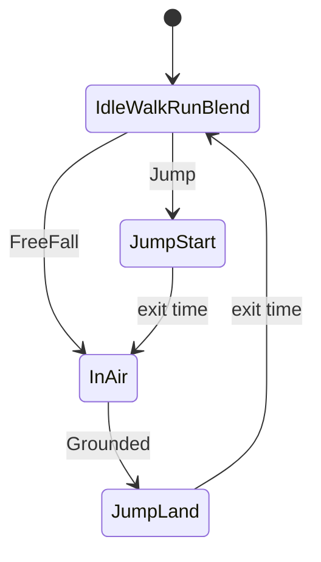
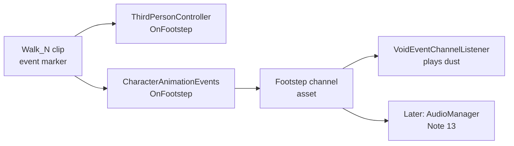
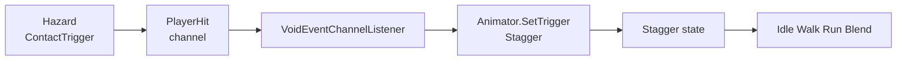

# 12 - Character Animation

Lab: [Lab 12 - Extending the Third Person Animator](../labs/lab_12_third_person_animator.md)

## Key Concepts

1. **Gameplay decides, the Animator presents** - the controller moves the character and reports its state; the Animator chooses which pose matches that state.
2. **Clip, controller, component** - a clip is motion, an Animator Controller is the rules for choosing clips, and the `Animator` component runs those rules on one object.
3. **Parameters are the only interface** - code sets named values, and transitions read them, so neither side needs to know the other's details.
4. **A blend tree is a mix, not a state** - one parameter smoothly mixes clips such as idle, walk and run, which would otherwise need many transitions.
5. **Exit time and transition duration shape feel** - an action state that waits for its exit time can make controls feel slow, even when the code responds at once.
6. **Foot sliding means two speeds disagree** - the speed the character moves at and the speed its clip was authored for must match.
7. **Animation events connect a pose to a moment** - only the clip knows the frame on which a foot touches the ground.
8. **Every component can hear an animation event** - a new component on the Animator's object can respond with no edit to the controller.
9. **Copy third-party animation assets before you change them** - duplicate the controller and clip, and leave the originals as they were imported.
10. **Choose the Animator for character motion and tweens for simple object motion** - one is authored and blended, and the other is data-driven and needs no asset.

---

## 1. Framing Question

The third person controller from Note 09 already walks, runs, jumps and lands, with footsteps that match its feet. Your group needs the character to react to being hit, and dust to appear at the moment of a jump. How do you add to its animation without a custom controller, and without editing the code or assets that came with it?

Watch a character jump in a game you know. Does it leave the ground on the frame you press the button, or does it crouch first? Which would you want for a tight platformer, and which for a heavy armoured knight?

---

## 2. What You Will Learn

| Skill | You can... |
|:------|:-----------|
| Read an Animator Controller | Trace the states and transitions of the third person controller, and name the parameter behind each |
| Explain a blend tree | Work out the mix of clips at a given `Speed` value |
| Tune transitions | Change exit time and transition duration, and describe the effect on feel |
| Diagnose foot sliding | Compare movement speed with the clip's authored speed |
| Respond to animation events | Add a component that raises channels from `OnFootstep` and a new event of your own |
| Add a state | Add a triggered state with no change to any script |
| Choose a technique | State when to use the Animator and when to use a tween |

---

## 3. Why This Matters

Animation is the part of your game the player looks at for the whole 2 to 3 minutes. A small, well-connected set of animations reads as craft: feet that match the ground, a landing with weight, and dust on the right frame. Your group does not need many clips to achieve that. It needs the ones it has to connect properly to gameplay.

There is also a design problem. If animation code is mixed into movement, combat and audio code, nobody can change one without risking the others. The Starter Assets controller already separates the layers through parameters and events. Understanding that split lets you add features without touching its code, which supports **Systems Integration** in the GCA. The third person controller is the case study here; Section 4.9 covers what first person groups do instead.

---

## 4. Core Ideas

### 4.1 Clip, Controller and Component

Three things work together:

| Part | What it is | Third person example |
|:--|:--|:--|
| **Animation clip** | Motion data over time | `Walk_N`, `JumpStart`, inside `Character/Animations` |
| **Animator Controller** | An asset holding states, transitions and parameters | `StarterAssetsThirdPerson.controller` |
| `Animator` component | Runs a controller on one object, and applies poses | On the root of `PlayerArmature` |

The `Animator` also has an **Avatar**, a mapping from a humanoid skeleton's bones to standard names. It lets one humanoid clip play on another humanoid character, and this is why clips downloaded from a library can work on the Starter Assets armature if they are imported as `Humanoid`.

### 4.2 The Animator as a State Machine

An Animator Controller is a **state machine**: it is always in one state, and **transitions** move it to another when their conditions are met. Note 16 implements this idea in code. These are the states you use from the third person controller:



The real asset also contains a `Fly` state that depends on a `Flying` parameter the controller does not declare. Nothing enters it, so it never plays. Third-party assets often carry leftovers like this, and it is a reason to read them rather than trust them.

Three settings on each transition matter for feel:

| Setting | Meaning | Effect |
|:--|:--|:--|
| `Has Exit Time` | Wait until a point in the clip before leaving | On means the action finishes first, and can feel slow; off means it reacts at once |
| `Exit Time` | How far through the clip to leave, as a fraction | 0.9 means 90% of the way through |
| `Transition Duration` | How long the two clips blend | Long is smooth and soft; short is sharp and responsive |

The jump is a good example. `Idle Walk Run Blend` to `JumpStart` has `Has Exit Time` off and a duration of about 0.07 s, so the jump reads immediately. The transition from `JumpLand` back has a duration of about 0.43 s, so the landing eases into the run. Both choices are about feel.

### 4.3 Parameters

**Animator parameters** are the interface between code and the controller. The controller uses five:

| Parameter | Type | Set to | Read by |
|:--|:--|:--|:--|
| `Speed` | Float | `_animationBlend`, a smoothed target speed | The blend trees |
| `MotionSpeed` | Float | Stick magnitude, or 1 for keyboard | `Idle Walk Run Blend`'s speed multiplier |
| `Jump` | Bool | True on the frame a jump starts | Transition to `JumpStart` |
| `FreeFall` | Bool | True after `FallTimeout` in the air | Transition to `InAir` |
| `Grounded` | Bool | The grounded check result | Transition to `JumpLand` |

A **trigger** is a fourth type, along with float, int and bool. It works like a bool that resets itself once a transition uses it, so it fits a one-off action such as being hit or attacking.

```csharp
private static readonly int StaggerId = Animator.StringToHash("Stagger");

public void PlayStagger()
{
    animator.SetTrigger(StaggerId);
}
```

Hashing the name once (Note 09, Section 4.8) saves repeated string work and keeps a spelling mistake in one place. A misspelt name does not cause a compile error; it logs a warning at runtime, and nothing happens.

### 4.4 Blend Trees

A **blend tree** is a state that mixes several clips based on a parameter. `Idle Walk Run Blend` is a 1D tree on `Speed`:

| Clip | Threshold |
|:--|:--|
| `Idle` | 0 |
| `Walk_N` | 2 |
| `Run_N` | 6 |

Between two thresholds, the clips are mixed in proportion. The controller's `MoveSpeed` of 2 gives pure `Walk_N`. Its `SprintSpeed` of 5.335 lies between 2 and 6, so it gives a mix of 83% run and 17% walk: `(5.335 - 2) / (6 - 2)` is about 0.83. Without a blend tree, walking at each stick position would need a separate clip and transitions.

`JumpLand` is also a blend tree on `Speed`, mixing a standing landing with walking and running landings at the same thresholds. A landing at a run looks different from a standing one, and the code does not need to know that. `Speed` is what gets used.

`Speed` itself comes from the frame-rate dependent `Lerp` in Note 11, Section 4.2. You leave that in place, because it is Unity's code and the effect on a mix of clips is small. It is a measured decision rather than an oversight.

### 4.5 Who Moves the Character

Animation clips can contain movement of the whole character, which is **root motion**. `PlayerArmature` has `Apply Root Motion` off, so the clips only change the pose, and the `CharacterController` does all the moving. The controller's movement stays exact and predictable, at the cost that a clip and the movement can disagree.

**Foot sliding** is what that disagreement looks like: the character moves faster or slower than its legs. Raise `SprintSpeed` to 8 and `Speed` passes the top threshold of 6, so the clip stays at pure `Run_N` while the character moves a third faster. To fix it, either keep movement speeds near what the clips were authored for, or change a state's `Speed` multiplier. A multiplier on `Idle Walk Run Blend` affects walking too, so test both. Root motion is the alternative when a clip must control exact distances, such as a vault. It is out of scope here, because the Starter Assets controller is built around `CharacterController.Move`.

### 4.6 Animation Events

An **animation event** is a marker in a clip that calls a named method when playback reaches it. The Starter Assets use two: `OnFootstep`, in `Walk_N`, `Run_N` and `Run_S`, and `OnLand`, in the three landing clips.

```csharp
// From ThirdPersonController.
private void OnFootstep(AnimationEvent animationEvent)
{
    if (animationEvent.animatorClipInfo.weight > 0.5f)
    {
        // Plays a random footstep clip.
    }
}
```

Only the clip's author knows the frame on which a foot lands, so the marker belongs in the clip. The weight check exists because a blend tree runs several clips together, and each one fires its own events. At a walk-run mix, both clips fire `OnFootstep`, and only the clip with the most weight should count.

An event calls that method on **every** component on the Animator's GameObject. This gives you an extension point: a second component can have its own `OnFootstep`, and both run. You add behaviour with no edit to the controller. The cost is that the link is only a name. Rename the method, and Unity logs `has no receiver` at runtime.

### 4.7 From Animation Event to Game Event

The controller's `OnFootstep` is private, and plays audio directly with `PlayClipAtPoint`. Your game probably wants more: dust, a noise an enemy can hear, a small camera movement. If one component called them all, it would depend on all of them. An event channel (Note 04) breaks that dependency:

```csharp
using GD.Types;
using UnityEngine;

/// <summary>
/// Turns animation events on this character into event channel raises, so other systems
/// can respond without depending on the character or its animations.
/// </summary>
[RequireComponent(typeof(Animator))]
public class CharacterAnimationEvents : MonoBehaviour
{
    [SerializeField, Tooltip("Raised when a foot lands")]
    private VoidEventChannel footstepChannel;

    [SerializeField, Tooltip("Raised when the character pushes off for a jump")]
    private VoidEventChannel pushOffChannel;

    [SerializeField, Range(0f, 1f), Tooltip("Blended clips below this weight do not raise footsteps")]
    private float minimumClipWeight = 0.5f;

    // Called by animation events in the walk and run clips. The controller has its
    // own method with this name, and both run.
    public void OnFootstep(AnimationEvent animationEvent)
    {
        if (footstepChannel != null && animationEvent.animatorClipInfo.weight > minimumClipWeight)
            footstepChannel.Raise();
    }

    // Called by an animation event you add to a copy of the jump clip.
    public void OnPushOff()
    {
        if (pushOffChannel != null)
            pushOffChannel.Raise();
    }
}
```

This class has one job, translating animation events into channels. It knows nothing about dust or audio, so it depends on the channel abstraction and not on the things that respond, which is dependency inversion from Note 06. Note 13 connects the same channel to pooled audio, with no change here.



### 4.8 Changing Third-Party Animation Safely

Note 09 told you not to edit Unity's scripts, and the same reasoning covers its animation assets. Re-importing replaces your edits, and a change in the shared asset affects every scene.

| You want to change | Do this | Why |
|:--|:--|:--|
| States, parameters or transitions | Duplicate `StarterAssetsThirdPerson.controller` with `Ctrl+D`, and assign the copy to your character's `Animator` | The original stays intact, and your copy can be used in one scene or prefab variant |
| Events on a clip | Select the clip inside its FBX and press `Ctrl+D` to get an editable `.anim` copy, then use the copy in your controller | Clips inside an FBX are read-only, and editing their import settings changes the third-party asset |
| Movement or jump values | Set them on the component in your scene | These are overrides, not edits |

Adding a state is then an editor task. For a stagger when the player is hit, add a `Stagger` trigger, then add a state with a transition from `Any State`. Because `Animator.SetTrigger(string)` appears in a `UnityEvent` dropdown, a `VoidEventChannelListener` can fire it with no new script:



Remember Section 4.5: the Animator only presents. The character can still run during its stagger, with its legs out of step. If the design requires it to stop, that belongs in gameplay code, and Note 15 disables control during a sequence.

### 4.9 First Person Has No Animator

`FirstPersonController` has no `Animator`, no clips and no animation events, because the player has no visible body. Everything above about events and blend trees needs a different source:

| Third person source | First person equivalent |
|:--|:--|
| `OnFootstep` event | Raise the same channel after a set distance walked (Apply exercise) |
| `JumpLand` clip | Tween the camera target slightly on landing (Note 11) |
| Character clips | An `Animator` on a held object, such as a weapon, or a tween |

Listeners on the channel do not change, because they never knew where the raise came from. This is the benefit of Section 4.7: the two controllers share no interface, but they can share channels and everything listening to them.

### 4.10 Animator or Tween?

Note 11 slid a door with a tween. The same door can use an `Animator`: key a clip for open and another for closed, add a bool parameter `IsOpen`, then set it from code.

```csharp
using UnityEngine;

/// <summary>
/// Sets a named Animator bool from Inspector events, which cannot pass two arguments
/// to Animator.SetBool directly.
/// </summary>
[RequireComponent(typeof(Animator))]
public class AnimatorBoolSwitch : MonoBehaviour
{
    [SerializeField, Tooltip("Name of the bool parameter in the Animator Controller")]
    private string parameterName = "IsOpen";

    private Animator animator;
    private int parameterId;

    private void Awake()
    {
        animator = GetComponent<Animator>();
        parameterId = Animator.StringToHash(parameterName);
    }

    public void SetTrue()
    {
        animator.SetBool(parameterId, true);
    }

    public void SetFalse()
    {
        animator.SetBool(parameterId, false);
    }
}
```

| Question | Animator | Tween |
|:--|:--|:--|
| Skeletal character motion | Yes | No |
| Several coordinated bones or parts, authored by hand | Yes | Awkward |
| Blends, layers, reusable humanoid clips | Yes | No |
| Moving, scaling or fading one value | Works, but needs a clip and a controller | Yes |
| Endpoints known only at runtime | Awkward | Yes |
| Per-frame cost | Each `Animator` evaluates its graph every frame, even when idle | Only while a tween runs |
| Who tunes it | Animators, in clips | Anyone, through `TweenProfile` assets |

Use the Animator for characters and anything with authored multi-part motion. Use tweens for simple object and UI motion. Both are in your toolbox, and the choice is worth defending in your screencast.

---

## 5. Worked Example

The demo makes dust appear on a jump's push-off. The design decision comes first: the event must come from the clip, because it marks a moment in the pose. It must reach the dust through a channel, so the character does not depend on an effect. Neither step edits Unity's script or animation assets.

### Stage 1 - Initial Implementation: Use the Controller's State

The quickest idea uses what Note 09 taught: watch the input from a component, and play dust when jump goes true.

```csharp
using StarterAssets;
using UnityEngine;

[RequireComponent(typeof(StarterAssetsInputs))]
public class JumpDust : MonoBehaviour
{
    [SerializeField] private ParticleSystem dust;

    private StarterAssetsInputs input;
    private bool wasJumping;

    private void Awake()
    {
        input = GetComponent<StarterAssetsInputs>();
    }

    private void LateUpdate()
    {
        // input.jump stays true from the press until the controller clears it.
        if (input.jump && !wasJumping)
            dust.Play();

        wasJumping = input.jump;
    }
}
```

It works, and dust appears when you press Space.

### Stage 2 - Problem: The Input Is Not the Jump

| Observation | Cause |
|:--|:--|
| Dust appears when pressing Space in mid-air, or during the jump timeout | Input records what the player asked for, not what happened |
| The dust is slightly early against the pose | The crouch and push-off are in the clip, and code does not know when |
| Audio also wants this moment | Another reference, and `JumpDust` is now about more than dust |

Input records intent, so it is the wrong source. The right moment is in the animation.

### Stage 3 - Change: Add an Event to a Copy of the Clip

1. Duplicate `StarterAssetsThirdPerson.controller` as `AC_Player`, and assign it to the `Animator` on your `PlayerArmature`.
2. Inside `Character/Animations/Jump--Jump.anim.fbx`, select `JumpStart`, press `Ctrl+D`, and move the copy to your folder as `JumpStart_PushOff`.
3. In the `Animation` window, with the copy selected, move to the frame where the feet leave the ground and click `Add Event`. Set `Function` to `OnPushOff`.
4. In `AC_Player`, select the `JumpStart` state and set `Motion` to `JumpStart_PushOff`.

### Stage 4 - Improvement: Route It Through a Channel

Add `CharacterAnimationEvents` from Section 4.7 to `PlayerArmature`, and assign a `PushOff` channel asset. On the dust object, add a `VoidEventChannelListener` for `PushOff`, with `Response` set to `ParticleSystem.Play`.

`JumpDust` is now deleted. Pressing Space in mid-air no longer shows dust, because the clip does not play. The dust lands on the frame you chose in the clip, and a sound designer can add another listener with no code.

| Problem | Solution | Benefit |
|:--|:--|:--|
| Dust driven by input fires when no jump happened, and at an approximate moment | A new event in a copied clip raises a channel through `CharacterAnimationEvents` | Accurate timing, no third-party edits, and any system can respond with no change to the character |

---

## 6. Common Pitfalls

| Symptom | Cause | Fix |
|:--------|:------|:----|
| `AnimationEvent 'OnPushOff' on animation 'JumpStart_PushOff' has no receiver` | No component on the Animator's GameObject has that method name | Add the component to that object, not a child; check the spelling |
| Footstep events fire twice per step | A blended clip also fired, and the weight check is missing | Check `animationEvent.animatorClipInfo.weight` |
| A trigger seems to do nothing | The name is misspelt, or no transition uses it | Watch the `Parameters` tab in Play; a warning appears in the Console for an unknown name |
| A state plays again and again | `Any State` transition has `Can Transition To Self` ticked and the trigger is firing | Untick `Can Transition To Self` |
| A state never leaves | No `Has Exit Time` and no condition on the way out | Add one or the other |
| Controls feel slow | `Has Exit Time` is on for an action, or the transition is long | Turn it off, or shorten the transition |
| The character's feet slide | Movement speed does not match the clip | Section 4.5 |
| Changes appear in every scene, or vanish after an import | The original controller or clip was edited | Duplicate them (Section 4.8) |
| The character moves on its own or drifts | `Apply Root Motion` was ticked | Untick it; this controller moves the character itself |
| `Animator` has no effect on the capsule prefab | `PlayerCapsule` has no `Animator` | Use `PlayerArmature` |

---

## 7. Software Development Parallels

- **Separation of presentation from logic.** Gameplay state on one side, and a presentation system reading it through a small interface on the other, is the same idea as Model-View separation in application development.
- **Observer.** `CharacterAnimationEvents` publishes moments to a channel with no knowledge of its listeners, as in Note 04. The Gang of Four pattern applies to UI events and message buses in the same way. The cost is that flow is harder to trace, so give channels clear descriptions.
- **Single responsibility.** `CharacterAnimationEvents` only translates, and `AnimatorBoolSwitch` only sets one value. Each small class has one reason to change.
- **Dependency inversion.** Listeners depend on a channel abstraction, not on `ThirdPersonController` or on first person movement. This is why Section 4.9 needs no new listeners.
- **Commercial games.** *Dark Souls* uses long committed attack animations, with little cancelling, as a core design rule: pressing attack commits you. *DOOM (2016)* does the opposite, with short interruptible movement. Both are decisions you would make here using `Has Exit Time` and transition duration.

---

## 8. Exercises

### Core - An Animated Door

Build a door with an `Animator`: key `Closed` and `Open` clips in the `Animation` window, and add an `IsOpen` bool with a transition in each direction. Use `AnimatorBoolSwitch` from Section 4.10, wired to `On Enter` and `On Exit` on `ContactTrigger` from `Assets/GD/Common`.

**Expected result:** the door opens and closes as the player approaches and leaves. Compare it with a tweened door from Note 11. In 80 to 120 words, state the assets and code each version needed, and which you would choose for your game.

### Apply - First Person Footsteps

Write `DistanceFootsteps` for the first person `PlayerCapsule`. It measures horizontal distance moved through the `CharacterController`'s `velocity`, while the controller's public `Grounded` is true, and raises a `VoidEventChannel` for each `Step Length` metres. Reuse the listeners you used on the third person character.

**Expected result:** walking raises steps at a steady rate, and sprinting raises them faster. Standing still or jumping raises none. No listener changes, and in one sentence, say why not.

### Challenge - Fix Foot Sliding at Runtime

Set `SprintSpeed` to 8 in the third person controller. Fix the sliding without editing the controller, and without changing walking. One route uses `MotionSpeed`, which the controller writes every frame, and which multiplies `Idle Walk Run Blend`. A component with a later `[DefaultExecutionOrder]` can overwrite it after the controller's `Update` and before the Animator evaluates.

**Expected result:** at a sprint of 8, feet match the ground, and walking is unchanged. In 150 to 200 words, explain your solution and its execution order dependency, compare it with a copied controller and a new parameter, and state which you would keep in a group project.

---

## 9. Reflective Questions

1. Why is `OnFootstep` an event in a clip rather than a timer in the controller? What does this choice cost if your group replaces the walk clip?
2. `CharacterAnimationEvents` could call `AudioSource.Play` directly. Justify the channel using the dependency inversion principle, then describe a small game where you would skip it.
3. Your stagger plays while the player keeps running. Should the Animator stop the character? Say which system owns that decision, and why.
4. Choose one action in your group's game. Would `Has Exit Time` be on or off? Justify it in terms of commitment and responsiveness.
5. Section 4.10 gives two door implementations. Your group has five identical doors and one elaborate vault door. Would you use one technique or both? Defend your answer.

---

## 10. How This Builds

- **[Lab 12](../labs/lab_12_third_person_animator.md)** copies the third person Animator Controller, traces it with the debugger, raises channels from footsteps and from a new jump event, and adds a stagger state.
- **Note 13 - AudioManager** connects the footstep and landing channels to pooled audio.
- **Note 14 - CameraManager** uses `LandingEvents` from `Assets/GD/Common` to trigger a camera impulse.
- **Note 15 - Orchestration and Game Flow** disables player control during a sequence, which solves the stagger problem in Section 4.8.
- **Note 16 - State Machines and the State Pattern** implements in code the same states and transitions you read here.
- **GCA:** events that link pose, particles and audio to one moment are strong evidence for a **Craft Example**, and channel-based wiring is evidence for **Systems Integration**.

---

## Glossary

| Term | Definition |
|:-----|:-----------|
| Animation clip | Motion data over time, which an `Animator` can play |
| Animator Controller | An asset holding the states, transitions and parameters that choose which clips play |
| Animator parameter | A named value that code sets and transitions read |
| Avatar | A mapping from a humanoid skeleton's bones to standard names, so that clips can be shared |
| Blend tree | A state that mixes several clips based on a parameter |
| Foot sliding | A character moving faster or slower than its legs are animated to move |
| Root motion | Movement of the whole character stored in an animation clip |
| Trigger | An Animator parameter that resets itself once a transition uses it |
