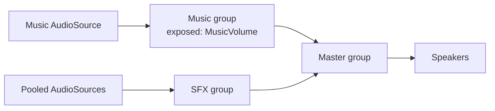

# 13 - AudioManager

Lab: [Lab 13 - A Pooled AudioManager with Ducking](../labs/lab_13_audio_manager.md)

## Key Concepts

1. **One `AudioSource` plays one clip at a time** - overlapping sounds need several sources, so something has to manage them.
2. **A mixer separates what plays from how loud it is** - sounds route to groups, and you balance groups rather than individual sounds.
3. **Decibels are logarithmic** - a change of -6 dB sounds like a similar step at any level, while a linear volume does not.
4. **A pool reuses objects instead of creating them** - take one, use it, and return it, so the number of objects stays bounded.
5. **A reused object carries old state** - set everything you depend on each time you take one from the pool.
6. **A cue describes a sound, not a clip** - clips and variation live in one asset a sound designer can tune, and the cue names a group whose routing and source settings are set once, in a table.
7. **Small random variation stops repetition sounding artificial** - the tenth identical footstep is the one players notice.
8. **Requests travel through a channel** - gameplay asks for a sound with no reference to the system that plays it.
9. **Ducking is a separate responsibility** - a class that lowers the music can listen to the same requests, with no edit to the class that plays sounds.
10. **Cap the number of voices** - a limit makes the worst case a dropped sound rather than an uncontrolled mix.

---

## 1. Framing Question

Your character has footsteps, your door has a sound, and your pickup has a sound. Each object has its own `AudioSource` or calls `PlayClipAtPoint`. Then the mix needs to change: the music should dip when an important sound plays, footsteps are too loud, and sounds cut each other off. How do you build one audio system that every part of the game can use, without every part of the game depending on it?

Think of a game with good audio. When something important happens, does the music stay at the same level? What would you lose if it did?

---

## 2. What You Will Learn

| Skill | You can... |
|:------|:-----------|
| Route audio | Build an `AudioMixer` with groups, and expose a volume parameter to code |
| Apply the Object Pool pattern | Use `ObjectPool<T>` from `Assets/GD/Common` for `AudioSource` components, and state what it costs and saves |
| Reset reused objects | Explain which values must be set each time a pooled source is used |
| Describe sounds as data | Create `AudioCue` assets with variation, each naming a mixer group |
| Map groups to settings | Fill a group table that gives each `MixerGroupType` its own source prefab, whose `Output` is the mixer group, and explain why it is a list in the Inspector and a dictionary at runtime |
| Decouple callers | Play a sound by raising a channel, with no reference to `AudioManager` |
| Duck music | Lower and restore a mixer parameter with a tween, including when interrupted |
| Measure | Compare garbage allocation between `PlayClipAtPoint` and the pool |

---

## 3. Why This Matters

Players forgive plain visuals far more readily than poor audio. A sound that plays at the right moment, at the right level, gives feedback that a screen cannot, and it is some of the cheapest **Technical Craft** evidence available for the GCA. Note 12 gave you the moments; this note gives you a system that can play them.

The design problem is that sound is needed everywhere. Without a plan, every prefab gains its own `AudioSource` and settings, and tuning the mix means opening every prefab in the game. Calling a global manager directly avoids that but couples everything to it, which is a problem in the additive scene setup from Note 05. A channel and a small set of focused classes avoid both, and give you evidence for **System Communication**.

---

## 4. Core Ideas

### 4.1 Clips, Sources and the Listener

An `AudioClip` is sound data. An `AudioSource` plays one clip at a position in the world. The `AudioListener`, usually on the main camera, is the point the player hears from. `Spatial Blend` on a source sets how far distance and direction affect it: 0 is 2D, and 1 is fully 3D.

The source is the limit here. Assigning `clip` and calling `Play` stops whatever it was playing, so two sounds at once need two sources. `PlayOneShot` can overlap clips on one source, but they all share its position, pitch and routing, and you cannot stop them individually.

### 4.2 The Mixer

An **`AudioMixer`** is an asset holding a tree of **groups**, each with a volume in **decibels** (dB) and optional effects. A source's `Output` field routes it to one group:



Decibels are logarithmic, which matches how hearing works. 0 dB is unchanged, about -6 dB is half the amplitude, and -80 dB is treated as silent. A move from 0 to -6 dB sounds like a similar step to a move from -12 to -18 dB, which a linear volume does not give you.

To control a group from code, right-click its `Volume` in the Inspector, choose `Expose 'Volume (of Music)' to script`, and rename the parameter in the `Exposed Parameters` menu of the `Audio Mixer` window. Code then uses the name:

```csharp
mixer.SetFloat("MusicVolume", -12f);
```

Two rules prevent confusion. Setting a parameter from code overrides the mixer's value and any snapshot from then on. And calling `SetFloat` in `Awake` may not take effect, because the mixer may not be ready, so use `Start` or later.

### 4.3 The Object Pool Pattern

The third person controller plays footsteps with `AudioSource.PlayClipAtPoint`. Each call creates a new GameObject named `One shot audio`, adds a source, and destroys it when the clip ends. That is short and works, with two limits:

- You cannot choose a mixer group or a pitch, so its sounds bypass your mix.
- Creating and destroying objects allocates memory, which the garbage collector later has to reclaim. You measure this in the lab, rather than assuming it.

The **Object Pool** pattern keeps a set of objects ready. You take one when needed, and return it when finished, rather than creating and destroying. `Assets/GD/Common` already provides a generic pool:

```csharp
using GD.Pool;

private ObjectPool<AudioSource> pool;

private void Awake()
{
    // Creates eight inactive copies of the prefab, parented under this object.
    pool = new ObjectPool<AudioSource>(sourcePrefab, 8, transform);
}
```

`Get()` activates and returns one, creating another only if the pool is empty. `ReturnToPool(source)` deactivates it and queues it for reuse. Because the class is generic, the same pool works for any component, which is the Apply exercise.

A pool has costs: it holds memory and objects even when idle, and it adds rules about ownership and returning. So a pool is not automatically an improvement, and the lab asks you to measure it. Here it earns its place because audio requests are frequent and because the manager also needs a set of sources to route through the mixer.

### 4.4 Resetting a Reused Object

`ObjectPool<T>` has a comment asking `// TODO - Reset the object?`. The pool cannot answer that, because only the user of the object knows what "reset" means. A source used for a quiet, low-pitched footstep keeps those values when it next plays a loud sting.

The rule is to set **every** value you depend on each time you take one from the pool, in one place. Section 4.5 puts that in the cue, so nothing carries over.

### 4.5 Describing a Sound: AudioCue

A sound in a game is more than a clip. A footstep is several clips, slightly varied, played through the player's mixer group and placed in 3D. Note 02's approach applies, with data in an asset:

```csharp
public bool TryApplyTo(AudioSource source)
{
    if (clips == null || clips.Length == 0)
        return false;

    source.clip = clips[Random.Range(0, clips.Length)];
    source.volume = volume * Random.Range(1f - volumeVariation, 1f);
    source.pitch = Random.Range(1f - pitchVariation, 1f + pitchVariation);
    source.loop = false;
    return true;
}
```

The cue also has a `Description`, which code never reads. It tells the team what the sound is for and where it plays, so a cue such as `AC_Hit_02` can be found and tuned months later without playing it. The cue does not set the mixer group or the spatial settings. It names a group, and Section 4.6 explains where the rest comes from.

Random pitch and volume are basic audio effects, and they are very effective for repeated sounds. Pitch variation of about 0.05 to 0.1 hides repetition, and much more starts to sound like a different object. The cue also answers Section 4.4: it sets each field it controls on every use, so no old state survives. The fields it does not control come from a source prefab that every source in its pool shares, so they never change.

### 4.6 Groups as an Enum, Mapped in a Table

Most games use the same small set of mixer groups: master, music, effects, the player, the environment, ambience, UI, voice. A cue could hold a direct reference to an `AudioMixerGroup` asset, and that works until the mix changes. Rename or split a group, or replace the mixer, and every cue in the game has to be opened and fixed. A cue that holds a mixer asset also cannot change how its sound is played: a UI click and a footstep need very different `AudioSource` settings, but one pool has one prefab.

The fix separates naming a group from configuring it. An **enum** names the standard groups in code:

```csharp
public enum MixerGroupType
{
    Master,
    Music,
    SFX,
    Player,
    Environment,
    Ambience,
    UI,
    Gameplay,
    Voice,
    Cinematic
}
```

A cue chooses one value from a drop-down, which a designer cannot misspell. The manager holds a **group table**, one row per group, set in the Inspector. Each row names a source prefab, and the prefab's `AudioSource` holds everything about how that group sounds, including its `Output`:

| Column | Example for `UI` | Example for `Player` |
|:--|:--|:--|
| `group` | `UI` | `Player` |
| `sourcePrefab` | `PF_UI`: `Output` `MX_Game > Master > UI`, `Spatial Blend` 0 | `PF_Player`: `Output` `MX_Game > Master > SFX > Player`, `Spatial Blend` 1, a short `Max Distance` |
| `initialSources` | 2 | 8 |

Two groups that sound alike still need two prefabs, because each routes to a different mixer group. A **prefab variant** keeps that cheap: make `PF_Player` a variant of `PF_SFX`, and override only `Output`. A later change to `PF_SFX`, such as a new rolloff, then reaches both.

Three details of the table matter:

- **A list in the Inspector, a dictionary at runtime.** Unity does not serialize a `Dictionary` (Note 02, Section 4.3), so the table is a `List` of rows that `Awake` copies into a `Dictionary<MixerGroupType, ...>`, as Note 10 did for slots. Each request is then one lookup, however many groups there are, and a second row for the same group is reported rather than silently used.
- **One group, one prefab, one pool.** Each row's prefab fills its own pool, so every source a group uses has the same routing and spatial settings, and a source never moves between groups. That is why the cue sets neither its mixer group nor `spatialBlend`: the prefab does, once.
- **A fallback.** A cue whose group has no row plays through the `Master` row, with one warning, so a missing row is heard and reported rather than silent.

Unity saves an enum field as its number, not its name. Add new groups only at the end of the enum: inserting `Footsteps` after `Master` would move every saved `Music` cue to `Footsteps`, with no error.

### 4.7 Requests Through a Channel

Gameplay should be able to ask for a sound with no reference to the system that plays it. A sound needs a cue and a position, so the channel carries a small struct, in the same way Note 04 sends a value with an event:

```csharp
public readonly struct AudioRequest
{
    public readonly AudioCue Cue;
    public readonly Vector3 Position;

    public AudioRequest(AudioCue cue, Vector3 position)
    {
        Cue = cue;
        Position = position;
    }
}
```

`Assets/GD/Common` has `Singleton<T>`, and a singleton `AudioManager.Instance.Play(...)` is the common alternative. It is simple, and it is a hidden dependency: every caller needs the manager to exist, and it is awkward to test a prefab alone. With a channel, a prefab in a level scene references one asset. If `AudioManager` is missing, nothing plays and nothing breaks, and `ListenerCount` on the channel shows why. That benefit is why this design uses a channel, not because singletons are always wrong.

In the additive setup from Note 05, `AudioManager` belongs in the persistent scene, so sounds continue across a level change and level scenes need no reference to it.

### 4.8 Ways to Duck

**Ducking** lowers one sound, usually the music, while another plays, so the important sound is heard. Unity gives you three routes:

| Route | How | Good for | Limit |
|:--|:--|:--|:--|
| `Duck Volume` mixer effect | Add it to the Music group, and send SFX to it | Automatic, reacts to actual loudness, no code | Every sound on that send ducks the music, and it takes tuning |
| Snapshots | Save mixer states, and call `snapshot.TransitionTo(seconds)` | Whole-mix states such as paused or underwater | One whole mix state at a time |
| Tween an exposed parameter | `mixer.DOSetFloat("MusicVolume", -12f, 0.1f)` | Chosen sounds only, with control of timing | You write it, and manage interruption |

This note uses the tween, because a designer chooses per cue which sounds duck, and because it builds on Note 11. `DOSetFloat` is in DOTween's free `Audio` module.

Ducking has three phases, named as in audio equipment: a fast **attack** down, a **hold**, and a slower **release** back up. Fast attack means the sound is clear from the start, and slow release means the music does not jump back.

### 4.9 Silencing the Controller's Own Audio

If your character uses `ThirdPersonController`, it still plays through `PlayClipAtPoint`. Do not edit it. Change its values on the component in your scene:

| Setting | Value | Effect |
|:--|:--|:--|
| `Footstep Audio Clips` | Size 0 | `OnFootstep` checks the array's length, and plays nothing |
| `Footstep Audio Volume` | 0 | The landing sound becomes silent |
| `Landing Audio Clip` | Keep assigned | `OnLand` has no null check, so an empty field causes an error each landing |

`OnFootstep` and `OnLand` still run, and your own component on the same object receives the same animation events (Note 12, Section 4.6). The Note 12 footstep channel is a `VoidEventChannel`, so a `VoidEventChannelListener` can call a play method directly. For a first person character, use the distance-based raise from Note 12's Apply exercise.

---

## 5. Worked Example

The demo builds the system one problem at a time. The design decision comes first: four small classes, each with one reason to change, are easier to extend than one large manager. `AudioCue` describes a sound, `AudioCuePlayer` requests one, `AudioManager` plays it, and `MusicDucker` handles the mix.

### Stage 1 - Initial Implementation: One Source

```csharp
using UnityEngine;

[RequireComponent(typeof(AudioSource))]
public class SimpleSoundPlayer : MonoBehaviour
{
    [SerializeField] private AudioClip clip;

    private AudioSource source;

    private void Awake()
    {
        source = GetComponent<AudioSource>();
    }

    public void Play()
    {
        source.clip = clip;
        source.Play();
    }
}
```

It works for one sound on one object, wired to `ContactTrigger` or any other event.

### Stage 2 - Problem: Sound Is Everywhere

| Observation | Cause |
|:--|:--|
| A second `Play` cuts off the first | One source plays one clip |
| A destroyed pickup's sound stops at once | The source is on the object being destroyed |
| Footsteps are too loud, and there are 40 prefabs to change | Settings live on each object |
| `PlayClipAtPoint` fixes the first two, but cannot use a mixer group or pitch, and allocates per call | It creates a throwaway GameObject |
| A UI click is heard in 3D from where the player clicked, and moving the mixer means editing every sound | Each source is set up by hand, and each one points at a mixer asset |

### Stage 3 - Change: A Cue, a Request and a Pooled Manager

A finished copy of these classes is in `Assets/GD/Common/Scripts/Audio`, in the `GD.Audio` namespace. The group names, the data, the request and its channel:

```csharp
/// <summary>
/// The standard mixer groups a game routes its sounds through. A cue names one of these,
/// and the AudioManager maps each one to a source prefab, whose Output is the mixer group.
/// </summary>
/// <remarks>
/// Add a value only at the end. Unity saves an enum field as its number, so inserting a value
/// earlier in the list changes the group of every cue and mapping already saved.
/// </remarks>
public enum MixerGroupType
{
    Master,
    Music,
    SFX,
    Player,
    Environment,
    Ambience,
    UI,
    Gameplay,
    Voice,
    Cinematic
}
```

```csharp
using UnityEngine;

/// <summary>
/// Describes one sound in the game: which clips, how they vary, and which mixer group it belongs to.
/// </summary>
/// <remarks>
/// The cue names a group, not a mixer asset. The AudioManager maps the group to a source prefab,
/// which sets the mixer group and the spatial settings, so changing the mixer changes no cue.
/// </remarks>
[CreateAssetMenu(fileName = "AudioCue", menuName = "Audio/Audio Cue")]
public class AudioCue : ScriptableObject
{
    [SerializeField, TextArea(2, 4), Tooltip("What this cue is for and where it plays, for the team. Not shown in the game")]
    private string description;

    [SerializeField, Tooltip("One clip is chosen at random each time")]
    private AudioClip[] clips;

    [SerializeField, Tooltip("The group this sound plays through. Its source prefab sets the mixer group, 2D or 3D, rolloff and priority")]
    private MixerGroupType group = MixerGroupType.SFX;

    [SerializeField, Range(0f, 1f), Tooltip("Volume before random variation. 1 plays the clip at its recorded level")]
    private float volume = 1f;

    [SerializeField, Range(0f, 0.5f), Tooltip("Random reduction in volume, as a fraction")]
    private float volumeVariation;

    [SerializeField, Range(0f, 0.5f), Tooltip("Random change in pitch, up or down, as a fraction")]
    private float pitchVariation = 0.05f;

    [Header("Mix")]
    [SerializeField, Tooltip("Lower the music while this sound plays")]
    private bool ducksMusic;

    [SerializeField, Min(0f), Tooltip("Seconds the music stays lowered")]
    private float duckHoldSeconds = 0.5f;

    public string Description => description;
    public MixerGroupType Group => group;
    public bool DucksMusic => ducksMusic;
    public float DuckHoldSeconds => duckHoldSeconds;

    /// <summary>
    /// Sets every value this cue controls, so a reused source keeps nothing from its last cue.
    /// Values the source prefab controls, such as spatial blend and rolloff, are left alone.
    /// Returns false if the cue has no clips.
    /// </summary>
    public bool TryApplyTo(AudioSource source)
    {
        if (clips == null || clips.Length == 0)
            return false;

        source.clip = clips[Random.Range(0, clips.Length)];
        source.volume = volume * Random.Range(1f - volumeVariation, 1f);
        source.pitch = Random.Range(1f - pitchVariation, 1f + pitchVariation);
        source.loop = false;
        return true;
    }
}
```

```csharp
using UnityEngine;

/// <summary>
/// A request to play a cue at a world position.
/// </summary>
public readonly struct AudioRequest
{
    public readonly AudioCue Cue;
    public readonly Vector3 Position;

    public AudioRequest(AudioCue cue, Vector3 position)
    {
        Cue = cue;
        Position = position;
    }
}
```

```csharp
using GD.Types;
using UnityEngine;

/// <summary>
/// Carries audio requests from anywhere in the game to whatever is listening.
/// </summary>
[CreateAssetMenu(fileName = "AudioRequestEventChannel", menuName = "Audio/Audio Request Event Channel")]
public class AudioRequestEventChannel : EventChannel<AudioRequest>
{
}
```

The caller, which any `UnityEvent` can reach:

```csharp
using UnityEngine;

/// <summary>
/// Requests a cue at this object's position. Wire Play to any Inspector event.
/// </summary>
public class AudioCuePlayer : MonoBehaviour
{
    [SerializeField, Tooltip("The sound to play when Play is called")]
    private AudioCue cue;

    [SerializeField, Tooltip("Channel the AudioManager listens on. Use the same asset as the AudioManager")]
    private AudioRequestEventChannel requestChannel;

    [ContextMenu("Play")]
    public void Play()
    {
        requestChannel.Raise(new AudioRequest(cue, transform.position));
    }
}
```

The manager, with its group table:

```csharp
using System;
using System.Collections.Generic;
using GD.Pool;
using UnityEngine;

/// <summary>
/// Plays requested cues on pooled AudioSources, with one pool per mixer group, and returns
/// each source when it finishes.
/// </summary>
/// <remarks>
/// Each group has its own source prefab. The prefab's Output sets the mixer group, and its other
/// settings set 2D or 3D, rolloff and priority, so everything about how a group sounds is in one
/// place. Cues only name a <see cref="MixerGroupType"/>.
/// </remarks>
public class AudioManager : MonoBehaviour
{
    #region Types

    /// <summary>One row of the group table, as set in the Inspector.</summary>
    [Serializable]
    private class GroupMapping
    {
        [Tooltip("The group that cues name")]
        public MixerGroupType group;

        [Tooltip("Prefab with an AudioSource, with Play On Awake unticked. Its Output is this group's mixer group")]
        public AudioSource sourcePrefab;

        [Min(1), Tooltip("Sources created in advance for this group")]
        public int initialSources = 4;
    }

    /// <summary>A playing source, and the pool it must go back to.</summary>
    private readonly struct ActiveSource
    {
        public ActiveSource(AudioSource source, ObjectPool<AudioSource> pool)
        {
            Source = source;
            Pool = pool;
        }

        public AudioSource Source { get; }

        public ObjectPool<AudioSource> Pool { get; }
    }

    #endregion Types

    #region Fields

    [SerializeField, Tooltip("Channel that gameplay raises requests on. Every AudioCuePlayer must use the same asset")]
    private AudioRequestEventChannel requestChannel;

    [SerializeField, Tooltip("One row per group. A cue whose group has no row plays through the Master row")]
    private List<GroupMapping> groups = new();

    [SerializeField, Min(1), Tooltip("Requests beyond this many sounds at once, across all groups, are dropped")]
    private int maxVoices = 16;

    // Unity cannot serialize a dictionary, so the Inspector list is turned into one in Awake.
    private readonly Dictionary<MixerGroupType, ObjectPool<AudioSource>> poolsByGroup = new();
    private readonly List<ActiveSource> activeSources = new();
    private readonly HashSet<MixerGroupType> reportedMissing = new();

    #endregion Fields

    #region Unity Messages

    private void Awake()
    {
        foreach (GroupMapping mapping in groups)
        {
            if (mapping.sourcePrefab == null)
            {
                Debug.LogWarning($"{name}: the {mapping.group} row has no source prefab, so it is ignored.", this);
                continue;
            }

            if (poolsByGroup.ContainsKey(mapping.group))
            {
                Debug.LogWarning($"{name}: {mapping.group} has more than one row, so only the first is used.", this);
                continue;
            }

            // With no Output, sources play straight to the listener and no fader affects them.
            if (mapping.sourcePrefab.outputAudioMixerGroup == null)
                Debug.LogWarning($"{name}: {mapping.sourcePrefab.name} has no Output, so {mapping.group} sounds bypass the mixer.", this);

            // A child per group keeps the hierarchy readable during Play.
            Transform parent = new GameObject(mapping.group.ToString()).transform;
            parent.SetParent(transform, false);

            poolsByGroup.Add(mapping.group, new ObjectPool<AudioSource>(mapping.sourcePrefab, mapping.initialSources, parent));
        }

        if (requestChannel == null || poolsByGroup.Count == 0)
        {
            Debug.LogError($"{name}: AudioManager needs a request channel and at least one group row.", this);
            enabled = false;
        }
    }

    private void OnEnable()
    {
        if (requestChannel != null)
            requestChannel.Raised += HandleRequest;
    }

    private void OnDisable()
    {
        if (requestChannel != null)
            requestChannel.Raised -= HandleRequest;
    }

    private void Update()
    {
        // Backwards, because removing an item moves the ones after it.
        for (int i = activeSources.Count - 1; i >= 0; i--)
        {
            ActiveSource active = activeSources[i];

            if (active.Source.isPlaying)
                continue;

            active.Pool.ReturnToPool(active.Source);
            activeSources.RemoveAt(i);
        }
    }

    #endregion Unity Messages

    #region Core Methods

    private void HandleRequest(AudioRequest request)
    {
        if (request.Cue == null || activeSources.Count >= maxVoices)
            return;

        if (!TryGetPool(request.Cue.Group, out ObjectPool<AudioSource> pool))
            return;

        AudioSource source = pool.Get();

        if (!request.Cue.TryApplyTo(source))
        {
            pool.ReturnToPool(source);
            return;
        }

        source.transform.position = request.Position;
        source.Play();
        activeSources.Add(new ActiveSource(source, pool));
    }

    private bool TryGetPool(MixerGroupType group, out ObjectPool<AudioSource> pool)
    {
        if (poolsByGroup.TryGetValue(group, out pool))
            return true;

        // Report each missing group once, not on every request.
        if (reportedMissing.Add(group))
            Debug.LogWarning($"{name}: no row for {group}, so its cues play through Master, or not at all if Master has no row.", this);

        return poolsByGroup.TryGetValue(MixerGroupType.Master, out pool);
    }

    #endregion Core Methods
}
```

The decisions in `AudioManager`:

- **It does not know about footsteps, pickups or the music.** Its one job is to turn requests into playing sources.
- **The group table is configuration, not code.** Adding a `Voice` group is a new mixer group, a new prefab and a new row, with no change to any class. A prefab with no `Output` is reported in `Awake`, because its sounds would bypass every fader. `GroupMapping` is a nested `[Serializable]` class so that each row shows in the Inspector, and `ActiveSource` remembers which pool each playing source must go back to.
- **A voice cap.** The pool can grow, so `maxVoices` is what limits how many sounds play at once. Dropping a sound is better than an uncontrolled mix, and the Lab Extension improves on simply dropping.
- **Checking `isPlaying` each frame.** This costs a short loop over only the active sources. A timer of `clip.length` would be wrong at a changed pitch, because pitch changes duration.

`Time.timeScale` does not affect audio, so a pause system (Note 15) must pause sound as well. Check what `isPlaying` reports for a paused source when you add a pause: if it reports false, this loop would return that source early.

### Stage 4 - Improvement: Add Ducking Without Touching the Manager

Ducking listens to the same channel. `AudioManager` does not change, which is the open/closed principle:

```csharp
using DG.Tweening;
using GD.Types;
using UnityEngine;
using UnityEngine.Audio;

/// <summary>
/// Lowers an exposed mixer volume when a cue that ducks the music is requested, then restores it.
/// </summary>
public class MusicDucker : MonoBehaviour
{
    [SerializeField, Tooltip("Channel to watch for cues that duck the music. Use the same asset as the AudioManager")]
    private AudioRequestEventChannel requestChannel;

    [SerializeField, Tooltip("The mixer that holds the exposed music volume parameter")]
    private AudioMixer mixer;

    [SerializeField, Tooltip("Exposed mixer parameter for the music group's volume")]
    private string volumeParameter = "MusicVolume";

    [Header("Levels (dB)")]
    [SerializeField, Tooltip("Music volume in dB when nothing is ducking it. 0 leaves the group at its mixer level")]
    private float normalVolume = 0f;

    [SerializeField, Tooltip("Music volume in dB while ducked. About -10 dB sounds half as loud")]
    private float duckedVolume = -12f;

    [Header("Timing")]
    [SerializeField, Tooltip("How quickly the music drops")]
    private TweenProfile attackProfile;

    [SerializeField, Tooltip("How slowly the music returns")]
    private TweenProfile releaseProfile;

    private Tween duckTween;

    private void OnEnable()
    {
        requestChannel.Raised += HandleRequest;
    }

    private void OnDisable()
    {
        requestChannel.Raised -= HandleRequest;
    }

    private void HandleRequest(AudioRequest request)
    {
        if (request.Cue.DucksMusic)
            Duck(request.Cue.DuckHoldSeconds);
    }

    private void Duck(float holdSeconds)
    {
        // A second duck replaces the first, starting from the current level.
        if (duckTween != null && duckTween.IsActive())
            duckTween.Kill();

        duckTween = DOTween.Sequence()
            .Append(attackProfile.Apply(mixer.DOSetFloat(volumeParameter, duckedVolume, attackProfile.Duration)))
            .AppendInterval(holdSeconds)
            .Append(releaseProfile.Apply(mixer.DOSetFloat(volumeParameter, normalVolume, releaseProfile.Duration)))
            .SetLink(gameObject);
    }
}
```

The class applies Note 11's interruption rule, keeping its own tween reference because a mixer asset is shared. Timing comes from two `TweenProfile` assets from `Assets/GD/Common`, so a designer can tune the attack and release with no code. `Sequence` runs the three phases in order; Note 15 compares it with coroutines.

| Problem | Solution | Benefit |
|:--|:--|:--|
| Sounds cut each other off, settings are scattered, and gameplay depends on audio code | Cue assets naming a group, a group table with a pool per group, channel requests and a separate ducker | Overlapping sounds through one mix; each group's routing and source settings tuned in one place; new behaviour with no edit to the manager |

---

## 6. Common Pitfalls

| Symptom | Cause | Fix |
|:--------|:------|:----|
| Nothing plays, and no error | No `AudioManager` is listening to that channel asset, or the scene has no `AudioListener` | Check `ListenerCount` on the channel; check `MainCamera` |
| A 3D sound is silent or very quiet | Its group's prefab has `Spatial Blend` 1 and the listener is far away | Check `Max Distance` on that group's prefab, or give the group a 2D prefab |
| A group's fader has no effect, and a warning says its prefab has no `Output` | The prefab's `AudioSource` has no `Output`, so its sounds go straight to the listener | Set `Output` on that group's prefab |
| A warning that a group has no row, and the sound plays through `Master` | The cue names a group that the table does not map | Add a row, or choose a mapped group on the cue |
| After editing the enum, cues play through the wrong groups | A value was inserted before existing ones, and Unity saves enums as numbers | Add values only at the end; fix the affected cues |
| Old pitch or volume comes through | A value was left out of `TryApplyTo` | Set every value you rely on |
| `SetFloat` has no effect | The name does not match the exposed parameter, or it ran in `Awake` | Check `Exposed Parameters`; call it from `Start` or later |
| Mixer changes vanish at runtime | A parameter set from code overrides the mixer | Change `normalVolume` on `MusicDucker` instead |
| A volume slider and the ducker fight | Both write the same parameter | Put the slider and the duck on different groups in the tree |
| Sounds stop when an object is destroyed | The source is on that object | Play it through `AudioManager` |
| Sounds sometimes do not play in a busy moment | `maxVoices` was reached | Log dropped requests; raise it, or prioritise |
| The landing sound plays twice, or an error on landing | The controller's own audio is still active, or `Landing Audio Clip` was cleared | Section 4.9 |
| A short sound plays with a click at the start | The source's position changed while it was playing | Set position before calling `Play` |

---

## 7. Software Development Parallels

- **Object Pool** (*Game Programming Patterns*, Robert Nystrom). Database connection pools and thread pools use the same idea, for the same reason: creation is expensive, and reuse needs care with old state. Unity also ships `UnityEngine.Pool.ObjectPool<T>`, with callbacks for get and release. This module uses its own simpler class, in `Assets/GD/Common`.
- **Observer.** `AudioManager` and `MusicDucker` both listen to one channel, and neither knows of the other. A cost is that the order they run in is not something you should rely on.
- **Single responsibility and open/closed.** Each class has one reason to change: the sound description, the request, the playing and the mix. Stage 4 added a feature with a new class and no edits.
- **Dependency inversion.** Prefabs depend on a channel asset, not on `AudioManager`, as in Note 04. Cues depend on a `MixerGroupType`, not on a mixer asset, so the mixer can change without them.
- **Configuration over code.** The group table is a lookup table set as data, the same idea as a routing table or a configuration file: behaviour that changes often is moved out of code.
- **Commercial practice.** The GDC 2016 talk *Overwatch: The Elusive Goal: Play by Sound* (Scott Lawlor and Tomas Neumann) describes how that game raises or lowers sounds by their importance to the player, since hearing an enemy nearby is gameplay information. Ducking is a small version of the same decision.

---

## 8. Exercises

### Core - A Volume Setting

Add a UI `Slider` that controls SFX volume, stored in a `FloatVariable` from `Assets/GD/Common` as a value from 0 to 1. Convert it for the mixer using `Mathf.Log10(Mathf.Max(value, 0.0001f)) * 20f`.

**Expected result:** moving the slider changes SFX volume smoothly across its range, and reaching 0 is effectively silent. In 80 to 120 words, explain why a linear conversion would feel wrong, and why this slider should not control the group that `MusicDucker` writes to.

### Apply - Pooled VFX

Write `VfxManager`, using `ObjectPool<ParticleSystem>` from `Assets/GD/Common`, a `VfxRequest` struct and a channel, in the same structure as `AudioManager`. Return a particle system when `IsAlive()` is false.

**Expected result:** landing dust and a pickup burst both play through one pool, and the Hierarchy shows no new objects after the first few plays. In 80 to 120 words, identify what you could reuse from the audio system, and whether the shared structure justifies a shared base class.

### Challenge - A Muffled Mix

When the player enters a zone such as underwater or a dream, music and effects should sound muffled, with a smooth change on entering and leaving. Use a `Lowpass` effect on a mixer group, with an exposed `Cutoff freq`, and a route of your choice from Section 4.8. Trigger it with `ContactTrigger` from `Assets/GD/Common`.

**Expected result:** entering or leaving, including part way through a change, moves smoothly with no jump. In 150 to 200 words, compare a snapshot with a tweened parameter for this task, with reference to how each handles interruption, and name the class that owns the change. Note that cutoff frequency is not linear to the ear, and say what you did about that.

---

## 9. Reflective Questions

1. `AudioManager` and `MusicDucker` could be one class. Using the single responsibility principle, argue for keeping them apart. Then describe a game small enough that you would merge them.
2. The pool saves allocation, and holds objects when idle. What evidence would convince you that a small game needs no pool at all?
3. `AudioCuePlayer` raises a channel rather than calling `AudioManager`. What can no longer go wrong, and what becomes harder to debug?
4. A cue names a `MixerGroupType` instead of holding an `AudioMixerGroup`. What does that protect when the mixer changes, and what does it cost when a designer wants a group the enum does not have?
5. Requests beyond `maxVoices` are dropped. Which sound in your group's game must never be dropped? How would you change the design to guarantee that?
6. Choose one moment in your group's game for ducking. Justify an attack, hold and release time based on what the player needs to hear.

---

## 10. How This Builds

- **[Lab 13](../labs/lab_13_audio_manager.md)** builds this system around the third person controller, and measures allocation before and after.
- **Note 14 - CameraManager** uses the same request, asset and manager structure for camera effects.
- **Note 15 - Orchestration and Game Flow** raises audio cues as steps in a sequence, and pauses audio with the game.
- **GCA:** one mixer, consistent cues and ducking on a chosen moment are evidence for a **Craft Example**. Channel-based requests are evidence for **System Communication**, and a before-and-after capture of the mix supports **Iteration & Improvement**.

---

## Glossary

| Term | Definition |
|:-----|:-----------|
| Attack | The time ducking takes to lower a sound |
| `AudioMixer` | An asset holding a tree of groups that control volume and effects |
| Decibel (dB) | A logarithmic unit of level, where 0 is unchanged and about -6 is half the amplitude |
| Ducking | Lowering one sound while another plays, so the second is heard |
| Enum | A type whose values are a fixed set of names, saved by Unity as numbers |
| Group | A node in an `AudioMixer` that sources route to |
| Group table | A list of rows on `AudioManager` that maps each `MixerGroupType` to a source prefab, whose `Output` is the mixer group |
| Prefab variant | A prefab based on another, which stores only the values it overrides and inherits later changes to the original |
| Hold | The time ducking keeps a sound lowered |
| Object Pool | A pattern that reuses a set of objects rather than creating and destroying them |
| Release | The time ducking takes to restore a sound |
| Voice | One sound playing at a time, here one active pooled source |
