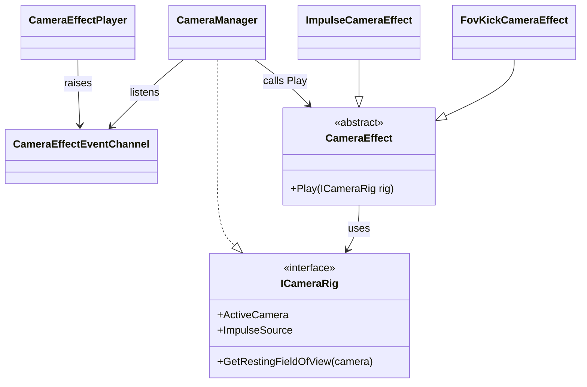

# 14 - CameraManager

Lab: [Lab 14 - Camera Zones and Camera Effects](../labs/lab_14_camera_manager.md)

## Key Concepts

1. **Move cameras by choosing them, not by moving them** - Cinemachine cameras describe views, and the Brain moves the real camera to the live one.
2. **Priority decides which camera is live** - among active cameras the highest priority wins, and on a tie the most recently activated wins.
3. **Check what the package already does** - Cinemachine's own queue handles overlapping zones, so you do not need your own camera stack.
4. **A blend is a transition with a duration and a shape** - the same timing decisions as Note 11 apply to camera cuts.
5. **Never shake the camera's Transform** - Cinemachine overwrites it each frame, so use an impulse.
6. **An impulse needs a source and a listener** - a source with no listening camera produces no shake and no error.
7. **Effects are strategies** - each effect is an asset behind one abstract class, so a new effect needs no edit to the manager.
8. **Depend on an interface, not on the manager** - effects need only what `ICameraRig` provides.
9. **Store the resting value** - the Note 11 rule applies to field of view just as it did to scale.
10. **Camera motion affects comfort** - keep effects short, and let players turn them down.

---

## 1. Framing Question

Your character lands heavily, a door slams, and the player walks into a small room where the follow camera clips into a wall. You want a different view in that room, and a small camera reaction to the big moments. Those requests come from many systems in many scenes. How do they all affect the camera without any of them holding a reference to it?

Think of a game where the camera reacts to what happens. Which reactions did you notice, and which only made the game feel heavier without you noticing why?

---

## 2. What You Will Learn

| Skill | You can... |
|:------|:-----------|
| Switch cameras by priority | Change the live camera from a trigger with no new script |
| Tune a blend | Set a blend's style and time, and describe the effect |
| Use impulses | Shake the camera using a source and a listener, and diagnose a missing listener |
| Apply Strategy | Add a new camera effect as a class and an asset, with no edit to the manager |
| Tween a camera value | Kick the field of view and return it to its resting value |
| Consider the player | Offer a setting that scales camera shake |

---

## 3. Why This Matters

The camera is how the player experiences every other system. A small impulse on landing and a short blend into a room are cheap, and they change how a game feels, which makes them useful **Technical Craft** evidence in the GCA.

The design problem is the same one Note 13 solved for audio. Without structure, a landing script gets a reference to a shake source, a door script gets another, and tuning means finding each one. In the additive setup from Note 05, a level scene cannot reference a camera system in the persistent scene at all. A thin manager, effect assets and a channel solve this, and they are evidence for **Software Design**.

---

## 4. Core Ideas

### 4.1 Brain, Cameras and Priority

Note 09 introduced the parts. A `CinemachineBrain` on the real camera copies position, rotation and lens from the live `CinemachineCamera`. Each `CinemachineCamera` is a description of a view, and most are disabled or waiting at any moment.

Among enabled cameras, the highest `Priority` is live. If priorities are equal, the most recently activated wins. Code can set the value directly:

```csharp
// Setting Value also ticks the Priority setting on the camera.
roomCamera.Priority.Value = 20;
```

Each `CinemachineCamera` chooses how it follows through its `Position Control` and `Rotation Control` settings. A camera in a room can have `Position Control` set to `None`, which keeps it where you placed it, and `Rotation Control` set to `Hard Look At`, which turns it towards its `Tracking Target`.

### 4.2 Camera Zones Need No New Script

A trigger can activate a camera directly, using `ContactTrigger` from `Assets/GD/Common`:

| Event | Target | Function |
|:--|:--|:--|
| `On Enter` | `CM_RoomCamera` | `GameObject.SetActive`, ticked |
| `On Exit` | `CM_RoomCamera` | `GameObject.SetActive`, unticked |

Give the room camera a priority above the follow camera, and leave it inactive at the start. Overlapping zones already work: enter room A, enter room B, leave room B, and Cinemachine returns to A, because A is still active and is next in its queue. It would be easy to write a stack of camera requests in a manager. It would duplicate what the package already does, so this note does not.

### 4.3 Blends

When the live camera changes, the Brain **blends** between them. `Default Blend` on the `CinemachineBrain` sets a style and a time. The Starter Assets `MainCamera` uses `Ease In Out` over 2 seconds.

| Style | Reads as | Use |
|:--|:--|:--|
| `Cut` | Instant, a clear change of place | Entering a building, or changing the subject |
| `Ease In Out` | Smooth, one continuous space | Moving between nearby views |
| `Linear` or `Custom` | Mechanical, or shaped by a curve | Specific moves you have tuned |

Two seconds is long in a game with direct control, because the player acts during it. Start around 0.5 to 1 second, then test. A `CinemachineBlenderSettings` asset can set a different blend for each pair of cameras.

The third person controller moves relative to the main camera's yaw, so a new angle changes what "forward" means while the player is holding a direction. That is a design cost of any fixed camera. Keep the new angle close to the old one when you can, or expect players to change direction at the boundary.

### 4.4 Impulses

You cannot shake a camera by moving its Transform, because the Brain overwrites it each frame. An **impulse** is Cinemachine's route: a signal that listening cameras add on top of their position.

| Part | Where | Job |
|:--|:--|:--|
| `CinemachineImpulseSource` | Any object | Sends the signal. `Impulse Shape` sets its form (`Recoil`, `Bump`, `Explosion`, `Rumble`), and `Default Velocity` its direction |
| `CinemachineImpulseListener` | Each camera, added through `Add Extension` | Receives the signal, and scales it with `Gain` |

```csharp
impulseSource.GenerateImpulseWithForce(1.5f);
```

Set `Impulse Type` to `Uniform` for a signal that ignores distance, which suits effects on the player. `Dissipating` and `Propagating` weaken or delay it with distance, which suits an explosion in the world. A live camera with no listener shakes nothing, and logs nothing.

For a quick test, wire `On Landed` on `LandingEvents` from `Assets/GD/Common` straight to `CinemachineImpulseSource.GenerateImpulse`. For one effect, that is enough.

### 4.5 Why a Manager, and How Thin

Add more effects and the wiring grows: each system needs its own source, with tuning repeated, and a level scene cannot wire to a camera system in another scene. The `CameraManager` here does very little. It listens to a channel, and it gives effects what they need. It does not know what any effect does.



### 4.6 Effects as Strategies

The **Strategy** pattern puts each variant of an algorithm behind one interface, so that the code using it does not change when a variant is added. An abstract ScriptableObject does this, and makes each configured variant an asset. Note 02 promised assets that hold behaviour, and this is that idea:

```csharp
public abstract class CameraEffect : ScriptableObject
{
    public abstract void Play(ICameraRig rig);
}
```

One class gives many assets: `CE_LightLanding` and `CE_HeavyLanding` can share `ImpulseCameraEffect` with different forces.

`ICameraRig` keeps the dependency narrow. An effect can reach the live camera and the impulse source, and nothing else about the manager, which is dependency inversion and interface segregation from Note 06. The substitution rule matters too: any `CameraEffect` must be safe to call at any moment, even when the camera has changed. A new effect that assumes a particular camera breaks that rule.

### 4.7 A Field of View Kick

The **field of view** (FOV) is the camera's angle of vision, and a brief increase reads as speed or force. It lives in the camera's `Lens`, which DOTween reaches through a getter and setter (Note 11, Section 4.7):

```csharp
DOTween.To(() => camera.Lens.FieldOfView, value => camera.Lens.FieldOfView = value, 46f, 0.08f);
```

Note 11's rule applies again: a second kick that reads the current value mid-kick gives a new, wrong resting value. So `CameraManager` records each camera's resting FOV the first time it is asked. Effect assets are shared and hold no runtime state, which is why this belongs in the manager. An asset's field changed at runtime would persist in the Editor and be shared by every user.

### 4.8 Comfort

Camera motion can cause discomfort, and some players are far more sensitive to it than others. Keep impulses short, and do not shake the camera on every small event, because players stop noticing it. Give players a setting to reduce it, which is the Apply exercise. If you cannot tell whether your game has too much, turn every effect off, then add them back one at a time.

### 4.9 First Person

`PlayerFollowCamera` for the first person controller is also a `CinemachineCamera`, so a listener and impulses work the same way. Keep the amplitude lower, because shake is stronger when the camera is the player's eyes. Fixed-angle zones usually do not suit first person, because they take away the player's view. `LandingEvents` in `Assets/GD/Common` requires `ThirdPersonController`, so first person landing effects need another trigger, such as the adapter in Note 09's Challenge exercise.

---

## 5. Worked Example

The demo reacts to landings with a camera shake, then adds a different effect with no edit to the manager. The design decision comes first: the manager should not know any effect by name. Requests carry the effect asset itself.

### Stage 1 - Initial Implementation: Direct Wiring

On `PlayerArmature`, add `Landing Events` and a `Cinemachine Impulse Source`. Wire `On Landed` to `CinemachineImpulseSource.GenerateImpulse`. Add a `Cinemachine Impulse Listener` to `PlayerFollowCamera`.

With no script, the camera bumps on landing. For a game with only this effect, stop here.

### Stage 2 - Problem: It Does Not Scale

| Observation | Cause |
|:--|:--|
| A heavy door also needs a shake, with its own source and tuning | Settings live on each object that shakes |
| Designers cannot find every setting when the game is too shaky | There is no single list of effects |
| An FOV kick needs a reference to the camera, in another scene | A prefab or level scene cannot reference an object in another scene |
| Each new kind of effect needs more wiring in more places | The requester has to know how the effect works |

### Stage 3 - Change: Effect Assets and a Thin Manager

A finished copy of these classes is in `Assets/GD/Common/Scripts/Cameras`, in the `GD.Cameras` namespace. The interface, the base class and the first effect:

```csharp
using Unity.Cinemachine;

/// <summary>
/// What a camera effect may use. Effects depend on this rather than on CameraManager.
/// </summary>
public interface ICameraRig
{
    /// <summary>The live camera, or null if the Brain has no CinemachineCamera live.</summary>
    CinemachineCamera ActiveCamera { get; }

    CinemachineImpulseSource ImpulseSource { get; }

    /// <summary>The camera's field of view when it is not being changed by an effect.</summary>
    float GetRestingFieldOfView(CinemachineCamera camera);
}
```

```csharp
using UnityEngine;

/// <summary>
/// Base class for a camera effect asset. Holds settings only, because assets are shared.
/// </summary>
public abstract class CameraEffect : ScriptableObject
{
    public abstract void Play(ICameraRig rig);
}
```

```csharp
using UnityEngine;

/// <summary>
/// Shakes every listening camera with an impulse.
/// </summary>
[CreateAssetMenu(fileName = "ImpulseCameraEffect", menuName = "Camera/Impulse Effect")]
public class ImpulseCameraEffect : CameraEffect
{
    [SerializeField, Min(0f), Tooltip("Strength of the impulse")]
    private float force = 1f;

    public override void Play(ICameraRig rig)
    {
        rig.ImpulseSource.GenerateImpulseWithForce(force);
    }
}
```

The channel and the caller, in the same structure as Note 13:

```csharp
using GD.Types;
using UnityEngine;

/// <summary>
/// Carries camera effect requests from anywhere in the game to the CameraManager.
/// </summary>
[CreateAssetMenu(fileName = "CameraEffectEventChannel", menuName = "Camera/Camera Effect Event Channel")]
public class CameraEffectEventChannel : EventChannel<CameraEffect>
{
}
```

```csharp
using UnityEngine;

/// <summary>
/// Requests a camera effect. Wire Play to any Inspector event.
/// </summary>
public class CameraEffectPlayer : MonoBehaviour
{
    [SerializeField] private CameraEffect effect;
    [SerializeField] private CameraEffectEventChannel effectChannel;

    [ContextMenu("Play")]
    public void Play()
    {
        effectChannel.Raise(effect);
    }
}
```

The manager:

```csharp
using System.Collections.Generic;
using Unity.Cinemachine;
using UnityEngine;

/// <summary>
/// Plays requested camera effects, and gives them access to the live camera.
/// </summary>
public class CameraManager : MonoBehaviour, ICameraRig
{
    [SerializeField] private CameraEffectEventChannel effectChannel;
    [SerializeField] private CinemachineBrain brain;
    [SerializeField] private CinemachineImpulseSource impulseSource;

    // Each camera's field of view, recorded before any effect changes it.
    private readonly Dictionary<CinemachineCamera, float> restingFieldOfViews = new();

    public CinemachineCamera ActiveCamera => brain.ActiveVirtualCamera as CinemachineCamera;

    public CinemachineImpulseSource ImpulseSource => impulseSource;

    public float GetRestingFieldOfView(CinemachineCamera camera)
    {
        if (!restingFieldOfViews.TryGetValue(camera, out float fieldOfView))
        {
            fieldOfView = camera.Lens.FieldOfView;
            restingFieldOfViews[camera] = fieldOfView;
        }

        return fieldOfView;
    }

    private void OnEnable()
    {
        effectChannel.Raised += HandleEffect;
    }

    private void OnDisable()
    {
        effectChannel.Raised -= HandleEffect;
    }

    private void HandleEffect(CameraEffect effect)
    {
        effect.Play(this);
    }
}
```

`CameraManager` has no `switch` and no list of effect types. Its only knowledge of effects is that they can play. Replace the Stage 1 wiring: `On Landed` now calls `CameraEffectPlayer.Play`, with `CE_Landing` assigned. The source moves to the `CameraSystem` object, which in an additive setup lives in the persistent scene.

### Stage 4 - Improvement: A New Effect, with No Edit to the Manager

```csharp
using DG.Tweening;
using Unity.Cinemachine;
using GD.Types;
using UnityEngine;

/// <summary>
/// Briefly widens the live camera's field of view, then returns it to rest.
/// </summary>
[CreateAssetMenu(fileName = "FovKickCameraEffect", menuName = "Camera/FOV Kick Effect")]
public class FovKickCameraEffect : CameraEffect
{
    [SerializeField, Tooltip("Degrees added to the field of view at the peak")]
    private float kick = 6f;

    [SerializeField, Tooltip("Timing of the move to the peak")]
    private TweenProfile attackProfile;

    [SerializeField, Tooltip("Timing of the return to rest")]
    private TweenProfile releaseProfile;

    public override void Play(ICameraRig rig)
    {
        CinemachineCamera camera = rig.ActiveCamera;

        // The Brain can be mid-change, or showing something other than a CinemachineCamera.
        if (camera == null)
            return;

        float resting = rig.GetRestingFieldOfView(camera);

        // The newest kick replaces any kick still running on this camera.
        DOTween.Kill(camera);

        DOTween.Sequence()
            .Append(attackProfile.Apply(TweenFieldOfView(camera, resting + kick, attackProfile.Duration)))
            .Append(releaseProfile.Apply(TweenFieldOfView(camera, resting, releaseProfile.Duration)))
            .SetTarget(camera)
            .SetLink(camera.gameObject);
    }

    private static Tween TweenFieldOfView(CinemachineCamera camera, float fieldOfView, float duration)
    {
        return DOTween.To(() => camera.Lens.FieldOfView, value => camera.Lens.FieldOfView = value,
            fieldOfView, duration);
    }
}
```

No existing class changed. A new asset `CE_Kick` works from any `CameraEffectPlayer`, and every other effect is unaffected.

| Problem | Solution | Benefit |
|:--|:--|:--|
| Each system wired its own shake, and new effects spread further wiring | Effects as `CameraEffect` assets, requested through a channel and played by a thin manager | New effects need one class and no edits; tuning is in assets; level scenes need no camera reference |

---

## 6. Common Pitfalls

| Symptom | Cause | Fix |
|:--------|:------|:----|
| An impulse does nothing, and no error appears | The live camera has no `Cinemachine Impulse Listener`, or the channels differ | Add the listener to every camera that should shake; match `Impulse Channel` |
| A shake works on one camera only | Listeners are per camera | Add one to each |
| A script moving the camera's Transform has no effect | The Brain overwrites it | Use an impulse or a `CinemachineCamera` |
| A zone camera never goes live | Its `Priority` is not above the follow camera's | Tick `Priority` and set a higher value |
| A zone camera is live from the start | It was left active | Untick it in the Hierarchy |
| The camera stays in a zone's view after leaving | `On Exit` is not wired | Wire `GameObject.SetActive`, unticked |
| The controls change direction when entering a zone | The controller moves relative to the camera | Section 4.3; keep the angles close |
| Blends feel slow | The `MainCamera` prefab's `Default Blend` is 2 seconds | Lower it on your scene's `CinemachineBrain` |
| The field of view creeps up after repeated kicks | A resting value was read mid-kick | Use `GetRestingFieldOfView` |
| Effect settings changed permanently | An asset was changed in Play mode or by code | Keep runtime state out of assets |

---

## 7. Software Development Parallels

- **Strategy** (Gang of Four). Sorting comparers and payment providers follow the same shape: one interface, with interchangeable implementations. The cost is more classes and behaviour that is harder to read in one place, so use it when there are at least two real variants.
- **Open/closed principle.** Stage 4 added a feature with no edit to any existing class.
- **Interface segregation and dependency inversion.** `ICameraRig` exposes three members, not the whole manager.
- **Liskov substitution.** `CameraManager` calls any `CameraEffect` the same way, so each must cope with a missing camera rather than assume one.
- **Use the library first.** Section 4.2 rejected a custom camera stack because Cinemachine provides that behaviour. Writing less code is a design decision worth recording.
- **Commercial practice.** Squirrel Eiserloh's GDC 2016 talk *Math for Game Programmers: Juicing Your Cameras With Math* explains shake built on a "trauma" value that decays over time, which is more controllable than a fixed shake each time. It is a useful model for the Challenge exercise.

---

## 8. Exercises

### Core - Impulse Shapes

Make a hazard using `ContactTrigger` from `Assets/GD/Common` that plays an `ImpulseCameraEffect` through `CameraEffectPlayer`. Try `Recoil`, `Bump`, `Explosion` and `Rumble` on the impulse source, with several forces.

**Expected result:** the hazard shakes the camera with no new script. In 80 to 120 words, name the shape and force you chose, and say what each other shape would suggest to the player.

### Apply - A Comfort Setting

Add a `FloatVariable` from `Assets/GD/Common` named `CameraShakeScale`, from 0 to 1, controlled by a UI `Slider`. Make `ImpulseCameraEffect` multiply its force by this value.

**Expected result:** at 0 no effect shakes the camera, and at 1 they all play as tuned, with no edit to `CameraManager`. In 80 to 120 words, explain why the value belongs in a `FloatVariable` and not on the manager, and say whether `FovKickCameraEffect` should follow the same setting.

### Challenge - Hit Stop

Add a new effect, `HitStopCameraEffect`, which briefly slows `Time.timeScale` and then restores it, and which handles a second request during the first. Its tween must not be slowed by the change it makes, so use `SetUpdate(true)`. Do not edit `CameraManager`.

**Expected result:** a heavy hit plays a 0.08 s hit stop, and repeated hits never leave the game slowed. In 150 to 200 words, say whether this is really a camera effect, and whether `CameraEffect` is the right abstraction for it. Say what you would rename or split, using the single responsibility principle.

---

## 9. Reflective Questions

1. Section 4.2 rejected a camera request stack in the manager. Describe a feature that would justify writing one after all.
2. `CameraEffect` is an abstract ScriptableObject, and effects could instead be components. Compare the two for your group's game. Which is easier to tune, and which is easier to debug?
3. `ICameraRig` has three members. What would be lost if effects received `CameraManager` directly? Justify your answer with a SOLID principle.
4. Effect assets hold no runtime state. What would go wrong if `FovKickCameraEffect` stored the resting value in a private field?
5. Choose one camera effect in your group's game. What would you test with a player to show that it improves the game rather than only adding motion?

---

## 10. How This Builds

- **[Lab 14](../labs/lab_14_camera_manager.md)** builds zones, an impulse and a field of view kick around the third person controller.
- **Note 15 - Orchestration and Game Flow** activates cameras and plays effects as steps in a sequence.
- **GCA:** a before-and-after capture of a tuned camera reaction supports **Technical Craft** and **Iteration & Improvement**. New effects with no change to the manager are evidence for **Software Design**.

---

## Glossary

| Term | Definition |
|:-----|:-----------|
| Blend | The Brain's transition from one live camera to another, with a style and a time |
| Field of view (FOV) | The camera's angle of vision, in degrees |
| Impulse | A signal that listening Cinemachine cameras add to their position, used for shake |
| Strategy | A pattern that puts variants of an algorithm behind one interface, so the code using them does not change |
