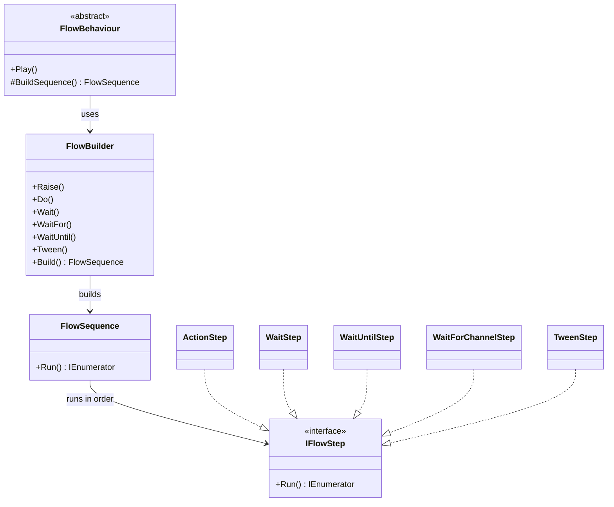
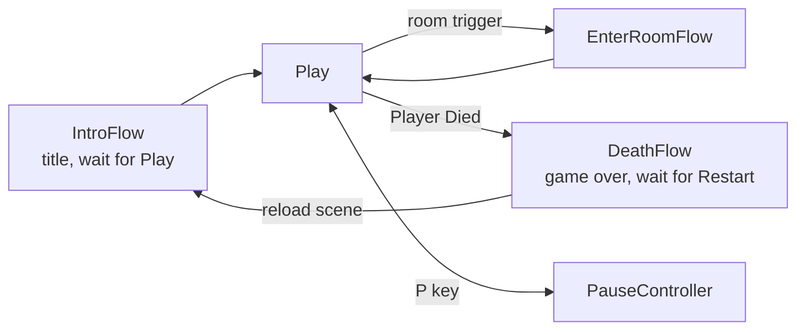

# 15 - Orchestration and Game Flow

Lab: [Lab 15 - A Game Loop Built with a Flow Builder](../labs/lab_15_orchestration_builder.md)

## Key Concepts

1. **Orchestration coordinates systems without doing their work** - a sequence says what happens next; doors, cameras and audio still do their own jobs.
2. **A coroutine is a method that can wait** - it runs up to a `yield return`, and Unity resumes it when the wait ends.
3. **Use the simplest timer that fits** - one countdown suits `Update`, and a series of waits suits a coroutine.
4. **Know who stops a coroutine** - deactivating its GameObject stops it; disabling its component does not.
5. **`Time.timeScale` affects systems differently** - tweens and `WaitForSeconds` stop, while audio and `WaitForSecondsRealtime` do not.
6. **`Func<T>` delays work until it is needed** - a tween created when the sequence is built would start too early.
7. **A builder separates describing from running** - chained calls describe a sequence, and `Build` produces an object that can run many times.
8. **Each step is one small object behind one interface** - a new kind of step needs one new class, and no edit to the sequence.
9. **Sequences talk through channels** - a flow raises a request, and listeners decide what it means.
10. **Taking control away has rules** - stop the controller and its input together, clear stale input, and give control back on every path.

---

## 1. Framing Question

Your systems work. The door tweens, the camera blends, the audio ducks, and the character moves. Now the player walks into a room, and you want this: take control away, cut to the door, drop the music, open the door, wait, return the camera, and give control back. Then you need a title screen, a game over and a restart. Which system owns all of that? How do you write it so that the next sequence takes minutes rather than an afternoon?

Think of a short scripted moment in a game you know. List what happens in order. How many separate systems does it touch?

---

## 2. What You Will Learn

| Skill | You can... |
|:------|:-----------|
| Write coroutines | Start, wait in, and stop a coroutine, and state what ends one |
| Choose a timing tool | Compare `Update` timers, coroutines, `Awaitable` and DOTween `Sequence` for a task |
| Handle `Time.timeScale` | Predict what stops and what continues when the game pauses |
| Use `Func<T>` | Pass code to run later, and explain why tween steps need it |
| Apply the Builder pattern | Build a `FlowSequence` with `FlowBuilder`, and add a new kind of step |
| Take and return control | Lock either Starter Assets controller without editing it |
| Build a complete loop | Connect title, play, game over, restart and pause |

---

## 3. Why This Matters

The GCA asks for 2 to 3 minutes of complete gameplay, and **Gameplay Systems & Integration** is 25% of the marks. A game whose parts work separately, but which has no start, no ending and no way to restart, reads as a tech demo. Build this loop early, so that all your remaining time goes into improving a game that already runs from start to finish.

The design problem is that sequences touch everything. The obvious place to write one is a big `GameManager` with references to every system. It works, then becomes the file everyone edits and nobody can read. This note writes small flows that describe sequences and talk through channels, so each system stays unaware of the others. The route there goes through a long hand-written coroutine, because you need to feel the problem before the pattern makes sense.

---

## 4. Core Ideas

### 4.1 From Timers to Coroutines

Note 09 showed the simplest timer: a float counted down in `Update`. For one countdown, that is the right tool. The third person controller's jump and fall timeouts are exactly this, and they suit it, because they run every frame anyway and reset with the character's state.

A series of waits does not suit it. Each stage needs another flag or state value, and the order of events is spread across branches:

```csharp
private void Update()
{
    timer -= Time.deltaTime;

    if (stage == 0 && timer <= 0f)
    {
        doorOpened.Raise();
        timer = 2f;
        stage = 1;
    }
    else if (stage == 1 && timer <= 0f)
    {
        controlRestored.Raise();
        stage = 2;
    }
}
```

A **coroutine** is a method that can pause. Note 05 used one to wait for scene loads. It returns `IEnumerator`, and each `yield return` hands control back to Unity until the wait ends:

```csharp
private IEnumerator OpenDoorSequence()
{
    yield return new WaitForSeconds(1f);
    doorOpened.Raise();

    yield return new WaitForSeconds(2f);
    controlRestored.Raise();
}
```

The order of events is now the order of the code. Start it with `StartCoroutine(OpenDoorSequence())`. Calling `OpenDoorSequence()` alone creates the enumerator, and does nothing.

| `yield return` | Resumes |
|:--|:--|
| `null` | Next frame, after `Update` |
| `new WaitForSeconds(s)` | After `s` seconds of scaled time |
| `new WaitForSecondsRealtime(s)` | After `s` real seconds, ignoring `Time.timeScale` |
| `new WaitUntil(() => condition)` | The first frame the condition is true |
| `someOtherEnumerator` | When that nested coroutine finishes |
| `asyncOperation` | When a scene load finishes (Note 05) |
| `tween.WaitForCompletion()` | When a DOTween tween finishes |

### 4.2 Coroutine Lifetime

A coroutine belongs to the `MonoBehaviour` that started it. Three rules cause most bugs:

| Event | Coroutine |
|:--|:--|
| The GameObject is deactivated or destroyed | Stops, and does not resume when reactivated |
| The component is disabled (`enabled = false`) | **Keeps running** |
| `StopCoroutine(handle)` or `StopAllCoroutines()` | Stops at once, and code after the last `yield` never runs |

Keep the `Coroutine` handle that `StartCoroutine` returns, both to stop it and to prevent a second copy starting while the first runs:

```csharp
private Coroutine running;

public void Play()
{
    if (running == null)
        running = StartCoroutine(RunAndClear());
}
```

Because a stopped coroutine never reaches its later lines, do not rely on the end of one to release something it took, such as player control. Section 4.9 returns to this.

### 4.3 Choosing a Timing Tool

| Tool | Best for | Limit |
|:--|:--|:--|
| `Update` timer | One value that runs all the time | Sequences become flags and stages |
| Coroutine | A series of waits, and conditions on one object | Needs a `MonoBehaviour`, and cannot return a value directly |
| DOTween `Sequence` | Timed tweens with exact overlaps, such as the duck in Note 13 | Only knows about time and tweens, not about conditions or channels |
| `Awaitable` with `async` | Work that needs to return a value, in current Unity versions | Stopping and exceptions need more care, and an unobserved failure can be silent |

Gameplay orchestration waits on things other than time: "until the player presses Play", or "until the door is open". This note therefore uses coroutines, with tweens as steps inside them. Unity's `Awaitable` is a current alternative that a group may choose, but it is not needed here.

### 4.4 Pausing and Time.timeScale

Setting `Time.timeScale` to 0 is the usual way to pause. It does not stop everything:

| System | At `timeScale` 0 |
|:--|:--|
| `Update`, `LateUpdate` | Still run, with `Time.deltaTime` at 0 |
| `FixedUpdate`, physics | Stop |
| `WaitForSeconds` | Stops waiting |
| `WaitForSecondsRealtime`, `WaitUntil` | Continue |
| DOTween tweens | Stop, unless `SetUpdate(true)` |
| `Animator` | Stops, unless `Update Mode` is `Unscaled Time` |
| Audio | **Continues**; use `AudioListener.pause` |
| Input System callbacks | Continue |

So a pause menu needs its UI tweens to use `SetUpdate(true)`, or it never appears. If you use the `AudioManager` from Note 13, test how its `isPlaying` check behaves under `AudioListener.pause`. If sources are returned early, add `if (AudioListener.pause) return;` at the start of its `Update`.

### 4.5 Func and Delayed Work

Note 11 introduced `Action`, a delegate with no return value. **`Func<T>`** is a delegate that returns a `T`. `Func<bool>` is a question you can ask later, and `Func<Tween>` is a tween you can create later:

```csharp
Func<bool> doorIsOpen = () => door.localPosition.y >= openHeight;

bool answer = doorIsOpen();   // Runs the code now, and reads the current value.
```

The lambda **captures** `door` and `openHeight`, so it reads their values when it runs, not when it was written. This matters for tweens. A DOTween tween starts as soon as it is created, and records its start value then:

```csharp
// Wrong: the door starts moving now, while the sequence is being described.
Tween tween = door.DOLocalMoveY(3f, 0.6f);

// Right: nothing happens until something calls this.
Func<Tween> createTween = () => door.DOLocalMoveY(3f, 0.6f);
```

### 4.6 The Builder Pattern

A hand-written sequence coroutine repeats the same few actions, and each one has to be typed in full (Section 5, Stage 2). The **Builder** pattern separates describing a complex object from using it. Chained calls collect the parts, and `Build` returns the finished object:

```csharp
FlowSequence enterRoom = new FlowBuilder()
    .Raise(controlEnabled, false)
    .Raise(roomCamera, true)
    .Wait(0.5f)
    .Tween(() => doorProfile.Apply(door.DOLocalMove(openPosition, doorProfile.Duration)))
    .Wait(1f)
    .Raise(roomCamera, false)
    .Raise(controlEnabled, true)
    .Build();
```

This is the fluent style you used with DOTween in Note 11. It reads as a list of events, and the builder runs nothing. It only records what should happen, so one `FlowSequence` can run many times.



The builder has a cost: seven small classes, against one coroutine. For one two-step sequence, a plain coroutine is the better choice. It starts to pay off with the second or third flow, when each new sequence is a short list and steps are shared.

### 4.7 Steps Are Small Commands

Each `IFlowStep` holds one action as an object, to run later. That is the core idea of the **Command** pattern, which Note 07 mentioned: a request becomes a thing you can store and queue. These steps do not support undo, which full Command implementations often add, because a game flow does not need it.

The interface also gives substitution: `FlowSequence` treats every step the same way, so each step must finish, or end the sequence by design. A step that can wait forever, such as a `WaitFor` for a channel nobody raises, is the failure to watch for.

### 4.8 Talking to Other Systems

A flow should not reference `AudioManager` or `CameraManager`. It raises channels from `Assets/GD/Common`, and listeners connect them to whatever responds:

| To do this | A flow calls | A listener does this |
|:--|:--|:--|
| Change the camera | `.Raise(roomCamera, true)` on a `BoolEventChannel` | `BoolEventChannelListener` calls `GameObject.SetActive`, using its dynamic value |
| Play a sound or camera effect | `.Raise(doorOpened)` on a `VoidEventChannel` | `VoidEventChannelListener` calls a `Play` method |
| Take control | `.Raise(controlEnabled, false)` | `BoolEventChannelListener` calls `PlayerControlLock.SetControlEnabled` |

Place listeners on objects that stay active. A listener on the inactive camera it is meant to activate never subscribes, so it never hears the channel.

Direct references are still fine for things in the same scene that belong to the flow, such as the door it opens or a panel it fades. Note 04's rule applies: use a channel when the sender should not know the receiver.

### 4.9 Taking Control Away

Note 09 extended the controllers by writing to their input. Control needs a little more, in a small component that works with either controller:

- **Disable the controller.** Its `Update` stops, so no movement, no gravity and no camera rotation. Avoid locking an airborne character, because it will hang in the air.
- **Disable `PlayerInput`.** The actions stop reading devices.
- **Clear `StarterAssetsInputs`.** Otherwise a key held at the moment of locking keeps its stale value, and the character walks on when control returns.
- **Reset the Animator's `Speed`.** Otherwise a third person character runs on the spot. First person has no `Animator`, so that part is optional.
- **Release the cursor**, and set `cursorLocked`, so that `StarterAssetsInputs` does not lock it again when the window regains focus.

The rule for flows is to return control on every path. If a sequence can be stopped part way, or a game over can interrupt it, something must restore control or restart the level.

### 4.10 A Whole Game Loop

The loop does not need a central `GameManager`. Each flow is a small component with one job, and channels connect them:



With additive scenes (Note 05), replace the reload with a raise on a `SceneEventChannel` from `Assets/GD/Common`, so that a loader in your persistent scene does the work. The flows do not otherwise change. This loop has few enough states that separate flows stay clear. Note 16 shows what to do when transitions between states become more complex.

---

## 5. Worked Example

The demo builds the room sequence from the Framing Question. The design decision comes first: a flow describes what happens and in what order, and it never contains the door's or camera's own logic. Control and camera requests go through channels.

### Stage 1 - Initial Implementation: One Coroutine

```csharp
using System.Collections;
using DG.Tweening;
using GD.Types;
using UnityEngine;

/// <summary>
/// Plays the room entry sequence as one hand-written coroutine.
/// </summary>
public class EnterRoomCoroutine : MonoBehaviour
{
    [SerializeField] private BoolEventChannel controlEnabled;
    [SerializeField] private BoolEventChannel roomCamera;
    [SerializeField] private VoidEventChannel doorOpened;

    [SerializeField] private Transform door;
    [SerializeField] private Vector3 openOffset = new(0f, 3.2f, 0f);
    [SerializeField] private TweenProfile doorProfile;

    private Coroutine running;

    public void Play()
    {
        if (running == null)
            running = StartCoroutine(Sequence());
    }

    private IEnumerator Sequence()
    {
        controlEnabled.Raise(false);
        roomCamera.Raise(true);

        yield return new WaitForSeconds(0.6f);

        Vector3 openPosition = door.localPosition + openOffset;
        Tween tween = doorProfile.Apply(door.DOLocalMove(openPosition, doorProfile.Duration));
        tween.SetLink(door.gameObject);
        yield return tween.WaitForCompletion();

        doorOpened.Raise();

        yield return new WaitForSeconds(1f);

        roomCamera.Raise(false);

        yield return new WaitForSeconds(0.6f);

        controlEnabled.Raise(true);
        running = null;
    }
}
```

It works, and it is readable.

### Stage 2 - Problem: The Second and Third Sequence

| Observation | Cause |
|:--|:--|
| A title sequence and a death sequence repeat the same lock, wait, tween and unlock code | Each coroutine spells out each action |
| The guard against a second copy is written again in each class | Running belongs in one place |
| `running = null` at the end is easy to forget, and then the flow never plays again | Each class manages its own state |
| Tween code takes three lines per tween, and timing details bury the order of events | Actions and their order are mixed |
| Adding "wait for a channel" needs a subscribe, a flag and an unsubscribe each time | There is no shared form for it |

The sequence is correct. It is the third copy that hurts.

### Stage 3 - Change: Steps and a Builder

These classes are in `Assets/GD/Common/Scripts/Flow`, in the `GD.Flow` namespace, so your flows only need `using GD.Flow;`. One interface and five small steps:

```csharp
using System.Collections;

namespace GD.Flow
{
    /// <summary>
    /// One stage of a flow. Run must finish, or the sequence it belongs to never continues.
    /// </summary>
    public interface IFlowStep
    {
        IEnumerator Run();
    }
}
```

```csharp
using System;
using System.Collections;

namespace GD.Flow
{
    /// <summary>
    /// Runs an action at once, then moves to the next step.
    /// </summary>
    public class ActionStep : IFlowStep
    {
        private readonly Action action;
        private readonly string description;

        public ActionStep(Action action, string description = null)
        {
            this.action = action;
            this.description = description;
        }

        public override string ToString()
        {
            return description ?? $"Do {DelegateNames.Describe(action)}";
        }

        public IEnumerator Run()
        {
            action();
            yield break;
        }
    }
}
```

```csharp
using System.Collections;
using UnityEngine;

namespace GD.Flow
{
    /// <summary>
    /// Waits for a number of seconds, in scaled time or in real time.
    /// </summary>
    public class WaitStep : IFlowStep
    {
        private readonly float seconds;
        private readonly bool realtime;

        public WaitStep(float seconds, bool realtime)
        {
            this.seconds = seconds;
            this.realtime = realtime;
        }

        public override string ToString()
        {
            return realtime ? $"Wait {seconds} s, real time" : $"Wait {seconds} s";
        }

        public IEnumerator Run()
        {
            if (realtime)
                yield return new WaitForSecondsRealtime(seconds);
            else
                yield return new WaitForSeconds(seconds);
        }
    }
}
```

```csharp
using System;
using System.Collections;
using UnityEngine;

namespace GD.Flow
{
    /// <summary>
    /// Waits until a condition becomes true.
    /// </summary>
    public class WaitUntilStep : IFlowStep
    {
        private readonly Func<bool> condition;

        public WaitUntilStep(Func<bool> condition)
        {
            this.condition = condition;
        }

        public override string ToString()
        {
            return $"Wait until {DelegateNames.Describe(condition)}";
        }

        public IEnumerator Run()
        {
            yield return new WaitUntil(condition);
        }
    }
}
```

```csharp
using System.Collections;
using GD.Types;
using UnityEngine;

namespace GD.Flow
{
    /// <summary>
    /// Waits until a channel is raised. Only raises after this step starts are counted.
    /// </summary>
    public class WaitForChannelStep : IFlowStep
    {
        private readonly VoidEventChannel channel;

        public WaitForChannelStep(VoidEventChannel channel)
        {
            this.channel = channel;
        }

        public override string ToString()
        {
            return $"Wait for {(channel != null ? channel.name : "(no channel)")}";
        }

        public IEnumerator Run()
        {
            bool raised = false;

            void HandleRaised()
            {
                raised = true;
            }

            channel.Raised += HandleRaised;
            yield return new WaitUntil(() => raised);
            channel.Raised -= HandleRaised;
        }
    }
}
```

```csharp
using System;
using System.Collections;
using DG.Tweening;

namespace GD.Flow
{
    /// <summary>
    /// Creates a tween when this step starts, and waits for it to finish.
    /// </summary>
    public class TweenStep : IFlowStep
    {
        private readonly Func<Tween> createTween;

        public TweenStep(Func<Tween> createTween)
        {
            this.createTween = createTween;
        }

        public override string ToString()
        {
            return "Tween, and wait for it to finish";
        }

        public IEnumerator Run()
        {
            // Created here, not when the sequence is built, because a tween starts at creation.
            Tween tween = createTween();
            yield return tween.WaitForCompletion();
        }
    }
}
```

The finished product and the builder:

```csharp
using System.Collections;
using System.Collections.Generic;
using UnityEngine;

namespace GD.Flow
{
    /// <summary>
    /// A fixed list of steps that runs in order. Can be run many times.
    /// </summary>
    public class FlowSequence
    {
        private readonly IFlowStep[] steps;

        public FlowSequence(IFlowStep[] steps)
        {
            this.steps = steps;
        }

        /// <summary>The steps, in order, so that a debugging tool can list them.</summary>
        public IReadOnlyList<IFlowStep> Steps => steps;

        /// <summary>The step running now, or -1 before the first run and after a run finishes.</summary>
        public int CurrentStepIndex { get; private set; } = -1;

        /// <summary>When the current step started, in unscaled time.</summary>
        public float CurrentStepStartTime { get; private set; }

        public IEnumerator Run()
        {
            for (int i = 0; i < steps.Length; i++)
            {
                CurrentStepIndex = i;
                CurrentStepStartTime = Time.unscaledTime;
                yield return steps[i].Run();
            }

            CurrentStepIndex = -1;
        }
    }
}
```

```csharp
using System;
using System.Collections.Generic;
using DG.Tweening;
using GD.Types;

namespace GD.Flow
{
    /// <summary>
    /// Describes a flow through chained calls, then creates it with Build.
    /// </summary>
    public class FlowBuilder
    {
        private readonly List<IFlowStep> steps = new();

        public FlowBuilder Raise(VoidEventChannel channel)
        {
            return Add(new ActionStep(channel.Raise, $"Raise {channel.name}"));
        }

        public FlowBuilder Raise<T>(EventChannel<T> channel, T value)
        {
            return Add(new ActionStep(() => channel.Raise(value), $"Raise {channel.name}: {value}"));
        }

        public FlowBuilder Do(Action action)
        {
            return Add(new ActionStep(action));
        }

        public FlowBuilder Wait(float seconds)
        {
            return Add(new WaitStep(seconds, false));
        }

        public FlowBuilder WaitRealtime(float seconds)
        {
            return Add(new WaitStep(seconds, true));
        }

        public FlowBuilder WaitFor(VoidEventChannel channel)
        {
            return Add(new WaitForChannelStep(channel));
        }

        public FlowBuilder WaitUntil(Func<bool> condition)
        {
            return Add(new WaitUntilStep(condition));
        }

        public FlowBuilder Tween(Func<Tween> createTween)
        {
            return Add(new TweenStep(createTween));
        }

        public FlowSequence Build()
        {
            // A copy, so that using this builder again cannot change a finished sequence.
            return new FlowSequence(steps.ToArray());
        }

        /// <summary>Adds any step, including your own step types, with no edit to this class.</summary>
        public FlowBuilder Add(IFlowStep step)
        {
            steps.Add(step);
            return this;
        }
    }
}
```

Each step's `ToString` describes it, and `FlowSequence` records the current step, so that `Tools > GD > Analyse > State and Flow Viewer` can show a running flow. The running logic moves into one base class, so that it is written once. Each flow supplies only its sequence, which is the **Template Method** idea you met in `BaseCastSelector` in `Assets/GD/Common`:

```csharp
using System.Collections;
using UnityEngine;

namespace GD.Flow
{
    /// <summary>
    /// Runs one flow sequence as a coroutine. Child classes describe the sequence.
    /// </summary>
    public abstract class FlowBehaviour : MonoBehaviour
    {
        [SerializeField, Tooltip("Start when the scene starts")]
        private bool playOnStart;

        [SerializeField, Tooltip("Ignore requests after the first")]
        private bool playOnce;

        private FlowSequence sequence;
        private Coroutine running;
        private bool hasPlayed;

        /// <summary>The sequence this flow runs, once built in Awake.</summary>
        public FlowSequence Sequence => sequence;

        /// <summary>True while the sequence is running.</summary>
        public bool IsRunning => running != null;

        /// <summary>True once the flow has started at least once.</summary>
        public bool HasPlayed => hasPlayed;

        private void Awake()
        {
            sequence = BuildSequence();
        }

        private void Start()
        {
            if (playOnStart)
                Play();
        }

        private void OnDisable()
        {
            // Disabling a component does not stop its coroutines, so stop this one here.
            if (running != null)
                StopCoroutine(running);

            running = null;
        }

        /// <summary>Starts the flow, unless it is running or has already played once.</summary>
        public void Play()
        {
            if (running != null || (playOnce && hasPlayed))
                return;

            hasPlayed = true;
            running = StartCoroutine(RunSequence());
        }

        /// <summary>Describes this flow. Called once, in Awake.</summary>
        protected abstract FlowSequence BuildSequence();

        private IEnumerator RunSequence()
        {
            yield return sequence.Run();
            running = null;
        }
    }
}
```

The room sequence is now only its description:

```csharp
using DG.Tweening;
using GD.Flow;
using GD.Types;
using UnityEngine;

/// <summary>
/// Shows the door opening when the player enters the room, then returns control.
/// </summary>
public class EnterRoomFlow : FlowBehaviour
{
    [SerializeField] private BoolEventChannel controlEnabled;
    [SerializeField] private BoolEventChannel roomCamera;
    [SerializeField] private VoidEventChannel doorOpened;

    [SerializeField] private Transform door;
    [SerializeField] private Vector3 openOffset = new(0f, 3.2f, 0f);
    [SerializeField] private TweenProfile doorProfile;

    [SerializeField, Min(0f), Tooltip("Seconds for the camera blend, before and after the door")]
    private float cameraBlendSeconds = 0.6f;

    [SerializeField, Min(0f), Tooltip("Seconds to hold on the open door")]
    private float holdSeconds = 1f;

    protected override FlowSequence BuildSequence()
    {
        Vector3 openPosition = door.localPosition + openOffset;

        return new FlowBuilder()
            .Raise(controlEnabled, false)
            .Raise(roomCamera, true)
            .Wait(cameraBlendSeconds)
            .Tween(() => doorProfile.Apply(door.DOLocalMove(openPosition, doorProfile.Duration))
                .SetLink(door.gameObject))
            .Raise(doorOpened)
            .Wait(holdSeconds)
            .Raise(roomCamera, false)
            .Wait(cameraBlendSeconds)
            .Raise(controlEnabled, true)
            .Build();
    }
}
```

### Stage 4 - Improvement: The Next Flow Is Short

A game over reuses everything, and no step changes:

```csharp
using DG.Tweening;
using GD.Flow;
using GD.Types;
using GD.UI;
using UnityEngine.SceneManagement;
using UnityEngine;

/// <summary>
/// Takes control when the player dies, shows the game over panel, and restarts on request.
/// </summary>
public class DeathFlow : FlowBehaviour
{
    [SerializeField] private BoolEventChannel controlEnabled;
    [SerializeField] private VoidEventChannel restartPressed;
    [SerializeField] private ScreenPanel gameOverPanel;

    [SerializeField, Min(0f), Tooltip("Seconds before the panel appears")]
    private float delaySeconds = 0.5f;

    protected override FlowSequence BuildSequence()
    {
        return new FlowBuilder()
            .Raise(controlEnabled, false)
            .Wait(delaySeconds)
            .Tween(() => gameOverPanel.Show())
            .WaitFor(restartPressed)
            .Do(ReloadScene)
            .Build();
    }

    private static void ReloadScene()
    {
        SceneManager.LoadScene(SceneManager.GetActiveScene().name);
    }
}
```

Supporting it are two small components. `ScreenPanel`, in `Assets/GD/Common/Scripts/UI`, fades any UI panel. `PlayerControlLock`, in `Assets/GD/Common/Scripts/Controllers/Character`, works with either Starter Assets controller:

```csharp
using DG.Tweening;
using GD.Types;
using UnityEngine;

namespace GD.UI
{
    /// <summary>
    /// Fades a UI panel in and out. Uses real time, so it works while the game is paused.
    /// </summary>
    [RequireComponent(typeof(CanvasGroup))]
    [AddComponentMenu("GD/UI/Screen Panel")]
    public class ScreenPanel : MonoBehaviour
    {
        [SerializeField] private TweenProfile showProfile;
        [SerializeField] private TweenProfile hideProfile;

        private CanvasGroup canvasGroup;

        private void Awake()
        {
            canvasGroup = GetComponent<CanvasGroup>();
        }

        public Tween Show()
        {
            return Fade(1f, showProfile, true);
        }

        public Tween Hide()
        {
            return Fade(0f, hideProfile, false);
        }

        private Tween Fade(float alpha, TweenProfile profile, bool isVisible)
        {
            // Only a visible panel may take clicks.
            canvasGroup.interactable = isVisible;
            canvasGroup.blocksRaycasts = isVisible;

            canvasGroup.DOKill();

            return profile.Apply(canvasGroup.DOFade(alpha, profile.Duration))
                .SetUpdate(true)
                .SetLink(gameObject);
        }
    }
}
```

```csharp
using StarterAssets;
using UnityEngine;
using UnityEngine.InputSystem;

namespace GD
{
    /// <summary>
    /// Takes control from, and returns it to, either Starter Assets controller, with no edit to it.
    /// </summary>
    [AddComponentMenu("GD/Character/Player Control Lock")]
    [RequireComponent(typeof(StarterAssetsInputs), typeof(PlayerInput))]
    public class PlayerControlLock : MonoBehaviour
    {
        private static readonly int SpeedId = Animator.StringToHash("Speed");

        [SerializeField, Tooltip("The ThirdPersonController or FirstPersonController on this object")]
        private Behaviour controller;

        private StarterAssetsInputs input;
        private PlayerInput playerInput;
        private Animator animator;

        private void Awake()
        {
            input = GetComponent<StarterAssetsInputs>();
            playerInput = GetComponent<PlayerInput>();

            // First person characters have no Animator, so this may stay null.
            TryGetComponent(out animator);
        }

        public void SetControlEnabled(bool isEnabled)
        {
            controller.enabled = isEnabled;
            playerInput.enabled = isEnabled;

            // StarterAssetsInputs locks the cursor again on focus unless this is also set.
            input.cursorLocked = isEnabled;
            Cursor.lockState = isEnabled ? CursorLockMode.Locked : CursorLockMode.None;
            Cursor.visible = !isEnabled;

            if (isEnabled)
                return;

            // A key held at this moment would otherwise keep its value until control returns.
            input.MoveInput(Vector2.zero);
            input.LookInput(Vector2.zero);
            input.JumpInput(false);
            input.SprintInput(false);

            if (animator != null)
                animator.SetFloat(SpeedId, 0f);
        }
    }
}
```

`IntroFlow` and `PauseController` follow the same shapes, and are in the lab.

| Problem | Solution | Benefit |
|:--|:--|:--|
| Each sequence coroutine repeats actions, running guards and channel handling | Steps behind `IFlowStep`, a `FlowBuilder`, and running logic in `FlowBehaviour` | A new sequence is a short list; a new kind of step needs one class; flows stay independent of the systems they coordinate |

---

## 6. Common Pitfalls

| Symptom | Cause | Fix |
|:--------|:------|:----|
| A coroutine method does nothing | It was called without `StartCoroutine` | Use `StartCoroutine(Method())` |
| A sequence stops part way, with no error | Its GameObject was deactivated | Host flows on an object that stays active |
| A sequence keeps going after `enabled = false` | Disabling a component does not stop coroutines | Stop it in `OnDisable`, as `FlowBehaviour` does |
| A door moves as soon as the scene starts | A tween was created while building, not inside a lambda | Pass `() => ...` to `.Tween` |
| A flow hangs on one step | A `WaitFor` channel is never raised, or was raised before the step started | Find the step in `Tools > GD > Analyse > State and Flow Viewer`; tick `Log Raises`; check the order |
| A pause menu does not appear | Its tween uses scaled time | `SetUpdate(true)` |
| A wait never ends during pause | `WaitForSeconds` uses scaled time | Use `.WaitRealtime` for pause UI |
| Audio continues during pause | `Time.timeScale` does not affect it | Set `AudioListener.pause` |
| The game stays frozen after restarting | `Time.timeScale` survives a scene load | Set it to 1 before loading |
| A camera listener never responds | The listener is on the inactive camera it should activate | Put it on an active object |
| The player must press a key again after control returns | `PlayerInput` only reports changes, and the key was held throughout | Accept it, or read the action's current value on unlock |
| The character hangs in the air during a sequence | The controller is disabled, so gravity stops | Start sequences only when grounded, or wait for `Grounded` first |
| Scene reload fails with a "not been added" error | The scene is not in the build's scene list | `File > Build Profiles`, then add it under `Scene List` |
| A subscription stays on a channel after stopping a flow | Code after a `yield` never ran | Accept it for a short flow, or unsubscribe in a stop method |

---

## 7. Software Development Parallels

- **Builder** (Gang of Four). `StringBuilder`, `UriBuilder` and HTTP client builders separate configuration from the finished object. DOTween's `Sequence` has a similar chained form, although it runs as you build it.
- **Command.** Job queues, undo systems and game replays all store requests as objects. Your steps store them in a list.
- **Template Method.** `FlowBehaviour` fixes how a flow runs, and child classes supply what it does. It uses inheritance because every flow really is the same kind of thing, with one varying part.
- **Open/closed and single responsibility.** A new step type needs one new class, passed to `FlowBuilder.Add`, so nothing in `Assets/GD/Common` changes. The flows have no timer logic.
- **Mediator.** A flow coordinates several systems that do not know each other. The risk with any mediator is that it grows into a god class, which is why each flow is small and separate.
- **Commercial practice.** *Night in the Woods* was written with Yarn Spinner, a scripting tool created for that game, in which dialogue and commands are listed in the order they happen. It solves the same problem as `FlowBuilder`, keeping the order of events readable, and it is a useful comparison if your game has a lot of scripted content.

---

## 8. Exercises

### Core - A Wave Timer as a Coroutine

Write `WaveSpawnFlow`, using a plain coroutine without the builder. It raises a `VoidEventChannel` for `WaveStarted`, waits, and raises `WaveEnded`, for a set number of waves with a pause between them. Compare it with a version that uses one `Update` timer and a stage variable.

**Expected result:** the Console shows three waves in order, with `Log Raises` ticked, at your chosen timings. In 80 to 120 words, say which version you would keep, and why, and describe what happens to each if its component is disabled mid-wave.

### Apply - A Door That Needs a Key

Write a flow in which entering a trigger plays a locked sound, and the sequence waits until a `BoolVariable` from `Assets/GD/Common` named `HasKey` is true. It then opens the door, and a second trigger at the exit raises `LevelComplete`. Use `.WaitUntil(() => hasKey.Value)`, and set the value from a `ContactTrigger` through a small pickup component.

**Expected result:** the door stays shut until the key is collected, then opens with no further trigger. In 80 to 120 words, compare `.WaitUntil` with waiting on a channel. When can each one miss a change, or waste work?

### Challenge - Steps at the Same Time

`FlowSequence` runs one step at a time. Add a `ParallelStep` that runs several steps together, and finishes when all are done, so a camera change and a door tween can overlap. A step is only an `IEnumerator`, and `WaitForSeconds` only works when Unity runs it. So you need to decide how a step can start other coroutines without changing `IFlowStep` for every existing step.

**Expected result:** `.Add(new ParallelStep(...))` runs a tween and a wait together, and the sequence continues after the longer one. In 150 to 200 words, name the pattern involved, explain how you gave the step access to a `MonoBehaviour`, and state what you considered and rejected.

---

## 9. Reflective Questions

1. Your group has one scripted sequence. Would you build `FlowBuilder`, or write a coroutine? Justify the decision by comparing the costs, and state the point at which you would change your mind.
2. `FlowSequence` knows nothing about doors, audio or cameras. Which SOLID principle does that show, and what evidence in your code proves it?
3. `EnterRoomFlow` has a direct reference to the door, but only a channel for the camera. Justify that difference, or argue for changing it.
4. `PlayerControlLock` disables the controller, which stops gravity. Describe a design that lets a character fall during a sequence, without editing the controller.
5. List the ways a sequence in your game could end early. For each one, what restores control to the player?

---

## 10. How This Builds

- **[Lab 15](../labs/lab_15_orchestration_builder.md)** builds a complete loop: title, play, room sequence, game over, restart and pause.
- **Note 16 - State Machines and the State Pattern** handles behaviour with many transitions, reusing `Func<bool>` as transition conditions, where a linear flow no longer fits.
- **GCA:** a complete game loop built early gives you time for **Iteration & Improvement**. Sequences connecting several systems through channels are direct evidence for **Systems Integration**, and a builder you can justify is evidence for **Software Design**.

---

## Glossary

| Term | Definition |
|:-----|:-----------|
| Builder | A pattern in which chained calls describe a complex object, and a final call creates it |
| Capture | A lambda keeping access to variables from the place it was written |
| Command | A pattern that stores a request as an object, to be run later |
| Coroutine | A method returning `IEnumerator` that can pause at `yield return`, and is resumed by Unity |
| `Func<T>` | A built-in delegate for a method that returns a `T` |
| Mediator | An object that coordinates others, so that they do not need to know each other |
| Orchestration | Coordinating several systems into one sequence, without doing their work |
| Template Method | A base class fixes the steps of a process, and child classes supply a varying part |
