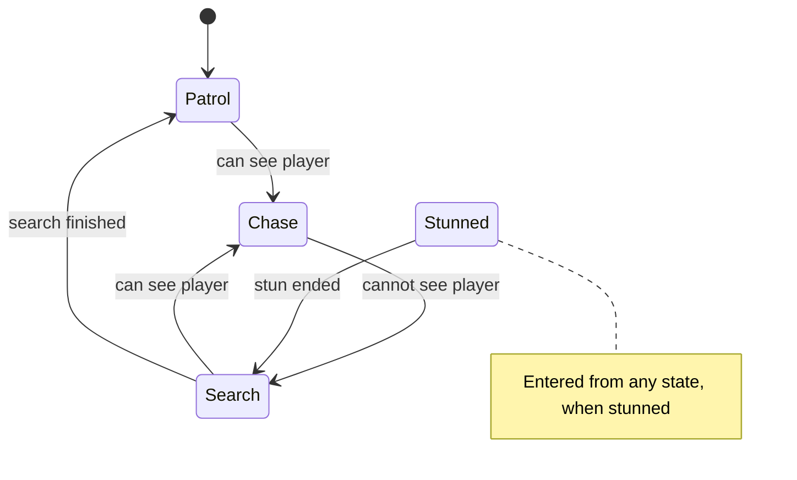
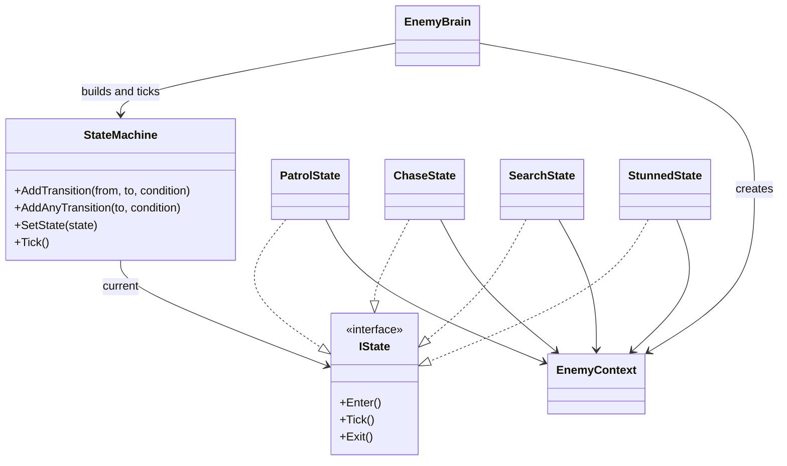

# 16 - State Machines and the State Pattern

Lab: [Lab 16 - An Enemy with States](../labs/lab_16_enemy_state_machine.md)

## Key Concepts

1. **A state machine is always in exactly one state** - behaviour depends on the current state, and transitions are the only way to change it.
2. **Draw it before you code it** - if you cannot draw the states and arrows, the code will not make them clearer.
3. **An enum and a switch are often enough** - two or three small states do not need classes.
4. **Add the pattern when the switch starts hurting** - scattered transitions, missing exit code and flags are the signs.
5. **Each state is a small class behind one interface** - a new state is a new class, and other states do not change.
6. **Every state has an entry, a tick and an exit** - paired setup and cleanup stop one state's settings leaking into the next.
7. **Transitions are data held by the machine** - a state does its job, and does not need to know which state comes next.
8. **A condition is a `Func<bool>`** - any shared variable, event, trigger or timer can become one, with no change to the machine.
9. **Order is priority** - the first true condition wins, so check the most important first.
10. **Avoid flicker with a gap between conditions** - a state entered and left on the same threshold can change every frame.

---

## 1. Framing Question

Your enemy patrols, and it chases the player when it sees them. Now it should search where the player was last seen, give up, and go back. A stun should interrupt any of that. Your `Update` has a growing `switch`, three flags and a bug where the enemy keeps its chase speed while patrolling. How do you structure behaviour that changes with a situation, so that the fifth behaviour is as easy to add as the second?

Think of an enemy in a game you have played. Name its states. What does it do when you hide? How can you tell which state it is in, just by watching?

---

## 2. What You Will Learn

| Skill | You can... |
|:------|:-----------|
| Model behaviour as states | Draw a state diagram with its transitions and conditions before coding |
| Implement a simple FSM | Write an enum and `switch` version, and state when it is enough |
| Apply the State pattern | Implement states as classes behind `IState`, run by a `StateMachine` |
| Express conditions | Write transitions as `Func<bool>` from variables, events, triggers and timers |
| Pair setup and cleanup | Use `Enter` and `Exit`, so that nothing leaks between states |
| Prevent flicker | Identify a threshold problem, and fix it with a gap or a minimum time |
| Choose a tool | Compare a state machine, a flow sequence and an Animator for a given behaviour |

---

## 3. Why This Matters

Most gameplay behaviour that feels "alive" is a small number of states with clear rules. An enemy that visibly patrols, notices, chases, searches and gives up can carry a 2 to 3 minute game. Players read those changes as intelligence, and it costs far less than it appears to. A readable state diagram is also one of the clearest things you can show in your screencast to defend a design decision in **Software Design**, and the behaviour itself can be a **Gameplay System** in the GCA.

The design problem is growth. A `switch` in `Update` works well at two states. By five, transitions are scattered through its branches, entry code runs every frame or relies on flags, and a change to one behaviour risks another. The State pattern fixes that, at the cost of more classes, so this note starts with the simple version and only moves on when the simple version shows the problem.

---

## 4. Core Ideas

### 4.1 The Finite State Machine

A **finite state machine** (FSM) has a fixed set of **states**, one current state, and **transitions** between them, each with a **condition**. You have already read one: the Animator Controller in Note 12. This is the enemy you build here:



Draw this first, on paper. Every arrow needs a condition you can state in a sentence. Ask what happens in each state for each event. A missing arrow is a design question to answer now, rather than a bug to find in a playtest.

### 4.2 The Simple Version

An enum and a `switch` are a real state machine, with nothing else to learn:

```csharp
private enum EnemyState { Patrol, Chase }

private void Update()
{
    switch (state)
    {
        case EnemyState.Patrol:
            UpdatePatrol();
            break;
        case EnemyState.Chase:
            UpdateChase();
            break;
    }
}
```

For a door with two states, or a pickup that is available or collected, stop here. It is short, and everything is in one place. Section 5 shows the signs that it has stopped being enough.

### 4.3 The State Pattern

The **State** pattern moves each state's behaviour into its own class, behind one interface. This is the same design move as selection responses in Note 06: a class that once did everything delegates to small replaceable parts.

```csharp
namespace GD.States
{
    public interface IState
    {
        void Enter();
        void Tick();
        void Exit();
    }
}
```

| Method | Runs | Use it for |
|:--|:--|:--|
| `Enter` | Once, when the state starts | Set speed, start a timer, begin an effect |
| `Tick` | Every frame while current | Follow a path, count down |
| `Exit` | Once, when the state ends | Undo what `Enter` set, such as restarting a stopped agent |

Pairing `Enter` and `Exit` is what removes "chase speed while patrolling" bugs. Each state sets what it needs when it starts, and cleans up what it should not leave behind.

### 4.4 Transitions as Func

If a state decides what comes next, it must know the other states, and every new state means editing old ones. So transitions move out into a machine, and a state only does its job. A condition is a `Func<bool>` (Note 15, Section 4.5), a question the machine can ask each frame:

```csharp
Func<bool> canSeePlayer = () => playerInSight && !playerHidden.Value;

machine.AddTransition(patrol, chase, canSeePlayer);
machine.AddTransition(chase, search, () => !canSeePlayer());
```

The lambda captures the variables, so it reads their current values each time it is asked.

### 4.5 Where Conditions Come From

Because a condition is only a question, anything can provide one, using what you already have in `Assets/GD/Common`:

| Source | Example condition | From |
|:--|:--|:--|
| Detection volume | `() => playerInSight`, set from `On Enter` and `On Exit` on `ContactTrigger` | Note 08 |
| Shared variable | `() => playerHidden.Value`, on a `BoolVariable` | Note 03 |
| Event | A channel handler records the time, then `() => Time.time < stunnedUntil` | Note 04 |
| Timer or progress | `() => search.IsFinished`, a property on the state | This note |
| Distance | `() => Vector3.Distance(a, b) < range` | Note 07 |

An event happens once, and a condition is asked every frame, so an event needs to leave something behind for the condition to read, such as a time or a flag. A channel is a good trigger, but the machine still reads a value.

Remember from Note 03 that a variable asset is shared by everything that references it. `PlayerHidden` is true for the whole game, which is correct. `PlayerInSight` is different for each enemy, so it belongs in a field on the enemy. Using a shared asset for it would make all enemies see the player at once.

### 4.6 Order and the Any Transition

More than one condition can be true at once. The machine checks in the order you added them, and the first true one wins, so **order is priority**. An **any transition** applies from every state, and is checked first. A stun is an example: every state needs the same arrow, and writing that arrow once also means a new state gets it for free. It is the same idea as `Any State` in Note 12.

### 4.7 Flicker

If one threshold both enters and leaves a state, a value sitting near it can change state every frame:

```csharp
// The enemy can flicker at exactly 10 metres.
machine.AddTransition(patrol, chase, () => distance < 10f);
machine.AddTransition(chase, patrol, () => distance >= 10f);
```

| Fix | How | Example |
|:--|:--|:--|
| A gap (**hysteresis**) | Enter at one value, and leave at a wider one | Chase within 10 m, give up beyond 14 m |
| A minimum time | A state cannot be left until a time has passed | Stay in chase for at least 1 s |
| An intermediate state | Pass through a state with its own exit rule | Search sits between chase and patrol |

The enemy here uses the third. Search also gives the player something to read: the enemy lost them, and it is looking.

### 4.8 Who Builds the Machine

One component assembles everything, and runs it. States are plain C# classes rather than components, and they receive what they need through a small context object:



`EnemyBrain` is the only class that knows the whole diagram: read its `Awake` and you read the arrows in Section 4.1. A context object can become a dumping ground, so add to it only what several states need.

### 4.9 Choosing a Tool

You now have three tools that look similar:

| Tool | Best for | Example |
|:--|:--|:--|
| Flow sequence (Note 15) | A scripted list of events, in a fixed order, with one path | Room entry, game over |
| State machine | Behaviour that reacts to changing conditions, with many paths | Enemy, door with a key, boss phases |
| Animator (Note 12) | Choosing and blending animation | Locomotion, jump |

They work together. An enemy's `StunnedState` could set an Animator trigger, and a flow could raise a channel that a state machine reacts to. A state should set animation parameters rather than contain animation logic, and an Animator should present a state, not decide gameplay.

State machines also have a limit. With many states, the number of arrows grows quickly, which is the usual reason larger games move to hierarchical state machines or behaviour trees. A 2 to 3 minute game should not reach that point.

### 4.10 Data-Driven Behaviour

Values such as speeds and durations belong in an asset, as in Note 02, so `EnemySettings` lets one state machine produce a slow guard and a fast hunter, with no code. Going further, states and conditions can themselves be assets, so that a designer can edit the diagram. That is flexible, and it takes real tooling to stay readable, so it is the Challenge exercise rather than the default.

---

## 5. Worked Example

The demo builds the enemy in Section 4.1. The design decision comes first: start with an enum and two states, and move to the pattern only when the third and fourth states show why.

### Stage 1 - Initial Implementation: Enum and Switch

```csharp
using UnityEngine;
using UnityEngine.AI;

/// <summary>
/// Patrols between waypoints, and chases the player while they are in range.
/// </summary>
[RequireComponent(typeof(NavMeshAgent))]
public class EnumEnemy : MonoBehaviour
{
    private enum EnemyState { Patrol, Chase }

    [SerializeField] private Transform player;
    [SerializeField] private Transform[] waypoints;
    [SerializeField, Min(0f)] private float sightRange = 7f;
    [SerializeField, Min(0f)] private float patrolSpeed = 2f;
    [SerializeField, Min(0f)] private float chaseSpeed = 4.5f;

    private NavMeshAgent agent;
    private EnemyState state = EnemyState.Patrol;
    private int waypointIndex;

    private void Awake()
    {
        agent = GetComponent<NavMeshAgent>();
    }

    private void Update()
    {
        bool playerInRange = Vector3.Distance(transform.position, player.position) < sightRange;

        switch (state)
        {
            case EnemyState.Patrol:
                agent.speed = patrolSpeed;
                agent.SetDestination(waypoints[waypointIndex].position);

                if (!agent.pathPending && agent.remainingDistance < 0.5f)
                    waypointIndex = (waypointIndex + 1) % waypoints.Length;

                if (playerInRange)
                    state = EnemyState.Chase;
                break;

            case EnemyState.Chase:
                agent.speed = chaseSpeed;
                agent.SetDestination(player.position);

                if (!playerInRange)
                    state = EnemyState.Patrol;
                break;
        }
    }
}
```

It works, and for this behaviour it is hard to beat.

### Stage 2 - Problem: Search and Stun

Now add Search and Stunned to that `switch`:

| Observation | Cause |
|:--|:--|
| Speed and destination are set every frame, in every branch | There is nowhere for "once, on entering" to go |
| A stopped agent stays stopped after a stun, unless each way out restarts it | There is nowhere for "once, on leaving" to go |
| Stun must be checked in all four branches | A rule for all states has no home |
| Search needs a timer and an arrived flag, which clutter the whole class | All state data sits in one class |
| Transitions are scattered through the branches, so nobody can read the diagram from the code | Behaviour and transitions are mixed |
| Two teammates editing the enemy conflict in Git | One file holds every behaviour |

### Stage 3 - Change: States and a Machine

The machine knows nothing about enemies, so it works for doors and wave spawners too. It is in `Assets/GD/Common/Scripts/StateMachines`, with `IState`, in the `GD.States` namespace. The optional `owner` and the two `partial` methods let `Tools > GD > Analyse > State and Flow Viewer` show a running machine; their code is in `StateMachine.Debug.cs`, and it is not in a build:

```csharp
using System;
using System.Collections.Generic;

namespace GD.States
{
    /// <summary>
    /// Holds a current state and the transitions between states. Knows nothing about what
    /// any state does, so it works for any object with states.
    /// </summary>
    public partial class StateMachine
    {
        private readonly struct Transition
        {
            public readonly IState To;
            public readonly Func<bool> Condition;

            public Transition(IState to, Func<bool> condition)
            {
                To = to;
                Condition = condition;
            }
        }

        private static readonly List<Transition> NoTransitions = new();

        private readonly Dictionary<IState, List<Transition>> transitions = new();
        private readonly List<Transition> anyTransitions = new();

        private List<Transition> currentTransitions = NoTransitions;

        /// <param name="owner">Shown in the State and Flow Viewer. Usually <c>this</c>.</param>
        public StateMachine(object owner = null)
        {
            Owner = owner;
            RegisterForDebugging();
        }

        /// <summary>The object this machine belongs to, if one was given.</summary>
        public object Owner { get; }

        /// <summary>The state running now, or null before the first SetState.</summary>
        public IState CurrentState { get; private set; }

        /// <summary>Raised after each change of state, with the new state.</summary>
        public event Action<IState> StateChanged;

        /// <summary>Adds a transition. Transitions are checked in the order they are added.</summary>
        public void AddTransition(IState from, IState to, Func<bool> condition)
        {
            if (!transitions.TryGetValue(from, out List<Transition> list))
            {
                list = new List<Transition>();
                transitions[from] = list;
            }

            list.Add(new Transition(to, condition));
        }

        /// <summary>Adds a transition from every state. These are checked first.</summary>
        public void AddAnyTransition(IState to, Func<bool> condition)
        {
            anyTransitions.Add(new Transition(to, condition));
        }

        /// <summary>Exits the current state and enters a new one.</summary>
        public void SetState(IState state)
        {
            if (state == CurrentState)
                return;

            CurrentState?.Exit();
            CurrentState = state;

            if (!transitions.TryGetValue(state, out currentTransitions))
                currentTransitions = NoTransitions;

            CurrentState.Enter();
            RecordStateChange();
            StateChanged?.Invoke(CurrentState);
        }

        /// <summary>Changes state if a condition is true, then ticks the current state.</summary>
        public void Tick()
        {
            if (TryFindNextState(anyTransitions, out IState next) || TryFindNextState(currentTransitions, out next))
                SetState(next);

            CurrentState?.Tick();
        }

        // Implemented in StateMachine.Debug.cs in the Editor, and removed by the compiler in a build.
        partial void RegisterForDebugging();
        partial void RecordStateChange();

        private static bool TryFindNextState(List<Transition> list, out IState next)
        {
            foreach (Transition transition in list)
            {
                if (transition.Condition())
                {
                    next = transition.To;
                    return true;
                }
            }

            next = null;
            return false;
        }
    }
}
```

The enemy's data, and what its states share:

```csharp
using UnityEngine;

/// <summary>
/// Tuning values for one type of enemy.
/// </summary>
[CreateAssetMenu(fileName = "EnemySettings", menuName = "GD/Enemies/Enemy Settings")]
public class EnemySettings : ScriptableObject
{
    [Header("Speeds (metres per second)")]
    [SerializeField, Min(0f)] private float patrolSpeed = 2f;
    [SerializeField, Min(0f)] private float chaseSpeed = 4.5f;
    [SerializeField, Min(0f)] private float searchSpeed = 3f;

    [Header("Timing (seconds)")]
    [SerializeField, Min(0f), Tooltip("Time between path updates while chasing")]
    private float repathSeconds = 0.25f;

    [SerializeField, Min(0f), Tooltip("Time spent looking after reaching the last known position")]
    private float searchSeconds = 3f;

    [SerializeField, Min(0f)] private float stunSeconds = 2f;

    [Header("Navigation")]
    [SerializeField, Min(0f), Tooltip("Distance that counts as having arrived")]
    private float arriveDistance = 0.5f;

    [Header("Colours")]
    [SerializeField] private Color patrolColour = Color.green;
    [SerializeField] private Color chaseColour = Color.red;
    [SerializeField] private Color searchColour = Color.yellow;
    [SerializeField] private Color stunnedColour = Color.cyan;

    public float PatrolSpeed => patrolSpeed;
    public float ChaseSpeed => chaseSpeed;
    public float SearchSpeed => searchSpeed;
    public float RepathSeconds => repathSeconds;
    public float SearchSeconds => searchSeconds;
    public float StunSeconds => stunSeconds;
    public float ArriveDistance => arriveDistance;
    public Color PatrolColour => patrolColour;
    public Color ChaseColour => chaseColour;
    public Color SearchColour => searchColour;
    public Color StunnedColour => stunnedColour;
}
```

```csharp
using DG.Tweening;
using GD.Types;
using UnityEngine;

/// <summary>
/// Shows the enemy's state to the player. States call this, and know nothing about renderers.
/// </summary>
public class EnemyView : MonoBehaviour
{
    [SerializeField] private Renderer bodyRenderer;
    [SerializeField] private TweenProfile tintProfile;

    private Material material;

    private void Awake()
    {
        // A copy for this enemy, so that enemies can show different states.
        material = bodyRenderer.material;
    }

    private void OnDestroy()
    {
        // Unity does not free a material copy made through Renderer.material.
        Destroy(material);
    }

    public void SetTint(Color colour)
    {
        material.DOKill();
        tintProfile.Apply(material.DOColor(colour, tintProfile.Duration)).SetLink(gameObject);
    }
}
```

```csharp
using GD.Types;
using UnityEngine;
using UnityEngine.AI;

/// <summary>
/// What the enemy's states share. Add to this only what several states need.
/// </summary>
public class EnemyContext
{
    public NavMeshAgent Agent { get; }
    public Transform Target { get; }
    public Transform[] Waypoints { get; }
    public EnemySettings Settings { get; }
    public EnemyView View { get; }
    public VoidEventChannel PlayerSpotted { get; }

    public EnemyContext(NavMeshAgent agent, Transform target, Transform[] waypoints,
        EnemySettings settings, EnemyView view, VoidEventChannel playerSpotted)
    {
        Agent = agent;
        Target = target;
        Waypoints = waypoints;
        Settings = settings;
        View = view;
        PlayerSpotted = playerSpotted;
    }

    /// <summary>True once the agent has a path and has come within the arrive distance.</summary>
    public bool HasArrived => !Agent.pathPending && Agent.remainingDistance <= Settings.ArriveDistance;
}
```

The states:

```csharp
/// <summary>
/// One state of any object with states, behind the interface every state shares.
/// </summary>
public interface IState
{
    /// <summary>Runs once, when this state starts.</summary>
    void Enter();

    /// <summary>Runs every frame while this state is current.</summary>
    void Tick();

    /// <summary>Runs once, when this state ends. Undo here what Enter set up.</summary>
    void Exit();
}
```

```csharp
using GD.States;
using UnityEngine;

/// <summary>
/// Walks between waypoints in order.
/// </summary>
public class PatrolState : IState
{
    private readonly EnemyContext context;
    private int waypointIndex;

    public PatrolState(EnemyContext context)
    {
        this.context = context;
    }

    public void Enter()
    {
        context.Agent.speed = context.Settings.PatrolSpeed;
        context.View.SetTint(context.Settings.PatrolColour);
        MoveToCurrentWaypoint();
    }

    public void Tick()
    {
        if (!context.HasArrived)
            return;

        waypointIndex = (waypointIndex + 1) % context.Waypoints.Length;
        MoveToCurrentWaypoint();
    }

    public void Exit()
    {
    }

    private void MoveToCurrentWaypoint()
    {
        Transform waypoint = context.Waypoints[waypointIndex];
        context.Agent.SetDestination(waypoint.position);
    }
}
```

```csharp
using GD.States;
using UnityEngine;

/// <summary>
/// Follows the target, updating the path at a set interval rather than every frame.
/// </summary>
public class ChaseState : IState
{
    private readonly EnemyContext context;
    private float repathTimer;

    public ChaseState(EnemyContext context)
    {
        this.context = context;
    }

    public void Enter()
    {
        context.Agent.speed = context.Settings.ChaseSpeed;
        context.View.SetTint(context.Settings.ChaseColour);
        context.PlayerSpotted.Raise();
        repathTimer = 0f;
    }

    public void Tick()
    {
        repathTimer -= Time.deltaTime;

        if (repathTimer > 0f)
            return;

        repathTimer = context.Settings.RepathSeconds;
        context.Agent.SetDestination(context.Target.position);
    }

    public void Exit()
    {
    }
}
```

```csharp
using GD.States;
using UnityEngine;

/// <summary>
/// Goes to where the target was last seen, looks for a while, then reports that it is finished.
/// </summary>
public class SearchState : IState
{
    private readonly EnemyContext context;
    private float lookTimer;

    public SearchState(EnemyContext context)
    {
        this.context = context;
    }

    /// <summary>A condition can read this, so the state need not know what comes next.</summary>
    public bool IsFinished { get; private set; }

    public void Enter()
    {
        IsFinished = false;
        lookTimer = context.Settings.SearchSeconds;
        context.Agent.speed = context.Settings.SearchSpeed;
        context.View.SetTint(context.Settings.SearchColour);
        context.Agent.SetDestination(context.Target.position);
    }

    public void Tick()
    {
        if (!context.HasArrived)
            return;

        lookTimer -= Time.deltaTime;
        IsFinished = lookTimer <= 0f;
    }

    public void Exit()
    {
    }
}
```

The component that builds it. Read `Awake` against the diagram in Section 4.1:

```csharp
using GD.States;
using GD.Types;
using UnityEngine;
using UnityEngine.AI;

/// <summary>
/// Builds the enemy's state machine and runs it. This is the only class that knows the
/// whole diagram of states and transitions.
/// </summary>
[RequireComponent(typeof(NavMeshAgent))]
public class EnemyBrain : MonoBehaviour
{
    [SerializeField] private EnemySettings settings;
    [SerializeField] private EnemyView view;
    [SerializeField] private Transform player;
    [SerializeField] private Transform[] waypoints;

    [Header("Conditions")]
    [SerializeField, Tooltip("True while the player is hidden, for every enemy")]
    private BoolVariable playerHidden;

    [SerializeField, Tooltip("Raised each time this enemy starts chasing")]
    private VoidEventChannel playerSpotted;

    [Header("Debug")]
    [SerializeField, Tooltip("Shows the current state in the Inspector during Play")]
    private string currentStateName;

    private StateMachine machine;
    private IState firstState;
    private bool playerInSight;

    private void Awake()
    {
        var context = new EnemyContext(GetComponent<NavMeshAgent>(), player, waypoints,
            settings, view, playerSpotted);

        var patrol = new PatrolState(context);
        var chase = new ChaseState(context);
        var search = new SearchState(context);

        bool CanSeePlayer() => playerInSight && !playerHidden.Value;

        machine = new StateMachine(this);
        machine.AddTransition(patrol, chase, CanSeePlayer);
        machine.AddTransition(chase, search, () => !CanSeePlayer());
        machine.AddTransition(search, chase, CanSeePlayer);
        machine.AddTransition(search, patrol, () => search.IsFinished);

        machine.StateChanged += state => currentStateName = state.GetType().Name;
        firstState = patrol;
    }

    private void Start()
    {
        // In Start, because SetState uses other objects that are ready after their Awake.
        machine.SetState(firstState);
    }

    private void Update()
    {
        machine.Tick();
    }

    /// <summary>Wire to On Enter and On Exit of a ContactTrigger on the enemy's sight zone.</summary>
    public void SetPlayerInSight(bool inSight)
    {
        playerInSight = inSight;
    }
}
```

The decisions here:

- **States do not know each other.** `PatrolState` does not mention `ChaseState`. `SearchState` reports `IsFinished`, and the brain decides what that means.
- **The path updates at an interval.** `RepathSeconds` is a tuning value here. To choose it on evidence, compare the Profiler at several values.
- **`EnemyView` handles presentation.** States ask for a colour, and a future group could replace that with an Animator with no change to the states.
- **`Start`, not `Awake`, enters the first state.** `EnemyView` caches its material in its own `Awake`, and the order of `Awake` calls between components is not something to rely on.

### Stage 4 - Improvement: A New State, with No Edit to Other States

Stunned needs one new class and three lines in the brain:

```csharp
using GD.States;
using UnityEngine;

/// <summary>
/// Stops the agent. Exit restarts it, whichever state comes next.
/// </summary>
public class StunnedState : IState
{
    private readonly EnemyContext context;

    public StunnedState(EnemyContext context)
    {
        this.context = context;
    }

    public void Enter()
    {
        context.Agent.isStopped = true;
        context.View.SetTint(context.Settings.StunnedColour);
    }

    public void Tick()
    {
    }

    public void Exit()
    {
        context.Agent.isStopped = false;
    }
}
```

In `EnemyBrain`, a channel records when the stun ends, and the condition reads that:

```csharp
[SerializeField] private VoidEventChannel stunRequested;

private float stunnedUntil;

// In Awake, after the other transitions:
var stunned = new StunnedState(context);

bool IsStunned() => Time.time < stunnedUntil;

machine.AddAnyTransition(stunned, IsStunned);
machine.AddTransition(stunned, search, () => !IsStunned());
```

`Exit` restarts the agent for every way out of the state, so no other state needs to remember. The lab has the complete class, including subscribing to the channel.

| Problem | Solution | Benefit |
|:--|:--|:--|
| A growing `switch` scattered transitions and had no entry or exit | Each state in a class behind `IState`, with transitions as `Func<bool>` in a `StateMachine` | A new state is one class, teammates work in separate files, and the diagram can be read from one method |

---

## 6. Common Pitfalls

| Symptom | Cause | Fix |
|:--------|:------|:----|
| The enemy changes state every frame | One threshold both enters and leaves | Confirm it in `Tools > GD > Analyse > State and Flow Viewer`, which reports flicker; add a gap, a minimum time or an intermediate state (Section 4.7) |
| The wrong transition fires | Two conditions are true, and order decides | Read the transitions in the viewer, which lists them in checking order; add the most important first |
| The enemy never leaves a state | No transition out, or a condition that is never true | Compare your code with the diagram |
| The enemy keeps a value from its last state | `Enter` did not set it, or `Exit` did not restore it | Set what you need in `Enter`; undo in `Exit` |
| The enemy stays still after a stun | `isStopped` was not reset | Restore it in `Exit` |
| The enemy arrives immediately | `remainingDistance` reads as 0 while a new path is computed | Check `pathPending` first, as `HasArrived` does |
| All enemies notice the player at once | A per-enemy value is in a shared variable | Keep it in a field on the enemy |
| An event has no effect | A condition is asked each frame, and the event left nothing to read | Record a time or a flag in the handler |
| `SetDestination can only be called on an active agent` | No baked NavMesh, or the agent starts off it | Bake it; place the agent on it |
| `NullReferenceException` in the first `Enter` | Another object was not ready | Enter the first state in `Start`, not `Awake` |
| Code in one state checks whether another state is current | States have become coupled | Move the rule into a transition |

---

## 7. Software Development Parallels

- **State** (Gang of Four). An object's behaviour changes with its internal state, and each state is a class. UI workflows, network connections and parsers commonly use the same pattern. Its cost is more classes for a small behaviour, which is why Section 4.2 comes first.
- **Strategy, compared.** Both patterns put behaviour behind an interface. In Strategy, a caller chooses the algorithm, and it rarely changes. In State, the object moves between states itself as things happen.
- **Open/closed and single responsibility.** A new state needs no edit to other states, and each state has one reason to change. `EnemyBrain` is deliberately the one exception, because something must know the whole diagram.
- **Dependency inversion.** `StateMachine` depends on `IState` and `Func<bool>`, not on enemies, NavMesh or Unity.
- **Commercial games.** Jeff Orkin's GDC 2006 talk *Three States and a Plan: The AI of F.E.A.R.* describes how that game reduced its FSM to three states, using planning to choose actions. The talk is a useful view of where FSMs stop scaling. *Pac-Man*'s ghosts alternate between chase, scatter and frightened modes, which shows how much a few states and clear rules can do.

---

## 8. Exercises

### Core - A Locked Door

Write a door with three states: `Locked`, `Unlocked` and `Open`, using an enum first. A `BoolVariable` from `Assets/GD/Common` named `HasKey` is the condition from locked to unlocked. Being in a `ContactTrigger` zone is the condition from unlocked to open, and leaving it returns to unlocked.

**Expected result:** the door stays shut without a key, opens as the player approaches with a key, and closes when they leave. Draw the diagram first. In 80 to 120 words, say whether this needs the State pattern, and what would change your answer.

### Apply - Wave States

Write a wave spawner with `Waiting`, `Spawning` and `PausedBetweenWaves` states, using `StateMachine` and `IState`. Spawn primitives at a set rate during `Spawning`. Raise channels for wave start and wave end from `Enter` and `Exit`.

**Expected result:** three waves run, with visible pauses, and `Log Raises` shows the channels in order. In 80 to 120 words, compare this with the coroutine from Note 15's Core exercise. Which would you use if a boss could interrupt a wave?

### Challenge - States as Assets

A designer wants to change an enemy's diagram with no code. Design a ScriptableObject version in which conditions, at least, are assets, and the enemy's transitions are a list in the Inspector. You will need to decide how an asset condition can read per-enemy values such as `playerInSight`, because assets are shared.

**Expected result:** one enemy is changed from "patrol, chase" to "patrol, chase, search" by editing assets. In 150 to 200 words, say how you handled per-enemy data, and state what became harder to read or debug compared with `EnemyBrain.Awake`. Say whether you would use this for your group's 2 to 3 minute game.

---

## 9. Reflective Questions

1. Your game has one enemy with two states. Would you write `StateMachine`? Justify the decision, and name the change that would make you switch.
2. `SearchState` reports `IsFinished` rather than changing state itself. Which SOLID principle does this support, and what would it cost to do it the other way?
3. `EnemyBrain` must change whenever a state is added. Does that break the open/closed principle? Defend your position.
4. Compare `playerInSight` as a field with `playerHidden` as a shared variable. Why does each belong where it is, using Note 03?
5. Choose a behaviour in your group's game. Is it a flow, a state machine or an Animator? Justify your answer with the transitions it needs.

---

## 10. How This Builds

- **[Lab 16](../labs/lab_16_enemy_state_machine.md)** builds this enemy from an enum to the State pattern, with a sight zone, a shared variable and an event as conditions.
- **GCA:** a state diagram, with code that matches it, is strong evidence for **Software Design**, and it is worth showing in your screencast. The behaviour itself can be a **Gameplay System**. Record the enum version before refactoring, as evidence for **Iteration & Improvement**.

---

## Glossary

| Term | Definition |
|:-----|:-----------|
| Any transition | A transition that applies from every state |
| Condition | A question that decides whether a transition fires, here a `Func<bool>` |
| Finite state machine (FSM) | A model with a fixed set of states, one current state, and transitions between them |
| Hysteresis | Using different thresholds to enter and to leave a state, to prevent flicker |
| State | One mode of behaviour in a state machine |
| State pattern | A pattern that puts each state's behaviour in its own class, behind one interface |
| Transition | A move from one state to another when a condition is true |
