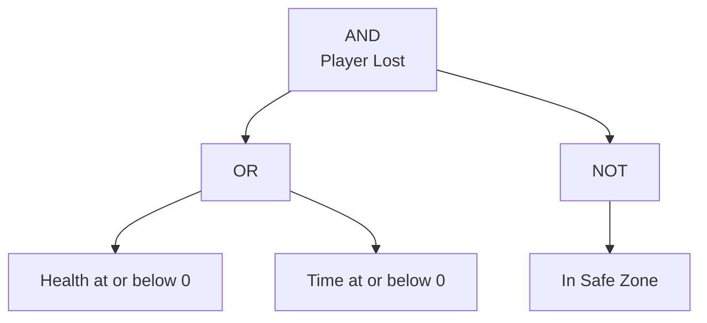
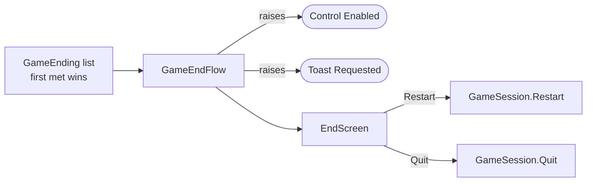

# 17 - Game Conditions and End States

Lab: [Lab 17 - Win, Lose and Restart from Condition Assets](../labs/lab_17_game_conditions.md)

## Key Concepts

1. **A condition answers one question** - is this true right now? It does not store progress, and it causes nothing to happen.
2. **State lives in variables, and conditions only read it** - a trigger, a pickup or an enemy writes the value, so no condition needs to know about them.
3. **A few leaf types cover most games** - a bool, an int compared with a number, and a float compared with a number.
4. **A group is also a condition** - AND, OR, XOR and NOT combine conditions, and can contain other groups to any depth.
5. **XOR needs a definition** - with more than two inputs, "exactly one" and "an odd number" give different answers.
6. **An empty group is never met** - an unfinished asset must not end the game.
7. **Reading a condition must change nothing** - groups stop checking as soon as they know the answer, so a child may not even run.
8. **Separate the question from the reaction** - a watcher detects the moment a condition becomes true, and something else decides what that means.
9. **List end states in priority order** - the player can win and lose in the same frame, so the order decides.
10. **Restarting must reset the variables** - assets outlive the scene, so an old key would end the new game straight away.

---

## 1. Framing Question

The player wins when they have the key, have collected five items and have reached the exit. They lose when their health runs out or the timer does, unless they are in a safe zone. A designer wants to change those rules twice before the deadline. Then the game must show a message, take control away, and offer a restart or a quit. Where do those rules live, and how do you change them without editing a manager class each time?

Think of the rules that end a level in a game you know. Write them as a sentence, using only AND, OR and NOT. Which of them is a value that changes, and which is something that happened once?

---

## 2. What You Will Learn

| Skill | You can... |
|:------|:-----------|
| Choose condition types | State which leaf type a game rule needs, or that it is not a condition at all |
| Connect state to conditions | Write game state into shared variables with no new script, from triggers and events |
| Combine conditions | Build AND, OR, XOR and NOT groups as assets, nested to any depth |
| Apply the Composite pattern | Explain why a group and a leaf share one base class |
| Use conditions anywhere | Pass a condition to `FlowBuilder.WaitUntil`, or to `StateMachine.AddTransition` |
| Detect a change | Fire an event once when a condition becomes true, optionally after it has held for a time |
| Finish a game | Show a toast, take control, and offer restart and quit, with state correctly reset |

---

## 3. Why This Matters

Your game needs an ending, because a complete loop is what lets you spend the remaining time improving it. The rules of that ending are also what a designer tunes most: one more item, a shorter timer, a key that is now optional. If those rules are `if` statements in a `GameManager`, each change means editing a class that references half the game, and two teammates changing rules will conflict in Git.

Treating rules as data solves that, and it is good evidence for **Data & State** in the GCA. Levels can have different rules with no new code, and the same condition assets also work in doors, flows and state machines. Note 15 built the flows that react to these moments, and Note 16 built state machines that need these questions answered. This note provides the questions.

---

## 4. Core Ideas

### 4.1 What a Condition Is

A **condition** answers one question about the current state of the game, and it answers with `true` or `false`. It is a `Func<bool>` (Note 15, Section 4.5) that a designer can create as an asset:

```csharp
public abstract class Condition : ScriptableObject
{
    public abstract bool IsMet();
}
```

Because `IsMet` has the shape of a `Func<bool>`, a condition already works with the classes in `Assets/GD/Common`, and neither of them needs to change:

```csharp
new FlowBuilder().WaitUntil(exitUnlocked.IsMet);

machine.AddTransition(patrol, chase, canSeePlayer.IsMet);
```

### 4.2 State Lives in Variables

Conditions never watch triggers or inventories directly. Something else writes a shared variable (Note 03), and the condition reads it. This keeps conditions simple, and most of the writing needs no code at all:

| Game event | Written by | Variable |
|:--|:--|:--|
| Key collected | `ContactTrigger`, `On Enter`, calling `BoolVariable > bool Value` | `HasKey` |
| Reached the exit | `ContactTrigger`, `On Enter` and `On Exit`, setting a value | `AtExit` |
| Item collected | `ContactTrigger`, `On Enter`, calling `IntVariable.Add (int)` with 1 | `ItemsCollected` |
| Enemy killed | `VoidEventChannelListener`, calling `IntVariable.Add (int)` with -1 | `EnemiesLeft` |
| Boss defeated | `VoidEventChannelListener`, calling `BoolVariable > bool Value` | `BossDefeated` |
| Health changed | The health system writes its value | `Health` |
| Time passing | A small timer component writes its value | `TimeLeft` |

If your group has an inventory system, it writes the count into an `IntVariable` when it changes, and it does not need to know that a condition exists. Note 03's warning still applies: a shared variable is one value for the whole game, so use it only for values that are truly global.

### 4.3 Which Condition Types to Include

Most game rules reduce to very few types. Start with these, and add others only when a real rule needs one:

| Type | Question | Examples |
|:--|:--|:--|
| `BoolVariableCondition` | Is this flag true (or false)? | Has the key; trigger reached; boss defeated; door open |
| `IntVariableCondition` | How does this count compare with a number? | At least 5 items; no enemies left; 0 lives |
| `FloatVariableCondition` | How does this value compare with a number? | Health at or below 0; time at or below 0; score above 1000 |
| `AllCondition` | **AND**: are all of these met? | Key and items and exit |
| `AnyCondition` | **OR**: is at least one of these met? | No health or no time |
| `XorCondition` | **XOR**: is exactly one of these met? | Exactly one of two levers pulled |
| `NotCondition` | **NOT**: is this not met? | Not in the safe zone |

Some rules look like conditions, but are not, because answering them needs memory or a place in a scene:

| Rule | Why it is not a leaf | Where it belongs |
|:--|:--|:--|
| "Stood in the zone for 3 seconds" | Needs a timer | `Hold Seconds` on `ConditionWatcher` (Section 4.7) |
| "Pulled lever A, then lever B" | Depends on order, so it needs memory | A flow (Note 15) or a state machine (Note 16) that sets a `BoolVariable` when finished |
| "Within 5 metres of the player" | Assets cannot reference scene objects | A `ContactTrigger` zone that writes a `BoolVariable` |
| "The button was pressed" | An event has no duration | A listener that writes a `BoolVariable`, as in Section 4.2 |

This is a useful test for any new type: if a condition would need a field that changes during play, the changing value belongs somewhere else.

### 4.4 Combining Conditions: The Composite Pattern

The rule "key AND items AND (exit OR teleporter)" has a group inside a group. If a group were a different kind of thing from a leaf, this nesting would need special code. The **Composite** pattern avoids that: a group is itself a condition, whose children are conditions, so groups contain groups with no extra work.



Each box is one asset. The code that reads a condition calls `IsMet()` on the root, and it does not know whether it holds one leaf or a large tree.

### 4.5 What XOR Should Mean

For two inputs, **XOR** means "one or the other, but not both". For three or more, there are two definitions in common use:

| A | B | C | Exactly one | Odd number (chained XOR) |
|:--|:--|:--|:--|:--|
| false | false | false | false | false |
| true | false | false | true | true |
| true | true | false | false | false |
| true | true | true | **false** | **true** |

Chaining XOR in code gives the odd number rule, so with three levers, all three pulled counts as true. That is almost never what a designer means. `XorCondition` here uses **exactly one**. Take care with this choice, because the two definitions only differ in a case you may not test. For two inputs, they agree.

### 4.6 Rules for Well-Behaved Conditions

| Rule | Why |
|:--|:--|
| `IsMet` changes nothing | `AllCondition` stops at the first false child, so a child with a side effect might or might not run |
| Assets hold no runtime state | One asset can be used by many objects, and values changed in Play mode persist in the Editor (Note 02) |
| An empty group is never met | Mathematically, "all of nothing" is true, which would end the game as soon as someone creates an empty `AllCondition` |
| A group cannot contain itself | A cycle overflows the stack, so the base class checks for it in the Inspector |

Polling a small tree each frame costs a few `bool` checks, and it is simple. The alternative, subscribing every condition to its variable's `ValueChanged` event, avoids that small cost, but it adds subscribe and unsubscribe rules to every class, and to assets that outlive scenes. For a tree this size, keep polling, and only change if measurement shows you should.

### 4.7 Reacting to a Condition

A condition is a state, and most reactions need a moment. `ConditionWatcher` detects the moment by comparing the answer with its previous one, as `LandingEvents` does with `Grounded`. It connects any condition to any `UnityEvent`, so a door can open when a condition is met, with no new script.

### 4.8 End States

An **end state** is a rule plus what it means for the player: `Won` or `Lost`, with a title and a message. Two can be true at once, for example when the player reaches the exit on the frame the timer ends, so end states go in a list, and the first true one wins. The order is a design decision: the example below checks losing first, and a designer can change that by reordering the list in the Inspector.



### 4.9 Restarting Safely

ScriptableObject assets are not reloaded with a scene, so reloading the scene leaves `HasKey` true and `ItemsCollected` at 5, and the rule that ended the game is immediately true again. Note 03 gave you `ResetToInitial` for this. `GameSession` calls it for each game variable before reloading, in one place, so that a new variable only needs adding to one list. `Time.timeScale` also survives a scene load, so it is reset too.

---

## 5. Worked Example

The demo implements the rules in the Framing Question. The design decision comes first: rules go in assets and state goes in variables, and the only code that knows about game endings is a small flow.

### Stage 1 - Initial Implementation: An If Statement

```csharp
using GD.Types;
using UnityEngine;

public class SimpleGameManager : MonoBehaviour
{
    [SerializeField] private BoolVariable hasKey;
    [SerializeField] private BoolVariable atExit;
    [SerializeField] private IntVariable itemsCollected;
    [SerializeField] private FloatVariable health;

    private bool finished;

    private void Update()
    {
        if (finished)
            return;

        if (health.Value <= 0f)
        {
            finished = true;
            Debug.Log("Lost");
        }
        else if (hasKey.Value && atExit.Value && itemsCollected.Value >= 5)
        {
            finished = true;
            Debug.Log("Won");
        }
    }
}
```

It works, and it is readable.

### Stage 2 - Problem: The Rules Keep Changing

| Observation | Cause |
|:--|:--|
| "Five items" becoming "three on easy" means a new field, and more conditions | Rules are code |
| Adding a timer and a safe zone adds fields, and the `if` becomes hard to read | Each rule needs its own variable references here |
| A door needs "has the key" too, and now it is written twice | There is no way to reuse a rule |
| A second level with different rules needs a second manager, or flags | One class holds one set of rules |
| A designer asks why the game did not end, and only a debugger can answer | The tree has no visible form |
| Everyone editing rules conflicts in one file | All the rules share one class |

### Stage 3 - Change: Conditions as Assets

These classes are in `Assets/GD/Common/Scripts/Conditions`, in the `GD.Conditions` namespace. The base class has the checks from Section 4.6, and a way to see the current state of a tree:

```csharp
using System.Collections.Generic;
using UnityEngine;

namespace GD.Conditions
{
    /// <summary>
    /// One question about the current state of the game. Reading it must change nothing.
    /// </summary>
    public abstract class Condition : ScriptableObject
    {
        /// <summary>True if this condition is met right now.</summary>
        public abstract bool IsMet();

        /// <summary>The conditions directly inside this one. Leaves have none.</summary>
        protected virtual IEnumerable<Condition> Children => System.Array.Empty<Condition>();

        /// <summary>Describes this condition and any children, for debugging.</summary>
        public virtual string Describe(string indent = "")
        {
            string text = $"{indent}{name}: {(IsMet() ? "met" : "not met")}";

            foreach (Condition child in Children)
            {
                if (child != null)
                    text += "\n" + child.Describe(indent + "    ");
            }

            return text;
        }

        [ContextMenu("Log State")]
        private void LogState()
        {
            Debug.Log(Describe(), this);
        }

        private void OnValidate()
        {
            if (Reaches(this, new HashSet<Condition>()))
                Debug.LogError($"{name} contains itself, which would overflow the stack.", this);
        }

        private bool Reaches(Condition target, HashSet<Condition> visited)
        {
            foreach (Condition child in Children)
            {
                if (child == null)
                    continue;

                if (child == target)
                    return true;

                if (visited.Add(child) && child.Reaches(target, visited))
                    return true;
            }

            return false;
        }
    }
}
```

Comparison operators are shared, so that the int and float leaves stay small:

```csharp
using System;

namespace GD.Conditions
{
    /// <summary>
    /// How a value is compared with a target.
    /// </summary>
    public enum CompareOperator
    {
        Equal,
        NotEqual,
        Less,
        LessOrEqual,
        Greater,
        GreaterOrEqual
    }

    /// <summary>Applies a CompareOperator to two values.</summary>
    public static class CompareOperatorExtensions
    {
        /// <summary>Applies this operator to a value and a target.</summary>
        public static bool Evaluate<T>(this CompareOperator compare, T value, T target) where T : IComparable<T>
        {
            int result = value.CompareTo(target);

            return compare switch
            {
                CompareOperator.Equal => result == 0,
                CompareOperator.NotEqual => result != 0,
                CompareOperator.Less => result < 0,
                CompareOperator.LessOrEqual => result <= 0,
                CompareOperator.Greater => result > 0,
                CompareOperator.GreaterOrEqual => result >= 0,
                _ => false
            };
        }
    }
}
```

The three leaves:

```csharp
using GD.Types;
using UnityEngine;

namespace GD.Conditions
{
    /// <summary>
    /// Met when a shared bool has the expected value, for example "has the key".
    /// </summary>
    [CreateAssetMenu(fileName = "BoolVariableCondition", menuName = "GD/Conditions/Bool Variable")]
    public class BoolVariableCondition : Condition
    {
        [SerializeField] private BoolVariable variable;
        [SerializeField] private bool expected = true;

        public override bool IsMet()
        {
            return variable != null && variable.Value == expected;
        }
    }
}
```

```csharp
using GD.Types;
using UnityEngine;

namespace GD.Conditions
{
    /// <summary>
    /// Met when a shared int compares as stated, for example "at least 5 items".
    /// </summary>
    [CreateAssetMenu(fileName = "IntVariableCondition", menuName = "GD/Conditions/Int Variable")]
    public class IntVariableCondition : Condition
    {
        [SerializeField] private IntVariable variable;
        [SerializeField] private CompareOperator compare = CompareOperator.GreaterOrEqual;
        [SerializeField] private int target;

        public override bool IsMet()
        {
            return variable != null && compare.Evaluate(variable.Value, target);
        }
    }
}
```

```csharp
using GD.Types;
using UnityEngine;

namespace GD.Conditions
{
    /// <summary>
    /// Met when a shared float compares as stated, for example "health at or below 0".
    /// Avoid Equal and NotEqual, because floats are rarely exact.
    /// </summary>
    [CreateAssetMenu(fileName = "FloatVariableCondition", menuName = "GD/Conditions/Float Variable")]
    public class FloatVariableCondition : Condition
    {
        [SerializeField] private FloatVariable variable;
        [SerializeField] private CompareOperator compare = CompareOperator.LessOrEqual;
        [SerializeField] private float target;

        public override bool IsMet()
        {
            return variable != null && compare.Evaluate(variable.Value, target);
        }
    }
}
```

The groups share their list, and each one supplies only its rule:

```csharp
using System.Collections.Generic;
using UnityEngine;

namespace GD.Conditions
{
    /// <summary>
    /// A condition made from other conditions, which may themselves be groups.
    /// An empty group is never met, so that an unfinished asset cannot end the game.
    /// </summary>
    public abstract class ConditionGroup : Condition
    {
        [SerializeField] private List<Condition> conditions = new();

        protected override IEnumerable<Condition> Children => conditions;

        protected IReadOnlyList<Condition> Conditions => conditions;

        protected bool IsEmpty => conditions.Count == 0;
    }
}
```

```csharp
using UnityEngine;

namespace GD.Conditions
{
    /// <summary>
    /// AND: met when every condition is met. An empty slot counts as not met.
    /// </summary>
    [CreateAssetMenu(fileName = "AllCondition", menuName = "GD/Conditions/All (AND)")]
    public class AllCondition : ConditionGroup
    {
        public override bool IsMet()
        {
            if (IsEmpty)
                return false;

            foreach (Condition condition in Conditions)
            {
                if (condition == null || !condition.IsMet())
                    return false;
            }

            return true;
        }
    }
}
```

```csharp
using UnityEngine;

namespace GD.Conditions
{
    /// <summary>
    /// OR: met when at least one condition is met.
    /// </summary>
    [CreateAssetMenu(fileName = "AnyCondition", menuName = "GD/Conditions/Any (OR)")]
    public class AnyCondition : ConditionGroup
    {
        public override bool IsMet()
        {
            foreach (Condition condition in Conditions)
            {
                if (condition != null && condition.IsMet())
                    return true;
            }

            return false;
        }
    }
}
```

```csharp
using UnityEngine;

namespace GD.Conditions
{
    /// <summary>
    /// XOR: met when exactly one condition is met. With three or more conditions this differs
    /// from a chained XOR, which would also be true when an odd number are met.
    /// </summary>
    [CreateAssetMenu(fileName = "XorCondition", menuName = "GD/Conditions/Exactly One (XOR)")]
    public class XorCondition : ConditionGroup
    {
        public override bool IsMet()
        {
            int metCount = 0;

            foreach (Condition condition in Conditions)
            {
                if (condition != null && condition.IsMet())
                    metCount++;

                if (metCount > 1)
                    return false;
            }

            return metCount == 1;
        }
    }
}
```

```csharp
using System.Collections.Generic;
using UnityEngine;

namespace GD.Conditions
{
    /// <summary>
    /// NOT: met when the inner condition is not met. An empty slot counts as not met,
    /// so that an unfinished asset cannot end the game.
    /// </summary>
    [CreateAssetMenu(fileName = "NotCondition", menuName = "GD/Conditions/Not")]
    public class NotCondition : Condition
    {
        [SerializeField] private Condition condition;

        protected override IEnumerable<Condition> Children => new[] { condition };

        public override bool IsMet()
        {
            return condition != null && !condition.IsMet();
        }
    }
}
```

For the Framing Question, a designer now creates these assets and writes no code:

| Asset | Type | Contains |
|:--|:--|:--|
| `C_HasKey` | Bool Variable | `HasKey` is true |
| `C_AtExit` | Bool Variable | `AtExit` is true |
| `C_FiveItems` | Int Variable | `ItemsCollected` at least 5 |
| `C_Won` | All | `C_HasKey`, `C_AtExit`, `C_FiveItems` |
| `C_NoHealth` | Float Variable | `Health` at or below 0 |
| `C_NoTime` | Float Variable | `TimeLeft` at or below 0 |
| `C_InSafeZone` | Bool Variable | `InSafeZone` is true |
| `C_OutOfTime` | All | `C_NoTime`, and Not `C_InSafeZone` |
| `C_Lost` | Any | `C_NoHealth`, `C_OutOfTime` |

Right-click any asset during Play, and choose `Log State`, to see which part of a tree is holding it back. A door that needs the key reuses `C_HasKey`, and an easier level swaps `C_FiveItems` for a different asset.

For anything other than ending the game, the watcher turns a condition into an event:

```csharp
using UnityEngine;
using UnityEngine.Events;

namespace GD.Conditions
{
    /// <summary>
    /// Raises an event when a condition becomes met, and another when it stops being met.
    /// </summary>
    [AddComponentMenu("GD/Conditions/Condition Watcher")]
    public class ConditionWatcher : MonoBehaviour
    {
        [SerializeField] private Condition condition;

        [SerializeField, Min(0f), Tooltip("Seconds the condition must stay met before it counts")]
        private float holdSeconds;

        [SerializeField] private UnityEvent onMet;
        [SerializeField] private UnityEvent onNoLongerMet;

        private bool wasMet;
        private float heldFor;

        private void Update()
        {
            bool metNow = condition.IsMet();

            heldFor = metNow ? heldFor + Time.deltaTime : 0f;

            bool counts = metNow && heldFor >= holdSeconds;

            if (counts == wasMet)
                return;

            wasMet = counts;

            if (counts)
                onMet.Invoke();
            else
                onNoLongerMet.Invoke();
        }
    }
}
```

### Stage 4 - Improvement: Ending the Game

These classes are in `Assets/GD/Common/Scripts/Flow/GameEnd`. An ending is data:

```csharp
using GD.Conditions;
using UnityEngine;

namespace GD.Flow
{
    /// <summary>
    /// One way the game can end: the rule, and what to tell the player.
    /// </summary>
    [CreateAssetMenu(fileName = "GameEnding", menuName = "GD/Conditions/Game Ending")]
    public class GameEnding : ScriptableObject
    {
        [SerializeField] private Condition condition;
        [SerializeField] private string title = "Game Over";

        [SerializeField, TextArea(1, 3), Tooltip("Shown briefly before the end screen")]
        private string toastMessage = "";

        public string Title => title;
        public string ToastMessage => toastMessage;

        public bool IsReached()
        {
            return condition != null && condition.IsMet();
        }
    }
}
```

The flow builds on `FlowBehaviour` and `FlowBuilder` from `Assets/GD/Common`. Tick `Play Once` on it. It decides which ending applies, and it runs the same sequence for all of them:

```csharp
using GD.Types;
using GD.UI;
using UnityEngine;

namespace GD.Flow
{
    /// <summary>
    /// Checks a list of endings in order, and plays the end of the game when the first is reached.
    /// </summary>
    [AddComponentMenu("GD/Flow/Game End Flow")]
    public class GameEndFlow : FlowBehaviour
    {
        [SerializeField, Tooltip("Checked from the top. The first reached wins")]
        private GameEnding[] endings;

        [SerializeField] private EndScreen endScreen;

        [Header("Channels")]
        [SerializeField] private BoolEventChannel controlEnabled;
        [SerializeField] private StringEventChannel toastRequested;
        [SerializeField] private VoidEventChannel gameEnded;

        [SerializeField, Min(0f), Tooltip("Seconds between the toast and the end screen")]
        private float toastSeconds = 1.5f;

        private GameEnding reached;

        private void Update()
        {
            if (reached != null)
                return;

            foreach (GameEnding ending in endings)
            {
                if (!ending.IsReached())
                    continue;

                reached = ending;
                Play();
                return;
            }
        }

        protected override FlowSequence BuildSequence()
        {
            // The ending is not known yet, so these steps read it when they run.
            return new FlowBuilder()
                .Raise(gameEnded)
                .Raise(controlEnabled, false)
                .Do(() => toastRequested.Raise(reached.ToastMessage))
                .Wait(toastSeconds)
                .Tween(() => endScreen.Show(reached.Title))
                .Build();
        }
    }
}
```

The toast and the screen are small views in `Assets/GD/Common/Scripts/UI`, each using `ScreenPanel` from Note 15 for its fade. A `StringEventChannelListener` calls `ToastView.Show`, so any system can request a toast:

```csharp
using DG.Tweening;
using TMPro;
using UnityEngine;

namespace GD.UI
{
    /// <summary>
    /// Shows a short message on a ScreenPanel, then fades it. A new message replaces the current one.
    /// </summary>
    [AddComponentMenu("GD/UI/Toast View")]
    [RequireComponent(typeof(ScreenPanel))]
    public class ToastView : MonoBehaviour
    {
        [SerializeField] private TMP_Text label;

        [SerializeField, Min(0f), Tooltip("Seconds the message stays fully visible")]
        private float holdSeconds = 2f;

        private ScreenPanel panel;
        private Tween hideTimer;

        private void Awake()
        {
            panel = GetComponent<ScreenPanel>();
        }

        /// <summary>Wire to a StringEventChannelListener, as a dynamic string.</summary>
        public void Show(string message)
        {
            label.text = message;

            if (hideTimer != null && hideTimer.IsActive())
                hideTimer.Kill();

            panel.Show().OnComplete(StartHideTimer);
        }

        private void StartHideTimer()
        {
            // True ignores Time.timeScale, so a toast still fades while the game is paused.
            hideTimer = DOVirtual.DelayedCall(holdSeconds, () => panel.Hide(), true).SetLink(gameObject);
        }
    }
}
```

```csharp
using DG.Tweening;
using TMPro;
using UnityEngine;

namespace GD.UI
{
    /// <summary>
    /// Fades in the end of game panel, with the title of the ending reached.
    /// </summary>
    [AddComponentMenu("GD/UI/End Screen")]
    [RequireComponent(typeof(ScreenPanel))]
    public class EndScreen : MonoBehaviour
    {
        [SerializeField] private TMP_Text titleLabel;

        private ScreenPanel panel;

        private void Awake()
        {
            panel = GetComponent<ScreenPanel>();
        }

        public Tween Show(string title)
        {
            titleLabel.text = title;
            return panel.Show();
        }
    }
}
```

The end screen's buttons call `GameSession`, which owns restarting and quitting:

```csharp
using GD.Types;
using UnityEngine;
using UnityEngine.SceneManagement;

namespace GD.Flow
{
    /// <summary>
    /// Restarts or quits the game. Add every variable that holds game state, so that a new
    /// game does not start with the old game's values.
    /// </summary>
    [AddComponentMenu("GD/Flow/Game Session")]
    public class GameSession : MonoBehaviour
    {
        [SerializeField] private BoolVariable[] boolVariables;
        [SerializeField] private IntVariable[] intVariables;
        [SerializeField] private FloatVariable[] floatVariables;

        public void Restart()
        {
            foreach (BoolVariable variable in boolVariables)
                variable.ResetToInitial();

            foreach (IntVariable variable in intVariables)
                variable.ResetToInitial();

            foreach (FloatVariable variable in floatVariables)
                variable.ResetToInitial();

            // Time.timeScale survives a scene load, as the variables do.
            Time.timeScale = 1f;

            SceneManager.LoadScene(SceneManager.GetActiveScene().name);
        }

        public void Quit()
        {
    #if UNITY_EDITOR
            UnityEditor.EditorApplication.isPlaying = false;
    #else
            Application.Quit();
    #endif
        }
    }
}
```

`PlayerControlLock` from `Assets/GD/Common` responds to `Control Enabled`, through a `BoolEventChannelListener`, as in Note 15. Enemies can stop by listening to `Game Ended`.

| Problem | Solution | Benefit |
|:--|:--|:--|
| Game rules were `if` statements in one class, which only code could change | Conditions as assets that read shared variables, combined with AND, OR, XOR and NOT; endings as data; a flow for the reaction | Designers change rules with no code; rules are reused by doors, flows and state machines; a new ending needs no new class |

---

## 6. Common Pitfalls

| Symptom | Cause | Fix |
|:--------|:------|:----|
| The game ends as soon as it restarts | A variable was not reset | Add it to `GameSession` |
| The game ends the moment it starts | A `NotCondition` or `Less` compare is true at the initial value, such as `Health` at 0 until its owner writes it | Set `Initial Value` on the variable; check with `Log State` |
| A rule never becomes true | One child of an `AllCondition` is false, or a slot is empty | Use `Log State` on the root |
| `HasKey` stays true between Play sessions in the Editor | The asset's `Initial Value` was edited during Play, rather than the value | Set `Initial Value` outside Play mode |
| A trigger's condition turns off again | `On Exit` writes false, when the rule means "has ever reached" | Write only on `On Enter` for "has reached" |
| All objects share a value they should not | A per-object value is in a shared variable | Keep it on the object; a condition cannot express it, so use a local `Func<bool>` |
| Three levers all pulled does not count | `XorCondition` means exactly one | Use `AllCondition` for all, or `AnyCondition` for at least one |
| A health check at exactly 0 fails | `Equal` on a `float` | Use `LessOrEqual` |
| `Stack overflow` | A group contains itself | Read the error from `OnValidate`, and remove the loop |
| An ending plays twice, or two endings conflict | `Play Once` is not ticked | Tick it; order the list |
| A fade of your own does not run when paused | It uses scaled time | Add `SetUpdate(true)`, or use `ScreenPanel` |
| A restart reports that the scene cannot be loaded | The scene is not in the build's list | Add it under `File > Build Profiles` |

---

## 7. Software Development Parallels

- **Composite** (Gang of Four). A group and a leaf share one interface, so a tree is used like a single object. File systems and UI hierarchies use the same structure.
- **Specification** (Eric Evans and Martin Fowler). Business rules as small objects that combine with AND, OR and NOT, as used for rules such as "eligible for a discount". `Condition` is this pattern as a Unity asset.
- **Open/closed and single responsibility.** A new leaf type is one class. Conditions read, variables hold, triggers write, the watcher detects, and the flow reacts.
- **Dependency inversion.** `FlowBuilder` and `StateMachine` depend on `Func<bool>`, so they accept `IsMet` with no knowledge of conditions.
- **Liskov substitution.** Any `Condition` can sit in any group, as long as `IsMet` has no side effects. A leaf that consumes something when read would break every group that holds it.
- **Commercial practice.** Valve's Hammer level editor connects `logic_compare`, `math_counter` and relay entities to control doors and puzzles in *Half-Life 2* and *Portal* maps, with designers building rules from small logic objects. The same split between small reusable logic objects and the things they trigger is what this note builds.

---

## 8. Exercises

### Core - Two Levers

Create `LeverA` and `LeverB` as `BoolVariable` assets, each set from a `ContactTrigger`. Using a `XorCondition` and a `ConditionWatcher`, open a door while exactly one lever is pressed, and close it otherwise.

**Expected result:** the door is open for one lever, and closed for none or both, with no new script apart from the door's movement. In 80 to 120 words, add a third lever, and predict what happens with all three pressed. Then explain how the result would differ with a chained XOR, and which behaviour you would want.

### Apply - A Timed Loss

Add a `TimeLeft` `FloatVariable`, with a small component that counts it down. Create a `GameEnding` for winning and one for losing, using the `C_Lost` tree from Section 5, and a safe zone through a `ContactTrigger`. Show a toast at 10 seconds left using a `ConditionWatcher`, and a `StringEventChannel`.

**Expected result:** the game ends correctly each way, is not lost while the player is in the safe zone, and restarts with every value reset. In 80 to 120 words, say which ending you put first in the list, why, and how you tested the two being reached in one frame.

### Challenge - Objectives in Order

A designer wants "pull lever A, then lever B, then reach the exit", with a wrong order doing nothing. Implement this without adding a field that changes at runtime to any `Condition` class. A flow or a state machine could use a condition for each stage, then write a final `BoolVariable`.

**Expected result:** only the correct order completes the objective, and a `GameEnding` reads the result with no knowledge of the order. In 150 to 200 words, explain why order cannot be expressed with AND, OR, XOR and NOT alone, compare your choice of a flow or a state machine, and state how a restart resets progress.

---

## 9. Reflective Questions

1. Your game has one win rule that will never change. Would you build this system, or write one `if`? Justify the decision, and name the change that would alter it.
2. Conditions poll each frame, and variables have a `ValueChanged` event. Compare the two designs, and state what evidence would make you change.
3. `AllCondition` treats an empty group as not met, which differs from the mathematical definition. Argue for or against that choice.
4. "All state lives in variables" keeps conditions simple. What does it cost? Name one rule in your group's game that this makes awkward, and say how you would handle it.
5. Write your game's end rules as a tree. Which part would a designer most likely change, and does your tree make that change a single asset edit?

---

## 10. How This Builds

- **[Lab 17](../labs/lab_17_game_conditions.md)** builds a level with key, items, levers, a hazard and a timer, ending in win, lose, restart and quit.
- **Note 15 - Orchestration and Game Flow** provides `FlowBehaviour`, and accepts `IsMet` in `.WaitUntil`.
- **Note 16 - State Machines and the State Pattern** accepts `IsMet` as a transition condition.
- **GCA:** rules as data are direct evidence for **Data & State**, and a complete win, lose and restart loop supports **Systems Integration**. Record the `if` version of a rule before moving it to assets, as evidence for **Iteration & Improvement**.

---

## Glossary

| Term | Definition |
|:-----|:-----------|
| Composite | A pattern in which a group and a single item share one interface, so that groups can contain groups |
| Condition | An object that answers whether something is true right now, and changes nothing |
| End state | A rule that ends the game, with what it means for the player |
| Leaf | A condition with no children, which reads a value directly |
| Polling | Asking for a value repeatedly, rather than waiting to be told |
| Specification | A pattern that expresses a rule as an object that can be combined with other rules |
| Toast | A short message that appears briefly and fades, with no input needed |
| XOR | Exclusive or: here, met when exactly one condition is met |
