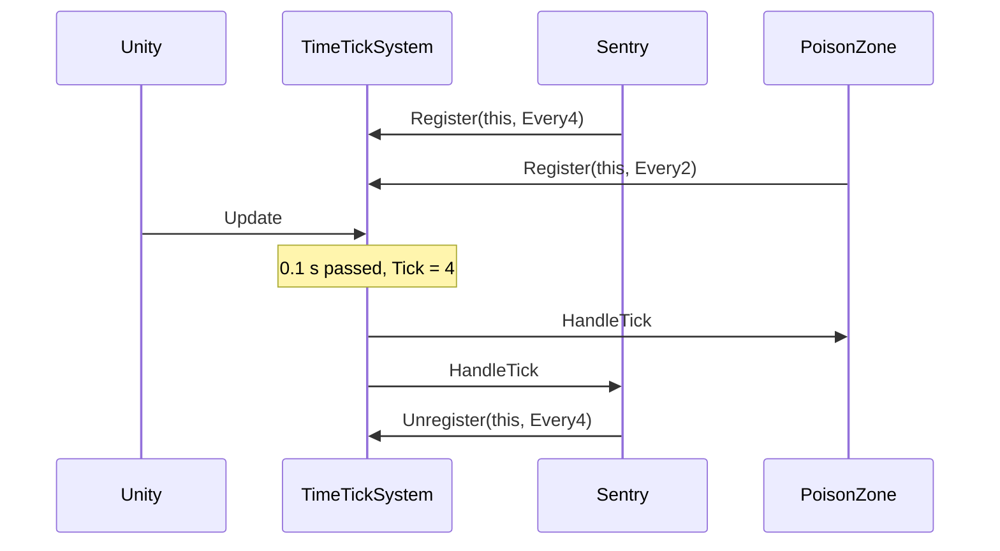

# 18 - Tick Systems

Lab: [Lab 18 - Hazards, Sensors and a HUD on Ticks](../labs/lab_18_tick_hazards_and_sensors.md)

## Key Concepts

1. **Not everything needs every frame** - a camera must update every frame, but a poison zone, a sensor or a score label can update a few times a second.
2. **A tick is a fixed step of game time** - it happens every 0.1 s whatever the frame rate, so gameplay that runs on ticks behaves the same on every machine.
3. **One clock, many handlers** - a single system counts time and calls every registered handler, so no object keeps a timer of its own.
4. **Register in `OnEnable`, unregister in `OnDisable`** - a disabled object must stop receiving ticks, and a destroyed one must not be called.
5. **Rates are powers of two** - every 1, 2, 4 or 8 ticks, so slower rates always line up with faster ones.
6. **Convert per second to per tick** - multiply a rate per second by the seconds a tick stands for, just as `Update` multiplies by `Time.deltaTime`.
7. **Long frames drop ticks** - after a hitch the system catches up by a few ticks at most, rather than sending a burst that would feel like a jump.
8. **Spread handlers to spread the work** - giving handlers of one rate different phases stops them all running in the same frame.
9. **A tick loop must survive its handlers** - a handler may unregister itself, unregister another, or throw, and the others must still run correctly.
10. **Do not tick what an event can tell you** - ticks are for questions nobody announces, such as "is anyone in range?".

---

## 1. Framing Question

Your level has a poison swamp, a healing shrine, twenty sentries that look for the player, and a health label. Each one runs in `Update`, so on a 144 Hz monitor each sentry looks for the player 144 times a second, and the swamp needs its own timer to hurt the player at a steady rate. Which of these really needs to run every frame, and what should decide how often the rest run?

---

## 2. What You Will Learn

| Skill | You can... |
|:------|:-----------|
| Choose per frame or per tick | Sort a list of behaviours into those that need every frame, those that suit a tick, and those that need an event |
| Use the tick system | Register a handler with `TimeTickSystem` at a chosen rate, and unregister it safely |
| Write tick components | Extend `TickBehaviour` and write only `HandleTick` |
| Keep rates frame-rate independent | Convert a per-second value into a per-tick amount with `SecondsPerTick` |
| Explain the tick loop | Describe what happens after a long frame, during a pause, and when a handler changes the list or throws |
| Spread work | Use phases so that handlers of one rate do not all run in the same frame |

---

## 3. Why This Matters

`Update` is the default home for game code, so it is where most first versions go. That is fine until several behaviours need a steady rhythm: damage every half second, a sensor that checks four times a second, an economy that pays out every few seconds. Each one then grows its own timer, and those timers drift apart, ignore the pause menu in different ways, and must each be tuned separately.

A **tick system** replaces those timers with one clock. That gives three benefits that matter in the GCA:

- **Reliability & Finish.** Gameplay that runs on ticks gives the same result at 30 and at 144 frames per second, and after a hitch it neither skips a large step nor fires a burst.
- **Software Design.** Handlers depend on one small interface, and the clock knows nothing about poison or sentries. That is a clear responsibility split you can nominate and explain.
- **Iteration & Improvement.** Moving a timer out of `Update` and onto a tick is a before-and-after you can show in a few lines of code.

Running less often can also cost less, but only claim that if you have measured it. The design reasons above stand on their own.

---

## 4. Core Ideas

### 4.1 Frames and Ticks

A frame (Note 01, Section 4.4) is one pass of the game loop. Its length changes from moment to moment. A **tick** is a fixed step of game time sent by a clock, for example every 0.1 s. The **base tick interval** is the length of that step.

| | Frame | Tick |
|:--|:--|:--|
| How often | As often as the machine can draw | A fixed number of times per second |
| Length | Changes every frame | Always the base tick interval |
| Called by | Unity, through `Update` | `TimeTickSystem`, through `HandleTick` |
| Good for | Anything the player sees move or feels respond | Rules that run at a steady rate |

`FixedUpdate` is also a fixed step, but it belongs to physics and runs 50 times a second by default. A tick system is the same idea for gameplay rules, at a rate you choose, which is usually much slower.

### 4.2 What Belongs on a Tick

Ask what the player would notice if the behaviour ran ten times a second instead of every frame:

| Behaviour | Every frame | Tick | Event |
|:--|:--|:--|:--|
| Camera, movement, input, animation blending | Yes: steps would be visible | | |
| Poison, healing, oxygen, hunger | | Yes: a steady rate is the point | |
| Sensors: "is the player in range?" | | Yes: a 0.1 to 0.4 s delay reads as reaction time | |
| AI decisions: patrol, chase or search | | Often: movement stays per frame, the decision does not need to be | |
| A label showing a value | | Possible | Better, if the value raises `ValueChanged` |
| "The player picked up the key" | | | Yes: it happens once, at a known moment |

The last column matters. A tick asks a question repeatedly, which is polling (Note 17). If something can tell you the moment a value changes, as `ScriptableVariable<T>.ValueChanged` does, listening is cheaper and has no delay. Ticks are for questions that nothing announces, such as a distance or an overlap.

### 4.3 One Clock, Many Handlers

`TimeTickSystem` in `Assets/GD/Common/Scripts/Time/Tick` counts time in its own `Update`. Each time a base interval passes, it sends a tick to every handler due at that tick. A **handler** is any object that implements `IHandleTicks` and has registered.



This is the Observer pattern from Notes 03 and 04: the clock is the subject, handlers are listeners, and the clock does not know what any of them do. The difference from an event channel is that the clock calls handlers at different rates, which a plain `event Action` cannot do.

### 4.4 The IHandleTicks Interface

The contract is one method:

```csharp
namespace GD.Tick
{
    public interface IHandleTicks
    {
        void HandleTick();
    }
}
```

Any class can implement it, including one that is not a `MonoBehaviour`. A component registers when enabled and unregisters when disabled:

```csharp
using GD.Tick;
using UnityEngine;

/// <summary>
/// Turns a light on and off every eight ticks.
/// </summary>
public class Beacon : MonoBehaviour, IHandleTicks
{
    [SerializeField] private Light lamp;

    private void OnEnable()
    {
        TimeTickSystem.Instance.Register(this, TimeTickSystem.TickRate.Every8);
    }

    private void OnDisable()
    {
        // During shutdown the system may already be destroyed, and asking
        // for Instance would then create a new one.
        if (TimeTickSystem.HasInstance)
            TimeTickSystem.Instance.Unregister(this, TimeTickSystem.TickRate.Every8);
    }

    public void HandleTick()
    {
        lamp.enabled = !lamp.enabled;
    }
}
```

`OnEnable` and `OnDisable` pair up (Note 01, Section 4.8), so a disabled beacon stops blinking, and a pooled object that is re-enabled starts again. If a handler is destroyed without unregistering, the system notices that it compares equal to `null` and removes it, but relying on that hides mistakes.

### 4.5 Tick Rates

A handler chooses how many base ticks pass between its calls:

| Tick | 1 | 2 | 3 | 4 | 5 | 6 | 7 | 8 |
|:--|:--|:--|:--|:--|:--|:--|:--|:--|
| `Every1` | Yes | Yes | Yes | Yes | Yes | Yes | Yes | Yes |
| `Every2` | | Yes | | Yes | | Yes | | Yes |
| `Every4` | | | | Yes | | | | Yes |
| `Every8` | | | | | | | | Yes |

With the default base interval of 0.1 s, that is every 0.1, 0.2, 0.4 and 0.8 s. The rates are powers of two, so whenever a slow rate fires, every faster rate fires too. A sensor at `Every4` and an AI decision at `Every2` therefore see the same world on the ticks they share. Within one tick, faster rates run first, and handlers of one rate run in the order they registered.

A handler that changes a value at a rate per second must convert it to a rate per tick. This is the same job `Time.deltaTime` does in `Update`:

```csharp
float secondsPerTick = TimeTickSystem.Instance.SecondsPerTick(TimeTickSystem.TickRate.Every2);

// -10 per second, applied every 0.2 s, is -2 per tick.
health.Add(-10f * secondsPerTick);
```

Because the amount comes from the rate, a designer can change `Base Tick Interval` or a handler's rate and the damage per second stays the same.

### 4.6 TickBehaviour: Write Only the Tick

Every component in Section 4.4 repeats the same two methods, and the repetition hides a bug. If a designer changes the rate in the Inspector while the object is enabled, `OnDisable` unregisters from the new rate, the old registration stays, and a disabled object keeps receiving ticks.

`TickBehaviour` in the same folder removes the repetition and the bug:

```csharp
using UnityEngine;

namespace GD.Tick
{
    public abstract class TickBehaviour : MonoBehaviour, IHandleTicks
    {
        [SerializeField]
        private TimeTickSystem.TickRate tickRate = TimeTickSystem.TickRate.Every1;

        // The rate actually registered with. Unregistering must use the same rate,
        // even if tickRate was edited in the Inspector while enabled.
        private TimeTickSystem.TickRate registeredRate;

        protected TimeTickSystem.TickRate Rate => registeredRate;

        protected float SecondsPerTick => TimeTickSystem.Instance.SecondsPerTick(registeredRate);

        protected virtual void OnEnable()
        {
            registeredRate = tickRate;
            TimeTickSystem.Instance.Register(this, registeredRate);
        }

        protected virtual void OnDisable()
        {
            if (TimeTickSystem.HasInstance)
                TimeTickSystem.Instance.Unregister(this, registeredRate);
        }

        public abstract void HandleTick();
    }
}
```

The listing leaves out the XML comments and the tooltip in the Common file. With it, the beacon is one method, and its rate is an Inspector setting:

```csharp
using GD.Tick;
using UnityEngine;

/// <summary>
/// Turns a light on and off at the rate set in the Inspector.
/// </summary>
public class TickBeacon : TickBehaviour
{
    [SerializeField] private Light lamp;

    public override void HandleTick()
    {
        lamp.enabled = !lamp.enabled;
    }
}
```

This is the Template Method pattern from Note 15: the base class fixes when registration happens, and the subclass supplies the varying part. It is inheritance, which the module usually avoids, but here the base class holds only lifecycle code that every handler needs, and nothing about what handlers do. A subclass that overrides `OnEnable` or `OnDisable` must call `base.OnEnable()` or `base.OnDisable()`, or it never registers. A class that already has a base class implements `IHandleTicks` directly, as in Section 4.4.

### 4.7 Long Frames and Dropped Ticks

Sometimes a frame takes far longer than usual, for example while a scene loads or while you stop at a breakpoint. This is a **hitch**. By the time `Update` runs again, many ticks may be owed.

Unity limits this before the tick system sees it. `Time.deltaTime` is never larger than `Maximum Allowed Timestep` (`Edit > Project Settings > Time`, default about 0.33 s), so after a 2 second hitch, scaled game time moves on by only 0.33 s. That is about 3 ticks at 0.1 s per tick. `Time.unscaledDeltaTime` has no such limit, so a system that uses unscaled time is owed all 20 ticks. A smaller base interval also raises the count: at 0.02 s per tick, even 0.33 s is 16 ticks.

When many ticks are owed, the system has three choices:

| Choice | Effect when 20 ticks are owed |
|:--|:--|
| Send every owed tick at once | 20 ticks in one frame: the player takes 2 s of poison in an instant, and the frame is slow too |
| Send one tick, drop the rest | The game loses most of 2 s of rule time |
| Send a few, drop the rest | Up to 3 ticks now (the default `Max Ticks Per Frame`), and the rest are dropped |

`TimeTickSystem` uses the third. It is the same reasoning as Unity's `Maximum Allowed Timestep`, which also stops a slow frame from causing a burst of physics steps, and so an even slower next frame:

```csharp
private void Update()
{
    tickTimer += useUnscaledTime ? Time.unscaledDeltaTime : Time.deltaTime;

    for (int sent = 0; sent < maxTicksPerFrame && tickTimer >= baseTickIntervalSecs; sent++)
    {
        tickTimer -= baseTickIntervalSecs;
        SendTick();
    }

    // After a long frame (a hitch or a breakpoint), the ticks still owed are
    // dropped rather than sent in a burst. The remainder keeps the rhythm.
    if (tickTimer >= baseTickIntervalSecs)
        tickTimer %= baseTickIntervalSecs;
}
```

In normal play, with frames much shorter than a tick, the loop runs at most once a frame. Subtracting the interval, rather than setting the timer to zero, keeps the part of a frame that runs past a tick, so ticks stay on a steady rhythm. The modulo on the last line drops whole owed ticks but keeps that remainder.

### 4.8 Pausing: Scaled and Unscaled Time

Note 15, Section 4.4 showed that `Time.timeScale` set to 0 pauses some systems and not others. By default the tick system uses `Time.deltaTime`, so a pause stops all ticks. That is right for poison and sensors.

Tick `Use Unscaled Time` when ticks must continue while paused, for example for a pause menu that animates or polls a controller. One system has one setting, so a game that needs both kinds would use two tick systems. Avoid that unless a real feature needs it.

### 4.9 Spreading the Load

With twenty sentries at `Every4`, all twenty run on ticks 4, 8, 12, and so on, and none run on the ticks between. The work arrives in spikes, and those frames are the slowest.

Each registration has a **phase**, which moves the ticks it runs on. With `Spread Handlers` ticked, handlers of one rate receive phases in turn, so the twenty sentries split into four groups of five:

| Tick | 1 | 2 | 3 | 4 | 5 | 6 | 7 | 8 |
|:--|:--|:--|:--|:--|:--|:--|:--|:--|
| Spread off | | | | 20 | | | | 20 |
| Spread on | 5 | 5 | 5 | 5 | 5 | 5 | 5 | 5 |

Each sentry still runs every 0.4 s. Only the alignment changes, and that is the cost: with spreading on, a sentry and a decision-maker no longer check on the same tick, and one can read the other's result up to a tick late. Use the default, aligned behaviour while you build, and turn spreading on when many handlers of one rate exist. Phases are given out as handlers register, so set it before entering Play mode.

### 4.10 Changing the List During a Tick

A handler can do surprising things inside `HandleTick`: unregister itself (a sensor that only needs to trigger once), disable another handler (a sentry that turns off its partner), register a new one (a spawner), or throw an exception. Changing a `List<T>` while looping over it is a classic bug: removing an item shifts the later items down, so the loop skips one or calls one twice.

`TimeTickSystem` handles each case:

| Case | What the system does | Why |
|:--|:--|:--|
| A handler unregisters during a tick | Clears its entry, and removes cleared entries after the tick | No item moves during the loop |
| A handler registers during a tick | Adds it after the count the loop started with | Its first call is on the next tick, never part-way through this one |
| A handler throws | Logs the exception, with the object as context, and carries on | One broken sentry must not stop the poison zone |
| A handler was destroyed without unregistering | Clears its entry instead of calling it | Unity's `==` reports a destroyed object as `null` |

The loop shows the first three:

```csharp
private void SendTo(List<Registration> list, uint rate)
{
    // A handler registered during this tick is added past this count,
    // so its first call is on a later tick.
    int count = list.Count;

    for (int i = 0; i < count; i++)
    {
        Registration registration = list[i];

        // Unregistered earlier in this tick.
        if (registration.Handler == null)
            continue;

        if ((Tick + registration.Phase) % rate != 0)
            continue;

        // A handler destroyed without unregistering compares equal to null
        // (Unity's null check), so it is removed instead of called.
        if (registration.Handler is Object unityObject && unityObject == null)
        {
            MarkRemoved(list, i);
            continue;
        }

        try
        {
            registration.Handler.HandleTick();
        }
        catch (Exception exception)
        {
            // One failing handler must not stop the others for this tick.
            Debug.LogException(exception, registration.Handler as Object);
        }
    }
}
```

The handler lists are also created when the system object is created, not in `Awake`. When the system and a handler are in the same scene, Unity may run the handler's `OnEnable` before the system's `Awake`, and a list created in `Awake` would not exist yet.

### 4.11 Why a Singleton Here

`TimeTickSystem` extends `Singleton<T>` from `Assets/GD/Common/Scripts/Patterns`. Note 05 and Note 13 argued against singletons by default, because `Instance` hides a dependency. That still applies here, but the trade-off is different. The clock is like `Time` itself: almost every handler needs it, there must be exactly one, and a handler cannot do anything useful without it. A channel asset would add one more reference to assign on every handler, with no real choice to make.

Two rules keep the singleton safe:

1. **Put the system in a scene.** Add a `TimeTickSystem` object to the persistent scene (Note 05), or to the level in a single-scene game, so its settings are visible and saved. If none exists, `Instance` creates a hidden one with default settings, which you cannot inspect or tune.
2. **Guard `OnDisable` with `HasInstance`.** When the game stops, Unity destroys objects in no fixed order. Without the guard, a handler disabled after the system would create a new hidden system during shutdown.

---

## 5. Worked Example

The level has a poison swamp, a healing shrine, a sentry with a lamp, and a health label. Health is a `FloatVariable` (Note 03), and the swamp and shrine each have a `ContactTrigger` that sets a `BoolVariable` while the player is inside.

### Stage 1 - Initial Implementation: A Timer in Update

The swamp hurts the player every half second, so it keeps its own timer:

```csharp
using GD.Types;
using UnityEngine;

/// <summary>
/// Changes health every half second while the player is in the zone,
/// using a timer of its own.
/// </summary>
public class PoisonTimerUpdate : MonoBehaviour
{
    [SerializeField] private BoolVariable inZone;
    [SerializeField] private FloatVariable health;
    [SerializeField, Min(0.01f)] private float interval = 0.5f;
    [SerializeField] private float amountPerInterval = -5f;

    private float timer;

    private void Update()
    {
        timer += Time.deltaTime;

        if (timer < interval)
            return;

        timer -= interval;

        if (inZone.Value)
            health.Add(amountPerInterval);
    }
}
```

It works, and it is frame-rate independent because the timer adds `Time.deltaTime`.

### Stage 2 - Problem: Timers Everywhere

Now add the rest of the level the same way:

- The shrine is a copy of the swamp class with a positive amount, and its own timer.
- The sentry checks for the player in `Update`, or adds a third timer to check four times a second.
- The label sets its text every frame, although the value changes twice a second.

There are now three timers that run independently. Poison and healing fall on different beats, so standing on both gives an uneven result. Changing the game's rhythm means finding every interval field. After a long frame, each timer catches up differently. Each class repeats the same five lines of timer code, which is the repetition that DRY warns against.

### Stage 3 - Change: One Clock

Add a `TimeTickSystem` object to the scene, with `Base Tick Interval` 0.1. The swamp and the shrine become two copies of one component that changes a value at a rate per second while a flag is true:

```csharp
using GD.Tick;
using GD.Types;
using UnityEngine;

/// <summary>
/// While a flag is true, changes a float at a rate per second, applied once
/// per tick. One class covers poison, healing, oxygen and stamina.
/// </summary>
public class TickVariableChanger : TickBehaviour
{
    [SerializeField] private BoolVariable whileTrue;
    [SerializeField] private FloatVariable target;

    [SerializeField, Tooltip("Change per second. Use a negative rate to drain")]
    private float ratePerSecond = -10f;

    [SerializeField] private float minValue;
    [SerializeField] private float maxValue = 100f;

    public override void HandleTick()
    {
        if (!whileTrue.Value)
            return;

        // The rate is per second, so it is scaled by the seconds this tick stands for.
        float next = target.Value + ratePerSecond * SecondsPerTick;
        target.Value = Mathf.Clamp(next, minValue, maxValue);
    }
}
```

| Object | `Tick Rate` | `While True` | `Rate Per Second` |
|:--|:--|:--|:--|
| `PoisonSwamp` | `Every2` | `BV_InPoison` | -10 |
| `HealingShrine` | `Every4` | `BV_OnShrine` | 5 |

There is no timer left in either. The rate per second is what a designer thinks in, and `Tick Rate` only sets how smooth the change is.

The sentry asks a question that nothing announces, so it polls on a tick:

```csharp
using GD.Tick;
using UnityEngine;
using UnityEngine.Events;

/// <summary>
/// Checks a few times a second for a target in range, and raises an event
/// when one is first found and when none remain.
/// </summary>
public class TickProximitySensor : TickBehaviour
{
    [SerializeField, Min(0f)] private float range = 6f;
    [SerializeField] private LayerMask targetLayers;
    [SerializeField] private UnityEvent onDetected;
    [SerializeField] private UnityEvent onLost;

    // Reused by every check, so sensing does not allocate. One slot is enough
    // to know whether anything is in range.
    private readonly Collider[] hits = new Collider[1];
    private bool detected;

    public override void HandleTick()
    {
        int count = Physics.OverlapSphereNonAlloc(
            transform.position, range, hits, targetLayers, QueryTriggerInteraction.Ignore);

        bool found = count > 0;

        if (found == detected)
            return;

        detected = found;

        if (found)
            onDetected.Invoke();
        else
            onLost.Invoke();
    }

    private void OnDrawGizmosSelected()
    {
        Gizmos.color = detected ? Color.red : Color.yellow;
        Gizmos.DrawWireSphere(transform.position, range);
    }
}
```

`OnDetected` turns the lamp on and `OnLost` turns it off, set in the Inspector. The events fire only when the answer changes, as `ConditionWatcher` does in Note 17, so the lamp is not switched on four times a second. At `Every4` the lamp reacts up to 0.4 s after the player arrives, which reads as the sentry noticing, not as lag.

### Stage 4 - Improvement: Choosing Rates and Spreading

The label is the last per-frame piece. Health now changes only on ticks, so drawing it more often than the fastest changer shows nothing new:

```csharp
using GD.Tick;
using GD.Types;
using TMPro;
using UnityEngine;

/// <summary>
/// Shows a float in a TextMeshPro label, refreshed on ticks rather than every frame.
/// </summary>
public class TickFloatLabel : TickBehaviour
{
    [SerializeField] private FloatVariable source;
    [SerializeField] private TMP_Text label;

    [SerializeField, Tooltip("{0} is the value. In TextMeshPro, {0:1} shows one decimal place")]
    private string format = "Health {0:0}";

    // NaN is never equal to a real value, so the first tick always draws the label.
    private float shownValue = float.NaN;

    public override void HandleTick()
    {
        // Rebuilding text is the costly part, so skip it when nothing has changed.
        if (source.Value == shownValue)
            return;

        shownValue = source.Value;
        label.SetText(format, shownValue);
    }
}
```

At `Every2` it matches the swamp. Section 4.2 suggested an event instead, and Reflective Question 2 asks you to decide between them.

Finally, the level designer places twenty sentries. With all of them at `Every4`, every fourth tick runs twenty overlap checks and the ticks between run none. Ticking `Spread Handlers` on the `TimeTickSystem` before Play splits them across four ticks (Section 4.9). Each sentry still reacts within 0.4 s, and no tick does more than five checks.

The design now has these responsibilities:

| Class | Responsibility |
|:--|:--|
| `TimeTickSystem` | Counts time and calls handlers at their rates |
| `TickBehaviour` | Registers and unregisters a component |
| `TickVariableChanger` | Changes a value while a flag is true |
| `TickProximitySensor` | Answers "is a target in range?" when that answer changes |
| `TickFloatLabel` | Shows a value |
| `ContactTrigger`, `BoolVariable`, `FloatVariable` | Write and hold state, as in Notes 03 and 08 |

---

## 6. Common Pitfalls

| Symptom | Cause | Fix |
|:--------|:------|:----|
| `HandleTick` is never called | The component overrides `OnEnable` without calling `base.OnEnable()` | Call the base method first |
| Settings on the `TimeTickSystem` object have no effect | The scene has no system, or its system is inactive or in a scene that loads later, so `Instance` created a hidden one | Add one active `TimeTickSystem` to the persistent or level scene |
| When Play stops, the Console warns that some objects were not cleaned up | `OnDisable` uses `Instance` without checking `HasInstance`, so a new system is created during shutdown | Guard it, or extend `TickBehaviour` |
| A disabled object still acts | It registered at one rate and unregistered at another | Extend `TickBehaviour`, which remembers the registered rate |
| Damage per second changes when the rate changes | The amount is per tick, not per second | Multiply a per-second rate by `SecondsPerTick` |
| Movement on a tick looks jerky | Visible motion runs at the tick rate | Keep motion in `Update`; tick the decision only |
| Nothing happens while the game is paused | Ticks use scaled time | Expected for gameplay; tick `Use Unscaled Time` only for systems that must run while paused |
| After a breakpoint, values jump by a few ticks' worth | Unity's `Maximum Allowed Timestep` and the system's `Max Ticks Per Frame` both allow a short catch-up | Expected; lower `Max Ticks Per Frame` to 1 if any catch-up is unwanted |
| A sensor reacts up to a tick late with `Spread Handlers` on | Phases separate it from what reads its result | Turn spreading off for handlers that must align, or accept one tick of delay |
| `StateMachine.Tick` and `HandleTick` are confused | Note 16's state machine also uses the word tick, meaning "one update" | Call `machine.Tick()` from `HandleTick` if the machine should run at a tick rate |

---

## 7. Software Development Parallels

- **Observer** (Notes 03 and 04). The clock notifies registered handlers without knowing what they do. Adding a new kind of handler changes nothing in the clock, which is the open/closed principle.
- **Template Method** (Note 15). `TickBehaviour` fixes the registration steps and leaves `HandleTick` to subclasses.
- **Interface segregation.** Handlers depend on one method, so a plain C# class, such as a wrapper that runs a `StateMachine`, can register as easily as a component.
- **Fixed timestep game loops.** Glenn Fiedler's article "Fix Your Timestep!" describes the same accumulator: add frame time, step in fixed amounts, and cap the steps per frame to avoid a "spiral of death". Unity's `FixedUpdate` and `Maximum Allowed Timestep` are the engine's version.
- **Commercial practice.** *Minecraft* runs its game rules at 20 ticks per second, and crop growth and redstone circuits are described in game ticks, not frames. *RimWorld* runs 60 ticks per second at normal speed, and gives objects `TickRare` (every 250 ticks) and `TickLong` (every 2000 ticks) for slow work, which is the same idea as `Every8`, at a larger scale. Multiplayer servers describe their simulation as a tick rate, for example 64 ticks per second.

---

## 8. Exercises

### Core - Blinking Beacons

Make four `TickBeacon` objects (Section 4.6) at `Every8`, each with a point light, in a row. Play once with `Spread Handlers` off, and once with it on.

**Expected result:** with spreading off, all four blink together every 0.8 s. With it on, they blink in a ripple along the row, one tick apart, and each still blinks every 0.8 s. In 80 to 120 words, explain why the order of the ripple matches the order the beacons registered, and what decides that order.

### Apply - A State Machine on a Tick

Take the enemy from Note 16. Instead of calling `machine.Tick()` in `Update`, call it from `HandleTick` at `Every2`. The `NavMeshAgent` still moves the enemy every frame.

**Expected result:** the enemy still patrols and chases smoothly, and reacts to the player up to 0.2 s later. In 100 to 150 words, name one state that is fine at `Every2`, and one kind of state that would look wrong at that rate. Explain the difference using Section 4.2.

### Challenge - A Ticked Condition Watcher

Note 17's `ConditionWatcher` reads its condition every frame. Write a `TickConditionWatcher : TickBehaviour` with the same events, and a hold time counted in ticks. Do not edit the Common class.

**Expected result:** a door driven by your watcher opens within one tick of the condition becoming met, and the hold time behaves the same at 30 and 120 frames per second. In 150 to 200 words, compare the two watchers on delay, cost, and accuracy of the hold time. State which one you would use for a pressure plate and which for a level's win rule, with your reasons.

---

## 9. Reflective Questions

1. Sort five behaviours from your group's game into every frame, tick and event. For any you put on a tick, state the slowest rate the player would not notice, and how you would check it.
2. `TickFloatLabel` polls health, but `FloatVariable` raises `ValueChanged`. Argue for one design over the other for this label, and describe a value for which the other design would be better.
3. `TickBehaviour` uses inheritance, although the module prefers composition. Justify or reject that choice, naming what a composition-based alternative would look like and what it would cost.
4. The tick system drops ticks after a hitch. Describe a game rule for which dropping ticks is wrong, and say how you would change the system or the rule.
5. `TimeTickSystem` is a singleton, and Note 13 chose a channel over a singleton for audio. Using both cases, state the conditions under which a singleton is the better choice.

---

## 10. How This Builds

- **[Lab 18](../labs/lab_18_tick_hazards_and_sensors.md)** builds the poison swamp, healing shrine, sentry and health label from Section 5, tests them at two frame rates, and uses the debugger to follow ticks.
- **Note 16 - State Machines and the State Pattern.** A state machine's decisions can run at a tick rate by calling `machine.Tick()` from `HandleTick`, as in the Apply exercise.
- **Note 17 - Game Conditions and End States.** `ConditionWatcher` polls every frame; the Challenge exercise moves that polling onto a tick.
- **GCA:** a tick-driven system with handlers behind one interface is evidence for **Software Design**. Frame-rate independent rules that survive hitches support **Reliability & Finish**. Replacing hand-written `Update` timers with ticks is a clear before-and-after for **Iteration & Improvement**.

---

## Glossary

| Term | Definition |
|:-----|:-----------|
| Base tick interval | The seconds between two ticks of the clock |
| Handler | An object that implements `IHandleTicks` and is registered to receive ticks |
| Hitch | A single frame that takes far longer than usual |
| Phase | An offset that moves the ticks a handler runs on, without changing how often it runs |
| Tick | A fixed step of game time sent by a clock, independent of the frame rate |
| Tick rate | How many base ticks pass between calls to one handler |
| Tick system | One clock that sends ticks to every registered handler at its rate |
