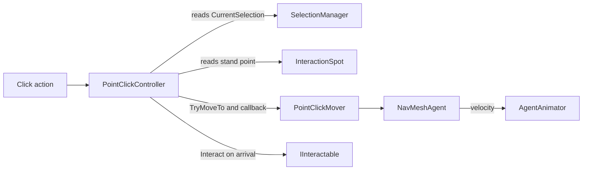

# Supplementary - Point-and-Click Movement and Interaction

Lab: [Lab S - Point-and-Click in Two Rooms](../labs/lab_s_point_and_click_rooms.md)

## Key Concepts

1. **A click is either a place or a thing** - a place means "walk there", and a thing means "walk to it, then use it".
2. **The selection pipeline already knows what the pointer is over** - reuse `SelectionManager` for things, and keep the floor out of it.
3. **A clicked point is not always on the NavMesh** - snap it with `NavMesh.SamplePosition` before you send the agent.
4. **Arrival is a question you ask the agent every frame** - `pathPending`, `remainingDistance` and `pathStatus` answer it together.
5. **An order can be replaced before it finishes** - a callback for the old order must never run after a new click.
6. **Objects say where to stand** - the centre of a bookcase is inside the bookcase, so give each object a stand point.
7. **One system moves the character** - remove `ThirdPersonController` and `CharacterController` when a `NavMeshAgent` takes over.
8. **The Animator only needs its parameters** - set `Speed` from the agent's velocity, and `MotionSpeed` and `Grounded` once.
9. **Animation events need a receiver** - the Starter Assets clips call `OnFootstep` and `OnLand`, so something on the Animator's object must have them.
10. **Feedback makes a click feel answered** - a hover highlight, a marker at the destination and a turn before use cost little and show the player that the game understood.

---

## 1. Framing Question

Your game is a third person adventure set in a few connected rooms. The player clicks on the floor to walk, and clicks on an object, such as a painting, a drawer or a key, to walk over to it and use it. You already have a selection pipeline (Note 06), a NavMesh (Note 07), an interface for usable objects (Note 10) and a third person character with an Animator (Note 12). How do you connect them, so that the right thing happens whatever the player clicks, and whenever they change their mind?

Think about an adventure game you have played with the mouse. What happens if you click an object, then click the floor before the character reaches it?

---

## 2. What You Will Learn

| Skill | You can... |
|:------|:-----------|
| Separate places from things | Route a click to a walk or to a walk-and-use, using `SelectionManager` and a floor raycast |
| Move a character with an agent | Send a `NavMeshAgent` to a snapped point and detect arrival, including a partial path |
| Handle orders that change | Replace an order with a new one, so that a stale callback never runs |
| Place interactions | Give an object a stand point, and turn the player to face it before use |
| Animate an agent-driven character | Drive the Starter Assets Animator Controller from an agent, and receive its animation events |
| Add click feedback | Highlight on hover, mark the destination and ease the turn, using `Common` classes |

---

## 3. Why This Matters

Point-and-click control hides a lot of logic behind one button. The player never says "walk to the drawer, turn to face it, then open it": they click the drawer and expect all three, in order, with no mistakes. If the character opens a drawer from across the room, walks into a wall to reach a painting, or opens the drawer after the player has clicked away, the control feels broken, even if each part works on its own.

This is a good example of **Systems Integration** for the GCA: selection, navigation, interaction, animation and the camera each exist already, and the work is in connecting them with clear responsibilities. It also gives you a lot of room for **Technical Craft**, because the difference between a functional and a well-crafted click is mostly timing and feedback.

This note assumes you have read Note 06 on the selection pipeline, Note 07, Section 4.5 on `NavMeshAgent`, Note 10, Section 4.7 on `IInteractable`, Note 12 on the Starter Assets Animator Controller, and Note 14, Section 4.2 on camera zones. It uses `SelectionManager`, `MouseScreenRayProvider`, `RayCastSelector`, `HighlightSelectionResponse`, `IInteractable`, `TweenProfile`, `ToastView` and event channels from `Assets/GD/Common`.

---

## 4. Core Ideas

### 4.1 Places and Things

A click means one of two things:

| The pointer is over | The player means | The game does |
|:--|:--|:--|
| The floor | Go there | Walk to the point |
| An object that can be used | Use it | Walk to the object, face it, then use it |
| Anything else, such as a wall | Nothing useful | Ignore the click, or walk to the floor behind it if there is one |

Point-and-click adventures have used this split for decades. In *Thimbleweed Park*, clicking an object walks the character to it before the action runs. In *Disco Elysium*, clicking an object walks the character over to it, and the interaction opens only on arrival. The order of events is the same in both: walk, then act.

### 4.2 Reusing the Selection Pipeline

`SelectionManager` from `Assets/GD/Common` already answers "what usable object is under the pointer?" every frame. A `MouseScreenRayProvider` creates the ray, a `RayCastSelector` accepts only objects tagged `Selectable`, and `CurrentSelection` holds the result. That handles the things.

The floor should not be selectable, for two reasons:

- `SelectionManager` exposes only a `Transform`, not the point that was hit, and a walk needs the point.
- Every response would run for the floor. `HighlightSelectionResponse` would highlight the whole floor whenever the pointer is not over an object.

So a click on a thing reads `CurrentSelection`, and a click on a place makes its own raycast against a `Floor` layer, using the same `IRayProvider`. Both use one ray from one camera.

```csharp
Transform selection = selectionManager.CurrentSelection;

if (selection != null && selection.TryGetComponent(out IInteractable interactable))
    WalkToAndUse(selection, interactable);
else
    WalkToFloor();
```

The hover highlight now comes for free: add `HighlightSelectionResponse` beside the manager, as in Note 06, and every usable object lights up before it is clicked.

### 4.3 From a Clicked Point to the NavMesh

A raycast hit is a point on a collider. It is not always on the NavMesh: the player may click the edge of a rug, a step, or the floor just beside a table, where the agent cannot stand. `NavMesh.SamplePosition` finds the nearest point on the NavMesh within a distance:

```csharp
if (NavMesh.SamplePosition(point, out NavMeshHit hit, sampleDistance, agent.areaMask))
    agent.SetDestination(hit.position);
```

Keep `sampleDistance` small, around 1 metre. A large value lets a click on one side of a wall snap to the floor on the other side, and the character then walks the long way round to a place the player did not click. Passing `agent.areaMask` keeps the result on areas this agent may use.

### 4.4 Knowing When You Have Arrived

`SetDestination` returns at once. The path is calculated over the next frames, and the agent then walks it. To act on arrival, check three properties every frame:

| Property | Meaning | Why it matters |
|:--|:--|:--|
| `pathPending` | The path is still being calculated | `remainingDistance` is not valid yet, and may read 0 |
| `remainingDistance` | Metres left along the path | Arrival is when it falls to `stoppingDistance` or below |
| `pathStatus` | `PathComplete`, `PathPartial` or `PathInvalid` (Supplementary note on runtime NavMesh, Section 4.7) | A partial path ends as close as the agent could get, which is not where it was sent |

The third check is easy to forget. If the drawer is behind a locked door, the path is partial: the agent walks to the door and stops, and `remainingDistance` reaches 0. Without the status check, the drawer opens through the wall.

Set the agent's `Stopping Distance` to around 0.1. The default of 0 can leave an agent circling a point it cannot quite reach.

### 4.5 Orders That Change

An **order** is a request with something to do on completion: "walk to the drawer, then open it". The thing to do is a **callback**, an `Action` passed with the order, as in Weeks 1 and 2:

```csharp
mover.TryMoveTo(standPosition, () => FaceThenUse(target, interactable));
```

The player can click again at any time, and the new order must replace the old one completely. If the old callback survives, clicking a drawer and then the floor would walk the player away and still open the drawer. The mover therefore keeps one callback, replaces it on every new order, and clears it before calling it:

```csharp
// Clear the field before the call, because the callback may give a new order.
Action arrived = onArrived;
onArrived = null;

if (reached)
    arrived?.Invoke();
```

Clearing first matters because a callback may start a new order of its own. A callback that is still in the field while it runs could be called a second time.

### 4.6 Where to Stand

Sending the agent to `target.position` works for a key on the floor. It fails for most objects in a room:

| Object | `target.position` is | The agent |
|:--|:--|:--|
| Bookcase | Inside the bookcase, which is not on the NavMesh | Walks to the nearest point, which may be at its side |
| Painting | On the wall, at head height | Snaps to the floor below if within `sampleDistance`, or does not move |
| Desk | Under the desk, in a carved hole | Stops at the edge nearest to where it came from |

An **interaction spot** is a stand point that the object provides: a child transform on the floor in front of it. The object knows where it should be used from, so the object holds the data, and the controller only reads it. Objects with no spot still fall back to their position, which is fine for small objects on the floor.

### 4.7 Animating a Character Moved by an Agent

The Starter Assets `PlayerArmature` is built for direct control. `ThirdPersonController` reads input, moves a `CharacterController` and writes the Animator's parameters. For point-and-click, a `NavMeshAgent` moves the character, so:

| Component | Keep? | Reason |
|:--|:--|:--|
| `Animator`, with `StarterAssetsThirdPerson` or your copy from Lab 12 | Yes | It animates the model; only its parameters need a new source |
| `ThirdPersonController` | No | It moves the character too, and the two fight over the position |
| `CharacterController` | No | It is a second movement system, and it blocks the agent |
| `StarterAssetsInputs`, `PlayerInput`, `BasicRigidBodyPush` | No | They serve the direct-control controller |
| `NavMeshAgent` | Add | It plans and moves |

The Animator then needs three parameters set by something else (Note 12, Section 4.3):

| Parameter | Set to | Why |
|:--|:--|:--|
| `Speed` | `agent.velocity.magnitude`, smoothed | The blend tree is set in metres per second: 0 idle, 2 walk, 6 run |
| `MotionSpeed` | 1, once | It multiplies the blend tree's playback speed. Its default is 0, which freezes the legs mid-stride |
| `Grounded` | `true`, once | This character never jumps or falls |

An Animator resets its parameters to their defaults when its object is re-enabled, so set the two fixed values in `OnEnable`, not `Awake`.

The clips also contain animation events: `OnFootstep` in the walk and run clips, and `OnLand` in the landing clips (Note 12, Section 4.7). They used to be received by `ThirdPersonController`. With it removed, Unity logs `AnimationEvent 'OnFootstep' on animation 'Walk_N' has no receiver` on every step. The component that sets the parameters can receive them too, and raise a channel on each footstep, so audio from Note 13 still works.

Match the agent's `Speed` to the clip. At 2 metres per second the walk clip plays at its natural speed. At 3.5 the agent moves faster than the feet, and the character appears to slide.

### 4.8 Rooms and Cameras

A room-based game usually has a fixed camera per room. Note 14, Section 4.2 does this with no new script: a trigger volume covering each room, with a `ContactTrigger` that activates that room's `CinemachineCamera` on `On Enter` and deactivates it on `On Exit`. A `Cut` blend reads as a change of room.

Two details matter for point-and-click:

- **The click ray follows the live camera.** `MouseScreenRayProvider` uses `Camera.main`, which is the camera with the `CinemachineBrain`, so the ray always comes from the room the player is in.
- **A `NavMeshAgent` alone does not fire trigger events.** Trigger messages need a `Rigidbody` or a `CharacterController` on one of the two objects. Add a `Rigidbody` with `Is Kinematic` ticked to the player, and a `Capsule Collider` matching the agent's radius and height.

Doorways between rooms need no special handling. Bake one `NavMeshSurface` over all the rooms, and the agent plans through doorways like any other gap. A door that must block the way can carry a `NavMeshObstacle` with `Carve` ticked, and disabling the obstacle opens the route, with no rebuild (Supplementary note on runtime NavMesh, Section 4.6).

---

## 5. Worked Example

The demo is two rooms joined by a doorway. The player clicks the floor to walk, and clicks a painting to examine it or a key to pick it up.

### Stage 1 - Initial Implementation: Click and Go

One component on a `NavMeshAgent` sends it to wherever the mouse ray hits:

```csharp
using UnityEngine;
using UnityEngine.AI;
using UnityEngine.InputSystem;

[RequireComponent(typeof(NavMeshAgent))]
public class ClickToWalk : MonoBehaviour
{
    [SerializeField] private InputAction clickAction = new("Click", binding: "<Mouse>/leftButton");

    private NavMeshAgent agent;

    private void Awake()
    {
        agent = GetComponent<NavMeshAgent>();
    }

    private void OnEnable()
    {
        clickAction.Enable();
    }

    private void OnDisable()
    {
        clickAction.Disable();
    }

    private void Update()
    {
        if (!clickAction.WasPressedThisFrame())
            return;

        Ray ray = Camera.main.ScreenPointToRay(Mouse.current.position.ReadValue());

        if (Physics.Raycast(ray, out RaycastHit hit))
            agent.SetDestination(hit.point);
    }
}
```

On a capsule in an empty room, this works.

### Stage 2 - Problem: Everything Else in the Room

Put it on the Starter Assets character, furnish the room and add a UI:

| Observation | Cause |
|:--|:--|
| Clicking the painting walks the player to the wall below it, and nothing else happens | Every click is a place; there is no idea of a thing |
| Nothing shows which objects can be used | Nothing reacts to the pointer before a click |
| Clicking a UI button also moves the player | The raycast does not know about the UI |
| Clicking a table top sends the player somewhere unexpected | The hit point is not on the NavMesh, and `SetDestination` picks a point the player did not choose |
| The character slides with frozen legs, and the Console fills with "has no receiver" errors | Nothing sets `Speed` or `MotionSpeed`, and nothing receives `OnFootstep` |
| `ThirdPersonController` and the agent fight, and the character jitters | Two systems move one transform |
| Adding "use on arrival" needs arrival detection, facing and cancellation, all in one class | One class reads input, chooses the target, moves, and will soon use objects |

### Stage 3 - Change: Mover, Controller, Spot and Animator

The responsibilities split into four small classes:



**The mover** walks to a point and reports arrival. It knows nothing about clicks or objects, so an enemy or a cutscene could use it too:

```csharp
using System;
using UnityEngine;
using UnityEngine.AI;

/// <summary>
/// Walks a NavMeshAgent to a point, and calls back when it gets there.
/// Knows nothing about clicks, cameras or the objects in the room.
/// </summary>
[RequireComponent(typeof(NavMeshAgent))]
public class PointClickMover : MonoBehaviour
{
    [SerializeField, Min(0.1f), Tooltip("How far a requested point may be from the NavMesh, in metres")]
    private float sampleDistance = 1f;

    private NavMeshAgent agent;
    private Action onArrived;
    private bool isMoving;

    public bool IsMoving => isMoving;

    private void Awake()
    {
        agent = GetComponent<NavMeshAgent>();
    }

    /// <summary>
    /// Starts walking to the point on the NavMesh nearest to <paramref name="point"/>.
    /// A new order replaces the current one, and the old callback is dropped.
    /// Returns false if there is no NavMesh near the point.
    /// </summary>
    public bool TryMoveTo(Vector3 point, Action arrived = null)
    {
        // Drop the old order first, so a refused order also cancels it.
        onArrived = null;
        isMoving = false;

        if (!agent.isOnNavMesh)
            return false;

        if (!NavMesh.SamplePosition(point, out NavMeshHit hit, sampleDistance, agent.areaMask))
            return false;

        if (!agent.SetDestination(hit.position))
            return false;

        onArrived = arrived;
        isMoving = true;
        return true;
    }

    public void Stop()
    {
        onArrived = null;
        isMoving = false;

        if (agent.isOnNavMesh)
            agent.ResetPath();
    }

    private void Update()
    {
        // remainingDistance is only meaningful once the path has been calculated.
        if (!isMoving || agent.pathPending || agent.remainingDistance > agent.stoppingDistance)
            return;

        isMoving = false;

        // A partial path ends as close as the agent can get, which is not the place it was sent.
        bool reached = agent.pathStatus == NavMeshPathStatus.PathComplete;

        // Clear the field before the call, because the callback may give a new order.
        Action arrived = onArrived;
        onArrived = null;

        if (reached)
            arrived?.Invoke();
    }
}
```

**The spot** is data on the object, with a gizmo so you can see it in the Scene view:

```csharp
using UnityEngine;

/// <summary>
/// Marks where the player stands to use this object. The player faces the object itself.
/// </summary>
public class InteractionSpot : MonoBehaviour
{
    [SerializeField, Tooltip("A child placed on the floor in front of the object")]
    private Transform standPoint;

    public Vector3 StandPosition => standPoint != null ? standPoint.position : transform.position;

    private void OnDrawGizmosSelected()
    {
        if (standPoint == null)
            return;

        Gizmos.color = Color.cyan;
        Gizmos.DrawWireSphere(standPoint.position, 0.25f);
        Gizmos.DrawLine(standPoint.position, transform.position);
    }
}
```

**The controller** turns a click into an order. It sits beside the `SelectionManager`, so it shares its ray provider:

```csharp
using DG.Tweening;
using GD;
using GD.Types;
using UnityEngine;
using UnityEngine.EventSystems;
using UnityEngine.InputSystem;

/// <summary>
/// Turns a click into an order for the player: walk to the selected object and use it,
/// or walk to the clicked floor. Sits beside a SelectionManager and its ray provider.
/// </summary>
[RequireComponent(typeof(SelectionManager))]
public class PointClickController : MonoBehaviour
{
    #region Fields

    [SerializeField, Tooltip("A button action, for example UI/Click")]
    private InputActionReference clickAction;

    [SerializeField] private PointClickMover player;

    [SerializeField, Tooltip("Layers a click can walk to, usually only the floor")]
    private LayerMask walkableLayers;

    [SerializeField, Min(1f)] private float maxClickDistance = 100f;

    [SerializeField, Tooltip("How the player turns to face an object. Leave empty to turn at once")]
    private TweenProfile turnProfile;

    [SerializeField, Tooltip("Raised with each point the player walks to. Leave empty if not needed")]
    private Vector3EventChannel walkTargetChosen;

    private SelectionManager selectionManager;
    private IRayProvider rayProvider;
    private Tween turning;

    #endregion Fields

    #region Unity Messages

    private void Awake()
    {
        selectionManager = GetComponent<SelectionManager>();
        rayProvider = GetComponent<IRayProvider>();

        if (clickAction == null || player == null || rayProvider == null)
        {
            Debug.LogError($"{name}: PointClickController needs a click action, a player and an IRayProvider.", this);
            enabled = false;
        }
    }

    private void OnEnable()
    {
        // The UI input module shares this action, so this component enables it but never disables it.
        if (clickAction != null)
            clickAction.action.Enable();
    }

    private void Update()
    {
        if (!clickAction.action.WasPressedThisFrame())
            return;

        // A click on a button must not also move the player.
        if (EventSystem.current != null && EventSystem.current.IsPointerOverGameObject())
            return;

        // Any new order cancels a turn in progress, and the use that would follow it.
        if (turning != null && turning.IsActive())
            turning.Kill();

        Transform selection = selectionManager.CurrentSelection;

        if (selection != null && selection.TryGetComponent(out IInteractable interactable))
            WalkToAndUse(selection, interactable);
        else
            WalkToFloor();
    }

    #endregion Unity Messages

    #region Core Methods

    private void WalkToFloor()
    {
        if (!rayProvider.TryCreateRay(out Ray ray))
            return;

        if (!Physics.Raycast(ray, out RaycastHit hit, maxClickDistance, walkableLayers))
            return;

        if (player.TryMoveTo(hit.point) && walkTargetChosen != null)
            walkTargetChosen.Raise(hit.point);
    }

    private void WalkToAndUse(Transform target, IInteractable interactable)
    {
        Vector3 standPosition = target.TryGetComponent(out InteractionSpot spot)
            ? spot.StandPosition
            : target.position;

        // The callback runs only if the player arrives, so another click before then cancels the use.
        if (player.TryMoveTo(standPosition, () => FaceThenUse(target, interactable)) && walkTargetChosen != null)
            walkTargetChosen.Raise(standPosition);
    }

    private void FaceThenUse(Transform target, IInteractable interactable)
    {
        // The object may have been destroyed during the walk.
        if (target == null)
            return;

        Vector3 toTarget = target.position - player.transform.position;
        toTarget.y = 0f;

        if (toTarget.sqrMagnitude < 0.0001f || turnProfile == null)
        {
            if (toTarget.sqrMagnitude >= 0.0001f)
                player.transform.rotation = Quaternion.LookRotation(toTarget);

            interactable.Interact(player.gameObject);
            return;
        }

        Quaternion facing = Quaternion.LookRotation(toTarget);

        turning = turnProfile
            .Apply(player.transform.DORotateQuaternion(facing, turnProfile.Duration))
            .OnComplete(() =>
            {
                if (target != null)
                    interactable.Interact(player.gameObject);
            });
    }

    #endregion Core Methods
}
```

The decisions here:

- **The controller decides what, the mover decides how.** The controller chooses between a place and a thing, and the mover only walks. A game with a gamepad cursor or a cutscene can reuse the mover unchanged.
- **The turn is part of the order.** Killing `turning` on every click means a turn in progress cannot finish and then use an object the player has clicked away from.
- **`IInteractable` from `Common` is the only contract with objects.** `InteractableItem` from Note 10 already implements it, so inventory pickups work with no change.

**The animator bridge** replaces the parts of `ThirdPersonController` that the Animator needs:

```csharp
using GD.Types;
using UnityEngine;
using UnityEngine.AI;

/// <summary>
/// Drives the Starter Assets third person Animator Controller from a NavMeshAgent, and
/// receives the clips' animation events in place of ThirdPersonController.
/// </summary>
[RequireComponent(typeof(Animator), typeof(NavMeshAgent))]
public class AgentAnimator : MonoBehaviour
{
    private static readonly int SpeedId = Animator.StringToHash("Speed");
    private static readonly int MotionSpeedId = Animator.StringToHash("MotionSpeed");
    private static readonly int GroundedId = Animator.StringToHash("Grounded");

    [SerializeField, Min(0f), Tooltip("Seconds to smooth Speed over, so starts and stops do not snap")]
    private float speedDampSeconds = 0.1f;

    [SerializeField, Tooltip("Raised on each footstep. Leave empty if not needed")]
    private VoidEventChannel footstep;

    private Animator animator;
    private NavMeshAgent agent;

    private void Awake()
    {
        animator = GetComponent<Animator>();
        agent = GetComponent<NavMeshAgent>();
    }

    private void OnEnable()
    {
        // Both default to 0 in the controller, and an Animator resets its parameters when
        // it is re-enabled. MotionSpeed 0 plays the walk at speed 0: legs frozen mid-stride.
        animator.SetFloat(MotionSpeedId, 1f);
        animator.SetBool(GroundedId, true);
    }

    private void Update()
    {
        // The blend tree is set in metres per second: 0 is idle, 2 a walk, 6 a run.
        animator.SetFloat(SpeedId, agent.velocity.magnitude, speedDampSeconds, Time.deltaTime);
    }

    // Called by the event markers in the walk and run clips.
    private void OnFootstep(AnimationEvent animationEvent)
    {
        // A blend tree plays several clips at once, and each fires its own events.
        if (animationEvent.animatorClipInfo.weight > 0.5f && footstep != null)
            footstep.Raise();
    }

    // Called by the landing clips. This character never lands, but without a receiver
    // Unity logs an error each time the event is reached.
    private void OnLand(AnimationEvent animationEvent)
    {
    }
}
```

**One usable object** shows a line of text through `ToastView` from `Assets/GD/Common`:

```csharp
using GD;
using GD.Types;
using UnityEngine;

/// <summary>
/// Shows a line of text about this object when the player uses it.
/// </summary>
public class ExamineInteractable : MonoBehaviour, IInteractable
{
    [SerializeField, TextArea] private string description = "A dusty painting of the house, years ago.";

    [SerializeField, Tooltip("A ToastView listens to this through a StringEventChannelListener")]
    private StringEventChannel messageRequested;

    public void Interact(GameObject interactor)
    {
        if (messageRequested != null)
            messageRequested.Raise(description);
    }
}
```

The scene is assembled from these parts:

| Object | Components | Notes |
|:--|:--|:--|
| `Rooms` | Floors and walls as cubes; floors on a `Floor` layer; `NavMeshSurface` on the root | Bake once with `Collect Objects` set to `Current Object Hierarchy` |
| `Player` | `PlayerArmature` model with its `Animator`; `NavMeshAgent` (`Speed` 2, `Stopping Distance` 0.1); `Capsule Collider`; `Rigidbody`, `Is Kinematic`; `PointClickMover`; `AgentAnimator`; tag `Player` | Remove `ThirdPersonController`, `CharacterController`, `StarterAssetsInputs`, `PlayerInput` and `BasicRigidBodyPush` |
| `Pointer` | `MouseScreenRayProvider` (`UI/Point`); `RayCastSelector`; `SelectionManager`; `HighlightSelectionResponse`; `PointClickController` (`UI/Click`, `Walkable Layers` set to `Floor`) | One object holds the whole pipeline |
| `Painting` | `Box Collider`; tag `Selectable`; `ExamineInteractable`; `InteractionSpot`, with a child `StandPoint` on the floor in front | The collider, tag and components are on the same object |
| `Key` | `Box Collider`; tag `Selectable`; `InteractableItem` from Note 10 | No spot: it lies on the floor, so its position is on the NavMesh |
| `CM_Room1`, `CM_Room2` | `CinemachineCamera` (`Position Control` `None`, `Rotation Control` `Hard Look At`, `Tracking Target` `Player`) | Each activated by a room trigger, as in Note 14, Section 4.2 |
| `Room1Zone`, `Room2Zone` | Trigger `Box Collider` over the room; `ContactTrigger`, `Required Tag` `Player` | `On Enter` activates the room camera, `On Exit` deactivates it |
| `HUD` | Canvas with a `ToastView`; `StringEventChannelListener` on `EC_Message` calling `ToastView.Show` | `ExamineInteractable` raises `EC_Message` |

### Stage 4 - Improvement: Make Each Click Feel Answered

The control now works. Three small changes make it feel deliberate, and each one is the Note 11 idea of turning a functional change into a timed one:

| Feedback | How | Reason |
|:--|:--|:--|
| Hover | `HighlightSelectionResponse`, already in place | The player sees what can be used before clicking |
| Destination marker | `ClickMarker`, below, on a flat disc with no collider, called by a `Vector3EventChannelListener` on `EC_WalkTarget` | The player sees that the click was understood, and where the character is going |
| Turn before use | `Turn Profile` on `PointClickController`, set to a `TweenProfile` of about 0.2 seconds with `OutCubic` | The character visibly attends to the object before it acts |
| Footstep audio | `Footstep` on `AgentAnimator` set to a channel, with a `VoidEventChannelListener` that calls `AudioCuePlayer.Play` from Note 13 | Movement has weight |

```csharp
using DG.Tweening;
using GD.Types;
using UnityEngine;

/// <summary>
/// Shows where the player is walking to: pops up at the point, then shrinks away.
/// Called by a Vector3EventChannelListener.
/// </summary>
public class ClickMarker : MonoBehaviour
{
    [SerializeField] private TweenProfile popProfile;

    [SerializeField, Min(0f), Tooltip("Seconds the marker stays at full size")]
    private float holdSeconds = 0.4f;

    private Vector3 restingScale;

    private void Awake()
    {
        restingScale = transform.localScale;
        transform.localScale = Vector3.zero;
    }

    private void OnDestroy()
    {
        transform.DOKill();
    }

    public void ShowAt(Vector3 point)
    {
        // A new click interrupts the last marker, so kill its tweens before starting again.
        transform.DOKill();

        // Slightly above the floor, so the marker does not flicker against it.
        transform.position = point + Vector3.up * 0.02f;
        transform.localScale = Vector3.zero;

        popProfile
            .Apply(transform.DOScale(restingScale, popProfile.Duration))
            .OnComplete(() => transform.DOScale(Vector3.zero, 0.15f).SetDelay(holdSeconds));
    }
}
```

The marker uses the interruption rule from Note 11: kill the old tween, then start the new one from a known state. It has no collider, so the floor raycast cannot hit it.

| Problem | Solution | Benefit |
|:--|:--|:--|
| One script treated every click as a place, could not use objects or ignore UI, and fought the third person controller | `SelectionManager` for things and a floor raycast for places; a mover with replaceable orders; stand points as data; an animator bridge in place of `ThirdPersonController` | Clicks do the right thing whatever is under the pointer; changing your mind is safe; new objects need only `IInteractable`; feedback is added with `Common` parts and channels |

---

## 6. Common Pitfalls

| Symptom | Cause | Fix |
|:--------|:------|:----|
| The character walks but the legs do not move | `MotionSpeed` is 0, its default | Set it to 1 in `OnEnable` |
| `AnimationEvent 'OnFootstep' ... has no receiver` | `ThirdPersonController` was removed, and nothing else has the method | Add `AgentAnimator` to the object with the `Animator`, not a child |
| The character jitters or snaps back | `ThirdPersonController` or `CharacterController` is still on the player | Remove both |
| `"SetDestination" can only be called on an active agent that has been placed on a NavMesh` | The player starts above or beside the baked NavMesh | Move the player onto the floor; rebake after moving walls |
| A click on a button also moves the player | The UI check is missing, or the canvas has no `GraphicRaycaster` | Check `EventSystem.current.IsPointerOverGameObject()`; keep the `GraphicRaycaster` |
| An object is highlighted, but clicking it walks to the floor | The `IInteractable` component is on a parent, and the collider is on a child | Put the collider, tag and component on the same object |
| An object is used from the other side of a wall | The path was partial, and arrival ignored `pathStatus` | Only call back on `PathComplete` |
| The object is used after clicking away | The old callback was kept, or the turn was not killed | Replace the callback on every order; kill the turn on every click |
| Clicking near a wall sends the player round to the other side | `sampleDistance` is larger than the wall's thickness | Keep it near 1 metre |
| The player stops short of an object or orbits it | The stand point is off the NavMesh, or `Stopping Distance` is 0 | Move the stand point; set `Stopping Distance` to about 0.1 |
| Room cameras never change | A `NavMeshAgent` alone does not fire trigger events | Add a kinematic `Rigidbody` and a collider to the player |
| Clicks are blocked by the destination marker | The marker has a collider on a layer in `Walkable Layers` | Remove the collider |
| The character slides at speed | Agent `Speed` is between the blend tree's thresholds, so the blend does not match the movement | Use 2 for a walk, or tune the blend thresholds in your copy of the controller |

---

## 7. Software Development Parallels

- **Single responsibility.** `PointClickController` interprets input, `PointClickMover` walks, `InteractionSpot` holds data, `AgentAnimator` presents, and each `IInteractable` decides what using it means.
- **Dependency inversion and open/closed.** The controller depends on `IInteractable`, not on paintings, keys or doors, so a new kind of object needs a new class and no change to the controller.
- **Callbacks and cancellation.** An order with a callback is the same shape as an asynchronous request in any other software: a web request with a completion handler, or a task with a cancellation token. The rule is the same too: a cancelled request must never run its handler.
- **Observer.** `EC_WalkTarget`, `EC_Message` and the footstep channel let the marker, the HUD and the audio respond with no references to the controller.
- **Commercial games.** *Thimbleweed Park* walks the character to an object before running the chosen verb. *Disco Elysium* walks the character to an object before its interaction opens.

---

## 8. Exercises

### Core - A Locked Door

Add a door between the two rooms, with a `NavMeshObstacle` that has `Carve` ticked, and an `IInteractable` component of your own. A `BoolVariable` from `Assets/GD/Common` named `HasKey` is set to true when the key is picked up. Using the door with no key shows a message through `EC_Message`. Using it with the key disables the obstacle, which opens the route.

**Expected result:** clicking the far room's floor before the door is open walks the player only as far as the door, and nothing is used. After the key is collected and the door used, the same click walks the player through. In 60 to 100 words, explain why the mover did not call back for the first click, using `pathStatus`.

### Apply - Double-Click to Run

Make a second click on the same point within 0.3 seconds raise the agent's `Speed` to 6 until the player arrives, and return it to 2 afterwards. Keep the change inside one class, and say which one, and why.

**Expected result:** a double-click runs, with the run animation, and a single click walks. In 80 to 120 words, justify the class you changed, against single responsibility, and describe what you saw at speeds between 2 and 6.

### Challenge - Hold to Move

Some games walk the character towards the pointer while the button is held. Add this mode, then measure it: calling `SetDestination` every frame plans a new path every frame. Use the Profiler to compare every frame with a limit of one new destination every 0.1 seconds, in a room with at least 20 obstacles.

**Expected result:** holding the button steers the character smoothly. A table of your Profiler results for both versions, and a recommendation. In 150 to 200 words, justify your chosen rate from your evidence, and state what the player would notice at a slower rate.

---

## 9. Reflective Questions

1. The floor is handled by a raycast, and objects by `SelectionManager`. Justify the split. What would break if the floor were tagged `Selectable`?
2. `PointClickMover` clears its callback before calling it. Describe a sequence of events in which not doing so would use an object twice.
3. `InteractionSpot` puts the stand point on the object, not in the controller. Which principle does this follow, and what would change for a level designer if the controller worked it out instead?
4. A partial path does not call back. Argue for or against telling the player, with a message or an animation, that the object cannot be reached, and describe how you would test that your choice reads clearly.
5. `AgentAnimator` replaces part of `ThirdPersonController` rather than editing it. What does that cost, and what does it protect?

---

## 10. How This Builds

This is supplementary material, outside the weekly sequence, and no other note depends on it.

- **[Lab S - Point-and-Click in Two Rooms](../labs/lab_s_point_and_click_rooms.md)** builds two rooms with a mouse-controlled Starter Assets character, usable objects, room cameras and click feedback.
- **Note 15 - Orchestration and Game Flow** provides `FlowBehaviour` for sequences such as walking to a spot, playing a line and opening a door, started by an `IInteractable`.
- **Note 16 - State Machines and the State Pattern** suits a player who can be walking, using, talking or locked out of control, where each state accepts clicks differently.
- **Note 17 - Game Conditions and End States** provides conditions for puzzles that need several objects used in any order.
- **GCA:** a click that walks, faces and uses, with cancellation, is strong evidence for a **Gameplay System** and for **Systems Integration**. A recorded before-and-after of the hover, marker and turn supports **Technical Craft** and **Iteration & Improvement**.

---

## Glossary

| Term | Definition |
|:-----|:-----------|
| Callback | A method passed with a request, to be called when the request completes |
| Interaction spot | A point, provided by an object, where the player stands to use it |
| Order | A request to the player character, such as walking to a point, with an optional callback on completion |
| Partial path | A path that ends as close to the destination as the agent can get, because the destination cannot be reached |
| `NavMesh.SamplePosition` | Finds the nearest point on the NavMesh to a position, within a given distance |
| Stopping distance | How close an agent must get to its destination before it stops |
