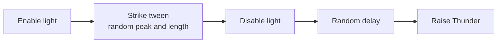
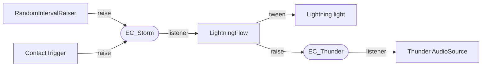

# Supplementary - Timed Light Effects

Lab: [Lab S - A Lightning Storm](../labs/lab_s_lightning_storm.md)

## Key Concepts

1. **Only a Realtime light fully answers a script** - once lighting is generated, a Baked light is in the lightmap, and a Mixed light changes only its direct part.
2. **A light that is not needed should be disabled** - a disabled light is not drawn, and it casts no shadows.
3. **A light change is a tween** - `DOIntensity` and `DOColor` give a timed change to one property, with an ease and a lifetime.
4. **A curve can be an ease or an envelope** - an ease ends at 1 and moves a value from start to end; an envelope ends at 0 and returns it to where it started.
5. **The shape of an effect is data** - draw the strike in a `TweenProfile` curve, and change it with no code.
6. **A value drawn when the sequence is built never changes** - `Random.Range` inside a `Func<Tween>` is drawn each time the step runs.
7. **A strike is a flow** - flash, wait, thunder is a short sequence of steps, built with `FlowBuilder`.
8. **Channels start effects** - the scheduler, a trigger volume and a cutscene raise the same channel, and none of them knows about lights.
9. **Decide what happens to a request during an effect** - here a strike that is running ignores new requests, which `FlowBehaviour.Play` already does.
10. **Build it from what you have** - every class in this note is either in `Assets/GD/Common` or a short subclass of something that is.

---

## 1. Framing Question

Your game has a night scene in a storm. Every few seconds, lightning lights the whole scene for a moment, with hard shadows from a new direction, and thunder follows after a delay that depends on how far away the strike was. No two strikes should look the same. A trigger volume near the house should also be able to start a strike on cue. You already have tweens (Note 11), event channels (Note 04) and flows (Note 15). Can you build the storm from those, with no new system?

Think about a storm in a game you have played. What did the lightning do to the scene apart from making it brighter?

---

## 2. What You Will Learn

| Skill | You can... |
|:------|:-----------|
| Choose a light mode | State which light modes respond to runtime changes, and set one up for an effect |
| Measure an idle light | Compare a disabled light with one at intensity 0 in the `Stats` panel |
| Shape a light change | Draw an envelope curve in a `TweenProfile`, and explain how it differs from an ease |
| Add variability | Draw random values each time a flow step runs, and show with the debugger that they change |
| Sequence an effect | Build a strike, a delay and a thunder cue as a `FlowBehaviour` |
| Trigger an effect | Start the same effect from a random schedule and from any `UnityEvent`, through one channel |

---

## 3. Why This Matters

A change in light is one of the cheapest ways to give a scene life and to tell the player something. Lightning makes a storm feel dangerous, a flickering corridor light warns of a power failure, and a room that dims when an alarm starts tells the player that the rules have changed. In *Five Nights at Freddy's*, the lights going out when the power runs out is usually the moment the player loses.

These effects are also easy to get wrong. A light that snaps on and off at the same brightness every few seconds reads as a bug, not as weather. Thunder that always arrives 1.5 seconds after the flash soon sounds like a loop. A light whose mode is Baked does nothing at all when a script changes it.

The GCA rewards **Systems Integration** and **Technical Craft**. This note shows both: a storm built entirely by connecting systems you already have, then refined with timing, shape and variation, not new code. It assumes Notes 04, 11 and 15, and uses `FlowBehaviour`, `FlowBuilder`, `TweenProfile`, `VoidEventChannel`, `VoidEventChannelListener` and `ContactTrigger` from `Assets/GD/Common`.

---

## 4. Core Ideas

### 4.1 What Can Change at Runtime: Light Modes

Every `Light` has a **light mode**, set in its `Mode` property. The mode decides when Unity calculates the light's effect on the scene:

| Mode | Calculated | Changing `intensity`, `color` or `enabled` from a script |
|:--|:--|:--|
| **Realtime** | Every frame | Changes all of the light's effect at once |
| **Mixed** | Direct light every frame; bounced (indirect) light in advance | Changes the direct light only. The bounced light stays as it was baked, so the scene no longer matches |
| **Baked** | In advance, into **lightmaps** (textures that store light) | No effect once lighting is generated, because the light is no longer used at runtime |

A **lightmap** is a texture that stores how lit each surface is. Baking takes time in the Editor, but costs very little in the game, which is why static lights such as a sun or ceiling lamps are often Baked or Mixed.

The rule for this note is simple: **a light that a script changes is Realtime**. If a scene already uses a Mixed or Baked light in the place where you want a flash, add a separate Realtime light for the effect, rather than changing the mode of the existing one.

### 4.2 What a Changing Light Costs

A Realtime light is drawn every frame. A Realtime light that casts shadows also renders the scene again into a **shadow map**, from its own point of view, and the `Shadow casters` figure in the `Stats` panel (Note 01, Section 4.5) counts the objects drawn into it. A point light that casts shadows needs six views, one per direction, so it costs more than a spot light.

Lightning is idle almost all the time. Two ways to keep an idle effect light dark:

| Approach | Effect |
|:--|:--|
| Set `intensity` to 0 | The light is still in the scene. Whether it is still drawn, and still renders its shadows, depends on the render pipeline |
| Set `enabled` to false | The light is not drawn and casts no shadows |

Do not take this table on trust: Lab S, Step 3 measures both in the `Stats` panel. The flow in this note disables the light between strikes, and enables it only for the strike itself.

### 4.3 A Light Change Is a Tween

Changing `intensity` from 0 to 6 over a third of a second is a timed transition, exactly like the door in Note 11. DOTween has shortcuts for `Light`:

```csharp
lightningLight.DOIntensity(6f, 0.3f);
lightningLight.DOColor(new Color(0.8f, 0.85f, 1f), 0.3f);
```

The rules from Note 11, Section 4.8 apply unchanged: a tween records its start value when it is created, `SetLink(gameObject)` stops it when its object is destroyed, and two tweens on the same property fight each other.

### 4.4 Curve as Ease, Curve as Envelope

Note 11 used an `AnimationCurve` as an **ease**: a curve from (0, 0) to (1, 1) that shapes how a value moves from its start to its end. DOTween applies any curve the same way:

```text
value = start + (end - start) * curve(t)
```

Nothing forces the curve to end at 1. A curve that ends at 0 returns the value to where it started, and can rise and fall as many times as you like on the way. That is an **envelope**: the shape of an effect over time, with its height scaled by `end - start`.

| Curve | Ends at | Use | Example |
|:--|:--|:--|:--|
| Ease | 1 | Move from one value to another, and stay there | A door opens; a light fades to dark in a power cut |
| Envelope | 0 | A change that comes back by itself | Lightning, a muzzle flash, a pulse |

A lightning strike is a bright first flash, a dip, and one or two smaller re-strikes before it dies away. As an envelope:

| Time | Value | Meaning |
|:--|:--|:--|
| 0.00 | 0 | Dark |
| 0.04 | 1 | First flash, at full peak |
| 0.12 | 0.15 | Almost dark |
| 0.20 | 0.7 | First re-strike |
| 0.30 | 0.05 | Almost dark |
| 0.42 | 0.45 | Weaker re-strike |
| 1.00 | 0 | Dark again |

`TweenProfile` from `Assets/GD/Common` already holds a curve: tick `Use Curve` and draw this envelope in it. The strike's shape is then an asset, so a designer can make a distant storm with one soft flash and a close one with three sharp re-strikes, with no code. This is the same idea as in Note 11, Section 4.10: timing belongs in data.

### 4.5 Values Fixed at Build Time, Values Drawn at Run Time

`FlowBehaviour` builds its sequence once, in `Awake` (Note 15). Any value written directly into a builder call is worked out then, and never again:

```csharp
return new FlowBuilder()
    // Drawn once, in Awake. Every strike waits the same time.
    .Wait(Random.Range(minThunderDelay, maxThunderDelay))
    .Raise(thunder)
    .Build();
```

The code says "random", and the first strike is random, but every later strike repeats it. Note 15, Section 4.5 gave the fix: a **lambda** (or a method passed as a `Func<Tween>`) runs when its step starts, not when the sequence is built. `TweenStep` calls it on every run:

```csharp
private Tween CreateThunderDelay()
{
    float seconds = Random.Range(minThunderDelay, maxThunderDelay);

    // A tween that does nothing but take time. false: use scaled time.
    return DOVirtual.DelayedCall(seconds, null, false).SetLink(gameObject);
}
```

```csharp
.Tween(CreateThunderDelay)
```

The same applies to the strike itself: draw the peak intensity and the duration inside the method that creates the tween. This needs no new step type, because the builder already accepts a `Func<Tween>`.

`DOVirtual.DelayedCall` uses unscaled time unless its third argument is `false`. With the default, thunder would still arrive while the game is paused (Note 15, Section 4.4).

### 4.6 A Strike Is a Flow

A strike is a short sequence: enable the light, flash it, disable it, wait for the sound to travel, then thunder. Light travels almost instantly, and sound takes about 3 seconds per kilometre, so the delay before the thunder tells the player how close the storm is.



Each box is a builder call you already know: `Do`, `Tween`, `Do`, `Tween` and `Raise`. The flow raises a `VoidEventChannel` for the thunder rather than holding an `AudioSource`, because Note 15, Section 4.8 applies: the flow describes what happens, and a listener decides how it sounds. With the `AudioManager` from Note 13, the listener calls `AudioCuePlayer.Play`, and a thunder cue gives a random clip, volume and pitch for free.

### 4.7 Starting a Strike

`LightningFlow` has a public `Play` method, inherited from `FlowBehaviour`. A `VoidEventChannelListener` on a `Storm` channel calls it. Anything can then start a strike by raising `Storm`:

| Raiser | When |
|:--|:--|
| A component that raises the channel after a random wait, again and again | Background weather |
| `ContactTrigger.onEnter`, calling `VoidEventChannel.Raise` | The player reaches the window, and lightning reveals the garden |
| A cutscene flow, with `.Raise(storm)` | A scripted beat |
| The channel's `Raise` context menu | Testing in Play mode |

None of these knows that lightning is a light. The random scheduler is a small coroutine (Note 15, Section 4.1), and it raises any `VoidEventChannel`, so the same component can drive birdsong or creaking timbers.

**Requests during a strike.** A second request can arrive while a strike is still running. There are three reasonable rules: ignore it, restart, or queue it. This note ignores it, because `FlowBehaviour.Play` already does: it returns at once while the flow is running, as long as `Play Once` is not ticked. For background weather, a dropped strike is invisible. If a scripted strike must always happen, raise it at a moment when no background strike can be running, or give the script its own flow on its own light.

### 4.8 One Flow per Light, or One Flow for Many

A strike may need more than one light: a sky light outside, and a light through a window inside. Two options:

| Option | Result |
|:--|:--|
| A `LightningFlow` on each light, both listening to `Storm` | Each draws its own random values, so the two lights flash out of step |
| One flow that tweens both lights from the same random values | The lights stay in step, but the flow now knows about both |

Neither is wrong. The first suits lights that are far apart, such as strikes over separate hills. The second suits one strike seen through two openings. The Challenge exercise asks you to choose for a given scene and justify the choice.

---

## 5. Worked Example

The demo is a small night scene: a ground plane, a house and a few posts, a dim blue `Moon` light, and a `Lightning` light that is disabled and Realtime. The design decision comes first: the strike is a flow, its shape and timing are data, and channels connect it to whatever starts it and whatever plays the thunder. The code is in `Assets/GD/Demos/S - Timed Light Effects/Scripts`, in namespace `GD.Demos`.

### Stage 1 - Initial Implementation: One Coroutine

The simplest storm is one coroutine that loops forever:

```csharp
using System.Collections;
using UnityEngine;

/// <summary>
/// First version of the storm: one coroutine that flashes a light and plays thunder.
/// It works, but every strike is identical and nothing else can start one.
/// </summary>
public class StormCoroutine : MonoBehaviour
{
    [SerializeField] private Light lightningLight;
    [SerializeField] private AudioSource thunder;

    [SerializeField, Min(0f)] private float flashIntensity = 6f;
    [SerializeField, Min(0f)] private float flashSeconds = 0.15f;
    [SerializeField, Min(0f)] private float thunderDelay = 1.5f;
    [SerializeField, Min(0.1f)] private float secondsBetweenStrikes = 8f;

    private IEnumerator Start()
    {
        while (true)
        {
            yield return new WaitForSeconds(secondsBetweenStrikes);

            lightningLight.intensity = flashIntensity;
            lightningLight.enabled = true;
            yield return new WaitForSeconds(flashSeconds);
            lightningLight.enabled = false;

            yield return new WaitForSeconds(thunderDelay);
            thunder.Play();
        }
    }
}
```

`Start` can be a coroutine: Unity starts it for you when it returns `IEnumerator`. It works, and for a game jam it would be enough.

### Stage 2 - Problem: Every Strike Is the Same

Play the scene for a minute and the problems are obvious:

- **It looks mechanical.** The light snaps on and off with no shape, at the same brightness, every 8 seconds exactly.
- **It sounds like a loop.** The thunder always arrives 1.5 seconds after the flash.
- **Nothing else can start a strike.** A trigger volume or a cutscene cannot ask for one, because the timing and the strike are in one method.
- **It is wired to one sound.** The coroutine holds an `AudioSource`, so it cannot use a pooled `AudioManager` or a cue with variation.

Adding random ranges to this coroutine would fix the first two, but not the last two.

### Stage 3 - Change: A Flow, a Profile and Channels

The strike becomes a `FlowBehaviour`, as in Note 15. Its shape is a `TweenProfile` with the envelope from Section 4.4, its ranges are Inspector fields, and the random values are drawn inside the methods passed to `Tween`, so they change on every strike:

```csharp
using DG.Tweening;
using GD.Flow;
using GD.Types;
using UnityEngine;

/// <summary>
/// One lightning strike: the light flashes in the shape of an envelope curve, then
/// thunder is raised after a random delay. Each strike draws new random values.
/// </summary>
/// <remarks>
/// Start it with a VoidEventChannelListener that calls Play. Play is ignored while a
/// strike is running, so requests that arrive during a strike are dropped.
/// </remarks>
public class LightningFlow : FlowBehaviour
{
    [Header("Light")]
    [SerializeField, Tooltip("A Realtime light used only for lightning, disabled and at intensity 0. The flow enables it for each strike")]
    private Light lightningLight;

    [SerializeField, Tooltip("Use Curve ticked, with a curve that starts and ends at 0. The curve is the shape of the strike")]
    private TweenProfile strikeEnvelope;

    [SerializeField, Min(0f), Tooltip("Lowest peak intensity of a strike")]
    private float minPeakIntensity = 3f;

    [SerializeField, Min(0f), Tooltip("Highest peak intensity of a strike")]
    private float maxPeakIntensity = 8f;

    [SerializeField, Min(0.05f), Tooltip("Shortest strike, in seconds")]
    private float minStrikeSeconds = 0.3f;

    [SerializeField, Min(0.05f), Tooltip("Longest strike, in seconds")]
    private float maxStrikeSeconds = 0.8f;

    [Header("Thunder")]
    [SerializeField, Tooltip("Raised when the thunder should be heard. A listener plays the sound")]
    private VoidEventChannel thunder;

    [SerializeField, Min(0f), Tooltip("Shortest delay before the thunder. Sound takes about 3 seconds to travel 1 kilometre")]
    private float minThunderDelay = 0.5f;

    [SerializeField, Min(0f), Tooltip("Longest delay before the thunder")]
    private float maxThunderDelay = 3f;

    protected override FlowSequence BuildSequence()
    {
        return new FlowBuilder()
            .Do(() => lightningLight.enabled = true)
            .Tween(CreateStrike)
            .Do(() => lightningLight.enabled = false)
            .Tween(CreateThunderDelay)
            .Raise(thunder)
            .Build();
    }

    // Called when its step starts, not when the sequence is built,
    // so each strike draws new random values.
    private Tween CreateStrike()
    {
        float peak = Random.Range(minPeakIntensity, maxPeakIntensity);
        float seconds = Random.Range(minStrikeSeconds, maxStrikeSeconds);

        // The curve ends at 0, so the intensity ends where it started.
        return strikeEnvelope.Apply(lightningLight.DOIntensity(peak, seconds))
            .SetLink(gameObject);
    }

    private Tween CreateThunderDelay()
    {
        float seconds = Random.Range(minThunderDelay, maxThunderDelay);

        // false: scaled time, so the delay stops while the game is paused.
        return DOVirtual.DelayedCall(seconds, null, false)
            .SetLink(gameObject);
    }
}
```

The points to notice:

- **`.Tween(CreateStrike)`** passes the method itself, not its result, so `TweenStep` calls it each time the step starts. Writing `.Tween(CreateStrike())` would not compile, because a `Tween` is not a `Func<Tween>`, and that is a useful guard.
- **The light starts at intensity 0.** `DOIntensity` records the current intensity as its start, and the envelope returns to it, so every strike starts and ends dark.
- **`enabled`, not `SetActive`.** The flow switches the `Light` component, so a listener or another component on the same object keeps working.
- **No light code in the flow's caller, and no audio code in the flow.** The flow raises `thunder`; a listener plays it.

The random schedule is a short coroutine that raises any `VoidEventChannel`:

```csharp
using System.Collections;
using GD.Types;
using UnityEngine;

/// <summary>
/// Raises a channel again and again while enabled, after a new random wait each time.
/// It knows nothing about what responds, so it can drive a storm, birdsong or a creaking ship.
/// </summary>
public class RandomIntervalRaiser : MonoBehaviour
{
    [SerializeField, Tooltip("The channel to raise")]
    private VoidEventChannel channel;

    [SerializeField, Min(0.1f), Tooltip("Shortest wait between raises, in seconds")]
    private float minSeconds = 4f;

    [SerializeField, Min(0.1f), Tooltip("Longest wait between raises, in seconds")]
    private float maxSeconds = 12f;

    private void OnEnable()
    {
        if (channel == null)
        {
            Debug.LogError($"{name}: assign the channel to raise.", this);
            enabled = false;
            return;
        }

        StartCoroutine(RaiseRepeatedly());
    }

    private void OnDisable()
    {
        // Disabling a component does not stop its coroutines, so stop them here.
        StopAllCoroutines();
    }

    private IEnumerator RaiseRepeatedly()
    {
        while (true)
        {
            yield return new WaitForSeconds(Random.Range(minSeconds, maxSeconds));
            channel.Raise();
        }
    }
}
```

The scene is wired in the Inspector, with no references between the parts:

| Object | Components | Settings |
|:--|:--|:--|
| `Lightning` | `Light` | `Mode` Realtime, `Intensity` 0, `Shadow Type` Hard, component disabled |
| `Storm` | `Lightning Flow`, `Void Event Channel Listener`, `Random Interval Raiser` | Flow: `Lightning`, `TP_LightningEnvelope`, `EC_Thunder`. Listener: `EC_Storm`, calls `LightningFlow.Play`. Raiser: `EC_Storm`, 4 to 12 seconds |
| `Thunder` | `AudioSource`, `Void Event Channel Listener` | Listener: `EC_Thunder`, calls `AudioSource.Play` |



### Stage 4 - Improvement: A Different Storm with No New Code

With the strike described as data and connected by channels, most changes are now edits to assets and Inspector values:

| Change | How |
|:--|:--|
| A distant storm | A second envelope with one soft flash; a longer thunder delay; lower peaks |
| A storm that builds | A flow from Note 15 that shortens the raiser's range over time, or two raisers enabled in turn |
| Lightning when the player reaches the window | `ContactTrigger` on a volume by the window, with `On Enter` calling `EC_Storm.Raise` |
| A camera shake on close strikes | A `CameraEffectPlayer` (Note 14) with a second listener on `EC_Storm` |
| Variation in the thunder sound | A thunder `AudioCue` played through the `AudioManager` (Note 13) instead of a plain `AudioSource` |

<!-- IMAGE: gif "../images/notes/s_lightning_three_strikes.gif" - Game view of the storm scene during Play, about 12 seconds: three strikes with visibly different brightness and re-strike patterns, each throwing hard shadows from the posts and house. -->

| Problem | Solution | Benefit |
|:--|:--|:--|
| One coroutine flashed one light the same way on a fixed timer, and played one sound | A flow with an envelope `TweenProfile`, random values drawn each run, and channels for start and thunder | Every strike differs; anything can start one; sound and light are independent; the storm is tuned in the Inspector |

---

## 6. Common Pitfalls

| Symptom | Cause | Fix |
|:--------|:------|:----|
| The light does not change when the flow runs, after lighting is generated | The light's `Mode` is Baked | Use a separate Realtime light for the effect |
| The flash lights objects but the bounced light in the room stays dark | The light is Mixed, so only its direct part changes | Use a Realtime light, or accept the mismatch for a very short flash |
| The flash is hard to see | Ambient light or the skybox already lights the scene brightly | Lower the environment lighting in `Window > Rendering > Lighting`, `Environment` |
| Every strike has the same thunder delay | The delay was written into `.Wait(Random.Range(...))`, so it was drawn once in `Awake` | Draw it in a method passed to `.Tween`, as in Section 4.5 |
| The light stays bright to the end, then snaps off | `Use Curve` is not ticked, so the profile's ease ends at the peak | Tick `Use Curve` |
| Each strike starts brighter than the last | The curve does not end at 0, so the intensity ends above where it started | Set the last key to (1, 0) |
| Peaks are brighter than the maximum | Curve values above 1 multiply the peak | Keep the envelope between 0 and 1 |
| Thunder arrives while the game is paused | `DOVirtual.DelayedCall` uses unscaled time by default | Pass `false` as its third argument |
| Some scheduled strikes never happen | A request arrived while a strike was running, and `Play` ignored it | Expected with this rule. Make the shortest wait longer than a strike plus its thunder delay |
| Nothing happens, and the strike never runs again | `Play Once` is ticked on the flow | Untick it |
| The listener on the light stops working | The flow, or your code, called `SetActive(false)` on the light's object | Switch `Light.enabled` instead |

---

## 7. Software Development Parallels

- **Composition over new systems.** The storm adds no new framework: a flow, a profile and two channels, each from an earlier note. The open/closed principle is at work in `FlowBuilder`: it accepts a `Func<Tween>`, so new behaviour arrives without editing the builder.
- **Deferred execution.** A `Func<Tween>` describes work to do later, and runs it each time it is asked. The same idea appears as lazy evaluation in LINQ, where `Where` and `Select` do nothing until the result is read, and as factory methods that create a fresh object on each call.
- **Data-driven design.** The envelope is the effect's shape stored as data. Audio uses the same idea with an ADSR envelope (attack, decay, sustain, release) on a synthesiser note.
- **Observer.** `EC_Storm` and `EC_Thunder` separate what starts a strike, the strike, and what it sounds like.
- **Commercial games.** In *Resident Evil* (2002), lightning through the mansion's windows lights a dark corridor for a moment, so the player briefly sees what is in it. In *Five Nights at Freddy's*, the office lights failing when the power runs out usually means the player is about to lose.

---

## 8. Exercises

### Core - A Power Cut

Write a `PowerCutFlow` for a room with one Realtime light. When `EC_PowerFailed` is raised, the light flickers using an envelope profile, then fades to 0 using a second profile with an ease, not an envelope. The flow then waits for `EC_PowerRestored` with `WaitFor`, and fades the light back to its starting intensity.

**Expected result:** raising `EC_PowerFailed` from its context menu flickers then darkens the room, and it stays dark until `EC_PowerRestored` is raised. In 60 to 100 words, explain why the flicker uses an envelope and the fade uses an ease.

### Apply - Strikes from Different Directions

Real lightning comes from a different place each time. Rotate the `Lightning` light to a random direction within a range of yaw angles at the start of each strike, and add a camera impulse from Note 14 that plays only on close strikes, which you define as a thunder delay under 1 second.

**Expected result:** shadows jump to a new direction on each strike, and the camera shakes only on close ones. In 80 to 120 words, explain where you drew the random direction and the thunder delay, and how the camera effect knows that a strike was close without the flow referencing the camera.

### Challenge - Two Lights in Step

Add a point light inside the house, behind a window, that should flash with the sky light. Build both options from Section 4.8: two flows on `EC_Storm`, and one flow that tweens both lights from the same random values. Record a GIF of each with `Tools > GD > Evidence > GIF Capture`.

**Expected result:** two GIFs, and a recommendation for this scene. In 150 to 200 words, justify your choice against coupling and against what the player sees, and state the scene in which you would choose the other option.

---

## 9. Reflective Questions

1. The strike's light mode must be Realtime. Your scene's sun is Mixed for performance. Justify adding a second light for lightning instead of switching the sun to Realtime.
2. `.Wait(Random.Range(0.5f, 3f))` compiles and looks correct. Explain, using when `BuildSequence` runs, why it does not do what it says, and how you would show this to a teammate with the debugger.
3. The strike's shape lives in a `TweenProfile`, not in code. Argue for or against this for a game in which only one programmer will ever touch the lightning.
4. A request during a strike is ignored. Describe a gameplay moment in which that rule is wrong, and the rule you would use instead.
5. The flow raises `EC_Thunder` rather than playing a sound. What does that cost when debugging a missing thunder sound, and what does it protect?

---

## 10. How This Builds

This is supplementary material, outside the weekly sequence, and no other note depends on it.

- **[Lab S - A Lightning Storm](../labs/lab_s_lightning_storm.md)** builds the storm scene, measures the cost of an idle light, and uses the debugger to find a random value that is not random.
- **Note 13 - AudioManager** provides `AudioCue` for thunder with random clips, volume and pitch.
- **Note 14 - CameraManager** provides camera effects for a shake on close strikes.
- **Note 16 - State Machines and the State Pattern** suits weather with states such as calm, building and storm, each enabling a different raiser.
- **Note 17 - Game Conditions and End States** can start the storm when a condition becomes true, such as all generators being off.
- **GCA:** a timed light effect built from existing systems is evidence for **Systems Integration**. A before-and-after recording of the first coroutine and the final strike supports **Technical Craft** and **Iteration & Improvement**.

---

## Glossary

| Term | Definition |
|:-----|:-----------|
| Baked light | A light whose effect is calculated in advance into lightmaps, and not used at runtime |
| Envelope | A curve that starts and ends at 0 and gives the shape of an effect over time, scaled by its peak |
| Light mode | The `Mode` of a `Light`: when its effect is calculated, which decides what a script can change |
| Lightmap | A texture that stores how lit each surface is, created when lighting is generated |
| Mixed light | A light whose direct light is calculated every frame and whose bounced light is baked |
| Realtime light | A light whose effect is calculated every frame, so a script can change all of it |
| Shadow map | A texture rendered from a light's point of view, used to decide which surfaces are in its shadow |
